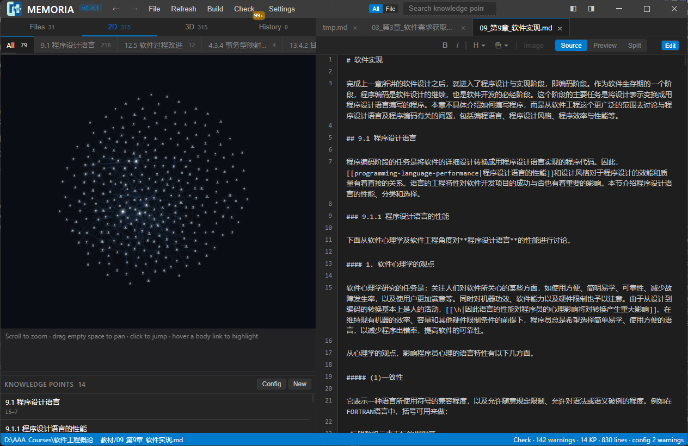
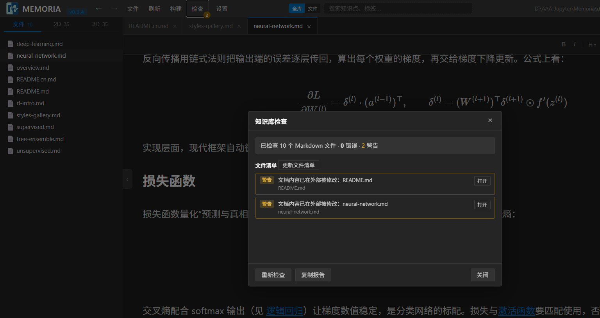
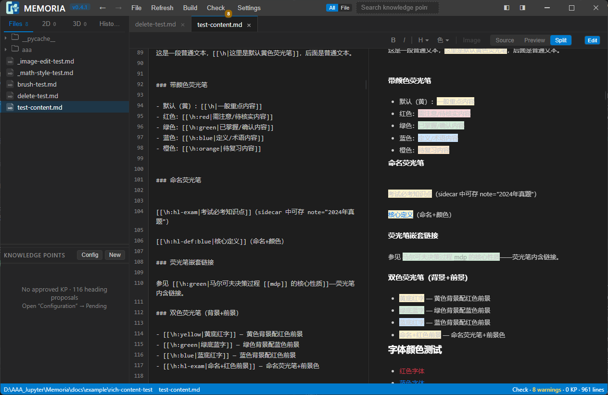
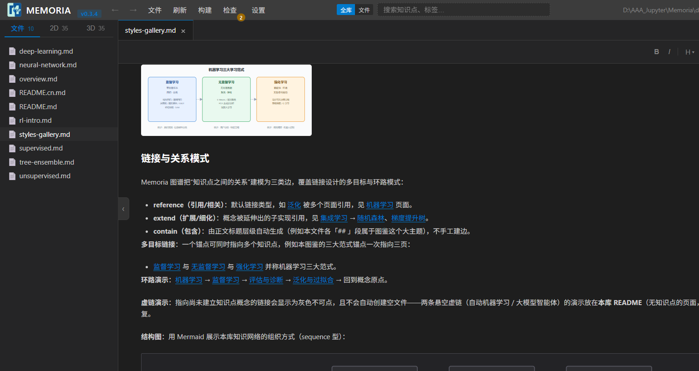
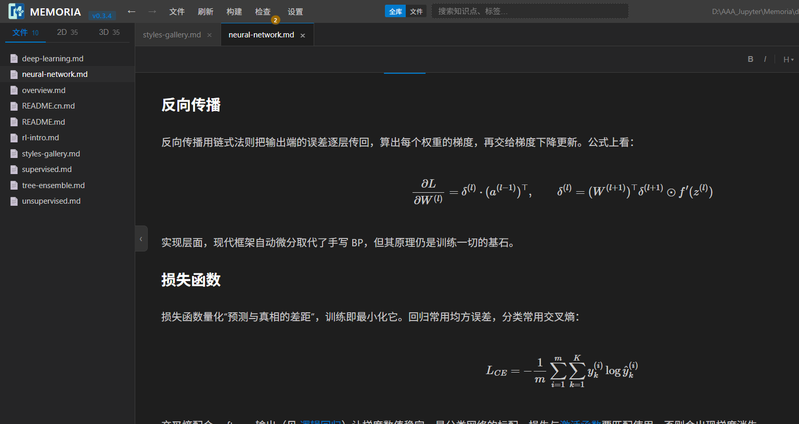
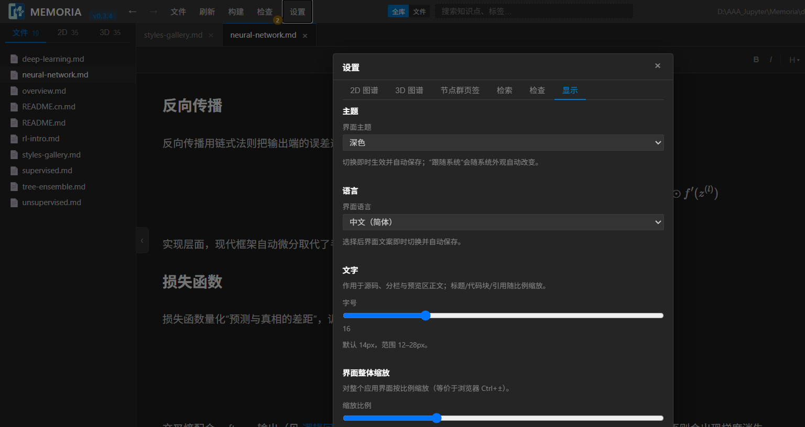
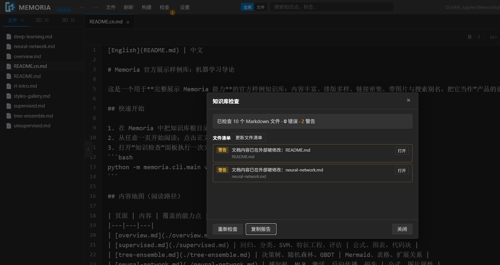
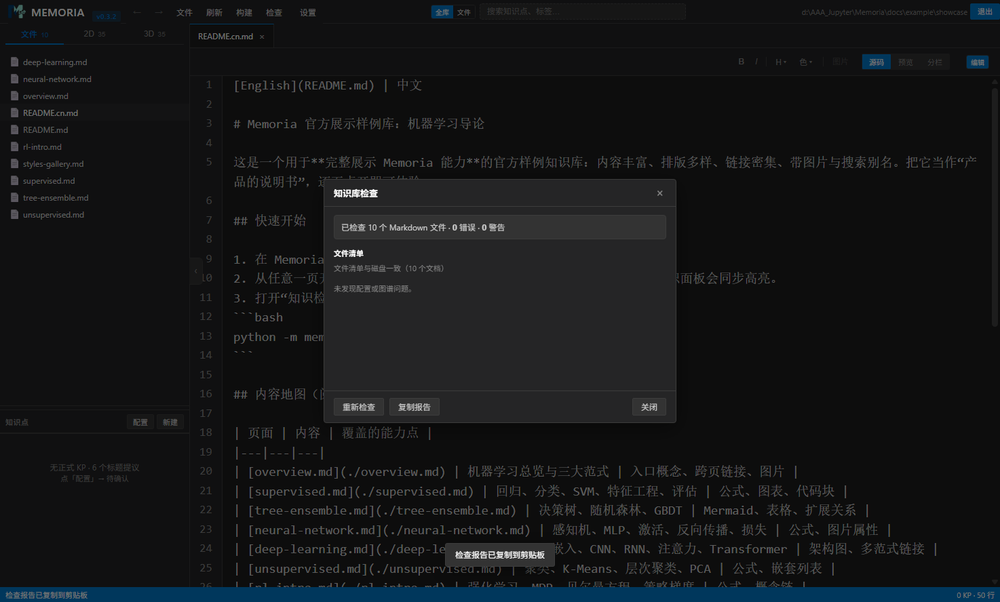

# Memoria — a local-first knowledge IDE where **knowledge points** are the atoms

> **Markdown notes become a knowledge network you can navigate, schedule for review, and let an AI agent
> maintain with you — entirely on your own disk.**

> 中文读者请看 [README.cn.md](README.cn.md)。

[](src/memoria/__version__.py)
[](https://github.com/)
[](LICENSE)
[](https://github.com/)
[](README.cn.md)

**Memoria** is not "another Markdown notes app". It treats **knowledge points (KPs)** — not whole
documents — as the unit of knowledge: links resolve to an **exact snippet range**, the **2D/3D graph is
designed as an index** (design intent, see below), **FSRS spaced repetition is built in**, and an
**AI agent can read and write the knowledge base** through a single, backed-up, auditable and undoable
write path with per-session approval levels.

Everything is plain files on your disk: Markdown bodies plus YAML sidecars. No account, no cloud sync,
no telemetry upload.



---

## Why Memoria

| Conventional note apps | Memoria |
|---|---|
| Documents organized by folders | **Knowledge points** linked at **exact snippet range**, with back/forward navigation |
| The graph is decoration | The graph is **designed as an index** — with an ontology debate (13 rulings) and a **frozen** visualization design (see [design philosophy](#the-graph-is-an-index-not-decoration)) |
| Reviewing means re-reading | **Built-in FSRS** scheduler: due queue, 1–4 grading, per-card state (stability / difficulty / due), append-only attempt log |
| AI is a separate app or a chat sidebar | An **agent inside the app** that can read the KB, audit it, and write through **one plan-based path** — pre-write backup, audit trail, one-step undo, and per-session approval levels (default: routine edits auto, deletions/renames ask once) |
| Fast claims without evidence | Performance is **measured with the repo's own harness** — numbers and methodology are published, including the ones that did not meet their gates |

---

## The graph is an index, not decoration

This is the design philosophy that distinguishes Memoria from "pretty graph" note apps.

- We ran a **knowledge-graph ontology debate** and froze it: **13 rulings**, including the explicit
  statement that **edges currently serve the human-facing graph and write-quality diagnosis — not agent
  reasoning** ([kg-ontology-v0.md](docs/design/kg-ontology-v0.md) — `L13`, `L20`, `L27`, `L28`).
- We then ran a **visualization design review** and froze it as well: node size range, no discrete size
  buckets (continuous mapping), 3D must **not** encode importance with size, label decluttering, layout
  stability commitments — each with a rejected alternative and a falsifier where applicable, plus **two
  explicit human rulings** ([kg-visualization-v0.md](docs/design/kg-visualization-v0.md)).
- **Design intent**: the graph is the kind of stable, typed index an agent framework would need.
  **Roadmap**: making graph topology participate in **agent retrieval** — gated on the project's own rule
  that it must first be shown to change an agent decision
  ([kg-ontology-v0.md §6.2](docs/design/kg-ontology-v0.md)).

> In other words: we know exactly where we are. The graph is designed as an index; it does **not** yet
> feed agent retrieval. We wrote that boundary down ourselves before writing any marketing.

---

## Features

### Knowledge points, snippet-range links, 2D/3D graph

- `[[Some Knowledge Point]]` links weave snippets into a network; clicking jumps to the **exact source
  range** (not just the page), with back/forward history.
- 2D force graph and 3D spatial graph; click a node to jump back to its source; the graph can be rebuilt
  and grouped from the sidebar.
- KP metadata (name, weight, tags) lives in front-matter or sidecars; a KP panel manages points and links
  for the current file.
- Integrity check across the library: dangling links, missing points, graph edge issues — with a copyable
  Markdown report.

### Built-in spaced repetition (FSRS)

- A **deterministic FSRS scheduler** ships with the app (`resources/agent-prompts/fsrs.py`):
  `due` / `init` / `grade`, atomic writes, single writer for scheduling state.
- Review cards can be bound to a **knowledge point and its source file**; the review panel shows the due
  queue and grades answers; answers stay hidden until reveal; attempts are appended to an audit log.
- The agent can help create cards, list what is due, grade, and write feedback — **every write tool goes
  through approval**.

### AI agent + notes in one place

- **Read**: `read_document` (paginated), `kb_overview`, granular read (`outline` / `section` / `snippet`),
  `search_kb`, `validate_kb`.
- **Write**: one plan-based path — a dry-run diff is computed first, then the plan is applied under the
  session's **approval level**: `auto-approval` (default: routine edits auto-apply, deletions/renames ask
  once), `manual-approval` (every write asks), `all-access` (never asks). **Regardless of level**, every
  apply takes a pre-write snapshot, emits audit events, and can be undone in one step; oversized or
  out-of-scope writes are rejected. There is no second write path.
- **MCP**: a minimal MCP server exposes 4 tools (`outline` / `section` / `snippet` / `propose_write`,
  544-token schema) so external MCP clients can read and *propose* edits; MCP writes still require
  approval regardless of the in-app preset.
- **Extensible**: capability plugins, user skills, and extension points — declaration-only, no executable
  code inside plugin directories.

### Rich rendering (Markdown+)

- LaTeX math (MathJax: inline `$...$`, block `$$...$$`), Mermaid diagrams, tables, code blocks, quotes.
- Visual editing: paint highlighters / font colors / bold / italic like a word processor, with source
  write-back.
- Images: local relative paths, remote URLs, or copy-into-library (`.memoria/images`), with lightbox and
  width/alignment controls.

### Bilingual UI, plain data

- Chinese / English UI, switchable at runtime.
- A knowledge base is an ordinary folder: `.md` bodies + a `.memoria/` directory (sidecar YAML, manifest,
  caches, images). Put it in Git, on a NAS, or a sync drive — it moves anywhere.

---

## 30-second quick start

> Requirements: **Windows 10/11 x64** for the desktop app; Python ≥ 3.11 for development.
> The desktop shell is pywebview + WebView2 (built into Windows 10 1803+ / Windows 11).

```powershell
# 1) Install (development mode, includes pytest)
pip install -e ".[dev]"

# 2) Launch the desktop app
python app.py
# or dev mode (DevTools + frameless window)
.\scripts\run_dev.ps1
```

Click **Open Knowledge Base** and pick any folder of Markdown files. To try it immediately, open the
bundled official showcase (Machine Learning intro; 10 content pages / 36 knowledge points, covering
styles, images, links and search aliases):

```text
docs\example\showcase\
```

Prefer a standalone exe? Run `.\packaging\build_release.cmd`; the output is `Package\Memoria.exe`
(or use a released `Memoria-v*-win64.zip`). Extract the **whole** archive to a writable folder first —
never run `Memoria.exe` from inside the zip. If it fails to start, `crash.log` next to the exe has the
details; if Windows blocks the bundled .NET runtime because the files came from the Internet, run
`Get-ChildItem -Recurse | Unblock-File` in the extracted folder and try again.

---

## Design trade-offs (Memoria vs Obsidian)

Both are local-first Markdown tools; they optimize for different things. No marketing hostility here —
just the trade-off, so you can pick the right tool.

| | Memoria | Obsidian |
|---|---|---|
| Center of gravity | **Knowledge points** + built-in learning loop (review scheduling) | **Files + a large plugin ecosystem**; features grown through community plugins |
| Links | KP-level, snippet-range, graph design frozen through a documented design review | Block references + graph view; extensible through plugins |
| Spaced repetition | **Built in** (FSRS, due queue, grading) | Via community plugins |
| AI | **Bundled agent** with approval-gated write path + minimal MCP server | Via community plugins / external tooling |
| Platforms (as of 2026-10) | Windows 10/11 desktop | Windows / macOS / Linux / mobile |

**Pick Memoria if** you are on Windows, want knowledge-point-level structure, a built-in review loop, and
an AI agent that can maintain the same files you edit — with pre-write backups, an audit trail, one-step
undo, and per-session approval levels.
**Pick Obsidian if** you need mobile apps, a huge plugin ecosystem, or cross-platform sync today.

### Who it is not for

- You need **mobile / tablet** clients today.
- You need a **multi-user / cloud sync** service.
- You want hundreds of third-party plugins.
- You need macOS/Linux desktop builds (not released yet).

Writing this list costs us sign-ups; writing a false list would cost you trust.

---

## Screenshots

Workspace: 2D knowledge graph, knowledge-point list on the left, the document editor on the right.


3D knowledge graph: wheel to zoom, drag to rotate, click a node to jump back to its source.



Split view: source on the left, live rendered preview on the right.



Rich preview: tables, wiki links and code blocks in a mixed layout.



Math rendering: LaTeX formulas via MathJax (inline and display).



Display settings and integrity check: adjustable font size / UI scale; one-click structural scan.





Knowledge-base check with a copyable report: the panel summarizes integrity, manifest diff and
graph-edge issues; "Copy report" puts a Markdown report on the clipboard.



---

## Measured performance (published methodology)

We do not do "blazingly fast" adjectives; we publish numbers with the harness that produced them.

| Measurement | Result | Where it was measured |
|---|---|---|
| 5,000-node star graph, full frame | **9108 ms → 41.5 ms** (~212×, ≈23 fps); load **136 s → 0.35 s** | measured at **v0.3.4**; baseline + results in [graph-benchmark.md](docs/design/graph-benchmark.md) and raw artifacts in `scripts/benchmark/graph/results/` |
| Cold start | **15.4 s → 2.4 s (−84%)** | measured at **v0.4.6**; protocol in [benchmark-measurement-protocol.md](docs/design/benchmark-measurement-protocol.md) |

**Honesty notes**: these are historical measurements on specific hardware, not re-run for this README;
the benchmarks themselves record the cases that did **not** meet their gates. If a number matters to you,
re-run the harness — the commands and the raw outputs are in the repository.

---

## Data, privacy and network

- **No account. No cloud sync. No telemetry upload.** Your notes are files; the app is a local desktop app.
- **Network is used only for features you enable or configure**: your LLM provider, optional web
  search/fetch, and an optional update check. There is a single **outbound switch** in Settings —
  when it is off, the app makes **zero** requests (the code documents and tests this).
- The update checker sends only a standard `GET` + `User-Agent` (plus GitHub's required `Accept` header);
  it sends **no local data**, and auto-check can be turned off.
- Release archives, when a `release-manifest.json` is present, are checked for **structure and integrity**
  (per-file sha256/bytes, zip entry set, path traversal, trailing data). This is an integrity check,
  **not a digital signature** — we do not claim one.
- Local interaction counters (graph style / node-size changes) are stored locally under `%LOCALAPPDATA%`
  and never uploaded.

---

## Docs and AI collaboration

Memoria's documentation is built for humans **and** agents to work on together: every top-level directory
has a README, and contract-level rules live under `docs/conventions/`.

- Onboarding for contributors/agents: [AGENT.md](AGENT.md)
- Docs hub: [docs/README.md](docs/README.md)
- Architecture: [docs/reference/architecture.md](docs/reference/architecture.md), [docs/design/system-design.md](docs/design/system-design.md)
- Design milestone: [docs/design/designV0.md](docs/design/designV0.md)
- Version single source of truth: [src/memoria/\_\_version\_\_.py](src/memoria/__version__.py) (currently **0.4.9**)
- **Every capability claim in this README is registered with its evidence** — see
  [docs/marketing/claims.md](docs/marketing/claims.md). If you find an unregistered capability claim in
  our README, that is a bug: please report it.

---

## Tech stack

| Layer | Technology | Notes |
|---|---|---|
| Language | **Python ≥ 3.11** | `src` layout, `pyproject.toml` |
| Desktop shell | **pywebview** (WebView2/Chromium); PyQt6 optional | switch via `MEMORIA_SHELL` |
| Web service | **bottle** | static assets + `/files/` routing + `/rpc` bridge |
| Frontend | **vanilla JS (zero framework)** | `parser.js` → AST → renderer; edits write back to source |
| Rendering | marked / **MathJax** / **mermaid** / **three.js** | Markdown, math, diagrams, 3D graph |
| Storage | file system + YAML | sidecar `.memoria.yaml` + `.memoria/` (index, images, manifest) |
| Retrieval | jieba lexical; optional sentence-transformers / pypinyin | semantic retrieval is an optional dependency |
| Tests | **pytest** — `pytest -q tests` → **1,600+ passing** (point-in-time 1,624 on 2026-10-26) | `node --check` + i18n self-test for the frontend |

---

## Roadmap

- **Graph-aware agent retrieval** — let the agent's search/read path use graph topology. Gated by our own
  frozen rule: it must first be shown to change an agent decision (A/B against a no-graph baseline).
- **Richer semantic search** — better local embeddings / rerank while staying offline-by-default.
- **Additional desktop targets and platforms** — macOS/Linux are not released yet.
- Everything above is a plan, not a claim: see [claims.md §2](docs/marketing/claims.md) for the
  implemented/design-intent/roadmap distinction.

---

## License

[MIT](LICENSE) © 2026 FreshTim
