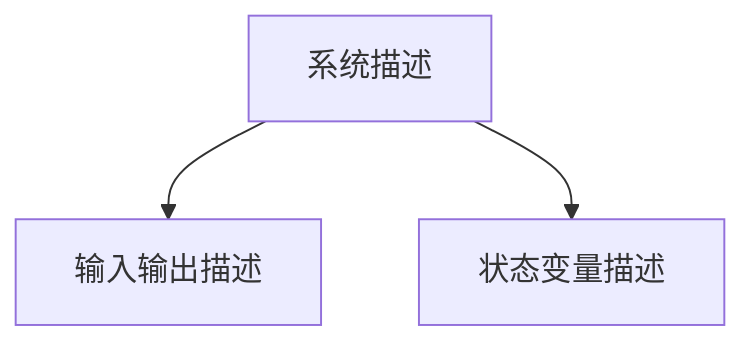
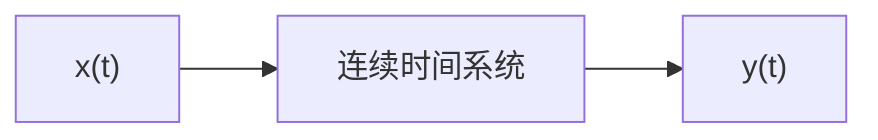
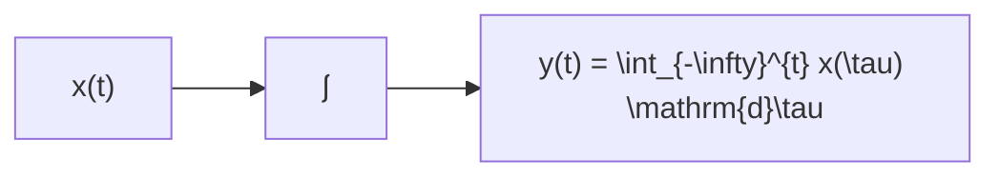
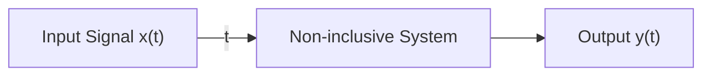

## 信号的定义

(1)数学表达式——函数

广义：x(t)、x[k]

具体： ${ \boldsymbol x } ( t ) { = } \sin ( t )$ 、 $\mathbf { \boldsymbol { x } } [ k ] { = } \mathbf { 0 } . 5 ^ { k }$

本课中“信号”与“函数”混用

---

## 信号的分类

确定信号与随机信号

连续时间信号与离散时间信号

周期信号与非周期信号

能量信号与功率信号

---

# 1. 确定信号与随机信号

➢ 确定信号：信号在定义域上的每一点都有确定值。


| t | x(t) |
| --- | --- |
| -3 | 0 |
| -2 | 0 |
| -1 | 0 |
| 0 | 1 |
| 1 | 0 |
| 2 | 0 |
| 3 | 0 |

---

# 1. 确定信号与随机信号

# ➢ 随机信号：不满足确定信号定义的信号。

随机信号是指在任意时刻的取值具有不确定性，无法用确定性的时间函数精确描述，其未来值不能完全预测，只能通过概率统计特性来表征用的信号。


| Time | Value |
| --- | --- |
| 0.00 | ~0.1 |
| 0.05 | ~0.2 |
| 0.10 | ~0.1 |
| 0.15 | ~0.3 |
| 0.20 | ~0.2 |
| 0.25 | ~0.1 |
| 0.30 | ~0.2 |
| 0.35 | ~0.1 |
| 0.40 | ~0.1 |

语音信号


随机信号的一个样本
噪声信号

---

# 2. 连续时间信号与离散时间信号

连续时间信号：信号的定义域为连续区间，通常以 $x(t)$ 表示， $t\in \mathbf{R}$


| t | x(t) |
| --- | --- |
| 0 | 0 |
| ~0.1 | 110 |
| ~0.2 | 0 |
| ~0.3 | -110 |
| ~0.4 | 0 |
| ~0. |

定义域为连续区间


允许在其定义域上存在有限个间断点。

---

## 2. 连续时间信号与离散时间信号

离散时间信号：信号的定义域为一些离散点通常以x[k]表示,k∈I。


定义域为离散点


定义域为离散点

(画波形图时，纵轴也可以省略)

---

## 2. 连续时间信号与离散时间信号

## 离散时间信号：信号的定义域为一些离散点。


居民消费价格指数


成绩分布

上证指数


北京市常住人口

---

# 2. 连续时间信号与离散时间信号

两者关系


---

## 2. 连续时间信号与离散时间信号

## 模拟信号和数字信号

·模拟信号：幅度连续的连续时间信号（连续信号）。

·数字信号：幅度离散的离散时间信号（离散信号）。


模拟信号


离散信号


数字信号
✓严谨来说：离散信号的幅度可以是连续也可以是离散的。
✓很多经典教材中，为了强调“数字化”的关键步骤，经常把“离散时间信号”这个术语特指为“尚未量化的采样信号”，而把“数字信号”单独拎出来作为量化后的产物。

---

# 3. 周期信号与非周期信号

连续时间周期信号： $\forall t\in \mathbb{R}$ ，存在正数 $T$ ，使得

$x(t + T) = x(t)$ 成立, 则 $x(t) = x(t)) = 1$ ，满足上述条件的最小正数 $T$ ，称为信号的基本周期。

➢离散时间周期信号： $\forall k\in I$ ，存在正整数N，使得

$x[k+N]=x[k]$ 成立，则 $x[k]$ 为周期信号。

---

# 3. 周期信号与非周期信号


H34560 128Hz
H34570 256Hz
H34580 512Hz
H34590 1024Hz
H34600 2048Hz

测听力音叉


| Segment | Waveform Description |
| --- | --- |
| 1 | Periodic wave with peak at 1 and trough at -1 |
| 2 | Periodic wave with peak at 1 and trough at -1 |
| 3 | Periodic wave with peak at 1 and trough at -1 |
| 4 | Periodic wave with peak at 1 and trough at -1 |
| 5 | Periodic wave with peak at 1 and trough at -1 |

音叉发出信号对应波形

---

# 3. 周期信号与非周期信号

例1：判断正弦信号 $x(t) = \sin (\omega_0t)$ 是否是周期信号。

解：因为 $x(t + T) = \sin \omega_0(t + T) = \sin (\omega_0t + \omega_0T)$

要使其为周期信号，必须有


ω₀ T = m2π, m = 整数
T = m(2π/ω₀), m = 整数

连续正弦信号是周期信号

因此， $\sin(\omega_{0}t)$ 是周期为 $2\pi/|\omega_{0}|$ 的周期信号。

---

# 3. 周期信号与非周期信号

例2：判断离散正弦信号 $x[k] = \sin (\Omega_0k)$ 是否是周期信号。

解：因为 $x[k + N] = \sin \Omega_0(k + N) = \sin (\Omega_0k + \Omega_0N$

要使其为周期信号，必须有

$$
\begin{array}{c} \Omega_ {0} N = m 2 \pi , \quad m = \text {整数} \\ \ \ \ \text {有理数，} m \text {和} N \text {为正整数} \end{array}
$$

因此，只有当 $\left|\Omega_{0}\right|/2\pi$ 可表示为有理数时才为周期信号。

---

# 3. 周期信号与非周期信号

判断信号 \( x\left\lbrack  k\right)  = \sin \left( {\frac{\pi k}{3} - \frac{\pi }{4}}\right) 是否为周期。

A. 非周期信号
B. 周期信号，周期为6
C. 周期信号，周期为24

---

## 4. 能量信号与功率信号

能量信号：能量为非零的有限值，平均功率为零。

功率信号：能量为无限值，平均功率为非零有限值。

连续信号

离散信号

能量W

$$
W = \operatorname* { l i m } _ { T \to \infty } \int _ { - T } ^ { T } \left| x ( t ) \right| ^ { 2 } \mathrm { d } t
$$

$$
W = \operatorname* { l i m } _ { N \to \infty } \sum _ { - N } ^ { N } \bigl | x [ k ] \bigr | ^ { 2 }
$$

平均功率P

$$
P = \operatorname* { l i m } _ { T \to \infty } \frac { 1 } { 2 T } { \int _ { - T } ^ { T } \left| x ( t ) \right| ^ { 2 } \mathrm { d } t }
$$

$$
P = \operatorname* { l i m } _ { N \to \infty } \frac { 1 } { 2 N + 1 } \sum _ { - N } ^ { N } \bigl | x [ k ] \bigr | ^ { 2 }
$$

---

# 4. 能量信号与功率信号

能量信号：能量为非零的有限值，平均功率为零。
功率信号：能量为无限值，平均功率为非零有限值。

| 信号类型 | 总能量E | 平均功率P | 典型 |  |
|---|---|---|---|---|
| 能量信号 | 有限 | 等于0 | 等于0 |  |
| 功率信号 | 无穷大 | 等于0 | 等于0 |  |
| 非零能信号 | 无穷大 | 等于0 | 等于0 |  |

划分信号类型的“黄金法则”：

(1) 能量有限 $\Rightarrow$ 功率为 0

(2) 功率有限且不为 $0 \Rightarrow$ 能量无穷

---

## 4. 能量信号与功率信号

例3：计算周期信号 $x ( t ) = A \cos ( \omega _ { \scriptscriptstyle 0 } t )$ 的功率，A为非零的有限值。

解： $A \cos ( \omega _ { 0 } t )$ 是基本周期 $\scriptstyle { T _ { 0 } = 2 \pi / | \omega _ { 0 } | }$ 的周期信号。

由于周期信号有无限个周期，所以能量E为无限值。

其在一个基本周期内的能量为

$$
E _ { 0 } = \int _ { 0 } ^ { T _ { 0 } } \lvert \ x ( t ) \rvert ^ { 2 } \mathrm { d } t = \int _ { 0 } ^ { T _ { 0 } } A ^ { 2 } \cos ^ { 2 } ( \omega _ { 0 } t ) \mathrm { d } t = \frac { A ^ { 2 } T _ { 0 } ^ { \prime } } { 2 }
$$

对于周期信号，其平均功率可由一个周期内的能量除以周期而获得

$$
P = { \frac { { \cal { E } } _ { 0 } } { T _ { 0 } } } = { \frac { A ^ { 2 } } { 2 } }
$$

P是非零的有限值，因此是功率信号，且功率P只与幅值A有关。

---

## 4. 能量信号与功率信号

例4：判断直流信号x(t)=C是能量信号还是功率信号，C为非零的有限常数。

解：直流信号的能量为

$$
E = \operatorname* { l i m } _ { T \to \infty } \int _ { - T } ^ { T } | \ : x ( t ) | ^ { 2 } \mathrm { d } t \ = \operatorname* { l i m } _ { T \to \infty } \int _ { - T } ^ { T } C ^ { 2 } \mathrm { d } t = \infty
$$

平均功率为

$$
P = \operatorname* { l i m } _ { T \to \infty } \frac { 1 } { 2 T } \int _ { - T } ^ { T } \lvert x ( \iota ) \rvert ^ { 2 } \mathrm { d } \iota = \operatorname* { l i m } _ { T \to \infty } \frac { 1 } { 2 T } \int _ { - T } ^ { T } C ^ { 2 } \mathrm { d } \iota \ = \operatorname* { l i m } _ { T \to \infty } \frac { 2 C ^ { 2 } T } { 2 T } \ = C ^ { 2 }
$$

E是无限值，而P是非零的有限值，因此是功率信号。

幅值有限的周期信号和直流信号都是功率信号

---

## 4. 能量信号与功率信号

例5：判断信号 $\cdot x [ k ] { = } 0 . 5 ^ { k }$ 是能量信号还是功率信号。

解：信号的能量为

$$
\_ E = \operatorname* { l i m } _ { \stackrel { N \to \infty } { - } } \sum _ { k = - N } ^ { N } | x [ k ] | ^ { 2 } = \operatorname* { l i m } _ { N \to \infty } \sum _ { k = - N } ^ { N } ( 0 . 5 ) ^ { 2 k } = \infty
$$

信号的平均功率为

$$
P = \operatorname* { l i m } _ { N  \infty } { \frac { 1 } { 2 N + 1 } } \sum _ { k = - N } ^ { N } ( 0 . 5 ) ^ { 2 k } \quad = \infty
$$

E和P都是无限值，因此既不是能量信号也不是功率信号。

注意:一个信号可以既不是能量信号也不是功率信号，但不可能既是能量信号又是功率信号。

---

# 信号的分类小结

$\spadesuit$ 确定信号与随机信号
$\spadesuit$ 连续时间信号与离散时间信号
周期信号与非周期信号
$\spadesuit$ 能量信号与功率信号

---

# 系统的定义与分类

# 目录

√ 系统的定义
√ 实际的系统
√ 系统的描述
√ 系统的分类

---

## 系统的定义

英文中系统(system)一词来源于古代希腊文(systεma)意为由多个部分而组成的整体。

系统论创始人贝塔朗菲定义：系统是相互联系且相互作用的诸元素的综合体。

本课程定义：

系统是指由相互作用和依赖的若干单元组合而成的、具有特定功能的有机整体。

---

# 系统的定义

系统是指由相互作用和依赖的若干单元组成的、具有特定功能的整体。


电视广播通信系统框图

---

# 系统的定义

系统是指由相互作用和依赖的若干单元组成的、具有特定功能的整体。


---

## 实际的系统

## 简单电路系统


分压器


分流器

$$
\nu _ { { \mathrm { R } } 2 } ( t ) = { \frac { R _ { 2 } } { R _ { 1 } + R _ { 2 } } } \mathsf { u } ( t )
$$

---

# 实际的系统

# 简单电路系统

$$
\begin{array}{c} 1 = G \frac {A}{4} \\ 1 2 3 4 | 5 6 7 \dot {1}
$$


u(t)
R
C
v_c(t)

低通滤波器


高通滤波器

---

# 系统的定义与分类

# 目录

√ 系统的定义
√ 实际的系统
√ 系统的描述
√ 系统的分类

---

# 系统的描述

系统描述：建立描述系统基本特性的数学模型




---

# 系统的描述

# 输入输出描述


x(t)
iR(t)
R
iL(t)
L
iC(t)
C
vC(t)
-

RLC并联电路

若输入为 $x(t)$ ，输出为 $v_{\mathrm{C}}(t)$ ，则输入和输出的关系为

$$
\frac {\mathrm{d} v _ {\mathrm{C}} ^ {2} (t)}{\mathrm{d} t ^ {2}} + \frac {v} \frac {\mathrm{d} v _ {\mathrm{C}} ^ {2}}{\mathrm{d} t} + \frac {1}{2} \frac {\mathrm{d} v _ {\mathrm{C}} ^ {2}}{\mathrm{d} t} + \frac {1}{2} \frac {\mathrm{d} v _ {\mathrm{C}} ^ {2}}{\mathrm{d} t} + \frac {1}{2} \frac {\mathrm{d} v _ {\mathrm{C}} ^ {2}}{\mathrm{d} t} + \frac {1}{2} v _ {\mathrm{C}} ^ {2} + \frac {1}{2} v _ {\mathrm{C}} ^ {2} + \frac {1}{2} v _ {\mathrm{C}} ^ {2} + \frac {1}{2} v _ {\mathrm{C}}{\mathrm{d} t ^ {2}} + \frac {1}{R C} \frac {\mathrm{d} v _ {\mathrm{C}} ^ {2}} + \frac {1}{2} v _ {\mathrm{C}} ^ {2} + \frac {1}{2} v _ {\mathrm{C}} ^ {2} + \frac {1}{2} v _ {\mathrm{C}} ^ {2} + \frac {1}{2} v _ {\mathrm{C}} ^ {2} + \frac {1}{2} v _ {\mathrm{C}} ^ {2} + \frac {1}{2} v _ {\mathrm{C}} ^ {2} + \frac {2}{2} v _ {\mathrm{C}} ^ {2} + \frac {2}{2} v _ {\mathrm{C}} ^ {2} + \frac {2}{2} v _ {\mathrm{C}} ^ {2} + \frac {2}{2} v _ {\mathrm{C}} ^ {2} + \frac {2}{2} v _ {\mathrm{C}} ^ {2} + \frac {2}{2} v ^ {2} + \frac {2}{2} v ^ {2} + \mathrm{d} t
$$

输入输出描述

$N$ 阶系统的数学模型： $N$ 阶微分方程或 $N$ 阶差分方程

---

## 系统的描述

## >状态变量描述

若输入为x(t)，计算 $i _ { \mathrm { R } } ( i ) , \ i _ { \mathrm { C } } ( i )$ ，则可先建立状态变量 $i _ { \mathrm { L } } ( t )$ $\nu _ { \mathrm { C } } ( \iota )$ 与输 $\lambda x ( t )$ 的关系


RLC并联屯路

$$
\begin{array} { l } { \displaystyle \frac { \mathrm { d } i _ { \mathrm { t } } ( t ) } { \mathrm { d } t } = \frac { 1 } { L } \nu _ { \mathrm { c } } ( t ) } \\ { \displaystyle \frac { \mathrm { d } \nu _ { \mathrm { c } } ( t ) } { \mathrm { d } t } = - \frac { 1 } { C } i _ { \mathrm { t . } } ( t ) - \frac { 1 } { R C } \nu _ { \mathrm { c } } ( t ) + \frac { 1 } { C } x ( t ) } \end{array}
$$

状态变量描述

N阶系统的数学模型：N个一阶微分方程组或一阶差分方程组

---

# 系统的分类

1. 连续时间系统与离散时间系统
2. 线性系统与非线性系统
3. 非时变系统 与时变系统
4. 因果系统与非因果系统
5. 稳定系统与非稳定系统

---

# 1. 连续时间系统与离散时间系统

连续时间系统:

系统的输入激励与输出响应均为连续时间信号




离散时间系统：

系统的输入激励与输出响应均为离散时间信号


```mermaid
graph LR
  A["&quot;x[k"]"] --> B["离散时间系统"]
  B --> C["&quot;y[k"]"]
```

---

离散时间系统

## 1. 连续时间系统与离散时间系统

## 连续时间系统和离散时间系统举例


由电阻、电容、电感、二极管、三极管、模拟放大器等模拟器件组成的电路


由门电路、触发器、计数器、寄存器、编码器、译码器、比较器等数字元件组成的电路

---

# 1. 连续时间系统与离散时间系统

连续时间系统和离散时间系统举例


Portrait of a man with a beard, holding a small object (no visible text or symbols)

大哥大


Abstract wave pattern with wavy lines, no text or symbols present

1G通信系统（连续时间系统）

---

## 2. 线性系统与非线性系统

线性系统：具有线性特性的系统。

均匀性也称为齐次性、比例性；
叠加性也称为可加性。

均匀特性与叠加特性

均匀特性可表示为

若 $x ( t ) \longrightarrow y ( t ) ,$ 则Kx(t) Ky(t)叠加特性可表示为


若

则

$$
\begin{array} { r l } { ~ } & { { } \xrightarrow { ~ x _ { 1 } ( t ) \longrightarrow y _ { 1 } ( t ) , ~ x _ { 2 } ( t ) \longrightarrow y _ { 2 } ( t ) } } \\ { ~ } & { { } \xrightarrow { ~ x _ { 1 } ( t ) + x _ { 2 } ( t ) ~ } \xrightarrow { ~ y _ { 1 } ( t ) + y _ { 2 } ( t ) ~ } } \end{array}
$$

---

# 2. 线性系统与非线性系统

线性系统：具有线性特性的系统。

均匀特性与叠加特性

同时具有均匀特性与叠加特性才称线性特性，可表示为

若 $x_{1}(t)\longrightarrow y_{1}(t),x_{2}(t)\longrightarrow y_{2}(t)$

则 $\alpha x_{1}(t)+\beta x_{2}(t)\longrightarrow\alpha y_{1}(t)+\beta y_{2}(t)$

其中 $\alpha$ 、 $\beta$ 为任意常数

---

# 2. 线性系统与非线性系统

# 线性系统举例


R₁-1Ω
x(t)
R₂-2Ω
vᵣ₂(t)

分压器

$$
\begin{array}{r l} v _ {R 2} (t) & = \frac {R _ {1}} \frac {R _ {2}}{R _ {1} + R _ {2}} \quad \text {或} \quad x (t) \\ & = \frac {2}{3} x (t) \end{array}
$$

当 $x(t) = 3\mathrm{V}$

$$
v _ {\mathrm{R2}} (t) = \frac {2}{3} x (t) = 2 \mathrm{V}
$$

当 $x(t)=2\times3V$ 时，

$$
v _ {\mathrm{R2}} (t) = \frac {2}{3} x (t) = 2 \times 2
$$

满足均匀性

---

## 2. 线性系统与非线性系统

## 线性系统举例


分压器

$$
\begin{array} { c } { \displaystyle \nu _ { \mathrm { R 2 } } ( t ) = \frac { R _ { 2 } } { R _ { 1 } + R _ { 2 } } x ( t ) } \\ { \displaystyle = \frac { 2 } { 3 } x ( t ) } \end{array}
$$

若 $x ( t ) = x _ { 1 } ( t ) + x _ { 2 } ( t )$

当 $x _ { 1 } ( t )$ 单独作用时，

$$
\nu _ { { \scriptscriptstyle \mathrm { R } } 2 _ { - } 1 } ( t ) = \frac { 2 } { 3 } x _ { 1 } ( t )
$$

当 $x _ { 2 } ( t )$ 单独作用时，

$$
\nu _ { { \scriptscriptstyle \mathrm { R } } 2 _ { - } 2 } ( t ) = \frac { 2 } { 3 } x _ { 2 } ( t )
$$

当两者共同作用时，


$$
\nu _ { { \scriptscriptstyle \mathrm { R } } 2 } ( t ) = \frac { 2 } { 3 } x ( t ) = \frac { 2 } { 3 } [ x _ { \scriptscriptstyle \perp } ( t ) + x _ { 2 } ( t ) ] = \nu _ { { \scriptscriptstyle \mathrm { R } } 2 } { \bf \nabla } _ { 1 } ( t ) + \nu _ { { \scriptscriptstyle \mathrm { R } } 2 } { \bf \nabla } _ { 2 } ( t )
$$

---

# 2. 线性系统与非线性系统

线性系统举例

电流作为输入，电压作为输出，系统是否线性？


Electrical circuit diagram with resistor R, with input voltage v_R(t) and output voltage v_R(t) labeled.


Electrical circuit diagram with capacitor with input and output terminals labeled.


Electrical circuit diagram with inductance and voltage, with input voltage and output voltage labeled.

对于电容C，设 $i_{\mathrm{C}}(t) = \alpha i_{\mathrm{C1}}(t) + \beta i_{\mathrm{C}$

则 $v_{\mathrm{C}}(t) = \frac{1}{C}\int_{-\infty}^{t}[\alpha i_{\mathrm{C1}}(\tau$ )
则 $v_{\mathrm{C}}(t) = \frac{1}{C}\int_{-\infty}^{t}\left[\alpha i_{\mathrm{C1}}(\tau)\right]d\tau$

---

## 2. 线性系统与非线性系统

线性系统举例

电流作为输入，电压作为输出，系统是否线性？


$$
\nu _ { \mathrm { { R } } } ( \iota ) = R i _ { \mathrm { { R } } } ( \iota )
$$

$$
\nu _ { \mathrm { c } } ( t ) = \frac { 1 } { C } \int _ { - \infty } ^ { t } i _ { \mathrm { c } } ( \tau ) \mathrm { d } \tau
$$

$$
\nu _ { \mathrm { l . } } ( t ) = L \frac { \mathrm { d } i _ { \mathrm { L } } ( t ) } { \mathrm { d } t }
$$

对于电感L，设 $i _ { \mathrm { L } } ( t ) = \alpha i _ { \mathrm { L 1 } } ( t ) + \beta i _ { \mathrm { L 2 } } ( t )$

则 $\nu _ { \mathrm { { l . } } } ( t ) = L \frac { \mathrm { d } [ \alpha i _ { \mathrm { L 1 } } ( t ) + \beta i _ { \mathrm { L 2 } } ( t ) ] } { \mathrm { d } t } = \alpha L \frac { \mathrm { d } i _ { \mathrm { L 1 } } ( t ) } { \mathrm { d } t } + \beta L \frac { \mathrm { d } i _ { \mathrm { L 2 } } ( t ) } { \mathrm { d } t }$ $= \alpha \nu _ { { \scriptscriptstyle 1 , 1 } } ( \iota ) + \beta \nu _ { { \scriptscriptstyle 1 , 2 } } ( \iota )$ 具有线性特性

电感是线性元件

---

# 2. 线性系统与非线性系统

# 线性系统举例

由线性元件（电阻、电容、电感等）、独立源构成的电路都是线性系统。


线性系统

---

## 2. 线性系统与非线性系统

[例1]已知连续时间系统的输入x(t)与输出y(t)约束关系如下，试判断这些系统是否为线性系统。(1) $y ( t ) = \frac { 3 x ( t ) + 4 } { 0 }$ (2) $y ( t ) = 4 x ^ { 2 } ( t )$ (3) $y ( t ) = 2 { \frac { \mathrm { d } x ( t ) } { \mathrm { d } t } } + x ( t )$ 解：(1)考察均匀特性$x ( t )  y ( t ) = 3 x ( t ) + 4$ $\frac { K x ( t ) } { \cosh } \to \frac { 3 K x ( t ) + 4 } { 6 } \neq \underline { { K y ( t ) } }$ 不满足均匀特性，该系统为非线性系统。

---

# 2. 线性系统与非线性系统

[例1]已知连续时间系统的输入 $x(t)$ 与输出 $y(t)$ 约束关系如下，试判断这些系统是否为线性系统。

$$
(1) y (t) = 3 x (t) + 4 \quad (2) y (t) = 4 x ^ {2} (t) \quad (3) y (t) = 2 \frac {\mathrm{d} x (t(1) (2) (3) (4) (5) (6) (7) (8) (9) (10) (11) (12) (13) (14) (15) (16) (17) (18) (19) (20) (21) (22) (23) (24) (25) (26) (27) (28) (29) (30) (31) (32) (33) (t) + x (t)) + (t) + x (t))}
$$

解：(2) 考察均匀特性

$$
x (t) \rightarrow y (t) = 4 x ^ {2} (t)
$$

$$
K x (t) \rightarrow 4 [ K x (t) ] ^ {2} = K ^ {2} [ 4 x ^ {2} (t) ] \neq K y (t)
$$

---

# 此题未设置答案，请点击右侧设置按钮

判断系统 $y(t) = 2x(t) \frac{\mathrm{d}x(t)}{\mathrm{d}t} + 3x(t)$ 是否为线性系统。

A 非线性系统

B 线性系统

√ 输入信号之间相乘、平方、开方，可直接判定非线性；
√ 微分、积分、常数倍才是线性运算。

# 线性系统需要同时满足两个条件

1. 可加性： $x_{1}(t) \rightarrow y_{1}(t)$ ， $x_{2}(t) \rightarrow y_{2}(t)$ ，则输入 $x_{1} + x_{2}$ ，输出必须为 $y_{1} + y_{2}$

2. 齐次性（比例性）：输入 $a x(t)$ ，输出必须

提交

---

# 2. 线性系统与非线性系统

[例2] 判断积分器、延时器是否为线性系统。


```mermaid
graph LR
  A["x(t)"] --> B["∫"]
  B --> C["y(t) = ∫_{-t}^t x(τ) dτ"]
  C --> D["&quot;x[k"]"]
  D --> E["D"]
  E --> F["&quot;y[k"] = x["k-1"]"]
```

解：设 $x[k] = \alpha x_{1}[k] + \beta x_{2}[k]$

则 $y[k] = x[k - 1] = \alpha x_{1}[k - 1] + \beta x_{2}[k - 1]$

$$
= \alpha y _ {1} [ k ] + \beta y _ {2} [ k ]
$$

延时器是线性系统

---

# 2. 线性系统与非线性系统

# 含有初始状态的线性系统

可分解性：系统输出可以分解为零输入响应和零状态响应之和

零输入响应 \( y\_{zi}(t) \) ：仅由初始状态 \( \{y(0)\} \) 产生的响应， \( y\_{zi}(t)=0

零输入响应线性：对所有的初始状态 $\{y(0)\}$ 线性

零状态响应线性：对输入信号 $\{x(t)\}$ 线性

---

# 2. 线性系统与非线性系统

[例1] 试判断下列系统是否为线性系统。

$$
(1) y (t) = 4 y (0) x (t) + 2 x (t) \quad (2) y (t) = 4 y (0) + 2 \sin (t) \frac {\mathrm{d} x (t)}{\mathrm{d} t}
$$

解：(1) 考察可分解性

$$
y _ {\mathrm{zi}} (t) = y (t) \big | _ {x (t) = 0} = 0
$$

$$
y (t) \neq y _ {z i} (t) + y _ {z s} (t)
$$

$$
y _ {z s} (t) = y (t) \big | _ {y (0) 0} = 2 x (t)
$$

由于不满足可分解性，该系统为非线性系统。

---

# 2. 线性系统与非线性系统

[例1] 试判断下列系统是否为线性系统。

(1) $y(t) = 4y(0)x(t) + 2x(t)$ (2) $y(t) = 4y(0) + 2\sin (t)$

解：(2) 考察可分解性

$$
y _ {\mathrm{zi}} (t) = y (t) \big | _ {x (t) = 0} = 4 y (0)
$$

$$
y _ {z s} (t) = y (t) \big | _ {y (0) = 0} = 2 \sin (t) \frac {\mathrm{d}} \frac {\mathrm{d} x}{\mathrm{d} t} \tag {2}
$$

---

# 2. 线性系统与非线性系统

[例1] 试判断下列系统是否为线性系统。

(1) $y(t) = 4y(0)x(t) + 2x(t)$ (2) $y(t) = 4y(0) + 2\sin(t)\frac{\mathrm{d}x(t)}{\mathrm{d}t}$

解：(2) 考察零输入响应对初始状态 $y(0)$ 是否具有线性特性

$$
y _ {z i} (t) = 4 y (0) \quad \text {线性}
$$

考察零状态响应对输入 $x(t)$ 是否具有线性特性

$$
y _ {z s} (t) = 2 \sin (t) \frac {\mathrm{d} x (t)}{\mathrm{d} t} \quad \text {线性}
$$

该系统为线性系统。

---

# 3. 非时变系统与时变系统

非时变系统：在零状态条件下，系统的输出响应与输入激励的关系不随输入激励作用于系统的起点而改变。

非时变的连续时间系统表示为

Zero State(零状态)

若 $x(t)\longrightarrow y_{\mathrm{ZS}}(t)$

则 $x(t - t_0)\longrightarrow y_{\mathrm{zs}}(t - t_0)$

非时变的离散时间系统表示为

若 $x[k] \longrightarrow y_{\mathrm{zs}}[k]$

则 $x[k - n]\longrightarrow y_{\mathrm{zs}}[k - n]$

---

# 2. 线性系统与非线性系统

# 含有初始状态的线性系统

可分解性：系统输出可以分解为零输入响应和零状态响应之和

零输入响应 $y_{zi}(t)$ ：仅由初始状态 $\{y(0)\}$ 产生的响应， $y_{zi}(t)$ 零状态响应 $y_{zs}(t)$ ：仅由输入信号 $(x,t)$ 产生的响应， $y_{zs}(t)=y_{ts}(t)$ 产生的响应， $y_{zs}(t)=y_{ts}(t)$ 产生的响应。

---

# 3. 非时变系统与时变系统

非时变系统：在零状态条件下，若系统的输入发生延时，输出时，输出时，输出时，输出时，输出时，输出时，输出时，输出时，输出时，输出时，输出时，输出时，输出时，输出时，输出时，输出时，输出时，输出时，输出时，输出时，输出时，输出时，输出时，输出时，输出时，输出时，输出时，输出时，输出时，输出时，输出时，输出时，输出时，输出时间


```mermaid
x(t)
1
0
2
t
x(t-t0)
1
0
2 t
t
非时变系统
y(t)
1
0
2 t
t
y(t-t0)
1
0
2 t
t
非时变系统图示
```

时变系统：不满足非时变特性的系统。

---

# 3. 非时变系统与时变系统

➢ 非时变系统举例 输入为电流，输出为电压


Electrical circuit diagram with resistor and voltage source


Electrical circuit diagram with capacitor and voltage source labels


Electrical circuit diagram with inductor and voltage source

对于电阻R，若 $x(t)=i_{\mathrm{R}}(t-t_{0})$

则 $y(t) = Ri_{\mathrm{R}}(t - t_0)$

$$
= v _ {\mathrm{R}} (t - t _ {0})
$$

具有非时变特性

若电阻值为 $R(t)$ ，随时间变化，即 $\nu_{\mathrm{R}}(t) = R(t)i_{\mathrm{R}}(t)$ 则当电流为 $x(t)$ 时，

$$
y (t) = R (t) i _ {\mathrm{R}} (t - t _ {0}) \neq v _ {\mathrm{R}} (t - t _ {0})
$$

不具有非时变特性

---

# 3. 非时变系统与时变系统

非时变系统举例

元件参数不随时间变化的RLC电路均为非时变系统


---

# 3. 非时变系统与时变系统


系统的输入输出关系如下，试判断是否为非时变系统。

(1) \( y(t)=2x(t) \)  (2) \( y(t)=\cos(t)x(t) \)  (3) \( y[k]=k

解：

(1) $x(t - t_0)\longrightarrow y_1(t) = 2x(t - t_0) = y(t - t_0)$ �变系统
(2) $x(t - t_0)\longrightarrow y_1(t) = \cos (t)\cdot x(t - t_0)\neq y(t - t_t$ 时变系统
(3) $x[k - k_0]\longrightarrow y_1[k] = k\cdot x[k - k_0]\neq y[k - k_0]$ 时变系统

一般，若在系统的输入输出关系中，除输入和输出外，还含有与t、k有关的变量，则为时变系统。

---

# 3. 非时变系统与时变系统

[例4] 试判断积分器、延时器是否为非时变系统。




解: 设 $x_{1}(t)=x(t-t_{0})$


则 $y_{1}(t) = \int_{-\infty}^{t}x(\tau -t_{0})\mathrm{d}\tau$

$$
= \int_ {- \infty} ^ {t - t _ {0}} x (\tau) \mathrm{d} \tau = y (t - t _ {0})
$$


```mermaid
graph LR
  A["&quot;x[k"]]"] --> B["D"]
  B --> C["&quot;y[k"]=x["k-1"]"]
```

设 $x_{1}[k] = x[k - k_{0}]$


则 $y_{1}[k] = x[k - k_{0} - 1]$

$$
= y [ k - k _ {0} ]
$$

积分器、延时器是非时变系统

---

# 4. 因果系统与非因果系统

非因果系统：不具有因果特性的系统称为非因果系统。




非因果系统示意图

---

