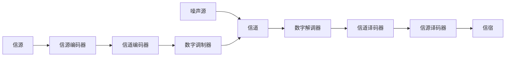

## 第1章 绪论

本章简要介绍通信技术发展的历史和现状,分析通信系统特别是数字通信系统的基本组成和特点,介绍数字通信系统的有关术语、主要性能指标和度量参数,使读者对通信系统的概貌有一个基本了解。

## 1.1 近代与现代通信技术的发展历史和现状

通信 交流是人类的一项基本活动。交流的目的，主要是交换信息。所谓通信，就是传递信息。通信系统的任务，就是要克服各种障碍，实现信息高效、准确的传递。

广义的通信系统可以包括各种实时和非实时的、各种载体和方式的系统。由古到今，传统意义上的通信，如古代的烽火狼烟、近代的莫尔斯电报、现代的宽带数字无线通信和计算机网络等，都是为了克服距离上的障碍，实现信息的传送。其他方式，如古代的甲骨文、结绳记事、竹简到普通的书籍等，可以认为是一种克服时间上的障碍，实现信息传递和传承的一种方式。而现代的各种记录系统，如磁带、磁盘（硬盘）、光盘等各种存储媒介，信息的记录和读出过程，都与传统意义上的通信系统的发送和接收过程非常相似，本质上也是一种通信系统。现在人们日常所称的通信或通信系统，一般都是指利用电信号和光信号来传递信息的电通信、光通信或电光混合的狭义通信系统。本书所介绍的范围和内容，属于狭义通信系统。

近代与现代通信技术的发展历史 近代与现代通信技术的历史，是一部伴随着整个社会的科学与工业技术的进步而同步发展的历史，其主要代表人物和重要里程碑事件包括[1][2][3]：

1837 年莫尔斯（S. Morse）发明了有线电报，这是最早的电信号通信，是一种利用点和划的序列组合来对符号进行编码以传送信息的方式，这种标志着近代通信开端的早期通信系统是一种数字通信系统。  
● 1864 年，麦克斯韦（Maxwell）提出了电磁辐射方程组，即麦克斯韦方程组，预言了电磁波的存在；1887 年赫兹（Hertz）的实验验证了电磁波的存在。麦克斯韦开创性的工作奠定了整个近代和现代无线通信的理论基础。  
● 1876 年贝尔（A. G. Bell）利用电磁感应原理发明了电话机，通过电信号实现了声音的传递；1892 年史瑞乔（A. Strowger）发明了自动电话交换机。  
● 1896 年马可尼（Marconi）发明了无线电报，并于 1901 年实现了无线电报的越洋传输，开创了近代无线通信的先河。  
● 1918 年出现了调幅无线广播（Amplitude Modulation，AM），标志着通信的应用开始广泛地进入人们家庭的日常生活。  
● 1924 年奈奎斯特（Nyquist）提出了抽样定理，奈奎斯特还确定了在给定带宽的信道上，可获得的无符号间干扰的最大码元传输速率，这些都是现代数字通信领域的开创性工作。  
● 1933 年阿姆斯特朗（E. H. Armstrong）发明了有更好抗干扰能力的调频无线广播（Frequency Modulation，FM）。  
● 1937 年瑞维斯（A. H. Reeves）发明了脉冲编码调制（Pulse Code Modulation，PCM），脉冲编码调制和奈奎斯特抽样定理是数字通信系统时分复用技术的基础。

● 1938 年开通了电视广播，电视可视为一种包含声音与图像的早期多媒体通信系统。  
● 1942 年维纳（N. Wiener）提出了加性噪声环境下最佳线性滤波的方法，首先开始从均方误差最小这一意义上来研究噪声中的信号最佳提取问题。

● 1946 年第一台数字电子计算机诞生，计算机的发明是现代信息社会得以构建的最重要基础之一。

1948 年香农（C. E. Shannon）创立信息论，建立了信息传输的数学基础，香农的信道容量定理指出了在高斯加性噪声信道条件下通信系统可能获得的最大传输能力，是通信系统研究和设计的基本指导理论；同年，贝尔实验室的三名科学家巴丁（Bardeen）、布拉顿（Brattain）和肖克利（Shockley）发明了晶体管。

● 1958 年发射第一颗通信卫星，实现了洲际无线通信。

● 1960 年发明激光，激光可以作为单模光纤实现长距离数据传输的光源。

● 1961 年集成电路出现，集成电路是计算机获得推广应用的基础，也是现代通信，特别是各种便携式移动通信设备得以普及应用的基本条件。

● 1964 年高锟提出以玻璃纤维代替导线，发明了光纤。

● 1969 年分组交换网在美国投入运行，分组交换网的出现是现代电信时代的开始。

1973 年美国人 V. Cerf 和 B. Kahn 发表了有关分组交换通信协议的论文, 以实现数据分组通过网络在端到端的计算机间传输。到 1977 年, 该协议发展演变成当今全球通信和计算机互联互通的标准: TCP/IP 协议。互联网的出现和广泛应用从根本上改变了通信网络单纯通信的概念, 它不仅是通信网, 而且是一个包含众多服务器系统的信息网。互联网的应用是人类进入信息社会的标志之一。

\- 20世纪90年代光纤通信技术开始获得广泛应用,这是有线通信系统领域的一次重要革命,光纤通信从根本上改变了通信系统的容量。光纤通信使通信系统信道容量的增加较之计算机运算速度的增加快了近一个数量级[4]。单根光纤上的信息传输速率已从百兆比特每秒（ $100 \times 10^{6}$ bps）发展到现在的吉比特每秒（ $10^{9}$ bps），不久的将来将进入太比特每秒（ $10^{12}$ bps）的时代。

无线移动通信一直是人们关注的重点，从 20 世纪 50 年代到 60 年代，以美国电话电报公司（AT&T）贝尔实验室为代表的一批公司，研究发明了蜂窝式的频率重用无线通信系统，使无线系统的频率资源可随蜂窝区域的减小而倍增，为小区制的移动通信的广泛应用奠定了基础。20 世纪 80 年代，第一代基于模拟通信技术的蜂窝移动通信系统开始获得大量应用。

到 90 年代初，模拟移动通信系统逐步被更先进的基于数字通信技术的第二代（2G）蜂窝移动通信系统所代替，数字通信技术的引入，使得频谱效率更高、通信质量更好，同时有更好的安全保密性能。

随着人们对更高速率的数据业务和多媒体通信业务需求的增加, 2G 系统的 9.6\~14.4kbps 传输速率已经不能满足人们的需求, 第三代移动通信系统 (3G) 以其支持移动条件下千比特每秒 ( $10^{3}$ bps)、静止条件下达若干兆比特每秒 ( $10^{6}$ bps) 的传输能力, 使移动通信的性能得到了极大提高。移动通信技术以约每十年一代的速度飞快发展。

伴随着通信信号处理理论的发展和芯片信号处理能力的增强，第四代移动通信系统（4G）或称长期演进（Long Term Evolution，LTE）系统得以采用高频谱效率的正交频分复用技术，使得移动通信空口的峰值传输速率可达几十兆比特每秒，在理想的信道环境下甚至可达几百兆比特每秒。

目前已经开始获得广泛应用的第五代移动通信系统（5G）进一步综合了现有的各种先进技术，如大规模天线系统及动态波束赋形技术、高密度微小区部署及高能效技术、异构网技术、海量的机器类接入通信技术等。不久的将来，移动通信系统将进入万物互联和区域内吉比特每秒（ $10^{9}\mathrm{bps}$ ）的容量时代。此外，5G所提升的不仅是通信系统容量和接入能力，而且包括大数据的能力和人工智能的能力。从某种意义上，如果说4G改变的是生活，5G改变的则是社会。

当前人们正开始展望有关第六代移动通信系统（6G）的愿景，一般认为6G有两大标志：一是星地融合移动通信，实现全域覆盖；二是建立以用户为中心的弹性可定制网络架构，可应对未来的各种需求挑战。主要的技术引擎包括：利用更大维度的天线，提升6G频谱利用率和系统容量；设计新型多址接入方式，应对海量接入与星地融合的挑战；通信与感知融合，以支撑实现万物智联；新型编码技术，可灵活解决6G信令及多样化业务的不同需求；构建无线智能和自智网络，应对复杂的运维挑战；频谱智能感知与共享，解决资源稀缺与利用率低的矛盾。

纵观通信技术的发展历史，近代物理学的成就奠定了通信技术的基础，而通信技术的发展则综合体现了工业技术各方面的进步。现代通信技术还在继续向前发展，技术的进步需要基础理论的支撑，这些基础理论就包括本书将要介绍的数字通信的基本原理和方法。

## 1.2 数字通信系统的基本组成

典型数字通信系统的基本组成如图 1.2.1 所示。它由发送端的信源、信源编码器、信道编码器、数字调制器、受噪声干扰的信道、接收端的数字解调器、信道译码器、信源译码器和信宿等组成。

信源：信源输出的是待传输的消息，消息的形式可以是模拟信号，如音频信号、视频信号或由其他传感器获得的信号；也可以是数字信号，如各种数据、文件或已转变成数字信号形式的图像、语音、视频或其他信号。

信源编码器：信源编码器完成模拟信号到数字信号的转化，将模拟信号转变成数字信号。根

flowchart

图1.2.1 数字通信系统模型

据不同的应用要求，信源编码器还可以完成包括对信源产生的信号做进一步的数据压缩等信号处理功能。通过压缩可以去除数据中的冗余成分，或将人耳或人眼不能分辨（或对某些应用来说不需要分辨）的语音或图像中的细节部分加以省略，达到提升传输效率的目的。

信道编码器：
信道编码器可以是一个根据信道传输状况加入的选项，对于具有非理想特性、有较大噪声或存在其他干扰影响的信道，可以通过信道编码器，对待传输的数据进行某种编码处理，加入可实现检错或纠错的辅助信息，使接收端能够在一定范围内检测出或纠正传输过程中因各种原因导致的错误。

数字调制器：
数字调制器的主要功能是将数字序列变换成某种信号形式，以适合在特定的信道中传输。对于基带传输系统，数字序列被映射成某种基带波形信号；对于通带传输系统，数字序列被映射成特定频段上的通带信号。在无线通信系统中，在对信号调制时一般还同时包含频谱搬移操作，使其适合在天线上发送和接收。对于光纤传输系统，数字序列则被调制成某种形式的光信号在光纤中传输。

信道：
信道是传送信号的物理媒质。有线信道可以是铜缆、光纤等；无线信道可以是大气、水或太空的自由空间等。信号的强度一般会因传输距离增大时能量的扩散而衰减，也会因为信号经传播环境的反射和折射导致的多径效应产生复杂的随机变化。在一个通信传输系统中，各个环节都可能引入噪声，在对通信系统进行理论分析时，为简化起见，通常将噪声的影响集中在信道中体现。

##### ***接收端的数字解调器、信道译码器、信源译码器完成与发送端的数字调制器、信道编码器和信源编码器相反的功能。***

数字解调器：
数字解调器将不同的信号波形恢复成相应的数字序列。在此过程中一般还会包含对噪声的抑制处理。

信道译码器：
信道译码器利用编码时加入的与数据关联的附加信息，可以检查在传输过程中是否发生误码，并可在译码过程中纠正一定范围内的错误。

信源译码器：
信源译码器负责恢复出编码前的原始信号，其过程通常包括解压缩和数字到模拟信号的转换等操作，重现原来的声音或图像信号。

图 1.2.1 所示是一个最基本的数字通信系统框图。对于一个实际的系统，还可能包括信息的加密/解密、数据序列的复接/分接、信号的扩频/解扩等功能，部分内容将在后续章节中陆续介绍，而有关信息加密/解密的原理和方法，可参阅专门的书籍。一个数据通信网或计算机网络系统通常包括实现信息传输过程中不同控制功能的协议层，如互联网的协议层中就包括应用层、传输层、网络层、链路层和物理层等。本书所涉及的内容是其中的物理层技术，其他层协议和有关技术将在数据传输或计算机网络等课程中介绍。

## 1.3 数字通信的特点

数字通信之所以能够成为当前通信系统的主流技术，主要是其具有如下特点。

（1）**抗噪声和抗干扰能力强** 
数字信号最大的特点是它只有有限种状态，如有限种不同的信号幅度，有限种不同的信号相位，有限种不同的信号频率，或有限种上述信号参量的组合。噪声和干扰对信号的影响只要小于某一门限，就可以无失真地恢复受衰落和噪声污染前的信号。图 1.3.1 是一个二进制数字脉冲信号在传输过程中受到噪声干扰、衰落和信道不完善影响导致畸变后，在接收端无失真地恢复的

例子。在传输过程中受到劣化的信号只要通过某种方式还能被分辨，就能无失真地还原。

又如对于已调制数字信号，虽然一般每个符号的波形是一个连续取值的信号，但有限种符号只对应于有限种不同的波形，反映到描述信号相位和幅度的平面（相幅平面）上，每个符号波形对应于相幅平面上的一个特定点，这些点被称为星座点。每个星座点表示一个具有特定相位和幅度的正弦波信号，该正弦波信号在1个符号周期内持续传输。在数字通信的接收系统中，只需判别收到的信号是有限多种信号波形中的哪一个即可。例如，一个四进制的调相信号可以表示为

$$
s _ {i} (t) = A \cos (\omega_ {\mathrm{c}} t + \phi_ {i}) = I _ {i} \cos \omega_ {\mathrm{c}} t - Q _ {i} \sin \omega_ {\mathrm{c}} t, 0 \leqslant t \leqslant T _ {\mathrm{S}} \tag {1.3.1}
$$

式中， $\phi_{i},i=1,2,3,4$ 表示4个不同的相位。 $I_{i},Q_{i}$ 是相应的4组不同的坐标值， $\omega_{c}$ 是载波信号的角频率。若4个选定的相位 $\phi_{i}$ 分别为 $45^{\circ},135^{\circ},225^{\circ},315^{\circ}$ ，其时域的信号波形图和在相幅平面上表示的星座图分别如图 1.3.2 和图 1.3.3 所示。

图 1.3.3(a) 表示的是理想的接收信号星座图，两位的二进制数据分组 00, 01, 10, 11 分别对应图中相应的 4 个星座点；图 1.3.3(b) 是受噪声干扰的接收信号星座图，表示实际接收到的信号可能会偏离原来理想的信号星座点。显然，只要噪声和干扰的影响所产生的偏差小于理想星座点间最小距离的 1/2，以 4 个象限对信号进行划分，如第一象限上的所有点均对应 “00”，

第二象限上的所有点均对应 “01”，以此类推，只要信号在传输过程中的变化不至于偏离原来星座点所在的象限，就能够正确地解调出原来发送的符号。图 1.3.4 所示为信号 $s_{1}(t)$ 经过信道后，在接收端收到的信号 $r(t)$ ，其中幅度和相位都受到了劣化的影响。但只要 $r(t)$ 仍然处在第一象限，通过判决就可无失真地恢复原来的信号。

  
图 1.3.3 四进制相位调制的信号星座图

（2）**便于提高消息传输效率** 
随着计算机技术的广泛应用，语音和图像等消息序列的压缩编码处理算法获得了极大的发展，对原始的视频图像数据序列进行上百倍的压缩后，仍然能保持良好的画面质量，从而极大地提高了传输效率，而这只有采用数字信号处理方法才能实现。另外，只有对数字信号才能进行时间上的“压缩”，将多个低速的数据流汇接成高速的数据流，实现时分复用。图1.3.5所示的是一个4路信号复接以实现时分复用的例子。

(3)** 便于进行差错控制** 
伴随数字通信的应用发展起来的差错控制编码理论与技术, 能够使传输的数字序列具备一定的检错和纠错能力。视不同的编码方法和效率, 在一定范围内的传输错误可在接收端被检出, 甚至可在检出错误后进一步对其进行纠正, 从而提高传输的可靠性。下面是差错控制编译码过程的一个示例:

原信息码组：100→通过纠错编码生成的码字：110100→传输→因受干扰接收端收到出

错的码字：110000→纠错译码恢复正确的码字：110100→译码后恢复原信息码组：100

表 1.3.1 古典置换密码编译码表

| 密钥 | C | H | I | N | A |
|---|---|---|---|---|---|
|  | D | i | g | i | t |
|  | a | l | C | o | m |
|  | m | u | n | i | c |
|  | a | t | i | o | n |
|  | I | s | F | u | n |

明文：DigitalCommunicationIsFun；密文：tmcnnDamaIilutsgCniFioiou

(4) **便于对信息进行加密处理** 
目前有效的信息加密方法都借助于计算机运算的、基于数学复杂性问题求解的算法，各种信息必须以数字方法表示时才能利用这些方法进行加密。下面是采用最简单的一种古典置换密码编码方法由明文生成密文的一个示例。表1.3.1是一个密钥和编译码规则表，待加密的明文按行写入，填完第一行后依次填第二行、第三行……直到将明文全部填入。然后根据密钥定义的字母顺序按列读出，形成密文。因为密钥中的“A”在英文字母表

中排序最靠前，所以按字母顺序首先输出该列“tmcnn”，密钥中的字母“C”在字母表中排第二，所以输出的第二列为“DamaI”，以此类推，生成密文“tmcnnDamaIilutsgCniFioiou”。在接收端则做相反的处理，假定接收端已知每列的长度，在本例中，对输入的序列以每5个字母为一列划分，根据密钥字母出现的先后顺序对列进行排序，如最先输入的5个字母“tmcnn”构成第一列，则将其置于密钥中字母“A”所对应的列；输入的字母“DamaI”构成第二列，将其置于密钥中字母“C”所对应的列，对后面输入的字母做类似的处理；然后按行读出，就可以译码出相应的明文。从这个简单的示例可见，数字通信系统很容易实现信息的加密。

(5) **便于采用大规模集成电路实现** 
数字集成电路具有集成度高、一致性好和易于实现等特点, 这是数字通信系统得以广泛应用的关键之一。随着微电子、嵌入式系统、信号处理和软件无线电等技术的发展, 各种通信设备, 包括基站和终端设备, 很大程度上就是一个基于大规模集成电路、可编程阵列和数字信号处理器等的由数字运算器件构成的系统。

数字通信也有缺点。
相对于模拟通信系统，数字通信[[\c:yellow|需要较为复杂的符号同步技术]]，一旦发生失步，数字通信系统即使接收了信号，也无法正确地恢复出原来的消息。
另外，当噪声、干扰和信道不完善导致的失真超过信号恢复所需达到的门限时，数字通信系统的[[\c:yellow|传输质量会迅速劣化]]，使接收端得不到任何有用的信息。
随着数字信号处理技术的提高，数字通信系统的上述不足正在不断地得到改善。从目前的发展来看，在模拟通信系统最后的主要应用领域——语音和电视的地面和有线广播，也正在被数字通信系统所取代。

## 1.4 数字通信系统的基本性能指标及其度量参数

衡量数字通信系统的性能有许多不同的指标和参数，本节介绍最基本的性能指标及其度量参数。

比特率 $R_{\mathrm{b}}$ 
比特率是指在单位时间内传输的二进制数据（“0”或“1”）的位数，单位是比特每秒，通常可记为比特/秒、bit/s、b/s或bps（bits per second）。比特率通常又称数据速率，是数字通信系统的主要性能指标之一。比特率有时也称信息速率，但严格来说只有在传输没有错误时，比特率和信息速率才是等价的。

码元速率 $R_{\mathrm{S}}$ 
又称[[\c:yellow|符号速率、波特率,]] 指单位时间内传输的码元的个数, 单位是波特 (Baud)。对于一个 $M$ 进制的传输系统, 一般有 $M$ 种不同的码元符号, 传输时对应 $M$ 种不同的信号波形: $s_{0}(t), s_{1}(t), s_{2}(t), \dots, s_{M-1}(t)$ 。信号波形的区别, 可以是不同的幅度、不同的相位、不同的频率或不同的脉冲宽度等。 $M$ 进制传输系统的每个码元可以携带 [[\h:#252525|$\mathrm{lb} M$]] 比特的信息, 码元速率 $R_{\mathrm{S}}$ 与比特率 $R_{\mathrm{b}}$ 之间的关系如下:

$$
R _ {\mathrm{b}} = R _ {\mathrm{S}} \mathrm{lb} M \tag {1.4.1}
$$

通过后面的内容会了解到, 某个数字通信系统所需的[[\h:#444444|***频带宽度主要由其符号速率 $R_{\mathrm{S}}$ 决定***]]。从式 (1.4.1) 可见, 一个通信系统可以获得的比特率, 与符号速率 $R_{\mathrm{S}}$ 和进制数 $M$ 有关, $M$ 的取值主要受信道的特性、噪声和干扰大小的制约。

【例 1.4.1】已知某一采用六十四进制的数据传输系统，码元速率是 1000 波特，求该系统的比特率。

解：由式（1.4.1），系统的比特率为 $R_{\mathrm{b}} = R_{\mathrm{s}} \mathrm{lb} M = 1000 \times \mathrm{lb} 64 = 6000 \mathrm{bps}$ 。

带宽 $W$ 
信号带宽一般是指该信号所占据的频带宽度，单位为赫兹。由于实际信号都是时间有限的，理论上其所具有的频谱宽度延伸到无限大，但在分析实际问题时往往可根据信号的特点，将信号幅度或功率小于某一定值所对应的频率之外的信号成分忽略不计。对不同类|型的信号或通信系统、不同的通信标准和协议，带宽可能有不同的定义。

带宽利用率 $\eta$ 
在本书中，带宽利用率 $\eta_{b}$ 定义为

$$
\eta_ {\mathrm{b}} = R _ {\mathrm{b}} / W \tag {1.4.2}
$$

带宽利用率的单位为 $b/(s \cdot Hz)$ 。在式（1.4.2）中， $R_{b}$ 为比特率，W为带宽。 $\eta$ 的物理意义是**每秒每赫兹带宽可传输的比特位数**。在同样的传输条件下，频带利用率是衡量不同数字通信系统的重要性能指标。另外，人们也常用带宽利用率来描述每秒每赫兹带宽可传输的符号的个数。
此时，带宽利用率定义为波特率与带宽的比值，即

$$
\eta_ {\mathrm{B}} = R _ {\mathrm{S}} / W \tag {1.4.3}
$$

$\eta_{B}$ 也称[[\c:yellow|符号带宽利用率]]，单位为 Baud/Hz。

信噪比 $SNR$
 在通信系统中，信号和噪声通常都是随机信号，用某一时刻的信号幅度与噪声幅度的比值衡量两者间的关系意义不大。信噪比一般定义为信号的平均功率 $S$ 与噪声的平均功率 $N$ 之比，即

$$
\mathrm{SNR} = S / N \tag {1.4.4}
$$

信噪比$SNR$ 是一个无量纲的标量。
在通信系统中，经常用信噪比的分贝值（dB）来表示信噪比的大小，此时上式变为

$$
(\mathrm{SNR}) _ {\mathrm{dB}} = 1 0 \lg (S / N) \tag {1.4.5}
$$

**比特能量 $E_{\mathrm{b}}$ 与噪声功率谱密度 $N_{0}$ 的比** **$(E_{\mathrm{b}} / N_{0})$** 
比特能量 $E_{\mathrm{b}}$ 是指传输1比特信息所需要的能量，噪声功率谱密度 $N_{0}$ 是指单位频带所含噪声功率的大小。在数字通信系统中，通常SNR越大，传输过程中出现错误的概率越小。在一定的噪声环境下，SNR越大意味着所需的信号功率越大。对于 $M$ 进制的数字通信系统， $M$ 取值不同，每个码元携带的信息量或比特数也不同。简单地根据SNR还不能准确地描述系统的性能，例如，两个具有相同SNR的通信系统，若它们具有相同的误比特率，如果一个是 $M = 4$ ，那么每个符号可携带2比特数据；如果另一个是 $M = 16$ ，那么每个符号可携带4比特数据。显然，后者的传输能力是前者的2倍。换句话说，后者传输1比特数据所需的能量是前者的 $1 / 2$ 。
为了更有效地比较不同数字通信系统的性能，引入**比特能量 $E_{\mathrm{b}}$ 与噪声功率谱密度 $N_{0}$ 的比**这一指标，即 $E_{\mathrm{b}} / N_{0}$ 。在同样的错误概率情况下，有较小 $E_{\mathrm{b}} / N_{0}$ 取值的系统传输每个比特所需的能量较小，因而具有较好的能量利用效率。注意， $E_{\mathrm{b}}$ 的单位为焦耳，噪声功率谱密度 $N_{0}$ 表示单位频带上的平均噪声功率的大小，其单位为瓦/赫兹，或（焦耳/秒）/赫兹，因此比值 $E_{\mathrm{b}} / N_{0}$ 也是无量纲的标量。通过后面的内容将了解到，已知符号速率 $R_{\mathrm{s}}$ 、比特率 $R_{\mathrm{b}}$ ，可以确定 $E_{\mathrm{b}} / N_{0}$ 与SNR之间的关系。

误码率 $P_{s}$ 
误码率是衡量通信系统符号出错概率的一个性能指标，它定义为

$$
P _ {\mathrm{S}} = \frac {\text {出错的码元数}}{\text {发送的总码元数}} \tag {1.4.6}
$$

误比特率 $P_{b}$ 
误比特率是衡量通信系统比特出错概率的一个性能指标，它定义为

$$
P _ {\mathrm{b}} = \frac {\text {出错的比特数}}{\text {发送的总比特数}} \tag {1.4.7}
$$

误比特率是数字通信系统的重要指标之一。误比特率 $P_{\mathrm{b}}$ 与误码率 $P_{\mathrm{s}}$ 之间有一定的关系，视不同的系统而异，具体将在后面的章节中介绍。

## 1.5 本书的内容安排

数字通信原理是一门系统性的理论课程，本书一般不涉及通信系统具体的电路实现，通过对本课程的学习，试图让读者比较完整地掌握数字通信系统的基本概念、原理和方法。数字通信原理涉及的内容很多，在本书中主要包括：通信中常用的信号类型，随机信号与噪声，信道特性，数字基带信号传输，信息论基础，调制解调技术，锁相环与同步理论和技术，信源编码，差错控制编码，扩频通信技术，信道复用与多址技术等。上述的每个专题都有专门的论著对其进行深入的讨论和分析，本课程主要介绍其基础部分，并力图将上述各个方面有机地联系起来，使读者对数字通信系统有一个完整的认识，为进一步深入学习通信系统的专门知识打下基础。

作为一般主要面向大学本科阶段数字通信原理课程的入门教材和参考书，本书努力在保证理论的严谨性的同时，用尽可能浅显的语言、大量的图示和精选的例子，系统地介绍数字通信的基本内容。考虑到现代通信设备已基本采用大规模集成电路构建，或基于计算机或数字信号处理器实现，通信系统的设计很大程度上已变成算法的设计，因此本书基本上不再讨论通信系统的具体电路实现。

第 2 章介绍数字通信系统经常涉及的信号与噪声的基本概念和有关的分析计算方法。主要讨论信号的向量表示、希尔伯特变换、平稳随机信号的主要统计特性、信号的功率谱密度计算和匹配滤波器等。

第 3 章讨论模拟信号的数字编码，主要研究在通信系统中实现模拟信号数字化的基本方法，引入脉冲编码调制的概念，介绍各种常用的数字编码实现方法。

第 4 章介绍信息论基础，包括信息的度量方法和熵的概念，分析信道传输信息的极限能力：信道容量。本章同时还将介绍信源和信道编码的基本原理与方法。

第 5 章介绍基带信号的传输与接收方法，包括基带信号的波形设计与编码、基带信号的功率谱、信号传输无失真的条件、部分响应系统和信号的最佳接收方法。

第 6 章介绍数字通信的调制解调技术，分析数字载波调制的基本原理与方法，研究载波调制的各种具体实现方法和有关的性能。

第 7 章讨论通信系统的传输信道，分析不同环境下的传输特性及其对信道容量的影响，研究信道估计与均衡的基本方法。

第 8 章讨论差错控制编码，介绍差错控制的基本概念和信道编码的数学基础，讨论信道编码中最主要的两种编码方法：分组码和卷积码，同时分析调制与编码的权衡问题。

第 9 章分析同步原理与技术，介绍锁相环的基本概念，分析载波同步和数字通信系统中特有的符号同步与帧同步的基本方法。

第 10 章讨论扩展频谱通信技术，介绍伪随机序列的概念，分析扩频通信的特点、实现方法和有关的应用。

第 11 章简要介绍信道复用与多址技术，包括频分、时分、码分、空分以及统计复用技术等，讨论有关多用户接入系统的基本概念。

第 12 章介绍空时编码技术的基本概念，讨论如何利用该技术提升无线通信系统的容量，提高信息传输的可靠性，以及对抗同频信道上的干扰等。

书中标有“\*”号的小节是超过大学本科阶段数字通信原理课程要求的内容，供读者选择学习。本书每章均列有习题，以帮助读者理解每章的基本内容和方法。完成这些练习，是学好数字通信原理课程的必经之路。为便于读者查阅，本书的开头给出了常用符号列表，附录中给出了英文缩写的索引表，在这些表格中的每一条目后，标注了该符号或缩写在书中首次出现时所在章节的位置。书中经常出现的符号“□”表示一个定理证明的结束或一个例题的结束。

## 习题

1.1 数字通信系统有哪些主要的功能模块，这些功能模块各起什么作用？  
1.2 对于已调数字信号，如果呈现为连续的信号波形，如何理解它传输的是一个数字信号？  
1.3 已知一个数字传输系统的比特率为 64kbps，如果采用一个十六进制的系统传输这些数据，其符号速率是多少？  
1.4 试述数字通信的优点有哪些，为什么？  
1.5 已知二进制信号在 3 分钟内共传送了 72000 个码元。（1）其码元速率和信息速率分别是多少？（2）如果码元脉冲宽度保持不变，但改为八进制数字信号，则其码元速率和信息速率又为多少？  
1.6 已知某八进制数字传输系统的信息速率为 3600bps，接收端在 1 小时内共收到 216 个错误码元，求系统的误码率。  
1.7 已经 A、B 两个八进制数字传输系统，它们的码元传输速率相同，假定接收端在相同的 T 分钟内，A 共接收到 m 个错误码元，B 共接收到 $m + 3$ 个错误比特。两个系统中哪个系统的性能较好？为什么？

## 主要参考文献

[1] 张传生. 数字通信原理[M]. 西安: 西安交通大学出版社, 1990.  
[2] 曹志刚，钱亚生．现代通信原理[M]. 北京：清华大学出版社，1991.  
[3] [美]John G. Proakis. 数字通信（第3版）[M]. 张力军等译. 北京：电子工业出版社，2001.  
[4] [美]A. S. Tanenbaum. 计算机网络（第3版）[M]. 北京：清华大学出版社，1997.  
[5] [美]Bernard Sklar. 数字通信：基础与应用（第2版）[M]. 徐平平等译. 北京：电子工业出版社，2002.  
[6] 黄昭文. 5G 网络协议与用户感知[M]. 北京：人民邮电出版社，2020.  
[7] 冯穗力，董守斌．网络通信原理[M]. 北京：科学出版社，2017.