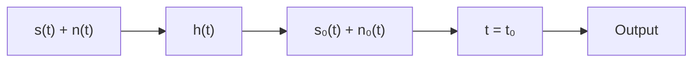
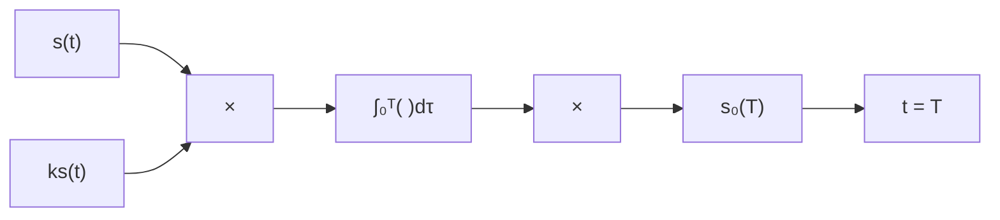
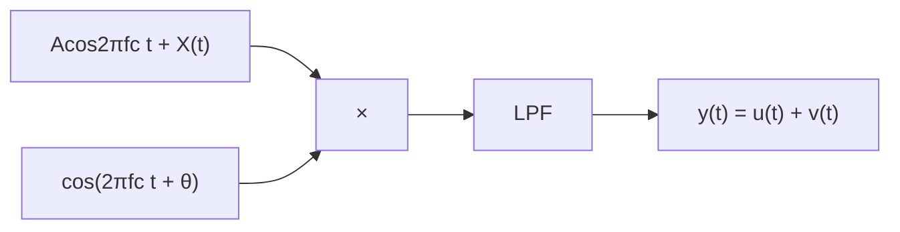

## 第2章 信号分析基础

## 2.1 引言

在通信系统中，涉及的信号包括确定信号与随机信号两大类。确定信号是指描述信号的时间函数 $x(t)$ 是完全确定的，给定时刻 $t$ ，即可确定信号在该时刻的各有关参数取值；而随机信号是指含有不可预测成分的信号。确定信号分析是研究随机信号的基础。在通信系统中，主要有两种类型的随机信号，一种是作为信道中固有干扰存在的噪声信号，这种信号的幅度和相位变化一般都不可预测，通常是一种纯随机信号；另一种是作为信息载体的信号，这种信号也是一种随机信号，但通常具有某些已知的特征。在数字通信系统中传输的信号，一般都是以码元周期为时间单位的、在一个有限信号集合中选取的信号，信号集合中的每个信号都是一个确定信号。发送信号的随机性体现在接收端并不知道发送端发送过来的是信号集合中的具体哪一个信号，而噪声的干扰则会增加信号检测时的不确定性。另外，传输信道的不完善也会使信号发生畸变，增加对信号判别的难度，甚至可能导致接收的错误。信号的构建、传输和检测，是本课程研究的基本问题之一。本章将简要回顾确定信号的分析方法，并在此基础上重点讨论数字通信系统中涉及的随机信号的基本特性和处理方法。

## 2.2 确定信号分析方法回顾

本节主要对在信号与系统等课程中学习过的有关确定信号的分析方法进行简要归纳。

周期信号与其傅里叶级数展开式 对任意的 t，若均有

$$
f (t) = f (t + T) \tag {2.2.1}
$$

式中，T 是满足上述关系式的最小常数，则称 $f(t)$ 是周期为 T 的周期信号。

一般地，若周期信号满足狄里赫利条件 $^{[9]}$ ，则可用傅里叶级数展开为

$$
f (t) = a _ {0} + \sum_ {n = 1} ^ {\infty} \left(a _ {n} \cos n \omega_ {0} t + b _ {n} \sin n \omega_ {0} t\right) \tag {2.2.2}
$$

式中， $a_0 = \frac{1}{T}\int_{c}^{c + T}f(t)\mathrm{d}t$ ， $a_{n} = \frac{2}{T}\int_{c}^{c + T}f(t)\cos n\omega_{0}t\mathrm{d}t$ ， $b_{n} = \frac{2}{T}\int_{c}^{c + T}f(t)\sin n\omega_{0}t\mathrm{d}t$ ， $c$ 是任意常数。傅里叶级数展开式也可以采用指数形式：

$$
f (t) = \sum_ {n = - \infty} ^ {\infty} F _ {n} \mathrm{e} ^ {\mathrm{j} n \omega_ {0} t} \tag {2.2.3}
$$

式中， $F_{n} = \frac{1}{T}\int_{-T / 2}^{T / 2}f(t)\mathrm{e}^{-\mathrm{j}n\omega_0t}\mathrm{d}t$ 。

非周期信号与其傅里叶变换式 对于非周期信号 $f(t)$ ，若满足绝对可积的条件 $\int_{-\infty}^{\infty}|f(t)|\mathrm{d}t < \infty$ ，在任一有限区间只有有限个极大值和极小值，且只有有限个不连续点的条件，则存在如下傅里叶变换和傅里叶反变换的关系式：

$$
F (f) = \int_ {- \infty} ^ {\infty} f (t) \mathrm{e} ^ {- \mathrm{j} 2 \pi f t} \mathrm{d} t \tag {2.2.4}
$$

$$
f (t) = \int_ {- \infty} ^ {\infty} F (f) \mathrm{e} ^ {\mathrm{j} 2 \pi f t} \mathrm{d} f \tag {2.2.5}
$$

傅里叶变换和傅里叶反变换也可以采用角频率的表示形式：

$$
F (\omega) = \int_ {- \infty} ^ {\infty} f (t) \mathrm{e} ^ {- \mathrm{j} \omega t} \mathrm{d} t \tag {2.2.6}
$$

$$
f (t) = \frac {1}{2 \pi} \int_ {- \infty} ^ {\infty} F (\omega) \mathrm{e} ^ {\mathrm{j} \omega t} \mathrm{d} \omega \tag {2.2.7}
$$

式中， $\omega=2\pi f$ 。

能量信号与其能量谱密度 对于实信号 $f(t)$ ，若其满足条件

$$
\int_ {- \infty} ^ {\infty} f ^ {2} (t) \mathrm{d} t <   \infty \tag {2.2.8}
$$

即信号的功率 $f^{2}(t)$ 在整个时间域上是可积的，则称这种信号为能量信号。能量信号的能量可以表示为

$$
\begin{array}{l} E = \int_ {- \infty} ^ {\infty} f ^ {2} (t) \mathrm{d} t = \int_ {- \infty} ^ {\infty} f (t) \left(\frac {1}{2 \pi} \int_ {- \infty} ^ {\infty} F (\omega) \mathrm{e} ^ {\mathrm{j} \omega t} \mathrm{d} \omega\right) \mathrm{d} t = \frac {1}{2 \pi} \int_ {- \infty} ^ {\infty} F (\omega) \left(\int_ {- \infty} ^ {\infty} f (t) \mathrm{e} ^ {\mathrm{j} \omega t} \mathrm{d} t\right) \mathrm{d} \omega \tag {2.2.9} \\ = \frac {1}{2 \pi} \int_ {- \infty} ^ {\infty} F (\omega) F ^ {*} (\omega) \mathrm{d} \omega = \frac {1}{2 \pi} \int_ {- \infty} ^ {\infty} \left| F (\omega) \right| ^ {2} \mathrm{d} \omega \\ \end{array}
$$

上式表明信号的能量沿时域分布的累加和，与沿频域分布的累加和是相同的，这一关系式又称帕塞瓦尔（Parseval）定理。经过简单变换，式（2.2.9）又可表示为

$$
E = \int_ {- \infty} ^ {\infty} f ^ {2} (t) \mathrm{d} t = \frac {1}{2 \pi} \int_ {- \infty} ^ {\infty} | F (\omega) | ^ {2} \mathrm{d} \omega = \int_ {- \infty} ^ {\infty} | F (2 \pi f) | ^ {2} \mathrm{d} f \tag {2.2.10}
$$

或简单记为

$$
E = \int_ {- \infty} ^ {\infty} f ^ {2} (t) \mathrm{d} t = \int_ {- \infty} ^ {\infty} \left| F (f) \right| ^ {2} \mathrm{d} f \tag {2.2.11}
$$

由此可以定义信号的能量密度谱为

$$
E (\omega) = \left| F (\omega) \right| ^ {2} \text {或} E (f) = \left| F (f) \right| ^ {2} \tag {2.2.12}
$$

能量密度谱的单位为焦耳/赫兹，对于实信号，能量密度谱为偶函数。能量密度谱描述了信号的能量沿频域分布的特性。

功率信号与其功率谱密度 许多信号不满足条件 $\int_{-\infty}^{\infty}f^2 (t)\mathrm{d}t <   \infty$ ，但若这些信号满足条件

$$
\lim _ {T \to \infty} \frac {1}{T} \int_ {- T / 2} ^ {T / 2} f ^ {2} (t) \mathrm{d} t <   \infty \tag {2.2.13}
$$

则称这种信号为功率信号。定义功率信号 $f(t)$ 的截短函数为

$$
f _ {\mathrm{T}} (t) = \left\{ \begin{array}{c c} f (t), & - T / 2 \leqslant t \leqslant T / 2 \\ 0, & \text {其他} \end{array} \right. \tag {2.2.14}
$$

对任意给定的 $T$ ，若有 $\int_{-\infty}^{\infty}f_{\mathrm{T}}^{2}(t)\mathrm{d}t <   \infty$ ，则 $f_{\mathrm{T}}(t)$ 的傅里叶变换一定存在，即有

$$
F _ {\mathrm{T}} (\omega) = \int_ {- \infty} ^ {\infty} f _ {\mathrm{T}} (t) \mathrm{e} ^ {- \mathrm{j} \omega t} \mathrm{d} t = \int_ {- T / 2} ^ {T / 2} f _ {\mathrm{T}} (t) \mathrm{e} ^ {- \mathrm{j} \omega t} \mathrm{d} t \tag {2.2.15}
$$

由此可以定义 $f_{\mathrm{T}}(t)$ 的能量密度谱 $E_{\mathrm{T}}(\omega) = \left|F_{\mathrm{T}}(\omega)\right|^{2}$ 或 $E_{\mathrm{T}}(f) = \left|F_{\mathrm{T}}(f)\right|^{2}$ ，若

$$
\lim _ {T \rightarrow \infty} \frac {E _ {\mathrm{T}} (\omega)}{T} = \lim _ {T \rightarrow \infty} \frac {\left| F _ {\mathrm{T}} (\omega) \right| ^ {2}}{T} <   \infty \text {或} \lim _ {T \rightarrow \infty} \frac {E _ {\mathrm{T}} (f)}{T} = \lim _ {T \rightarrow \infty} \frac {\left| F _ {\mathrm{T}} (f) \right| ^ {2}}{T} <   \infty \tag {2.2.16}
$$

即上述的极限存在，则将其定义为信号 $f(t)$ 的功率密度谱，

$$
P (\omega) = \lim _ {T \rightarrow \infty} \frac {\left| F _ {\mathrm{T}} (\omega) \right| ^ {2}}{T} \text {或} P (f) = \lim _ {T \rightarrow \infty} \frac {\left| F _ {\mathrm{T}} (f) \right| ^ {2}}{T} \tag {2.2.17}
$$

功率密度谱的单位为瓦/赫兹，对于实信号，功率密度谱为偶函数。功率密度谱描述了信号的功率沿频域分布的特性。已知信号 $f(t)$ 的功率密度谱 $P(\omega)$ ，则其功率为

$$
P = \frac {1}{2 \pi} \int_ {- \infty} ^ {\infty} P (\omega) \mathrm{d} \omega = \int_ {- \infty} ^ {\infty} P (f) \mathrm{d} f \tag {2.2.18}
$$

相关函数 不同类型的信号，其相关函数的定义有所不同。

若 $f_{1}(t)$ 和 $f_{2}(t)$ 是实的能量信号，则其互相关函数定义为

$$
R _ {1 2} (\tau) = \int_ {- \infty} ^ {\infty} f _ {1} (t) f _ {2} (t + \tau) \mathrm{d} t \tag {2.2.19}
$$

式中， $\tau$ 是两信号的时间间隔。

若 $f_{1}(t)$ 和 $f_{2}(t)$ 是实的功率信号，则其互相关函数定义为

$$
R _ {1 2} (\tau) = \lim _ {T \to \infty} \frac {1}{T} \int_ {- T / 2} ^ {T / 2} f _ {1} (t) f _ {2} (t + \tau) \mathrm{d} t \tag {2.2.20}
$$

式中， $\tau$ 是两信号的时间间隔。

周期信号是一种特殊的功率信号，若 $f_{1}(t)$ 和 $f_{2}(t)$ 同是周期为 T 的实的功率信号，则其互相关函数定义为

$$
R _ {1 2} (\tau) = \frac {1}{T} \int_ {- T / 2} ^ {T / 2} f _ {1} (t) f _ {2} (t + \tau) \mathrm{d} t \tag {2.2.21}
$$

在上述的相关函数定义中，若 $f(t) = f_{1}(t) = f_{2}(t)$ ，则称这些相关函数为自相关函数，并简记为 $R(\tau)$ 。

相关函数有如下主要性质：

性质 1: $R_{12}(\tau)=R_{21}(-\tau)$ (2.2.22)

性质 2: $R(\tau)=R(-\tau)$ (2.2.23)

性质 3: $\left|R(\tau)\right|\leqslant R(0)$ (2.2.24)

性质 4：对于能量信号，信号能量密度谱与其自相关函数是一个傅里叶变换对：

$$
E (\omega) = \int_ {- \infty} ^ {\infty} R (\tau) \mathrm{e} ^ {- \mathrm{j} \omega \tau} \mathrm{d} \tau , \quad R (\tau) = \frac {1}{2 \pi} \int_ {- \infty} ^ {\infty} E (\omega) \mathrm{e} ^ {\mathrm{j} \omega \tau} \mathrm{d} \omega \tag {2.2.25}
$$

由此可得

$$
R (0) = \frac {1}{2 \pi} \int_ {- \infty} ^ {\infty} E (\omega) \mathrm{d} \omega = E \tag {2.2.26}
$$

性质 5：对于功率信号，信号功率密度谱与其自相关函数是一个傅里叶变换对：

$$
P (\omega) = \int_ {- \infty} ^ {\infty} R (\tau) \mathrm{e} ^ {- \mathrm{j} \omega \tau} \mathrm{d} \tau , \quad R (\tau) = \frac {1}{2 \pi} \int_ {- \infty} ^ {\infty} P (\omega) \mathrm{e} ^ {\mathrm{j} \omega \tau} \mathrm{d} \omega \tag {2.2.27}
$$

由此可得

$$
R (0) = \frac {1}{2 \pi} \int_ {- \infty} ^ {\infty} P (\omega) \mathrm{d} \omega = P \tag {2.2.28}
$$

在数字通信系统中，信息是通过符号来携带的，每个不同的符号对应于一个特定的物理信号，每个物理信号的持续时间是一个符号周期 $T_{S}$ 。一个M进制通信系统传输的一个信号序列可如图2.2.1所示，其中 $f_{k}(t),0\leqslant t\leqslant T_{S}$ 表示符号集 $\left\{f_{k}(t),k=1,2,\cdots,M\right\}$ 中的第k个符号。

line

| Time Interval | Frequency Component |
| --- | --- |
| 0 to $T_S$ | $f_3(t)$ |
| T_S to 2T_S | f_7(t-T_S) |
| 2T_S to 3T_S | f_M(t-2T_S) |
| 3T_S to 4T_S | f_k(t-3T_S) |
| 4T_S to 5T_S | f_1(t-4T_S) |
| 5T_S to iT_S | f_2(t-iT_S) |
| iT_S to (i+1)T_S | f_2(t-iT_S) |

图 2.2.1 M 进制通信系统信号序列

在接收端接收信号时，可以通过相关运算来对接收的符号进行判断，此时一般利用符号同步信号进行控制，在每个符号周期 $T_{s}$ 内完成一次相关运算。通常在信号设计时，尽可能使得不同符号所对应信号间的互相关性很小，这样在接收端就很容易通过相关运算来判断发送端发送的是哪个符号。图2.2.2所示的是一个二进制通信系统中的两个不同符号对应的两个信号波形 $f_{1}(t)$ 和 $f_{2}(t)$ 。由图中所示的 $f_{1}(t)$ 和 $f_{2}(t)$ ，容易得到

$$
\int_ {0} ^ {T _ {\mathrm{S}}} f _ {i} (t) f _ {j} (t) \mathrm{d} t = \left\{ \begin{array}{l l} \frac {1}{2} A ^ {2} T _ {\mathrm{S}}, & i = j \\ 0, & i \neq j \end{array} \right.
$$

这时称信号 $f_{1}(t)$ 和 $f_{2}(t)$ 是正交的。图2.2.3所示的是一个二进制通信系统中的两个不同符号对应的另外两个信号 $f_{1}(t) = A\cos 2\pi ft, 0 \leqslant t \leqslant T_{\mathrm{S}}$ 和 $f_{2}(t) = A\sin 2\pi ft, 0 \leqslant t \leqslant T_{\mathrm{S}}$ ，其中 $T_{\mathrm{S}} = 2T$ ， $f = 1 / T$ 。这两个信号可视为两个已调制信号，此时同样有

$$
\int_ {0} ^ {T _ {\mathrm{S}}} f _ {i} (t) f _ {j} (t) \mathrm{d} t = \left\{ \begin{array}{l l} \frac {1}{2} A ^ {2} T _ {\mathrm{S}}, & i = j \\ 0, & i \neq j \end{array} \right.
$$

可见这两个信号也是正交的。

  
图 2.2.2 两个正交的脉冲信号

  
图 2.2.3 两个正交的已调制信号

卷积与卷积定理 信号 $f_{1}(t)$ 与 $f_{2}(t)$ 的卷积运算定义为

$$
f (t) = f _ {1} (t) ^ {*} f _ {2} (t) = \int_ {- \infty} ^ {\infty} f _ {1} (\tau) f _ {2} (t - \tau) \mathrm{d} \tau \tag {2.2.29}
$$

卷积运算通常用于描述信号经过线性系统的输出。假定线性系统的冲激响应为 $h(t)$ ，输入信号为 $s(t)$ ，输出信号为 $s_{0}(t)$ ，则有

$$
s _ {0} (t) = h (t) ^ {*} s (t) = \int_ {- \infty} ^ {\infty} h (\tau) s (t - \tau) \mathrm{d} \tau \tag {2.2.30}
$$

若线性系统是一个物理可实现系统，则有

$$
s _ {\mathrm{o}} (t) = h (t) ^ {*} s (t) = \int_ {0} ^ {\infty} h (\tau) s (t - \tau) \mathrm{d} \tau \tag {2.2.31}
$$

卷积运算有如下两个重要定理。

（1）时域卷积定理 若 $f_{1}(t)\Leftrightarrow F_{1}(\omega),f_{2}(t)\Leftrightarrow F_{2}(\omega)$ ，则有

$$
f _ {1} (t) ^ {*} f _ {2} (t) \Leftrightarrow F _ {1} (\omega) \cdot F _ {2} (\omega) \tag {2.2.32}
$$

这里符号 “ $\Leftrightarrow$ ” 表示一个傅里叶变换对。

（2）频域卷积定理 若 $f_{1}(t)\Leftrightarrow F_{1}(\omega)$ ， $f_{2}(t)\Leftrightarrow F_{2}(\omega)$ ，则有

$$
f _ {1} (t) \cdot f _ {2} (t) \Leftrightarrow F _ {1} (\omega) * F _ {2} (\omega) \tag {2.2.33}
$$

上述这些性质均可根据定义直接证明。

## 2.3 信号的向量表示

数字通信系统中信号随机性的特点 数字通信系统中信息的传输是以码元序列发送和接送的形式实现的。一个 $M$ 进制的符号集所对应的物理信号可表示为

$$
s _ {i} (t), i = 1, 2, \dots , M, t \in [ 0, T _ {\mathrm{S}} ] \tag {2.3.1}
$$

式中的每个信号 $s_i(t)$ 都是一个持续时间为一个码元周期 $T_{\mathrm{S}}$ 的确知信号。通常取 $M = 2^{k}$ ，其中 $k$ 是一个正整数，这样，每个码元或其对应的信号就可携带 $k$ 比特的信息。通信信号的随机特性体现在如下几个方面：

(1) $s_{i}(t), i = 1,2,\dots,M, t \in [0,T_{\mathrm{S}}]$ 对应一个包含了 $M$ 个样本的信号集, 每个码元周期发送哪个信号是由具体的一个信源输出决定的, 接收端在收到这个信号前, 只知道收到的应是该有限样本符号集中的一个, 但并不知道具体是哪一个。  
(2) 信号在通信系统中传输的每个环节, 都可能受到噪声的干扰, 噪声本身也是一个随机信号。这样, 在接收端收到的通常是一个受到噪声污染的信号, 接收端需要对收到的信号做出正确的判断。  
(3) 通信系统的信道, 特别是在无线通信的场合, 其特性是非理想的, 还可能是时变的, 信号经过这种非理想的信道, 会受到不可预测的随机因素的影响, 从而使接收信号的判别变得更为复杂。本课程要讨论的基本问题, 就是如何实现这些码元或符号的高效率正确传输。

在通信系统中，发送的信号往往可由一组基函数的线性组合来表示，从而给信号的分析和处理带来极大的便利。例如，在后续章节将了解的多进制正交幅度调制（MQAM）中，其进制数 M，即符号种类的个数，视不同的应用场合，可以从 M = 4 的四相调制（QPSK）到 M = 2048 的高阶相幅调制。尽管不同的符号个数可以达到 2048 个，但这些不同的符号都可用 $\sin \omega_{c} t$ 和 $\cos \omega_{c} t$ 这两个基函数的线性组合来表示。下面介绍有关基函数的基本概念。

内积 在信号集 $s_{i}(t)$ ， $i=1,2,\cdots,M$ ， $t\in[0,T_{S}]$ 中，定义任两信号 $s_{i}(t)$ 和 $s_{j}(t)$ 的内积为

$$
\left\langle s _ {i} (t), s _ {j} (t) \right\rangle = \int_ {0} ^ {T} s _ {i} (t) s _ {j} (t) \mathrm{d} t \tag {2.3.2}
$$

内积运算是信号检测的基本方法之一。

基函数 在一个 N 维的信号空间中，若 N 个函数构成的函数组 $\left\{\Psi_{k}(t), k=1,2,\cdots,N\right\}$ 满足：

(1) 线性独立性: $\Psi_{k}(t), k = 1,2,\dots,N$ 相互线性独立。即对 $\{\Psi_{k}(t)\}$ 中任意的元素 $\Psi_{i}(t)$ , $\Psi_{i}(t)$ 不等于函数组中的其他元素的线性组合。

(2) 完备性: $N$ 维信号空间中的信号 $s(t)$ , 若有 $\left\langle s(t), \Psi_k(t) \right\rangle = 0, k = 1, 2, \cdots, N$ , 则一定有 $s(t) = 0$ 。则称函数组 $\left\{\Psi_k(t)\right\}$ 为该 $N$ 维信号空间的一组基函数。其中完备性的物理意义是, 信号空间中所有的信号, 都能够用这个函数组的线性组合来表示。

如果基函数组 $\{\Psi_k(t)\}$ 满足条件

$$
\left\langle \Psi_ {i} (t), \Psi_ {j} (t) \right\rangle = \int_ {0} ^ {T} \Psi_ {i} (t) \Psi_ {j} (t) \mathrm{d} t = \left\{ \begin{array}{l l} K _ {i}, & i = j \\ 0, & i \neq j \end{array} \right. \tag {2.3.3}
$$

则称该基函数组 $\{\Psi_k(t)\}$ 为一组正交基。给定线性空间中的任何一组基函数，通过Gram-Schmidt标准正交化法，可将非正交的基函数转换成正交的基函数[2]。特别地，如果基函数组满足条件

$$
\left\langle \Psi_ {i} (t), \Psi_ {j} (t) \right\rangle = \int_ {0} ^ {T} \Psi_ {i} (t) \Psi_ {j} (t) \mathrm{d} t = \left\{ \begin{array}{l l} 1, & i = j \\ 0, & i \neq j \end{array} \right. \tag {2.3.4}
$$

则称该基函数组 $\left\{\Psi_{k}(t)\right\}$ 为一组标准正交基。

在 M 进制数字通信系统中, 发送端在任一时刻发送的是具有 M 个不同确知信号组成的集合 $\{s_{m}(t)\}$ 中的某一个信号, $m=1,2,\cdots,M, t\in[0,T_{S}]$ 。接收端则需要判别当前收到的信号是 M 个确知信号中的具体哪个信号。若所有的信号都是平方可积的, 即

$$
\int_ {0} ^ {T _ {S}} s _ {m} ^ {2} (t) \mathrm{d} t <   + \infty , m = 1, 2, \dots , M \tag {2.3.5}
$$

则一般地，它们可用 $N(N \leqslant M)$ 个正交的基函数 $\{\Psi_k(t)\}$ 来描述[7]，即有

$$
s _ {m} (t) = a _ {m 1} \Psi_ {1} (t) + a _ {m 2} \Psi_ {2} (t) + \dots + a _ {m N} \Psi_ {N} (t) = \sum_ {i = 1} ^ {N} a _ {m i} \Psi_ {i} (t) \tag {2.3.6}
$$

式中，

$$
a _ {m i} = \frac {1}{K _ {i}} \int_ {0} ^ {T _ {\mathrm{S}}} s _ {m} (t) \Psi_ {i} (t) \mathrm{d} t, i = 1, 2, \dots , N \tag {2.3.7}
$$

特别地，当 $\{\Psi_{k}(t)\}$ 为一组标准正交基时，式（2.3.7）简化为

$$
a _ {m i} = \int_ {0} ^ {T _ {S}} s _ {m} (t) \Psi_ {i} (t) \mathrm{d} t, i = 1, 2, \dots , N \tag {2.3.8}
$$

若这 M 个信号是线性独立的，则有 N=M 。显然，确定基函数 $\left\{\Psi_{k}(t)\right\}$ 后，信号 $s_{m}(t)$ ， $m=1,2,\cdots,M$ 可由其系数向量

$$
S _ {m} = \left[ a _ {m 1}, a _ {m 2}, \dots , a _ {m N} \right] ^ {\mathrm{T}}, m = 1, 2, \dots , M \tag {2.3.9}
$$

唯一确定。此时信号的能量

$$
E _ {m} = \int_ {0} ^ {T _ {\mathrm{S}}} s _ {m} ^ {2} (t) \mathrm{d} t = \int_ {0} ^ {T _ {\mathrm{S}}} \left[ \sum_ {i = 1} ^ {N} a _ {m i} \Psi_ {i} (t) \right] ^ {2} \mathrm{d} t = \sum_ {i = 1} ^ {N} a _ {m i} ^ {2}, m = 1, 2, \dots , M \tag {2.3.10}
$$

【例 2.3.1】二维函数空间中的两个函数 $f_{1}(t)$ 和 $f_{2}(t)$ 如图 2.3.1(a) 与 (b) 所示。(1) 证明这两个函数是一组正交的基函数；(2) 试用 $f_{1}(t)$ 和 $f_{2}(t)$ 表示图 2.3.1(c) 所示的函数 $s_{1}(t)$ 。

area

| Time (t) | f1(t) |
| --- | --- |
| 0 | 1 |
| 0~TS/2 | 1 |
| TS/2 | -1 |
| TS | 0 |

(a)

area

| t | f2(t) |
| --- | --- |
| 0 | 1 |
| TS | 0 |

(b)

line

| Time (t) | s1(t) |
| --- | --- |
| 0 | -1 |
| TS/2 | -1 |
| TS/2 | -3 |
| TS | -3 |
| TS | 0 |

(C)  
图2.3.1 例2.3.1信号示意图

解: (1) 因为 $f_{1}(t)$ 和 $f_{2}(t)$ 均为非恒等于 0 的函数, 且 $f_{1}(t)$ 不能用 $f_{2}(t)$ 表示, $f_{2}(t)$ 也不能用 $f_{1}(t)$ 表示, 所以满足线性独立性。在二维空间中, 两个非零的线性独立的向量即构成一组基函数, 另外 $f_{1}(t)$ 和 $f_{2}(t)$ 满足

$$
\left\langle f _ {1} (t), f _ {2} (t) \right\rangle = \int_ {0} ^ {T} f _ {1} (t) f _ {2} (t) \mathrm{d} t = \int_ {0} ^ {T / 2} 1 \mathrm{d} t + \int_ {T / 2} ^ {T} (- 1) \mathrm{d} t = 0
$$

因此， $f_{1}(t)$ 和 $f_{2}(t)$ 构成一组二维信号空间中的正交基函数。

(2) 因为

$$
K _ {1} = \left\langle f _ {1} (t), f _ {1} (t) \right\rangle = \int_ {0} ^ {T} f _ {1} ^ {2} (t) \mathrm{d} t = \int_ {0} ^ {T / 2} 1 \mathrm{d} t + \int_ {0} ^ {T / 2} (- 1) ^ {2} \mathrm{d} t = T
$$

$$
K _ {2} = \left\langle f _ {2} (t), f _ {2} (t) \right\rangle = \int_ {0} ^ {T} f _ {2} ^ {2} (t) \mathrm{d} t = \int_ {0} ^ {T} \mathrm{d} t = T
$$

根据式（2.3.7），

$$
\begin{array}{l} a _ {1} = \frac {1}{K _ {l}} \int_ {0} ^ {T} s (t) f _ {1} (t) \mathrm{d} t = \frac {1}{T} \left[ \int_ {0} ^ {T / 2} (- 1) \mathrm{d} t + \int_ {T / 2} ^ {T} (- 1) (- 3) \mathrm{d} t \right] = \frac {1}{T} \left(- \frac {T}{2} + 3 \frac {T}{2}\right) = 1 \\ a _ {2} = \frac {1}{K _ {2}} \int_ {0} ^ {T} s (t) f _ {2} (t) \mathrm{d} t = \frac {1}{T} \left[ \int_ {0} ^ {T / 2} (- 1) \mathrm{d} t + \int_ {T / 2} ^ {T} (- 3) \mathrm{d} t \right] = \frac {1}{T} \left(- \frac {T}{2} - 3 \frac {T}{2}\right) = - 2 \\ \end{array}
$$

所以有

$$
s (t) = a _ {1} f _ {1} (t) + a _ {2} f _ {2} (t) = f _ {1} (t) - 2 f _ {2} (t)
$$

读者容易直接根据信号图形验证上述结果的正确性。□

## 2.4 希尔伯特变换及应用

希尔伯特变换是获得某一函数相应的正交函数的一种变换。在对通信信号的处理过程中，利用希尔伯特变换，可将一频带信号变换为较为简单的低通信号来分析。

希尔伯特变换 希尔伯特变换是构建某一函数相应的正交函数的变换，定义实函数 $f(t)$ 的希尔伯特变换为

$$
\hat {f} (t) = H [ f (t) ] = f (t) * \frac {1}{\pi t} = \frac {1}{\pi} \int_ {- \infty} ^ {\infty} \frac {f (\tau)}{t - \tau} \mathrm{d} \tau \tag {2.4.1}
$$

希尔伯特变换等效为信号通过一个冲激响应为 $1/\pi t$ 的滤波器后的输出信号。该滤波器的傅里叶变换为

$$
\frac {1}{\pi t} \Leftrightarrow - \mathrm{jsgn} (\omega) = \left\{ \begin{array}{l l} - \mathrm{j}, & \omega \geqslant 0 \\ \mathrm{j}, & \omega <   0 \end{array} \right. \tag {2.4.2}
$$

式中， $\omega = 2\pi f$ ，j 是虚单位常数， $j = \sqrt{-1}$ 。 $\operatorname{sgn}(\omega)$ 为数学中的符号函数， $\operatorname{sgn}(\omega) = \begin{cases} 1, & \omega \geqslant 0 \\ -1, & \omega < 0 \end{cases}$ ，由此可见希尔伯特变换对应的滤波器等效于一个理想的 $\pi / 2$ 移相器。式（2.4.2）的证明如下。

证明：为方便地求 $\mathrm{sgn}(\omega)$ 的傅里叶反变换，可将其表示为 $\mathrm{sgn}(\omega) = \lim_{\alpha \to 0}\left[\mathrm{e}^{-\alpha \omega}u(\omega) - \mathrm{e}^{\alpha \omega}u(-\omega)\right]$ 。由此

$$
\begin{array}{l} \Im^ {- 1} [ \operatorname{sgn} (\omega) ] = \frac {1}{2 \pi} \int_ {- \infty} ^ {\infty} \lim _ {\alpha \rightarrow 0} \left[ \mathrm{e} ^ {- \alpha \omega} u (\omega) - \mathrm{e} ^ {\alpha \omega} u (- \omega) \right] \mathrm{e} ^ {\mathrm{j} \omega t} \mathrm{d} \omega \\ = \lim _ {\alpha \rightarrow 0} \frac {1}{2 \pi} \left[ \int_ {- \infty} ^ {\infty} \mathrm{e} ^ {- \alpha \omega} u (\omega) \mathrm{e} ^ {\mathrm{j} \omega t} \mathrm{d} \omega - \int_ {- \infty} ^ {\infty} \mathrm{e} ^ {\alpha \omega} u (- \omega) \mathrm{e} ^ {\mathrm{j} \omega t} \mathrm{d} \omega \right] \tag {2.4.3} \\ = \frac {1}{2 \pi} \lim _ {\alpha \rightarrow 0} \left(\frac {- 1}{- \alpha + \mathrm{j} t} - \frac {1}{\alpha + \mathrm{j} t}\right) = \frac {1}{2 \pi} \lim _ {\alpha \rightarrow 0} \frac {2 \mathrm{j} t}{\alpha^ {2} + t ^ {2}} = \frac {\mathrm{j}}{\pi t} \\ \end{array}
$$

式中，符号 $\Im^{-1}[F(\omega)]$ 表示对函数 $F(\omega)$ 取傅里叶反变换。因此可得

$$
\frac {\mathrm{j}}{\pi t} \Leftrightarrow \operatorname{sgn} (\omega) \rightarrow \frac {1}{\pi t} \Leftrightarrow - \mathrm{jsgn} (\omega) \tag {2.4.4}
$$

证毕。□

希尔伯特反变换 定义实函数 $g(t)$ 的希尔伯特反变换为

$$
H ^ {- 1} \left[ g (t) \right] \stackrel {\Delta} {=} g (t) * \left(- \frac {1}{\pi t}\right) = - \frac {1}{\pi} \int_ {- \infty} ^ {\infty} \frac {g (\tau)}{t - \tau} \mathrm{d} \tau \tag {2.4.5}
$$

同理可以证明，对信号取希尔伯特反变换等效于使其通过傅里叶变换，变换为如下滤波器：

$$
- \frac {1}{\pi t} \Leftrightarrow \mathrm{jsgn} (\omega) = \left\{ \begin{array}{l l} \mathrm{j}, & \omega \geqslant 0 \\ - \mathrm{j}, & \omega <   0 \end{array} \right. \tag {2.4.6}
$$

显然，希尔伯特反变换也是一种实现 $\pi/2$ 移相的正交变换。

希尔伯特变换的性质 希尔伯特变换有如下主要性质。

性质 1: 对函数 $f(t)$ 进行希尔伯特变换后，再进行希尔伯特反变换，则恢复原来的函数，

$$
H ^ {- 1} \Big [ \hat {f} (t) \Big ] = H ^ {- 1} \Big [ H \big [ f (t) \big ] \Big ] = f (t) \tag {2.4.7}
$$

证明：

$$
\begin{array}{l} H ^ {- 1} \Big [ \hat {f} (t) \Big ] = H ^ {- 1} \Big [ H \big [ f (t) \big ] \Big ] \Leftrightarrow f (t) * \frac {1}{\pi t} * \left(- \frac {1}{\pi t}\right) \tag {2.4.8} \\ \Leftrightarrow F (\omega) \cdot \left[ - \mathrm{jsgn} (\omega) \right] \cdot \left[ \mathrm{jsgn} (\omega) \right] = F (\omega) \cdot 1 \Leftrightarrow f (t) \\ \end{array}
$$

式中， $F(\omega)$ 是 $f(t)$ 的傅里叶变换。证毕。□

性质 2: 对函数 $f(t)$ 进行两次希尔伯特变换等效于取函数 $f(t)$ 的负值函数 $-f(t)$ ,

$$
H \Big [ \hat {f} (t) \Big ] = \hat {\hat {f}} (t) = - f (t) \tag {2.4.9}
$$

证明：

$$
\begin{array}{l} H \Big [ \hat {f} (t) \Big ] = H \left\{H \big [ f (t) \big ] \right\} \Leftrightarrow f (t) * \frac {1}{\pi t} * \frac {1}{\pi t} \tag {2.4.10} \\ \Leftrightarrow F (\omega) \cdot \left[ - \mathrm{jsgn} (\omega) \right] \cdot \left[ - \mathrm{jsgn} (\omega) \right] = F (\omega) \cdot (- 1) \Leftrightarrow - f (t) \\ \end{array}
$$

证毕。□

上式的物理意义很明显，对信号进行两次 $\pi/2$ 移相等效于对其进行 $180^{\circ}$ 的倒相处理。

性质3：函数 $f(t)$ 与其希尔伯特变换 $\hat{f} (t)$ 有相同的能量，

$$
\int_ {- \infty} ^ {\infty} f ^ {2} (t) \mathrm{d} t = \int_ {- \infty} ^ {\infty} \hat {f} ^ {2} (t) \mathrm{d} t \tag {2.4.11}
$$

证明：

$$
\begin{array}{l} \int_ {- \infty} ^ {\infty} \hat {f} ^ {2} (t) \mathrm{d} t = \frac {1}{2 \pi} \int_ {- \infty} ^ {\infty} \left| \hat {F} (\omega) \right| ^ {2} \mathrm{d} \omega = \frac {1}{2 \pi} \int_ {- \infty} ^ {\infty} \left| - \mathrm{jsgn} (\omega) F (\omega) \right| ^ {2} \mathrm{d} \omega \tag {2.4.12} \\ = \frac {1}{2 \pi} \int_ {- \infty} ^ {\infty} \left| F (\omega) \right| ^ {2} \mathrm{d} \omega = \int_ {- \infty} ^ {\infty} f ^ {2} (t) \mathrm{d} t \\ \end{array}
$$

其中第一个等号成立的根据是傅里叶变换中的帕塞瓦尔定理。证毕。□

性质 4: 若 $f(t)$ 为偶函数，则 $\hat{f}(t)$ 为奇函数；反之若 $f(t)$ 为奇函数，则 $\hat{f}(t)$ 为偶函数。

证明：首先证明第一点结论。假定 $f(t)$ 为偶函数，则有

$$
\begin{array}{l} \hat {f} (- t) = \frac {1}{\pi} \int_ {- \infty} ^ {\infty} \frac {f (\tau)}{- t - \tau} \mathrm{d} \tau = \frac {1}{\pi} \int_ {- \infty} ^ {\infty} \frac {f (- \tau)}{t - (- \tau)} \mathrm{d} (- \tau) \tag {2.4.13} \\ = \frac {1}{\pi} \int_ {- \infty} ^ {- \infty} \frac {f (\tau^ {\prime})}{t - \tau^ {\prime}} \mathrm{d} \tau^ {\prime} = - \frac {1}{\pi} \int_ {- \infty} ^ {\infty} \frac {f (\tau^ {\prime})}{t - \tau^ {\prime}} \mathrm{d} \tau^ {\prime} = - \hat {f} (t) \\ \end{array}
$$

即 $\hat{f}(t)$ 为奇函数。同理可以证明第二点结论。证毕。☐

性质 5: 函数 $f(t)$ 与其希尔伯特变换 $\hat{f}(t)$ 相互正交,

$$
\int_ {- \infty} ^ {\infty} f (t) \hat {f} (t) \mathrm{d} t = 0 \tag {2.4.14}
$$

证明：

$$
\begin{array}{l} \int_ {- \infty} ^ {\infty} f (t) \hat {f} (t) \mathrm{d} t = \lim _ {\omega \rightarrow 0} \int_ {- \infty} ^ {\infty} f (t) \hat {f} (t) \mathrm{e} ^ {- \mathrm{j} \omega t} \mathrm{d} t \\ = \lim _ {\omega \rightarrow 0} \frac {1}{2 \pi} \left[ F (\omega) ^ {*} (- \mathrm{jsgn} (\omega) F (\omega)) \right] \tag {2.4.15} \\ = \lim _ {\omega \to 0} \frac {1}{2 \pi} \int_ {- \infty} ^ {\infty} \left(- \mathrm{jsgn} (\omega^ {\prime}) F (\omega^ {\prime})\right) F (\omega - \omega^ {\prime}) \mathrm{d} \omega^ {\prime} \\ = - \mathrm{j} \frac {1}{2 \pi} \int_ {- \infty} ^ {\infty} \operatorname{sgn} \left(\omega^ {\prime}\right) F \left(\omega^ {\prime}\right) F \left(- \omega^ {\prime}\right) \mathrm{d} \omega^ {\prime} = 0 \\ \end{array}
$$

上式中最后一个等式成立是因为积分式中的函数 $\operatorname{sgn}(\omega') F(\omega') F(-\omega')$ 是一个奇函数。证毕。□

【例 2.4.1】求函数 $f(t)=\cos\omega_{0}t$ 的希尔伯特变换。

解：因为 $f(t) = \cos \omega_0t\Leftrightarrow F(\omega) = \pi \left[\delta (\omega +\omega_0) + \delta (\omega -\omega_0)\right]$ ，所以有

$$
\begin{array}{l} \cos \omega_ {0} t * \frac {1}{\pi t} \Leftrightarrow \pi \left[ \delta \left(\omega + \omega_ {0}\right) + \delta \left(\omega - \omega_ {0}\right) \right] \cdot \left[ - j \operatorname{sgn} (\omega) \right] \\ = \mathrm{j} \pi \left[ \delta \left(\omega + \omega_ {0}\right) - \delta \left(\omega - \omega_ {0}\right) \right] \Leftrightarrow \sin \omega_ {0} t \\ \end{array}
$$

因此有 $H[f(t)] = \hat{f}(t) = \sin \omega_0t$ 。□

解析信号 信号 $f(t)$ 的解析信号定义为

$$
z (t) = f (t) + \mathrm{j} \hat {f} (t) \tag {2.4.16}
$$

式中， $\hat{f}(t)$ 是 $f(t)$ 的希尔伯特变换，j 是虚单位常数， $j=\sqrt{-1}$ 。

解析信号的主要性质 信号 $f(t)$ 的解析信号 $z(t)$ 有如下主要性质。

性质 1: $f(t)=\mathrm{Re}[z(t)]$ (2.4.17)

式中，符号Re[·]表示取其中的实部。由解析函数的 $z(t)$ 的定义，结论显然成立。

性质2: $f(t) = \frac{1}{2}\left[z(t) + z^{*}(t)\right]$ (2.4.18)

直接由式（2.4.16），可得

$$
f (t) = \frac {1}{2} \left[ z (t) + z ^ {*} (t) \right] = \frac {1}{2} \left[ \left(f (t) + \mathrm{j} \hat {f} (t)\right) + \left(f (t) - \mathrm{j} \hat {f} (t)\right) \right] = \frac {1}{2} 2 f (t) = f (t) \tag {2.4.19}
$$

因此结论成立。

性质3：若 $f(t)\Leftrightarrow F(\omega)$ ，则有

$$
Z (\omega) = 2 F (\omega) u (\omega) \tag {2.4.20}
$$

式中， $u(\omega)$ 是单位阶跃函数。

证明：

$$
\begin{array}{l} Z (\omega) = \Im \left[ f (t) + \mathrm{j} \hat {f} (t) \right] = F (\omega) + \mathrm{j} (- \mathrm{j}) \operatorname{sgn} (\omega) F (\omega) \tag {2.4.21} \\ = F (\omega) + \operatorname{sgn} (\omega) F (\omega) = 2 F (\omega) u (\omega) \\ \end{array}
$$

式中，符号 $\Im[\cdot]$ 表示取函数的傅里叶变换。证毕。☐

性质 4: $z(t)=\frac{1}{\pi}\int_{0}^{\infty}F(\omega)\mathrm{e}^{\mathrm{j}\omega t}\mathrm{d}\omega$ (2.4.22)

证明：

$$
z (t) = \frac {1}{2 \pi} \int_ {- \infty} ^ {\infty} Z (\omega) \mathrm{e} ^ {\mathrm{j} \omega t} \mathrm{d} \omega = \frac {1}{2 \pi} \int_ {- \infty} ^ {\infty} 2 F (\omega) u (\omega) \mathrm{e} ^ {\mathrm{j} \omega t} \mathrm{d} \omega = \frac {1}{\pi} \int_ {0} ^ {\infty} F (\omega) \mathrm{e} ^ {\mathrm{j} \omega t} \mathrm{d} \omega \tag {2.4.23}
$$

证毕。□

性质5：若 $f(t)\Leftrightarrow F(\omega)$ ，则有

$$
z ^ {*} (t) \Leftrightarrow 2 F (\omega) u (- \omega) \tag {2.4.24}
$$

证明：因为 $z^{*}(t) = f(t) - \mathrm{j}\hat{f}(t)$

$$
z ^ {*} (t) \Leftrightarrow \Im \left[ f (t) - \mathrm{j} \hat {f} (t) \right] = F (\omega) - \mathrm{j} (- \mathrm{j}) \operatorname{sgn} (\omega) F (\omega) = 2 F (\omega) u (- \omega) \tag {2.4.25}
$$

证毕。□

性质 6: 若 $z_{1}(t)$ 和 $z_{2}(t)$ 分别为信号 $f_{1}(t)$ 和 $f_{2}(t)$ 的解析信号，则有

$$
z _ {1} (t) ^ {*} z _ {2} ^ {*} (t) = 0 \tag {2.4.26}
$$

证明：因为

$$
z _ {1} (t) ^ {*} z _ {2} ^ {*} (t) \Leftrightarrow \Im \left[ z _ {1} (t) \right] \Im \left[ z _ {2} ^ {*} (t) \right] = \left[ 2 F _ {1} (\omega) u (\omega) \right] \left[ 2 F _ {2} (\omega) u (- \omega) \right] = 0 \tag {2.4.27}
$$

其中等号的成立是因为 $u(\omega)u(-\omega)=0$ 。证毕。□

同理可得

$$
z _ {1} ^ {*} (t) ^ {*} z _ {2} (t) = 0 \tag {2.4.28}
$$

性质 7：解析信号 $z(t)$ 的能量等于其原信号 $f(t)$ 能量 $E_{f}$ 的 2 倍。

证明：因为有

$$
\begin{array}{l} E _ {z} = \int_ {- \infty} ^ {\infty} | z (t) | ^ {2} \mathrm{d} t = \int_ {- \infty} ^ {\infty} z (t) z ^ {*} (t) \mathrm{d} t = \int_ {- \infty} ^ {\infty} [ f (t) + \mathrm{j} \hat {f} (t) ] [ f (t) - \mathrm{j} \hat {f} (t) ] \mathrm{d} t \tag {2.4.29} \\ = \int_ {- \infty} ^ {\infty} \left[ f ^ {2} (t) + \hat {f} ^ {2} (t) \right] \mathrm{d} t = 2 \int_ {- \infty} ^ {\infty} f ^ {2} (t) \mathrm{d} t = 2 E _ {f} \\ \end{array}
$$

证毕。□

所谓带通信号，一般是指频带围绕某一中心频率出现的、带宽一定的信号。利用解析信号，很容易将一带通信号转换为一低通信号，以便于进行信号的分析和处理。假定 $f(t)$ 是一带通信号，其频谱特性 $F(\omega)$ 如图2.4.1所示。则由式（2.4.21），解析信号 $z(t)$ 的频谱特性如将图2.4.2所示。

text_image

-ω₀ -W -ω₀ + W
ω₀ -W ω₀ + W
ω
A
O
F(ω)

图 2.4.1 带通信号 $f(t)$ 的频谱图

contour

| Frequency \((\omega)\) | Amplitude \((Z(\omega))\) |
| --- | --- |
| \(\omega_{0} - W\) | 0 |
| \(\omega_{0}\) | 2A |
| \(\omega_{0} + W\) | 0 |

图2.4.2 解析信号 $z(t)$ 的频谱图

对 $f(t)$ 的解析信号 $z(t)$ 做如下频移变换：

$$
f _ {\mathrm{L}} (t) = z (t) \mathrm{e} ^ {- \mathrm{j} \omega_ {\mathrm{C}} t} \tag {2.4.30}
$$

式中， $f_{\mathrm{L}}(t)$ 称为原信号 $f(t)$ 的复包络信号，其相应的频谱特性为

$$
f _ {\mathrm{L}} (t) \Leftrightarrow F _ {\mathrm{L}} (\omega) = Z \left(\omega + \omega_ {\mathrm{C}}\right) = 2 F \left(\omega + \omega_ {\mathrm{C}}\right) u \left(\omega + \omega_ {\mathrm{C}}\right) \tag {2.4.31}
$$

contour

| \(\omega\) | \(F_L(\omega)\) |
| --- | --- |
| \(-W\) | 0 |
| 0 | 2A |
| \(+W\) | 0 |

图 2.4.3 等效低通信号 $f_{\mathrm{L}}(t)$ 的频谱图

如图 2.4.3 所示， $F_{\mathrm{L}}(\omega)$ 是将 $F(\omega)$ 从以 $\omega_{\mathrm{c}}$ 为中心的位置，平移到以 $\omega = 0$ 为中心的位置，信号频谱结构和相对关系保持不变，相当于将 $f(t)$ 的信号变换为一等效的低通信号 $f_{\mathrm{L}}(t)$ 。

频带信号的低通等效分析方法 带通系统一般是指允许通带内频率成分的信号通过，通带外频率信号成分受到抑制的系统。带通系统具有类似于图2.4.1所示的频谱特性。记带通系统的冲激响应为 $h(t)$ ，其解析信号为 $z_{h}(t)$ ，即有

$$
z _ {h} (t) = h (t) + \mathrm{j} \hat {h} (t) \iff Z _ {h} (\omega) = 2 H (\omega) u (\omega) \tag {2.4.32}
$$

定义带通系统的等效低通函数为

$$
h _ {\mathrm{L}} (t) = \frac {1}{2} z _ {h} (t) \mathrm{e} ^ {- \mathrm{j} \omega_ {0} t} \Leftrightarrow H _ {\mathrm{L}} (\omega) = H \left(\omega + \omega_ {0}\right) u \left(\omega + \omega_ {0}\right) \tag {2.4.33}
$$

直接可以证明，输入的频带信号 $f(t)$ 、带通系统冲激响应 $h(t)$ 和带通系统的输出 $y(t)$ ，与它们相应的解析信号和等效低通信号间有如下关系：

$$
f (t) = \frac {1}{2} \left[ z _ {f} (t) + z _ {f} ^ {*} (t) \right] = \frac {1}{2} \left[ f _ {\mathrm{L}} (t) \mathrm{e} ^ {\mathrm{j} \omega_ {0} t} + \left(f _ {\mathrm{L}} (t) \mathrm{e} ^ {\mathrm{j} \omega_ {0} t}\right) ^ {*} \right] \tag {2.4.34}
$$

$$
h (t) = \frac {1}{2} \left[ z _ {h} (t) + z _ {h} ^ {*} (t) \right] = h _ {\mathrm{L}} (t) \mathrm{e} ^ {\mathrm{j} \omega_ {0} t} + \left(h _ {\mathrm{L}} (t) \mathrm{e} ^ {\mathrm{j} \omega_ {0} t}\right) ^ {*} \tag {2.4.35}
$$

$$
y (t) = \frac {1}{2} \left[ z _ {y} (t) + z _ {y} ^ {*} (t) \right] = \frac {1}{2} \left[ y _ {\mathrm{L}} (t) \mathrm{e} ^ {\mathrm{j} \omega_ {0} t} + \left(y _ {\mathrm{L}} (t) \mathrm{e} ^ {\mathrm{j} \omega_ {0} t}\right) ^ {*} \right] \tag {2.4.36}
$$

由此可得

$$
\begin{array}{l} y (t) = f (t) ^ {*} h (t) = \frac {1}{2} \left[ z _ {f} (t) + z _ {f} ^ {*} (t) \right] ^ {*} \frac {1}{2} \left[ z _ {h} (t) + z _ {h} ^ {*} (t) \right] \\ = \frac {1}{4} \left[ z _ {f} (t) * z _ {h} (t) + z _ {f} ^ {*} (t) * z _ {h} (t) + z _ {f} (t) * z _ {h} ^ {*} (t) + z _ {f} ^ {*} (t) * z _ {h} ^ {*} (t) \right] \tag {2.4.37} \\ = \frac {1}{4} \left[ z _ {f} (t) ^ {*} z _ {h} (t) + z _ {f} ^ {*} (t) ^ {*} z _ {h} ^ {*} (t) \right] \\ \end{array}
$$

其中第4个等号成立利用了解析函数的性质6。由式（2.4.33）， $z_{h}(t)=2h_{L}(t)\mathrm{e}^{\mathrm{j}\omega_{0}t}$ ，代入上式可得

$$
y (t) = \frac {1}{2} \left[ f _ {\mathrm{L}} (t) \mathrm{e} ^ {\mathrm{j} \omega_ {0} t} * h _ {\mathrm{L}} (t) \mathrm{e} ^ {\mathrm{j} \omega_ {0} t} + f _ {\mathrm{L}} ^ {*} (t) \mathrm{e} ^ {- \mathrm{j} \omega_ {0} t} * h _ {\mathrm{L}} ^ {*} (t) \mathrm{e} ^ {- \mathrm{j} \omega_ {0} t} \right] \tag {2.4.38}
$$

因为

$$
f _ {\mathrm{L}} (t) \mathrm{e} ^ {\mathrm{j} \omega_ {0} t} * h _ {\mathrm{L}} (t) \mathrm{e} ^ {\mathrm{j} \omega_ {0} t} \Leftrightarrow [ 2 F (\omega) u (\omega) ] \cdot [ H (\omega) u (\omega) ] \tag {2.4.39}
$$

因而有

$$
f _ {\mathrm{L}} (t) ^ {*} h _ {\mathrm{L}} (t) \Leftrightarrow \left[ 2 F \left(\omega + \omega_ {0}\right) u \left(\omega + \omega_ {0}\right) \right] \cdot \left[ H \left(\omega + \omega_ {0}\right) u \left(\omega + \omega_ {0}\right) \right] \tag {2.4.40}
$$

由上式，利用傅里叶变换的基本性质，直接可得

$$
\left[ f _ {\mathrm{L}} (t) * h _ {\mathrm{L}} (t) \right] \mathrm{e} ^ {\mathrm{j} \omega_ {0} t} \Leftrightarrow 2 F (\omega) u (\omega) H (\omega) u (\omega) \tag {2.4.41}
$$

比较式（2.4.39）与式（2.4.41），显然有

$$
f _ {\mathrm{L}} (t) \mathrm{e} ^ {\mathrm{j} \omega_ {0} t} * h _ {\mathrm{L}} (t) \mathrm{e} ^ {\mathrm{j} \omega_ {0} t} = \left[ f _ {\mathrm{L}} (t) * h _ {\mathrm{L}} (t) \right] \mathrm{e} ^ {\mathrm{j} \omega_ {0} t} \tag {2.4.42}
$$

同理，可以导出如下关系式：

$$
f _ {\mathrm{L}} ^ {*} (t) \mathrm{e} ^ {- \mathrm{j} \omega_ {0} t} * h _ {\mathrm{L}} ^ {*} (t) \mathrm{e} ^ {- \mathrm{j} \omega_ {0} t} = \left[ f _ {\mathrm{L}} ^ {*} (t) * h _ {\mathrm{L}} ^ {*} (t) \right] \mathrm{e} ^ {- \mathrm{j} \omega_ {0} t} \tag {2.4.43}
$$

由式（2.4.38）、式（2.4.42）和式（2.4.43），可得

$$
y (t) = \frac {1}{2} \left[ \left(f _ {\mathrm{L}} (t) * h _ {\mathrm{L}} (t)\right) \mathrm{e} ^ {\mathrm{j} \omega_ {0} t} + \left(f _ {\mathrm{L}} ^ {*} (t) * h _ {\mathrm{L}} ^ {*} (t)\right) \mathrm{e} ^ {- \mathrm{j} \omega_ {0} t} \right] \tag {2.4.44}
$$

比较上式与式（2.4.36），可得

$$
y _ {\mathrm{L}} (t) = h _ {\mathrm{L}} (t) ^ {*} f _ {\mathrm{L}} (t) \tag {2.4.45}
$$

和

$$
y (t) = \mathrm{Re} \left[ y _ {\mathrm{L}} (t) \mathrm{e} ^ {\mathrm{j} \omega_ {0} t} \right] \tag {2.4.46}
$$

式（2.4.45）和式（2.4.46）的主要意义在于：对于一个带通信号 $f(t)$ 和带通系统 $h(t)$ ，可以将其变换为较容易进行分析与处理的低通信号 $f_{\mathrm{L}}(t)$ 和低通系统 $h_{\mathrm{L}}(t)$ ，获得相应的低通输出信号 $y_{\mathrm{L}}(t)$ 后，再通过频移变换获得最终的原输出信号 $y(t)$ 。

【例2.4.2】已知带通滤波器的冲激响应为

$$
h (t) = \left\{ \begin{array}{c c} {\cos \omega_ {0} t,} & {0 <   t <   T} \\ {0,} & {\text {其他}} \end{array} \right.
$$

式中， $\omega_{0}T\gg1$ 。若输入窄带信号 $f(t)=m(t)\cos\omega_{0}t$ ，求滤波输出 $y(t)$ 。

解: 该带通滤波器的冲激响应是一个持续时间宽度为 $T$ 、频率为 $\omega_0$ 的余弦信号。给定的条件 $\omega_0 T \gg 1$ 等效于 $\omega_0 \gg 1 / T$ , 这意味着宽度为 $T$ 的脉冲的主要频率成分集中在远小于 $\omega_0$ 的区域, 即为所谓的窄带信号。下面先求 $f_{\mathrm{L}}(t)$ 和 $h_{\mathrm{L}}(t)$ , 因为

$$
z _ {h} (t) = \cos \omega_ {0} t + \mathrm{j} \sin \omega_ {0} t = \mathrm{e} ^ {\mathrm{j} \omega_ {0} t}, 0 <   t <   T, h _ {\mathrm{L}} (t) = \frac {1}{2} z _ {h} (t) \mathrm{e} ^ {- \mathrm{j} \omega_ {0} t} = \left\{ \begin{array}{l l} 1 / 2, & 0 <   t \leqslant T \\ 0, & \text {其他} \end{array} \right.
$$

由 $f(t) = m(t)\cos \omega_0t\Leftrightarrow \frac{1}{2}\bigl [M(\omega +\omega_0) + M(\omega -\omega_0)\bigr ]$ ，可得 $z_{f}(t)\Leftrightarrow 2F(\omega)u(\omega) = M(\omega -\omega_0)$

$f_{\mathrm{L}}(t) = z_{f}(t)\mathrm{e}^{-\mathrm{j}\omega_{0}t}\Leftrightarrow M(\omega +\omega_{0} + \omega_{0}) = M(\omega)$ ，即有 $f_{\mathrm{L}}(t) = m(t)$ 。因此等效的低通输出为

$$
y _ {\mathrm{L}} (t) = f _ {\mathrm{L}} (t) * h _ {\mathrm{L}} (t) = \int_ {- \infty} ^ {\infty} f _ {\mathrm{L}} (\tau) h _ {\mathrm{L}} (t - \tau) \mathrm{d} \tau = \int_ {t - T} ^ {t} f _ {\mathrm{L}} (\tau) \cdot \frac {1}{2} \mathrm{d} \tau = \frac {1}{2} \int_ {t - T} ^ {t} m (\tau) \mathrm{d} \tau
$$

等效的低通输出 $y_{\mathrm{L}}(t)$ 仅与信号 $f(t) = m(t)\cos \omega_0t$ 中的 $m(t)$ 部分有关，因此对其特征的分析大为简化。在获得 $y_{\mathrm{L}}(t)$ 的基础上，信号 $f(t) = m(t)\cos \omega_0t$ 经滤波器的实际输出为

$$
y (t) = \mathrm{Re} \Big [ y _ {\mathrm{L}} (t) \mathrm{e} ^ {\mathrm{j} \omega_ {0} t} \Big ] = \frac {1}{2} \Big [ \int_ {t - T} ^ {t} m (\tau) \mathrm{d} \tau \Big ] \cos \omega_ {0} t \quad \square
$$

## 2.5 随机信号的基本概念和特点

在通信系统中，主要的研究对象是随机信号，随机信号分析的数学基础是随机过程，本章简要地介绍在本书中需要用到的随机过程的基本知识。

随机信号的概念 通常人们说，消息是信息的载体。消息在通信过程中是以某种信号的形式来表示的。信号可以具有非常广的含义，自然界中任意一个或若干因素的变化引起的某些物理现象都可视为信号，如温度和压力的变化使物体形状或体积大小发生的变化。信号通常以自变量和函数的形式出现，在通信系统中，信号的基本形式是随时间变化的电流、电压和电磁波，也可能是光或声音等。本章主要讨论实的随机信号。

已知一个信号 $x(t)$ ，若其每个时刻的取值都服从某种确定的函数关系，则称其为确定信号。例如，

对于正弦波信号 $A \sin (\omega t + \theta)$ , 若信号的幅度 $A$ 、角频率 $\omega$ 、相位 $\theta$ 均已知, 则该正弦波信号就是一种确定信号, 对于这类信号, 其过去、现在和未来任一时刻的取值, 都是完全确定的。反之, 若信号 $x(t)$ 含有不可预知的成分, 则这类信号就是一种随机信号。同样, 对于正弦波信号 $A \sin (\omega t + \theta)$ , 当其幅度 $A$ 、角频率 $\omega$ 或相位 $\theta$ 这三个参数中有一个或多个是随机变量时, 该信号就是一种随机信号。

一般地，一则消息如果对于接收端是已知的，则没有传输的必要。因此，包含信息的消息序列所对应的信号，都是随机信号。在数字通信系统中，在各个功能模块和信道间传输的信号，形式上通常都是时间连续的信号，但却具有数字信号的特征。在某一时间段内，如一个符号周期中，传输的都是确定信号集合中的一个信号。但在收到这一信号前，并不能预测发送的是信号集中的哪个信号。因此，传输的信号对接收端而言就是一种随机信号。随机信号在数学上用随机过程描述，信号集中的每个信号可视为随机过程的一个实现。信号在传输过程的每个环节中都可能受到噪声或其他干扰的影响，噪声和干扰通常都是随机信号。

信号在传输过程中，尤其是在无线信道中，往往经历的是一个随时间、距离、环境场景等多种因素影响变化的过程。其信号处理的复杂过程在于，因为信道特性随机变化且伴随有噪声和干扰，需要在这样的传输环境中对接收信号做出正确的检测判断。

随机过程的基本概念 下面给出随机过程的一些最基本的概念 $^{[1]}$ 。

概率: 设样本空间为 $\Omega$ , $\zeta$ 是 $\Omega$ 中的一个事件域, $P(A), A \in \zeta$ 是定义在 $\zeta$ 上的一个实值集函数, 如果它满足条件: (1) 对于一切 $A \in \zeta$ 有 $P(A) \geqslant 0$ ; (2) $P(\Omega) = 1$ ; (3) 若 $A_i \in \zeta$ , $i = 1, 2, \cdots$ 且 $A_i A_j = \varnothing$ (空集), $i \neq j$ , 则

$$
P \left(\bigcup_ {i = 1} ^ {\infty} A _ {i}\right) = \sum_ {i = 1} ^ {\infty} P \left(A _ {i}\right) \tag {2.5.1}
$$

就称 $P(A)$ 为事件 $A$ 的概率。

概率空间: 样本空间 $\Omega$ 、事件域 $\zeta$ 和概率 $P$ 是描述随机试验的三个基本组成部分, 三者结合构成的有序总体 $(\Omega, \zeta, P)$ 称为概率空间。

line

| Time (t) | X1(t) | X2(t) | Xn(t) |
| --- | --- | --- | --- |
| 0 | ~0.8 | ~0.6 | ~0.4 |
| t_i | ~0.6 | ~0.5 | ~0.3 |

图2.5.1 随机过程 $X(t)$ 与随机变量 $X(t_{i})$

具体到我们研究的数字通信系统，信源的符号空间可视为样本空间 $\Omega$ ，符号和符号的子集所构成的集类可视为事件域 $\zeta$ 。

随机过程：给定概率空间 $(\Omega,\zeta,P)$ 及参数集T，若对于每个 $t\in T$ ，有一个定义在该概率空间上的随机变量 $X(t)\in\Omega$ 与其对应，则称随机变量集为 $(\Omega,\zeta,P)$ 上的随机过程，简记为 $\{X(t),t\in T\}$ 。直观地，如图2.5.1所示，随机过程可以由有限或无限多个样本函数 $X_{n}(t),n=1,2,\cdots$ 组成，其中每个样本

函数也可称为一个实现。对于某一给定的参数 $t_i$ ， $X(t_i)$ 是一随机变量。在本书中随机过程与随机信号这两个词不加区别地使用。

对于数字通信系统，在理想的信道和无噪声干扰的环境下，符号样本的个数一般等于系统采用的进制数。例如，对于一个采用 M 进制正交幅度调制（MQAM）的传输系统，样本函数的个数为 M。引入随机噪声干扰后，样本函数的个数实际上为无限多个。接收端的任务，就是要以最大可能获得的正确概率，对接收的符号是发送符号集中的哪一个做出判决。

随机过程的分布函数：设 $\{X(t), t \in T\}$ 为一随机过程，对于任意固定的 $t \in T$ ， $X(t)$ 为一随机变量，其分布函数定义为

$$
F (t, x) = P \{X (t) <   x \}, t \in T \tag {2.5.2}
$$

称 $F(t,x)$ 为随机过程 $\{X(t),t\in T\}$ 的一维分布。

通常，一维随机过程还不能完全描述随机过程的特性。在许多情况下，需要了解随机过程在多个不同时刻相互间的关系。一般地，对任意固定的有限个时刻 $t_{1}, t_{2}, \cdots, t_{n} \in T$ ， $X(t_{1}), X(t_{2}), \cdots, X(t_{n})$ 的联合分布函数定义为

$$
\begin{array}{l} F \left(t _ {1}, t _ {2}, \dots , t _ {m}, t _ {m + 1}, \dots , t _ {n}; x _ {1}, x _ {2}, \dots , x _ {m}, x _ {m + 1}, \dots , x _ {n}\right) \tag {2.5.3} \\ = P \left\{X (t _ {1}) <   x _ {1}, X (t _ {2}) <   x _ {2}, \dots , X (t _ {n}) <   x _ {n} \right\}, \quad t _ {1}, t _ {2}, \dots , t _ {m}, t _ {m + 1}, \dots , t _ {n} \in T \\ \end{array}
$$

称其为该随机过程的 n 维联合分布。随机过程的 n 维联合分布具有所谓的相容性，即对任何 m < n，有

$$
F \left(t _ {1}, t _ {2}, \dots , t _ {m}, t _ {m + 1}, \dots , t _ {n}; x _ {1}, x _ {2}, \dots , x _ {m}, \infty , \infty , \dots , \infty\right) = F \left(t _ {1}, t _ {2}, \dots , t _ {m}; x _ {1}, x _ {2}, \dots , x _ {m}\right) \tag {2.5.4}
$$

随机过程的概率密度函数：对于随机过程的分布函数 $F(t,x)$ ，如果存在

$$
\frac {\partial F (t , x)}{\partial x} = f (t, x) \tag {2.5.5}
$$

则将其定义为随机过程 $\{X(t),t\in T\}$ 的一维概率密度函数。进一步地，如果存在

$$
\frac {\partial F (t _ {1} , t _ {2} , \cdots , t _ {n} ; x _ {1} , x _ {2} , \cdots , x _ {n})}{\partial x _ {1} \partial x _ {2} \cdots \partial x _ {n}} = f (t _ {1}, t _ {2}, \dots , t _ {n}; x _ {1}, x _ {2}, \dots , x _ {n}) \tag {2.5.6}
$$

则将其定义为随机过程的 n 维概率密度函数。

两随机过程 $\{X(t), t \in T\}$ 和 $\{Y(t), t \in T\}$ 的 $m + n$ 维联合分布函数定义为

$$
\begin{array}{l} F \left(t _ {1}, t _ {2}, \dots , t _ {m}; x _ {1}, x _ {2}, \dots , x _ {m}; t _ {1} ^ {\prime}, t _ {2} ^ {\prime}, \dots , t _ {n} ^ {\prime}; y _ {1}, \dots , y _ {n}\right) \\ = P \left\{X (t _ {1}) <   x _ {1}, X (t _ {2}) <   x _ {2}, \dots , X (t _ {m}) <   x _ {m}; Y (t _ {1} ^ {\prime}) <   y _ {1}, Y (t _ {2} ^ {\prime}) <   y _ {2}, \dots , Y (t _ {n} ^ {\prime}) <   y _ {n} \right\} \tag {2.5.7} \\ t _ {1}, t _ {2}, \dots , t _ {m}; t _ {1} ^ {\prime}, t _ {2} ^ {\prime}, \dots , t _ {n} ^ {\prime} \in T \\ \end{array}
$$

同理，若式（2.5.7）的偏导数存在，则两随机过程 $\{X(t), t \in T\}$ 和 $\{Y(t), t \in T\}$ 的 $m + n$ 维概率密度函数定义为

$$
\begin{array}{l} p \left(t _ {1}, t _ {2}, \dots , t _ {m}; x _ {1}, x _ {2}, \dots , x _ {m}; t _ {1} ^ {\prime}, t _ {2} ^ {\prime}, \dots , t _ {n} ^ {\prime}; y _ {1}, y _ {2}, \dots , y _ {n}\right) \\ = \frac {F \left(t _ {1} , t _ {2} , \cdots , t _ {m} ; x _ {1} , x _ {2} , \cdots , x _ {m} ; t _ {1} ^ {\prime} , t _ {2} ^ {\prime} , \cdots , t _ {n} ^ {\prime} ; y _ {1} , y _ {2} , \cdots , y _ {n}\right)}{\partial x _ {1} \partial x _ {2} \cdots \partial x _ {m} \partial y _ {1} \partial y _ {2} \cdots \partial y _ {n}} \tag {2.5.8} \\ t _ {1}, t _ {2}, \dots , t _ {m}; t _ {1} ^ {\prime}, t _ {2} ^ {\prime}, \dots , t _ {n} ^ {\prime} \in T \\ \end{array}
$$

两随机过程 $\{X(t), t \in T\}$ 和 $\{Y(t), t \in T\}$ 间可能有某种关联关系，也可能没有关系，其独立的充要条件是，对任意 m 和 n，均有

$$
\begin{array}{l} F \left(t _ {1}, t _ {2}, \dots , t _ {m}; x _ {1}, x _ {2}, \dots , x _ {m}; t _ {1} ^ {\prime}, t _ {2} ^ {\prime}, \dots , t _ {n} ^ {\prime}; y _ {1}, \dots , y _ {n}\right) \tag {2.5.9} \\ = F \left(t _ {1}, t _ {2}, \dots , t _ {m}; x _ {1}, x _ {2}, \dots , x _ {m}\right) F \left(t _ {1} ^ {\prime}, t _ {2} ^ {\prime}, \dots , t _ {n} ^ {\prime}; y _ {1}, \dots , y _ {n}\right) \\ \end{array}
$$

独立的充要条件也可以表示为，对任意 $m$ 和 $n$ ，均有

$$
\begin{array}{l} p \left(t _ {1}, t _ {2}, \dots , t _ {m}; x _ {1}, x _ {2}, \dots , x _ {m}; t _ {1} ^ {\prime}, t _ {2} ^ {\prime}, \dots , t _ {n} ^ {\prime}; y _ {1}, \dots , y _ {n}\right) \tag {2.5.10} \\ = p \left(t _ {1}, t _ {2}, \dots , t _ {m}; x _ {1}, x _ {2}, \dots , x _ {m}\right) p \left(t _ {1} ^ {\prime}, t _ {2} ^ {\prime}, \dots , t _ {n} ^ {\prime}; y _ {1}, \dots , y _ {n}\right) \\ \end{array}
$$

一般地，只要知道随机过程的分布函数或概率密度函数，随机过程的统计特性就可完全确定。但在一个实际系统中，要确定一个随机过程的分布函数或概率密度函数通常是很困难的，在大多数情况下，只能根据其样值估计随机过程的某些统计特性和数字特征。数字通信系统中常用随机信号的统计特性将在下一节中加以归纳。

## 2.6 随机过程的主要统计特性

随机过程的统计特性与随机变量的统计特性的主要区别，在于随机过程的统计特性一般与参数 $t \in T$ 有关，通常是参数 t 的函数。在本书中讨论的随机信号中的参数 t 一般是指时间变量。

均值函数 设 $\{X(t), t \in T\}$ 为一随机过程，对于任意给定的 $t \in T$ ，其均值函数定义为

$$
E [ X (t) ] = \int_ {- \infty} ^ {+ \infty} x f (t, x) \mathrm{d} x \tag {2.6.1}
$$

式中， $f(t,x)$ 是该随机过程的概率密度函数，均值函数有时也记为 $m(t)=E[X(t)]$ 。均值函数描述了随机过程于特定时刻 t 在统计平均意义上的取值大小，一般情况下，它是 t 的一个函数。

方差函数 随机过程的方差函数定义为

$$
D [ X (t) ] = E \left\{\left[ X (t) - m (t) \right] ^ {2} \right\} \tag {2.6.2}
$$

式（2.6.2）可以展开表示为其他形式：

$$
\begin{array}{l} D [ X (t) ] = E \left\{\left[ X (t) - m (t) \right] ^ {2} \right\} = \int_ {- \infty} ^ {+ \infty} [ x - m (t) ] ^ {2} f (t, x) \mathrm{d} x \\ = \int_ {- \infty} ^ {+ \infty} x ^ {2} f (t, x) \mathrm{d} x - 2 m (t) \int_ {- \infty} ^ {+ \infty} x f (t, x) \mathrm{d} x + m ^ {2} (t) \int_ {- \infty} ^ {+ \infty} f (t, x) \mathrm{d} x \tag {2.6.3} \\ = E \left\{\left[ X (t) \right] ^ {2} \right\} - m ^ {2} (t) \\ \end{array}
$$

上式的最后一个等式中利用了概率密度函数的性质 $\int_{-\infty}^{+\infty} f(t, x) \mathrm{d}x = 1$ 。方差函数有时也记为 $\sigma^2(t) = D[X(t)]$ 。方差函数描述了随机过程在特定时刻 $t$ ，随机变量在统计平均意义上偏离该时刻均值的大小的程度。直观地，如果 $\sigma^2(t)$ 小，说明在 $t$ 时刻的随机变量的取值大多在均值附近；反之，如果 $\sigma^2(t)$ 大，可以认为该时刻随机变量的取值的离散性较大；特别地，如果 $\sigma^2(t)$ 等于零，该时刻的随机变量退化为一个常数。

均值函数和方差函数描述了相应统计特性随参数 $t$ 的变化特性, 可确定某个特定参数 $t$ 的取值所对应的数字特征。有时还需要分析在两个不同的参数 $t_1, t_2 \in T$ 间随机过程统计特性的关系, 或两个不同的随机过程 $\{X(t), t \in T\}$ 与 $\{Y(t), t \in T\}$ 在相同和不同时刻之间的关系。下面要讨论的相关函数和协方差函数描述了这种关系。

自相关函数 设 $\{X(t), t \in T\}$ 为一随机过程，对于给定的 $t_1, t_2 \in T$ ，随机过程的自相关函数定义为

$$
R _ {X} (t _ {1}, t _ {2}) = E \left[ X (t _ {1}) X (t _ {2}) \right] = \int_ {- \infty} ^ {+ \infty} \int_ {- \infty} ^ {+ \infty} x _ {1} x _ {2} f (t _ {1}, t _ {2}; x _ {1}, x _ {2}) \mathrm{d} x _ {1} \mathrm{d} x _ {2} \tag {2.6.4}
$$

互相关函数 两个随机过程 $\{X(t), t \in T\}$ 和 $\{Y(t), t \in T\}$ ，对于给定的 $t_1, t_2 \in T$ ，它们的互相关函数定义为

$$
R _ {X Y} (t _ {1}, t _ {2}) = E \left[ X (t _ {1}) Y (t _ {2}) \right] = \int_ {- \infty} ^ {+ \infty} \int_ {- \infty} ^ {+ \infty} x y f _ {X Y} (t _ {1}, t _ {2}; x, y) \mathrm{d} x \mathrm{d} y \tag {2.6.5}
$$

式中， $f_{XY}(t_{1},t_{2};x,y)$ 是 $X(t)$ 和 $Y(t)$ 的联合概率密度函数。

相关函数的概念，类似于向量空间中两个向量的点积，当两个向量正交时，其点积为零，此时两个向量相互间不包含另一个的任何分量成分。两随机变量也可以视为两向量，当相关函数为零时，我们说它们在统计意义上是正交的。在后面的章节将会看到，信号的最佳接收通常利用相关器来实现。另外，在信号的预测过程中，我们可根据预测信号与实际信号间的误差及预测信号的相关函数是否为零，确定是否到达了最佳预测，若相关函数等于零，说明不可预测的部分与预测值在统计意义上是正交的，从几何上说，预测值与实际值间的误差达到了可能获得的最小值。同时，平稳随机信号的相关函数与其功率谱有着特殊的关系，因此使得相关函数在通信系统信号的分析中起着非常重要的作用。

互相关函数可用于衡量两信号的可识别度 $^{[2]}$ ， $R_{XY}(t_{1},t_{2})$ 的值越小，在 $t=t_{1}$ 时刻的随机信号 $X(t)$ 与在 $t=t_{2}$ 时刻的随机信号 $Y(t)$ 的差异就越明显，可识别度就越高。特别地，若对任意 $t_{1},t_{2}\in T$ ， $R_{XY}(t_{1},t_{2})=0$ ，则称 $X(t)$ 和 $Y(t)$ 完全不相关，很容易分离，因而是两个完全可识别的信号。这一概念可以指导我们针对特定的应用进行信号的设计。

自协方差函数 设 $\{X(t), t \in T\}$ 为一随机过程，对于给定的 $t_{1}, t_{2} \in T$ ，随机过程的自协方差函数定义为

$$
\begin{array}{l} \Gamma_ {X} (t _ {1}, t _ {2}) = \operatorname{cov} \left[ X (t _ {1}), X (t _ {2}) \right] = E \left\{\left[ X (t _ {1}) - m (t _ {1}) \right] \left[ X (t _ {2}) - m (t _ {2}) \right] \right\} \tag {2.6.6} \\ = \int_ {- \infty} ^ {+ \infty} \int_ {- \infty} ^ {+ \infty} \left[ x _ {1} - m (t _ {1}) \right] \left[ x _ {2} - m (t _ {2}) \right] f (t _ {1}, t _ {2}; x _ {1}, x _ {2}) \mathrm{d} x _ {1} \mathrm{d} x _ {2} \\ \end{array}
$$

互协方差函数 两个随机过程 $\{X(t), t \in T\}$ 和 $\{Y(t), t \in T\}$ ，对于给定的 $t_1, t_2 \in T$ ，它们的互协方差函数定义为

$$
\begin{array}{l} \Gamma_ {X Y} (t _ {1}, t _ {2}) = \operatorname{cov} \left[ X (t _ {1}), Y (t _ {2}) \right] = E \left\{\left[ X (t _ {1}) - m _ {X} (t _ {1}) \right] \left[ Y (t _ {2}) - m _ {Y} (t _ {2}) \right] \right\} \tag {2.6.7} \\ = \int_ {- \infty} ^ {+ \infty} \int_ {- \infty} ^ {+ \infty} \left[ x - m _ {X} (t _ {1}) \right] \left[ y - m _ {Y} (t _ {2}) \right] f _ {X Y} (t _ {1}, t _ {2}; x, y) \mathrm{d} x \mathrm{d} y \\ \end{array}
$$

式中， $m_{X}(t),m_{Y}(t)$ 分别是 $X(t),Y(t)$ 的均值函数。

自协方差、互协方差函数与自相关、互相关函数的差别在于，前者在做统计平均运算时，减去了代表信号“直流成分”的信号统计平均值，因而能更好地比较两随机信号“变化部分”的相关性或差异。

需要注意的是，上面的讨论均假定随机过程是一个实随机过程，即随机过程的每一个实现均为一实的函数。对于一个复随机过程，其具有如下形式：

$$
X (t) = X _ {\mathrm{R}} (t) + \mathrm{j} X _ {\mathrm{I}} (t) \tag {2.6.8}
$$

式中， $X_{\mathrm{R}}(t)$ 和 $X_{1}(t)$ 是实的随机过程。复随机过程的均值

$$
\begin{array}{l} m (t) = E [ X (t) ] = E [ X _ {\mathrm{R}} (t) + \mathrm{j} X _ {1} (t) ] \tag {2.6.9} \\ = E \left[ X _ {\mathrm{R}} (t) \right] + \mathrm{j} E \left[ X _ {\mathrm{I}} (t) \right] = m _ {\mathrm{R}} (t) + \mathrm{j} m _ {\mathrm{I}} (t) \\ \end{array}
$$

对于复随机过程的其他统计量，有更为一般的表达形式。其相关函数定义为

$$
R _ {X} (t _ {1}, t _ {2}) = E \Big [ X (t _ {1}) X ^ {*} (t _ {2}) \Big ] \tag {2.6.10}
$$

式中， $X^{*}(t)$ 表示 $X(t)$ 的共轭函数。协方差函数定义为

$$
\Gamma_ {X} (t _ {1}, t _ {2}) = E \left\{\left[ X (t _ {1}) - m (t _ {1}) \right] \left[ X (t _ {2}) - m (t _ {2}) \right] ^ {*} \right\} \tag {2.6.11}
$$

互协方差函数定义为

$$
\Gamma_ {X Y} (t _ {1}, t _ {2}) = E \left\{\left[ X (t _ {1}) - m _ {X} (t _ {1}) \right] \left[ Y (t _ {2}) - m _ {Y} (t _ {2}) \right] ^ {*} \right\} \tag {2.6.12}
$$

更多的有关复随机过程的知识，可参考有关概率论或随机过程的专著。以后若未特别声明，均假定讨论的是实随机过程。

## 2.7 随机变量函数的分布及数字特征

在通信信号的分析过程中，当信号中的某些参量或变量是随机变量时，有关的计算会涉及随机变量函数的问题，例如对于调相信号 $X(t,\theta)=A\cos(\omega_{c}t+\theta)$ ，对接收端来说，收到的信号就是一个关于随机相位变量 $\theta$ 的随机变量函数。下面给出有关随机变量函数的一些性质 $^{[1]}$ 。

一维随机变量函数的分布 设 X 为连续型随机变量，其概率密度函数为 $p_{X}(x)$ 。

(1) 若 $y = f(x)$ 严格单调，其反函数 $x = f^{-1}(y)$ 有连续的导数，则 $Y = f(X)$ 是具有如下分布密度的连续型随机变量：

$$
p _ {Y} (y) = \left\{ \begin{array}{c c} p _ {X} \left[ f ^ {- 1} (y) \right] & \left| \left[ f ^ {- 1} (y) \right] ^ {\prime} \right|, \alpha <   y <   \beta \\ 0, & \text {其他} \end{array} \right. \tag {2.7.1}
$$

式中， $\alpha = \min \left[f(-\infty),f(+\infty)\right],\quad \beta = \max \left[f(-\infty),f(+\infty)\right].$

(2) 若 $y = f(x)$ 在不相重叠的区间 $I_{1}, I_{2}, \cdots$ 上逐段严格单调，其反函数分别是 $f_{1}^{-1}(x), f_{2}^{-1}(x), \cdots$ ，且在各自的区间上有连续的导数，则 $Y = f(X)$ 是连续型随机变量，其概率密度函数在相应的区间上为

$$
p _ {Y} (y) = p _ {X} \left[ f _ {1} ^ {- 1} (y) \right] \left| \left[ f _ {1} ^ {- 1} (y) \right] ^ {\prime} \right| + p _ {X} \left[ f _ {2} ^ {- 1} (y) \right] \left| \left[ f _ {2} ^ {- 1} (y) \right] ^ {\prime} \right| + \dots \tag {2.7.2}
$$

随机向量函数的分布 设 $(X_{1},X_{2},\cdots,X_{n})$ 为连续型随机向量，其概率密度函数为 $p(x_{1},x_{2},\cdots,x_{n})$ ，则 $Y=f(X_{1},X_{2},\cdots,X_{n})$ 的分布函数为

$$
\begin{array}{l} F _ {Y} (y) = P (Y <   y) = P \left[ f \left(X _ {1}, X _ {2}, \dots , X _ {n}\right) <   y \right] \\ = \int \dots \int_ {f (x _ {1}, x _ {2}, \dots , x _ {n}) <   y} p (x _ {1}, x _ {2}, \dots , x _ {n}) \mathrm{d} x _ {1} \mathrm{d} x _ {2} \dots \mathrm{d} x _ {n} \tag {2.7.3} \\ \end{array}
$$

其中事件 $\{Y<y\}=\left\{f(X_{1},X_{2},\cdots,X_{n})<y\right\}$ 的概率，等价于 $(X_{1},X_{2},\cdots,X_{n})$ 落在区域

$$
D = \left\{(x _ {1}, x _ {2}, \dots , x _ {n}) \mid f (x _ {1}, x _ {2}, \dots , x _ {n}) <   y \right\}
$$

上的概率。

随机变量函数的统计特性 利用计算随机向量分布函数所揭示的方法，在计算随机变量函数的数字特征时，往往可以不用显式地解出随机变量函数的分布密度，而直接通过原随机变量的概率密度函数来计算。例如，一般地，假定随机变量函数 $Y = f(X)$ ，则其均值为

$$
E [ Y ] = \int_ {- \infty} ^ {\infty} y p _ {Y} (y) \mathrm{d} y = \int_ {- \infty} ^ {\infty} f (x) p _ {X} (x) \mathrm{d} x \tag {2.7.4}
$$

随机函数的其他数字特征也可仿照同样的方法计算。

【例 2.7.1】随机过程 $Y(t)=A\cos(\omega_{c}t+X)$ 是随机变量 X 的函数，X 是在 $(-π, π)$ 上均匀分布的随机变量，A 和 $\omega_{c}$ 是常数，求在任一特定时刻随机过程的均值和方差。

解： $m_{Y}(t) = E[Y(t)] = \int_{-\infty}^{\infty}yp_{Y}(y)\mathrm{d}y = \int_{-\infty}^{\infty}A\cos (\omega_{\mathrm{c}}t + x)p_{X}(x)\mathrm{d}x = \int_{-\pi}^{\pi}A\cos (\omega_{\mathrm{c}}t + x)\frac{1}{2\pi}\mathrm{d}x = 0$

同理，利用上式的结果和式（2.6.3），可得

$$
E \left\{\left[ Y (t) - m _ {Y} (t) \right] ^ {2} \right\} = E \left\{\left[ Y (t) \right] ^ {2} \right\} - m _ {Y} ^ {2} (t) = E \left\{\left[ Y (t) \right] ^ {2} \right\} = \int_ {- \pi} ^ {\pi} \left[ A \cos \left(\omega_ {\mathrm{c}} t + x\right) \right] ^ {2} \frac {1}{2 \pi} \mathrm{d} x = \frac {A ^ {2}}{2} \quad \square
$$

## 2.8 平稳随机信号

平稳随机信号是通信系统中常常遇到的一类信号。平稳随机信号对应的平稳随机过程有如下两种定义。

严格（狭义）平稳随机过程 若随机过程的概率密度函数和分布函数与时间的起点无关，则称其为严格平稳随机过程。对于任意的 $n$ 和 $\tau$ ，严格平稳随机过程的概率密度函数满足

$$
f \left(t _ {1} + \tau , t _ {2} + \tau , \dots , t _ {n} + \tau ; x _ {1}, x _ {2}, \dots , x _ {n}\right) = f \left(t _ {1}, t _ {2}, \dots , t _ {n}; x _ {1}, x _ {2}, \dots , x _ {n}\right) \tag {2.8.1}
$$

广义平稳随机过程 若随机过程存在二阶矩，且均值为与时间无关的常数，协方差函数只与时间的差值有关，则称其为广义平稳随机过程。广义平稳随机过程的上述性质可表示为

$$
E \Big [ X ^ {2} (t) \Big ] <   \infty \tag {2.8.2}
$$

$$
E \big [ X (t) \big ] = m _ {X} \quad (\text {常数}) \tag {2.8.3}
$$

$$
\Gamma_ {X} [ t _ {1}, t _ {2} ] = E \left\{\left[ X (t _ {1}) - m _ {X} \right] \left[ X (t _ {2}) - m _ {X} \right] \right\} = \Gamma_ {X} [ t _ {2} - t _ {1} ] = \Gamma_ {X} [ \tau ], \quad \tau = t _ {2} - t _ {1} \tag {2.8.4}
$$

一般来说，严格平稳过程一定是广义平稳的，反之则不一定成立。在通信系统信号和噪声的分析过程中，通常假定它们都是广义平稳的随机过程。图 2.8.1 给出了平稳随机过程与非平稳随机过程的一个形象示意图，图中可见非平稳随机过程的均值是时间的函数。

  
图 2.8.1 平稳随机过程与非平稳随机过程

平稳随机过程的数字特征有如下物理意义: (1) 均值 $E[X(t)]$ 等于信号的直流成分的大小; (2) 均值的平方 $\{E[X(t)]\}^{2}$ 等于信号直流部分的归一化功率; (3) 二阶矩 $E[X^{2}(t)]$ 等于归一化的总平均功率; (4) 方差 $E[X(t) - E[X(t)]]^{2} = E[X^{2}(t)] - \{E[X(t)]\}^{2}$ 等于信号时变部分的归一化平均功率。这里所说的归一化是指将负载归一化为 $1\Omega$ 电阻时信号的功率值。

实平稳随机过程有如下主要性质。

性质 1: $R_{X}(\tau)=R_{X}(-\tau)$ (2.8.5)

性质 2: $R_{X}(\tau) \leqslant R_{X}(0)$ (2.8.6)

性质3: $\Gamma_{X}(\tau)=\Gamma_{X}(-\tau)$ (2.8.7)

性质 4: $\Gamma_{X}(\tau) \leqslant \Gamma_{X}(0)$ (2.8.8)

性质 5: $\Gamma_{X}(\tau)=R_{X}(\tau)-m_{X}^{2}$ (2.8.9)

上面的关系很容易根据定义证明。例如，对于式（2.8.5），有

$$
R _ {X} (\tau) = E \big [ X (t) X (t + \tau) \big ] = E \big [ X (t + \tau) X (t) \big ] = R _ {X} (t - (t + \tau)) = R _ {X} (- \tau)
$$

又如，对于式（2.8.6），因为有 $E\left\{\left[X(t) - X(t + \tau)\right]^2\right\} \geqslant 0$ ，展开该式可得

$$
E \left\{\left[ X (t) - X (t + \tau) \right] ^ {2} \right\} = E \left[ X ^ {2} (t) \right] - 2 E \left[ X (t) X (t + \tau) \right] + E \left[ X ^ {2} (t + \tau) \right] = 2 R _ {X} (0) - 2 R _ {X} (\tau) \geqslant 0
$$

即有 $R_{X}(\tau) \leqslant R_{X}(0)$ 。其余性质很容易在上面两式分析推导的基础上证明，请读者自行完成。

各态历经性（遍历性） 若平稳随机过程 $\{X(t),t\in T\}$ 的数字特征可用其任何一个实现 $X(t)$ 的时间平均来替代，即若其均值、相关函数和协方差函数满足

$$
m _ {X} = \left\langle X (t) \right\rangle = \lim _ {T \rightarrow \infty} \frac {1}{T} \int_ {- T / 2} ^ {T / 2} x (t) \mathrm{d} t \tag {2.8.10}
$$

$$
R _ {X} (\tau) = \left\langle x (t) x (t + \tau) \right\rangle = \lim _ {T \to \infty} \frac {1}{T} \int_ {- T / 2} ^ {T / 2} x (t) x (t + \tau) \mathrm{d} t \tag {2.8.11}
$$

$$
\Gamma_ {X} (\tau) = \left\langle [ x (t) - m _ {X} ] [ x (t + \tau) - m _ {X} ] \right\rangle = \lim _ {T \to \infty} \frac {1}{T} \int_ {- T / 2} ^ {T / 2} [ x (t) - m _ {X} ] [ x (t + \tau) - m _ {X} ] \mathrm{d} t \tag {2.8.12}
$$

则称其为具有各态历经性的随机过程。对于这类随机过程，当其任一实现所经历的时间足够长时，可包含该随机过程的全部统计特性，所以也称具有遍历性。在实际系统中，随机信号的分布函数和概率密度函数通常很难得到，对于具有各态历经性的随机信号，其数字特征可用求其一个实现的时间平均的方法来计算。这样，人们就可以根据对随机信号的一次较长时间的观测记录来估计随机信号的数字特征，从而带来分析上的极大便利。

【例 2.8.1】随机过程 $Y(t)=A\cos(\omega_{c}t+X)$ 是随机变量 X 的函数，X 是在 $(-π, π)$ 上均匀分布的随机变量，A 和 $\omega_{c}$ 是常数。分析该随机过程的平稳性和各态历经性。

解：（1）由例2.7.1的结果可知 $E\left[Y^{2}(t)\right] = A^{2} / 2 < \infty$ ，其均值 $m_{Y}(t) = 0$ 是常数；协方差等于相关函数，为

$$
\begin{array}{l} \Gamma_ {X} (t, t + \tau) = R _ {X} (t, t + \tau) = \int_ {- \pi} ^ {\pi} A \cos (\omega_ {\mathrm{c}} t + x) A \cos \left[ \omega_ {\mathrm{c}} (t + \tau) + x \right] \frac {1}{2 \pi} \mathrm{d} x \\ = \frac {A ^ {2}}{2 \pi} \int_ {- \pi} ^ {\pi} \frac {1}{2} \left\{\cos \left(\omega_ {\mathrm{c}} \tau\right) + \cos \left[ \omega_ {\mathrm{c}} (2 t + \tau) + x \right] \right\} \mathrm{d} x = \frac {A ^ {2}}{2} \cos \left(\omega_ {\mathrm{c}} \tau\right) \\ \end{array}
$$

综上，由广义平稳随机过程的定义，可见 $Y(t)$ 是广义平稳过程。

(2) 分析 $Y(t)$ 的下列时间平均值:

$$
\left\langle Y (t) \right\rangle = \lim _ {T \rightarrow \infty} \frac {1}{T} \int_ {- T / 2} ^ {T / 2} y (t) \mathrm{d} t = \lim _ {T \rightarrow \infty} \frac {1}{T} \int_ {- T / 2} ^ {T / 2} A \cos \left(\omega_ {\mathrm{c}} t + x\right) \mathrm{d} t = 0
$$

$$
\begin{array}{l} \left\langle y (t) y (t + \tau) \right\rangle = \lim _ {T \to \infty} \frac {1}{T} \int_ {- T / 2} ^ {T / 2} A \cos (\omega_ {\mathrm{c}} t + x) A \cos \left[ \omega_ {\mathrm{c}} (t + \tau) + x \right] \mathrm{d} t \\ = \lim _ {T \rightarrow \infty} \frac {1}{T} \int_ {- T / 2} ^ {T / 2} \frac {A ^ {2}}{2} \left\{\cos \left(\omega_ {\mathrm{c}} \tau\right) + \cos \left[ \omega_ {\mathrm{c}} (2 t + \tau) + 2 x \right]\right\} \mathrm{d} t = \frac {A ^ {2}}{2} \cos \left(\omega_ {\mathrm{c}} \tau\right) \\ \end{array}
$$

显然，上述时间平均等于其相应的统计平均，所以随机过程 $Y(t)$ 还是具有各态历经性的平稳过程。☐

## 2.9 信号功率谱密度

在通信系统中出现的信号大多是随机信号，一般的随机信号有多种甚至无穷多种可能的实现，难以简单地根据傅里叶变换分析信号的频谱特性。但对于平稳随机信号，通过其相关函数与功率谱的关系，往往比较容易确定信号在频谱上的分布。下面讨论这种关系。

在有限时间段 $-T < t < T$ 内，取平稳随机信号 $X(t)$ 的截短函数 $X_{\mathrm{T}}(t): \{X(t), -T < t < T\}$ ，其傅里叶变换形式上可以表示为

$$
F _ {X _ {\mathrm{T}}} (f) = \int_ {- T} ^ {T} X (t) \mathrm{e} ^ {- \mathrm{j} 2 \pi f t} \mathrm{d} t \tag {2.9.1}
$$

相应地，该截短信号的功率密度谱为

$$
P _ {X _ {\mathrm{T}}} (f) = \frac {\left| F _ {X _ {\mathrm{T}}} (f) \right| ^ {2}}{2 T} \tag {2.9.2}
$$

由于随机信号有多种甚至无穷多种可能的实现，取其统计平均值得到

$$
\begin{array}{l} P _ {T} (f) = E \left[ \left| F _ {X _ {T}} (f) \right| ^ {2} / 2 T \right] = \frac {1}{2 T} E \left[ \left(\int_ {- T} ^ {T} X \left(t _ {1}\right) \mathrm{e} ^ {- \mathrm{j} 2 \pi f t _ {1}} \mathrm{d} t _ {1}\right) \left(\int_ {- T} ^ {T} X \left(t _ {2}\right) \mathrm{e} ^ {- \mathrm{j} 2 \pi f t _ {2}} \mathrm{d} t _ {2}\right) ^ {*} \right] \tag {2.9.3} \\ = \frac {1}{2 T} \int_ {- T} ^ {T} \int_ {- T} ^ {T} E \left[ X (t _ {1}) X (t _ {2}) \right] \mathrm{e} ^ {- \mathrm{j} 2 \pi f (t _ {1} - t _ {2})} \mathrm{d} t _ {1} \mathrm{d} t _ {2} = \frac {1}{2 T} \int_ {- T} ^ {T} \int_ {- T} ^ {T} R (t _ {1} - t _ {2}) \mathrm{e} ^ {- \mathrm{j} 2 \pi f (t _ {1} - t _ {2})} \mathrm{d} t _ {1} \mathrm{d} t _ {2} \\ \end{array}
$$

利用重积分的变量替换方法，令 $u = t_{1} - t_{2}$ ， $v = t_{2}$ ，可得 $t_{1} = u + v$ ， $t_{2} = v$ 。由此得

$$
\frac {\partial \left(t _ {1} , t _ {2}\right)}{\partial (u , v)} = \left[ \begin{array}{l l} \partial t _ {1} / \partial u & \partial t _ {1} / \partial v \\ \partial t _ {2} / \partial u & \partial t _ {2} / \partial v \end{array} \right] = \left[ \begin{array}{l l} 1 & 1 \\ 0 & 1 \end{array} \right] \tag {2.9.4}
$$

参见图 2.9.1，经过变量替换后，原来变量 $t_{1}, t_{2}$ 的矩形积分区域变为图中灰色部分所示的区域 D，从而有

$$
\begin{array}{l} P _ {T} (f) = \frac {1}{2 T} \int_ {- T} ^ {T} \int_ {- T} ^ {T} R \left(t _ {1} - t _ {2}\right) \mathrm{e} ^ {- \mathrm{j} 2 \pi f \left(t _ {1} - t _ {2}\right)} \mathrm{d} t _ {1} \mathrm{d} t _ {2} = \frac {1}{2 T} \iint_ {D} R (u) \mathrm{e} ^ {- \mathrm{j} 2 \pi f u} \left| \frac {\partial \left(t _ {1} , t _ {2}\right)}{\partial ((u , v))} \right| \mathrm{d} u \mathrm{d} v \\ = \frac {1}{2 T} \iint_ {D} R (u) \mathrm{e} ^ {- \mathrm{j} 2 \pi f u} \mathrm{d} u \mathrm{d} v = \frac {1}{2 T} \int_ {- 2 T} ^ {0} R (u) \mathrm{e} ^ {- \mathrm{j} 2 \pi f u} \int_ {- u - T} ^ {T} \mathrm{d} v \mathrm{d} u + \frac {1}{2 T} \int_ {0} ^ {2 T} R (u) \mathrm{e} ^ {- \mathrm{j} 2 \pi f u} \int_ {- T} ^ {- u + T} \mathrm{d} v \mathrm{d} u \tag {2.9.5} \\ = \int_ {- 2 T} ^ {2 T} R (u) \left(1 - \frac {| u |}{2 T}\right) \mathrm{e} ^ {- \mathrm{j} 2 \pi f u} \mathrm{d} u \\ \end{array}
$$

当 $T\to\infty$ 时，如果式（2.9.5）对应的积分存在，则定义随机信号的功率密度谱为

$$
P (f) = \lim _ {T \to \infty} P _ {T} (f) = \lim _ {T \to \infty} \int_ {- 2 T} ^ {2 T} R (u) \left(1 - \frac {| u |}{2 T}\right) \mathrm{e} ^ {- \mathrm{j} 2 \pi u f} \mathrm{d} u = \int_ {- \infty} ^ {\infty} R (u) \mathrm{e} ^ {- \mathrm{j} 2 \pi u f} \mathrm{d} u \tag {2.9.6}
$$

由上面的分析，可以得到平稳随机信号的功率密度谱的如下性质。

性质 1：平稳随机信号的功率密度谱 $P(f)$ 是实的、非负的函数。

性质 2: 平稳随机信号的相关函数 $R(\tau)$ 与其功率密度谱 $P(f)$ 是一个傅里叶变换对。

取式（2.9.6）的傅里叶反变换，可得

$$
R (\tau) = \int_ {- \infty} ^ {\infty} P (f) \mathrm{e} ^ {\mathrm{j} 2 \pi \tau f} \mathrm{d} f \tag {2.9.7}
$$

另外，直接由功率密度谱 $P(f)$ 的物理意义，若已知 $P(f)$ ，则平稳随机信号的功率 $P_{W}$ 为

text_image

区域D
-2T
-T
O
-T
vT
T
2T
t1
u

图 2.9.1 变量替换后积分区域变化

$$
P _ {W} = \int_ {- \infty} ^ {\infty} P (f) \mathrm{d} f = \left[ \int_ {- \infty} ^ {\infty} P (f) \mathrm{e} ^ {\mathrm{j} 2 \pi \tau f} \mathrm{d} f \right] _ {\tau = 0} = R (\tau) \Big | _ {\tau = 0} = R (0) = E \left[ X ^ {2} (t) \right] \tag {2.9.8}
$$

【例 2.9.1】对于码元周期为 T 的二元纯随机序列，可以证明（参见后面章节），当 “0” 和 “1” 等概出现时，其功率密度谱为

$$
P (f) = T \left(\frac {\sin \pi f T}{\pi f T}\right) ^ {2}
$$

利用傅里叶变换关系式，可得其相关函数为

$$
R (\tau) = \left\{ \begin{array}{c c} 1 - | \tau | / T, & | \tau | \leqslant T \\ 0, & | \tau | > T \end{array} \right.
$$

图2.9.2描绘了上式中 $R(\tau)$ 与 $P(f)$ 间的关系，其中图2.9.2(a)和(b)是 $T = 1.5$ 时的一个傅里叶变换对；图2.9.2(c)和(d)是 $T = 0.5$ 时的一个傅里叶变换对。可见，若 $T$ 取较大的值，相应地相关函数变化较缓慢，说明信号自身在较缓慢地从相关变为不相关，相应地所占的频带较窄；相反，若 T 取较小的值，相关函数变化较快，图形尖锐，相应地所占的频带则较宽。图 2.9.2 很好地体现了相关函数与功率密度谱间的物理意义。☐

  
图 2.9.2 相关函数与功率密度谱

## 2.10 通信系统中几种常用的随机过程

高斯随机过程：若在任意 n 个时刻 $t_{1}, t_{2}, \cdots, t_{n}$ ，由随机过程 $X(t)$ 所形成的 n 维随机变量 $X = \left[X(t_{1}), X(t_{2}), \cdots, X(t_{n})\right]^{\mathrm{T}}$ ，其概率密度函数为

$$
f \left(t _ {1}, t _ {2}, \dots , t _ {n}; x _ {1}, x _ {2}, \dots , x _ {n}\right) = \frac {1}{(2 \pi) ^ {\frac {n}{2}} \left| \left[ \boldsymbol {\Gamma} _ {X} \right] \right| ^ {\frac {n}{2}}} \exp \left[ - \frac {1}{2} \left(\boldsymbol {X} - \boldsymbol {m} _ {X}\right) ^ {\mathrm{T}} \left[ \boldsymbol {\Gamma} _ {X} \right] ^ {- 1} \left(\boldsymbol {X} - \boldsymbol {m} _ {X}\right) \right] \tag {2.10.1}
$$

式中， $m_{X}=\left[E\left(X(t_{1})\right),E\left(X(t_{2})\right),\cdots,E\left(X(t_{n})\right)\right]^{\mathrm{T}},\Gamma_{X}$ 是由 $X(t)$ 形成的协方差矩阵：

$$
\begin{array}{l} \Gamma_ {X} = E \left\{\left[ \begin{array}{c} X (t _ {1}) - m \\ X (t _ {2}) - m \\ \vdots \\ X (t _ {n}) - m \end{array} \right] \left[ X (t _ {1}) - m, X (t _ {2}) - m, \dots , X (t _ {n}) - m \right] \right\} \tag {2.10.2} \\ = \left[ \begin{array}{c c c c} R (0) - m ^ {2} & R (t _ {1}, t _ {2}) - m ^ {2} & \dots & R (t _ {1}, t _ {n}) - m ^ {2} \\ R (t _ {2}, t _ {1}) - m ^ {2} & R (0) - m ^ {2} & \dots & R (t _ {2}, t _ {n - 1}) - m ^ {2} \\ \vdots & \vdots & \ddots & \vdots \\ R (t _ {n}, t _ {1}) - m ^ {2} & R (t _ {n}, t _ {2}) - m ^ {2} & \dots & R (0) - m ^ {2} \end{array} \right] \\ \end{array}
$$

则称随机过程 $X(t)$ 为高斯随机过程，简称高斯过程。高斯随机过程具有下列性质。

性质 1：高斯过程的统计特性可由其一阶和二阶数字特征完全确定。

性质 2：若高斯随机过程的协方差矩阵进一步满足如下关系：

$$
\begin{array}{l} \Gamma_ {X} = E \left\{\left[ \begin{array}{c} X (t _ {1}) - m \\ X (t _ {2}) - m \\ \vdots \\ X (t _ {n}) - m \end{array} \right] \left[ X (t _ {1}) - m, X (t _ {2}) - m, \dots , X (t _ {n}) - m \right] \right\} \tag {2.10.3} \\ = \left[ \begin{array}{c c c c} R (0) - m ^ {2} & R (t _ {1} - t _ {2}) - m ^ {2} & \dots & R (t _ {1} - t _ {n}) - m ^ {2} \\ R (t _ {2} - t _ {1}) - m ^ {2} & R (0) - m ^ {2} & \dots & R (t _ {2} - t _ {n - 1}) - m ^ {2} \\ \vdots & \vdots & \ddots & \vdots \\ R (t _ {n} - t _ {1}) - m ^ {2} & R (t _ {n} - t _ {2}) - m ^ {2} & \dots & R (0) - m ^ {2} \end{array} \right] \\ \end{array}
$$

则称其为高斯平稳随机过程，简称为高斯平稳过程。可见对于高斯平稳过程，其统计特性可由其常数的均值 $m_{X}$ 和相关函数 $R(\tau)$ 完全确定。

性质 3: 因为高斯过程的统计特性只取决于其一阶和二阶数字特征, 所以对于高斯随机过程, 广

义平稳和严格平稳是等价的。

白噪声 白噪声 $n(t)$ 是指其均值为零且在整个频谱域内功率密度谱是一常数的随机信号。白噪声的功率密度谱和自相关函数可分别表示为

$$
P _ {n} (f) = N _ {0} / 2, \quad - \infty \leqslant f \leqslant + \infty \tag {2.10.4}
$$

$$
R _ {n} (\tau) = \frac {N _ {0}}{2} \delta (\tau) \tag {2.10.5}
$$

式中， $N_{0}$ 是一个常数。白噪声包含了各种频率成分，这些成分的分布是均匀的，且其在任意不同的两个时刻（ $\tau \neq 0$ ）都是不相关的，白噪声是一种理想化的纯随机过程，白噪声的特性如图 2.10.1 所示。在通信系统中，热噪声在从直流到 $10^{12}Hz$ 的频率范围内，每单位带宽上产生的噪声功率基本相等，在该段范围内的频谱特性可以认为是平坦的，因此热噪声可以近似地视为白噪声。对于一个特定的实际系统，只要噪声带宽远比系统带宽大，且频谱特性是近似平坦的，分析时就可认为该噪声是白噪声。若 $n(t)$ 同时也是高斯随机过程时，称其为高斯白噪声或白高斯噪声。

  
图 2.10.1 白噪声的功率密度谱与自相关函数

窄带随机过程 如图 2.10.2 所示，若随机信号频带宽度 $\Delta f$ 远小于其中心频率 $f_{c}$ ，则称其为窄带随机过程。窄带随机过程通常用下式表示：

$$
X (t) = a (t) \cos \left[ 2 \pi f _ {\mathrm{c}} t + \phi (t) \right] \tag {2.10.6}
$$

式中， $a(t)$ 和 $\phi(t)$ 都是随机过程，分别反映窄带随机过程的幅度和相位的变化，它们的变化相对于载波频率 $f_{c}$ 的变化要小得多，图 2.10.3 给出了一个典型的窄带随机信号的时域波形图，其包络和频率的变化相对于其中心频率的周期变化来说缓慢很多，呈现窄带特性。

展开式（2.10.6）并加以整理可得

$$
X (t) = a _ {\mathrm{C}} (t) \cos 2 \pi f _ {\mathrm{c}} - a _ {\mathrm{S}} (t) \sin 2 \pi f _ {\mathrm{c}} t \tag {2.10.7}
$$

式中，

$$
a _ {\mathrm{C}} (t) = a (t) \cos \phi (t), \quad a _ {\mathrm{S}} (t) = a (t) \sin \phi (t) \tag {2.10.8}
$$

式中， $a_{\mathrm{C}}(t)$ 和 $a_{\mathrm{S}}(t)$ 相对载波来说是低频信号。

text_image

-f_c
Δf
O
X(f)
f_c
Δf

图 2.10.2 窄带随机信号

text_image

x(t)
O
t
≈4π/Δω
≈2π/ωc

图 2.10.3 窄带随机信号的时域波形图

窄带高斯随机过程 窄带高斯随机过程可视为高斯信号通过某种线性带通滤波器后产生的信号。在通信系统中，最典型的窄带高斯随机信号是高斯白噪声经过带通滤波器后输出的信号。

记均值为零、方差为 $\sigma^{2}$ 的窄带高斯平稳随机过程为 $n_{\mathrm{N}}(t)$ ，

$$
n _ {\mathrm{N}} (t) = n _ {\mathrm{C}} (t) \cos 2 \pi f _ {\mathrm{c}} t - n _ {\mathrm{S}} (t) \sin 2 \pi f _ {\mathrm{c}} t \tag {2.10.9}
$$

可以证明 $^{[3]}$ ， $n_{C}(t)$ 和 $n_{S}(t)$ 也是均值为零、方差为 $\sigma^{2}$ 且相互独立的高斯过程。若将 $n_{C}(t)$ 和 $n_{S}(t)$ 表示成式（2.10.8）的形式，则有

$$
n _ {\mathrm{N}} (t) = a _ {n} (t) \cos \left[ 2 \pi f _ {\mathrm{c}} t + \phi_ {n} (t) \right] \tag {2.10.10}
$$

其中包络 $a_{n}(t)$ 和相位 $\phi_n(t)$ 与信号 $n_{\mathrm{C}}(t)$ 和 $n_{\mathrm{S}}(t)$ 间的关系分别为

$$
a _ {n} (t) = \left[ n _ {\mathrm{C}} ^ {2} (t) + n _ {\mathrm{S}} ^ {2} (t) \right] ^ {1 / 2}, \quad a _ {n} (t) \geqslant 0 \tag {2.10.11}
$$

$$
\phi_ {n} (t) = \arctan \frac {n _ {\mathrm{S}} (t)}{n _ {\mathrm{C}} (t)}, \quad 0 \leqslant \phi_ {n} (t) \leqslant 2 \pi \tag {2.10.12}
$$

$$
n _ {\mathrm{C}} (t) = a _ {n} (t) \cos \phi_ {n} (t) \tag {2.10.13}
$$

$$
n _ {\mathrm{S}} (t) = a _ {n} (t) \sin \phi_ {n} (t) \tag {2.10.14}
$$

下面分析包络 $a_{n}(t)$ 和相位 $\phi_{n}(t)$ 的分布特性， $n_{\mathrm{C}}(t)$ 和 $n_{\mathrm{S}}(t)$ 具有均值为零、方差为 $\sigma^2$ 且相互独立的高斯分布特性，因此直接可得其联合概率密度函数

$$
\begin{array}{l} p _ {n _ {\mathrm{C}} n _ {\mathrm{S}}} \left(n _ {\mathrm{C}}, n _ {\mathrm{S}}\right) = p _ {n _ {\mathrm{C}}} \left(n _ {\mathrm{C}}\right) \cdot p _ {n _ {\mathrm{S}}} \left(n _ {\mathrm{S}}\right) = \frac {1}{\sqrt {2 \pi} \sigma} \exp \left(- \frac {n _ {\mathrm{C}} ^ {2}}{2 \sigma^ {2}}\right) \cdot \frac {1}{\sqrt {2 \pi} \sigma} \exp \left(- \frac {n _ {\mathrm{S}} ^ {2}}{2 \sigma^ {2}}\right) \tag {2.10.15} \\ = \frac {1}{2 \pi \sigma^ {2}} \exp \left(- \frac {n _ {\mathrm{C}} ^ {2} + n _ {\mathrm{S}} ^ {2}}{2 \sigma^ {2}}\right) \\ \end{array}
$$

由概率论中随机向量概率密度函数变换关系式，可得包络 $a_{n}(t)$ 和相位 $\phi_n(t)$ 的联合概率密度函数

$$
p _ {a _ {n} \phi_ {n}} \left(a _ {n}, \phi_ {n}\right) = p _ {n _ {\mathrm{C}} n _ {\mathrm{S}}} \left[ n _ {\mathrm{C}} \left(a _ {n}, \phi_ {n}\right), n _ {\mathrm{S}} \left(a _ {n}, \phi_ {n}\right) \right] \cdot | J | \tag {2.10.16}
$$

式中， $J$ 为雅可比行列式，

$$
J = \left| \begin{array}{l l} \frac {\partial n _ {\mathrm{C}}}{\partial a _ {n}} & \frac {\partial n _ {\mathrm{S}}}{\partial a _ {n}} \\ \frac {\partial n _ {\mathrm{C}}}{\partial \phi_ {n}} & \frac {\partial n _ {\mathrm{S}}}{\partial \phi_ {n}} \end{array} \right| = \left| \begin{array}{l l} \frac {\partial a _ {n} \cos \phi_ {n}}{\partial a _ {n}} & \frac {\partial a _ {n} \sin \phi_ {n}}{\partial a _ {n}} \\ \frac {\partial a _ {n} \cos \phi_ {n}}{\partial \phi_ {n}} & \frac {\partial a _ {n} \sin \phi_ {n}}{\partial \phi_ {n}} \end{array} \right| = \left| \begin{array}{c c} \cos \phi_ {n} & \sin \phi_ {n} \\ - a _ {n} \sin \phi_ {n} & a _ {n} \cos \phi_ {n} \end{array} \right| = a _ {n} \cos^ {2} \phi_ {n} + a _ {n} \sin^ {2} \phi_ {n} = a _ {n} \tag {2.10.17}
$$

由此得

$$
p _ {a _ {n} \phi_ {n}} (a _ {n}, \phi_ {n}) = \frac {1}{2 \pi \sigma^ {2}} \exp \left(- \frac {a _ {n} ^ {2} \cos^ {2} \phi_ {n} + a _ {n} ^ {2} \sin^ {2} \phi_ {n}}{2 \sigma^ {2}}\right) \cdot a _ {n} = \frac {a _ {n}}{2 \pi \sigma^ {2}} \exp \left(- \frac {a _ {n} ^ {2}}{2 \sigma^ {2}}\right) \tag {2.10.18}
$$

其包络 $a_{n}(t)$ 分布特性为

$$
\begin{array}{l} p _ {a _ {n}} (a _ {n}) = \int_ {- \infty} ^ {\infty} p _ {a _ {n} \phi_ {n}} (a _ {n}, \phi_ {n}) \mathrm{d} \phi_ {n} = \int_ {0} ^ {2 \pi} p _ {a _ {n} \phi_ {n}} (a _ {n}, \phi_ {n}) \mathrm{d} \phi_ {n} = \int_ {0} ^ {2 \pi} \frac {a _ {n}}{2 \pi \sigma^ {2}} \exp \left(- \frac {a _ {n} ^ {2}}{2 \sigma^ {2}}\right) \mathrm{d} \phi_ {n} \tag {2.10.19} \\ = \frac {a _ {n}}{2 \pi \sigma^ {2}} \exp \left(- \frac {a _ {n} ^ {2}}{2 \sigma^ {2}}\right) \int_ {0} ^ {2 \pi} \mathrm{d} \phi_ {n} = \frac {a _ {n}}{\sigma^ {2}} \exp \left(- \frac {a _ {n} ^ {2}}{2 \sigma^ {2}}\right) \\ \end{array}
$$

式中， $a_{n}\geqslant 0$ 。该分布称为瑞利分布。不同 $\sigma$ 参数取值的瑞利分布的概率密度函数如图2.10.4所示。

而相位 $\phi_n(t)$ 的分布特性为

$$
\begin{array}{l} p _ {\phi_ {n}} (\phi_ {n}) = \int_ {- \infty} ^ {\infty} p _ {a _ {n} \phi_ {n}} (a _ {n}, \phi_ {n}) \mathrm{d} a _ {n} = \int_ {0} ^ {\infty} p _ {a _ {n} \phi_ {n}} (a _ {n}, \phi_ {n}) \mathrm{d} a _ {n} \\ = \int_ {0} ^ {\infty} \frac {a _ {n}}{2 \pi \sigma^ {2}} \exp \left(- \frac {a _ {n} ^ {2}}{2 \sigma^ {2}}\right) \mathrm{d} a _ {n} = - \frac {1}{2 \pi} \exp \left(- \frac {a _ {n} ^ {2}}{2 \sigma^ {2}}\right) \bigg | _ {a _ {n} = 0} ^ {\infty} = \frac {1}{2 \pi} \\ \end{array}
$$

(2.10.20)

其中 $0 \leqslant \phi_{n} \leqslant 2\pi$ ，因此满足均匀分布的特性。比较式（2.10.18）、式（2.10.19）和式（2.10.20），容易发现

$$
p _ {a _ {n} \phi_ {n}} (a _ {n}, \phi_ {n}) = p _ {a _ {n}} (a _ {n}) p _ {\phi_ {n}} (\phi_ {n}) \tag {2.10.21}
$$

因此在任意时刻，包络 $a_{n}(t)$ 和相位 $\phi_n(t)$ 都是统计独立的。窄带高斯信号描述了无线通信中一个窄带信号经过多个不可分辨的多径反射（散射）后到达接收端叠加形成的综合信号特性。

余弦信号加窄带高斯随机信号 通信系统的主要信号调制方法不外乎调幅、调相、调频和相幅同时调制几种，这些信号在一个符号周期内，信号的调制幅度和相位通常固定不变，可以视为一特定的余弦信号。正弦（余弦）信号加窄带高斯过程描述了窄带信号经过多个不可分辨的多径反射过程到达接收端时的信号特性，在这些信号中，有其中一径特别强的信号。该特别强的信号通常可视为信号中直达的视距信号。下面讨论余弦信号加窄带高斯随机信号的有关性质。

line

| a_n | \(\sigma=0.5\) | \(\sigma=1\) | \(\sigma=1.5\) | \(\sigma=2\) |
| --- | --- | --- | --- | --- |
| 0 | 0 | 0 | 0 | 0 |
| 1 | ~0.6 | ~0.6 | ~0.35 | ~0.2 |
| 2 | ~0.1 | ~0.35 | ~0.4 | ~0.3 |
| 3 | 0 | ~0.15 | ~0.3 | ~0.25 |
| 4 | 0 | ~0.05 | ~0.2 | ~0.15 |
| 5 | 0 | 0 | ~0.1 | ~0.08 |
| 6 | 0 | 0 | ~0.05 | ~0.04 |
| 7 | 0 | 0 | 0 | ~0.02 |

图 2.10.4 瑞利分布特性

余弦信号加窄带高斯随机信号一般可以表示为

$$
X (t) = A \cos 2 \pi f _ {\mathrm{c}} t + n _ {\mathrm{C}} (t) \cos 2 \pi f _ {\mathrm{c}} t - n _ {\mathrm{S}} (t) \sin 2 \pi f _ {\mathrm{c}} t = \left[ A + n _ {\mathrm{C}} (t) \right] \cos 2 \pi f _ {\mathrm{c}} t - n _ {\mathrm{S}} (t) \sin 2 \pi f _ {\mathrm{c}} t \tag {2.10.22}
$$

式中，A 是常数， $n_{\mathrm{C}}(t)$ 和 $n_{\mathrm{S}}(t)$ 是均值为零、方差为 $\sigma^{2}$ 且相互独立的高斯过程。式（2.10.22）中余弦项的系数为 $n_{\mathrm{C}}^{\prime}(t)=A+n_{\mathrm{C}}(t)$ 。常数加高斯随机过程产生的 $n_{\mathrm{C}}^{\prime}(t)$ 仍为高斯过程，只是其均值发生了变化， $n_{\mathrm{C}}^{\prime}(t)$ 的概率密度函数为

$$
p _ {n _ {C} ^ {\prime}} (n _ {C} ^ {\prime}) = \frac {1}{\sqrt {2 \pi} \sigma} \exp \left(- \frac {(n _ {C} ^ {\prime} - A) ^ {2}}{2 \sigma^ {2}}\right) \tag {2.10.23}
$$

利用 $n_{\mathrm{C}}^{\prime}(t)$ 与 $n_{\mathrm{S}}(t)$ 统计独立的性质，得到其联合概率密度函数为

$$
\begin{array}{l} p _ {n _ {\mathrm{C}} n _ {\mathrm{S}}} (n _ {\mathrm{C}}, n _ {\mathrm{S}}) = p _ {n _ {\mathrm{C}}} (n _ {\mathrm{C}}) \cdot p _ {n _ {\mathrm{S}}} (n _ {\mathrm{S}}) = \frac {1}{\sqrt {2 \pi} \sigma} \exp \left(- \frac {(n _ {\mathrm{C}} ^ {\prime} - A) ^ {2}}{2 \sigma^ {2}}\right) \cdot \frac {1}{\sqrt {2 \pi} \sigma} \exp \left(- \frac {n _ {\mathrm{S}} ^ {2}}{2 \sigma^ {2}}\right) \tag {2.10.24} \\ = \frac {1}{2 \pi \sigma^ {2}} \exp \left(- \frac {\left(n _ {\mathrm{C}} ^ {\prime} - A\right) ^ {2} + n _ {\mathrm{S}} ^ {2}}{2 \sigma^ {2}}\right) \\ \end{array}
$$

$X(t)$ 也可以用具有随机幅度和随机相位的余弦信号的形式来表示：

$$
X (t) = n _ {\mathrm{C}} ^ {\prime} (t) \cos 2 \pi f _ {\mathrm{c}} t - n _ {\mathrm{S}} (t) \sin 2 \pi f _ {\mathrm{c}} t = R (t) \cos \left[ 2 \pi f _ {\mathrm{c}} t + \theta (t) \right] \tag {2.10.25}
$$

式中，

$$
R (t) = \sqrt {n _ {\mathrm{S}} ^ {\prime 2} (t) + n _ {\mathrm{S}} ^ {2} (t)} = \sqrt {\left[ A + n _ {\mathrm{C}} (t) \right] ^ {2} + n _ {\mathrm{S}} ^ {2} (t)} \tag {2.10.26}
$$

$$
\theta (t) = \arctan \frac {n _ {\mathrm{S}} (t)}{n _ {\mathrm{C}} ^ {\prime} (t)} = \arctan \frac {n _ {\mathrm{S}} (t)}{A + n _ {\mathrm{C}} (t)}, \quad 0 \leqslant \theta (t) \leqslant 2 \pi \tag {2.10.27}
$$

展开式（2.10.25），得

$$
X (t) = R (t) \cos \left[ 2 \pi f _ {\mathrm{c}} t + \theta (t) \right] = R (t) \cos \theta (t) \cos 2 \pi f _ {\mathrm{c}} t - R (t) \sin \theta (t) \sin 2 \pi f _ {\mathrm{c}} t \tag {2.10.28}
$$

比较式（2.10.28）与式（2.10.25），可得

$$
n _ {\mathrm{C}} ^ {\prime} (t) = R (t) \cos \theta (t) \tag {2.10.29}
$$

$$
n _ {\mathrm{S}} (t) = R (t) \sin \theta (t) \tag {2.10.30}
$$

同样，利用概率论中随机向量概率密度函数变换关系式，可得包络 $R(t)$ 和相位 $\theta(t)$ 的联合概率密度函数

$$
p _ {R \theta} (R, \theta) = p _ {n _ {\mathrm{C}} ^ {\prime} n _ {\mathrm{S}}} \left[ n _ {\mathrm{C}} ^ {\prime} \big ((R, \theta) \big), n _ {\mathrm{S}} \big ((R, \theta) \big) \right] \cdot | J | \tag {2.10.31}
$$

式中，雅可比行列式 $J$ 为

$$
J = \left| \begin{array}{c c} \frac {\partial n _ {\mathrm{C}}}{\partial R} & \frac {\partial n _ {\mathrm{S}}}{\partial R} \\ \frac {\partial n _ {\mathrm{C}}}{\partial \theta} & \frac {\partial n _ {\mathrm{S}}}{\partial \theta} \end{array} \right| = \left| \begin{array}{c c} \frac {\partial R \cos \theta}{\partial R} & \frac {\partial R \sin \phi_ {n}}{\partial R} \\ \frac {\partial R \cos \theta}{\partial \theta} & \frac {\partial R \sin \theta}{\partial \theta} \end{array} \right| = \left| \begin{array}{c c} \cos \theta & \sin \theta \\ - R \sin \theta & R \cos \theta \end{array} \right| = R \cos^ {2} \theta + R \sin^ {2} \theta = R \tag {2.10.32}
$$

因此得

$$
p _ {R \theta} (R, \theta) = \frac {1}{2 \pi \sigma^ {2}} \exp \left(- \frac {(R \cos \theta - A) ^ {2} + R ^ {2} \sin^ {2} \theta}{2 \sigma^ {2}}\right) \cdot R = \frac {R}{2 \pi \sigma^ {2}} \exp \left(- \frac {R ^ {2} + A ^ {2} - 2 R A \cos \theta}{2 \sigma^ {2}}\right) \tag {2.10.33}
$$

式中， $R\geqslant 0$ ， $0\leqslant \theta \leqslant 2\pi$ 。其中包络 $R$ 的概率密度函数

$$
\begin{array}{l} p _ {R} (R) = \int_ {0} ^ {2 \pi} p _ {R \theta} (R, \theta) \mathrm{d} \theta = \int_ {0} ^ {2 \pi} \frac {R}{2 \pi \sigma^ {2}} \exp \left(- \frac {R ^ {2} + A ^ {2} - 2 R A \cos \theta}{2 \sigma^ {2}}\right) \mathrm{d} \theta \tag {2.10.34} \\ = \frac {R}{\sigma^ {2}} \exp \left(- \frac {R ^ {2} + A ^ {2}}{2 \sigma^ {2}}\right) \cdot \frac {1}{2 \pi} \int_ {0} ^ {2 \pi} \exp \left(\frac {R A \cos \theta}{\sigma^ {2}}\right) \mathrm{d} \theta = \frac {R}{\sigma^ {2}} \exp \left(- \frac {R ^ {2} + A ^ {2}}{2 \sigma^ {2}}\right) \cdot I _ {0} \left(\frac {R A}{\sigma^ {2}}\right) \\ \end{array}
$$

式中，

$$
I _ {0} (x) = \frac {1}{2 \pi} \int_ {0} ^ {2 \pi} \exp (x \cos \theta) \mathrm{d} \theta \tag {2.10.35}
$$

称为零阶修正的贝塞尔函数。 $I_{0}(x)$ 没有闭式解，但人们已经通过数值计算将其制作成相应的零阶修正的贝塞尔函数表，通过查表或数值计算的方法可以获得其函数值。式（2.10.34）对应的包络 R 的分布称为莱斯分布。不同 $\sigma$ 参数与不同 A 参数取值的莱斯分布的概率密度函数如图 2.10.5 所示。而相位 $\theta$ 的概率密度函数

  
图 2.10.5 莱斯分布特性

$$
\begin{array}{l} p _ {\theta} (\theta) = \int_ {0} ^ {\infty} p _ {R \theta} (R, \theta) \mathrm{d} R = \int_ {0} ^ {\infty} \frac {R}{2 \pi \sigma^ {2}} \exp \left(- \frac {R ^ {2} + A ^ {2} - 2 R A \cos \theta}{2 \sigma^ {2}}\right) \mathrm{d} R \\ = \int_ {0} ^ {\infty} \frac {R}{2 \pi \sigma^ {2}} \exp \left(- \frac {R ^ {2} - 2 R A \cos \theta + A ^ {2} \cos^ {2} \theta + A ^ {2} \sin^ {2} \theta}{2 \sigma^ {2}}\right) \mathrm{d} R \tag {2.10.36} \\ = \frac {1}{2 \pi} \exp \left(- \frac {A ^ {2} \sin^ {2} \theta}{2 \sigma^ {2}}\right) \int_ {0} ^ {\infty} \frac {R}{\sigma^ {2}} \exp \left(- \frac {(R - A \cos \theta) ^ {2}}{2 \sigma^ {2}}\right) \mathrm{d} R \\ \end{array}
$$

式中，

$$
\begin{array}{l} \int_ {0} ^ {\infty} \frac {R}{\sigma^ {2}} \exp \left(- \frac {(R - A \cos \theta) ^ {2}}{2 \sigma^ {2}}\right) \mathrm{d} R \stackrel {u = \frac {R - A \cos \theta}{\sigma}} {=} \int_ {- \frac {A \cos \theta}{\sigma}} ^ {\infty} u \exp \left(- \frac {u ^ {2}}{2}\right) \mathrm{d} u + \int_ {- \frac {A \cos \theta}{\sigma}} ^ {\infty} \frac {A \cos \theta}{\sigma} \exp \left(- \frac {u ^ {2}}{2}\right) \mathrm{d} u \\ = \exp \left(- \frac {A ^ {2} \cos^ {2} \theta}{2 \sigma^ {2}}\right) + \frac {A \cos \theta}{\sigma} \int_ {- \frac {A \cos \theta}{2}} ^ {\infty} \exp \left(- \frac {u ^ {2}}{2}\right) \mathrm{d} u \\ = \exp \left(- \frac {A ^ {2} \cos^ {2} \theta}{2 \sigma^ {2}}\right) \frac {\sqrt {2 \pi} A \cos \theta}{\sigma} \left(\frac {1}{2} + \frac {1}{2} \operatorname{erf} \left(\frac {A \cos \theta}{\sigma}\right)\right) \\ \end{array}
$$

代回式（2.10.36）得

$$
\begin{array}{l} p _ {\theta} (\theta) = \frac {1}{2 \pi} \exp \left(- \frac {A ^ {2} \sin^ {2} \theta}{2 \sigma^ {2}}\right) \left(\exp \left(- \frac {A ^ {2} \cos^ {2} \theta}{2 \sigma^ {2}}\right) + \frac {\sqrt {2 \pi} A \cos \theta}{\sigma} \left(\frac {1}{2} + \frac {1}{2} \operatorname{erf} \left(\frac {A \cos \theta}{\sigma}\right)\right)\right) \tag {2.10.37} \\ = \frac {1}{2 \pi} \exp \left(- \frac {A ^ {2}}{2 \sigma^ {2}}\right) + \frac {1}{2 \pi} \exp \left(- \frac {A ^ {2} \sin^ {2} \theta}{2 \sigma^ {2}}\right) \frac {\sqrt {2 \pi} A \cos \theta}{\sigma} \left(\frac {1}{2} + \frac {1}{2} \operatorname{erf} \left(\frac {A \cos \theta}{\sigma}\right)\right) \\ \end{array}
$$

随着 $A$ 的减小，有

$$
A \to 0, \quad p _ {\theta} (\theta) \to \frac {1}{2 \pi} \tag {2.10.38}
$$

即 $p_{\theta}(\theta)$ 趋于均匀分布，此时包络的莱斯分布也退化为瑞利分布。而随着 A 的增大，

$$
A \uparrow , p _ {\theta} (\theta) \rightarrow \text {高斯分布} \tag {2.10.39}
$$

即 $p_{\theta}(\theta)$ 呈现高斯分布特性。余弦信号的平均功率为 $A^{2}/2$ ；均值为零的噪声的平均功率的方差值为 $\sigma^{2}$ ，若定义信噪比

$$
\gamma = \frac {A ^ {2}}{2 \sigma^ {2}} \tag {2.10.40}
$$

$p_{\theta}(\theta)$ 的分布特性如图 2.10.6 所示， $\gamma$ 较大时，此时信号的相位主要由余弦信号 $A\cos2\pi f_{c}$ 决定，该信号的初始相位为 $0^{\circ}$ ，所以 $p_{\theta}(\theta)$ 主要集中在 $0^{\circ}$ 附近。如果余弦信号为 $A\cos(2\pi f_{c}+\theta_{0})$ ，其初相为 $\theta_{0}$ ， $p_{\theta}(\theta)$ 的曲线将平移到以 $\theta_{0}$ 为中心的位置。随着 $\gamma$ 的减少， $p_{\theta}(\theta)$ 的分布逐步发散，当 $\gamma$ 很小时， $A\cos2\pi f_{c}$ 将被高斯随机信号 $n_{c}(t)\cos2\pi f_{c}-n_{s}(t)\sin2\pi f_{c}t$ 淹没，此时 $p_{\theta}(\theta)$ 将服从均匀分布。

violin

| \(\theta\) | \(\gamma=1\) | \(\gamma=2\) | \(\gamma=4\) | \(\gamma=8\) |
| --- | --- | --- | --- | --- |
| -180 | ~0.05 | ~0.05 | ~0.05 | ~0.05 |
| -135 | ~0.05 | ~0.05 | ~0.05 | ~0.05 |
| -90 | ~0.05 | ~0.05 | ~0.05 | ~0.05 |
| -45 | ~0.15 | ~0.25 | ~0.35 | ~0.45 |
| 0 | ~0.6 | ~0.8 | ~1.1 | ~1.6 |
| 45 | ~0.15 | ~0.25 | ~0.35 | ~0.45 |
| 90 | ~0.05 | ~0.05 | ~0.05 | ~0.05 |
| 135 | ~0.05 | ~0.05 | ~0.05 | ~0.05 |
| 180 | ~0.05 | ~0.05 | ~0.05 | ~0.05 |

图 2.10.6 余弦信号加窄带高斯随机信号相位的分布特性

  
图 2.11.1 时不变线性系统的冲激响应

## 2.11 平稳随机过程与时不变线性系统

时不变线性系统 时不变线性系统的冲激响应满足如下关系式:

$$
h (t, \tau) = h (t - \tau) \tag {2.11.1}
$$

如图 2.11.1 所示，在系统的输入端，不论在任何一个时刻 $\tau$ 施加冲激信号 $\delta(t)$ ，除了时差，系统都具有同样的输出。

随机信号与时不变线性系统 当随机信号 $X(t)$ 输入时不变线性系统时，对于随机信号的每个实现 $X_{i}(t)$ ，系统的输出

$$
Y _ {i} (t) = \int_ {- \infty} ^ {\infty} h (t - \tau) X _ {i} (\tau) \mathrm{d} \tau \tag {2.11.2}
$$

$Y_{i}(t)$ 通常也是一个随机信号。下面分析线性系统时不变系统输出的主要统计特性。

线性系统输出的主要数字特征 假定对于输入的随机信号 $X(t)$ ，求时域的积分和求统计平均的运算都是可交换的。

1. 均值：线性系统输出的均值

$$
\begin{array}{l} m _ {Y} (t) = E [ Y (t) ] = E \left[ \int_ {- \infty} ^ {\infty} h (t - \tau) X (\tau) \mathrm{d} \tau \right] \tag {2.11.3} \\ = \int_ {- \infty} ^ {\infty} h (t - \tau) E [ X (\tau) ] \mathrm{d} \tau = \int_ {- \infty} ^ {\infty} h (t - \tau) m _ {X} (\tau) \mathrm{d} \tau \\ \end{array}
$$

2. 自相关函数：线性系统输出的自相关函数

$$
\begin{array}{l} R _ {Y} (t _ {1}, t _ {2}) = E \left[ Y (t _ {1}) Y (t _ {2}) \right] = E \left[ \int_ {- \infty} ^ {\infty} h (t _ {1} - \tau_ {1}) X (\tau_ {1}) \mathrm{d} \tau_ {1} \int_ {- \infty} ^ {\infty} h (t _ {2} - \tau_ {2}) X (\tau_ {2}) \mathrm{d} \tau_ {2} \right] \\ = \int_ {- \infty} ^ {\infty} \int_ {- \infty} ^ {\infty} h (t _ {1} - \tau_ {1}) h (t _ {2} - \tau_ {2}) E \left[ X (\tau_ {1}) X (\tau_ {2}) \right] \mathrm{d} \tau_ {1} \mathrm{d} \tau_ {2} \tag {2.11.4} \\ = \int_ {- \infty} ^ {\infty} \int_ {- \infty} ^ {\infty} h (t _ {1} - \tau_ {1}) h (t _ {2} - \tau_ {2}) R _ {X} (\tau_ {1}, \tau_ {2}) \mathrm{d} \tau_ {1} \mathrm{d} \tau_ {2} \\ \end{array}
$$

若令 $u_{1} = t_{1} - \tau_{1}$ ， $u_{2} = t_{2} - \tau_{2}$ ，可得

$$
R _ {Y} (t _ {1}, t _ {2}) = \int_ {- \infty} ^ {\infty} \int_ {- \infty} ^ {\infty} h (u _ {1}) h (u _ {2}) R _ {X} (t _ {1} - u _ {1}, t _ {2} - u _ {2}) \mathrm{d} u _ {1} \mathrm{d} u _ {2} \tag {2.11.5}
$$

3. 平稳性: 若输入 $X(t)$ 为广义平稳的随机信号, 其均值为常数 $m_{X}$ , 在式 (2.11.3) 中, 令 $u = t - \tau$ , 则有

$$
\begin{array}{l} m _ {Y} (t) = \int_ {- \infty} ^ {\infty} h (t - \tau) m _ {X} (\tau) \mathrm{d} \tau = \int_ {- \infty} ^ {\infty} h (u) m _ {X} (t - u) \mathrm{d} u \tag {2.11.6} \\ = \int_ {- \infty} ^ {\infty} h (u) m _ {X} \mathrm{d} u = m _ {X} \int_ {- \infty} ^ {\infty} h (u) \mathrm{d} u = m _ {X} H (0) \\ \end{array}
$$

对于平稳的线性系统， $H(0)$ 是常数，所以输出随机信号的均值为常数。同理，在式（2.11.4）中，令 $u_{1} = t_{1} - \tau_{1}$ ， $u_{2} = t_{2} - \tau_{2}$ ，可得

$$
\begin{array}{l} R _ {Y} (t _ {1}, t _ {2}) = \int_ {- \infty} ^ {\infty} \int_ {- \infty} ^ {\infty} h (u _ {1}) h (u _ {2}) R _ {X} (t _ {1} - u _ {1}, t _ {2} - u _ {2}) \mathrm{d} u _ {1} \mathrm{d} u _ {2} \tag {2.11.7} \\ = \int_ {- \infty} ^ {\infty} \int_ {- \infty} ^ {\infty} h (u _ {1}) h (u _ {2}) R _ {X} (u _ {1} - u _ {2} + t _ {2} - t _ {1}) \mathrm{d} u _ {1} \mathrm{d} u _ {2} = R _ {Y} (t _ {2} - t _ {1}) \\ \end{array}
$$

可见输出信号的相关函数仅与时间的差值有关。

综上，若线性系统的输入 $X(t)$ 是广义平稳的随机信号，则输出 $Y(t)$ 也是广义平稳的随机信号。特别地，若输入的随机信号是平稳的高斯过程，则线性时不变系统的输出也是平稳的高斯过程[1][10]。有关该特性可以这样理解，高斯随机变量经过线性系统后的输出是一高斯随机变量的线性加权和，而高斯随机变量的线性加权和依然是高斯随机变量。此时，根据系统输出的均值和相关函数，就能够完全确定输出的分布特性。

另外，由式（2.11.3）和式（2.11.4）可见，若输入信号是非平稳随机信号，则线性系统的输出的均值一般是时间的函数，且相关函数并不是两时刻差值的函数。因此，输出一般也是非平稳的随机信号。

信号经线性系统后的功率密度谱 假定输入 $X(t)$ 为广义平稳的随机信号, 线性系统输出的相关函数由式 (2.11.7) 确定。又由平稳随机信号相关函数与其功率密度谱是一对傅里叶变换的关系, 输出信号的功率密度谱

$$
\begin{array}{l} P _ {Y} (f) = \int_ {- \infty} ^ {\infty} R _ {Y} (\tau) \mathrm{e} ^ {- \mathrm{j} 2 \pi f \tau} \mathrm{d} \tau \tag {2.11.8} \\ = \int_ {- \infty} ^ {\infty} \left[ \int_ {- \infty} ^ {\infty} \int_ {- \infty} ^ {\infty} h (u _ {1}) h (u _ {2}) R _ {X} (u _ {1} - u _ {2} + \tau) \mathrm{d} u _ {1} \mathrm{d} u _ {2} \right] \mathrm{e} ^ {- \mathrm{j} 2 \pi f \tau} \mathrm{d} \tau \\ \end{array}
$$

令 $\xi = u_{1} - u_{2} + \tau$ ，在上述积分中做相应的变换，可得

$$
\begin{array}{l} P _ {Y} (f) = \int_ {- \infty} ^ {\infty} \left[ \int_ {- \infty} ^ {\infty} \int_ {- \infty} ^ {\infty} h (u _ {1}) h (u _ {2}) R _ {X} (\xi) \mathrm{d} u _ {1} \mathrm{d} u _ {2} \right] \mathrm{e} ^ {- \mathrm{j} 2 \pi f (\xi - u _ {1} + u _ {2})} \mathrm{d} \xi \\ = \int_ {- \infty} ^ {\infty} h (u _ {2}) \mathrm{e} ^ {- \mathrm{j} 2 \pi f u _ {2}} \mathrm{d} u _ {2} \left[ \int_ {- \infty} ^ {\infty} h (u _ {1}) \mathrm{e} ^ {- \mathrm{j} 2 \pi f u _ {1}} \mathrm{d} u _ {1} \right] ^ {*} \int_ {- \infty} ^ {\infty} R _ {X} (\xi) \mathrm{e} ^ {- \mathrm{j} 2 \pi f \xi} \mathrm{d} \xi \tag {2.11.9} \\ = H (f) H ^ {*} (f) P _ {X} (f) = \left| H (f) \right| ^ {2} P _ {X} (f) \\ \end{array}
$$

可见已知输入信号的功率密度谱 $P_{X}(f)$ 和系统的传递函数 $H(f)$ ，输出信号的功率密度谱 $P_{Y}(f)$ 随之确定。

【例 2.11.1】求功率谱密度为 $N_{0}/2$ 瓦/赫兹（W/Hz）的白噪声 $n(t)$ 经过频率响应为 $H(f)$ 的线性系统后的输出功率。

解：由式（2.11.9），经过线性系统后，噪声信号的功率谱密度为

$$
P _ {N} (f) = \left| H (f) \right| ^ {2} P _ {N _ {0}} (f) = \left| H (f) \right| ^ {2} \frac {N _ {0}}{2}
$$

相应地，噪声功率为

$$
P _ {W} = \int_ {- \infty} ^ {\infty} P _ {N} (f) \mathrm{d} f = \int_ {- \infty} ^ {\infty} \left| H (f) \right| ^ {2} \frac {N _ {0}}{2} \mathrm{d} f = \frac {N _ {0}}{2} \int_ {- \infty} ^ {\infty} \left| H (f) \right| ^ {2} \mathrm{d} f = \frac {N _ {0}}{2} \int_ {- \infty} ^ {\infty} h ^ {2} (t) \mathrm{d} t
$$

最后一个等式成立利用了傅里叶变换中的帕塞瓦尔定理。□

信号通过线性系统无失真的条件 信号通过某一系统时，通常会受到某种改变，一般认为，如果信号经过该系统后，仅仅是信号幅度大小的比例变化及增加了时延外，其他都没有改变，这时可认为信号是没有失真的。因此，信号 $x(t)$ 经过线性系统无失真的条件可以表述为

$$
y (t) = k x (t - \tau_ {0}) \tag {2.11.10}
$$

式中，k 和 $\tau_{0}$ 为常数。由此可导出线性无失真系统的频率特性要求。因为

$$
y (t) = k x (t - \tau_ {0}) \rightarrow h (t) = k \delta (t - \tau_ {0}) \tag {2.11.11}
$$

可得

$$
H (f) = \int_ {- \infty} ^ {\infty} h (t) \mathrm{e} ^ {- \mathrm{j} 2 \pi f t} \mathrm{d} t = \int_ {- \infty} ^ {\infty} k \delta (t - \tau_ {0}) \mathrm{e} ^ {- \mathrm{j} 2 \pi f t} \mathrm{d} t = k \mathrm{e} ^ {- \mathrm{j} 2 \pi f \tau_ {0}} \tag {2.11.12}
$$

其相频和幅频特性分别为

$$
\left| H (f) \right| = k, \quad \phi (f) = - 2 \pi f \tau_ {0} \tag {2.11.13}
$$

上述特性可由图 2.11.2 形象地描述。

理想的线性无失真系统要在整个频域范围均满足上述特性，而在实际的通信系统中要满足这一条件通常是非常困难的，一般只要在信号出现的频谱范围内保证上述幅频与相频特性条件成立，就能够达到无失真的效果。

信号的群时延特性 信号通过某一系统后，不同的频率成分可能会有不同的时延，信号的群时延定义为

  
图 2.11.2 线性无失真系统的幅频与相频特性

$$
\tau_ {\mathrm{G}} (f) = - \frac {1}{2 \pi} \frac {\mathrm{d} \phi (f)}{\mathrm{d} f} \tag {2.11.14}
$$

群时延反映了信号的不同频率成分经过系统后的时延特性。

下面分析一个信号经过系统时, 不同频率成分的幅频特性没有失真, 但有不同的传输时延时导致信号失真的示例。图 2.11.3(a) 是原周期的方波信号, 图 2.11.3(c) 和 (e) 中的实线波形是因不同频率成分有不同时延产生畸变的信号, 而右边则是相应的信号分解图。

natural_image

Pure waveform diagram with no text, numbers, or symbols

(a) 周期方波信号

natural_image

Pure electrical circuit lines without any symbols

(b) 周期方波信号的分解

频率高、延小时的情形  

natural_image

Pure waveform diagram with dashed lines indicating signal patterns (no text or symbols)

(c) 群时延非常数时信号的畸变

natural_image

Three parallel sinusoidal waveforms with varying frequencies and phase shifts (no text or labels)

(d) 发生畸变信号的分解

频率高、延大时的情形  

natural_image

Two overlapping line patterns, one solid and one dashed, showing periodic fluctuations (no text or symbols)

(e) 群时延非常数时信号的畸变

natural_image

Three parallel sinusoidal waveforms with varying frequencies and phase shifts (no text or labels)

(f) 发生畸变信号的分解  
图 2.11.3 群时延不同对信号的影响

对于线性无失真的系统，其群时延为

$$
\tau_ {\mathrm{G}} (\omega) = - \frac {1}{2 \pi} \frac {\mathrm{d} \phi (f)}{\mathrm{d} f} = - \frac {\mathrm{d} (- 2 \pi f \tau_ {0})}{\mathrm{d} f} = \tau_ {0} \tag {2.11.15}
$$

$\tau_{0}$ 为一常数，各种频率成分具有相同时延。

信号经过非线性系统后，通常有新的频率成分产生，此时信号一定是有失真的。

## 2.12 循环平稳随机过程

平稳随机过程具有许多便于进行信号分析和处理的性质。例如前面我们看到的平稳随机过程的相关函数和其功率谱密度是一个傅里叶变换对。因此，如果已知某信号的相关函数，便很容易获得其功率密度谱，由此可以确定其在频域中的分布特性和传输该信号时对频带的要求。但在通信系统中，大量信号并非平稳随机信号。下面首先考察通信系统中的一种典型随机序列信号

$$
X (t) = \sum_ {n = - \infty} ^ {\infty} a _ {n} g _ {T} (t - n T) \tag {2.12.1}
$$

式中， $g_{T}(t)$ 是持续时间为一个码元周期 T 的确定信号波形的函数，图 2.12.1 是 $g_{T}(t)$ 的一个示例，这是一个占空比为 50% 的脉冲。 $a_{n}$ 是第 n 个码元携带信息的信号波形加权值，即信源输出符号序列 $\{a_{n}\}$ 在第 n 时刻的符号值。

对于一个 M 进制的传输系统， $a_{n} \in \{A_{m}, m = 1, 2, \cdots, M\}$ ，即 $a_{n}$ 有 M 种可能的取值。假定 $\{a_{n}\}$ 是一个广义平稳随机序列，即满足

$$
E (a _ {n}) = m _ {a} \tag {2.12.2}
$$

$$
R _ {a} (n, n + k) = E (a _ {n} a _ {n + k}) = R _ {a} (k) \tag {2.12.3}
$$

相应地，随机信号 $X(t)$ 的均值

$$
\begin{array}{l} E \big [ X (t) \big ] = E \bigg [ \sum_ {n = - \infty} ^ {\infty} a _ {n} g _ {T} (t - n T) \bigg ] = \sum_ {n = - \infty} ^ {\infty} E (a _ {n}) g _ {T} (t - n T) \tag {2.12.4} \\ = \sum_ {n = - \infty} ^ {\infty} m _ {a} g _ {T} (t - n T) = m _ {a} \sum_ {n = - \infty} ^ {\infty} g _ {T} (t - n T) \\ \end{array}
$$

$E[X(t)]$ 是一个周期为 $T$ 的函数, 若信号波形为图 2.12.1 所示的波形, 则 $E[X(t)]$ 的取值变化如图 2.12.2 所示, 可见尽管 $a_{n}$ 是一个均值为常数 $m_{a}=E(a_{n})$ 的广义平稳随机序列, 但 $E[X(t)]$ 是一个时变的周期函数。

area

| Time (t) | g_T(t) |
| --- | --- |
| 0 | A |
| T | 0 |

图 2.12.1 信号波形

bar

| Time (t) | E[X(t)] |
| --- | --- |
| 0 | m_a |
| 1 | m_a |
| 2 | 0 |
| 3 | 0 |
| 4 | m_a |
| 5 | 0 |
| 6 | 0 |
| 7 | m_a |
| 8 | 0 |
| 9 | 0 |
| 10 | m_a |

图2.12.2 $E[X(t)]$ 波形图

随机序列信号 $X(t)$ 的自相关函数

$$
\begin{array}{l} R _ {X} (t, t + \tau) = E \big [ X (t) X (t + \tau) \big ] \\ = \sum_ {n = - \infty} ^ {\infty} \sum_ {m = - \infty} ^ {\infty} E (a _ {n} a _ {m}) g _ {T} (t - n T) g _ {T} (t + \tau - m T) \tag {2.12.5} \\ = \sum_ {n = - \infty} ^ {\infty} \sum_ {m = - \infty} ^ {\infty} R _ {a} (m - n) g _ {T} (t - n T) g _ {T} (t + \tau - m T) \\ \end{array}
$$

可见尽管 $\{a_{n}\}$ 是一个广义平稳随机序列，但随机序列信号 $X(t)$ 是非平稳的。又由

$$
\begin{array}{l} R _ {X} (t + T, t + T + \tau) = E \big [ X (t + T) X (t + T + \tau) \big ] \\ \begin{array}{l} = \sum_ {n = - \infty} ^ {\infty} \sum_ {m = - \infty} ^ {\infty} R _ {a} (m - n) g _ {T} (t + T - n T) g _ {T} (t + T + \tau - m T) \\ = \sum_ {n = - \infty} ^ {\infty} \sum_ {m = - \infty} ^ {\infty} R _ {a} (m - n) g _ {T} (t - (n - 1) T) g _ {T} (t + \tau - (m - 1) T) \end{array} \tag {2.12.6} \\ = \sum_ {n = - \infty} ^ {\infty} \sum_ {m = - \infty} ^ {\infty} R _ {a} \left((m - 1) - (n - 1)\right) g _ {T} (t - (n - 1) T) g _ {T} (t + \tau - (m - 1) T) \\ = \sum_ {n ^ {\prime} = - \infty} ^ {\infty} \sum_ {m ^ {\prime} = - \infty} ^ {\infty} R _ {a} (m ^ {\prime} - n ^ {\prime}) g _ {T} (t - n ^ {\prime} T) g _ {T} (t + \tau - m ^ {\prime} T) = R _ {X} (t, t + \tau) \\ \end{array}
$$

可知相关函数是也是一个周期为 $T$ 的周期函数。我们称这种由一个广义平稳随机序列 $\{a_{n}\}$ 构成的均值和相关函数均为周期函数的随机过程 $X(t)$ 为循环平稳随机过程。在通信系统中, 许多信号是非平稳的, 但却具有循环平稳的特性。上述的周期特性, 可用于判断周围环境中是否有区别于噪声的无线电信号的存在。

循环平稳随机过程并非平稳随机过程，因此无法由其自相关函数求解信号的功率密度谱。定义循环平稳随机过程的平均自相关函数为

$$
\overline {{R _ {X} (t , t + \tau)}} = \frac {1}{T} \int_ {- T / 2} ^ {T / 2} R _ {X} (t, t + \tau) \mathrm{d} t = \overline {{R}} _ {X} (\tau) \tag {2.12.7}
$$

显然平均自相关函数具有和平稳过程自相关函数类似的、与时间 t 无关而只与时间差值 $\tau$ 有关的特性。

由此，可定义循环平稳随机信号的平均功率密度谱为

$$
P _ {X} (\omega) = \int_ {- \infty} ^ {\infty} \overline {{R}} _ {X} (\tau) \mathrm{e} ^ {- \mathrm{j} \omega \tau} \mathrm{d} \tau \tag {2.12.8}
$$

循环平稳随机过程平均自相关函数的这种特性，使得一大类信号的功率密度谱的估计问题得以解决。

下面分析循环平稳随机信号的平均功率密度谱的具体计算问题。由平均自相关函数的定义及式（2.12.5）有

$$
\begin{array}{l} \overline {{R}} _ {X} (\tau) = \frac {1}{T} \int_ {- T / 2} ^ {T / 2} R _ {X} (t, t + \tau) \mathrm{d} t = \frac {1}{T} \int_ {- T / 2} ^ {T / 2} E [ X (t) X (t + \tau) ] \mathrm{d} t \\ = \frac {1}{T} \int_ {- T / 2} ^ {T / 2} \sum_ {n = - \infty} ^ {\infty} \sum_ {m = - \infty} ^ {\infty} R _ {a} (m - n) g _ {T} (t - n T) g _ {T} (t + \tau - m T) \mathrm{d} t \tag {2.12.9} \\ = \frac {1}{T} \sum_ {m ^ {\prime} = - \infty} ^ {\infty} R _ {a} (m ^ {\prime}) \int_ {- \infty} ^ {\infty} g _ {T} (t) g _ {T} (t + \tau - m ^ {\prime} T) \mathrm{d} t \\ \end{array}
$$

记 $g_{T}(t)$ 的自相关函数为

$$
R _ {g} (\tau) = \int_ {- \infty} ^ {\infty} g _ {T} (t) g _ {T} (t + \tau) \mathrm{d} t \tag {2.12.10}
$$

代入式（2.12.9），平均自相关函数变为

$$
\overline {{R}} _ {X} (\tau) = \frac {1}{T} \sum_ {m = - \infty} ^ {\infty} R _ {a} (m) R _ {g} (\tau - m T) \tag {2.12.11}
$$

由此，循环平稳随机信号的平均功率密度谱的一般计算方法可以表示为

$$
\begin{array}{l} P _ {X} (f) = \int_ {- \infty} ^ {\infty} \overline {{R}} _ {X} (\tau) \mathrm{e} ^ {- \mathrm{j} 2 \pi f \tau} \mathrm{d} \tau = \int_ {- \infty} ^ {\infty} \frac {1}{T} \sum_ {m = - \infty} ^ {\infty} R _ {a} (m) R _ {g} (\tau - m T) \mathrm{e} ^ {- \mathrm{j} 2 \pi f \tau} \mathrm{d} \tau \\ = \frac {1}{T} \sum_ {m = - \infty} ^ {\infty} R _ {a} (m) \mathrm{e} ^ {- \mathrm{j} 2 \pi f m T} \int_ {- \infty} ^ {\infty} R _ {g} \left(\tau^ {\prime}\right) \mathrm{e} ^ {- \mathrm{j} 2 \pi f \tau^ {\prime}} \mathrm{d} \tau^ {\prime} = \frac {1}{T} P _ {a} (f) \left| G _ {T} (f) \right| ^ {2} \\ \end{array}
$$

$$
= \frac {1}{T} \sum_ {m = - \infty} ^ {\infty} R _ {a} (m) \mathrm{e} ^ {- \mathrm{j} 2 \pi f m T} \int_ {- \infty} ^ {\infty} R _ {g} (\tau - m T) \mathrm{e} ^ {- \mathrm{j} 2 \pi f (\tau - m T)} \mathrm{d} \tau \tag {2.12.12}
$$

式中， $\left|G_{T}(f)\right|^{2}=\int_{-\infty}^{\infty}R_{g}(\tau)\mathrm{e}^{-\mathrm{j}2\pi f\tau}\mathrm{d}\tau$ ， $G_{T}(f)$ 是 $g_{T}(t)$ 的傅里叶变换，若已知脉冲信号的波形 $g_{T}(t)$ ，通过傅里叶变换很容易求解 $G_{T}(f)$ 。 $P_{a}(f)=\sum_{m=-\infty}^{\infty}R_{a}(m)\mathrm{e}^{-\mathrm{j}2\pi fmT}$ 。由此平均功率密度谱 $P_{S}(f)$ 的计算转换为 $G_{T}(f)$ 和 $P_{a}(f)$ 的计算。

假定已知 $a_{n}$ 的均值为

$$
E (a _ {n}) = m _ {a} \tag {2.12.13}
$$

其自协方差函数

$$
\begin{array}{l} \Gamma_ {a} (a _ {n}, a _ {n + m}) = E \left[ (a _ {n} - E (a _ {n})) (a _ {n + m} - E (a _ {n + m})) \right] \\ = E \left[ \left(a _ {n} - m _ {a}\right) \left(a _ {n + m} - m _ {a}\right) \right] = E \left[ a _ {n} a _ {n + m} \right] - m _ {a} E \left(a _ {n}\right) - m _ {a} E \left(a _ {n + m}\right) + m _ {a} ^ {2} \tag {2.12.14} \\ = E [ a _ {n} a _ {n + m} ] - m _ {a} ^ {2} = R _ {a} (a _ {n}, a _ {n + m}) - m _ {a} ^ {2} = R _ {a} (m) - m _ {a} ^ {2} \\ \end{array}
$$

可得 $R_{a}(m) = \Gamma_{a}(a_{n},a_{n + m}) + m_{a}^{2}$ 。由此可见，若随机序列的均值 $E(a_{n}) = m_{a}\neq 0$ ，其符号间一定是相关的，直流成分就是符号间相关的部分。

下面讨论一种特殊的情形，如果随机序列 $\{a_{n}\}$ 中交变的信号成分不相关，即

$$
\Gamma_ {a} \left(a _ {n}, a _ {n + m}\right) = \left\{ \begin{array}{l l} \sigma_ {a} ^ {2}, & m = 0 \\ 0, & m \neq 0 \end{array} \right. \tag {2.12.15}
$$

其中 $\sigma_{a}^{2} = E\left[(a_{n} - m_{a})^{2}\right]$ 是 $a_{n}$ 的方差，则相应地有

$$
R _ {a} (m) = \Gamma_ {a} \left(a _ {n}, a _ {n + m}\right) + m _ {a} ^ {2} = \left\{ \begin{array}{c l} \sigma_ {a} ^ {2} + m _ {a} ^ {2}, & m = 0 \\ m _ {a} ^ {2}, & m \neq 0 \end{array} \right. \tag {2.12.16}
$$

由随机序列 $\{a_{n}\}$ 的功率密度谱定义，并利用上式的结果可得

$$
P _ {a} (f) = \sum_ {m = - \infty} ^ {\infty} R _ {a} (m) \mathrm{e} ^ {- \mathrm{j} 2 \pi f m T} = \sigma_ {a} ^ {2} + m _ {a} ^ {2} \sum_ {m = - \infty} ^ {\infty} \mathrm{e} ^ {- \mathrm{j} 2 \pi f m T} = \sigma_ {a} ^ {2} + \frac {m _ {a} ^ {2}}{T} \sum_ {m = - \infty} ^ {\infty} \delta (f - m / T) \tag {2.12.17}
$$

其中最后一个等式成立利用了周期函数 $\frac{1}{T}\sum_{m=-\infty}^{\infty}\delta(f-m/T)$ 与其傅里叶级数 $\sum_{m=-\infty}^{\infty}e^{-j2\pi fmT}$ 之间的关系。将式（2.12.17）的结果代入式（2.12.12）得

$$
\begin{array}{l} P _ {X} (f) = \frac {1}{T} P _ {a} (f) \left| G _ {T} (f) \right| ^ {2} = \frac {1}{T} \left[ \sigma_ {a} ^ {2} + \frac {m _ {a} ^ {2}}{T} \sum_ {m = - \infty} ^ {\infty} \delta (f - m / T) \right] \left| G _ {T} (f) \right| ^ {2} \tag {2.12.18} \\ = \frac {1}{T} \sigma_ {a} ^ {2} \left| G _ {T} (f) \right| ^ {2} + \frac {m _ {a} ^ {2}}{T ^ {2}} \sum_ {m = - \infty} ^ {\infty} \delta (f - m / T) \left| G _ {T} (m / T) \right| ^ {2} \\ \end{array}
$$

若随机序列中不含直流成分，即均值 $m_{a} = 0$ ，则上式可进一步简化为

$$
P _ {X} (f) = \frac {1}{T} \sigma_ {a} ^ {2} \left| G _ {T} (f) \right| ^ {2} \tag {2.12.19}
$$

【例 2.12.1】设信号波形是图 2.12.1 所示的占空比为 50% 的脉冲， $\left\{a_{n}\right\}$ 是一个二进制的随机序列， $a_{n} \in \{-1,1\}$ 。

求：（1） $P(a_{n} = -1) = P(a_{n} = 1) = 1/2$ 时，随机信号序列 $X(t) = \sum_{n=-\infty}^{\infty} a_{n} g_{T}(t - nT)$ 的功率密度谱；（2） $P(a_{n} = -1) = 1/3$ ， $P(a_{n} = 1) = 2/3$ 时，该信号的功率密度谱。

解：（1）若 $P(a_{n} = -1) = P(a_{n} = 1) = 1 / 2$ ， $a_{n}$ 的均值和方差分别为

$$
\begin{array}{l} m _ {a} = E (a _ {n}) = (- 1) \cdot 1 / 2 + 1 \cdot 1 / 2 = 0; \quad \sigma_ {a} ^ {2} = E (a _ {n}) = (- 1 - 0) ^ {2} \cdot 1 / 2 + (1 - 0) ^ {2} \cdot 1 / 2 = 1 \\ g _ {T} (t) \Leftrightarrow G _ {T} (f) = 2 A \frac {\sin (2 \pi f T / 2)}{2 \pi f} \cdot \mathrm{e} ^ {- \mathrm{j} 2 \pi f \frac {T}{4}} = \frac {1}{2} T A \mathrm{sinc} (f T / 2) \cdot \mathrm{e} ^ {- \mathrm{j} 2 \pi f \frac {T}{4}} \\ \end{array}
$$

因为 $m_{a}=0$ ，所以功率密度谱中不含离散频谱分量，得

$$
P _ {X} (f) = \frac {1}{T} \sigma_ {a} ^ {2} \left| G _ {T} (f) \right| ^ {2} = \frac {T A ^ {2}}{4} \mathrm{sinc} ^ {2} (f T / 2)
$$

(2) 若 $P(a_{n}=-1)=1/3,\ P(a_{n}=1)=2/3,\ a_{n}$ 的均值和方差分别为

$$
m _ {a} = E (a _ {n}) = (- 1) \cdot 1 / 3 + 1 \cdot 2 / 3 = 1 / 3; \quad \sigma_ {a} ^ {2} = E (a _ {n}) = (- 1 - 0) ^ {2} \cdot 1 / 3 + (1 - 0) ^ {2} \cdot 2 / 3 = 1
$$

功率密度谱为

$$
\begin{array}{l} P _ {X} (f) = \frac {1}{T} \sigma_ {a} ^ {2} \left| G _ {T} (f) \right| ^ {2} + \frac {m _ {a} ^ {2}}{T ^ {2}} \sum_ {m = - \infty} ^ {\infty} \delta (f - m / T) \left| G _ {T} (m / T) \right| ^ {2} \\ = \frac {T A ^ {2}}{4} \operatorname{sinc} ^ {2} (f T / 2) + \frac {A ^ {2}}{4} \left(\frac {1}{3}\right) ^ {2} \sum_ {m = - \infty} ^ {\infty} \delta (f - m / T) \left| \operatorname{sinc} ^ {2} (m / 2) \right| \\ \end{array}
$$

显然，此时功率密度谱中包含离散频谱分量。□

## 2.13 匹配滤波器

在通信系统中，信号的接收过程本质上是信号的检测过程，在数字通信系统中传输的是符号序列，人们自然会问，当一个受噪声干扰的码元信号到达时，用什么样的滤波器检测信号是最有效的？在一个码元出现的什么时刻进行抽样，正确判决的概率是最大的？

一个典型的信号接收判决系统如图 2.13.1 所示，接收端收到的信号为

flowchart

图 2.13.1 接收端滤波判决系统

$$
x (t) = s (t) + n (t) \tag {2.13.1}
$$

经过接收端的滤波器处理后，输出的信号为

$$
y (t) = s _ {\mathrm{o}} (t) + n _ {\mathrm{o}} (t) \tag {2.13.2}
$$

匹配滤波器 能够在 $t = t_{0}$ 时刻使输出信号功率与噪声功率的比值达到最大的滤波器 $h(t)$ ，称为匹配滤波器。

匹配滤波接收是输出信噪比达到最大意义上的最佳接收。该问题归结为接收的滤波器应该具有什么样的形式和判决时刻应如何选择。记输入、输出信号和滤波器的冲激响应及它们的傅里叶变换为

$$
s (t) \Leftrightarrow S (f); s _ {o} (t) \Leftrightarrow S _ {o} (f); h (t) \Leftrightarrow H (f) \tag {2.13.3}
$$

在数字通信中， $s(t)$ 通常代表一个码元、持续时间为一个码元周期 T 的某一特定波形的信号。上述信号间有如下关系：

$$
S _ {0} (f) = H (f) S (f) \tag {2.13.4}
$$

$$
s _ {\mathrm{o}} (t) = \int_ {- \infty} ^ {+ \infty} S _ {\mathrm{o}} (f) \mathrm{e} ^ {\mathrm{j} 2 \pi f t} \mathrm{d} f = \int_ {- \infty} ^ {+ \infty} H (f) S (f) \mathrm{e} ^ {\mathrm{j} 2 \pi f t} \mathrm{d} f \tag {2.13.5}
$$

噪声 $n(t)$ 是一个随机信号。由式（2.6.13）可知，对于白噪声，其功率密度谱是一常数

$$
P _ {n} (f) = \frac {N _ {0}}{2}, - \infty \leqslant f \leqslant + \infty \tag {2.13.6}
$$

此时噪声功率 N 可表示为

$$
N = \int_ {- \infty} ^ {+ \infty} \left| H (f) \right| ^ {2} P _ {n} (f) \mathrm{d} f = \frac {N _ {0}}{2} \int_ {- \infty} ^ {+ \infty} \left| H (f) \right| ^ {2} \mathrm{d} f \tag {2.13.7}
$$

在 $t = t_0$ 时刻信号的功率为

$$
s _ {\mathrm{o}} ^ {2} (t _ {0}) = \left| \int_ {- \infty} ^ {+ \infty} H (f) S (f) \mathrm{e} ^ {\mathrm{j} 2 \pi f t _ {0}} \mathrm{d} f \right| ^ {2} \tag {2.13.8}
$$

相应地，在 $t=t_{0}$ 时刻的信噪比为

$$
\left(\frac {S}{N}\right) _ {t = t _ {0}} = \frac {s _ {0} ^ {2} (t _ {0})}{N} = \frac {\left| \int_ {- \infty} ^ {+ \infty} H (f) S (f) \mathrm{e} ^ {\mathrm{j} 2 \pi f t _ {0}} \mathrm{d} f \right| ^ {2}}{\frac {N _ {0}}{2} \int_ {- \infty} ^ {+ \infty} \left| H (f) \right| ^ {2} \mathrm{d} f} \tag {2.13.9}
$$

所谓匹配滤波器，就是能够使上式达到最大值的滤波器 $H(f)$ 。下面进一步分析匹配滤波器应该具有什么样的形式，以及具体如何求解该滤波器。

根据数学上有关许瓦兹不等式的结论，对任意函数 $f_{1}(x)$ 和 $f_{2}(x)$ ，恒有

$$
\left| \int_ {- \infty} ^ {+ \infty} f _ {1} (x) f _ {2} (x) \mathrm{d} x \right| ^ {2} \leqslant \int_ {- \infty} ^ {+ \infty} \left| f _ {1} (x) \right| ^ {2} \mathrm{d} x \int_ {- \infty} ^ {+ \infty} \left| f _ {2} (x) \right| ^ {2} \mathrm{d} x \tag {2.13.10}
$$

当且仅当

$$
f _ {2} (x) = k \cdot f _ {1} ^ {*} (x) \tag {2.13.11}
$$

成立时，式（2.13.10）取等号，即 $\left|\int_{-\infty}^{+\infty}f_{1}(x)f_{2}(x)\mathrm{d}x\right|^{2}$ 达到最大值，其中 k 是常数， $f_{1}^{*}(x)$ 是 $f_{1}(x)$ 的共轭函数。比较式（2.13.11），要使式（2.13.9）的分子部分取最大值，滤波器应取

$$
H (f) = k \cdot S ^ {*} (f) \mathrm{e} ^ {- \mathrm{j} 2 \pi f t _ {0}} \tag {2.13.12}
$$

该滤波器即称为关于信号 $s(t)$ 的匹配滤波器。此时有

$$
\begin{array}{l} \left| \int_ {- \infty} ^ {+ \infty} H (f) \mathrm{e} ^ {\mathrm{j} 2 \pi f t _ {0}} \mathrm{d} f \right| ^ {2} = \int_ {- \infty} ^ {+ \infty} \left| k \cdot S ^ {*} (f) \mathrm{e} ^ {- \mathrm{j} 2 \pi f t _ {0}} \right| ^ {2} \mathrm{d} f \int_ {- \infty} ^ {+ \infty} \left| S (f) \mathrm{e} ^ {\mathrm{j} 2 \pi f t _ {0}} \right| ^ {2} \mathrm{d} f \\ = k ^ {2} \int_ {- \infty} ^ {+ \infty} \left| S ^ {*} (f) \right| ^ {2} \mathrm{d} f \int_ {- \infty} ^ {+ \infty} \left| S (f) \right| ^ {2} \mathrm{d} f \tag {2.13.13} \\ = k ^ {2} \int_ {- \infty} ^ {+ \infty} | S (f) | ^ {2} \mathrm{d} f \int_ {- \infty} ^ {+ \infty} | S (f) | ^ {2} \mathrm{d} f \\ \end{array}
$$

$$
\int_ {- \infty} ^ {+ \infty} \left| H (f) \right| ^ {2} \mathrm{d} f = \int_ {- \infty} ^ {+ \infty} \left| k \cdot S ^ {*} (f) \mathrm{e} ^ {- \mathrm{j} 2 \pi f t _ {0}} \right| ^ {2} \mathrm{d} f = k ^ {2} \int_ {- \infty} ^ {+ \infty} \left| S (f) \right| ^ {2} \mathrm{d} f \tag {2.13.14}
$$

由上面两式，可知当滤波器取式（2.13.12）时，信噪比达到最大，且有

$$
\max \left(\frac {S}{N}\right) _ {t = t _ {0}} = \frac {\left| \int_ {- \infty} ^ {+ \infty} H (f) S (f) \mathrm{e} ^ {\mathrm{j} 2 \pi f t _ {0}} \mathrm{d} f \right| ^ {2}}{\frac {N _ {0}}{2} \int_ {- \infty} ^ {+ \infty} \left| H (f) \right| ^ {2} \mathrm{d} f} = \frac {\int_ {- \infty} ^ {+ \infty} \left| S (f) \right| ^ {2} \mathrm{d} f}{\frac {N _ {0}}{2}} = \frac {2 E _ {\mathrm{S}}}{N _ {0}} \tag {2.13.15}
$$

式中， $E_{\mathrm{S}} = \int_{-\infty}^{+\infty}\left|S(f)\right|^{2}\mathrm{d}f = \int_{-\infty}^{+\infty}\left|s(t)\right|^{2}\mathrm{d}t = \int_{0}^{T}\left|s(t)\right|^{2}\mathrm{d}t$ 是一个码元的能量。上式说明，对于匹配滤波器，可获得的最大信噪比只与接收码元的能量 $E_{\mathrm{S}}$ 和噪声功率密度谱 $N_{0}$ 有关。

匹配滤波器的冲激响应 式（2.13.12）揭示了匹配滤波器与其接收信号频域特性之间的关系，下面进一步讨论匹配滤波器的时域冲激响应。根据傅里叶变换关系式，匹配滤波器的冲激响应为

$$
\begin{array}{l} h (t) = \int_ {- \infty} ^ {\infty} H (f) \mathrm{e} ^ {\mathrm{j} 2 \pi f t} \mathrm{d} f = \int_ {- \infty} ^ {\infty} \left[ k S ^ {*} (f) \mathrm{e} ^ {- \mathrm{j} 2 \pi f t _ {0}} \right] \mathrm{e} ^ {\mathrm{j} 2 \pi f t} \mathrm{d} f \\ = k \int_ {- \infty} ^ {\infty} \left[ \int_ {- \infty} ^ {\infty} s (\tau) \mathrm{e} ^ {- \mathrm{j} 2 \pi f \tau} \mathrm{d} \tau \right] ^ {*} \mathrm{e} ^ {- \mathrm{j} 2 \pi f (t _ {0} - t)} \mathrm{d} f = k \int_ {- \infty} ^ {\infty} \left[ \int_ {- \infty} ^ {\infty} \mathrm{e} ^ {\mathrm{j} 2 \pi f (\tau - t _ {0} + t)} \mathrm{d} f \right] s ^ {*} (\tau) \mathrm{d} \tau \tag {2.13.16} \\ = k \int_ {- \infty} ^ {\infty} \delta (\tau - t _ {0} + t) s ^ {*} (\tau) \mathrm{d} \tau = k s ^ {*} (t _ {0} - t) \\ \end{array}
$$

如果信号 $s(t)$ 本身是实信号，则其冲激响应也是实函数，且为

$$
h (t) = k s (t _ {0} - t) \tag {2.13.17}
$$

图 2.13.2 形象地描述了匹配滤波器的冲激响应 $h(t)$ 与其原信号 $s(t)$ 间的关系。

  
图 2.13.2 信号与其匹配滤波器间的关系

匹配滤波器时间参数 $t_0$ 的选择 由式（2.13.15），匹配滤波器 $t = t_0$ 时刻可获得最大的信噪比 $E_{\mathrm{S}} / (N_{0} / 2)$ 。相对码元周期 $T$ ，不同的 $t_0$ 取值会出现不同的情况：

(1) $t_0 < T$ , 如图 2.13.3(a) 所示, 此时得到的匹配滤波器是一个物理不可实现系统, 因此在实际系统中不能取 $t_0 < T$ 。  
(2) $t_0 > T$ ，如图2.13.3(c)所示，此时得到的匹配滤波器需要在超过一个码元周期 $T$ 的时间后才能获得最大的信噪比输出，在一个实际系统中，时延加大，且可能会影响对连续输入的码元的判决，所以一般也不会取 $t_0 > T$ 。  
(3) $t_0 = T$ ，如图2.13.3(b)所示，此时得到的匹配滤波器恰好在一个完整的码元到达时刻，输出的信噪比达到最大，此时一个码元信号的全部能量得到充分利用，同时也不会影响后续输入码元的处理，因此一般匹配滤波器时间参数 $t_0$ 选择为 $t_0 = T$ 。

  
图 2.13.3 匹配滤波器时间参数 $t_{0}$ 的选择

对特定信号的匹配滤波器来说，匹配有下面几个方面的含义：从频域的角度，幅频特性的取值 $\left|H(f)\right|$ 正比于 $\left|G(f)\right|$ ，在信号的频谱分量较小的区域，滤波器相应的幅频特性也较小，从而有利于抑制噪声的干扰；从时域的角度， $h(t)$ 与 $s(t)$ 的卷积在 $t_{0}=T$ 时刻的取值等效于对 $s^{2}(t)$ 在 $(0,T)$ 区间上的积分，充分提取了信号 $s(t)$ 的全部能量。在更一般的噪声干扰条件下，匹配滤波器具有如下频域特性：

$$
H (f) = k \frac {S ^ {*} (f)}{\varPhi_ {n} (f)} \mathrm{e} ^ {- \mathrm{j} 2 \pi f T} \tag {2.13.18}
$$

式中， $S^{*}(f)$ 仍为信号 $S(f)$ 的共轭函数，而 $\Phi_n(f)$ 为噪声功率密度谱， $\left|H(f)\right|$ 与 $\left|S(f)\right|$ 成正比，与 $\left|\Phi_n(f)\right|$ 成反比，可见匹配滤波器抑制噪声的物理意义非常明显。

【例 2.13.1】求：（1）图 2.13.4(a) 所示矩形脉冲 $s_{1}(t)$ 的匹配滤波器的冲激响应和 t = T 时刻的输出波形图；
（2）图 2.13.4(b) 所示余弦脉冲 $s_{2}(t)$ 的匹配滤波器的冲激响应和 t = T 时刻的输出波形图，假定余弦信号的波形周期 $T_{C} = T / 4$ 。

area

| Time (t) | s1(t) |
| --- | --- |
| 0 | 0 |
| T | 0 |
| T | 0 |
| T | 0 |
| T | 0 |
| T | 0 |
| T | 0 |
| T | 0 |
| T | 0 |
| T | 0 |
| T | 0 |
| T | 0 |
| T | 0 |
| T | 0 |
| T | 0 |
| T | 0 |
| T | 0 |
| T | 0 |

(a) 信号 $s_1(t)$

line

| Time (t) | Signal (s2(t)) |
| --- | --- |
| 0 | A |
| Tc | 0 |

(b) 信号 $s_2(t)$  
图 2.13.4 例 2.13.1 信号波形图

解：（1）通过对信号 $s_1(t)$ 关于纵轴的折叠和时间为 $t = T$ 的平移，可得

$$
h _ {1} (t) = k _ {1} s _ {1} (T - t) = \left\{ \begin{array}{l l} k, & 0 \leqslant t \leqslant T \\ 0, & \text {其他} \end{array} \right.
$$

滤波器输出

$$
y _ {1} (t) = h _ {1} (t) * s _ {1} (t) = \left\{ \begin{array}{c c} k A t, & 0 \leqslant t \leqslant T \\ k A (2 T - t), & T \leqslant t \leqslant 2 T \end{array} \right.
$$

所得信号波形图如图 2.13.5 所示。

text_image

h₁(t)
A
O
T
t

(a) $h_1(t)$ 信号波形

line

| t | y1(t) |
| --- | --- |
| 0 | 0 |
| T | Peak |
| 2T | 0 |

(b) $y_{1}(t)$ 信号波形  
图 2.13.5 $h_{1}(t)$ 与 $y_{1}(t)$ 信号波形图

（2）通过对信号 $s_2(t)$ 关于纵轴的折叠和时间为 $t = T$ 的平移，可得

$$
h (t) = k _ {1} s _ {2} (T - t) = \left\{ \begin{array}{c c} k \cos \omega_ {\mathrm{c}} (T - t), & 0 \leqslant t \leqslant T \\ 0, & \text {其他} \end{array} \right. = \left\{ \begin{array}{c c} k \cos \omega_ {\mathrm{c}} t, & 0 \leqslant t \leqslant T \\ 0, & \text {其他} \end{array} \right.
$$

滤波器输出

$$
y (t) = h (t) * s _ {2} (t) = \left\{ \begin{array}{l l} \frac {1}{2} k \cdot t \cos \omega_ {\mathrm{c}} t, & 0 \leqslant t \leqslant T \\ \frac {1}{2} k \cdot (2 T - t) \cos \omega_ {\mathrm{c}} t, & T <   t \leqslant 2 T \\ 0, & \text {其他} \end{array} \right.
$$

结果波形图如图 2.13.6 所示。

  
图 2.13.6 $h_{2}(t)$ 与 $y_{2}(t)$ 信号波形图

由（1）和（2）的输出结果可见，在 t=T 时刻，滤波器的信号输出达到最大值。在 $t \geqslant T$ 后信号的输出在图中以虚线表示，这个时段的信号一般对于接收信号的判决已无意义。通常接收端会将这部分输出信号的处理过程舍弃。☐

基于相关运算的匹配滤波实现方法 在通信的接收系统中，通常只关心匹配滤波器在判决时刻的输出值，而不需要了解其滤波的中间过程，这样匹配滤波器就可通过相对较为简单的相关运算的方法来实现。匹配滤波器的输出可以表示为

$$
s _ {o} (t) = h (t) * s (t) = \int_ {- \infty} ^ {\infty} h (\tau) s (t - \tau) \mathrm{d} \tau = k \int_ {0} ^ {\infty} s (T - \tau) s (t - \tau) \mathrm{d} \tau \tag {2.13.19}
$$

在 $t = T$ 时刻，上式变为

$$
s _ {\mathrm{o}} (T) = k \int_ {0} ^ {\infty} s (T - \tau) s (T - \tau) \mathrm{d} \tau = k \int_ {- \infty} ^ {T} s (\tau) s (\tau) \mathrm{d} \tau = k \int_ {0} ^ {T} s (\tau) s (\tau) \mathrm{d} \tau = k R _ {S} (0) \tag {2.13.20}
$$

式中，积分上限由 $+\infty$ 改变为 $T$ 是考虑到一个码元信号 $s(t)$ 的持续时间为一个码元周期 $T$ 。滤波器的输出 $s_{0}(T)$ 等于 $s(t)$ 的自相关函数 $R_{S}(\tau')$ 经 $k$ 倍加权后，在 $\tau' = 0$ 时刻的取值，因此可以用一个相关器来实现，其实现方法可由图2.13.7描述，其中 $ks(t)$ 是本地产生的信号， $s(t)$ 是输入的待滤波检测的信号。

flowchart

图 2.13.7 匹配滤波器的相关器实现方法

## 2.14 信号的带宽

在通信系统中，信号带宽是需要考虑的主要参数之一。一方面，数字通信有多种调制方式，不同调制方式的信号的频谱结构有很大区别。例如，对有些信号，在其载波频率 $f_{c}$ 位置，信号频谱的连续谱部分取最大值；而对另外一些信号，其连续谱部分在该位置的取值近似为零，但信号的频谱可以扩展到很大的宽度。另一方面，所有实际信号的持续时间都是有限的，根据信号与系统的基本知识，持续时间有限的信号理论上频带一般为无限大。

考察图 2.14.1(a) 所示的信号，假定信号 $x(t)$ 在某一持续时间为有限信号，持续时间为 T，将其进行周期为 T 的延拓，成为周期为 T 的信号 $x_{T}(t)$ 。对 $x_{T}(t)$ 用傅里叶级数展开得

$$
x _ {T} (t) = \sum_ {- \infty} ^ {\infty} a _ {n} \mathrm{e} ^ {\mathrm{j} 2 \pi n f T}, \quad a _ {n} = \frac {1}{T} \int_ {0} ^ {T} x (t) \mathrm{e} ^ {\mathrm{j} n \frac {2 \pi}{T} t} \mathrm{d} t = \frac {1}{T} \int_ {0} ^ {T} x (t) \mathrm{e} ^ {\mathrm{j} n 2 \pi f _ {T} t} \mathrm{d} t \tag {2.14.1}
$$

信号 $x_{T}(t)$ 的频谱为

$$
X _ {T} (f) = \Im \big [ x (t) \big ] = \pi \sum_ {- \infty} ^ {\infty} a _ {n} \delta (f - n f _ {T}) \tag {2.14.2}
$$

取一单位幅度、持续时间为 $T$ 的矩形信号 $g_{T}(t)$ 如图2.14.1(b)所示， $g_{T}(t)$ 的傅里叶变换为

$$
G _ {T} (f) = T \operatorname{sinc} \left(\pi f T\right) \mathrm{e} ^ {- \mathrm{j} 2 \pi f (T / 2)} \tag {2.14.3}
$$

因为信号 $x(t)$ 可以表示为 $x_{T}(t)$ 与 $g_{T}(t)$ 的乘积，由频域卷积定理

$$
x (t) = x _ {T} (t) \cdot g _ {T} (t) \leftrightarrow X (f) = X (f) * G _ {T} (f) \tag {2.14.4}
$$

信号 $X(t)$ 的频谱

$$
\begin{array}{l} X (f) = \pi \sum_ {- \infty} ^ {\infty} a _ {n} \delta \left(f - n f _ {T}\right) * T \operatorname{sinc} (\pi f T) \mathrm{e} ^ {- \mathrm{j} \pi f T} \tag {2.14.5} \\ = \pi \sum_ {- \infty} ^ {\infty} a _ {n} T \operatorname{sinc} \left[ \pi \left(f - n f _ {T}\right) T \right] \mathrm{e} ^ {- \mathrm{j} \pi \left(f - n f _ {T}\right) T} \\ \end{array}
$$

因为 $G_{T}(f) = T\mathrm{sinc}(\pi fT)\mathrm{e}^{-\mathrm{j}2\pi f(T / 2)}$ 占据的频谱宽带延伸到无限大，可见经 $g_{T}(t)$ 的截取所得的时域持续时间有限的信号 $x(t)$ ，其所占的频谱宽度无限大。一般情况下，随着频率趋于无限大， $X(f)$ 的取值会不断衰减而趋于零。

area

| Plot | X-axis | Y-axis | Description |
| --- | --- | --- | --- |
| (a) | -T to 2T | x(t) | Signal x(t) with a shaded region between -T and T. |
| (b) | 0 to T | gT(t) | Function gT(t) with a rectangular pulse between 0 and T. |

图 2.14.1 信号的周期延拓与截取

一般地，如图 2.14.2(a) 所示，带宽严格受限的信号，持续时间无限，物理上难以实现；而持续时间有限的信号，信号的带宽则无限大，如图 2.14.2(b) 所示。

text_image

(a) 频带受限的信号
(b) 时间受限的信号

图 2.14.2 信号带宽的定义问题

综合上面两方面的因素，通常很难有一种统一的带宽定义，对不同信号或不同的通信标准，带宽可能会有不同的定义。下面参照图2.14.3，介绍在实际系统中可能用到的几种带宽的定义[4]。

(1) 半功率点带宽: 对应信号功率密度谱下降到峰值的 $1 / 2$ , 即下降 $3 \mathrm{~dB}$ 时, 两频率点之间的间隔宽度。  
(2) 等效矩形带宽: 假定信号的功率密度谱为一常数, 即功率均匀分布在某一频率区域时所对应的带宽, 该常数可以是原来信号功率频谱的最大值。  
（3）零点到零点带宽：对应信号功率密度谱的主瓣所占的频谱宽度。  
(4) $X \%$ 功率带宽: 当采用 $X \%$ 功率带宽定义时, 带外的信号功率应小于或等于 $1 - X \%$ 。例如对于 $99 \%$ 功率带宽, 则意味着带内的功率应占 $99 \%$ , 带外仅允许有不超过 $1 \%$ 的信号功率。  
(5) 有界功率谱密度带宽: 对应信号在所定义带宽之外的任意频率点处, 信号的功率密度谱的取值必须较带宽中心点处取值小于某一确定的倍数, 例如 $35 \mathrm{~dB}$ 或 $50 \mathrm{~dB}$ 等。  
(6) 绝对带宽: 对应信号的功率密度谱所占的频带宽度, 由前面的分析, 对于持续实际为有限的信号, 该值为无限大。

text_image

信号功率密度谱P(f)
a
b
c
d
e

a—半功率点带宽；b—等效矩形带宽；c—零点到零点带宽；d—99%功率带宽；e—有界功率谱密度带宽

图 2.14.3 不同的信号带宽定义

上述不同的带宽定义，通常只适用于部分信号。例如，等效矩形带宽，通常只用于在功率密度谱的中心取最大值，且信号功率分布较为集中的场合；零点到零点带宽，用于信号功率分布主要集中在主瓣的场合；相对地，部分功率保留带宽具有较广泛的适用性，该定义被美国联邦通信委员会所采纳；而绝对带宽，通常只有理论上的意义。

需要特别说明的是，在对信号进行傅里叶变换等频域特性研究的过程中，为分析方便起见，引入了负频率的概念，即假定信号的频率可能分布的区域为 $-\infty < \omega < +\infty$ 。而我们在定义信号的带宽时，一般只考虑信号在频域的正半轴上所占据的带宽。图 2.14.4 给出了典型基带信号与经过频谱搬移的带通信号带宽的示意图。

spectrogram

| f | P(f) |
| --- | --- |
| Peak | Maximum |
| Side lobes | Lower than peak |

(a) 基带信号

spectrogram

| X | P(f) |
| --- | --- |
| f_c | Peak |

(b) 带通信号

spectrogram

| Feature | Description |
| --- | --- |
| Central Peak | f_c |
| Width | W |
| X-axis | f |
| Y-axis | Frequency |

图 2.14.4 基带信号与带通信号的带宽

下面给出一个估算各种带宽定义的例子，其中具体的求解过程要借助于数值运算工具。

【例 2.14.1】 $^{[6]}$ 已知某信号的功率谱密度为

$$
P _ {f _ {c}} (f) = 1 0 ^ {- 4} \left\{\frac {\sin \left[ \pi (f - 1 0 ^ {6}) 1 0 ^ {- 4} \right]}{\pi (f - 1 0 ^ {6}) 1 0 ^ {- 4}} \right\} ^ {2}
$$

根据下面的定义求信号的不同定义的带宽：（1）半功率点带宽；（2）等效矩形带宽；（3）零点到零点带宽；（4）部分功率保留带宽；（5）有界功率谱密度带宽（衰减在35dB内的带宽）；（6）绝对带宽。

解：为讨论问题简单起见，保持信号的频谱形状不变，把其搬移到中心频率为零的位置，并对信号的频谱函数做归一化处理，这并不影响分析计算的结果。经搬移和归一化后，信号的功率谱函数变为

$$
P _ {0} (f) = \left[ \frac {\sin (\pi f 1 0 ^ {- 4})}{\pi f 1 0 ^ {- 4}} \right] ^ {2}
$$

（1）求半功率点带宽。设半功率点位于频率 $f_{0}$ 处，则应有

$$
P _ {0} (f _ {0}) = \left[ \frac {\sin (\pi f _ {0} 1 0 ^ {- 4})}{\pi f _ {0} 1 0 ^ {- 4}} \right] ^ {2} = \frac {1}{2} \quad \rightarrow \quad \frac {\sin (\pi f _ {0} 1 0 ^ {- 4})}{\pi f _ {0} 1 0 ^ {- 4}} = \frac {1}{\sqrt {2}} = 0. 7 0 7
$$

求其数值解，可得 $\pi f_{0}10^{-4}\approx1.4$ ，相应的带宽为 $B=2f_{0}\approx9000Hz$ 。

(2) 求等效矩形带宽。因为功率密度谱的最大值已归一化为 1，按照其定义

$$
B = \int_ {- \infty} ^ {\infty} \left[ \frac {\sin (\pi f 1 0 ^ {- 4})}{\pi f 1 0 ^ {- 4}} \right] ^ {2} \mathrm{d} f = 2 \int_ {0} ^ {\infty} \left[ \frac {\sin (\pi f 1 0 ^ {- 4})}{\pi f 1 0 ^ {- 4}} \right] ^ {2} \mathrm{d} f = \frac {2 \times 1 0 ^ {4}}{\pi} \int_ {0} ^ {\infty} \left[ \frac {\sin x}{x} \right] ^ {2} \mathrm{d} x
$$

查定积分表，可得带宽

$$
B = \frac {2 \times 1 0 ^ {4}}{\pi} \frac {\pi}{2} = 1 0 ^ {4} \mathrm{Hz}
$$

（3）求零点到零点带宽。按定义，设信号的第一个零点位于 $f_{0}$ 处，则由

$$
P _ {0} \left(f _ {0}\right) = \left[ \frac {\sin (\pi f _ {0} 1 0 ^ {- 4})}{\pi f _ {0} 1 0 ^ {- 4}} \right] ^ {2} = 0 \quad \rightarrow \quad \frac {\sin (\pi f _ {0} 1 0 ^ {- 4})}{\pi f _ {0} 1 0 ^ {- 4}} = 0
$$

以及正弦函数的性质，得

$$
\pi f _ {0} 1 0 ^ {- 4} = \pi \quad \rightarrow \quad f _ {0} = 1 0 ^ {4} \mathrm{Hz}
$$

带宽为

$$
B = 2 f _ {0} = 2 \times 1 0 ^ {4} \mathrm{Hz}
$$

（4）求 $99\%$ 功率带宽。按定义，设 $B = 2f_{0}$ ，则应有

$$
\int_ {0} ^ {f _ {0}} \left[ \frac {\sin (\pi f 1 0 ^ {- 4})}{\pi f 1 0 ^ {- 4}} \right] ^ {2} \mathrm{d} f \Bigg / \int_ {0} ^ {\infty} \left[ \frac {\sin (\pi f 1 0 ^ {- 4})}{\pi f 1 0 ^ {- 4}} \right] ^ {2} \mathrm{d} f = 0. 9 9
$$

做积分变量的变换

$$
\int_ {0} ^ {X _ {0}} \left[ \frac {\sin x}{x} \right] ^ {2} \mathrm{d} x \Big / \int_ {0} ^ {\infty} \left[ \frac {\sin x}{x} \right] ^ {2} \mathrm{d} x = 0. 9 9, \quad X _ {0} = 1 0 ^ {- 4} \pi f _ {0}
$$

求上述积分方程的数值解，可得 $f_{0}=103000Hz$ 。因此带宽为

$$
B = 2 f _ {0} = 2 0 6 0 0 0 \mathrm{Hz}
$$

(5) 求衰减在 35dB 内的有界功率谱密度带宽。对应归一化后的功率密度谱，35dB 衰减对应功率密度谱取值 $P(f_{0})$ 有

$$
1 0 \lg \left[ \frac {P (f _ {0})}{1} \right] = - 3 5 \mathrm{dB}, \quad P (f _ {0}) = 1 0 ^ {- 3. 5} = 1 0 ^ {0. 5} \times 1 0 ^ {- 4} \approx 3. 1 6 \times 1 0 ^ {- 4}
$$

按照该带宽的定义，在频率 $f_{0}$ 之上，功率密度谱的取值均应小于 $3.16 \times 10^{-4}$ 。先考察函数 $\sin^{2}x/x^{2}$ 的分子部分 $\sin^{2}x$ ，当 $x=(2k+1)\pi/2, k=0,1,2,\cdots$ 时，有 $\sin^{2}x=1$ ，相应地在这些点处的取值

$$
\sin^ {2} \left[ \frac {\pi}{2} (2 k + 1) \right] / \left[ \frac {\pi}{2} (2 k + 1) \right] ^ {2} = 1 / \left[ \frac {\pi}{2} (2 k + 1) \right] ^ {2}, \quad k = 0, 1, 2, \dots
$$

即在这些点处都会出现一个局部极大值，这些极大值随着 k 的增加而减小。在最靠近频率 $f_{0}$ 而小于或等于 $3.16 \times 10^{-4}$ 处的极大值，可由满足下式的最小 k 值确定：

$$
\sin^ {2} \left[ \frac {\pi}{2} (2 k + 1) \right] / \left[ \frac {\pi}{2} (2 k + 1) \right] ^ {2} = 1 / \left[ \frac {\pi}{2} (2 k + 1) \right] ^ {2} \leqslant 3. 1 6 \times 1 0 ^ {- 4}
$$

解方程求得，当 $k = 18$ 时，满足上式。由此可以推断，频率 $f_{0}$ 应该在 $k = 17$ 的极大值右边的下降沿处，应有

$$
\frac {\pi}{2} (2 \times 1 7 + 1) \leqslant f _ {0} \leqslant \frac {\pi}{2} (2 \times 1 7 + 2)
$$

上述区域用递归数值计算的方法，求解方程

$$
\left[ \frac {\sin (\pi f _ {0} 1 0 ^ {- 4})}{\pi f _ {0} 1 0 ^ {- 4}} \right] ^ {2} = 3. 1 6 \times 1 0 ^ {- 4}
$$

可得 $f_{0}=175.6\times10^{3}Hz$ ， $B=2f_{0}=351.2\times10^{3}Hz$ 。

(6) 求绝对带宽。对于函数

$$
P _ {0} (f) = \left[ \frac {\sin (\pi f 1 0 ^ {- 4})}{\pi f 1 0 ^ {- 4}} \right] ^ {2}
$$

不会因为 f 的取值大于某一数值后恒等于零，因此绝对带宽为无限大。☐

由上面的例子容易看到，各种不同定义的信号带宽的求解并没有一个一般的方法，通常只能根据信号的频谱特性按定义逐个计算。

## 2.15 常用的几种特殊函数

在许多有关通信的文献和书籍分析导出有关系统性能的结果时, 常会用到 $\Phi(x)$ 函数、误差函数 $\operatorname{erf}(x)$ 、互补误差函数 $\operatorname{erfc}(x)$ 和 $Q(x)$ 函数等几种特殊的函数, 本节给出它们的定义和相互之间的关系:

$$
\varPhi (x) = \frac {1}{\sqrt {2 \pi}} \int_ {- \infty} ^ {x} \exp (- z ^ {2} / 2) \mathrm{d} z \tag {2.15.1}
$$

$$
\mathrm{erf} (x) = \frac {2}{\sqrt {\pi}} \int_ {0} ^ {x} \exp (- z ^ {2}) \mathrm{d} z \tag {2.15.2}
$$

$$
\mathrm{erfc} (x) = 1 - \mathrm{erf} (x) = \frac {2}{\sqrt {\pi}} \int_ {x} ^ {\infty} \exp (- z ^ {2}) \mathrm{d} z \tag {2.15.3}
$$

$$
Q (x) = \frac {1}{\sqrt {2 \pi}} \int_ {x} ^ {\infty} \exp (- z ^ {2} / 2) \mathrm{d} z \tag {2.15.4}
$$

上述的这些函数之间的相互关系如下：

$$
\mathrm{erf} (x) = 2 \Phi (\sqrt {2} x) - 1 \tag {2.15.5}
$$

$$
\mathrm{erfc} (x) = 2 - 2 \Phi (\sqrt {2} x) \tag {2.15.6}
$$

$$
\Phi (x) = \frac {1}{2} + \frac {1}{2} \mathrm{erf} (x / \sqrt {2}) = 1 - \frac {1}{2} \mathrm{erfc} (x / \sqrt {2}) \tag {2.15.7}
$$

$$
Q (x) = \frac {1}{2} \operatorname{erfc} (x / \sqrt {2}) = 1 - \Phi (x) \tag {2.15.8}
$$

## 2.16 本章小结

本章回顾了确定信号的基本分析方法，讨论了信号的向量表示和希尔伯特变换等新概念，详细介绍了本课程中将用到的最基本的随机信号与噪声的概念，讨论了随机过程的数字特征，包括均值、相关函数、自协方差函数与互协方差函数等，介绍了通信系统中常用的平稳随机信号的定义和有关特性，平稳随机信号和循环平稳随机过程的自相关函数与功率谱密度的关系，分析了几种常用的高斯、窄带和白噪声等随机过程，讨论了随机信号经过线性系统后的有关特性和无失真的条件等，以及匹配滤波器、信号的向量表示方法、希尔伯特变换和信号带宽等重要概念。以上内容是学习和掌握数字通信原理所必须具备的基本知识。

## 习题

2.1 若确知信号为 $f(t)=\mathrm{e}^{-at}u(t)$ ，试求其能量谱密度、能量和自相关函数。

2.2（a）试证明题图2.1所示的三个函数在区间 $(-2,2)$ 上两两正交。

(b) 求 (a) 中三个函数构成的标准正交基函数所需要的常数 A。

(c) 用 (b) 中的标准正交基函数表示波形 $x(t)$ 。

$$
x (t) = \left\{ \begin{array}{l l} 1, & 0 \leqslant t \leqslant 2 \\ 0, & \text {其他} \end{array} \right.
$$

  
题图2.1

2.3 带通信号 $s(t) = \left\{ \begin{array}{ccc} A \cos 2\pi f_{\mathrm{c}}t, & 0 \leqslant t < T \\ 0, & \text{其他} \end{array} \right.$ 通过一个冲激响应为 $h(t)$ 的线性系统，输出为 $y(t)$ 。若 $f_{\mathrm{c}} = 4 / T$ ， $h(t) = \left\{ \begin{array}{ccc} 2\cos 2\pi f_{\mathrm{c}}t, & 0 \leqslant t < T \\ 0, & \text{其他} \end{array} \right.$ ，试求：（1） $s(t)$ 的复包络 $s_{\mathrm{L}}(t)$ ；（2） $y(t)$ 的复包络 $y_{\mathrm{L}}(t)$ ；（3） $y(t)$ 。

2.4 证明实平稳随机过程 $X(t)$ 的自协方差函数满足如下关系：(1) $\Gamma_{X}(\tau) = \Gamma_{X}(-\tau)$ ; (2) $\Gamma_{X}(\tau) = R_{X}(\tau) - m_{X}^{2}$ ; (3) $\Gamma_{X}(\tau) \leqslant \Gamma_{X}(0)$ 。

2.5 设 $y(t)=x_{1}\cos\omega_{0}t-x_{2}\sin\omega_{0}t$ ，其中 $x_{1}, x_{2}$ 是均值为 0、方差为 $\sigma^{2}$ 且相互独立的高斯随机变量，试求：
(1) $E[y(t)]$ 和 $E[y^{2}(t)]$ ; (2) $y(t)$ 的一维概率密度函数 $p(y)$ ; (3) $y(t)$ 的相关函数与自协方差函数。

2.6 已知随机信号 $x(t)=A\cos(\omega_{0}t+\phi)$ ，式中 A 是均值为 $\mu_{A}$ 、方差为 $\sigma_{A}^{2}$ 的高斯随机变量。（1）求随机信号 $x(t)$ 的均值和方差；（2）该随机信号是否为广义平稳的随机过程，为什么？

2.7 已知 $x(t)$ 和 $y(t)$ 是两个相互独立和零均值的平稳随机过程, 它们的自相关函数分别为 $R_{X}(\tau) = \mathrm{e}^{-\alpha |\tau|}$ 和 $R_{Y}(\tau) = \beta \delta (\tau)$ 。若 $z(t) = x(t) + y(t)$ , 求 $z(t)$ 的功率密度谱。

2.8 设 RC 低通滤波器如题图 2.8 所示，当输入 $n(t)$ 是均值为 0、功率密度谱为 $N_{0}/2$ 的白噪声时，求输出过程 $y(t)$ 的均值、功率密度谱、自相关函数和分布特性。

2.9 双边功率密度谱为 $N_{0}/2$ 的白噪声经过传递函数为 $H(f)$ 的滤波器后成为 $X(t)$ ，若

$$
H (f) = \left\{ \begin{array}{l l} \frac {T _ {\mathrm{S}}}{2} \big (1 + \cos \pi f T _ {\mathrm{s}} \big), & | f | \leqslant \frac {1}{T _ {\mathrm{S}}} \\ 0, & \text {其他} \end{array} \right.
$$

求 $X(t)$ 的功率密度谱及其功率。

2.10 设 $X(t) = X_{\mathrm{c}}(t)\cos 2\pi f_{\mathrm{c}}t - X_{\mathrm{s}}(t)\sin 2\pi f_{\mathrm{c}}t$ 为窄带高斯平稳随机过程, 其均值为 0 , 方差为 $\sigma_{X}^{2}$ 。信号 $A\cos 2\pi f_{\mathrm{c}}t + X(t)$ 经过题图 2.10 所示电路后成为 $Y(t) = u(t) + v(t)$ , 其中 $u(t)$ 是与 $A\cos 2\pi f_{\mathrm{c}}t$ 对应的输出, $v(t)$ 是与 $X(t)$ 对应的输出。假设 $X_{\mathrm{c}}(t)$ 和 $X_{\mathrm{s}}(t)$ 的带宽等于低通滤波器 LPF 的通频带。(1) 若 $\theta$ 为常数, 求 $u(t)$ 和 $v(t)$ 的平均功率之比; (2) 若 $\theta$ 与 $X(t)$ 是独立的零均值的高斯随机变量, 求 $u(t)$ 和 $v(t)$ 的平均功率之比。

text_image

R
C

题图2.8

flowchart

题图2.10

2.11 若随机过程 $z(t) = m(t)\cos (2\pi f_0t + \phi)$ ，其中 $m(t)$ 是广义平稳随机过程，且自相关函数 $R_{m}(\tau)$ 为

$$
R _ {m} (\tau) = \left\{ \begin{array}{c c} 1 + \tau , & - 1 \leqslant \tau <   0 \\ 1 - \tau , & 0 \leqslant \tau <   1 \\ 0, & \text {其他} \end{array} \right.
$$

$\phi$ 是在 $[0,\pi]$ 内服从均匀分布的随机变量，且与 $m(t)$ 彼此独立， $f_{0}=3$ 。(1) 证明 $z(t)$ 是广义平稳的；
(2) 绘出自相关函数 $R_{z}(\tau)$ 的波形；(3) 求功率谱密度 $P_{z}(\omega)$ 及功率S。

2.12 设信道加性高斯白噪声的功率密度谱为 $N_{0}/2$ ，设计一个题图 2.12 所示的信号 $s(t)$ 的匹配滤波器。
（1）求匹配滤波器冲激响应的波形图；（2）确定匹配滤波器的最大信号输出幅度；（3）求匹配滤波器的最大输出信噪比；（4）画出信号 $s(t)$ 输入匹配滤波器时输出信号 $s_{0}(t)$ 的波形图。

2.13 已知信号 $s(t)$ 的波形如题图2.13所示，加性高斯白噪声的功率密度谱为 $N_0 / 2$ 。（1）求 $s(t)$ 的匹配滤波器的冲激响应波形图；（2）求匹配滤波器的最大输出信噪比；（3）求输出信噪比达到最大时，输出值的概率密度函数。

2.14 已知噪声 $n(t)$ 的自相关函数 $R_{n}(\tau)=(a/2)\mathrm{e}^{-a|\tau|}$ ，a 为常数。（1）求功率谱密度 $P_{n}(\omega)$ 及其功率 S；
（2）绘出 $R_{n}(\tau)$ 及 $P_{n}(\omega)$ 的图形。

2.15 将一个均值为 0、功率密度谱为 $N_{0}/2$ 的高斯白噪声加到一个中心角频率为 $\omega_{0}$ 、带宽为 W 的题图 2.15 所示的理想带通滤波器上。（1）求滤波器输出噪声的自相关函数；（2）写出输出噪声的一维概率密度函数。

area

| Time (t) | Signal (s(t)) |
| --- | --- |
| 0 | A |
| T/2 | A |
| T | -A |

题图2.12

line

| Time (t) | Signal (s(t)) |
| --- | --- |
| 0 | A |
| 1 | A |
| 2 | -A |
| 3 | -A |
| 4 | A |
| 5 | -A |
| 6 | -A |

题图 2.13

text_image

2πW
H(ω)
2πW
-ω₀
1
O
ω

题图2.15

2.16 已知周期为 $T$ 的信号 $f(t)$ 总可以用傅里叶级数表示为 $f(t) = \sum_{n=-\infty}^{\infty} C_n \mathrm{e}^{\mathrm{j}n\omega_T t}$ ，其中 $\omega_T = 2\pi / T$ ， $C_n = \frac{1}{T} \int_{-T/2}^{T/2} f(t) \mathrm{e}^{-\mathrm{j}n\omega_T t} \, \mathrm{d}t$ 。试证明信号 $f(t)$ 的功率密度为 $P_f(\omega) = 2\pi \sum_{n=-\infty}^{\infty} \left| C_n \right|^2 \delta \left( \omega - n\omega_T \right)$ 。

## 主要参考文献

[1] 唐鸿龄，等．应用概率（数理统计随机过程时间序列）[M]. 南京：南京工学院出版社，1988.  
[2] 张贤达．现代信号处理（第二版）[M]. 北京：清华大学出版社，2002.  
[3] 沈凤麟，叶中付，钱玉美．信号统计分析与处理[M]. 合肥：中国科学技术大学出版社，2001.  
[4] [美]Bernard Sklar. 数字通信：基础与应用（第二版）[M]. 徐平平等译. 北京：电子工业出版社，2002.  
[5] 吴大正. 信号与线性网络分析（下册）[M]. 北京：人民教育出版社，1982.  
[6] 数字通信：基础与应用（第二版）教辅资料．电子工业出版社提供.  
[7] 李道本. 信号的统计检测与估计理论（第二版）[M]. 北京：科学出版社，2004.  
[8] 周炯槃，庞沁华，续大我，吴伟陵．通信原理（合订本）[M].北京：北京邮电大学出版社，2005.  
[9] 樊映川，等．高等数学（上）[M]. 北京：人民教育出版社，1977.  
[10] [美]Robert G. Gallager. 数字通信原理[M]. 杨鸿文译. 北京: 人民邮电出版社, 2011.