## 第3章 模拟信号的数字编码

## 3.1 引言

在数字通信系统中，许多需传输的信号都是模拟信号，如音频信号和视频信号等，但这些信号不能在数字通信系统中直接传输。因此，在传输之前需要对其进行数字编码。模拟信号的数字编码通常包括[[\h:#58d858:red|抽样、量化和编码]]三个过程。抽样将时域上连续的信号离散化，以便于量化处理；***量化则是将幅度上有无穷多种可能取值的连续模拟信号变成只有有限多种状态的数字信号；编码则是将量化后的数字信号用某种二进制的码组来表示。***本章讨论模拟信号数字编码的基本方法和有关性能，主要讨论低通和带通抽样定理、模拟信号的各种不同量化方法；在介绍编码的基本概念之后，重点讨论针对语音信号的脉冲编码调制（PCM）、差分脉冲编码调制（DPCM）和增量调制（ΔM）等典型的编码方法。

## 3.2 低通和带通信号抽样定理

在对模型信号进行数字编码时，首先要对模拟信号进行离散化处理。抽样就是把时间连续的模拟信号变为时间离散的模拟信号的操作。一般地，用于抽样的脉冲信号序列可以表示为

$$
s _ {\mathrm{p}} (t) = \sum_ {n = - \infty} ^ {+ \infty} p _ {T} \left(t - n T _ {\mathrm{S}}\right) \tag {3.2.1}
$$

式中， $p_{T}(t)$ 是持续时间为 $T_{S}$ 的一个脉冲信号。抽样脉冲信号序列和抽样过程分别如图 3.2.1(a) 和 (b) 所示，设被抽样信号为 $x(t)$ ，抽样得到的信号则可以表示为

$$
x _ {\mathrm{S}} (t) = x (t) \cdot s _ {\mathrm{p}} (t) = x (t) \sum_ {n = - \infty} ^ {+ \infty} p _ {T} (t - n T _ {\mathrm{S}}) \tag {3.2.2}
$$

关于信号抽样主要有低通和带通抽样定理，这两个定理告诉我们抽样应如何实现，抽样频率 $f_{s}$ 应该如何选择，才能够保证由抽样所得信号无失真地恢复原来的模拟信号。

  
图 3.2.1 抽样脉冲信号序列与抽样过程

## 3.2.1 低通信号理想抽样

假定被抽样的信号 $x(t)$ 是一个低通信号, 其频率成分只分布在 $0 \leqslant f \leqslant f_{\mathrm{H}}$ 区域内。所谓低通信号的理想抽样, 是指抽样脉冲序列 $s_{\mathrm{p}}(t)$ 是由单位冲激响应函数以周期为 $T_{\mathrm{S}}$ 不断重复形成的序列

$$
s _ {\mathrm{p}} (t) = s _ {\delta} (t) = \sum_ {n = - \infty} ^ {\infty} \delta (t - n T _ {\mathrm{S}}) \tag {3.2.3}
$$

由式（3.2.2），对信号 $x(t)$ 进行理想抽样所得的信号为

$$
x _ {\mathrm{S}} (t) = x (t) s _ {\delta} (t) = x (t) \sum_ {n = - \infty} ^ {\infty} \delta (t - n T _ {\mathrm{S}}) = \sum_ {n = - \infty} ^ {\infty} x (n T _ {\mathrm{S}}) \delta (t - n T _ {\mathrm{S}}) \tag {3.2.4}
$$

记 $x(t)$ 的傅里叶变换为 $X(\omega)$ , $x_{\mathrm{S}}(t)$ 的傅里叶变换为 $X_{\mathrm{S}}(\omega)$ , $s_{\delta}(t)$ 的傅里叶变换为 $S_{\delta}(\omega)$ , 则有如下频谱关系式:

$$
S _ {\delta} (\omega) = \omega_ {\mathrm{S}} \sum_ {k = - \infty} ^ {\infty} \delta (\omega - k \omega_ {\mathrm{S}}) \tag {3.2.5}
$$

$$
X _ {\mathrm{S}} (\omega) = \frac {1}{2 \pi} \Big [ X (\omega) * S _ {\delta} (\omega) \Big ] = \frac {\omega_ {\mathrm{S}}}{2 \pi} \Bigg [ X (\omega) * \sum_ {k = - \infty} ^ {\infty} \delta (\omega - k \omega_ {\mathrm{S}}) \Bigg ] = \frac {1}{T _ {\mathrm{S}}} \sum_ {k = - \infty} ^ {\infty} X (\omega - k \omega_ {\mathrm{S}}) \tag {3.2.6}
$$

由此可见，抽样所得信号的频谱与原信号的频谱相比，除只差一个常数因子外，是每隔抽样频率 $\omega_{s}$ ，对原信号的频谱进行周期性复制而成的。图 3.2.2 给出了 $f_{s} \geqslant 2f_{H}$ 时，原信号、抽样脉冲信号序列、理想抽样所得信号和其频谱间的关系。在抽样所得信号的傅里叶变换 $X_{\mathrm{S}}(\omega)$ 中，每个原信号的傅里叶变换 $X(\omega)$ 的周期延拓 $X(\omega - k\omega_{\mathrm{S}})$ ，除中心频率不同之外，具有与 $X(\omega)$ 完全相同的频谱结构和特性。

  
图 3.2.2 原信号、抽样脉冲信号、理想抽样信号及它们的频谱间的关系

## 3.2.2 低通信号自然抽样

对信号 $x(t)$ 进行离散化的过程并不一定非要采用单位冲激函数构成的序列, 事实上, 理想的冲激函数本身物理上并不能实现。自然抽样是一种利用具有一定宽度和某种波形的脉冲构成的周期序列来对模拟信号抽样的方法, 其中对脉冲波形并无特别的限制。由式 (3.2.1), 抽样脉冲序列一般可记为 $s_{\mathrm{p}}(t) = \sum_{n=-\infty}^{\infty} p_{T}(t - nT_{\mathrm{s}})$ , 由此, 自然抽样信号可表示为

$$
x _ {\mathrm{S}} (t) = x (t) \cdot s _ {\mathrm{p}} (t) = x (t) \cdot \sum_ {n = - \infty} ^ {\infty} p _ {T} (t - n T _ {\mathrm{S}}) \tag {3.2.7}
$$

因为抽样脉冲序列 $s_{\mathrm{p}}(t)=\sum_{n=-\infty}^{\infty}p_{T}(t-nT_{\mathrm{S}})$ 是周期为 $T_{S}$ 的函数。因此可将 $s_{\mathrm{p}}(t)$ 用傅里叶级数表示，其相应的傅里叶变换则可表示为某一加权的冲激响应脉冲序列

$$
\delta ( t ) \Leftrightarrow 1 \quad \Rightarrow \quad \mathrm{e} ^ { \mathrm{j} \omega _ { 0 } t } \Leftrightarrow 2 \pi \delta ( \omega - \omega _ { 0 } ) \quad \Rightarrow \quad C _ { n } \mathrm{e} ^ { \mathrm{j} n \omega _ { \mathrm{S} } t } \Leftrightarrow 2 \pi C _ { n } \delta ( \omega - n \omega _ { \mathrm{S} } )
$$

$$
s _ {\mathrm{p}} (t) = \sum_ {n = - \infty} ^ {\infty} C _ {n} \mathrm{e} ^ {\mathrm{j} n \omega_ {\mathrm{S}} t} \Leftrightarrow S _ {\mathrm{p}} (\omega) = 2 \pi \sum_ {n = - \infty} ^ {\infty} C _ {n} \delta (\omega - n \omega_ {\mathrm{S}}) \tag {3.2.8}
$$

式中， $C_n = \frac{1}{T_s}\int_{-T_s / 2}^{T_s / 2}p_T(t)\mathrm{e}^{-\mathrm{j}n\omega_s t}\mathrm{d}t$ 。由此可得

$$
x _ {\mathrm{S}} (t) = x (t) \sum_ {n = - \infty} ^ {\infty} C _ {n} \mathrm{e} ^ {\mathrm{j} n \omega_ {\mathrm{S}} t} = \sum_ {n = - \infty} ^ {\infty} x (t) C _ {n} \mathrm{e} ^ {\mathrm{j} n \omega_ {\mathrm{S}} t} \tag {3.2.9}
$$

此时，抽样函数 $x_{\mathrm{S}}(t)$ 的傅里叶变换为

$$
X _ {\mathrm{S}} (\omega) = \frac {1}{2 \pi} X (\omega) * S _ {\mathrm{p}} (\omega) = \sum_ {n = - \infty} ^ {\infty} C _ {n} X (\omega - n \omega_ {\mathrm{S}}) \tag {3.2.10}
$$

图 3.2.3 给出了 $f_{s} \geqslant 2f_{H}$ 时，原信号、自然抽样脉冲信号、抽样所得信号和其频谱间的关系。与理想抽样不同，在自然抽样信号的傅里叶变换 $X_{\mathrm{S}}(\omega)$ 中，每个原信号的傅里叶变换 $X(\omega)$ 的周期延拓，幅度受到相应的抽样脉冲序列傅里叶级数系数 $C_{n}$ 加权的影响。因为 $C_{n}$ 是常数，这些周期延拓项 $C_{n}X(\omega - n\omega_{\mathrm{S}})$ ，除幅度和中心频率与原信号的频谱函数不同外，具有与 $X(\omega)$ 相同的频谱结构和特性。自然抽样更具一般性，理想抽样可视为自然抽样的一个特例。

  
图 3.2.3 自然抽样原信号、抽样脉冲信号、抽样信号和它们的频谱间的关系

## 3.2.3 混叠现象与低通抽样定理

混叠现象与混叠失真 前面[[\h:#8c1111:green|讨论了抽样频率 $f_{\mathrm{S}} \geqslant 2f_{\mathrm{H}}$ 时的情形]]，若抽样频率 $f_{\mathrm{S}} < 2f_{\mathrm{H}}$ ，会出现如图3.2.4所示的混叠现象。此时在原信号频谱函数 $X(\omega)$ 周期延拓而成的 $X_{\mathrm{S}}(\omega)$ 频谱中，出现了前后两个相邻延拓函数 $C_{n}X(\omega - n\omega_{\mathrm{S}})$ 频谱的重叠，这种混叠现象将导致信号恢复过程中的失真。直观地，从图中的信号 $x_{\mathrm{S}}(t)$ 中可见，信号 $x_{\mathrm{S}}(t)$ 已经丢失了原来信号 $x(t)$ 的许多波形轮廓的信息。

  
图 3.2.4 抽样频率 $f_{s} < 2f_{H}$ 时， $X_{s}(\omega)$ 出现的混叠现象

图 3.2.5 给出了一个因为抽样频率过低而出现混叠，恢复信号时产生的失真情况，原来实线所示的正弦波变成了虚线所示的波形。显然，这已不再是原来的信号。由混叠现象造成的失真称为混叠失真。


图 3.2.5 混叠造成信号失真的示例 $^{[2]}$

定理 3.2.1（低通抽样定理） 对一个频带限定在 $0 \leqslant \omega \leqslant \omega_{H}$ 内的连续信号 $x(t)$ ，若以频率 $\omega_{S} \geqslant 2\omega_{H}$ 的抽样脉冲序列 $s_{\mathrm{p}}(t) = \sum_{n=-\infty}^{\infty} p_{T}(t - nT_{\mathrm{S}})$ 对 $x(t)$ 进行抽样，由所得抽样序列 $x_{\mathrm{S}}(t)$ ，可无失真地恢复原来的信号 $x(t)$ 。

证明：由式（3.2.10）可知，一般地，有

$$
X _ {S} (\omega) = \sum_ {n = - \infty} ^ {\infty} C _ {n} X (\omega - n \omega_ {S})
$$

式中， $\omega_{\mathrm{S}} = 2\pi / T_{\mathrm{S}} = 2\pi f_{\mathrm{S}}$ 。若抽样频率 $\omega_{\mathrm{S}} \geqslant 2\omega_{\mathrm{H}}$ ，则 $X_{S}(\omega)$ 中的各 $C_{n}X(\omega - n\omega_{\mathrm{S}})$ ， $-\infty < n < +\infty$ 不会产生混叠，其中的 $C_{0}X(\omega - 0 \cdot \omega_{\mathrm{S}}) = C_{0}X(\omega)$ ，除幅度与原信号 $x(t)$ 的频谱 $X(\omega)$ 有一常数 $C_{0}$ 的倍数差异外，其频谱特性完全一致。因为没有混叠，所以采用低通滤波器
$C_{n}X(\omega - n\omega_{\mathrm{S}})$ 的[[\h:#D6E4F0:#1B4F72|支撑区间]]为 $[\,n\omega_{\mathrm{S}} - \omega_{\mathrm{H}},\;n\omega_{\mathrm{S}} + \omega_{\mathrm{H}}\,]$ ，故只需检查[[\h:#FDEBD0:#A04000|相邻两项]]是否重叠

$$
(n\omega_{\mathrm{S}} - \omega_{\mathrm{H}}) - \left[(n - 1)\omega_{\mathrm{S}} + \omega_{\mathrm{H}}\right] = \omega_{\mathrm{S}} - 2\omega_{\mathrm{H}} \geqslant 0 \quad \Longleftrightarrow \quad \omega_{\mathrm{S}} \geqslant 2\omega_{\mathrm{H}}
$$

当 $\omega_{\mathrm{S}} \geqslant 2\omega_{\mathrm{H}}$ 时， $|\omega| \leqslant \omega_{\mathrm{H}}$ 内只剩下 $n = 0$ 那一项

$$
X_{\mathrm{S}}(\omega) = C_{0}X(\omega), \quad |\omega| \leqslant \omega_{\mathrm{H}}
$$

而当 $\omega_{\mathrm{S}} < 2\omega_{\mathrm{H}}$ 时， $|\omega| \leqslant \omega_{\mathrm{H}}$ 内是[[\h:#D6E4F0:#1B4F72|两项之和]] $C_{0}X(\omega) + C_{1}X(\omega - \omega_{\mathrm{S}})$ ，线性滤波器[[\h:#D9EAD3:#1E5631|无法把相加的两项分开]]，[[\h:#FADBD8:#922B21|此即混叠]]。

$$
F _ {\mathrm{L}} (\omega) = \left\{ \begin{array}{c c} 1 / C _ {0}, & | \omega | \leqslant \omega_ {\mathrm{H}} \\ 0, & | \omega | > \omega_ {\mathrm{H}} \end{array} \right. \tag {3.2.11}
$$

则有

$$
F _ {\mathrm{L}} (\omega) X _ {\mathrm{S}} (\omega) = F _ {\mathrm{L}} (\omega) \sum_ {n = - \infty} ^ {\infty} C _ {n} X (\omega - n \omega_ {\mathrm{S}}) = X (\omega) \tag {3.2.12}
$$

由此即可无失真地恢复原来的信号。证毕。□

信号的恢复过程如图 3.2.6(a) 所示，但式 (3.2.11) 所示陡峭的理想低通滤波器 $F_{\mathrm{L}}(\omega)$ 在物理上难以实现。在实际系统中，可以提高抽样频率 $f_{\mathrm{S}}$ 的取值，使得各频谱延拓成分 $C_{n}X(\omega - n\omega_{\mathrm{S}})$ ， $-\infty < n < +\infty$ 具有较大的间距，如图 3.2.6(b) 所示。此时只需要采用在 $|\omega| \leqslant \omega_{\mathrm{H}}$ 区域内（如图中的点划线所示）幅度为常数，而到相邻频谱延拓成分之间采用具有平滑过渡特性的低通滤波器 $F_{\mathrm{L}}^{\prime}(\omega)$ ，也可由 $x_{\mathrm{S}}(t)$ 无失真地恢复出原来的信号 $x(t)$ 。


图 3.2.6 低通抽样信号的恢复

在电信网话音通信的应用场合，为节省传输的带宽资源，对话音信号一般采用 $f_{s}=8kHz$ 的抽样频率，但人发出的音频信号的频率最高有可能达到 $f_{H}=20kHz$ ，此时显然不能够满足 $f_{s}\geqslant2f_{H}$ 的无失真恢复信号的条件，因此会有混叠现象的出现。对此一般须在对话音信号抽样前，对信号进行预处理，滤除对通话效果影响不大的音频信号中的频率较高的成分，将信号的最高频率 $f_{H}^{\prime}$ 降低到 4kHz 以下，这样当采用 $f_{s}=8kHz$ 进行抽样时，就不会发生混叠造成的失真。具体过程如图 3.2.7 所示，图中 $X(\omega)$ 和 $X^{\prime}(\omega)$ 分别是滤波处理前后的话音信号频谱。

  
图 3.2.7 音频信号抽样前的预处理

信号重建的时域形式 式（3.2.12）实际上已经描述了信号重建的方法，将抽样信号 $x_{\mathrm{S}}(t)$ 通过截止频率为 $f_{H}$ 的低通滤波器

$$
F _ {\mathrm{L}} (\omega) = \left\{ \begin{array}{l l} 1, & | \omega | \leqslant \omega_ {\mathrm{H}} \\ 0, & | \omega | > \omega_ {\mathrm{H}} \end{array} \right.
$$

即可恢复出原来的信号 $x(t)$ 。由傅里叶变换的关系式可得


$$
x(t)=\mathcal{F}^{-1}\left[F_{\mathrm{L}}(\omega)X_{\mathrm{S}}(\omega)\right]=\frac{1}{2\pi}\int_{-\infty}^{\infty}F_{\mathrm{L}}(\omega)X_{\mathrm{S}}(\omega)\mathrm{e}^{\mathrm{j}\omega t}\mathrm{d}\omega,\qquad F_{\mathrm{L}}(\omega)=\int_{-\infty}^{\infty}f_{\mathrm{L}}(\tau)\mathrm{e}^{-\mathrm{j}\omega\tau}\mathrm{d}\tau
$$

$$
x(t)=\frac{1}{2\pi}\int_{-\infty}^{\infty}\left[\int_{-\infty}^{\infty}f_{\mathrm{L}}(\tau)\mathrm{e}^{-\mathrm{j}\omega\tau}\mathrm{d}\tau\right]X_{\mathrm{S}}(\omega)\mathrm{e}^{\mathrm{j}\omega t}\mathrm{d}\omega=\int_{-\infty}^{\infty}f_{\mathrm{L}}(\tau)\left[\frac{1}{2\pi}\int_{-\infty}^{\infty}X_{\mathrm{S}}(\omega)\mathrm{e}^{\mathrm{j}\omega(t-\tau)}\mathrm{d}\omega\right]\mathrm{d}\tau
$$

$$
=\int_{-\infty}^{\infty}f_{\mathrm{L}}(\tau)x_{\mathrm{S}}(t-\tau)\mathrm{d}\tau=f_{\mathrm{L}}(t)*x_{\mathrm{S}}(t)=\mathcal{F}^{-1}\left[F_{\mathrm{L}}(\omega)\right]*x_{\mathrm{S}}(t)
$$

$$
X (\omega) = F _ {\mathrm{L}} (\omega) X _ {\mathrm{S}} (\omega) \Leftrightarrow x (t) = \mathcal{F} ^ {- 1} \left(F _ {\mathrm{L}} (\omega)\right) * x _ {\mathrm{S}} (t) \tag {3.2.13}
$$

取常数 $C_0 = 1$ ，因为


$$
\mathcal{F}^{-1}\left[F_{\mathrm{L}}(\omega)\right]=\frac{1}{2\pi}\int_{-\omega_{\mathrm{H}}}^{\omega_{\mathrm{H}}}\mathrm{e}^{\mathrm{j}\omega t}\mathrm{d}\omega=\frac{1}{2\pi}\cdot\frac{\mathrm{e}^{\mathrm{j}\omega_{\mathrm{H}}t}-\mathrm{e}^{-\mathrm{j}\omega_{\mathrm{H}}t}}{\mathrm{j}t}=\frac{\sin\omega_{\mathrm{H}}t}{\pi t}
$$

$$
\mathcal{F}^ {- 1} \left(F _ {\mathrm{L}} (\omega)\right) = \frac {\omega_ {\mathrm{H}}}{\pi} \frac {\sin \omega_ {\mathrm{H}} t}{\omega_ {\mathrm{H}} t} = \frac {\omega_ {\mathrm{H}}}{\pi} \mathrm{sinc} (\omega_ {\mathrm{H}} t) \tag {3.2.14}
$$

由此可得

$$
x (t) = \frac {\omega_ {\mathrm{H}}}{\pi} \mathrm{sinc} (\omega_ {\mathrm{H}} t) * \sum_ {k = - \infty} ^ {\infty} x (k T _ {\mathrm{S}}) \delta (t - k T _ {\mathrm{S}}) = \frac {\omega_ {\mathrm{H}}}{\pi} \sum_ {k = - \infty} ^ {\infty} x (k T _ {\mathrm{S}}) \mathrm{sinc} (\omega_ {\mathrm{H}} (t - k T _ {\mathrm{S}})) \tag {3.2.15}
$$

  
图 3.2.8 利用抽样值实现的信号重建

可见 $x(t)$ 的重建可由抽样值 $x(kT_{\mathrm{S}})$ 对函数 $\mathrm{sinc}\left(\omega_{\mathrm{H}}(t-kT_{\mathrm{S}})\right)$ 序列线性加权后，再相加来实现。其物理意义可由图 3.2.8 来描述，其中图(a)是原信号和其抽样信号，图(b)是根据抽样值重建的信号。式（3.2.15）描述的信号重建的时域形式，通常只有理论分析上的意义。

## 3.2.4 带通抽样定理

在无线通信系统中应用的绝大多数无线信号，通常都是第2章中讨论过的窄带信号。这里所说的窄带信号并不一定意味着信号的绝对带宽很小，而主要是指信号的带宽 $W$ 相对于其载波频率 $f_{\mathrm{c}}$ 来说，具有 $W \ll f_{\mathrm{c}}$ 的特点。例如，对于一个宽带的无线通信系统，其信号的带宽可以达到 $W = 20 \mathrm{MHz}$ ，而其载波 $f_{\mathrm{c}}$ 通常取若干 $\mathrm{GHz}$ 。假如 $f_{\mathrm{c}} = 2 \mathrm{GHz}$ ，显然有

$$
W = 2 0 \mathrm{MHz} \ll f _ {\mathrm{c}} = 2 \mathrm{GHz} = 2 0 0 0 \mathrm{MHz}
$$

此宽带无线通信系统发送和接收的信号仍然是一种窄带信号。

对于一个带宽为 $W = 20\mathrm{MHz}$ 的基带信号, 如果是一个低通信号, 相应的 $f_{\mathrm{H}} = 20\mathrm{MHz}$ , 理论上抽样频率只需要 $f_{\mathrm{S}} = 2f_{\mathrm{H}} = 2 \times 20\mathrm{MHz}$ , 抽样值中就可以包含该信号的全部信息。但如果将该信号调制到[[\h:#D6E4F0:#1B4F72|中心频率]] $f_{\mathrm{c}} = 2\mathrm{GHz}$ , 则调制后信号的[[\h:#D6E4F0:#1B4F72|最高频率]]可达 $f_{\mathrm{c}} + W = 2.02\mathrm{GHz}$ , 如果依然按照低通抽样定理来抽样, 所需的抽样频率将高达 $f_{\mathrm{S}} = 2(f_{\mathrm{c}} + W) = 2 \times 2.02\mathrm{GHz} = 4.04\mathrm{GHz}$ 。即使器件有这样的抽样能力,要缓存和实时地处理这样庞大的数据量, 往往也是困难的。通过观察抽样所得信号的频谱可以发现, 只要没有发生混叠, 组成其频谱图的各个原信号频谱的周期延拓, 除中心频率和其常数的加权值不同外，每个都包含了原来信号的全部信息。利用窄带信号的频谱只分布在其载波附近的特点，可以得到如下的带通抽样定理。


$$
X_{\mathrm{c}}(f)=\frac{1}{2}\left[X(f-f_{\mathrm{c}})+X(f+f_{\mathrm{c}})\right],\qquad \left[\,0,\ W\,\right]\ \xrightarrow{\ +f_{\mathrm{c}}\ }\ \left[\,f_{\mathrm{c}},\ f_{\mathrm{c}}+W\,\right]
$$

定理 3.2.2（带通抽样定理） 对一个频带限定在 $\omega_{L} \leqslant \omega \leqslant \omega_{H}$ 的窄带信号 $x_{c}(t)$ ，记 $W = \omega_{H} - \omega_{L}$ ， $N = \left\lfloor \omega_{H} / W \right\rfloor$ （ $\left\lfloor \cdot \right\rfloor$ 表示取整数部分）（窄带边界到坐标原点能容纳的窄带数量）， $M = \omega_{H} / W - N$（不满足一个窄带的余） ，那么如果以抽样频率（[[\h:#58d858:red|这个是最小采样角频率，[[不是唯一的]]]]）

$$
\omega_ {\mathrm{S}} = 2 W \cdot (1 + M / N) \tag {3.2.16}
$$

对 $x_{\mathrm{c}}(t)$ 进行抽样，则由抽样所得序列 $x_{\mathrm{cS}}(t)$ ，可无失真地恢复原来的信号 $x_{\mathrm{c}}(t)$ 。

证明：抽样所得信号 $x_{\mathrm{cS}}(t)$ 的傅里叶变换 $X_{\mathrm{cS}}(\omega)$ ，是原信号 $x_{\mathrm{c}}(t)$ 的傅里叶变换 $X_{\mathrm{c}}(\omega)$ 的周期延拓，因此要保证可无失真地恢复原来的信号 $x_{\mathrm{c}}(t)$ ，只需保证所选抽样频率 $f_{\mathrm{S}}$ 可使 $X_{\mathrm{cS}}(\omega)$ 不会发生混叠现象，通过带通滤波器即可恢复原来的信号。带通信号 $x_{\mathrm{c}}(t)$ 经采用冲激响应序列抽样后，有

$$
x _ {\mathrm{cS}} (t) = x _ {\mathrm{c}} (t) x _ {\delta} (t) = x _ {\mathrm{c}} (t) \sum_ {n = - \infty} ^ {\infty} \delta (t - n T _ {\mathrm{S}}) = \sum_ {n = - \infty} ^ {\infty} x _ {\mathrm{c}} (n T _ {\mathrm{S}}) \delta (t - n T _ {\mathrm{S}}) \tag {3.2.17}
$$

由式（3.2.6），有

$$
X _ {\mathrm{cS}} (\omega) = \frac {\omega_ {\mathrm{S}}}{2 \pi} \bigg [ X _ {\mathrm{c}} (\omega) * \sum_ {k = - \infty} ^ {\infty} \delta (\omega - k \omega_ {\mathrm{S}}) \bigg ] = \frac {1}{T _ {\mathrm{S}}} \sum_ {k = - \infty} ^ {\infty} X _ {\mathrm{c}} (\omega - k \omega_ {\mathrm{S}}) \tag {3.2.18}
$$

式中， $\omega_{S}=2\pi f_{S}=2\pi/T_{S}$ 。原信号的频谱 $X_{c}(\omega)$ 如图3.2.9(a)所示。

首先观察 $X_{\mathrm{c}}(\omega)$ 的频谱周期地向右延拓的情况，此时需要避免 $X_{\mathrm{c}}(\omega)$ 位于负半轴的左瓣 $X_{\mathrm{c}}^{-}(\omega)$ 的延拓与原信号 $X_{\mathrm{c}}(\omega)$ 正半轴的右瓣 $X_{\mathrm{c}}^{+}(\omega)$ 发生混叠。参见图3.2.9(b)，图中虚线部分表示 $X_{\mathrm{c}}(\omega)$ 位于负半轴的左瓣 $X_{\mathrm{c}}^{-}(\omega)$ 向右延拓的成分。所以若要使 $X_{\mathrm{cs}}(\omega)$ 不会发生混叠现象，应同时满足如下两个条件：

(1) $(N - 1)\omega_{\mathrm{S}} + W \leqslant 2\omega_{\mathrm{H}} - W$ (3.2.19)

(2) $N\omega_{\mathrm{S}} \geqslant 2\omega_{\mathrm{H}}$ (3.2.20)

  
图 3.2.9 带通抽样定理证明的示意图

当式（3.2.19）的条件满足时，由图3.2.9(b)可见，此时最靠近原信号频谱 $X_{\mathrm{c}}^{+}(\omega)$ 负半轴的左瓣的延拓成分 $X_{\mathrm{c}}^{-}(\omega - (N - 1)\omega_{\mathrm{S}})$ 不会与 $X_{\mathrm{c}}^{+}(\omega)$ 发生混叠；当式（3.2.20）的条件满足时，另一个最靠近 $X_{\mathrm{c}}^{+}(\omega)$ 的负半轴的左瓣的延拓成分 $X_{\mathrm{c}}^{-}(\omega - N\omega_{\mathrm{S}})$ 也不会与 $X_{\mathrm{c}}^{+}(\omega)$ 发生混叠。

对于 $X_{\mathrm{c}}(\omega)$ 的频谱周期地向左延拓的情况可做完全类似的分析。总的 $X_{\mathrm{c}}(\omega)$ 的频谱的周期延拓如图3.2.9(c)所示，其中的宽虚线表示 $X_{\mathrm{c}}^{+}(\omega)$ 的向左延拓成分 $X_{\mathrm{c}}^{+}(\omega - k\omega_{\mathrm{S}})$ 。显然，在没有混叠发生的情况下，通过带通滤波器 $F_{\mathrm{B}}(\omega) = F_{\mathrm{B}}^{-}(\omega) + F_{\mathrm{B}}^{+}(\omega)$ 可将原信号 $X_{\mathrm{c}}(\omega)$ 无失真地恢复。


$$
F_{\mathrm{B}}(\omega)=F_{\mathrm{B}}^{-}(\omega)+F_{\mathrm{B}}^{+}(\omega),\qquad \left[\omega_{\mathrm{L}},\ \omega_{\mathrm{H}}\right]\cap\left[-\omega_{\mathrm{H}},\ -\omega_{\mathrm{L}}\right]=\varnothing\ \Longrightarrow\ F_{\mathrm{B}}(\omega)=\left\{\begin{array}{l l}1, & \omega_{\mathrm{L}}\leqslant|\omega|\leqslant\omega_{\mathrm{H}}\\ 0, & \text{其他}\end{array}\right.
$$

下面进一步证明，当取 $\omega_{\mathrm{S}} = 2W(1 + M/N)$ 时，条件（1）和（2）均可满足。由

$$
\omega_ {\mathrm{S}} = 2 W (1 + M / N) \rightarrow N \omega_ {\mathrm{S}} = 2 W (N + M) = 2 \omega_ {\mathrm{H}} \tag {3.2.21}
$$

显然相当于条件（2）中取等号时的情况，因此条件（2）可以满足。 $\omega_{\mathrm{S}}=2W(1+M/N)$ ， $M/N\geqslant0$ ，因此 $\omega_{S}\geqslant2W$ ，由式（3.2.21）有

$$
N \omega_ {\mathrm{S}} - \omega_ {\mathrm{S}} \leqslant N \omega_ {\mathrm{S}} - 2 W = 2 \omega_ {\mathrm{H}} - 2 W \tag {3.2.22}
$$

整理可得 $(N - 1)\omega_{\mathrm{S}} + W \leqslant 2\omega_{\mathrm{H}} - W$ 。由此可见条件（1）也能得到满足。证毕。□

对式（3.2.16）进行整理可得

$$
\begin{array}{l} \omega_ {\mathrm{S}} = 2 (\omega_ {\mathrm{H}} - \omega_ {\mathrm{L}}) \cdot (1 + M / N) = 2 (\omega_ {\mathrm{H}} - \omega_ {\mathrm{L}}) \cdot \left(1 + \frac {\omega_ {\mathrm{H}} / (\omega_ {\mathrm{H}} - \omega_ {\mathrm{L}}) - \left\lfloor \omega_ {\mathrm{H}} / (\omega_ {\mathrm{H}} - \omega_ {\mathrm{L}}) \right\rfloor}{\left\lfloor \omega_ {\mathrm{H}} / (\omega_ {\mathrm{H}} - \omega_ {\mathrm{L}}) \right\rfloor}\right) \tag {3.2.23} \\ = 2 W \cdot \left(1 + \frac {\omega_ {\mathrm{H}} / W - \left\lfloor \omega_ {\mathrm{H}} / W \right\rfloor}{\left\lfloor \omega_ {\mathrm{H}} / W \right\rfloor}\right) = 2 W \cdot \left(1 + \frac {(\omega_ {\mathrm{L}} + W) / W - \left\lfloor (\omega_ {\mathrm{L}} + W) / W \right\rfloor}{\left\lfloor (\omega_ {\mathrm{L}} + W) / W \right\rfloor}\right) \\ \end{array}
$$

当W固定后，在任意的 $\omega_{L}\in\left[(k-1)W,kW\right)$ ， $k=1,2,\cdots,\infty$ 内， $\left\lfloor(\omega_{L}+W)/W\right\rfloor=k$ 是一常数，此时 $\omega_{S}$ 作为 $\omega_{L}$ 的函数为

$$
\omega_ {\mathrm{S}} (\omega_ {\mathrm{L}}) = 2 W \cdot \left(1 + \frac {(\omega_ {\mathrm{L}} + W) / W - k}{k}\right) = \frac {2}{k} (\omega_ {\mathrm{L}} + W) \tag {3.2.24}
$$

可见 $\omega_{S}$ 是 $\omega_{L}$ 的分段线性函数。容易计算出当 $k=1,2,\cdots,\infty$ 时，各段端点的取值分别为

$$
\left[ \right. 2 W, 4 W\left. \right), \left[ \right. 2 W, 3 W\left. \right), \left[ \right. 2 W, \frac {8}{3} W\left. \right), \dots , \left[ \right. 2 W, \frac {2 (k + 1)}{k} W\left. \right), \dots \rightarrow \left[ \right. 2 W, 2 W\left. \right)
$$

[[\h:#58d858:red|所得的变化特性如图3.2.10所示，随着 $k\to \infty$ ， $\omega_{\mathrm{s}}\rightarrow 2W$ ]]。这说明对于窄带信号，当其中心频率（载

波）足够高时，理论上只需要两倍带宽的抽样频率对其进行抽样，由抽样所得序列可无失真地恢复原来的信号。同时由图3.2.10也可见，**当采用带通抽样定理对带通信号进行抽样时，无论信号的最高频率 $\omega_{H}$ 取值多大**，都可将无失真恢复原来信号的抽样频率限定在范围 $2W\sim4W$ 内。

**补充笔记：可行抽样率的完整区间结构**

将式（3.2.19）与式（3.2.20）联立，可把“不混叠”解成关于抽样角频率的**允许区间**：

$$
\frac{2\omega_{\mathrm{H}}}{k}\le\omega_{\mathrm{S}}\le\frac{2\omega_{\mathrm{L}}}{k-1},\qquad k=1,2,\cdots,\left\lfloor\frac{\omega_{\mathrm{H}}}{W}\right\rfloor
$$

- **下界**来自式（3.2.20）：第 $k$ 块负谱延拓 $X_{\mathrm{c}}^{-}(\omega-k\omega_{\mathrm{S}})$ 必须整体**跨过**正谱，即 $k\omega_{\mathrm{S}}\ge2\omega_{\mathrm{H}}$。
- **上界**来自式（3.2.19）：第 $k-1$ 块负谱延拓必须整体**钻进**正谱左边的空档 $[0,\omega_{\mathrm{L}}]$，即 $(k-1)\omega_{\mathrm{S}}\le2\omega_{\mathrm{L}}$。

**上界为什么会存在**：低通信号的正谱紧贴原点，门前空档宽度为 $0$，砖块只能“往右躲”，而右侧空间无限 ⇒ 只有下界。带通信号的正谱离原点 $\omega_{\mathrm{L}}$，门前有一段宽 $\omega_{\mathrm{L}}$ 的空档可以“往左钻”，但空档宽度有限 ⇒ 抽样间隔被上界卡住。代入 $\omega_{\mathrm{L}}=0$ 时上界退化为 $0$（即不可能），于是只剩低通的下界 $\omega_{\mathrm{S}}\ge2\omega_{\mathrm{H}}$。

因此对某个固定信号，全部可行抽样率为

$$
f_{\mathrm{S}}\in\bigcup_{k=1}^{\left\lfloor f_{\mathrm{H}}/W\right\rfloor}\left[\frac{2f_{\mathrm{H}}}{k},\ \frac{2f_{\mathrm{L}}}{k-1}\right]
$$

其中 $k=1$ 这一项为 $[2f_{\mathrm{H}},\infty)$：低通的抽样率永远合格，只是不经济。$k=\lfloor f_{\mathrm{H}}/W\rfloor$ 这一项的左端恰是式（3.2.16）的 $f_{\mathrm{S}}=2W(1+M/N)$；当 $M=0$（$f_{\mathrm{H}}/W$ 为整数）时该段退化为一个**单点**，没有任何余量（如前面 $W=20\,\mathrm{MHz}$、$f_{\mathrm{H}}=2.02\,\mathrm{GHz}$ 的例子中 $f_{\mathrm{S}}=40\,\mathrm{MHz}$ 是唯一解）。

取 $W=20\,\mathrm{MHz}$、$f_{\mathrm{L}}=70\,\mathrm{MHz}$、$f_{\mathrm{H}}=90\,\mathrm{MHz}$，共 $4$ 档：

| 档 $k$ | 可行 $f_{\mathrm{S}}$ | 与上一档之间的死区 |
|---|---|---|
| 4 | $[45,\ 46.67]\,\mathrm{MHz}$ | — |
| 3 | $[60,\ 70]\,\mathrm{MHz}$ | $13.33=2W/3$ |
| 2 | $[90,\ 140]\,\mathrm{MHz}$ | $20=2W/2$ |
| 1 | $[180,\ \infty)$ | $40=2W/1$ |

$k$ 越大，区间越窄、彼此越挤，左端趋近 $2W$ —— 这正是“抽样率被限定在 $2W\sim4W$”的来源；$k$ 越小，区间越宽，直至 $k=1$ 展开为半无限。

**不要与图 3.2.10 混为一谈**：教材给出的那一串 $[2W,4W),[2W,3W),[2W,\tfrac{8}{3}W),\dots$ 是式（3.2.24）各段端点的取值，画的是“**最小**可行抽样率随 $\omega_{\mathrm{L}}$ 的锯齿式下降”；上面这个并集描述的是“**某一个固定信号**的全部可行抽样率”。前者横切一族信号，后者纵看一个信号。

反例（$W=20\,\mathrm{MHz}$、$f_{\mathrm{L}}=30\,\mathrm{MHz}$、$f_{\mathrm{H}}=50\,\mathrm{MHz}$）：可行集为 $[50,\ 60]\cup[100,\ \infty)\,\mathrm{MHz}$。取 $f_{\mathrm{S}}=70\,\mathrm{MHz}$，虽远大于 $2W=40\,\mathrm{MHz}$，但第 $1$ 块负谱延拓落在 $[20,\ 40]$，与正谱 $[30,\ 50]$ 在 $[30,\ 40]$ 上重叠 ⇒ 混叠。

> 一句话：带通信号的可行抽样率是“一串离散的危险窗口 + 一个半无限的安全区”；低于 $2f_{\mathrm{H}}$ 时不是越小越好，而是必须落在某个窗口之内。

<!-- ⚠ 来源待核实：本段为学习笔记，由式（3.2.19）、（3.2.20）自行联立推导整理，非教材原文；数值算例请按教材公式复核。 -->

## 3.3 模拟信号的量化


上一节中介绍了模拟信号的抽样定理，即以适当的抽样频率对信号进行抽样，可将时间连续的信号变换为[[\h:#D6E4F0:#1B4F72|时间离散]]的序列值，由这些时间离散的抽样序列值，可无失真地恢复原来的模拟信号。但抽样得到的抽样值在[[\h:#D6E4F0:#1B4F72|幅度上仍然是一个连续取值的信号]]，仍然无法通过数字通信系统传输。对于一个实信号来说，每个抽样值对应一个实数，不管实数连续取值的区域有多小，其中[[\h:#FADBD8:#922B21|仍有无限多种可能的取值]]。这意味着每个抽样值有无限多种可能的状态，[[\h:#D9EAD3:#1E5631|需要一个具有无限长位数的符号才能够表示]]。相应地，传输一个这样的符号需要无限长的时间，这样的系统显然是无法实际应用的。

所谓[[\h:#D6E4F0:#1B4F72|模拟信号的量化]]，就是将抽样获得的、幅度有无限多种可能取值的时间离散的连续信号，[[\h:#D6E4F0:#1B4F72|转变为时间离散和幅度只有有限种可能取值的数字信号]]的过程。模拟信号的量化，可视为具有无限多个元素的信号空间映射到只有有限个元素的信号空间的过程。从这个意义上说，[[\h:#D9EAD3:#1E5631|量化本身就是一种数据压缩的变换过程]]。

要实现具有无限多个元素的信号空间到有限个元素的信号空间的映射，显然在映射后将不再具有一一对应关系，因此[[\h:#FADBD8:#922B21|量化必定会造成信号失真]]。也就是说，[[\h:#FADBD8:#922B21|信号的量化过程是不可逆的]]。模数变换包括抽样和量化这两个过程，它将模拟信号变成数字信号；数模变换则将数字信号重新变换为模拟信号。但是，经历了模数变换和数模变换后恢复的模拟信号已不再是严格意义上的原信号，而是[[\h:#D9EAD3:#1E5631|原信号的一个近似值]]。在大多数实际应用中，人耳和人眼等感觉器官的分辨能力有限，因此只要量化精度足够高，人们便感觉不到原信号和恢复信号之间的差异，或者虽然可以感觉出差异，但这种差异仍在可以接受的程度内。

## 3.3.1 标量量化

标量量化的概念 对抽样序列的每个样值独立地进行量化的操作称为标量量化。标量量化的基本做法是，将样值序列的取值范围划分成若干相邻的段落，当样值落在某一段落内时，其输出值就用该段落内的某一特定值来表示。如图3.3.1所示，假定输入模拟信号 $x(t)$ 的取值范围为 $\left[x_{\min}, x_{\max}\right]$ ，可将该区间划分为M个区域，即 $\left[x_{0}, x_{1}\right), \left[x_{1}, x_{2}\right), \cdots, \left[x_{k-1}, x_{k}\right), \cdots, \left[x_{M-1}, x_{M}\right]$ ，其中 $x_{\min} = x_{0}, x_{\max} = x_{M}$ ，在每个区间取一固定值作为这个区间的量化值输出。量化操作可以用如下的函数形式来表示：

$$
y _ {k} = Q (x) \quad x _ {k - 1} \leqslant x <   x _ {k}, y _ {k} \in \left[ x _ {k - 1}, x _ {k}\right), k = 1, 2, \dots , M \tag {3.3.1}
$$


图 3.3.1 标量量化示意图

为使得量化值可用二进制数或二进制代码来表示, 一般取 $M = 2^{N}$ , 其中 $N$ 是一个正整数, $M$ 称为[[\h:#D6E4F0:#1B4F72|量化级数]]。量化操作将一个量化区间 $\left[x_{k-1}, x_{k}\right)$ 内所含的无限多个取值映射为其中的某个特定值 $y_{k}$ , $y_{k} \in \left[x_{k-1}, x_{k}\right)$ 。通常把 $x_{k}$ 称为[[\h:#D6E4F0:#1B4F72|分层电平]], 把 $y_{k}$ 称为[[\h:#D6E4F0:#1B4F72|量化电平]], 把 $\Delta_{k} = x_{k} - x_{k-1}$ 称为[[\h:#D6E4F0:#1B4F72|量化阶距]]。显然,[[\h:#D9EAD3:#1E5631|量化级数越多, 同时量化的最大阶距越小, 对原信号的逼近程度就越高]], 但[[\h:#FADBD8:#922B21|同时表示一个量化值所需的比特数相应地也越多]]。

量化方式与量化误差 量化函数可以有多种，相应地有不同形式的量化误差。按照量化区间的划分方法，可将量化方法划分为两种主要方式：均匀量化与非均匀量化，图 3.3.2(a)和(b)给出了这两种典型量化方式的示意图。其中均匀量化  是一种[[\h:#D6E4F0:#1B4F72|等阶距量化]]，而非均匀量化的量化阶距[[\h:#D6E4F0:#1B4F72|通常随着信号幅度的增大而增大]]。


图 3.3.2 均匀量化与非均匀量化

假定当前输入的模拟信号幅度为 x，量化后取值为 $y_{k}$ ，则[[\h:#D6E4F0:#1B4F72|量化误差]]定义为

$$
e = x - Q (x) = x - y _ {k} \tag {3.3.2}
$$

图 3.3.2(c)和(d)描述了对不同输入的信号幅度, 量化误差的变化情况。直观地看, 采用均匀量化时,量化误差的变化特点是其大小随输入信号幅度的变化等幅度地锯齿状改变; 而采用非均匀量化时, 量化误差虽然也呈现锯齿状变化, 但信号幅度较小时, 误差相对也较小, 而随着信号幅度的增大, 误差才相应地变得较大。一般地, 如果输入的模拟信号是一幅度随机变化的信号, 那么相应的量化误差也是一个随机信号。为合理地描述量化误差的影响, 通常采用一个称为[[\h:#D6E4F0:#1B4F72|量化噪声]]的量化误差统计值来表示, 考虑到量化噪声的取值有正有负, [[\h:#D6E4F0:#1B4F72|量化误差一般用均方值来定义]]:

$$
\sigma_ {\mathrm{q}} ^ {2} = E \left[ (x - Q (x)) ^ {2} \right] = \int_ {- \infty} ^ {+ \infty} (x - Q (x)) ^ {2} p _ {X} (x) \mathrm{d} x \tag {3.3.3}
$$

式中， $p_{X}(x)$ 是模拟信号 $x(t)$ 幅度取值的概率密度函数。考虑到模拟信号量化时要划分为多个区间 $\left[x_{k-1}, x_{k}\right)$ ， $k = 0, 1, 2, \cdots, M$ ，当 $x \in \left[x_{k-1}, x_{k}\right)$ 时，量化电平为 $Q(x) = y_{k}$ 。因此，式（3.3.3）也可表示为

$$
\sigma_ {\mathrm{q}} ^ {2} = \sum_ {k = 1} ^ {M} \int_ {x _ {k - 1}} ^ {x _ {k}} (x - y _ {k}) ^ {2} p _ {X} (x) \mathrm{d} x \tag {3.3.4}
$$

[[\h:#D6E4F0:#1B4F72|过载量化噪声]] 前面在讨论量化问题时，假定量化器允许输入的模拟信号的动态范围为 $x_{\min} \sim x_{\max}$ ，如果输入的信号出现 $x(t) < x_{\min}$ 或 $x(t) > x_{\max}$ 的情况，则称量化器出现了[[\h:#FADBD8:#922B21|过载]]。当出现过载时，量化器的输出通常规定为

$$
Q (x) = y _ {1}, x (t) <   x _ {\min} \tag {3.3.5}
$$

$$
Q (x) = y _ {M}, x (t) > x _ {\max} \tag {3.3.6}
$$

相应地，过载时的量化失真分别为

$$
e = x - y _ {1}, x (t) <   x _ {\min} \tag {3.3.7}
$$

$$
e = x - y _ {M}, x (t) > x _ {\max} \tag {3.3.8}
$$

同样，过载量化误差失真与模拟信号 $x(t)$ 幅度取值的分布特性 $p_{X}(x)$ 有关，一般也是一个随机变量。因此过载量化噪声定义为

$$
\sigma_ {\mathrm{o}} ^ {2} = \int_ {- \infty} ^ {x _ {\min}} \left(x - y _ {1}\right) ^ {2} p _ {X} (x) \mathrm{d} x + \int_ {x _ {\max}} ^ {+ \infty} \left(x - y _ {M}\right) ^ {2} p _ {X} (x) \mathrm{d} x \tag {3.3.9}
$$

通常在对模拟信号 $x(t)$ 进行抽样量化前，会对其进行某种归一化的幅度变换处理，将其幅度取值限定在 $x_{\min} \leqslant x(t) \leqslant x_{\max}$ 范围内，这样就可避免过载量化失真的出现。

量化信噪比 随机信号的功率通常用其均方值来表示:

$$
S _ {x} = \int_ {x _ {\min}} ^ {x _ {\max}} x ^ {2} p _ {X} (x) \mathrm{d} x \tag {3.3.10}
$$

式中， $p_{X}(x)$ 是模拟信号 $x(t)$ 的幅度取值分布的概率密度函数。假定量化器不存在过载失真，量化信噪比定义为

$$
\mathrm{SNR} _ {\mathrm{q}} = \frac {S _ {x}}{\sigma_ {\mathrm{q}} ^ {2}} \tag {3.3.11}
$$

如果量化器会出现过载失真，记总的量化噪声为 $\sigma_{\mathrm{Q}}^{2} = \sigma_{\mathrm{q}}^{2} + \sigma_{\mathrm{o}}^{2}$ ，则量化信噪比定义为

$$
\mathrm{SNR} _ {\mathrm{q}} = \frac {S _ {x}}{\sigma_ {\mathrm{Q}} ^ {2}} = \frac {S _ {x}}{\sigma_ {\mathrm{q}} ^ {2} + \sigma_ {\mathrm{o}} ^ {2}} \tag {3.3.12}
$$

## 3.3.2 向量量化

标量量化是针对一维模拟信号 x 进行的量化。如果输入的信号是一个在 N 维空间区域分布的模拟信号 $\boldsymbol{x}=(x_{1}x_{2}\cdots x_{N})$ ，将其抽样值映射为包含 M 个元素的 N 维向量集中的某个元素的操作就称为向量量化。向量量化可以表示为

$$
\mathbf {y} _ {k} = Q (\boldsymbol {x}), \quad \mathbf {y} _ {k} \in \left\{\mathbf {y} _ {i} = (y _ {i 1} y _ {i 2} \dots y _ {i N}); i = 1, 2, \dots , M \right\} \tag {3.3.13}
$$

图 3.3.3 给出了两个二维模拟信号的向量量化示例，图(a)中灰色区域上的所有二维点都被量化为其中的向量 $y_{1}$ ，图(b)中灰色区域上的所有二维点都被量化为其中的向量 $y_{2}$ 。

  
图 3.3.3 二维向量量化

与标量量化类似，N维向量信号的量化误差定义为

$$
e = x - Q (x) = x - y _ {k} \tag {3.3.14}
$$

相应地，量化噪声定义为

$$
\sigma_ {\mathrm{q}} ^ {2} = \int_ {V} (\boldsymbol {x} - Q (\boldsymbol {x})) (\boldsymbol {x} - Q (\boldsymbol {x})) ^ {\mathrm{T}} p _ {X} (\boldsymbol {x}) \mathrm{d} \boldsymbol {x} = \sum_ {k = 1} ^ {M} \int_ {V _ {k}} (\boldsymbol {x} - \boldsymbol {y} _ {k}) (\boldsymbol {x} - \boldsymbol {y} _ {k}) ^ {\mathrm{T}} p _ {X} (\boldsymbol {x}) \mathrm{d} \boldsymbol {x} \tag {3.3.15}
$$

式中，V 是 x 的取值区域， $\bigcup_{k=1}^{M}V_{k}=V,\quad y_{k}\in V_{k},\quad k=1,2,\cdots,M$ 。能够使向量量化噪声 $\sigma_{q}^{2}$ 达到最小的量化方式称为最佳向量量化。最佳向量量化的问题归结为量化区域 $V_{k},\quad k=1,2,\cdots,M$ 在满足条件 $\bigcup_{k=1}^{M}V_{k}=V$ 和 $V_{k}\bigcap V_{j}=0,\quad k\neq j$ 下的划分，以及向量量化值 $y_{k},\quad k=1,2,\cdots,M$ 的选择问题。量化区域 $V_{k}$ 的划分和向量量化值 $y_{k}$ 的选择往往交织在一起，通常没有解析解，一般只能通过迭代的方法求数值解。

对于多维模拟信号，向量量化一般具有更高的效率，并可获得更好的量化效果。

前面介绍了标量量化和向量量化的基本概念。后面将主要介绍的均匀量化、非均匀量化和对数量化等，基本上针对的都是标量量化的场景。

## 3.3.3 均匀量化

前面已经对标量信号的均匀量化做了简要的分析，均匀量化简单、易于实现，是应用最为广泛的量化方式之一。均匀量化最基本的特点就是其量化阶距是一个常数，即

$$
\Delta_ {k} = x _ {k} - x _ {k - 1} = \Delta , \quad k = 1, 2, \dots , M \tag {3.3.16}
$$

不妨假定信号幅度取值的正负动态范围关于原点对称，即 $x_{\mathrm{min}} = -V_{\mathrm{p}} \leqslant x \leqslant x_{\mathrm{max}} = +V_{\mathrm{p}}$ ，量化区间数为 $M$ ，则量化间隔

$$
\Delta = \frac {V _ {\mathrm{p}} - (- V _ {\mathrm{p}})}{M} = \frac {2 V _ {\mathrm{p}}}{M} \tag {3.3.17}
$$

量化电平通常取区间的中值，即

$$
y _ {k} = \frac {x _ {k} + x _ {k - 1}}{2}, \quad k = 1, 2, \dots , M \tag {3.3.18}
$$

则当 M 足够大时， $p_{X}(x)$ 在 $\left[x_{k-1}, x_{k}\right)$ ， $k=1,2,\cdots,M$ 上的取值近似为常数，将其取值记为 $p_{X}(y_{k})$ ，则量化噪声有如下的近似关系式：

$$
\begin{array}{l} \sigma_ {q} ^ {2} = \sum_ {k = 1} ^ {M} \int_ {x _ {k - 1}} ^ {x _ {k}} \left(x - y _ {k}\right) ^ {2} p _ {X} (x) \mathrm{d} x \approx \sum_ {k = 1} ^ {M} p _ {X} (y _ {k}) \int_ {x _ {k - 1}} ^ {x _ {k}} \left(x - y _ {k}\right) ^ {2} \mathrm{d} x \\ \approx \sum_ {k = 1} ^ {M} p _ {X} \left(y _ {k}\right) \left[ \left(x _ {k} - y _ {k}\right) ^ {3} / 3 - \left(x _ {k - 1} - y _ {k}\right) ^ {3} / 3 \right] \tag {3.3.19} \\ = \frac {1}{1 2} \sum_ {k = 1} ^ {M} p _ {X} \left(y _ {k}\right) \Delta^ {3} = \frac {\Delta^ {2}}{1 2} \sum_ {k = 1} ^ {M} p _ {X} \left(y _ {k}\right) \Delta \approx \frac {\Delta^ {2}}{1 2} \\ \end{array}
$$

在上式的推导过程中，利用了关系式 $x_{k} - y_{k} = -(x_{k - 1} - y_{k}) = \Delta /2$ 和概率的基本关系式 $\sum_{k = 1}^{M}p_X(y_k)\Delta \approx 1$ 。上式表明， $M$ 足够大时，量化噪声的大小基本上由量化阶距 $\Delta$ 决定。“ $M$ 足够大”的条件在实际系统中一般都能够满足，例如，普通模数转换器输出的二进制代码有8位，相应的量化区间（量化电平）数为 $M = 2^{8} = 256$ 。精度更高的常用模数转换器的量化精度还有12位或16位等，相应的 $M = 2^{12} = 4096$ 和 $M = 2^{16} = 65536$ 。

进一步，由 $M = 2^{N}$ ，利用式（3.3.19）可得

$$
\sigma_ {\mathrm{q}} ^ {2} = \frac {\Delta^ {2}}{1 2} = \frac {1}{1 2} \left(\frac {2 V _ {\mathrm{p}}}{M}\right) ^ {2} = \frac {1}{1 2} \left(\frac {2 V _ {\mathrm{p}}}{2 ^ {N}}\right) ^ {2} = \frac {1}{1 2} \left(2 V _ {\mathrm{p}}\right) ^ {2} 2 ^ {- 2 N} \tag {3.3.20}
$$

假定信号的幅度取值在 $-V_{\mathrm{p}} \leqslant x \leqslant +V_{\mathrm{p}}$ 范围内均匀分布，则信号的平均功率为

$$
S _ {x} = \int_ {x _ {\min}} ^ {x _ {\max}} x ^ {2} p _ {X} (x) \mathrm{d} x = \int_ {- V _ {\mathrm{p}}} ^ {V _ {\mathrm{p}}} x ^ {2} \frac {1}{2 V _ {\mathrm{p}}} \mathrm{d} x = \frac {1}{1 2} (2 V _ {\mathrm{p}}) ^ {2} \tag {3.3.21}
$$

量化信噪比

$$
\mathrm{SNR} _ {\mathrm{q}} = \frac {S _ {x}}{\sigma_ {\mathrm{q}} ^ {2}} = 2 ^ {2 N} \tag {3.3.22}
$$

若将量化信噪比用dB值来表示，则有

$$
\mathrm{SNR} _ {\mathrm{q,dB}} = 1 0 \lg \frac {S _ {x}}{\sigma_ {\mathrm{q}} ^ {2}} = 1 0 \lg 2 ^ {2 N} = 6. 0 2 N (\mathrm{dB}) \tag {3.3.23}
$$

由此可得有关均匀量化的一个重要结论：每增加一位量化精度，量化信噪比 $SNR_{q,dB}$ 有约 6 dB 的提升。

量化噪声的简化分析计算 由式（3.3.4）可见，严格来说，量化噪声 $\sigma_{q}^{2}$ 的大小与信号的分布特性 $p_{X}(x)$ 、量化阶距 $\Delta$ 的大小以及量化电平的选择 $y_{k}$ 等都有关系。式（3.3.19）的结果表明，当量化阶距 $\Delta$ 足够小时， $\sigma_{q}^{2}$ 仅由 $\Delta$ 决定，其他因素的影响不大。由图 3.3.1 可见，在均匀量化时，可认为量化误差 e 在 $(- \Delta / 2, \Delta / 2)$ 范围内服从均匀分布，其概率密度函数

$$
p (e) = \left\{ \begin{array}{c c} 1 / \Delta , & - \Delta / 2 \leqslant e \leqslant \Delta / 2 \\ 0, & 0 \end{array} \right. \tag {3.3.24}
$$

由此可得计算量化噪声的估算公式为

$$
\sigma_ {\mathrm{q}} ^ {2} = \int_ {- \Delta / 2} ^ {\Delta / 2} e ^ {2} p (e) \mathrm{d} e = \int_ {- \Delta / 2} ^ {\Delta / 2} e ^ {2} \frac {1}{\Delta} \mathrm{d} e = \frac {\Delta^ {2}}{1 2} \tag {3.3.25}
$$

所得结果与式（3.3.19）所得的结果一致。

上面的分析中，为简化运算分析，做了模拟信号的幅度取值在 $-V_{p} \leqslant x \leqslant +V_{p}$ 范围内服从均匀分布、量化误差 e 在 $(- \Delta / 2, \Delta / 2)$ 范围内服从均匀分布等假设。针对具体的问题，必要时也可根据模拟信号幅度取值的实际分布特性 $p_{X}(x)$ 和其他特点，对量化噪声或量化信噪比做更为准确的分析和计算。下面通过两个例子来对此加以说明。

【例3.3.1】已知输入的模拟信号为正弦波 $A_{\mathrm{m}}\sin \omega t$ ，假定量化器不过载时允许输入信号的动态范围为 $-V_{\mathrm{p}}\leqslant x\leqslant +V_{\mathrm{p}}$ 。若对该信号进行 $M = 2^{N}$ 个量化间隔的均匀量化，试求相应的量化信噪比。

解：正弦波信号的平均功率为 $S_{x} = \frac{1}{T}\int_{0}^{T}\left(A_{\mathrm{m}}\sin \omega t\right)^{2}\mathrm{d}t = \frac{A_{\mathrm{m}}^{2}}{2}$ ，其中 $T = 1 / f = 2\pi /\omega$ 。由式（3.3.20），量化噪声功率 $\sigma_{\mathrm{q}}^{2} = (2V_{\mathrm{p}})^{2}2^{-2N} / 12$ 。假定 $V_{\mathrm{p}} \geqslant A_{\mathrm{m}}$ ，即不会产生过载失真，则量化的信噪比为

$$
\mathrm{SNR} _ {\mathrm{q}} = \frac {S _ {x}}{\sigma_ {\mathrm{q}} ^ {2}} = \left(A _ {\mathrm{m}} ^ {2} / 2\right) / \left(\frac {1}{1 2} \left(2 V _ {\mathrm{p}}\right) ^ {2} 2 ^ {- 2 N}\right) = \frac {3}{2} \left(\frac {A _ {\mathrm{m}}}{V _ {\mathrm{p}}}\right) ^ {2} 2 ^ {2 N}
$$

若定义正弦波的归一化有效值为 $D = (A_{\mathrm{m}} / \sqrt{2}) / V_{\mathrm{p}}$ ，则 $\mathrm{SNR}_{\mathrm{q}}$ 可表示为 $\mathrm{SNR}_{\mathrm{q}} = 3D^{2}2^{2N}$ ，若采用dB值表示，则

$SNR_{q,dB}=10\lg3+20\lg D+20\lg2^{N}=4.77+20\lg D+6.02N$ 。正弦波量化信噪比的变化特性参见图3.3.4。当正弦波信号的幅度达到 $A_{m}=V_{p}$ ，即到达将会产生过载失真的临界点 $(D=1/\sqrt{2})$ 时， $SNR_{q,dB}$ 达到最大值 $1.76+6.02N$ 。若 $A_{m}$ 继续增大，则有 $A_{m}>V_{p}$ ，此时将出现过载失真，量化的信噪比将急剧恶化。☐

【例 3.3.2】输入的模拟信号为语音信号，语音信号幅度的概率密度函数可用拉普拉斯分布来表示：

$$
p _ {X} (x) = \frac {1}{\sqrt {2} \sigma_ {x}} \exp \left(- \frac {\sqrt {2} | x |}{\sigma_ {x}}\right)
$$


<details>
<summary>line</summary>

| D | SNR (dB)::N=7 | SNR (dB)::N=8 |
| --- | --- | --- |
| -50 | 0 | 0 |
| -40 | ~0.2 | ~0.1 |
| -30 | ~0.4 | ~0.3 |
| -20 | ~0.6 | ~0.5 |
| -10 | ~0.8 | ~0.7 |
| 0 | ~0.9 | ~0.8 |
</details>

图 3.3.4 正弦波信号均匀量化信噪比示意图

式中 $\sigma_{x}$ 是信号的均方根值。假定采用均匀量化，量化器不会产生过载失真的动态范围为 $-V_{\mathrm{p}} \leqslant x \leqslant +V_{\mathrm{p}}$ ，试分析量化失真。

解：假定 $V_{\mathrm{p}}$ 取值足够大，对信号的不过载部分，仍有 $\sum_{k=1}^{M} p_{X}(y_{k}) \Delta \approx 1$ 。则不过载部分的量化噪声功率约为

$$
\sigma_ {\mathrm{q}} ^ {2} = \frac {(2 V _ {\mathrm{p}}) ^ {2} 2 ^ {- 2 N}}{1 2} = \frac {V _ {\mathrm{p}} ^ {2} 2 ^ {- 2 N}}{3} = \frac {1}{3} \frac {V _ {\mathrm{p}} ^ {2}}{M ^ {2}}
$$

而过载部分的失真功率则为

$$
\sigma_ {\mathrm{o}} ^ {2} = \int_ {- \infty} ^ {- V _ {\mathrm{p}}} (x + V _ {\mathrm{p}}) ^ {2} p _ {X} (x) \mathrm{d} x + \int_ {V _ {\mathrm{p}}} ^ {+ \infty} (x - V _ {\mathrm{p}}) ^ {2} p _ {X} (x) \mathrm{d} x = 2 \int_ {V _ {\mathrm{p}}} ^ {+ \infty} (x - V _ {\mathrm{p}}) ^ {2} \frac {1}{\sqrt {2} \sigma_ {x}} \mathrm{e} ^ {- \frac {\sqrt {2} | x |}{\sigma_ {x}}} \mathrm{d} x = \sigma_ {x} ^ {2} \mathrm{e} ^ {- \frac {\sqrt {2} V _ {\mathrm{p}}}{\sigma_ {x}}}
$$

总的量化噪声功率近似为

$$
\sigma_ {\mathrm{Q}} ^ {2} = \sigma_ {\mathrm{q}} ^ {2} + \sigma_ {\mathrm{o}} ^ {2} = \frac {V _ {\mathrm{p}} ^ {2} 2 ^ {- 2 N}}{3} + \sigma_ {x} ^ {2} \mathrm{e} ^ {- \frac {\sqrt {2} V _ {\mathrm{p}}}{\sigma_ {x}}}
$$

而信号功率为

$$
S _ {x} = \int_ {- V _ {\mathrm{p}}} ^ {+ V _ {\mathrm{p}}} x ^ {2} p _ {X} (x) \mathrm{d} x = \int_ {- V _ {\mathrm{p}}} ^ {+ V _ {\mathrm{p}}} x ^ {2} \frac {1}{\sqrt {2} \sigma_ {x}} \mathrm{e} ^ {- \frac {\sqrt {2} | x |}{\sigma_ {x}}} \mathrm{d} x = \sigma_ {x} ^ {2}
$$

总的量化信噪比为

$$
\mathrm{SNR} _ {\mathrm{Q}} = \frac {\sigma_ {x} ^ {2}}{\sigma_ {\mathrm{Q}} ^ {2}} = \frac {\sigma_ {x} ^ {2}}{\sigma_ {\mathrm{q}} ^ {2} + \sigma_ {\mathrm{o}} ^ {2}} = \sigma_ {x} ^ {2} / \left(\frac {V _ {\mathrm{p}} ^ {2} 2 ^ {- 2 N}}{3} + \sigma_ {x} ^ {2} \mathrm{e} ^ {- \frac {\sqrt {2} V _ {\mathrm{p}}}{\sigma_ {x}}}\right)
$$

若定义 $D = \sigma_{x} / V_{\mathrm{p}}$ ，则上式可表示为

$$
\mathrm{SNR} _ {\mathrm{Q}} = \left(\frac {2 ^ {- 2 N}}{3 D ^ {2}} + \mathrm{e} ^ {- \frac {\sqrt {2}}{D}}\right) ^ {- 1} = \left(\frac {1}{3 D ^ {2} M ^ {2}} + \mathrm{e} ^ {- \frac {\sqrt {2}}{D}}\right) ^ {- 1}
$$

若用dB值表示则有

$$
\mathrm{SNR} _ {\mathrm{Q,dB}} = - 1 0 \lg \left(\frac {1}{3 D ^ {2} M ^ {2}} + \mathrm{e} ^ {- \frac {\sqrt {2}}{D}}\right)
$$

（1）当 $D \leqslant 0.2$ 时，过载失真的影响可以忽略，此时

$$
\mathrm{SNR} _ {\mathrm{Q,dB}} \approx - 1 0 \lg \left(\frac {1}{3 D ^ {2} 2 ^ {2 N}}\right) = 4. 7 7 + 2 0 \lg D + 6. 0 2 N
$$

（2）当 D 很大时，过载失真的影响起主要作用，非过载部分的量化失真可以忽略，此时有

$$
\mathrm{SNR} _ {\mathrm{Q,dB}} \approx - 1 0 \lg \mathrm{e} ^ {- \frac {\sqrt {2} V _ {\mathrm{p}}}{\sigma_ {x}}} = - 1 0 \lg \mathrm{e} ^ {- \frac {\sqrt {2}}{D}} \approx \frac {6 . 1}{D}
$$

语音信号均匀量化时的量化信噪比特性，与图 3.3.4 所示的情形类似。☐

综上, 不难归纳出这样的特点: 对于均匀量化, 在过载失真的影响可以忽略时, 一般量化精度 $N$ 每增加 1 位, 量化信噪比 $\mathrm{SNR}_{\mathrm{q,dB}}$ 有 $6 \mathrm{~dB}$ 的改善。

均匀量化简单且易于实现，但也有不足，其主要缺点是：无论信号幅度的大小如何，[[\h:#FADBD8:#922B21|量化阶距都是一个常数，量化噪声的功率都基本固定不变]]。因此，当信号较小时，由前面的图3.3.2(c)可见，此时量化误差与信号幅度本身处于同样一个数量级，量化信噪比很低，[[\h:#FADBD8:#922B21|小信号量化后就会被量化噪声所淹没]]。为了克服这个缺点，在很多实际系统中常常采用下一节将要介绍的非均匀量化方法。

## 3.3.4 非均匀量化

在实际系统中，信号可能会在很大的范围内变化。如在电话通信中，对不同的人，说话的音量可以差别很大。即使对同一个人，受环境和情绪的影响，音量的变化也可能很大，语音信号平均功率的变动范围可达到 [[\h:#FDEBD0:#A04000|30dB，即 1000 倍]]。在这样的应用场合，由于均匀量化的固有缺点，采用均匀量化难以获得好的量化效果。图 3.3.2(b) 给出了一个非均匀量化示例，其基本思想是[[\h:#D6E4F0:#1B4F72|根据信号幅度所处的不同区间来确定量化间隔的大小]]，通常对于信号取值小的区间，其量化间隔也小；反之，量化间隔就大。如图 3.3.2(d) 所示，在对小信号进行量化时，量化阶距 $\Delta_{k}$ 相应地也较小，因为量化误差总是 $e \leqslant \Delta_{k}/2$ ，相应地其量化误差也比较小，从而保持有比较高的量化信噪比。因此[[\h:#D9EAD3:#1E5631|非均匀量化是改善小信号量化信噪比的有效手段]]。本节将介绍非均匀量化的基本原理、实现方法和实际系统中主要使用的非均匀量化

的具体算法。

  
图 3.3.5 通过信号变换实现非均匀量化

非均匀量化的实现方案 非均匀量化可以采用直接的方法实现，图 3.3.2(b)给出的就是一个直接实现非均匀量化的示例。给定一个抽样值，直接由量化特性曲线给出一个量化输出值。数字集成电路绝大多数都是一种二进制的系统，不容易直接实现非均匀的量化器。因此，非均匀量化通常采用图 3.3.5 所示的变换方法来实现。首先对模拟信号进行某种非线性变换：

$$
y = f (x) \tag {3.3.26}
$$

如图 3.3.5(a) 所示。然后对变换后的信号 y 进行均匀量化：

$$
y _ {k} = Q (y), \quad k = 1, 2, \dots , M \tag {3.3.27}
$$

如图 3.3.5(b) 所示。在对信号 $y_{k}$ 进行还原时，再将信号进行相反的变换：

$$
\hat {x} _ {k} = f ^ {- 1} (y _ {k}), \quad k = 1, 2, \dots , M \tag {3.3.28}
$$

如图 3.3.5(c) 所示，以恢复原来的信号。

在实际的变换操作过程中，一般都是对信号进行非均匀放大，对幅度较小的信号部分进行较大倍数的放大，对幅度较大的信号部分进行较小倍数的放大。随着输入幅度的变大，变换曲线的斜率由陡峭变为平缓，幅度较大的信号部分相对受到了“压缩”。通常把这种变换称为[[\h:#D6E4F0:#1B4F72|压缩变换]]，在信号恢复过程中进行的则是相反的变换，随着信号幅度的增大，曲线的斜率由平缓变为陡峭，因此把反变换称为[[\h:#D6E4F0:#1B4F72|扩张变换]]。

理论上，信号在经过变换和反变换后，对信号的幅度没有什么影响。而对量化噪声来说，[[\h:#D9EAD3:#1E5631|量化噪声只经历反变换]]，而反变换过程与信号量化前经历的变换相反，从而使得混合在信号中的量化噪声的影响在[[\h:#D9EAD3:#1E5631|小信号区域时受到了抑制]]，从而改善了小信号区域量化时的信噪比。

图 3.3.6 描述了量化噪声信号未通过压缩变换，而仅通过扩张变换，其幅度受到抑制的示意图。其效果与图 3.3.1 所示的非均匀量化小信号量化时量化噪声取值较小的情况非常类似。

> 「信号走两次、噪声走一次」的分域机理，以及 $\Delta^2/12$ 如何从 $y$ 域搬到 $x$ 域（含一阶线性化的适用边界），逐步推导见 [[nonuniform-quantization-noise-derivation|非均匀量化噪声推导]]。

量化噪声最小意义上的最佳压缩变换曲线\* 通过前面的分析已知，非均匀量化可以改善小信号情况下的量化信噪比。本节分析量化器具有什么样的压缩变换特性，才能获得使量化噪声 $\sigma_{\mathrm{q}}^{2}$ 达到最小这个意义上的最佳效果。如图3.3.7所示，量化器的压缩变换特性为 $y = f(x)$ 。


图 3.3.6 量化噪声在扩张过程中对应信号取值小的区域受抑制的示意图


图 3.3.7 压缩变换特性（正半轴部分）

当量化分层数 M 足够大，且最大的量化间隔足够小时，有

$$
\frac {\Delta_ {y}}{\Delta_ {k} (x)} = \frac {\mathrm{d} y}{\mathrm{d} x} = f ^ {\prime} (x) \tag {3.3.29}
$$

利用式（3.3.19）的分析方法，可得

$$
\sigma_ {\mathrm{q}} ^ {2} = \frac {1}{1 2} \sum_ {k = 1} ^ {M} p _ {X} (y _ {k}) \Delta_ {k} ^ {3} (x) = \frac {1}{1 2} \int_ {- V _ {\mathrm{p}}} ^ {+ V _ {\mathrm{p}}} \Delta_ {k} ^ {2} (x) p _ {X} (x) \mathrm{d} x \tag {3.3.30}
$$

在式（3.3.29）中解出 $\Delta_k(x) = \Delta_y / f'(x)$ 并代入上式，得到

$$
\sigma_ {\mathrm{q}} ^ {2} = \frac {1}{1 2} \int_ {- V _ {\mathrm{p}}} ^ {+ V _ {\mathrm{p}}} \frac {\Delta_ {y} ^ {2}}{\left(f ^ {\prime} (x)\right) ^ {2}} p _ {X} (x) \mathrm{d} x \tag {3.3.31}
$$

考虑到信号经压缩变换后，进行均匀量化，此时的量化阶距 $\Delta_{y}$ 是常数，因此有

$$
\Delta_ {y} = \Delta = \frac {2 V _ {\mathrm{p}}}{M} \tag {3.3.32}
$$

将式（3.3.32）代入式（3.3.31），得到

$$
\sigma_ {\mathrm{q}} ^ {2} = \frac {\Delta^ {2}}{1 2} \int_ {- V _ {\mathrm{p}}} ^ {+ V _ {\mathrm{p}}} \left(f ^ {\prime} (x)\right) ^ {- 2} p _ {X} (x) \mathrm{d} x = \frac {\Delta^ {2}}{6} \int_ {0} ^ {+ V _ {\mathrm{p}}} \left(f ^ {\prime} (x)\right) ^ {- 2} p _ {X} (x) \mathrm{d} x \tag {3.3.33}
$$

其中第二个等式利用了变换特性的对称性。求压缩变换函数 $f(x)$ ，使量化噪声 $\sigma_{\mathrm{q}}^{2}$ 达到最小，这是在约束条件

$$
\int_ {0} ^ {+ V _ {\mathrm{p}}} f ^ {\prime} (x) \mathrm{d} x = V _ {\mathrm{p}} (\mathrm{即需满足} f ^ {\prime} (V _ {\mathrm{p}}) = 0, f (V _ {\mathrm{p}}) = V _ {\mathrm{p}}) \tag {3.3.34}
$$

下的一个泛函求极值问题。采用变分法求解，引入函数 $H$ 和乘子 $\lambda$ ，令

$$
H = \frac {\Delta^ {2}}{6} \big (f ^ {\prime} (x) \big) ^ {- 2} p _ {X} (x) + \lambda f ^ {\prime} (x) \tag {3.3.35}
$$

函数 $H$ 应满足欧拉方程

$$
\frac {\mathrm{d}}{\mathrm{d} x} \Bigg (\frac {\partial H}{\partial f ^ {\prime} (x)} \Bigg) - \frac {\partial H}{\partial f (x)} = 0 \tag {3.3.36}
$$

且应有

$$
\frac {\partial H}{\partial f ^ {\prime} (x)} = - \frac {\Delta^ {2}}{3} \left(f ^ {\prime} (x)\right) ^ {- 3} p _ {X} (x) + \lambda , \frac {\partial H}{\partial f (x)} = 0 \tag {3.3.37}
$$

将式（3.3.37）代入式（3.3.36），得

$$
f ^ {\prime} (x) = \left(\frac {\Delta^ {2} p _ {X} (x)}{3 \lambda}\right) ^ {1 / 3} = K \left(p _ {X} (x)\right) ^ {1 / 3} \tag {3.3.38}
$$

将式（3.3.38）代入约束条件式（3.3.34），可得

$$
\int_ {0} ^ {+ V _ {\mathrm{p}}} f ^ {\prime} (x) \mathrm{d} x = \int_ {0} ^ {+ V _ {\mathrm{p}}} K \left(p _ {X} (x)\right) ^ {1 / 3} \mathrm{d} x = V _ {\mathrm{p}} \tag {3.3.39}
$$

解得

$$
K = \frac {V _ {\mathrm{p}}}{\int_ {0} ^ {+ V _ {\mathrm{p}}} \left(p _ {X} (x)\right) ^ {1 / 3} \mathrm{d} x} \tag {3.3.40}
$$

即当给定 $V_{\mathrm{p}}$ 和 $p_X(x)$ 时，可求得相应的 $K$ 。由此，可得最佳压缩特性为

$$
f (x) = \int_ {- \infty} ^ {x} f ^ {\prime} (x) \mathrm{d} x = K \int_ {- \infty} ^ {x} \left(p _ {X} (x)\right) ^ {1 / 3} \mathrm{d} x \tag {3.3.41}
$$

将上式的结果代入量化噪声的计算公式（3.3.33），可得最小量化噪声功率为

$$
\min \sigma_ {\mathrm{q}} ^ {2} = \frac {\Delta^ {2}}{6} \int_ {0} ^ {+ V _ {\mathrm{p}}} \left(K \left(p _ {X} (x)\right) ^ {1 / 3}\right) ^ {- 2} p _ {X} (x) \mathrm{d} x = \frac {\Delta^ {2}}{6 K ^ {2}} \int_ {0} ^ {+ V _ {\mathrm{p}}} \left(p _ {X} (x)\right) ^ {1 / 3} \mathrm{d} x \tag {3.3.42}
$$

将式（3.3.40）所得 K 的关系式代入上式，并利用关系式 $\Delta = 2V_{p}/M$ ，得

$$
\min \sigma_ {\mathrm{q}} ^ {2} = \frac {\Delta^ {2}}{6 K ^ {2}} \int_ {0} ^ {+ V _ {\mathrm{p}}} \left(p _ {X} (x)\right) ^ {1 / 3} \mathrm{d} x = \frac {\Delta^ {2}}{6 V _ {\mathrm{p}} ^ {2}} \left(\int_ {0} ^ {+ V _ {\mathrm{p}}} \left(p _ {X} (x)\right) ^ {1 / 3} \mathrm{d} x\right) ^ {3} = \frac {2}{3 M ^ {2}} \left(\int_ {0} ^ {+ V _ {\mathrm{p}}} \left(p _ {X} (x)\right) ^ {1 / 3} \mathrm{d} x\right) ^ {3} \tag {3.3.43}
$$

由此可获得最小的量化噪声 $\sigma_{q}^{2}$ 。

> 式 (3.3.33)–(3.3.43) 每一步的求解（约束条件的来历、欧拉方程为何退化成代数式、逐项偏导、代入化简）见 [[nonuniform-quantization-noise-derivation|非均匀量化噪声推导]]。

【例3.3.3】已知模拟信号 $x(t)$ 的幅度取值的概率密度函数 $p_X(x)$ 服从均匀分布，即有

$$
p _ {X} (x) = \left\{ \begin{array}{c c} 1 / (2 V _ {\mathrm{p}}), & | x | \leqslant V _ {\mathrm{p}} \\ 0, & | x | > V _ {\mathrm{p}} \end{array} \right.
$$

求其最佳的压缩特性函数和 M 个量化分层时相应的量化信噪比。

解：由式（3.3.40）有

$$
K = \frac {V _ {\mathrm{p}}}{\int_ {0} ^ {+ V _ {\mathrm{p}}} \left(p _ {X} (x)\right) ^ {1 / 3} \mathrm{d} x} = \frac {V _ {\mathrm{p}}}{\int_ {0} ^ {+ V _ {\mathrm{p}}} \left(1 / 2 V _ {\mathrm{p}}\right) ^ {1 / 3} \mathrm{d} x} = \left(\frac {1}{2 V _ {\mathrm{p}}}\right) ^ {- 1 / 3}
$$

再由式（3.3.41），其最佳压缩特性为

$$
f (x) = K \int_ {- \infty} ^ {x} \left(p _ {X} (x)\right) ^ {1 / 3} \mathrm{d} x = \left(\frac {1}{2 V _ {\mathrm{p}}}\right) ^ {- 1 / 3} \int_ {0} ^ {x} \left(\frac {1}{2 V _ {\mathrm{p}}}\right) ^ {1 / 3} \mathrm{d} x = x
$$

压缩特性函数是一个线性函数，因此对均匀分布来说，均匀量化就是最佳量化方法。根据前面均匀量化一节的分析结果，此时量化噪声 $\sigma_{q}^{2}=\frac{\Delta^{2}}{12}=\frac{V_{p}^{2}}{3M^{2}}$ 。☐

【例3.3.4】已知语音信号 $x(t)$ 的幅度取值的概率密度函数 $p_{X}(x)$ 服从拉普拉斯分布，即有

$$
p _ {x} (x) = \frac {1}{\sqrt {2} \sigma_ {x}} \mathrm{e} ^ {- \frac {\sqrt {2} x}{\sigma_ {x}}}
$$

求其最佳的压缩特性函数和 $M$ 个量化分层时相应的量化信噪比。

解：由式（3.3.40）有

$$
K = \frac {V _ {\mathrm{p}}}{\int_ {0} ^ {+ V _ {\mathrm{p}}} \left(p _ {X} (x)\right) ^ {1 / 3} \mathrm{d} x} = \frac {V _ {\mathrm{p}}}{\int_ {0} ^ {+ V _ {\mathrm{p}}} \left(\left(1 / \sqrt {2} \sigma_ {x}\right) \mathrm{e} ^ {- \frac {\sqrt {2} x}{\sigma_ {x}}}\right) ^ {1 / 3} \mathrm{d} x} = \frac {V _ {\mathrm{p}}}{\left(\frac {1}{\sqrt {2} \sigma_ {x}}\right) ^ {1 / 3} \left(\frac {3 \sigma_ {x}}{\sqrt {2}}\right) \left(1 - \mathrm{e} ^ {- \frac {\sqrt {2} V _ {\mathrm{p}}}{3 \sigma_ {x}}}\right)}
$$

再由式（3.3.41），其最佳压缩特性为 $f(x) = K\int_{-\infty}^{x}\left(p_X(x)\right)^{1/3}\mathrm{d}x = V_{\mathrm{p}}\frac{1 - \mathrm{e}^{\frac{\sqrt{2}x}{3\sigma_x}}}{1 - \mathrm{e}^{\frac{\sqrt{2}V_{\mathrm{p}}}{3\sigma_x}}}$ ，由式（3.3.43），量化噪声为 $\sigma_{\mathrm{q}}^{2} = \frac{2}{3M^{2}}\left(\int_{0}^{+V_{\mathrm{p}}}\left(p_X(x)\right)^{1/3}\mathrm{d}x\right)^{3} = \frac{9\sigma_{x}^{2}}{2M^{2}}\left(1 - \mathrm{e}^{-\frac{\sqrt{2}V_{\mathrm{p}}}{3\sigma_x}}\right)^{3}$ 。当 $V_{\mathrm{p}} / \sigma_{x} > 10$ 时，近似地有 $\sigma_{\mathrm{q}}^{2} \approx \frac{9\sigma_{x}^{2}}{2M^{2}}$ 。由例3.3.2可知语音信号的功率为 $S_{x} = \sigma_{x}^{2}$ ，因此其最大的量化信噪比约为 $\max \frac{S_x}{\sigma_{\mathrm{q}}^2} \approx \frac{2}{9} M^2$ 。□

语音信号幅度取值的概率密度函数 $p_{X}(x)$ 由参数 $\sigma_{x}$ 决定，所得的最佳压缩变换特性 $f(x)$ 与 $\sigma_{x}$ 密切相关。参数 $\sigma_{x}$ 因人而异，因此当 $\sigma_{x}$ 的取值变化时，相应地 $f(x)$ 也应改变。也就是说，为获得最佳的量化效果，必须针对每个人选择适合其 $\sigma_{x}$ 参数的压缩变换特性曲线。这就要求对每个通话人的语音信号的统计特性进行专门的分析，获得相应的 $\sigma_{x}$ 参数后，才能构建相应的最佳变换特性曲线，显然这在实际应用系统中是不容易实现的。

对于给定的与特定参数 $\sigma_{x}$ 对应的最佳压缩变换特性 $f(x)$ ，若信号的 $\sigma_{x}$ 发生变化，则 $\sigma_{\mathrm{q}}^{2}$ 偏离 $\min \sigma_{\mathrm{q}}^{2}$ 的现象称为量化器的方差失配。图3.3.8描述了对语音信号方差失配时 $\mathrm{SNR}_{\mathrm{q,dB}}$ 的变化特性[1]，当信号的 $\sigma_{x}$ 发生变化时， $\sigma_{q}^{2}$ 就会迅速地偏离 $\min\sigma_{q}^{2}$ 而增大，相应地量化信噪比 $SNR_{q,dB}$ 则快速地下降。这说明针对特定信号 $\sigma_{x}$ 获得的最佳压缩变换特性 $f(x)$ ，对实际输入信号的 $\sigma_{x}$ 变化非常敏感。因此，对语音信号来说，最佳压缩变换特性通常只有理论分析上的意义。


<details>
<summary>line</summary>

| \(\sigma x/Vp (\)dB) | SNRq,dB |
| --- | --- |
| -40 | ~5 |
| -30 | ~38 |
| -20 | ~15 |
</details>

图 3.3.8 方差失配对最佳量化 $SNR_{q,dB}$ 造成的影响

最佳量化的分层电平与量化电平 一般来说，量化分层越多，量化噪声就越小。在量化分层数 M 确定的条件下，寻求最佳量化的方法，就归结为确定使得量化噪声达到最小的最佳分层电平 $\{x_{k}, k=0,1,2,\cdots,M\}$ ，以及在

每个量化区间内最佳量化电平的取值 $\left\{y_{k}, k=1,2,\cdots,M\right\}$ 。由式 (3.3.4)，量化噪声为 $\sigma_{q}^{2}=\sum_{k=1}^{M}\int_{x_{k-1}}^{x_{k}}\left(x-y_{k}\right)^{2}$ $p_{X}(x)\mathrm{d}x$ 。若记最佳分层电平与最佳量化值的集合分别为

$$
\left\{x _ {k, \mathrm{opt}}, k = 0, 1, 2, \dots , M \right\} \tag {3.3.44}
$$

$$
\left\{y _ {k, \mathrm{opt}}, k = 1, 2, \dots , M \right\} \tag {3.3.45}
$$

则最佳量化器应满足取极值的必要条件

$$
\frac {\partial \sigma_ {\mathrm{q}} ^ {2}}{\partial x _ {k}} = 0, k = 1, 2, \dots , M - 1 \tag {3.3.46}
$$

$$
\frac {\partial \sigma_ {\mathrm{q}} ^ {2}}{\partial y _ {k}} = 0, k = 1, 2, \dots , M \tag {3.3.47}
$$

将式（3.3.4）代入上述方程可得

$$
\frac {\partial \sigma_ {\mathrm{q}} ^ {2}}{\partial x _ {k}} = \frac {\partial}{\partial x _ {k}} \left(\sum_ {k = 1} ^ {M} \int_ {x _ {k - 1}} ^ {x _ {k}} \left(x - y _ {k}\right) ^ {2} p _ {X} (x) \mathrm{d} x\right) = \left(x _ {k} - y _ {k}\right) ^ {2} p _ {X} (x _ {k}) - \left(x _ {k} - y _ {k + 1}\right) ^ {2} p _ {X} (x _ {k}) = 0 \tag {3.3.48}
$$

由此可解得

$$
x _ {k, \mathrm{opt}} = \frac {y _ {k , \mathrm{opt}} + y _ {k + 1 , \mathrm{opt}}}{2}, \quad k = 1, 2, \dots , M - 1 \tag {3.3.49}
$$

即最佳分层电平应处在相邻的两个最佳量化电平的中点上。而由

$$
\begin{array}{l} \frac {\partial \sigma_ {\mathrm{q}} ^ {2}}{\partial y _ {k}} = \frac {\partial}{\partial y _ {k}} \left(\sum_ {k = 1} ^ {M} \int_ {x _ {k - 1}} ^ {x _ {k}} \left(x - y _ {k}\right) ^ {2} p _ {X} (x) \mathrm{d} x\right) \tag {3.3.50} \\ = \int_ {x _ {k - 1}} ^ {x _ {k}} \frac {\partial (x - y _ {k}) ^ {2}}{\partial y _ {k}} p _ {X} (x) \mathrm{d} x = - 2 \int_ {x _ {k - 1}} ^ {x _ {k}} (x - y _ {k}) p _ {X} (x) \mathrm{d} x = 0 \\ \end{array}
$$

可得

$$
y _ {k, \mathrm{opt}} = \frac {\int_ {x _ {k - 1 , \mathrm{opt}}} ^ {x _ {k , \mathrm{opt}}} x p _ {X} (x) \mathrm{d} x}{\int_ {x _ {k - 1 , \mathrm{opt}}} ^ {x _ {k , \mathrm{opt}}} p _ {X} (x) \mathrm{d} x}, \quad k = 1, 2, \dots , M \tag {3.3.51}
$$

即最佳量化电平应处在相邻的两个最佳分层电平的质心上。

式（3.3.49）和式（3.3.51）给出了两组需求解未知数 $\left\{x_{k,\mathrm{opt}},k=1,2,\cdots,M-1\right\}$ 和 $\left\{y_{k,\mathrm{opt}},k=1,2,\cdots,M\right\}$ 的方程，两组未知数交织在一起，构成一非线性方程组。该非线性方程组没有一般的解析解，需要采用迭代方法来计算。迭代计算的具体方法可参考有关介绍数值计算的书籍。

特别地，若 $M \gg 1$ ，同时假定每个量化区间都足够小，则式（3.3.51）可以简化为

$$
y _ {k, \mathrm{opt}} = \frac {\int_ {x _ {k - 1 , \mathrm{opt}}} ^ {x _ {k , \mathrm{opt}}} x p _ {X} (x) \mathrm{d} x}{\int_ {x _ {k - 1 , \mathrm{opt}}} ^ {x _ {k , \mathrm{opt}}} p _ {X} (x) \mathrm{d} x} \approx \frac {p _ {X} (x _ {k}) \int_ {x _ {k - 1 , \mathrm{opt}}} ^ {x _ {k , \mathrm{opt}}} x \mathrm{d} x}{p _ {X} (x _ {k}) \int_ {x _ {k - 1 , \mathrm{opt}}} ^ {x _ {k , \mathrm{opt}}} \mathrm{d} x} = \frac {x _ {k , \mathrm{opt}} + x _ {k - 1 , \mathrm{opt}}}{2}, \quad k = 1, 2, \dots , M \tag {3.3.52}
$$

式中， $x_{k}$ 为任意的 $x\in (x_{k - 1,\mathrm{opt}},x_{k,\mathrm{opt}})$ 。由式（3.3.49）和式（3.3.52）可得

$$
x _ {k, \mathrm{opt}} = \frac {1}{2} (y _ {k, \mathrm{opt}} + y _ {k + 1, \mathrm{opt}}), \quad y _ {k, \mathrm{opt}} = \frac {x _ {k , \mathrm{opt}} + x _ {k - 1 , \mathrm{opt}}}{2}, \quad k = 1, 2, \dots , M \tag {3.3.53}
$$

在上式中，将关系式 $y_{k,\mathrm{opt}} = (x_{k,\mathrm{opt}} + x_{k - 1,\mathrm{opt}}) / 2$ 代入 $x_{k,\mathrm{opt}} = (y_{k,\mathrm{opt}} + y_{k + 1,\mathrm{opt}}) / 2$ ，整理可得

$$
x _ {k, \mathrm{opt}} - x _ {k - 1, \mathrm{opt}} = x _ {k + 1, \mathrm{opt}} - x _ {k, \mathrm{opt}}, \quad k = 1, 2, \dots , M - 1 \tag {3.3.54}
$$

同理可得

$$
y _ {k, \mathrm{opt}} - y _ {k - 1, \mathrm{opt}} = y _ {k + 1, \mathrm{opt}} - y _ {k, \mathrm{opt}}, \quad k = 1, 2, \dots , M \tag {3.3.55}
$$

且由

$$
x _ {k, \mathrm{opt}} + y _ {k, \mathrm{opt}} = \frac {y _ {k , \mathrm{opt}} + y _ {k + 1 , \mathrm{opt}}}{2} + \frac {x _ {k , \mathrm{opt}} + x _ {k - 1 , \mathrm{opt}}}{2} \tag {3.3.56}
$$

整理可得

$$
x _ {k, \mathrm{opt}} - x _ {k - 1, \mathrm{opt}} = y _ {k + 1, \mathrm{opt}} - y _ {k, \mathrm{opt}} \tag {3.3.57}
$$

综上，当满足条件 $M \gg 1$ 时，进行均匀的量化分层，量化电平取量化区间的中点，即可获得近似最佳的量化效果。此时最佳量化退化到均匀量化，这同时也说明，均匀量化本身是非均匀量化的一个特例。

## 3.3.5 对数量化

前面讨论了均匀量化和非均匀量化的一般方法。对于语音信号来说，最佳的非均匀量化参数 $\sigma_{x}$ 因人而异，在实际系统中很难实施。虽然在满足量化区间数和量化电平数 $M$ 足够大，同时每个量化区间足够小的条件时，最佳量化回归到均匀量化，但要达到理想的效果，则要么要求模拟信号的幅度取值趋于均匀分布，要么要求量化电平数 $M$ 很大。前者因为需量化的语音信号幅度取值服从拉普拉斯分布，如图3.3.9所示，其大量成分集中在小幅度信号的区域，与均匀分布差异很大。后者意味着每个抽样值需要用较多的比特来表示，这对于信号的传输和存储都极为不利。因此，需要寻求其他的量化方式。我们注意到，量化信噪比 $\mathrm{SNR}_{\mathrm{q}}$ 是一个相对的比值。同样大小的量化误差 $e$ ，对于小信号来说，影响很大，而对大信号来说，其影响则相对较小。是否有一种量化方法，其量化的性能与模拟信号幅度取值的分布特性 $p_{X}(x)$ 无关，它虽然不能达到最佳的量化效果，但可以改善小信号时的信噪比？本节要讨论的对数量化，就是一种具有无论输入的信号幅度具有何种分布特性，均能够使量化信噪比保持为常数的方法。


<details>


| x | \(p_X(x) (\sigma_x=1)\) | \(p_X(x) (\sigma_x=3)\) | \(p_X(x) (\sigma_x=6)\) |
| --- | --- | --- | --- |
| 0 | High | Medium | Low |
| High | ~0 | ~0 | ~0 |
</details>

图 3.3.9 拉普拉斯分布

假定信号幅度取值的分布特性为 $p_{X}(x)$ ，信号幅度取值范围为 $-V_{\mathrm{p}} \leqslant x \leqslant +V_{\mathrm{p}}$ ，信号的压缩变换特性为 $f(x)$ 。则由式（3.3.10）和式（3.3.33），一般地有

$$
\mathrm{SNR} _ {\mathrm{q}} = \frac {S _ {x}}{\sigma_ {\mathrm{q}} ^ {2}} = \frac {\int_ {- V _ {\mathrm{p}}} ^ {+ V _ {\mathrm{p}}} x ^ {2} p _ {X} (x) \mathrm{d} x}{\frac {\Delta^ {2}}{1 2} \int_ {- V _ {\mathrm{p}}} ^ {+ V _ {\mathrm{p}}} \left(f ^ {\prime} (x)\right) ^ {- 2} p _ {X} (x) \mathrm{d} x} \tag {3.3.58}
$$

要使 $\mathrm{SNR}_{\mathrm{q}}$ 为一常数, 应设法消去上式中分子和分母中与 $p_{X}(x)$ 有关的积分项。观察式 (3.3.58), 显然如果取

$$
f ^ {\prime} (x) = \frac {1}{B x} \tag {3.3.59}
$$

其中 $B$ 是常数，则有

$$
\mathrm{SNR} _ {\mathrm{q}} = \frac {S _ {x}}{\sigma_ {\mathrm{q}} ^ {2}} = \frac {1 2}{B ^ {2} \Delta^ {2}} = \frac {1 2}{B ^ {2} \left(2 V _ {\mathrm{p}} / M\right) ^ {2}} = \frac {3 M ^ {2}}{B ^ {2} V _ {\mathrm{p}} ^ {2}} \tag {3.3.60}
$$

相应地可得

$$
f ^ {\prime} (x) = \frac {1}{B x} \rightarrow f (x) = \frac {1}{B} \ln x \tag {3.3.61}
$$

由此得到一个重要结论: 当压缩变换特性 $f(x)$ 为一对数函数时, 信噪比 $\mathrm{SNR}_{\mathrm{q}}$ 成为[[\h:#D9EAD3:#1E5631|与 $p_{X}(x)$ 无关的常数]]。对数的自变量取值范围一定要是正数, 而量化信号变化范围有正有负, 因此一般取

$$
f (x) = \left\{ \begin{array}{l l} \frac {1}{B} \ln x, & x > 0 \\ \operatorname{sgn} (x) \frac {1}{B} \ln (- x), & x <   0 \end{array} \right. \tag {3.3.62}
$$

图 3.3.10(a) 给出了对数变换特性的曲线。注意到当

$$
\left| x \right|\rightarrow 0, \frac {1}{B} \ln | x | \rightarrow \infty \tag {3.3.63}
$$

因此该变换特性物理上难以实现。在实际系统中，一般采用图 3.3.10(b)所示的经过修正的对数变换特性，在小信号区域，用直线来替代对数特性曲线。有关对数变换特性的修正方法，已由国际电信联盟（ITU-T）制定了称为 A 律对数压缩变换和 $\mu$ 律对数压缩变换的两个国际标准，它们在国际电信联盟的 G.712 建议中定义。包括欧洲和中国在内的绝大多数国家采用 A 律作为变换标准，而北美、日本等部分国家和地区采用 $\mu$ 律作为变换标准。

A 律对数压缩变换 先对输入信号 $x(t)$ 的幅度进行基于 $V_{p}$ 的归一化处理，使得 $-1 \leqslant x \leqslant 1$ ，A 律的对数变换特性定义为

$$
f (x) = \left\{ \begin{array}{l l} \frac {A x}{1 + \ln A}, & 0 \leqslant x \leqslant \frac {1}{A} \\ \frac {1 + \ln A x}{1 + \ln A}, & \frac {1}{A} \leqslant x \leqslant 1 \end{array} \right. \tag {3.3.64}
$$

上式仅给出了 $x$ 正半轴的变换特性, 其负半轴的变换特性可通过 $f(x)$ 关于原点的奇对称函数来获得。其中的参数 $A$ 是一个确定对数变换特性弯曲程度的常数。不同参数 $A$ 取值的变换特性如图 3.3.11 所示。 $A$ 律压缩标准规定, [[\h:#FDEBD0:#A04000|$A = 87.56$]] 。由式(3.3.64)易见, 在区域 $0 \leqslant x \leqslant 1 / A$ , 其变换特性是斜率为 $A / (1 + \ln A)$ 的线性函数, 而在 $1 / A \leqslant x \leqslant 1$ 区域是一个近似的对数函数。

由式（3.3.33），当压缩变换函数为 $f(x)$ 时，一般地有

$$
\sigma_ {\mathrm{q}} ^ {2} = \frac {\Delta^ {2}}{6} \int_ {0} ^ {+ V _ {\mathrm{p}}} \left(f ^ {\prime} (x)\right) ^ {- 2} p _ {X} (x) \mathrm{d} x = \frac {2 V _ {\mathrm{p}} ^ {2}}{3 M ^ {2}} \int_ {0} ^ {+ V _ {\mathrm{p}}} \left(f ^ {\prime} (x)\right) ^ {- 2} p _ {X} (x) \mathrm{d} x \tag {3.3.65}
$$


<details>
<summary>text_image</summary>

sgn(x) 1/B ln(-x)
O
1/B ln x
x
y
</details>

(a) 对数变换特性


<details>
<summary>text_image</summary>

直线
O
x
y
</details>

(b)修正的对数变换特性  
图 3.3.10 对数变换特性与修正的对数变换特性


<details>
<summary>line</summary>

| A | Curve Type | Description |
| --- | --- | --- |
| 1 | Diagonal | Linear function |
| 2 | Curved | Sigmoid-like curve |
| 87.56 | Curved | Sigmoid-like curve |
| 255 | Curved | Sigmoid-like curve |
</details>

图 3.3.11 A 律对数压缩变换特性

由式（3.3.64）有

$$
f ^ {\prime} (x) = \left\{ \begin{array}{l l} \frac {A}{1 + \ln A}, & 0 \leqslant x \leqslant \frac {1}{A} \\ \frac {1}{(1 + \ln A) x}, & \frac {1}{A} \leqslant x \leqslant 1 \end{array} \right. \tag {3.3.66}
$$

代入式（3.3.65），并令 $V_{p}$ 取归一化值 $V_{p}=1$ ，得

$$
\begin{array}{l} \sigma_ {\mathrm{q}} ^ {2} = \frac {2}{3 M ^ {2}} \left(\int_ {0} ^ {1 / A} \left(\frac {1 + \ln A}{A}\right) ^ {2} p _ {X} (x) \mathrm{d} x + \int_ {1 / A} ^ {1} \left(1 + \ln A\right) ^ {2} x ^ {2} p _ {X} (x) \mathrm{d} x\right) \tag {3.3.67} \\ = \frac {2 (1 + \ln A) ^ {2}}{3 M ^ {2}} \left(\int_ {0} ^ {1 / A} \frac {1}{A ^ {2}} p _ {X} (x) \mathrm{d} x + \int_ {1 / A} ^ {1} x ^ {2} p _ {X} (x) \mathrm{d} x\right) \\ \end{array}
$$

可见采用 A 律的压缩变换特性后，量化信噪比为

$$
\mathrm{SNR} _ {\mathrm{q}} = \frac {S _ {x}}{\sigma_ {\mathrm{q}} ^ {2}} = \frac {\int_ {- 1} ^ {+ 1} x ^ {2} p _ {X} (x) \mathrm{d} x}{\frac {2 (1 + \ln A) ^ {2}}{3 M ^ {2}} \left(\int_ {0} ^ {1 / A} \frac {1}{A ^ {2}} p _ {X} (x) \mathrm{d} x + \int_ {1 / A} ^ {1} x ^ {2} p _ {X} (x) \mathrm{d} x\right)} \tag {3.3.68}
$$

可见 $SNR_{q}$ 不再像纯对数变换时的情形那样，保持为常数。但因为 $1/A = 1/87.56 \ll 1$ ，因此采用 A 律的压缩变换特性后，只是在很小的区域不能够满足 $SNR_{q}$ 为常数的要求，而在绝大部分区域，仍近似具有对数变换的特性。

再来看在小信号区域 $0 \leqslant x \leqslant 1 / A \to 0 \leqslant x \leqslant 1 / 87.56 = 0.0114$ ，对于 $A$ 律的压缩变换，

$$
f ^ {\prime} (x) = \frac {\mathrm{d}}{\mathrm{d} x} \Bigg (\frac {A x}{1 + \ln A} \Bigg) \Bigg | _ {A = 8 7. 5 6} = \frac {8 7 . 5 6}{1 + \ln 8 7 . 5 6} = 1 6 \tag {3.3.69}
$$

而对于均匀量化，可视为压缩变换具有 $f_{\mathrm{Uni}}(x) = x$ 特性的函数，因此

$$
f _ {\mathrm{Uni}} ^ {\prime} (x) = \frac {\mathrm{d}}{\mathrm{d} x} (x) = 1 \tag {3.3.70}
$$

两种变换特性在该区域斜率的比值为

$$
2 0 \lg \frac {f ^ {\prime} (x)}{f _ {\mathrm{Uni}} ^ {\prime} (x)} = 2 0 \lg \frac {1 6}{1} = 2 4 (\mathrm{dB}) \tag {3.3.71}
$$

说明 $A$ 律的压缩变换对这一区域的小信号来说, 有 $24 \mathrm{~dB}$ 的提升。因此相应地较之均匀量化, $A$ 律压缩变换对量化信噪比有 $24 \mathrm{~dB}$ 的改善。

【例 3.3.5】假定随机输入信号是具有随机相位的正弦波信号

$$
x (t) = a \cos (\omega t + \theta), 0 \leqslant a \leqslant 1, \text {其中} \theta \sim p (\theta) = \left\{ \begin{array}{l l} 1 / 2 \pi , & - \pi \leqslant \theta \leqslant \pi \\ 0, & \text {其他} \end{array} \right.
$$

若采用 A 律压缩变换，求量化信噪比。

解：因为正弦波信号的相位是与时间无关的一个随机变量，一旦取定某个值后，只会影响信号的初始相位，与信号幅度取值的分布无关。通过分析正弦波信号幅度取值的分布特性，可证明其幅度取值的概率密度函数为

$$
p _ {X} (x) = \frac {1}{\pi \sqrt {a ^ {2} - x ^ {2}}}, \left| x \right| \leqslant a
$$

代入式（3.3.67）可得

$$
\sigma_ {\mathrm{q}} ^ {2} = \left\{ \begin{array}{l l} \frac {(1 + \ln A) ^ {2}}{3 A ^ {2} M ^ {2}}, & 0 \leqslant a \leqslant \frac {1}{A} \\ \frac {(1 + \ln A) ^ {2}}{3 A ^ {2} M ^ {2}} \left((2 - (a A) ^ {2}) \arcsin \frac {1}{a A} + \frac {\pi (a A) ^ {2}}{2} + \sqrt {(a A) ^ {2} - 1}\right), & \frac {1}{A} \leqslant a \leqslant 1 \end{array} \right.
$$

而正弦波的平均信号功率为 $S_{X} = a^{2} / 2$ 。图3.3.12给出了对正弦波信号采用 $A$ 律压缩变换时的量化信噪比，以及采用均匀量化时信噪比随正弦波信号幅度 $a$ 取值变化的示意图，由图可见，对于均匀量化，随着信号幅度 $a$ 的减小，量化信噪比线性地下降；而对于 $A$ 律的压缩变换，量化信噪比则在 $a$ 取值的很大区域范围 $1 / 87.56 < a \leqslant 1$ （ $-39\mathrm{dB} < a(\mathrm{dB}) \leqslant 0\mathrm{dB}$ ）内， $\mathrm{SNR}_{\mathrm{q}}$ 基本上保持为常数；而当 $a < -39\mathrm{dB}$ 后，随着变换特性变为线性函数， $\mathrm{SNR}_{\mathrm{q}}$ 才会随着信号幅度的减少而线性下降。 $\square$


<details>
<summary>line</summary>

| 20lg(a/Vp) (dB) | A律压缩变换量化 (SNRq,dB) | 均匀量化 (SNRq,dB) |
| --- | --- | --- |
| -70 | 0 | — |
| -50 | ~25 | 0 |
| -30 | ~38 | ~25 |
| -10 | ~38 | ~38 |
| 0 | 38 | 50 |
</details>

图 3.3.12 正弦波信号输入时 A 律压缩变换量化信噪比与均匀量化信噪比的 $SNR_{q}$

$\mu$ 律对数压缩变换 同样，先对输入信号 $x(t)$ 的幅度进行基于 $V_{\mathrm{p}}$ 的归一化处理，使得 $-1 \leqslant x \leqslant 1$ ， $\mu$ 律对数变换特性定义为

$$
f (x) = \frac {\ln (1 + \mu x)}{\ln (1 + \mu)}, \quad 0 \leqslant x \leqslant 1 \tag {3.3.72}
$$

图 3.3.13(a)给出了不同取值时相应的变换特性曲线。图 3.3.13(b)给出了当 $\mu = 255$ 和 A = 87.56 时两种压缩变换特性的比较，两条变换特性曲线几乎完全重叠。

由式（3.3.72）有

$$
f ^ {\prime} (x) = \frac {\mathrm{d}}{\mathrm{d} x} \left(\frac {\ln (1 + \mu x)}{\ln (1 + \mu)}\right) = \frac {\mu}{\ln (1 + \mu)} \frac {1}{1 + \mu x}, \quad 0 \leqslant x \leqslant 1 \tag {3.3.73}
$$

  
图 3.3.13 (a) $\mu$ 压缩变换特性；(b) $\mu$ 律和 A 律两种变换特性的比较

由此得

$$
\sigma_ {\mathrm{q}} ^ {2} = \frac {2}{3 M ^ {2}} \int_ {0} ^ {1} \left(f ^ {\prime} (x)\right) ^ {- 2} p _ {X} (x) \mathrm{d} x = \frac {2}{3 M ^ {2}} \left(\frac {\ln (1 + \mu)}{\mu}\right) ^ {2} \int_ {0} ^ {1} (1 + \mu x) ^ {2} p _ {X} (x) \mathrm{d} x \tag {3.3.74}
$$

采用 $\mu$ 律的压缩变换特性后，量化信噪比为

$$
\mathrm{SNR} _ {\mathrm{q}} = \frac {S _ {x}}{\sigma_ {\mathrm{q}} ^ {2}} = \frac {\int_ {- 1} ^ {+ 1} x ^ {2} p _ {X} (x) \mathrm{d} x}{\frac {2}{3 M ^ {2}} \left(\frac {\ln (1 + \mu)}{\mu}\right) ^ {2} \int_ {0} ^ {1} (1 + \mu x) ^ {2} p _ {X} (x) \mathrm{d} x} \tag {3.3.75}
$$

量化信噪比与输入信号的分布特性 $p_{X}(x)$ 有一定的关系。

标准中规定 $\mu=255$ ，由式（3.3.73），在x=0处有

$$
f ^ {\prime} (0) = \frac {\mu}{\ln (1 + \mu)} \frac {1}{1 + \mu x} \Bigg | _ {x = 0} = \frac {2 5 5}{\ln (1 + 2 5 5)} \approx 4 6 \tag {3.3.76}
$$

与线性变换特性在 $x = 0$ 处斜率的比值为

$$
2 0 \lg \frac {f ^ {\prime} (0)}{f _ {\mathrm{Uni}} ^ {\prime} (0)} = 2 0 \lg \frac {4 6}{1} \approx 3 3 (\mathrm{dB}) \tag {3.3.77}
$$

说明小信号在该 x=0 区域附近有约 33dB 的提升，相应地信噪比也有约 33dB 的改善。图 3.3.14 给出了 A 律和 $\mu$ 律两种变换特性的性能比较。

A 律和 $\mu$ 律对数压缩变换的折线近似法 A 律和 $\mu$ 律对数压缩变换都是连续的非线性函数，难以用数字器件构建。工程上，这两种变换都采用折线近似的方法来实现。


<details>
<summary>line</summary>

| x(dB) | SNRq,dB \((\mu=255)\) | SNRq,dB \((\mu=256)\) |
| --- | --- | --- |
| -70 | ~5 | ~0 |
| -60 | ~15 | ~10 |
| -50 | ~25 | ~20 |
| -40 | ~35 | ~30 |
| -30 | ~38 | ~35 |
| -20 | ~39 | ~38 |
| -10 | ~39 | ~39 |
</details>

(1) $A$ 律变换特性的十三折线法 如图 3.3.15 所示。由图可见, 将纵坐标 $y = \hat{f}(x)$ 的信号输出范围 $[0,1]$ 均匀地分为 8 个子区 图 3.3.14 $A$ 律与 $\mu$ 律变换的性能比较间: $[0,1/8), [1/8,2/8), [2/8,3/8), [3/8,4/8), [4/8,5/8), [5/8,6/8), [6/8,7/8)$ 和 $[7/8,1]$ , 将横坐标的信号输入范围 $[0,1]$ 以 2 倍宽度递增的方法从小到大也划分为 8 个子区间: $[0,1/128), [1/128,1/64)$ , $[1/64,1/32), [1/32,1/16), [1/16,1/8), [1/8,1/4), [1/4,1/2)$ 和 $[1/2,1]$ 。然后将坐标点 $(0,0)$ 与坐标点 $(1/128,1/8)$ 连接成一条折线, 将坐标点 $(1/128,1/8)$ 与坐标点 $(1/64,2/8)$ 连接成一条折线, 因这两条折线有相同的斜率, 构成了图中的线段 1; 将坐标点 $(1/64,2/8)$ 与坐标点 $(1/32,3/8)$ 连接成一条折线, 构成图中的线段 2; 用同样方法, 可构成图中的线段 3、线段 4、线段 5、线段 6; 最后由坐标点 $(1/2,7/8)$ 和

图 3.3.14 A 律与 $\mu$ 律变换的性能比较

坐标点(1,1)构成了图中的线段7。至此，形成了正半轴的7段折线。同理可得负半轴与正半轴关于原点奇对称的7段折线。由于 $x$ 正半轴的线段1与 $x$ 负半轴的线段1有相同的斜率，连接后合成一条直线。这样，连同 $x$ 正半轴的其他6段折线和 $x$ 负半轴的其他6段折线，总共包含了13段折线。这就是所谓的 $A$ 律变换特性的十三折线法。

(2) $\mu$ 律变换特性的十五折线法 如图 3.3.16 所示。 $\mu$ 律变换特性的十五折线与 $A$ 律变换特性的十三折线的构成原理基本一样。其中细微的差别在于, 图中的 $x$ 横坐标子区间 1: $[0,1/255)$ 和子区间 2: $[1/255,3/255)$ 上的两根折线的斜率, 分别为 $(1/8)/(1/255)$ 和 $(1/8)/(2/255)$ , 不能连为一条直线, 所以每个 $x$ 半轴共有 8 条折线, 正负半轴共合成 15 段折线。这就是 $\mu$ 律变换特性的十五折线法。


<details>
<summary>line</summary>

| Point | x | f(x) |
| --- | --- | --- |
| 1 | 0 | 0 |
| 2 | 0 | 2/8 |
| 3 | 0 | 3/8 |
| 4 | 0 | 4/8 |
| 5 | 0 | 5/8 |
| 6 | 0 | 6/8 |
| 7 | 0 | 7/8 |
</details>

图3.3.15 $A$ 律变换的十三折线法


<details>
<summary>line</summary>

| Point | x | f(x) |
| --- | --- | --- |
| 1 | 0 | 0 |
| 2 | 0 | 2/8 |
| 3 | 0 | 3/8 |
| 4 | 0 | 4/8 |
| 5 | 0 | 5/8 |
| 6 | 0 | 6/8 |
| 7 | 0 | 7/8 |
| 8 | 0 | 8/8 |
</details>

图3.3.16 $\mu$ 律变换的十五折线法


<details>
<summary>line</summary>

| x(dB) | SNRq,dB (Dashed Line) | SNRq,dB (Solid Line) |
| --- | --- | --- |
| -70 | 0 | 0 |
| -60 | ~10 | ~10 |
| -50 | ~20 | ~20 |
| -40 | ~30 | ~30 |
| -30 | ~40 | ~38 |
| -20 | ~50 | ~38 |
| -10 | ~60 | ~38 |
| 0 | 70 | 38 |
</details>

图 3.3.17 十三折线法对信噪比的影响

折线近似法对量化信噪比的影响 采用折线法近似理想的 $A$ 律或 $\mu$ 律变换特性, 对量化信噪比会有一定的影响。图 3.3.17 给出了采用十三折线法近似 $A$ 律变换时, 对量化信噪比的影响示意图, 图中可见量化信噪比呈锯齿状起伏变化。稍后将看到,采用十三折线法对输入信号进行压缩变换后, 在每个不同的折线线段内, 采用不同的量化间隔。随着输入 $x$ 由小信号段向大信号段变化, 量化间隔按倍数增大。输入信号的幅度从最大的 $0 \mathrm{~dB}$ 开始减少时, 量化信噪比相应地逐渐下降; 到下一个量化区间, 量化间隔突然减少为原来的一半, 量化信噪比有一个跃升, 随着输入信号幅度的继续减小, 信噪比又开始下降; 如图

所示，由右到左，量化信噪比按照相同的规律变化，呈现锯齿形状；一直到信号最小的量化区间，此时量化间隔已达到最小而不再改变，随着输入信号幅度的持续减小，信噪比开始呈现连续线性下降的特性。

## 3.4 脉冲编码调制

在通信系统中，把经量化后的脉冲信号变换为二进制码组（码字）的过程称为脉冲编码调制，简称为 PCM（Pulse Code Modulation）。广义的信号调制，含有对传输的信息进行波形编码，使其适合特定信道传输特性的含义，在数字基带传输系统中，信号波形基本上采用的是二进制脉冲的形式，这就是 PCM 这一术语的由来。但在现在的教科书和有关文献中，PCM 通常是指把量化值变为某种二进制码组的过程，已淡化了二进制脉冲波形成形的含义；还有些文献用 PCM 泛指模拟信号的抽样、量化和编码的整个过程。在本节中，主要按前者的意义理解。

PCM 编码，本质上是建立信号的量化值与二进制码组的一一对应关系。编码的逆过程称为译码或译码。一般来说，任意可逆的二进制码组都可用于 PCM 编码。但通常人们会根据简单、含义清楚或具有某种特点（如抗干扰能力强等）的原则来进行 PCM 编码。

## 3.4.1 常用的PCM编码方式

自然二进制码（Natrual Binary Code，NBC） 自然二进制码采用的是普通二进制数的表示方式，如表 3.4.1 的第二列所示，编码过程是直接将量化电平的序号转换成相应的二进制数。自然二进制码的特点是简单、易于理解。

表 3.4.1 常用的 PCM 编码

| 电平序号 | 自然二进制码 | 格雷码 | 折叠码 |
|---|---|---|---|
| $c_3c_2c_1c_0$ | $c_3c_2c_1c_0$ | $c_3c_2c_1c_0$ |  |
| 0 | 0000 | 0000 | 0111 |
| 1 | 0001 | 0001 | 0110 |
| 2 | 0010 | 0011 | 0101 |
| 3 | 0011 | 0010 | 0100 |
| 4 | 0100 | 0110 | 0011 |
| 5 | 0101 | 0111 | 0010 |
| 6 | 0110 | 0101 | 0001 |
| 7 | 0111 | 0100 | 0000 |
| 8 | 1000 | 1100 | 1000 |
| 9 | 1001 | 1101 | 1001 |
| 10 | 1010 | 1111 | 1010 |
| 11 | 1011 | 1110 | 1011 |
| 12 | 1100 | 1010 | 1100 |
| 13 | 1101 | 1011 | 1101 |
| 14 | 1110 | 1001 | 1110 |
| 15 | 1111 | 1000 | 1111 |

格雷码（Gray or Reflected Binary Code, RBC）格雷码的特点是，相邻的码组只有1比特的差异，如表3.4.1的第三列所示。在通信过程中，随机噪声干扰造成的错误通常都是单个的误码。因此，当出现这种类型的错误时，码组变为相邻的一个码组，而相邻码组间对应的模拟信号值差异很小。采用NBC编码时，高位的误码对译码输出的影响很大，而采用格雷码编码时，任何1位的误码都不会导致译码后信号幅度有大的变化。格雷码编码的这一特点在多进制的带通信号调制过程中也被广泛地应用。

折叠二进制码（Folded Binary Code，FBC）折叠二进制码的编码特点如表3.4.1的第四列所示。左边的第一位表示数据的符号，用“0”表示负数，“1”表示正数，数值部分的大小采用自然二进制码的表示方式。从形式上看，折叠码的正数与负数间除符号位外，满足一种“折叠”的关系。折叠二进制码在抗干扰方面也有其特点：已知语音信号幅度取值服从拉普拉斯分布，其小信号出现的概率较大，如果采用自然二进制码，当最左边的一位出现错误时，译码后因为错误恢复出来的信号幅度差异可达1/2信号动态范围（ $V_{p}$ ）。而对于折叠二进制码，小幅度的信号出现符号错误时，其幅度的绝对值大小不会改变。因此，从统计上说，对语音信号采用折叠二进制码编码时，错误造成的影响较小。

## 3.4.2 A 律与 $\mu$ 律 PCM 编码

电信系统中的语音信号通常采用国际电信联盟制定的 G.711 编码标准，A 律或 $\mu$ 律压缩变换及量化后的 PCM 编码是该标准中的两种基本编码方式。

A 律 PCM 编码 A 律 PCM 编码采用 8 位的二进制编码，其中每位的功能具体定义如下：

$$
M _ {1} \quad M _ {2} M _ {3} M _ {4} \quad M _ {5} M _ {6} M _ {7} M _ {8} \tag {3.4.1}
$$

极性码 段落码 段内码

式中，当 $M_{1} = 0$ 时表示负极性；当 $M_{1} = 1$ 时表示正极性。 $M_{2}M_{3}M_{4}$ 采用自然二进制数表示方法，由 $000 / 001,010,\dots ,111$ 依次表示当前的编码值落在第一段（其中“000”表示第一段的前半段，“001”表示第一段的后半段）、第二段……第六段和第七段内； $M_5M_6M_7M_8$ 是段内的电平码，在每一段内采用均匀量化，采用自然二进制数表示电平值，除第一段有32个电平值外，其余各段每段有 $2^{4} = 16$ 个电平值。

表 3.4.2 详细描述了 $A$ 律 PCM 编码的有关参数的取值方法, 表中只给出了 $x$ 的正半轴部分, $x$ 的负半轴部分除了编码输出的符号位不同 (由 “1” 变为 “0”), 其他完全一样。下面逐项加以讨论:

(1) 线段编号 $A$ 律 PCM 编码共有 7 段, 从 1 到 7 。考虑到在第一段前半部分与后半部分编码输出时段落码 $M_{2}M_{3}M_{4}$ 取值的不同, 在表中增加了一个 “1” ” 段号。  
(2) 量化间隔/量化间隔数 $A$ 律 PCM 编码的量化间隔, 从第 1 段最小的 $\Delta_{1} = 2^{1} = 2$ 个单位到第 7 段最大的 $\Delta_{7} = 2^{7} = 128$ 个单位。每段 (把 $1 \sim 1'$ 视为两段, 在这两段中的量化间隔相同, 即 $\Delta_{1} = \Delta_{1'} = 2$ ) 内的量化间隔数均为 16。  
(3) 段落的起点/终点值 由图 3.2.15 可见, 对输入模拟信号的幅度进行归一化处理后, $x$ 轴第 1 段的长度为 $1 / 128$ , 其中包含 16 个最小的量化间隔。因此。归一化长度 1 对应的最小量化间隔数为 $128 \times 16$ , 而最小量化间隔 $\Delta_1 = 2^1 = 2$ (量化单位)。由此得到

归一化长度“1” $\leftrightarrow 128\times 16\times \Delta_{1} = 128\times 16\times 2 = 2^{12} = 4096$ （量化单位） (3.4.2)

若以 “量化单位数” 为单位划定每个段落的起点值和终点值，考虑到一个段落的终点就是相邻的下一个段落的起点，由此可得表中相应的结果。

(4) 分层电平号 分层电平号是给每个分层电平一个序号, 第一段有 32 个分层电平, 其余的每段有 16 个分层, 因此共有 $32 + 6 \times 16 = 128$ 个分层电平, 从 0 开始依次排列, 由 0 到 127。  
(5) 分层电平值 分层电平值从第1段的0值开始, 不断递增, 在每一段内每次递增的幅度相同, 如在第 $i$ 段内按照 $\Delta_{i} = 2^{i}$ 递增, 由此可得表中的分层电平值。  
(6) 量化电平值 量化电平值是输入模拟信号的量化电平折算为“量化单位”数后的取值, 具体计算方法由下式定义, 假定输入模拟信号不会产生量化过载失真, 允许输入信号变化的动态范围是 $-V_{\mathrm{p}} \leqslant x \leqslant +V_{\mathrm{p}}$ , 则量化电平值

$$
y _ {n} = \frac {| x |}{V _ {\mathrm{p}}} \times 4 0 9 6 \tag {3.4.3}
$$

(7) 编码输出码组 编码输出码组由式 (3.4.1) 定义, 是一个与量化值一一对应的码组 $M_{1} M_{2} M_{3} M_{4} M_{5} M_{6} M_{7} M_{8}$ 。其中 $M_{1}$ 由量化值的符号决定; $M_{2} M_{3} M_{4}$ 由量化值所处的段决定, 若记段的起始点的电平值为 $V_{k}; k = 1,1',2,3,\dots,7$ , 则可根据

$$
V _ {k} \leqslant y _ {n} <   V _ {k + 1} \tag {3.4.4}
$$

确定 $y_{n}$ 是在其中的第 k 段内。段内的取值 $M_{5}M_{6}M_{7}M_{8}$ 则根据如下计算结果确定：

$$
m = \left\lfloor \frac {y _ {n} - V _ {k}}{\Delta_ {k}} \right\rfloor \xrightarrow {\text {十进制数} \rightarrow \text {二进制数}} M _ {5} M _ {6} M _ {7} M _ {8} \tag {3.4.5}
$$

式中，符号“ $\lfloor \cdot \rfloor$ ”表示取整数部分。

(8) 量化电平编号 量化电平编号是量化电平的序号编号。

$A$ 律 PCM 译码 $A$ 律 PCM 译码是指根据收到的 PCM 码组 $M_{1}M_{2}M_{3}M_{4}M_{5}M_{6}M_{7}M_{8}$ , 恢复相应的量化值的过程。基本步骤如下:

(1) 由 $M_{1}$ 确定量化值的符号。  
(2) 由 $M_{2}M_{3}M_{4}$ 确定量化值所在的段落，并由此确定相应段的起始点电平值 $V_{K}; k=1,1',2,3,\cdots,7$ 。

表 3.4.2 A 律的 PCM 编码表

| 线段编号 | 量化间隔/量化间隔数 | 段落起点/终点值 | 分层电平编号 | 分层电平值 | 编码输出码组 | 量化电平值 | 量化电平编号 |
|---|---|---|---|---|---|---|---|
| 1 | $2^1=2$ | 0 | 0 | 0 | 10000000 | 1 | 1 |
| / | / | 1 | 2 | 10000001 | 3 | 2 |  |
| 16 | 32 | ... | ... | ... ... ... | ... | ... |  |
|  |  | 15 | 30 | 10001111 | 31 | 16 |  |
| $1'$ | $2^1=2$ | 32 | 16 | 32 | 10010000 | 33 | 17 |
| / | / | 17 | 34 | 10010001 | 35 | 18 |  |
| 16 | 64 | ... | ... | ... ... ... | ... | ... |  |
|  |  | 31 | 62 | 10011111 | 63 | 32 |  |
| 2 | $2^2=4$ | 64 | 32 | 64 | 10100000 | 66 | 33 |
| / | / | 33 | 68 | 10100001 |  | 34 |  |
| 16 | 128 | ... | ... | ... ... ... | ... | ... |  |
|  |  | 47 | 124 | 10101111 | 126 | 48 |  |
| 3 | $2^3=8$ | 128 | 48 | 128 | 10110000 | 132 | 49 |
| / | / | 49 | 136 | 10110001 | 140 | 50 |  |
| 16 | 256 | ... | ... | ... ... ... | ... | ... |  |
|  |  | 63 | 248 | 10111111 | 260 | 64 |  |
| 4 | $2^4=16$ | 256 | 64 | 256 | 11000000 | 264 | 65 |
| / | / | 65 | 272 | 11000001 | 280 | 66 |  |
| 16 | 512 | ... | ... | ... ... ... | ... | ... |  |
|  |  | 79 | 496 | 11001111 | 504 | 80 |  |
| 5 | $2^5=32$ | 512 | 80 | 512 | 11010000 | 528 | 81 |
| / | / | 81 | 544 | 11010001 | 560 | 81 |  |
| 16 | 1024 | ... | ... | ... ... ... | ... | ... |  |
|  |  | 95 | 996 | 11011111 | 1008 | 96 |  |
| 6 | $2^6=64$ | 1024 | 96 | 1024 | 11100000 | 1056 | 97 |
| / | / | 97 | 1088 | 11100001 |  | 98 |  |
| 16 | 2048 | ... | ... | ... ... ... |  | ... |  |
|  |  | 111 | 1984 | 11101111 | 2016 | 112 |  |
| 7 | $2^7=128$ | 2048 | 112 | 2048 | 11110000 | 2112 | 113 |
| / | / | 113 | 2176 | 11110001 | 2240 | 114 |  |
| 16 | 4096 | ... | ... | ... ... ... | ... | ... |  |
|  |  | 127 | 3968 | 11111111 | 4032 | 128 |  |
|  |  | (128) | (4096) |  |  |  |  |

(3) 由 $M_{5}M_{6}M_{7}M_{8}$ 确定段内的量化值 m。  
（4）由（2）和（3）得到的总电平值，根据下式计算实际译码输出的信号值：

$$
\hat {x} = (\pm 1) \frac {1}{4 0 9 6} \left(V _ {k} + m \cdot \Delta_ {k} + \frac {\Delta_ {k}}{2}\right) \cdot V _ {\mathrm{p}} \tag {3.4.6}
$$

式中，符号位 $(\pm1)$ 由 $M_{1}$ 决定。在编码计算m的过程中舍弃了所有的小数部分，在译码时另外加入“ $\Delta_{k}/2$ ”项，可将总量化误差控制在 $\pm\Delta_{k}/2$ 范围之内。在编码时取最小量化间隔 $\Delta_{1}=2$ 可保证 $\Delta_{k}/2$ 是一个整数。

【例 3.4.1】已知某 A 律 PCM 编码器，语音信号的输入动态范围为 $-V_{p} \leqslant x \leqslant V_{p}$ ，其中 $V_{p} = 2V$ 。若抽样获得的信号值 x = -0.74V。（1）求 A 律 PCM 编码输出码组；（2）根据（1）获得的编码码组，求译码恢复得到的信号值；（3）计算原信号与恢复所得信号误差值的大小。

解：（1）编码：因为 $x = -0.74\mathrm{V}$ 是负数，所以 $M_{1} = 0$ ；由式（3.4.3）有

$$
y _ {n} = \frac {| x |}{V _ {\mathrm{p}}} \times 4 0 9 6 = \frac {| - 0 . 7 4 |}{2} \times 4 0 9 6 = 1 5 1 5. 5 2
$$

由表3.4.2，因为 $1024 \leqslant 1515.52 \leqslant 2048$ ，所以处在第6线段内，有 $M_{2}M_{3}M_{4} = 110$ ；由

$$
m = \left\lfloor \frac {y _ {n} - V _ {k}}{\Delta_ {k}} \right\rfloor = \left\lfloor \frac {y _ {n} - V _ {6}}{\Delta_ {6}} \right\rfloor = \left\lfloor \frac {1 5 1 5 . 5 2 - 1 0 2 4}{6 4} \right\rfloor = \left\lfloor 7. 6 8 \right\rfloor = 7
$$

相应地有 $m=7 \leftrightarrow M_{5}M_{6}M_{7}M_{8}=0111$ 。

综上，编码输出为 $M_{1}M_{2}M_{3}M_{4}M_{5}M_{6}M_{7}M_{8}=0\ 110\ 0111$ 。

（2）译码：已知编码的码组为 $M_{1}M_{2}M_{3}M_{4}M_{5}M_{6}M_{7}M_{8}=0\ 110\ 0111$ 。

由 $M_{1}=0$ ，可知译码的信号为负值；

由 $M_{2}M_{3}M_{4}=110$ ，可知译码输出应处在第6段，其起始值为1024；

由 $M_{5}M_{6}M_{7}M_{8}=0111$ ，可知段内的编码值为 m=7；

最后由式（3.4.6），译码输出值为

$$
\hat {x} = (\pm 1) \frac {1}{4 0 9 6} \left(V _ {k} + m \Delta_ {k} + \frac {\Delta_ {k}}{2}\right) \cdot V _ {\mathrm{p}} = (- 1) \frac {1}{4 0 9 6} \left(1 0 2 4 + 7 \times 6 4 + \frac {6 4}{2}\right) \times 2 = - 0. 7 3 4 3 7 5
$$

(3) 恢复出的信号的误差值

$$
e = x - \hat {x} = - 0. 7 4 - (- 0. 7 3 4 3 7 5) = - 0. 0 0 5 6 2 5
$$

相对误差值为

$$
\left| \frac {e}{x} \right| \times 100\% = \left| \frac {- 0 . 0 0 5 6 2 5}{0 . 7 4} \right| \approx 0. 7 6
$$

$\mu$ 律 PCM 编码 $\mu$ 律 PCM 编码与 A 律 PCM 编码的方法类似。表 3.4.3 给出了 $\mu$ 律 PCM 编码表。

表 3.4.3 $\mu$ 律 PCM 编码表

| 信号取值范围 | 量化间隔 $\Delta_k$ | 段落码 $M_2M_3M_4$ | 电平码 $M_5M_6M_7M_8$ | 量化电平编号 | 分层电平值 |
|---|---|---|---|---|---|
| 0~0.5 | 1 | 000 | 0000 | 0 | 0 |
| 0.5~1.5 | 0001 | 1 | 1 |  |  |
| ... | ... | ... | ... |  |  |
| 14.5~15.5 | 1111 | 15 | 15 |  |  |
| 15.5~17.5 | 2 | 001 | 0000 | 16 | 16.5 |
| ... | ... | ... | ... |  |  |
| 45.5~47.5 | 1111 | 31 | 46.5 |  |  |
| 47.5~51.5 | 4 | 010 | 0000 | 32 | 49.5 |
| ... | ... | ... | ... |  |  |
| 107.5~111.5 | 1111 | 47 | 109.5 |  |  |
| 111.5~119.5 | 8 | 011 | 0000 | 48 | 115.5 |
| ... | ... | ... | ... |  |  |
| 231.5~239.5 | 1111 | 63 | 235.5 |  |  |
| 239.5~255.5 | 16 | 100 | 0000 | 64 | 247.5 |
| ... | ... | ... | ... |  |  |
| 479.5~495.5 | 1111 | 79 | 487.5 |  |  |
| 495.5~527.5 | 32 | 101 | 0000 | 80 | 511.5 |
| ... | ... | ... | ... |  |  |
| 975.5~1007.5 | 1111 | 95 | 991.5 |  |  |
| 1007.5~1071.5 | 64 | 110 | 0000 | 96 | 1039.5 |
| ... | ... | ... | ... |  |  |
| 1967.5~2031.5 | 1111 | 111 | 1999.5 |  |  |
| 2031.5~2159.5 | 128 | 111 | 0000 | 112 | 2095.5 |
| ... | ... | ... | ... |  |  |
| 3951.5~4079.5 | 1111 | 127 | 4015.5 |  |  |

【例3.4.2】已知某 $\mu$ 律PCM编码的输入动态范围为 $-V_{\mathrm{p}} \leqslant x \leqslant V_{\mathrm{p}}, V_{\mathrm{p}} = 2\mathrm{V}$ 。若抽样获得的信号值 $x = -0.74\mathrm{V}$ ，求 $\mu$ 律PCM编码输出码组。

解：因为 $x = -0.74\mathrm{V}$ 是负数，所以 $M_{1} = 0$ ；由式（3.4.3）有

$$
y _ {n} = \frac {| x |}{V _ {p}} \times 4 0 7 9. 5 = \frac {| - 0 . 7 4 |}{2} \times 4 0 7 9. 5 = 1 5 0 9. 4 1 5
$$

由表3.4.3，因为 $1007.5 \leqslant 1509.415 \leqslant 2031.5$ ，所以处在第7线段内，有 $M_{2}M_{3}M_{4} = 110$ ；由

$$
m = \left\lfloor \frac {y _ {n} - V _ {k}}{\Delta_ {k}} \right\rfloor = \left\lfloor \frac {y _ {n} - V _ {6}}{\Delta_ {6}} \right\rfloor = \left\lfloor \frac {1 5 0 9 . 4 1 5 - 1 0 0 7 . 5}{6 4} \right\rfloor = \left\lfloor 7. 8 4 2 8 \right\rfloor = 7
$$

相应地有

$$
m = 7 \leftrightarrow M _ {5} M _ {6} M _ {7} M _ {8} = 0 1 1 1
$$

由此可得编码输出为 $M_{1}M_{2}M_{3}M_{4}M_{5}M_{6}M_{7}M_{8}=0\ 110\ 0111$ 。☐

## 3.4.3 对数 PCM 与线性 PCM 间的变换

由式（3.4.1）定义的对数 PCM 编码码组 $M_{1}M_{2}M_{3}M_{4}M_{5}M_{6}M_{7}M_{8}$ 可知，对数 PCM 的码组仅仅是一组代码，不是一个线性二进制数，因而不能够直接进行数值运算。另外，虽然目前在电信网中大量采用的是标准为 G.711、比特率为 64kbps 的 A 律或 $\mu$ 律 PCM 编码，但在电信系统中，还同时使用多种不同的其他语音编码（压缩）标准，如比特率为 32kbps 的 ADPCM 编码方式（G.721 标准）、比特率为 16kbps 的 LD\_CELP 编码方式（G.728 标准）、比特率为 8kbps 的 CS\_ACELP 编码方式（G.728 标准）等。另外，GSM 移动通信系统采用的则是 13kbps 的 RPE\_LTP 编码方式。用户的话音信号代码在传输中可能会经历多次变换，如 GSM 移动网用户与电信固网的用户通话时，GSM 用户在其无线接入网中发送的是 13kbps 的 RPE\_LTP 编码方式的代码，进入电信固话网后需转换为 64kbps 的对数 PCM 编码，电信固网的用户才能够正常地接收；而电信固网用户发出的话音信号则要做相反的变换。上述这些变换处理都须在线性二进制代码的基础上进行。因此线性 PCM 变换与对数 PCM 之间的变换是一种常用的信号处理方法。

对数 PCM 代码到线性 PCM 代码间的转换 假定给定由式（3.4.1）定义的已知 A 律对数 PCM 代码，转换的具体过程如下：

(1) 由 $M_{1}$ 确定线性 PCM 代码的符号。  
（2）由 $M_{2}M_{3}M_{4}$ 确定对数PCM代码的段落号 $k$ ，由此得到该段落的起始电平 $V_{k}$ 和量化间隔 $\Delta_{k}$ 。  
(3) 由 $M_{5}M_{6}M_{7}M_{8}$ 确定对数 PCM 代码的段内编码 m。

由此可得给定对数 PCM 代码 $M_{1}M_{2}M_{3}M_{4}M_{5}M_{6}M_{7}M_{8}$ 所对应的十进制数

$$
\hat {y} _ {n} = (\pm 1) \left(V _ {k} + m \Delta_ {k} + \frac {\Delta_ {k}}{2}\right) \tag {3.4.7}
$$

将 $\hat{y}_{n}$ 转换为线性二进制代码, 由式 (3.4.2) 可知, 当最小量化间隔取 $\Delta_{1} = 2$ 时, $\hat{y}_{n}$ 的最大取值为 4096, 需要 12 位二进制数表示, 连同符号位, 转换后的线性二进制代码共需要 13 位, 因此最后得到编码转换的输出为

$$
\hat {y} _ {n} = (\pm 1) \sum_ {i = 0} ^ {1 1} b _ {i} 2 ^ {i} \rightarrow b _ {1 2} b _ {1 1} \dots b _ {2} b _ {1} b _ {0} \tag {3.4.8}
$$

式中， $b_{12}$ 是符号位。

线性 PCM 代码到对数 PCM 代码间的转换 线性 PCM 到对数 PCM 代码间的转换实质上就是对数 PCM 码的编码过程，假定已知 $b_{12}b_{11}\cdots b_{2}b_{1}b_{0}$ ，转换过程的具体步骤如下：

(1) 由二进制代码可得

$$
b _ {1 2} b _ {1 1} \dots b _ {2} b _ {1} b _ {0} \rightarrow \hat {y} _ {n} = (\pm 1) \sum_ {i = 0} ^ {1 1} b _ {i} 2 ^ {i} \tag {3.4.9}
$$

(2) 获得 $\hat{y}_{n}$ 后，根据对数 PCM 的编码方法，其具体步骤可表示为

$$
\hat {y} _ {n} \rightarrow M _ {1}, M _ {2} M _ {3} M _ {4}, V _ {k}, \Delta_ {k} \rightarrow m \rightarrow M _ {5} M _ {6} M _ {7} M _ {8} \tag {3.4.10}
$$

由此获得对数 PCM 代码 $M_{1}M_{2}M_{3}M_{4}M_{5}M_{6}M_{7}M_{8}$ 。

通过变换表格实现两种代码间的转换 在计算机或处理器进行上述变换处理时，实际上可以通过简单的查表方法来快速实现。

观察线性 PCM 与 A 律对数 PCM 编码间的关系, 可发现具有表 3.4.4 所示的规律, 因为对数 PCM 只有 8 位, 在大信号区域随着量化间隔 $\Delta_{k}$ 的增大, 量化误差 $e$ 也相应地增大, 表中的 “\*” 部分是由量化误差导致的不可分辨部分, 即对于线性 PCM 的这些位, 无论 $b_{i}$ 取什么值, 都不会对转换结果有大的影响。

表 3.4.4 线性 PCM 代码与 A 律对数 PCM 代码间的转换表

| 信号幅度部分取值范围 | $b_{11}b_{10}b_{9}b_{8}b_{7}b_{6}b_{5}b_{4}b_{3}b_{2}b_{1}b_{0}$ | $M_{2}M_{3}M_{4}M_{5}M_{6}M_{7}M_{8}$ |
|---|---|---|
| 0000 ≤ \|x\| < 0032 | 0 0 0 0 0 0 0 W X Y Z 1 | 0 0 0 0 W X Y Z |
| 0032 ≤ \|x\| < 0064 | 0 0 0 0 0 0 1 W X Y Z 1 | 0 0 1 W X Y Z |
| 0064 ≤ \|x\| < 0128 | 0 0 0 0 0 1 W X Y Z 1 * | 0 1 0 W X Y Z |
| 0128 ≤ \|x\| < 0256 | 0 0 0 0 1 W X Y Z 1 ** | 0 1 1 W X Y Z |
| 0256 ≤ \|x\| < 0512 | 0 0 0 1 W X Y Z 1 *** | 1 0 0 W X Y Z |
| 0512 ≤ \|x\| < 1024 | 0 0 1 W X Y Z 1 *** | 1 0 1 W X Y Z |
| 1024 ≤ \|x\| < 2048 | 0 1 W X Y Z 1 *** | 1 1 0 W X Y Z |
| 2048 ≤ \|x\| < 4096 | 1 W X Y Z 1 *** | 1 1 1 W X Y Z |

类似地, 由线性 PCM 与 $\mu$ 律对数 PCM 编码间的关系, 可得表 3.4.5 所示的线性 PCM 代码与 $\mu$ 律对数 PCM 代码间的转换表。因为 $\mu$ 律对数 PCM 编码在小信号段的精度较 $A$ 律高, 变换后线性 PCM 连同符号位共 14 位。

表 3.4.5 线性 PCM 代码与 $\mu$ 律对数 PCM 代码间的转换表

| 信号幅度部分取值范围 | $b_{12}b_{11}b_{10}b_{9}b_{8}b_{7}b_{6}b_{5}b_{4}b_{3}b_{2}b_{1}b_{0}$ | $M_{2}M_{3}M_{4}M_{5}M_{6}M_{7}M_{8}$ |
|---|---|---|
| 0000.0 ≤ \|x\| < 0015.5 | 0 0 0 0 0 0 0 1 W X Y Z 1 | 0 0 0 0 W X Y Z |
| 0015.5 ≤ \|x\| < 0047.5 | 0 0 0 0 0 0 1 W X Y Z 1 * | 0 0 1 W X Y Z |
| 0047.5 ≤ \|x\| < 0111.5 | 0 0 0 0 0 1 W X Y Z 1 ** | 0 1 0 W X Y Z |
| 0111.5 ≤ \|x\| < 0239.5 | 0 0 0 0 1 W X Y Z 1 *** | 0 1 1 W X Y Z |
| 0239.5 ≤ \|x\| < 0495.5 | 0 0 0 1 W X Y Z 1 **** | 1 0 0 W X Y Z |
| 0495.5 ≤ \|x\| < 1007.5 | 0 0 1 W X Y Z 1 **** | 1 0 1 W X Y Z |
| 1007.5 ≤ \|x\| < 2031.5 | 0 1 W X Y Z 1 **** | 1 1 0 W X Y Z |
| 2031.5 ≤ \|x\| < 4079.5 | 1 W X Y Z 1 **** | 1 1 1 W X Y Z |

【例 3.4.3】（1）已知收到的 A 律 PCM 编码的码组为 00110101，将其转换为折叠码形式的线性 PCM 码。
（2）已知收到的折叠码形式的线性 PCM 码为 1001101001011，将其转换为 A 律 PCM 编码。

解: (1) 若 $A$ 律 PCM 编码的码组为 00110101, 已知折叠码符号位的编码方式与 $A$ 律 PCM 编码一致, 由此可确定符号位。其数值部分由表 3.4.4 的第四行直接可得:

$$
A \text {律 PCM 编码:} 0 0 1 1 0 1 0 1 \rightarrow \text {折叠线性分组码:} 0 0 0 0 0 1 0 1 0 1 1 ^ {* *}
$$

其中斜体加粗部分是表中的“WXYZ”部分，“\*\*”部分可以任意取值，如可取为0000010101110，也可取为0000010101101，等等。

(2) 若折叠码形式的线性 PCM 码为 1001101001011, 同样折叠码符号位的编码方式与 $A$ 律 PCM 编码一致, 可确定 $A$ 律 PCM 的符号位。由表 3.4.4 可见, 高比特位最接近该码组的是第 6 行, 因此有

$$
\text {折叠线性分组码:} 1 0 0 1 1 0 1 0 0 1 0 1 1 \rightarrow A \text {律 PCM 编码:} 1 1 0 1 1 0 1 0
$$

其中的“WXYZ”如码组1001101001011中的斜体部分所示，但“WXYZ”之后并没有表中紧跟其后的“1”，说明转换后可能产生的最大误差为该段的量化间隔 $\Delta_{5} = 32$ ，由式（3.4.6）在译码时，会加入相应的项 $\Delta_{5} / 2$ ，所以最后量化误差仍可控制在 $\Delta_{5} / 2$ 范围内。□

## 3.5 差分脉冲编码调制（DPCM）

前节讨论了各种基本的 PCM 编码方式，目前电信网中广泛应用的语音信号的 A 律和 $\mu$ 律 PCM 编码标准，规定采用 8kHz 的抽样频率，每个样值经量化编码后，生成一个 8 比特的码组。因此，要传输一路单向的采用 A 律或 $\mu$ 律 PCM 编码的话音信号，需要速率为 $8k \times 8 = 64k$ (bps) 的数字信道来传输。人们在对语音信号的长期研究过程中发现，语音信号有许多特征，若能有效地加以利用，在对话音质量基本上没有影响或影响很小的情况下，可以通过对语音数据进行 “压缩”，减少传输的数据量，提高传输的效率。

图 3.5.1(a)所示为典型的语音信号功率谱，图 3.5.1(b)所示为其相应的相关函数 $^{[2]}$ 。由图可见，对于语音信号来说，在相邻的抽样点间，样值约有 80% 的相关性。换言之，从传递信息的角度来看，这些样值间有很大的冗余性。本节要讨论的差分脉冲编码调制（Differential Pulse Code Modulation，DPCM），就是一种利用相邻样值之间存在的信息冗余度来进行压缩编码，进而提高传输效率的技术。


<details>
<summary>line</summary>

| f | P_X(f) |
| --- | --- |
| 100 | ~0.1 |
| 300 | ~0.8 |
| 1000 | ~0.5 |
| 3000 | ~0.3 |
| 10000 | ~0.1 |
</details>

(a)


<details>
<summary>line</summary>

| Feature | Description |
| --- | --- |
| Y-axis | \(R_X(\tau)\) |
| X-axis | \(\tau\) |
| Peak Value | 1 |
| Zero Crossing | O |
| T_S | -Ts |
| T_S | Ts |
| Distance | 相关“距离” |
</details>

(b)  
图 3.5.1 典型的语音信号功率密度谱与相关函数

## 3.5.1 预测编码的基本概念

DPCM 编码的基本原理 DPCM 是一种基于预测编码的方法。图 3.5.2 给出了预测编码器和译码器的原理图。记 $x(k)$ 为输入 $x(t)$ 在 $t = kT_{\mathrm{S}}$ 时刻的抽样值, $x_{\mathrm{r}}(k)$ 和 $x_{\mathrm{e}}(k)$ 分别为 $x(k)$ 的重建信号和预测信号, $d(k) = x(k) - x_{\mathrm{e}}(k)$ 为输入信号与其预测信号的差值, $d_{\mathrm{q}}(k)$ 为 $d(k)$ 的量化值, $C(k)$ 是与该量化值对应的输出二进制码组。注意到图中编码器和译码器中有部分结构完全相同的信号重建部分。


<details>
<summary>flowchart</summary>

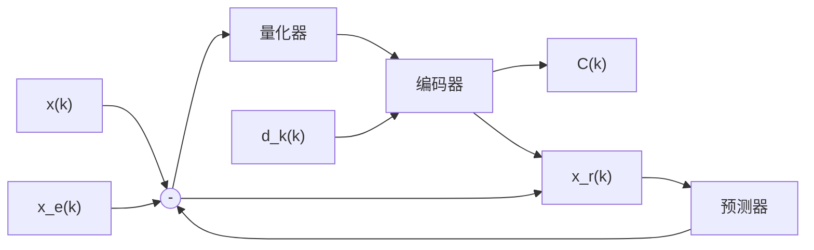
</details>

(a) 编码器


<details>
<summary>flowchart</summary>

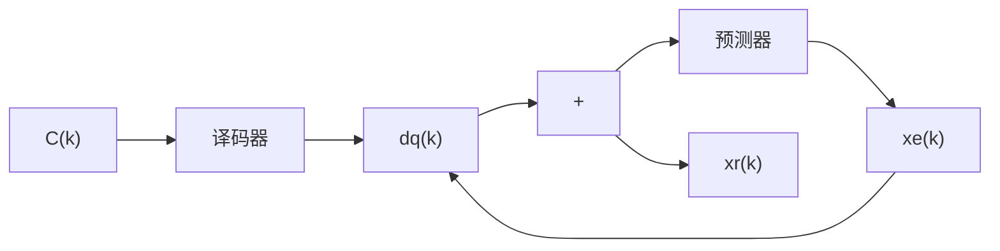
</details>

(b) 译码器  
图 3.5.2 DPCM 编码器与译码器

DPCM 中的预测器可以有多种不同的实现方案。图 3.5.2 中的预测器采用的是一种利用重建信号 $x_{\mathrm{r}}(k)$ 的过去值，来计算当前输入 $x(k)$ 的预测值 $x_{\mathrm{e}}(k)$ 的方法：

$$
x _ {\mathrm{e}} (k) = f \left[ x _ {\mathrm{r}} (k - 1), x _ {\mathrm{r}} (k - 2), \dots , x _ {\mathrm{r}} (k - N) \right] \tag {3.5.1}
$$

下面深入分析预测编码可以提高传输效率的原因。如图 3.5.3 所示，当输入信号 $x(k)$ 的样值间具有较强的相关性时，相邻样点取值的差值 $\left|\Delta x\right|$ 小的概率很大。预测值 $x_{e}(k)$ 在大多数情况下都能满足如下条件：

$$
\left| d (k) \right| = \left| x (k) - x _ {\mathrm{e}} (k) \right| \ll \left| x (k) \right| \tag {3.5.2}
$$


<details>
<summary>line</summary>

| Time Point | Description |
| --- | --- |
| t_k | Time interval at Δx |
| t_{k+1} | Time interval at Δx |
</details>

图 3.5.3 相邻信号的取值通常具有很强的相关性

再来看对于 DPCM 编码，误差由什么因素决定。DPCM 编码的误差定义为

$$
e (k) = x (k) - x _ {\mathrm{r}} (k) \tag {3.5.3}
$$

观察图3.5.2，很容易得到结果

$$
e (k) = x (k) - x _ {\mathrm{r}} (k) = \left(x _ {\mathrm{e}} (k) + d (k)\right) - \left(x _ {\mathrm{e}} (k) + d _ {\mathrm{q}} (k)\right) = d (k) - d _ {\mathrm{q}} (k) \tag {3.5.4}
$$

由此可见，DPCM编码的误差由量化误差决定。由式（3.5.2），一般有 $\left|d(k)\right|\ll\left|x(k)\right|$ ，所以在保持相同的最大量化误差的前提下，DPCM编码只需传递变化的信息，较之PCM编码，每个样值所需的比特位数较少，因此对同样的量化误差，DPCM编码有更高的传输效率。从另外一个角度来说，如果对每个样值，DPCM编码与PCM编码采用相同的比特位来表示，因为 $\left|d(k)\right|\ll\left|x(k)\right|$ ，DPCM编码有更小的量化误差，如果DPCM编码保持与PCM有相同的传输效率，那么DPCM编码有更好的话音质量。

DPCM 编码的性能分析 一般地, 若已知信号 $x(k)$ 的幅度取值的分布特性, 则信号 $x(k)$ 的平均功率可用 $x^{2}(k)$ 的统计平均值 $S_{x} = E[x^{2}(k)]$ 来表示; 误差 $e(k)$ 的影响相当于编码过程引入的噪声干扰。 $e(k)$ 是一个随机变量, 其统计平均功率可表示为 $N_{e} = E[e^{2}(k)]$ 。由此, DPCM 编码的信噪比可表示为

$$
\mathrm{SNR} = \frac {S _ {x}}{N _ {e}} = \frac {E \left[ x ^ {2} (k) \right]}{E \left[ e ^ {2} (k) \right]} = \frac {E \left[ x ^ {2} (k) \right]}{E \left[ d ^ {2} (k) \right]} \frac {E \left[ d ^ {2} (k) \right]}{E \left[ e ^ {2} (k) \right]} \tag {3.5.5}
$$

若定义预测增益为

$$
G _ {\mathrm{p}} = \frac {E \left[ x ^ {2} (k) \right]}{E \left[ d ^ {2} (k) \right]} \tag {3.5.6}
$$

则量化信噪比可以表示为

$$
\mathrm{SNR} _ {\mathrm{q}} = \frac {E \left[ d ^ {2} (k) \right]}{E \left[ e ^ {2} (k) \right]} \tag {3.5.7}
$$

式（3.5.5）定义的 DPCM 编码的信噪比可进一步表示为

$$
\mathrm{SNR} = G _ {\mathrm{p}} \mathrm{SNR} _ {\mathrm{q}} \tag {3.5.8}
$$

由此可见，DPCM编码的性能主要由预测增益 $G_{p}$ 和量化信噪比 $SNR_{q}$ 决定。通常 $G_{p} \gg 1$ ，所以若DPCM的量化信噪比 $SNR_{q}$ 与PCM的量化信噪比 $SNR_{q}$ 相同，则DPCM总的信噪比性能要优于PCM；若DPCM总的信噪比性能与PCM相同，则 $SNR_{q}$ 可以取较小值，使得表示每个样值信息所需的比特位减少，相应地所需的传输速率得以降低。

## 3.5.2 信号预测的基本方法

通过上节的讨论可以了解到，DPCM编码的性能与预测增益 $G_{p}$ 有很大的关系。预测增益 $G_{p}$ 的大小实际上反映了预测的精度。预测结果越精确，平均预测误差 $E\left[d^{2}(k)\right]$ 越小，相应的预测增益 $G_{p}$ 就越大。能否对信号进行有效的预测，一方面与预测方法有关，另一方面与信号本身也有关。有些纯随机的信号，抽样值间没有任何的相关性，如白噪声等，这种类型的信号是一种不可预测的信号。本节将介绍极点预测器、零点预测器和零极点预测器这三种经典的信号预测方法。

极点预测器 极点预测器是利用过去的重建值 $x_{\mathrm{r}}(k-i)$ ， $i=1,2,\cdots$ 来预测当前输入值 $x(k)$ 的一种预测方法。一个 N 阶的极点预测器可以表示为

$$
x _ {\mathrm{e}} (k) = \sum_ {i = 1} ^ {N} a _ {i} x _ {\mathrm{r}} (k - i) \tag {3.5.9}
$$

式中， $a_{i}, i=1,2,\cdots,N$ 是一组常数，称为预测系数。一般地，若量化误差足够小，则可得

$$
d _ {\mathrm{q}} (k) \approx d (k) = x (k) - x _ {\mathrm{e}} (k) \approx x _ {\mathrm{r}} (k) - \sum_ {i = 1} ^ {N} a _ {i} x _ {\mathrm{r}} (k - i) \tag {3.5.10}
$$

在等式两边取 $Z$ 变换，可得

$$
D _ {\mathrm{q}} (Z) = X _ {\mathrm{r}} (Z) - \sum_ {i = 1} ^ {N} a _ {i} Z ^ {- i} X _ {\mathrm{r}} (Z) \tag {3.5.11}
$$

式中， $d_{\mathrm{q}}(k)\Leftrightarrow D_{\mathrm{q}}(Z),x_{\mathrm{r}}(k)\Leftrightarrow X_{\mathrm{r}}(Z)$ 。定义传递函数

$$
H (Z) = \frac {X _ {\mathrm{r}} (Z)}{D _ {\mathrm{q}} (Z)} \tag {3.5.12}
$$

则有

$$
H (Z) = \frac {X _ {\mathrm{r}} (Z)}{D _ {\mathrm{q}} (Z)} = \frac {1}{1 - \sum_ {i = 1} ^ {N} a _ {i} Z ^ {- i}} \tag {3.5.13}
$$

式（3.5.13）确定的传递函数只有极点，所以将其称之为极点预测器。采用极点预测器的 DPCM 编码器和译码器如图 3.5.4 所示。


<details>
<summary>flowchart</summary>

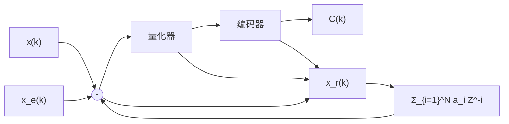
</details>

(a) 编码器


<details>
<summary>flowchart</summary>

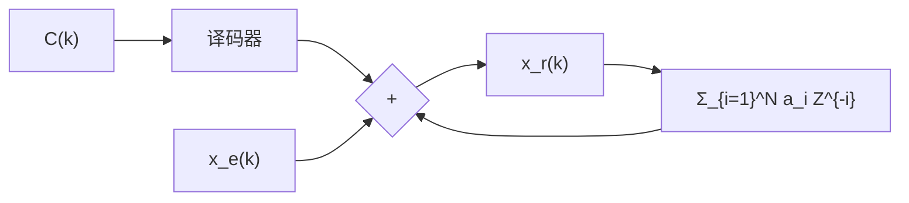
</details>

(b) 译码器  
图 3.5.4 采用极点预测器的 DPCM 编码器和译码器

零点预测器 零点预测器是利用过去的差值 $d_{\mathrm{q}}(k-i)$ ， $i=1,2,\cdots$ 来预测当前输入值 $x(k)$ 的一种预测方法。一个 M 阶的零点预测器可以表示为

$$
x _ {\mathrm{e}} (k) = \sum_ {i = 1} ^ {M} b _ {i} d _ {\mathrm{q}} (k - i) \tag {3.5.14}
$$

式中， $b_{i}, i=1,2,\cdots,M$ 为相应的预测系数。信号的重建值可以表示为

$$
x _ {\mathrm{r}} (k) = x _ {\mathrm{e}} (k) + d _ {\mathrm{q}} (k) = \sum_ {i = 1} ^ {M} b _ {i} d _ {\mathrm{q}} (k - i) + d _ {\mathrm{q}} (k) \tag {3.5.15}
$$

在上式的两边取 $Z$ 变换得

$$
X _ {\mathrm{r}} (D) = \sum_ {i = 1} ^ {M} b _ {i} Z ^ {- i} D _ {\mathrm{q}} (Z) + D _ {\mathrm{q}} (Z) \tag {3.5.16}
$$

可得相应的传递函数

$$
H (Z) = \frac {X _ {\mathrm{r}} (Z)}{D _ {\mathrm{q}} (Z)} = 1 + \sum_ {i = 1} ^ {M} b _ {i} Z ^ {- i} \tag {3.5.17}
$$

因为传递函数 $H(Z)$ 只含零点，所以称为零点预测器。采用零点预测器的DPCM编码器和译码器如图3.5.5所示。


<details>
<summary>flowchart</summary>

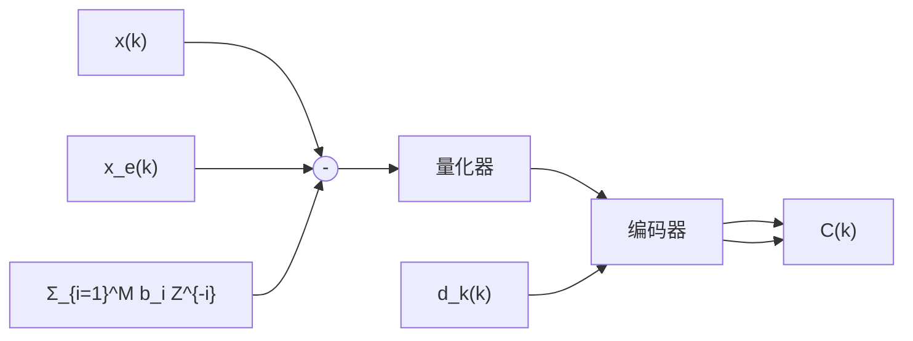
</details>

(a) 编码器


<details>
<summary>flowchart</summary>

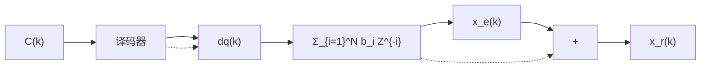
</details>

(b) 译码器  
图 3.5.5 采用零点预测器的 DPCM 编码器和译码器

零极点预测器 若同时使用过去的重建值 $x_{\mathrm{r}}(k-i)$ ， $i=1,2,\cdots$ 与过去的差值 $d_{\mathrm{q}}(k-i)$ ， $i=1,2,\cdots$ 的组合来预测当前输入值 $x(k)$ ，如图 3.5.6 所示，则有

$$
x _ {\mathrm{e}} (k) = \sum_ {i = 1} ^ {N} a _ {i} x _ {\mathrm{r}} (k - i) + \sum_ {i = 1} ^ {M} b _ {i} d _ {\mathrm{q}} (k - i) \tag {3.5.18}
$$

而重建值则为

$$
x _ {\mathrm{r}} (k) = x _ {\mathrm{e}} (k) + d _ {\mathrm{q}} (k) = \sum_ {i = 1} ^ {N} a _ {i} x _ {\mathrm{r}} (k - i) + \sum_ {i = 1} ^ {M} b _ {i} d _ {\mathrm{q}} (k - i) + d _ {\mathrm{q}} (k) \tag {3.5.19}
$$

在上式两边同时取 $Z$ 变换得

$$
\begin{array}{l} X _ {\mathrm{r}} (Z) = \sum_ {i = 1} ^ {N} a _ {i} Z ^ {- i} X _ {\mathrm{r}} (Z) + \sum_ {i = 1} ^ {M} b _ {i} Z ^ {- i} D _ {\mathrm{q}} (Z) + D _ {\mathrm{q}} (Z) \\ = X _ {\mathrm{r}} (Z) \sum_ {i = 1} ^ {N} a _ {i} Z ^ {- i} + D _ {\mathrm{q}} (Z) \left(\sum_ {i = 1} ^ {M} b _ {i} Z ^ {- i} + 1\right) \tag {3.5.20} \\ \end{array}
$$

整理后可得

$$
H (Z) = \frac {X _ {\mathrm{r}} (Z)}{D _ {\mathrm{q}} (Z)} = \frac {1 + \sum_ {i = 1} ^ {M} b _ {i} Z ^ {- i}}{1 - \sum_ {i = 1} ^ {N} a _ {i} Z ^ {- i}} \tag {3.5.21}
$$

传递函数 $H(Z)$ 同时包含零点和极点, 所以称为零极点预测器。采用零极点预测器的 DPCM 编码器和译码器如图 3.5.6 所示。


<details>
<summary>flowchart</summary>

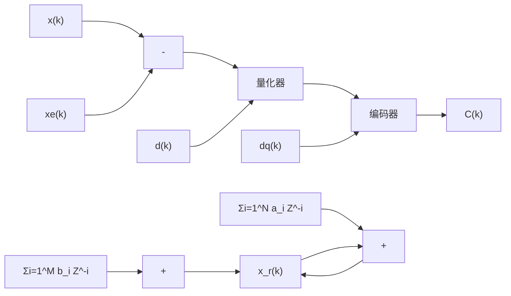
</details>

(a) 编码器


<details>
<summary>flowchart</summary>

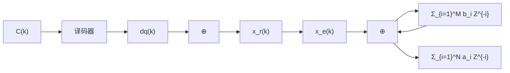
</details>

(b) 译码器  
图 3.5.6 采用零极点预测器的 DPCM 编码器和译码器

最佳预测系数 以上分析了三种不同形式的预测器，但这仅仅确定了其结构，进一步还需要确定预测系数的取值。下面以极点预测器为例，分析如何求解最佳的预测系数值。最佳预测器应该能够使预测误差 $d(k)=x(k)-x_{\mathrm{e}}(k)$ 达到最小。因为信号 $x(k)$ 是随机过程，同时预测误差 $d(k)$ 的取值有正有负，预测器的性能应从统计平均的意义上来判断。这里最佳预测器是指能够使 $d(k)$ 的均方值 $E\left[d^{2}(k)\right]$ 达到最小的预测器。

由 $d(k) = x(k) - x_{\mathrm{e}}(k)$ 及式（3.5.9），可得

$$
E \Big [ d ^ {2} (k) \Big ] = E \Big [ \Big (x (k) - x _ {\mathrm{e}} (k) \Big) ^ {2} \Big ] = E \Bigg [ \Big (x (k) - \sum_ {i = 1} ^ {N} a _ {i} x _ {\mathrm{r}} (k - i) \Big) ^ {2} \Bigg ] \tag {3.5.22}
$$

由式（3.5.3）和式（3.5.4）可知，输入值与重建值的误差 $e(k)=x(k)-x_{\mathrm{r}}(k)$ 就是量化误差，若忽略量化误差，则有 $x_{\mathrm{r}}(k)=x(k)$ ，代入式（3.5.22），可得

$$
E \Big [ d ^ {2} (k) \Big ] = E \Bigg [ \Big (x (k) - \sum_ {i = 1} ^ {N} a _ {i} x (k - i) \Big) ^ {2} \Bigg ] \tag {3.5.23}
$$

记最佳的预测系数为 $a_{i,opt}, i=1,2,\cdots,N$ ，根据偏导数求函数极值的方法，令

$$
\frac {\partial E \left[ d ^ {2} (k) \right]}{\partial a _ {i}} = - E \left[ 2 \left(x (k) - \sum_ {j = 1} ^ {N} a _ {j} x (k - j)\right) x (k - i) \right] = 0, \quad i = 1, 2, \dots , N \tag {3.5.24}
$$

可得

$$
E \big [ x (k) x (k - i) \big ] - \sum_ {j = 1} ^ {N} a _ {j} E \big [ x (k - j) x (k - i) \big ] = 0, \quad i = 1, 2, \dots , N \tag {3.5.25}
$$

$$
R (k, k - i) - \sum_ {j = 1} ^ {N} a _ {j} R (k - j, k - i) = 0, \quad i = 1, 2, \dots , N \tag {3.5.26}
$$

理论上，假定已知 $x(k)$ 的相关函数，可以求解出相应的最佳预测系数。

(1) 如果 $x(k)$ 是一个非平稳的随机过程，那么最佳预测系数将是一组与 k 有关的变量 $a_{i,\mathrm{opt}}(k)$ ， $i=1,2,\cdots,N$ ，这意味着每做一次预测，系数都要做相应的调整。

(2) 如果 $x(k)$ 是一个平稳的随机过程，式（3.5.26）变为

$$
\sum_ {j = 1} ^ {N} a _ {j, \mathrm{opt}} R (i - j) = R (i), \quad i = 1, 2, \dots , N \tag {3.5.27}
$$

对于实随机变量，有 $R(\tau)=R(-\tau)$ ，式（3.5.27）用矩阵形式可表示为

$$
\left[ \begin{array}{c c c c} R (0) & R (1) & \dots & R (N - 1) \\ R (1) & R (0) & \dots & R (N - 2) \\ \vdots & \vdots & \ddots & \vdots \\ R (N - 1) & R (N - 2) & \dots & R (0) \end{array} \right] \left[ \begin{array}{c} a _ {1, \mathrm{opt}} \\ a _ {2, \mathrm{opt}} \\ \vdots \\ a _ {N, \mathrm{opt}} \end{array} \right] = \left[ \begin{array}{c} R (1) \\ R (2) \\ \dots \\ R (N) \end{array} \right] \tag {3.5.28}
$$

假定上述的相关函数矩阵是可逆的，则可求得最佳预测系数为

$$
\left[ \begin{array}{c} a _ {1, \text {opt}} \\ a _ {2, \text {opt}} \\ \vdots \\ a _ {N, \text {opt}} \end{array} \right] = \left[ \begin{array}{c c c c} R (0) & R (1) & \dots & R (N - 1) \\ R (1) & R (0) & \dots & R (N - 2) \\ \vdots & \vdots & \ddots & \vdots \\ R (N - 1) & R (N - 2) & \dots & R (0) \end{array} \right] ^ {- 1} \left[ \begin{array}{c} R (1) \\ R (2) \\ \vdots \\ R (N) \end{array} \right] \tag {3.5.29}
$$

由此可见，对于平稳随机过程，其最佳预测系数 $a_{i,opt}, i=1,2,\cdots,N$ 是一组常数。

用类似的分析方法，可以得到零点预测器和零极点预测器的最佳预测系数。

最佳预测的“几何”意义 在一般的N维向量空间中，若向量 $X=(x_{1},x_{2},\cdots,x_{N})$ 和 $Y=(y_{1},y_{2},\cdots,y_{N})$ 正交，则它们的内积（点乘）为零，即有

$$
\boldsymbol {X} \cdot \boldsymbol {Y} ^ {\mathrm{T}} = (x _ {1}, x _ {2}, \dots , x _ {N}) \cdot (y _ {1}, y _ {2}, \dots , y _ {N}) ^ {\mathrm{T}} = \sum_ {i = 1} ^ {N} x _ {i} y _ {i} = 0 \tag {3.5.30}
$$

即当两个向量相互正交时，其中一个向量在另一个向量上的投影为零。此时这两个向量是完全不相关的，换句话说，此时向量 X 与 Y 间没有任何有关联的成分。

对于一个极点最佳预测器，若忽略量化误差，其预测值可以表示为

$$
x _ {\mathrm{e,opt}} (k) = \sum_ {i = 1} ^ {N} a _ {i, \mathrm{opt}} x (k - i) \tag {3.5.31}
$$

相应地，预测误差为

$$
d _ {\mathrm{opt}} (k) = x (k) - x _ {\mathrm{e,opt}} (k) = x (k) - \sum_ {i = 1} ^ {N} a _ {i, \mathrm{opt}} x (k - i) \tag {3.5.32}
$$

由此进一步可得

$$
E \Big [ d _ {\mathrm{opt}} (k) x _ {\mathrm{e,opt}} (k) \Big ] = E \Big [ \Big (x (k) - x _ {\mathrm{e,opt}} (k) \Big) x _ {\mathrm{e,opt}} (k) \Big ] = E \Big [ x (k) x _ {\mathrm{e,opt}} (k) \Big ] - E \Big [ x _ {\mathrm{e,opt}} ^ {2} (k) \Big ] \tag {3.5.33}
$$

其中右式中的第一式为

$$
\begin{array}{l} E \Big [ x (k) x _ {\mathrm{e,opt}} (k) \Big ] = E \Big [ x (k) \sum_ {i = 1} ^ {N} a _ {i, \mathrm{opt}} x (k - i) \Big ] \tag {3.5.34} \\ = \sum_ {i = 1} ^ {N} a _ {i, \mathrm{opt}} E [ x (k) x (k - i) ] = \sum_ {i = 1} ^ {N} a _ {i, \mathrm{opt}} R (i) \\ \end{array}
$$

由式（3.5.27），有 $R(i) = \sum_{j = 1}^{N}a_{j,\mathrm{opt}}R(i - j)$ ，将其代入上式可得

$$
\begin{array}{l} E \left[ x (k) x _ {\mathrm{e,opt}} (k) \right] = \sum_ {i = 1} ^ {N} a _ {i, \text {opt}} R (i) = \sum_ {i = 1} ^ {N} a _ {i, \text {opt}} \sum_ {j = 1} ^ {N} a _ {j, \text {opt}} R (i - j) \tag {3.5.35} \\ = \sum_ {i = 1} ^ {N} \sum_ {j = 1} ^ {N} a _ {i, \mathrm{opt}} a _ {j, \mathrm{opt}} R (i - j) \\ \end{array}
$$

式（3.5.33）的右式中的第二式为

$$
\begin{array}{l} E \left[ x _ {\mathrm{e,opt}} ^ {2} (k) \right] = E \left[ \sum_ {i = 1} ^ {N} a _ {i, \text {opt}} x (k - i) \sum_ {j = 1} ^ {N} a _ {j, \text {opt}} x (k - j) \right] \\ = \sum_ {i = 1} ^ {N} \sum_ {j = 1} ^ {N} a _ {i, \text {opt}} a _ {j, \text {opt}} E [ x (k - i) x (k - j) ] \tag {3.5.36} \\ = \sum_ {i = 1} ^ {N} \sum_ {j = 1} ^ {N} a _ {i, \text {opt}} a _ {j, \text {opt}} R (i - j) \\ \end{array}
$$

将式（3.5.35）和式（3.5.36）的结果代入式（3.5.33），可得

$$
E \left[ d _ {\mathrm{opt}} (k) x _ {\mathrm{e,opt}} (k) \right] = E \left[ \left(x (k) - x _ {\mathrm{e,opt}} (k)\right) x _ {\mathrm{e,opt}} (k) \right] = 0 \tag {3.5.37}
$$

即从统计上说， $d_{\mathrm{opt}}(k)$ 与 $x_{\mathrm{e,opt}}(k)$ 是正交的，图 3.5.7 给出了描述其正交性的一个形象示意图，说明最佳预测值 $x_{\mathrm{e,opt}}(k)$ 已充分利用了过去已知值中可以预测 $x(k)$ 的所有成分， $x(k)$ 中剩下的 $x_{\mathrm{e,opt}}(k)$ 不可预测的部分与 $x_{\mathrm{e,opt}}(k)$ 是完全不相关的。

最佳预测增益 由式（3.5.23），可得最小预测均方误差值为

$$
\begin{array}{l} \min E \left[ d ^ {2} (k) \right] = E \left[ \left(x (k) - \sum_ {i = 1} ^ {N} a _ {i, \text {opt}} x (k - i)\right) ^ {2} \right] \\ = E \left[ \left(x (k) - \sum_ {i = 1} ^ {N} a _ {i, \text {opt}} x (k - i)\right) x (k) \right] - E \left[ \left(x (k) - \sum_ {i = 1} ^ {N} a _ {i, \text {opt}} x (k - i)\right) \sum_ {i = 1} ^ {N} a _ {i, \text {opt}} x (k - i) \right] \tag {3.5.38} \\ = E \left[ \left(x (k) - \sum_ {i = 1} ^ {N} a _ {i, \mathrm{opt}} x (k - i)\right) x (k) \right] = E \left[ x ^ {2} (k) \right] - \sum_ {i = 1} ^ {N} a _ {i, \mathrm{opt}} R (i) \\ \end{array}
$$

其中从第二个等式到第三个等式利用了式（3.5.37）的结果。由此可得最佳预测增益

$$
G _ {\mathrm{p}} = \frac {E \left[ x ^ {2} (k) \right]}{E \left[ x ^ {2} (k) \right] - \sum_ {i = 1} ^ {N} a _ {i , \text {opt}} R (i)} = \frac {1}{1 - \sum_ {i = 1} ^ {N} a _ {i , \text {opt}} R (i) / E \left[ x ^ {2} (k) \right]} \tag {3.5.39}
$$

因为不同说话人的统计特性各异, 最佳预测系数 $a_{i,\mathrm{opt}}, i = 1,2,\dots,N$ 和可获得的预测增益 $G_{\mathrm{p}}$ 也会有所不同。针对语音信号, 采用不同预测阶数 $N$ 的大量统计实验表明, $G_{\mathrm{p}}$ 的取值范围大致在图3.5.8所示的两条实线之间, 虚线表示其平均值。由图可见, 当阶数 $N > 2$ 后, $G_{\mathrm{p}}$ 迅速趋于饱和, 饱和值在 $6 \sim 12 \mathrm{~dB}$ 之间, 因此阶数 $N$ 一般取 $3 \sim 5$ 。


<details>
<summary>text_image</summary>

x(k)
d_opt(k)
x_{e,opt}(k)
</details>

图 3.5.7 最佳预测值与差值正交的示意图


<details>
<summary>line</summary>

| N | Solid Line (Gp) | Dashed Line (Gp) | Thick Solid Line (Gp) |
|---|---|---|---|
| 0 | 0 | 0 | 0 |
| 1 | ~7.5 | ~6.5 | ~5.5 |
| 2 | ~9.0 | ~8.0 | ~7.0 |
| 3 | ~9.5 | ~8.5 | ~7.5 |
| 4 | ~10.0 | ~8.8 | ~7.6 |
| 5 | ~10.5 | ~9.0 | ~7.7 |
| 6 | ~10.8 | ~9.2 | ~7.8 |
| 7 | ~10.9 | ~9.3 | ~7.9 |
| 8 | ~10.9 | ~9.4 | ~8.0 |
| 9 | ~10.9 | ~9.5 | ~8.1 |
</details>

图 3.5.8 预测增益与预测阶数的关系

## 3.5.3 自适应差分脉冲编码调制

自适应预测 由式（3.5.26）和式（3.5.27）可知，一般地，最佳预测系数是时间的函数，仅当信号是平稳随机过程时，最佳预测系数才是常数。实际的语音信号是一个非平稳的随机过程，仅在一个较短的时间段内，可近似地将其视为平稳的随机过程。要获得最佳的预测效果，需要动态地调整预测系数，因此预测系数应是一组时变的参数 $a_{i}(k), i=1,2,\cdots,N$ ，预测值为

$$
x _ {\mathrm{e}} (k) = \sum_ {i = 1} ^ {N} a _ {i} (k) x (k - i) \tag {3.5.40}
$$

相应地，预测误差可表示为

$$
d (k) = x (k) - x _ {\mathrm{e}} (k) = x (k) - \sum_ {i = 1} ^ {N} a _ {i} (k) x (k - i) \tag {3.5.41}
$$

预测系数通常根据预测误差 $d(k)$ 的变化自适应地进行调整。有关预测系数的调整方法，在自适应信号处理中已有大量的研究。本节简要介绍其中最基本的最小均方算法（Least Mean Square，LMS）[5]。

若记预测误差 $d(k)$ 的均方值为 $J = E\left[d^{2}(k)\right]$ ，令

$$
g _ {i} (k) = \frac {\partial J}{\partial a _ {i}} = \frac {\partial E \left[ d ^ {2} (k) \right]}{\partial a _ {i}}, \quad i = 1, 2, \dots , N \tag {3.5.42}
$$

将具体的关系式代入得

$$
\begin{array}{l} g _ {i} (k) = \frac {\partial E \left[ d ^ {2} (k) \right]}{\partial a _ {i}} = \frac {\partial E \left[ \left(x (k) - \sum_ {i = 1} ^ {N} a _ {i} (k) x (k - i)\right) ^ {2} \right]}{\partial a _ {i}} \\ = \frac {\partial \left(E \left[ x ^ {2} (k) \right] - 2 E \left[ \sum_ {i = 1} ^ {N} a _ {i} x (k) x (k - i) \right] + E \left[ \sum_ {j = 1} ^ {N} \sum_ {i = 1} ^ {N} a _ {i} a _ {j} x (k - i) x (k - j) \right]\right)}{\partial a _ {i}} \tag {3.5.43} \\ = - 2 E [ x (k) x (k - i) ] + 2 \sum_ {j = 1} ^ {N} a _ {j} E [ x (k - i) x (k - j) ] \\ \end{array}
$$

式中， $a_{j} = a_{j}(k)$ ，第 $k + 1$ 时刻预测系数 $a_{j}(k + 1)$ 可取值为

$$
a _ {i} (k + 1) = a _ {i} (k) - \frac {1}{2} \mu g _ {i} (k), \quad i = 1, 2, \dots , N \tag {3.5.44}
$$

严格来说，式（3.5.43）中的相关运算需要知道信号 $x(k)$ 的统计特性分布，这在实际系统中一般是难以实现的。为避免式（3.5.43）中的求数学期望的运算，可用如下方法近似地估计 $g_{i}(k)$ ：

$$
\hat {g} _ {i} (k) = - 2 x (k) x (k - i) + 2 \sum_ {j = 1} ^ {N} \hat {a} _ {j} (k) x (k - i) x (k - j) \tag {3.5.45}
$$

代入式（3.5.44）中可得预测系数的估计值

$$
\begin{array}{l} \hat {a} _ {i} (k + 1) = \hat {a} _ {i} (k) - \frac {1}{2} \mu \hat {g} _ {i} (k) \\ = \hat {a} _ {i} (k) - \frac {1}{2} \mu \left(- 2 x (k) x (k - i) + 2 \sum_ {j = 1} ^ {N} \hat {a} _ {j} (k) x (k - i) x (k - j)\right) \tag {3.5.46} \\ = \hat {a} _ {i} (k) + \mu x (k - i) \left(x (k) - \sum_ {j = 1} ^ {N} \hat {a} _ {j} (k) x (k - j)\right) \\ = \hat {a} _ {i} (k) + \mu x (k - i) d (k) \\ \end{array}
$$

式（3.5.44）和式（3.5.46）中的参数 $\mu$ 是预测系数调整的步长，取值范围一般为

$$
0 <   \mu <   \frac {2}{N \cdot S _ {\mathrm{max}}} \tag {3.5.47}
$$

式中，N 是预测器的阶数， $S_{\max}$ 是 $x(k)$ 功率密度谱的最大值。

自适应量化 前面讨论的 DPCM，都假定采用的是均匀量化的方法。而实际语音信号的功率变化范围很大，可达 45dB。要获得好的量化效果，量化器的量化电平和分层电平，应随着输入信号特性的变化而自适应地改变。为简单起见，可主要根据输入量化器的差值信号 $d(k)$ 的方差 $\sigma_{\mathrm{d}}^{2}(k)$ 的大小变化进行调整。语音信号样点间具有较大的相关性，同时差值的增大表示 $\sigma_{\mathrm{d}}^{2}(k)$ 有增大的趋势，因此第 k 时刻

$\sigma_{d}^{2}(k)$ 的估计值可由下式计算：

$$
\hat {\sigma} _ {\mathrm{d}} ^ {2} (k) = \alpha \hat {\sigma} _ {\mathrm{d}} ^ {2} (k - 1) + (1 - \alpha) d _ {\mathrm{q}} ^ {2} (k - 1) \tag {3.5.48}
$$

式中， $\alpha$ 是常数， $0 < \alpha < 1$ ，其取值的大小反映 $\sigma_{\mathrm{d}}^{2}(k)$ 前后值的关联程度， $d_{\mathrm{q}}(k)$ 是差值信号 $d(k)$ 经自适应量化后的取值。 $\hat{\sigma}_{\mathrm{d}}^{2}(k-1)$ 是 $\sigma_{\mathrm{d}}^{2}(k-1)$ 的估计值。有关的研究表明 $^{[6]}$ ，量化间隔 $\Delta(k)$ 应自适应地随 $\sigma_{\mathrm{d}}^{2}(k)$ 的变化而改变，因此有

$$
\frac {\Delta (k)}{\Delta (k - 1)} = \left(\frac {\hat {\sigma} _ {\mathrm{d}} ^ {2} (k)}{\hat {\sigma} _ {\mathrm{d}} ^ {2} (k - 1)}\right) ^ {1 / 2} = \left(\alpha + (1 - \alpha) \frac {d _ {\mathrm{q}} ^ {2} (k - 1)}{\hat {\sigma} _ {\mathrm{d}} ^ {2} (k - 1)}\right) ^ {1 / 2} \tag {3.5.49}
$$

由此可得

$$
\Delta (k) = \Delta (k - 1) \Bigg (\alpha + (1 - \alpha) \frac {d _ {\mathrm{q}} ^ {2} (k - 1)}{\hat {\sigma} _ {\mathrm{d}} ^ {2} (k - 1)} \Bigg) ^ {1 / 2} \tag {3.5.50}
$$

式中， $\alpha$ 是取值范围为 $0 < \alpha < 1$ 的常数。若差值信号的 $\sigma_{\mathrm{d}}^{2}(k)$ 变化较大，在式（3.5.48）中， $d_{\mathrm{q}}^{2}(k - 1)$ 成为变化的主要因素，量化间隔 $\Delta(k)$ 可近似地视为 $d_{\mathrm{q}}^{2}(k - 1)$ 的函数，因为 $d_{\mathrm{q}}(k - 1)$ 与其编码输出 $C(k - 1)$ 有确定的关系，量化间隔 $\Delta(k)$ 又可表示为

$$
\begin{array}{l} \Delta (k) = \Delta (k - 1) F _ {1} \left(d _ {\mathrm{q}} ^ {2} (k - 1)\right) \tag {3.5.51} \\ = \Delta (k - 1) F _ {2} \left(\left| d _ {\mathrm{q}} ^ {2} (k - 1) \right|\right) = \Delta (k - 1) F \left(\left| C (k - 1) \right|\right) \\ \end{array}
$$

式中， $F_{1}(\cdot), F_{2}(\cdot)$ 和 $F(\cdot)$ 均表示某种函数关系。 $\left|C(k-1)\right|$ 与 $F\left(\left|C(k-1)\right|\right)$ 间的函数关系通过大量实验，得到了相应的查找表。表 3.5.1 给出了量化电平数 M=16 时， $\left|C(k-1)\right|$ 与 $F\left(\left|C(k-1)\right|\right)$ 间的函数关系表，显然这是一种非线性的关系特性。

表 3.5.1 $F\left(\left|C(k-1)\right|\right)$ 函数表（M=16）

| $\left\| C(k-1) \right\|$ | 1 | 2 | 3 | 4 | 5 | 6 | 7 | 8 |
|---|---|---|---|---|---|---|---|---|
| $F\left(\left\| C(k-1) \right\|\right)$ | 0.9 | 0.9 | 0.9 | 0.9 | 1.2 | 1.6 | 2.0 | 2.4 |

自适应差分编码调制（ADPCM）国际电联 ITU-T G.721 建议中制定的标准 ADPCM 编译码器是一个较为复杂的系统[4]，但其编码器和译码器的基本工作原理可如图 3.5.9(a)和(b)所示。由图可见，在 ADPCM 编译码器中，综合利用了自适应的预测和量化方法。图中在重建信号 $d(k)$ 时，增加了自适应逆量化器，用于完成自适应量化的差值 $d_{\mathrm{q}}(k)$ 和实际差值 $d(k)$ 之间的变换。另外，如果输入 ADPCM 的是 $A$ 律或 $\mu$ 律的对数 PCM 代码，因为这些代码不能直接运算，此时在输入端还需要增加 $A$ 律或 $\mu$ 律的对数 PCM 到线性 PCM 的转换单元模块。


<details>
<summary>flowchart</summary>

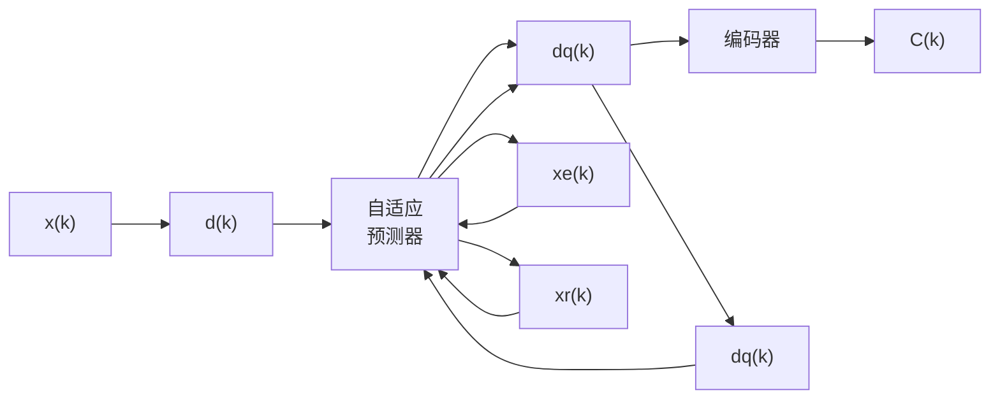
</details>

(a) 编码器


<details>
<summary>flowchart</summary>

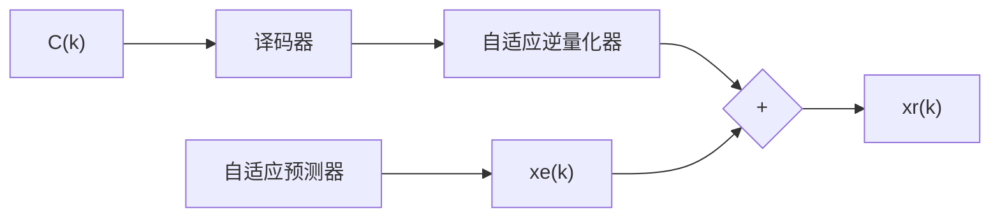
</details>

(b) 译码器  
图 3.5.9 ADPCM 编码器和译码器原理图

## 3.6 增量调制（ $\Delta \mathbf{M}$ 调制）

PCM 和 DPCM 编码器对每个样点的编码输出是一个码组，或称为一个码字。在接收端对这类码组的译码过程中，除了比特同步，还需要码组同步，否则就会造成码组划分时的混乱，不能够正确地译码；另外这些编码对传输过程中引入的误码也比较敏感，特别是高比特位出错时，往往会产生较大的误差。在许多需要对抗高误码率的应用场合，如在军用通信系统中，希望采用同步更为简单、容错性能更为强壮的编码方式。本节要介绍的增量调制，就具有上述特点。增量调制，英文为 Delta Modulation，所以通常也称 $\Delta M$ 调制。

## 3.6.1 简单增量调制

简单 $\Delta \mathrm{M}$ 调制的工作原理 $\Delta \mathrm{M}$ 调制的编码器和译码器的结构与DPCM编码器和译码器的结构非常相似, 本质上也是一种基于预测的编码方法, 但对每个样点编码后只输出1比特的信息。图3.6.1给出了简单 $\Delta \mathrm{M}$ 调制编码器和译码器的原理结构, 图中 $x(t)$ 表示输入模拟信号, $x_{l}(t)$ 表示重建信号, $d(t)$ 表示差值信号, $C(n)$ 表示编码输出, $\hat{x}(t)$ 表示低通滤波后的输出信号。


<details>
<summary>flowchart</summary>

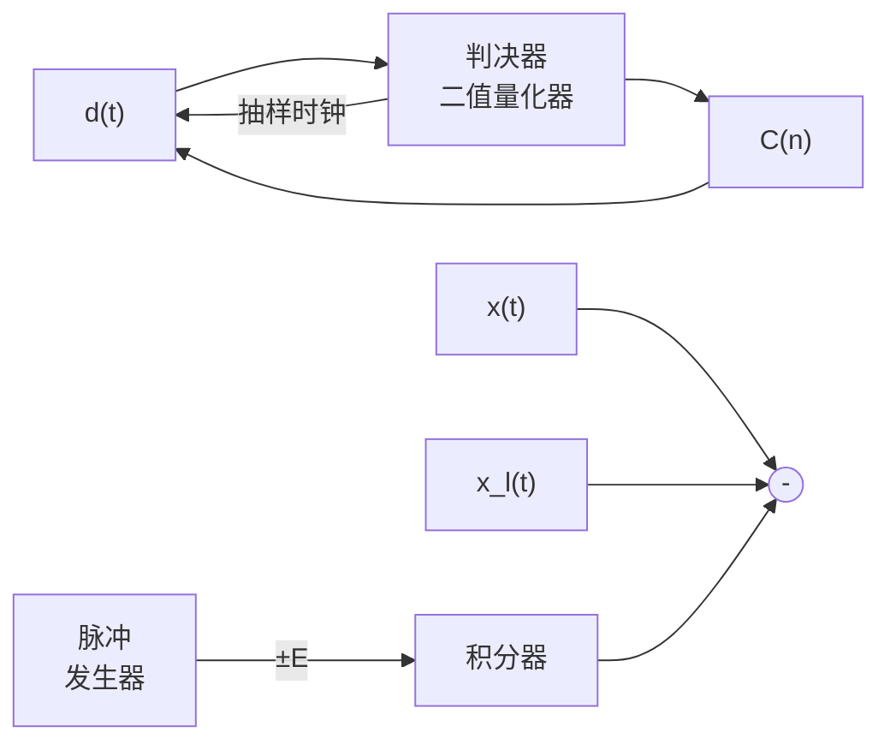
</details>

(a) 编码器


<details>
<summary>flowchart</summary>

```mermaid
graph LR
  A["C(n)"] --> B["脉冲发生器"]
  B -->|±E| C["积分器"]
  C -->|x₁t| D["低通滤波器"]
  D -->|x̂t| E[""]
```
</details>

(b) 译码器  
图 3.6.1 简单 $\Delta M$ 调制编码器和译码器的原理结构

$\Delta M$ 调制的编码器和译码器也很容易通过数字电路或在数字信号处理器中实现，图 3.6.2 给出了简单 $\Delta M$ 调制编码器和译码器的数字实现方案。图中 $x(n)$ 表示输入模拟信号抽样值， $x_{l}(n)$ 表示重建信号的样值， $d(n)$ 表示差值样值， $C(n)$ 表示编码输出。这里所谓的样值，就是图 3.6.1 中相应信号的量化值。


<details>
<summary>flowchart</summary>

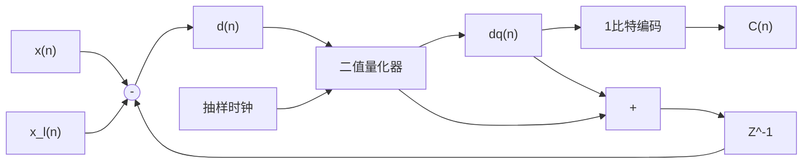
</details>

(a) 编码器


<details>
<summary>flowchart</summary>

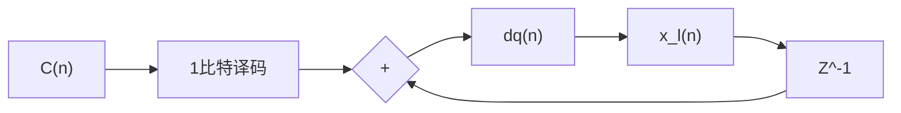
</details>

(b) 译码器  
图 3.6.2 数字结构的简单 $\Delta M$ 调制编码器和译码器

简单 $\Delta M$ 调制编码过程可用图 3.6.3 描述。其中差值信号为

$$
d (t) = x (t) - x _ {l} (t) \tag {3.6.1}
$$

1 比特的编码输出由差值信号的符号来决定：

$$
C (n) = \left\{ \begin{array}{l l} 1, & d (t) \geqslant 0 \\ 0, & d (t) <   0 \end{array} \right. \tag {3.6.2}
$$

图 3.6.2 中二值量化器的输出为

$$
d _ {\mathrm{q}} (n) = \left\{ \begin{array}{l l} + \Delta , & d (n) \geqslant 0 \\ - \Delta , & d (n) <   0 \end{array} = \Delta \operatorname{sgn} (d (n)) \right. \tag {3.6.3}
$$

式中， $\operatorname{sgn}(\cdot)$ 是符号函数，

$$
\operatorname{sgn} (x) = \left\{ \begin{array}{l l} + 1, & x \geqslant 0 \\ - 1, & x <   0 \end{array} \right. \tag {3.6.4}
$$

相应地，重建信号可表示为

$$
x _ {l} (t) = \int_ {- \infty} ^ {t} S _ {\mathrm{p}} (t) \mathrm{d} \tau \tag {3.6.5}
$$

式中， $S_{\mathrm{p}}(t) = \sum_{k = -\infty}^{\infty}p(t - kT_{\mathrm{S}})E\operatorname {sgn}\left(d(t - kT_{\mathrm{S}})\right)$ ， $p(t) = u(t) - u(t - T_{\mathrm{S}})$ 。脉冲发生器输出的脉冲幅度是 $+E$ 或 $-E$ ，经积分器后产生幅度为 $+\Delta$ 或 $-\Delta$ 的变化量。用数字方法实现的重建信号则可表示为

$$
x _ {l} (n) = x _ {l} (n - 1) + \Delta \operatorname{sgn} (d (n)) = \sum_ {k = - \infty} ^ {n} \Delta \operatorname{sgn} (d (k)) \tag {3.6.6}
$$

如图 3.6.3 所示，当抽样时刻到达时，输入信号 $x(t)$ （或 $x(n)$ ）与积分器输出的本地重建信号 $x_{l}(t)$ （或 $x_{l}(n)$ ）进行一次比较，然后根据比较的结果产生编码输出：

(1) 若 $x(t) \geqslant x_{l}(t)$ (或 $x(n) \geqslant x_{l}(n)$ ), $d(t) \geqslant 0$ , 编码输出为 $C(n) = 1$ , 同时脉冲发生器产生一个幅度为 $E$ (或 $\Delta$ ) 的正脉冲, 送入积分器 (或累加器) 做积分 (或累加) 运算, 为下一个抽样时刻到达的比较做准备。  
(2) 若 $x(t) < x_{l}(t)$ （或 $x(n) < x_{l}(n)$ ）， $d(t) < 0$ ，编码输出为 $C(n) = 0$ ，同时脉冲发生器产生一个幅度为 $E$ （或 $\Delta$ ）的负脉冲，送入积分器（或累加器）做积分（或累加）运算，为下一个抽样时刻到达的比较做准备。

由此可见，每次编码只产生1比特的输出，非常简单。译码过程与编码器中本地信号重建的工作过程完全一样，每收到一位编码值 $C(n)$ ，若 $C(n)=1$ ，则产生一个幅度为E（或 $\Delta$ ）的正脉冲送到积分器（或累加器）；反之，若 $C(n)=0$ ，则产生一个幅度为E（或 $\Delta$ ）的负脉冲送到积分器（或累加器）。由图3.6.3，对于积分器的输出，重建信号是图中虚线所示的锯齿波 $x_{l}(t)$ ；对于累加器的输出，重建信号是图中所示的阶梯波 $x_{l}(n)$ 。译码器中的低通滤波器用于对信号做平滑处理。

简单 $\Delta \mathrm{M}$ 调制的过载问题 在 $\Delta \mathrm{M}$ 调制编码过程中, 在每个抽样周期内, 积分器或累加器输出的最大变化量为 $\Delta$ , 相应的重建信号 $x_{l}(t)$ (或 $x_{l}(n)$ ) 在每个抽样周期 $T_{\mathrm{S}}$ 内的变化率为一常数

$$
\left| \frac {\mathrm{d} x _ {l} (t)}{\mathrm{d} t} \right| = \frac {\Delta}{T _ {\mathrm{S}}} \tag {3.6.7}
$$

若输入信号的变化率

$$
\left| \frac {\mathrm{d} x (t)}{\mathrm{d} t} \right| \leqslant \frac {\Delta}{T _ {\mathrm{S}}} \tag {3.6.8}
$$

分析图 3.6.3 中各曲线的关系，容易发现此时总有

$$
\left| d (t) \right| = \left| x (t) - x _ {l} (t) \right| \leqslant \Delta \tag {3.6.9}
$$

反之，若输入信号的变化率

$$
\left| \frac {\mathrm{d} x (t)}{\mathrm{d} t} \right| > \frac {\Delta}{T _ {\mathrm{S}}} \tag {3.6.10}
$$

则可能出现 $\Delta \mathrm{M}$ 调制编码器中重建信号 $x_{l}(t)$ 跟不上原 $x(t)$ 变化的所谓“过载”情况，图3.6.4描述了 $\Delta \mathrm{M}$ 调制编码出现严重过载时的情形。由图可见，在信号的AB段和CD段，此时重建信号 $x_{l}(t)$ 不能跟踪 $x(t)$

的变化，误差将迅速扩大，虽然编码器可以继续工作，但最终恢复的信号将有严重的失真。

由上面的分析，可定义 $\Delta M$ 调制编码无过载失真的最大跟踪斜率为

$$
\frac {\Delta}{T _ {\mathrm{S}}} = \Delta \cdot f _ {\mathrm{S}} \tag {3.6.11}
$$

对输入信号 $x(t)$ 进行 $\Delta M$ 调制编码时，不发生过载失真的条件为

$$
\max \left| \frac {\mathrm{d} x (t)}{\mathrm{d} t} \right| \leqslant \frac {\Delta}{T _ {\mathrm{S}}} = \Delta \cdot f _ {\mathrm{S}} \tag {3.6.12}
$$

通常把 $\max\left|\frac{\mathrm{d}x(t)}{\mathrm{d}t}\right|=\frac{\Delta}{T_{\mathrm{s}}}=\Delta\cdot f_{\mathrm{s}}$ 称为临界不过载的条件。信号的幅度和频率是影响 $\Delta M$ 调制编码过载的主要因素。


<details>
<summary>text_image</summary>

重建信号x₁(n)
原信号x(t)
重建信号x₁(t)
抽样脉冲
输出脉冲 +Δ
-Δ
编码输出C(n) 1 1 1 0 1 0 0 0 0 1
</details>

图 3.6.3 $\Delta M$ 调制编码工作原理示意图


<details>
<summary>text_image</summary>

过载失真
重建信号x_l(t)
重建信号x_l(n)
A
B
C
D
T_s
抽样脉冲
输出脉冲+Δ
-Δ
编码输出C(n) 1 1 1 1 1 1 0 1 0 0 0 0
</details>

图 3.6.4 $\Delta M$ 调制信号过载示意图

【例3.6.1】已知 $\Delta \mathrm{M}$ 调制编码输入的信号为 $x(t) = A\cos (\omega t + \theta)$ ，试求不发生过载失真的条件。

解：因为

$$
\frac {\mathrm{d} x (t)}{\mathrm{d} t} = - \omega A \sin (\omega t + \theta), \max \left| \frac {\mathrm{d} x (t)}{\mathrm{d} t} \right| = \omega A
$$

由式（3.6.12），无过载失真的条件为

$$
\max \left| \frac {\mathrm{d} x (t)}{\mathrm{d} t} \right| = \omega A \leqslant \frac {\Delta}{T _ {\mathrm{s}}} = \Delta \cdot f _ {\mathrm{s}} \tag * {\square}
$$

图 3.6.5 给出了输入信号为正弦波时， $\Delta M$ 调制编码临界过载和过载时的情形。由图 3.6.5(a) 可见，没有过载失真时，差值信号 $d(t)$ 的幅度基本上被控制在一个量化阶距范围内；由图 3.6.5(b) 可见，同样幅度的正弦波信号，当信号的频率增大 5 倍时，出现严重的过载现象，差值信号 $d(t)$ 的幅度迅速增大，在这种情况下，信号恢复时会产生严重的失真。

量化噪声 若 $\Delta \mathrm{M}$ 调制编码不会发生过载, 则量化误差 $e(t) = d(t)$ 被限定在 $(- \Delta, + \Delta)$ 范围内。一般可认为量化误差服从均匀分布

$$
p (e) = \left\{ \begin{array}{c c} 1 / (2 \Delta), | e | \leqslant \Delta \\ 0, & | e | > \Delta \end{array} \right. \tag {3.6.13}
$$

  
图 3.6.5 输入信号为正弦波时 $\Delta M$ 调制编码临界过载和过载时的情形

由此可得 $\Delta \mathrm{M}$ 调制量化噪声为

$$
\sigma_ {\mathrm{q}} ^ {2} = \int_ {- \Delta} ^ {+ \Delta} e ^ {2} p (e) \mathrm{d} e = \int_ {- \Delta} ^ {+ \Delta} e ^ {2} \frac {1}{2 \Delta} \mathrm{d} e = \frac {\Delta^ {2}}{3} \tag {3.6.14}
$$

【例3.6.2】已知 $\Delta \mathrm{M}$ 调制编码输入的信号为 $x(t) = A\cos (\omega t + \theta)$ ，分析临界不过载条件下的量化信噪比。

解：由例3.6.1可知，临界不过载时，信号的频率 $\omega$ 和幅度 $A$ ，与 $\Delta \mathrm{M}$ 调制编码器的抽样频率 $f_{\mathrm{s}}$ 和量化阶距 $\Delta$ 的关系为 $\omega A = 2\pi f\cdot A = \Delta \cdot f_{\mathrm{s}}$ 。由此可得信号的平均功率可表示为

$$
S _ {x} = \frac {A ^ {2}}{2} = \frac {1}{2} \Bigg (\frac {\Delta \cdot f _ {\mathrm{S}}}{2 \pi f} \Bigg) ^ {2} = \frac {\Delta^ {2} f _ {\mathrm{S}} ^ {2}}{8 \pi^ {2} f ^ {2}}
$$

信噪比为

$$
\mathrm{SNR} _ {\mathrm{q}} = \frac {S _ {x}}{\sigma_ {\mathrm{q}} ^ {2}} = \frac {\Delta^ {2} f _ {\mathrm{S}} ^ {2}}{8 \pi^ {2} f ^ {2}} \Bigg / \frac {\Delta^ {2}}{3} = \frac {3 f _ {\mathrm{S}} ^ {2}}{8 \pi^ {2} f ^ {2}}
$$

或

$$
\mathrm{SNR} _ {\mathrm{q,dB}} = 1 0 \lg \frac {3 f _ {\mathrm{s}} ^ {2}}{8 \pi^ {2} f ^ {2}} = 1 0 \lg \frac {3}{8 \pi^ {2}} + 2 0 \lg f _ {\mathrm{s}} - 2 0 \lg f
$$

由此可见，抽样频率 $f_{s}$ 每提高一倍，信噪比提高 $20\lg2 \approx 6(\mathrm{dB})$ ；同样，信号频率 f 每提高一倍，信噪比降低 $6(\mathrm{dB})$ 。☐

## 3.6.2 增量总和调制—— $\Delta-\Sigma$ 调制

从前面一节有关简单 $\Delta \mathrm{M}$ 调制的过载和量化噪声的分析中可以看到, 选择大的量化阶距 $\Delta$ , 有利于避免发生过载; 但另一方面, 大的量化阶距 $\Delta$ 会导致量化噪声的增大。虽然取定量化阶距 $\Delta$ 后, 通过增大抽样频率 $f_{\mathrm{s}}$ , 也可以在保持较小的量化信噪比的情况下避免过载的发生, 但编码后需传输的数据量也会增大, 不利于提高编码的效率。由此人们提出了本节将要介绍的增量总和调制的方法。

信号的幅度和频率是影响 $\Delta \mathrm{M}$ 调制编码过载的主要因素。 $\Delta - \Sigma$ 调制的基本思想是, 在进行简单的 $\Delta \mathrm{M}$ 调制编码前, 先对信号做平滑处理, 抑制信号的突变成分, 然后进行 $\Delta \mathrm{M}$ 调制编码, 这样就可大大降低出现过载的可能性。而在 $\Delta \mathrm{M}$ 调制译码时, 则对信号做相反的变换, 从而可避免编码时所做变换对信号造成影响。对信号进行积分处理是将信号幅度的突发变化转变为相对缓慢变化的有效手段, 如图 3.6.6(a)所示, $\Delta - \Sigma$ 调制编码器通过在简单 $\Delta \mathrm{M}$ 调制编码器前增加一个积分器来实现对信号进行平滑处理的功能。 $\Delta - \Sigma$ 调制译码器如图 3.6.6(b)所示, 为了避免译码后信号失真, 在原来 $\Delta \mathrm{M}$ 调制译码器的基础上增加了微分器, 这里的微分运算与编码时加入的积分运算对信号的作用正好相反, 从而补偿了编码时积分作用对信号产生的影响。在原来简单的 $\Delta \mathrm{M}$ 调制译码器中, 脉冲发生器之后是一个积分器, 因为积分与微分的作用相互抵消, 积分和微分这两个模块在 $\Delta - \Sigma$ 调制的译码器中可以省略, 使得 $\Delta - \Sigma$ 调制译码器最后可简化为图 3.6.6(c) 所示的结构。


<details>
<summary>flowchart</summary>

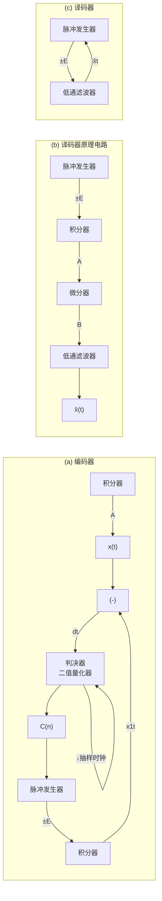
</details>

图 3.6.6 $\Delta-\Sigma$ 调制编码器和译码器

下面进一步分析 $\Delta-\Sigma$ 调制编码器和译码器的性能。在图3.6.7所示的简单阻容电路中，当其时间常数RC足够大时，可近似为一个积分器。该积分器的传递函数特性可表示为

$$
I (f) = \frac {1 / \mathrm{j} \omega C}{R + 1 / \mathrm{j} \omega C} = \frac {1 / \mathrm{j} 2 \pi f \cdot C}{R + 1 / \mathrm{j} 2 \pi f \cdot C} = \frac {1 / \mathrm{j} 2 \pi R C}{f + 1 / \mathrm{j} 2 \pi R C} \tag {3.6.15}
$$

  
图 3.6.7 积分电路

若定义 $f_{1} = 1 / (2\pi RC)$ ，则可得

$$
\left| I (f) \right| = \left| \frac {1 / \mathrm{j} 2 \pi R C}{f + 1 / \mathrm{j} 2 \pi R C} \right| = \left| \frac {f _ {1}}{\sqrt {f ^ {2} + f _ {1} ^ {2}}} \right| \tag {3.6.16}
$$

微分器要完成与积分器相反的变换，其传递函数特性相应地应满足

$$
\left| D (f) \right| = \frac {1}{\left| I (f) \right|} = \left| \frac {\sqrt {f ^ {2} + f _ {1} ^ {2}}}{f _ {1}} \right| \tag {3.6.17}
$$

记原来简单 $\Delta M$ 调制译码器A点的量化噪声功率密度谱为 $G_{\mathrm{q,A}}(f)$ ，已知简单 $\Delta M$ 调制编码的量化噪声功率为 $\sigma_{\mathrm{q}}^{2}=\Delta^{2}/3$ ，若假定量化噪声功率均匀分布在频谱的 $(0,f_{\mathrm{s}})$ 区域，则量化噪声功率密度谱

$$
G _ {\mathrm{q,A}} (f) = \frac {\sigma_ {\mathrm{q}} ^ {2}}{f _ {\mathrm{S}}} = \frac {\Delta^ {2}}{3 f _ {\mathrm{S}}} \tag {3.6.18}
$$

相应地，在 B 点的 $\Delta-\Sigma$ 调制译码的量化噪声功率密度谱为

$$
G _ {\mathrm{q,B}} (f) = \left| D (f) \right| ^ {2} G _ {\mathrm{q,A}} (f) = \frac {f ^ {2} + f _ {1} ^ {2}}{f _ {1} ^ {2}} G _ {\mathrm{q,A}} (f) = \frac {f ^ {2} + f _ {1} ^ {2}}{f _ {1} ^ {2}} \frac {\Delta^ {2}}{3 f _ {\mathrm{S}}} \tag {3.6.19}
$$

由此可得 $\Delta -\Sigma$ 调制译码输出的量化噪声功率

$$
\sigma_ {\mathrm{q}} ^ {2} = \int_ {0} ^ {f _ {\mathrm{S}}} G _ {\mathrm{q}, \mathrm{B}} (f) \mathrm{d} f = \int_ {0} ^ {f _ {\mathrm{S}}} \frac {f ^ {2} + f _ {1} ^ {2}}{f _ {1} ^ {2}} \frac {\Delta^ {2}}{3 f _ {\mathrm{S}}} \mathrm{d} f = \frac {\Delta^ {2}}{3 f _ {\mathrm{S}} f _ {1} ^ {2}} \left(\frac {f _ {\mathrm{S}} ^ {3}}{3} + f _ {1} ^ {2} f _ {\mathrm{S}}\right) \tag {3.6.20}
$$

在 $\Delta-\Sigma$ 调制译码后通常接有低通滤波器，通常低通滤波器的截止频率 $f_{H}<f_{S}$ ，因此最终输出的量化噪声功率为

$$
\sigma_ {\mathrm{q}} ^ {2} = \int_ {0} ^ {f _ {\mathrm{H}}} G _ {\mathrm{q,B}} (f) \mathrm{d} f = \int_ {0} ^ {f _ {\mathrm{H}}} \frac {f ^ {2} + f _ {1} ^ {2}}{f _ {1} ^ {2}} \frac {\Delta^ {2}}{3 f _ {\mathrm{S}}} \mathrm{d} f = \frac {\Delta^ {2}}{3 f _ {\mathrm{S}} f _ {1} ^ {2}} \left(\frac {f _ {\mathrm{H}} ^ {3}}{3} + f _ {1} ^ {2} f _ {\mathrm{H}}\right) \tag {3.6.21}
$$

参数 $RC$ 的选择应满足 $RC \gg T_{\mathrm{S}}$ ，方能使由图3.6.7构建的积分电路有近似理想的积分效果。如果脉冲发生器产生的脉冲信号的幅度为 $E$ ，则此时积分器在一个抽样周期内输出的电压幅度为

$$
\Delta \approx \frac {1}{C} \int_ {0} ^ {T _ {\mathrm{S}}} \frac {E}{R} \mathrm{d} t = \frac {E T _ {\mathrm{S}}}{R C} = \frac {2 \pi E f _ {1}}{f _ {\mathrm{S}}} \tag {3.6.22}
$$

代入式（3.6.21），同时利用一般在实际系统中应满足的关系式 $f_{H} \gg f_{1}$ ，得

$$
\sigma_ {\mathrm{q}} ^ {2} = \frac {4 \pi^ {2} E ^ {2}}{3 f _ {\mathrm{S}} ^ {3}} \left(\frac {f _ {\mathrm{H}} ^ {3}}{3} + f _ {1} ^ {2} f _ {\mathrm{H}}\right) \approx \frac {4 \pi^ {2} E ^ {2} f _ {\mathrm{H}} ^ {3}}{9 f _ {\mathrm{S}} ^ {3}} \tag {3.6.23}
$$

通过例 3.6.1 可知，对于简单 $\Delta$ 调制，正弦波信号的临界不过载条件为 $\omega A = \Delta \cdot f_{s}$ ，信号的频率和幅度是两个同时影响过载失真的主要因素。下面分析 $\Delta-\Sigma$ 调制时的情形。 $\Delta-\Sigma$ 调制编码器实际上是由积分器和简单 $\Delta$ 调制编码器组成的。在图 3.6.6(a) 中，假定在编码器的 B 点为避免信号过载失真，将信号的幅度限定为 $A_{\max \Delta M}$ ，则编码器的 A 点对信号的幅度限制为

$$
A _ {\max \Delta \Sigma} = \frac {A _ {\max \Delta \mathrm{M}}}{| I (f) |} = A _ {\max \Delta \mathrm{M}} \left| \frac {\sqrt {f ^ {2} + f _ {1} ^ {2}}}{f _ {1}} \right| \approx A _ {\max \Delta \mathrm{M}} \frac {f}{f _ {1}} \tag {3.6.24}
$$

式中的最后一个关系式利用了通常在实际系统中可以满足的条件 $f \gg f_{1}$ , 对输入信号幅度的限制得到放宽。

下面分析输入为正弦波信号时的情况。由正弦波信号不发生过载需满足的临界条件 $\omega A = \Delta \cdot f_{S}$ ，得 $A_{\max \Delta M} = \Delta \cdot f_{S} / \omega = \Delta \cdot f_{S} / (2\pi f)$ ，代入上式，同时利用式（3.6.22）所得的结果，可得

$$
A _ {\max \Delta \Sigma} = A _ {\max \Delta \mathrm{M}} \frac {f}{f _ {1}} = \frac {\Delta \cdot f _ {\mathrm{S}}}{2 \pi f} \frac {f}{f _ {1}} = \frac {2 \pi E f _ {1}}{f _ {\mathrm{S}}} \frac {f _ {\mathrm{S}}}{2 \pi f} \frac {f}{f _ {1}} = E \tag {3.6.25}
$$

由此可见，对于 $\Delta-\Sigma$ 调制编码器，临界不过载电压幅度与信号的频率f无关，而只取决于脉冲发生器产生脉冲的幅度E的大小。

$\Delta-\Sigma$ 调制编码的量化信噪比 对于正弦波信号，临界不过载时信号的最大功率为

$$
S _ {x \max} = \frac {A _ {\max \Delta \Sigma} ^ {2}}{2} = \frac {E ^ {2}}{2} \tag {3.6.26}
$$

此时可获得的量化信噪比为

$$
\mathrm{SNR} _ {\mathrm{qmax}} = \frac {S _ {x}}{\sigma_ {\mathrm{q}} ^ {2}} = \frac {E ^ {2} / 2}{4 \pi^ {2} E ^ {2} f _ {\mathrm{H}} ^ {3} / 9 f _ {\mathrm{S}} ^ {3}} = \frac {9 f _ {\mathrm{S}} ^ {3}}{8 \pi^ {2} f _ {\mathrm{H}} ^ {3}} \tag {3.6.27}
$$

显然，提高抽样频率 $f_{s}$ ，降低低通滤波器的截止频率 $f_{H}$ ，都有利于量化信噪比的提高。

## 3.6.3 数字压扩自适应增量调制

前面分别讨论了简单 $\Delta M$ 调制和 $\Delta-\Sigma$ 调制编码的原理。 $\Delta M$ 调制主要受到两类噪声的影响，即量化噪声和过载噪声。在上述调制方式中，减少这两种噪声的措施却是有矛盾的。增加量化阶距的幅度可对陡峭变化的波形有更好的跟踪效果，但较大的量化阶距势必又会增加量化噪声。如果希望在减小过载噪声的同时不增加量化噪声，就需要在波形陡峭变化时用较大的量化阶距，而在波形相对平坦时用较小的量化阶距。这就是自适应增量调制的基本概念，其原理可用图3.6.8来描述，由图可见，当信号变化比较平缓时，相应的量化阶距取较小值 $\Delta_{1}$ ，因此有较小的量化噪声；若检测到连续3个连“1”或连“0”，系统将自动地调整到较大的量化阶距 $\Delta_{2}$ ，从而避免过载失真情况的出现。


<details>
<summary>text_image</summary>

Δ₁
Δ₂
</details>

图 3.6.8 自适应增量调制原理图

所谓数字压扩自适应增量调制（数字压扩自适应 $\Delta M$ ），是指一种可根据输入信号斜率的变化自动调整量化阶距的大小，以使过载噪声和量化噪声都尽可能减到最小的一种方法。如图3.6.9所示，数字压扩自适应 $\Delta M$ 增加了一个用于检测连“0”和连“1”的检测电路和一个音节平滑电路，并用一个幅度可调的脉冲发生器来替代固定幅度的脉冲发生器。平滑电路是一个积分电路，其时间常数与语音信号的音节的长度基本相同（2～20ms）。平滑电路的作用是，使经过它处理后的输出信号变为一个以音节为时间常数的变化电压，同时与语音信号的平均斜率成正比，以控制可调脉冲发生器输出的脉冲的幅度反映重建信号的斜率。

  
图 3.6.9 数字压扩自适应增量调制编码器与译码器

图 3.6.10 给出了数字压扩自适应 $\Delta M$ 与简单 $\Delta M$ 及 $\Delta-\Sigma M$ 性能比较的示意图，由图可见，对于简单 $\Delta M$ 及 $\Delta-\Sigma M$ ，因为量化阶距固定，随着输入信号幅度的下降，归一化信噪比的 dB 值线性下降；而对于数字压扩自适应 $\Delta M$ ，量化阶距可随信号幅度及斜率的变换自适应地调制，在很大的范围，如图中的 AB 段，使归一化信噪比保持为较大的取值，因此性能较之简单 $\Delta M$ 调制有明显的改善。当输入信号幅度小到一定程度，量化阶距的自适应调整达到其量化阶距的最小值而不能再减小时，如图中的 BC 段，数字压扩自适应 $\Delta M$ 的性能才开始显著地下降。


<details>
<summary>line</summary>

| A/Amax (dB) | 简单 \(\Delta M\) 或 \(\Delta-\Sigma M\) (SNR/SNRmax (dB)) | 数字压扩自适应 \(\Delta M\) (SNR/SNRmax (dB)) | Baseline (SNR/SNRmax (dB)) |
| --- | --- | --- | --- |
| 0 | 0 | 0 | 0 |
| -30 | -30 | — | — |
| -40 | — | -6 | — |
| -60 | — | — | -22 |
</details>

图 3.6.10 数字压扩自适应增量调制与简单增量调制性能比较

另外，在图 3.6.10 中，虽然简单 $\Delta M$ 和 $\Delta-\Sigma M$ 的性能都会随着输入信号幅度的减小而下降，但 $\Delta-\Sigma M$ 有较好的频率特性。

## 3.7 不同编码方式的误码性能分析

## 3.7.1 增量调制编码的误码性能分析

$\Delta M$ 编码对每个抽样值编码后只输出 1 比特的信息，没有码组的同步问题，因此系统的同步实现相对简单。通过本节的深入分析我们会看到， $\Delta M$ 在抗信道误码影响方面较之普通 PCM 编码有更加优良的性能，因此 $\Delta M$ 更适合应用在误比特率性能较差的环境。

由式（3.5.6）， $\Delta \mathrm{M}$ 调制译码输出可表示为 $x_{l}(n) = \sum_{k = -\infty}^{n}\Delta \mathrm{sgn}(d(k))$ 。假如在传输过程中引入了噪声或其他随机干扰，如果这些干扰会对码元的判决造成影响，如图3.7.1所示，那么对于重建信号来说，可以设想在相应的时刻有一幅度为 $2\Delta$ 、极性与当前码元相反的等效干扰脉冲叠加在当前码元上。因此，存在干扰时的译码输出可表示为

$$
\hat {x} _ {l} (n) = \sum_ {k = - \infty} ^ {n} \Delta \left(\mathrm{sgn} \left(d (k)\right) + 2 e (k)\right) \tag {3.7.1}
$$


<details>
<summary>text_image</summary>

Δsgn(d(k))
+Δ
-Δ
O
k
+2Δ
2Δe(k)
等效干扰脉冲
k
-2Δ
O
Δ(sgn(d(k))+2e(k))
+Δ
-Δ
O
k
误码出现位置
</details>

图 3.7.1 受干扰的接收序列

式中，

$$
e (k) = \left\{ \begin{array}{c l} 0, & k \text {时刻未出现误码} \\ - \mathrm{sgn} (d (k)), & k \text {时刻出现误码} \end{array} \right. \tag {3.7.2}
$$

参见图 3.7.1，正常情况下，每个抽样间隔，积分器输出产生大小为 $+\Delta$ 或 $-\Delta$ 的变化量。出错的干扰对积分器输出造成的影响相当于这种变化由 $+\Delta$ 变为 $-\Delta$ ，或由 $-\Delta$ 变为 $+\Delta$ ，等效于积分器的输入端叠加了一个幅度为 $-2E$ 或 $+2E$ 的干扰脉冲。相应地，干扰脉冲的功率为 $(2E)^{2}$ 。假定传输过程的误比特率为 $P_{b}$ ，则由误码引入的平均噪声功率为

$$
\sigma_ {\mathrm{t}} ^ {2} = (2 E) ^ {2} P _ {\mathrm{b}} = 4 E ^ {2} P _ {\mathrm{b}} \tag {3.7.3}
$$

若将该平均噪声功率视为均匀分布在区域 $(0,f_{\mathrm{S}}/2)$ 上， $f_{S}$ 是抽样频率，则平均噪声的功率密度谱为

$$
P _ {\mathrm{e}} (f) = \frac {\sigma_ {\mathrm{t}} ^ {2}}{f _ {\mathrm{S}} / 2} = \frac {8 E ^ {2} P _ {\mathrm{b}}}{f _ {\mathrm{S}}} \tag {3.7.4}
$$

输出积分器的参数选择通常可使得式（3.5.16）满足条件

$$
\left| I (f) \right| = \left| \frac {f _ {1}}{\sqrt {f ^ {2} + f _ {1} ^ {2}}} \right| \approx \frac {f _ {1}}{f} = \frac {1}{2 \pi R C f} \tag {3.7.5}
$$

因此通过积分器后的噪声的功率密度谱为

$$
P _ {\mathrm{e}} ^ {\prime} (f) = \left| I (f) \right| ^ {2} P _ {\mathrm{e}} (f) = \left(\frac {1}{2 \pi R C f}\right) ^ {2} \frac {8 E ^ {2} P _ {\mathrm{b}}}{f _ {\mathrm{S}}} = \frac {2 E ^ {2} P _ {\mathrm{b}}}{\pi^ {2} R ^ {2} C ^ {2} f ^ {2} f _ {\mathrm{S}}} \tag {3.7.6}
$$

在音频输出的频率范围 $(f_{\mathrm{L}},f_{\mathrm{H}})$ 内，实际产生影响的噪声功率为

$$
\sigma_ {\mathrm{t}} ^ {\prime 2} = \int_ {f _ {\mathrm{L}}} ^ {f _ {\mathrm{H}}} P _ {\mathrm{e}} ^ {\prime} (f) \mathrm{d} f = \int_ {f _ {\mathrm{L}}} ^ {f _ {\mathrm{H}}} \frac {2 E ^ {2} P _ {\mathrm{b}}}{\pi^ {2} R ^ {2} C ^ {2} f ^ {2} f _ {\mathrm{S}}} \mathrm{d} f = \frac {2 E ^ {2} P _ {\mathrm{b}}}{\pi^ {2} R ^ {2} C ^ {2} f _ {\mathrm{S}}} \left(\frac {1}{f _ {\mathrm{L}}} - \frac {1}{f _ {\mathrm{H}}}\right) \approx \frac {2 E ^ {2} P _ {\mathrm{b}}}{\pi^ {2} R ^ {2} C ^ {2} f _ {\mathrm{S}} f _ {\mathrm{L}}} \tag {3.7.7}
$$

由式（3.5.22），已知 $\Delta \approx ET_{s}/RC$ ，代入上式得

$$
\sigma_ {\mathrm{t}} ^ {\prime 2} \approx \frac {2 \Delta^ {2} P _ {\mathrm{b}}}{\pi^ {2} T _ {\mathrm{S}} f _ {\mathrm{L}}} \tag {3.7.8}
$$

另外，若将 $\Delta$ 调制的量化噪声视为均匀分布在区域 $(0,f_{\mathrm{s}})$ 上，假定低通滤波器的截止频率为音频输出的最高频率 $f_{H}$ ，通常有 $f_{H}<f_{S}$ ，因此实际会产生影响的量化噪声功率为

$$
\sigma_ {\mathrm{q}} ^ {\prime 2} = \frac {\sigma_ {\mathrm{q}} ^ {2}}{f _ {\mathrm{S}}} f _ {\mathrm{H}} = \frac {\Delta^ {2} / 3}{f _ {\mathrm{S}}} f _ {\mathrm{H}} = \frac {\Delta^ {2} f _ {\mathrm{H}}}{3 f _ {\mathrm{S}}} \tag {3.7.9}
$$

因为量化误差 $e_{\mathrm{q}}$ 与误码引起的译码误差 $e_{\mathrm{t}}$ 是统计独立的，因而其幅度取值的联合概率密度函数满足

$$
p \left(e _ {\mathrm{q}} e _ {\mathrm{t}}\right) = p \left(e _ {\mathrm{q}} p \left(e _ {\mathrm{t}}\right) \right. \tag {3.7.10}
$$

$\Delta M$ 的量化噪声和误码引起的噪声总功率为

$$
\begin{array}{l} \sigma_ {\mathrm{n}} ^ {2} = E \left[ \left(e _ {\mathrm{q}} + e _ {\mathrm{t}}\right) ^ {2} \right] = \int_ {- \infty} ^ {\infty} \int_ {- \infty} ^ {- \infty} \left(e _ {\mathrm{q}} + e _ {\mathrm{t}}\right) ^ {2} p \left(e _ {\mathrm{q}} e _ {\mathrm{t}}\right) \mathrm{d} e _ {\mathrm{q}} \mathrm{d} e _ {\mathrm{t}} \\ = \int_ {- \infty} ^ {- \infty} \int_ {- \infty} ^ {\infty} (e _ {\mathrm{q}} ^ {2} + 2 e _ {\mathrm{q}} e _ {\mathrm{t}} + e _ {\mathrm{t}} ^ {2}) p (e _ {\mathrm{q}}) p (e _ {\mathrm{t}}) \mathrm{d} e _ {\mathrm{q}} \mathrm{d} e _ {\mathrm{t}} \tag {3.7.11} \\ = \int_ {- \infty} ^ {\infty} e _ {\mathrm{q}} ^ {2} p (e _ {\mathrm{q}}) \mathrm{d} e _ {\mathrm{q}} + 2 \int_ {- \infty} ^ {\infty} e _ {\mathrm{q}} p (e _ {\mathrm{q}}) \mathrm{d} e _ {\mathrm{q}} \int_ {- \infty} ^ {\infty} e _ {\mathrm{t}} p (e _ {\mathrm{t}}) \mathrm{d} e _ {\mathrm{t}} + \int_ {- \infty} ^ {\infty} e _ {\mathrm{t}} ^ {2} p (e _ {\mathrm{t}}) \mathrm{d} e _ {\mathrm{t}} \\ = \sigma_ {t} ^ {\prime 2} + \sigma_ {q} ^ {\prime 2} \\ \end{array}
$$

其中最后一个等式成立利用了 $E(e_{\mathrm{q}}) = 0$ 和 $E(e_{\mathrm{t}}) = 0$ 的合理假设。利用式（3.7.8）和式（3.7.9）所得的结果，进而得

$$
\sigma_ {\mathrm{n}} ^ {2} = \sigma_ {\mathrm{t}} ^ {\prime 2} + \sigma_ {\mathrm{q}} ^ {\prime 2} = \frac {2 \Delta^ {2} P _ {\mathrm{b}}}{\pi^ {2} T _ {\mathrm{S}} f _ {\mathrm{L}}} + \frac {\Delta^ {2} f _ {\mathrm{H}}}{3 f _ {\mathrm{S}}} \tag {3.7.12}
$$

假定输入编码的信号为正弦波信号，其临界过载即 $A_{\mathrm{max}}\omega = f_{\mathrm{S}}\Delta$ 时的信号功率为

$$
S _ {\max} = \frac {A _ {\max} ^ {2}}{2} = \frac {\Delta^ {2} f _ {\mathrm{S}} ^ {2}}{2 \omega^ {2}} = \frac {\Delta^ {2} f _ {\mathrm{S}} ^ {2}}{8 \pi^ {2} f ^ {2}} \tag {3.7.13}
$$

量化信噪比为

$$
\mathrm{SNR} _ {\mathrm{q,max}} = \frac {S _ {\max}}{\sigma_ {\mathrm{q}} ^ {\prime 2}} = \frac {\Delta^ {2} f _ {\mathrm{S}} ^ {2}}{8 \pi^ {2} f ^ {2}} / \frac {\Delta^ {2} f _ {\mathrm{H}}}{3 f _ {\mathrm{S}}} = \frac {3 f _ {\mathrm{S}} ^ {3}}{8 \pi^ {2} f ^ {2} f _ {\mathrm{H}}} \tag {3.7.14}
$$

在接收端 $\Delta$ 调制考虑量化误差和误码因素后总的信噪比为

$$
\mathrm{SNR} _ {\max} = \frac {S _ {\max}}{\sigma_ {\mathrm{n}} ^ {2}} = \frac {S _ {\max}}{\sigma_ {\mathrm{q}} ^ {\prime 2} + \sigma_ {\mathrm{t}} ^ {\prime 2}} = \frac {S _ {\max} / \sigma_ {\mathrm{q}} ^ {\prime 2}}{1 + \sigma_ {\mathrm{t}} ^ {\prime 2} / \sigma_ {\mathrm{q}} ^ {\prime 2}} = \frac {\mathrm{SNR} _ {\mathrm{q,max}}}{1 + \sigma_ {\mathrm{t}} ^ {\prime 2} / \sigma_ {\mathrm{q}} ^ {\prime 2}} = \frac {\mathrm{SNR} _ {\mathrm{q,max}}}{1 + 6 P _ {\mathrm{b}} f _ {\mathrm{S}} ^ {2} / \pi^ {2} f _ {\mathrm{H}} f _ {\mathrm{L}}} \tag {3.7.15}
$$

## 3.7.2 线性 PCM 编码的误码性能分析

线性 PCM 编码实际上就是均匀量化编码，假定量化电平的总数为 M， $y_{i}$ 和 $y_{j}$ 为任意两个量化电平， $y_{i}, y_{j} \in \{y_{k}, k = 1, 2, \cdots, M\}$ 。记出现量化电平 $y_{k}$ 的概率为 $P(y_{k}), k = 1, 2, \cdots, M$ 。记量化值 $y_{i}$ 的编码码组传输过程出错，导致译码输出为 $y_{j}$ 的概率为 $P(y_{j}/y_{i})$ ，则由传输过程误码造成的等效噪声功率为

$$
\sigma_ {\mathrm{t}} ^ {2} = E \left(e _ {\mathrm{t}} ^ {2}\right) = E \left[ \left(y _ {i} - y _ {j}\right) ^ {2} \right] = \sum_ {j = 1} ^ {M} \sum_ {i = 1} ^ {M} \left(y _ {i} - y _ {j}\right) ^ {2} P \left(y _ {j} / y _ {i}\right) P \left(y _ {i}\right) \tag {3.7.16}
$$

每个量化电平编码后长度为 lbM 的码组，假定系统设计使得在传输过程中 2 位以上的误码可以忽略，则误比特率 $P_{b} \approx P(y_{j}/y_{i})$ 。进一步假定编码输入的信号均匀分布，则有 $P(y_{k}) = 1/M, k = 1, 2, \cdots, M$ 。因为只需考虑 1 位误码的情况， $y_{i}$ 的编码码组传输过程出错，导致译码输出为 $y_{j}$ ，可等效为码组中的某一位如第 m 位出现误码。相应地有 $(y_{i} - y_{j})^{2} = (2^{m-1}\Delta)^{2}$ ，m 可能是 $m = 1, 2, \cdots, lbM$ 中的任何一位。由此，式（3.7.16）变为

$$
\begin{array}{l} \sigma_ {\mathrm{t}} ^ {2} = \sum_ {i = 1} ^ {M} \sum_ {m = 1} ^ {\mathrm{lb} M} \left(2 ^ {m - 1} \Delta\right) ^ {2} P _ {\mathrm{b}} P \left(y _ {i}\right) = \sum_ {i = 1} ^ {M} \sum_ {m = 1} ^ {\mathrm{lb} M} \left(2 ^ {m - 1} \Delta\right) ^ {2} P _ {\mathrm{b}} \frac {1}{M} \\ = \sum_ {i = 1} ^ {M} \frac {1}{M} P _ {\mathrm{b}} \sum_ {m = 1} ^ {\mathrm{lb} M} \left(2 ^ {m - 1} \Delta\right) ^ {2} = P _ {\mathrm{b}} \Delta^ {2} \sum_ {m = 1} ^ {\mathrm{lb} M} 4 ^ {m - 1} \tag {3.7.17} \\ = P _ {\mathrm{b}} \Delta^ {2} \frac {1 - 4 ^ {\mathrm{lb} M}}{1 - 4} = \frac {M ^ {2} - 1}{3} P _ {\mathrm{b}} \Delta^ {2} \\ \end{array}
$$

因为量化误差 $e_{\mathrm{q}}$ 与误码引起的译码误差 $e_{\mathrm{t}}$ 是统计独立的, 采用与式 (3.7.11) 完全相同的分析方法, 可得由上述两种误差导致的总的等效噪声为

$$
\sigma_ {\mathrm{n}} ^ {2} = \sigma_ {\mathrm{q}} ^ {2} + \sigma_ {\mathrm{t}} ^ {2} = \frac {\Delta^ {2}}{1 2} + \frac {M ^ {2} - 1}{3} P _ {\mathrm{b}} \Delta^ {2} \tag {3.7.18}
$$

另外，由编码输入的信号均匀分布的假定，其不过载情况下的最大信号功率为

$$
S _ {\max} = \int_ {- \infty} ^ {\infty} x ^ {2} p (x) \mathrm{d} x = \int_ {- V _ {\mathrm{p}}} ^ {+ V _ {\mathrm{p}}} x ^ {2} \frac {1}{2 V _ {\mathrm{p}}} \mathrm{d} x = \frac {1}{2 V _ {\mathrm{p}}} \frac {1}{3} x ^ {3} \Big | _ {x = - V _ {\mathrm{p}}} ^ {+ V _ {\mathrm{p}}} = \frac {1}{3} V _ {\mathrm{p}} ^ {2} = \frac {M ^ {2} \Delta^ {2}}{1 2} \tag {3.7.19}
$$

译码输出总的信噪比为

$$
\mathrm{SNR} _ {\max} = \frac {S _ {\max}}{\sigma_ {\mathrm{n}} ^ {2}} = \frac {S _ {\max}}{\sigma_ {\mathrm{q}} ^ {2} + \sigma_ {\mathrm{t}} ^ {2}} = \frac {M ^ {2}}{1 + 4 (M ^ {2} - 1) P _ {\mathrm{b}}} \tag {3.7.20}
$$

已知量化信噪比可表示为

$$
\mathrm{SNR} _ {\mathrm{q,max}} = \frac {S _ {\mathrm{max}}}{\sigma_ {\mathrm{q}} ^ {2}} = \frac {M ^ {2} \Delta^ {2} / 1 2}{\Delta^ {2} / 1 2} = M ^ {2} \tag {3.7.21}
$$

因此总的信噪比又可表示为

$$
\mathrm{SNR} _ {\mathrm{max}} = \frac {S _ {\mathrm{max}}}{\sigma_ {\mathrm{n}} ^ {2}} = \frac {S _ {\mathrm{max}} / \sigma_ {\mathrm{q}} ^ {2}}{1 + \sigma_ {\mathrm{t}} ^ {2} / \sigma_ {\mathrm{q}} ^ {2}} = \frac {\mathrm{SNR} _ {\mathrm{q,max}}}{1 + \sigma_ {\mathrm{t}} ^ {2} / \sigma_ {\mathrm{q}} ^ {2}} \tag {3.7.22}
$$

## 3.7.3 两种编码的抗误码性能比较

前面分别分析了增量调制编码和线性 PCM 编码的误码性能, 本节将对这两种调制编码方式的性能做一粗略比较。

对于线性 PCM 编码，如果由于误码导致总的信噪比下降为原来量化信噪比的 1/2， $SNR_{max} \rightarrow SNR_{q,max}/2$ ，即总的信噪比较之量化信噪比降低 3dB 时，由式（3.7.22），此时应有

$$
\sigma_ {\mathrm{t}} ^ {2} = \sigma_ {\mathrm{q}} ^ {2} \rightarrow \frac {M ^ {2} - 1}{3} P _ {\mathrm{b}} \Delta^ {2} = \frac {\Delta^ {2}}{1 2} \tag {3.7.23}
$$

$$
P _ {\mathrm{b}} = \frac {1}{4 (M ^ {2} - 1)} \tag {3.7.24}
$$

若码组长度为n=8，量化阶数 $M=2^{8}=256$ ，则有

$$
P _ {\mathrm{b}} = \frac {1}{4 (M ^ {2} - 1)} = \frac {1}{4 (2 5 6 ^ {2} - 1)} = 3. 8 1 6 \times 1 0 ^ {- 6}
$$

换句话说，如果要求总的信噪比下降不超过3dB，误比特率不能大于 $3.816\times10^{-6}$ 。

同样，对于 $\Delta M$ 编码，如果由于误码导致总的信噪比下降为原来量化信噪比的1/2， $SNR_{max}\rightarrow SNR_{q,max}/2$ ，即总的信噪比较之量化信噪比降低3dB时，由式（3.7.15），此时应有

$$
\sigma_ {\mathrm{t}} ^ {\prime 2} = \sigma_ {\mathrm{q}} ^ {\prime 2} \rightarrow \frac {2 \Delta^ {2} P _ {\mathrm{b}}}{\pi^ {2} T _ {\mathrm{S}} f _ {\mathrm{L}}} = \frac {\Delta^ {2} f _ {\mathrm{H}}}{3 f _ {\mathrm{S}}} \tag {3.7.25}
$$

由此可得

$$
P _ {\mathrm{b}} = \frac {\pi^ {2} f _ {\mathrm{H}} f _ {\mathrm{L}}}{6 f _ {\mathrm{S}} ^ {2}} \tag {3.7.26}
$$

取话音信号的基本参数 $f_{\mathrm{L}} = 300\mathrm{Hz}$ ， $f_{\mathrm{H}} = 3100\mathrm{Hz}$ 。为与线性PCM编码进行比较，假定每个话路采用64kbps的传输速率，对于 $\Delta \mathrm{M}$ 编码，此时抽样频率 $f_{\mathrm{s}} = 64\mathrm{kHz}$ ，代入上式可得

$$
P _ {\mathrm{b}} = \frac {\pi^ {2} f _ {\mathrm{H}} f _ {\mathrm{L}}}{6 f _ {\mathrm{S}} ^ {2}} = \frac {\pi^ {2} \times 3 1 0 0 \times 3 0 0}{6 \times (6 4 \times 1 0 ^ {3})} = 3. 7 3 5 \times 1 0 ^ {- 4}
$$

如果要求总的信噪比下降不超过3dB，那么误比特率不能大于 $3.735\times10^{-4}$ 。

对比线性 PCM 编码， $\Delta M$ 编码对误码率性能的要求降低了两个数量级。如果 $\Delta$ 调制编码抽样频率降低为 $f_{s}=32kHz$ ，则当总的信噪比下降不超过原来量化信噪比 3dB 的要求不变时，有

$$
P _ {\mathrm{b}} = \frac {\pi^ {2} f _ {\mathrm{H}} f _ {\mathrm{L}}}{6 f _ {\mathrm{S}} ^ {2}} = \frac {\pi^ {2} \times 3 1 0 0 \times 3 0 0}{6 \times (3 2 \times 1 0 ^ {3})} = 1. 4 9 4 \times 1 0 ^ {- 3}
$$

对误码率性能的要求进一步降低。

综上，对比线性 PCM 编码，采用 $\Delta M$ 编码时，虽然其量化噪声的性能略低于线性 PCM 编码，但误码对系统劣化的影响将大大降低，从这个意义上说， $\Delta M$ 编码有更好的抗误码性能。因此 $\Delta M$ 编码被广泛应用于能够在较为恶劣的环境中工作的军用通信系统中。

## 3.8 本章小结

本章介绍了模拟信号的数字编码的基本原理和方法。3.2节首先回顾了低通抽样定理，并在此基础上讨论了带通抽样定理。低通抽样定理具有一般性，它告诉我们，只要抽样频谱大于或等于两倍的信号最高频率，则可由时间离散的样值无失真地恢复原信号。由离散的抽样序列可恢复原信号的基本条件是，抽样序列的频谱不发生混叠。根据这一基本思想，可导出带通抽样定理，对于窄带的带通信号，如果选择合适的抽样频率，只要使抽样所得的序列信号对应的频谱不发生混叠，则可通过带通滤波器从抽样序列中恢复出原信号，带通抽样定理保证了可无失真恢复原带通信号的抽样频谱出现在信号带宽的2～4倍的范围内。3.3节和3.4节介绍了模拟信号的量化方法，重点讨论了均匀量化和针对语音信号的非均匀量化的基本原理与方法，对于信号幅度为均匀分布的信号来说，均匀量化是一种最佳的量化方案，而修正的对数量化方法可使得量化信噪比在很大的范围内保持为常数，是目前电信系统话音信号编码的主要标准。3.5节讨论了差分脉冲编码调制（DPCM）的基本原理，通过预测编码的方法，可以去除信号中的部分冗余成分，有效提高编码效率，是实用的自适应编码调制（ADPCM）的基础。3.6节讨论了增量调制（ΔM）的基本原理和其改进的编码方案，ΔM与DPCM的原理有类似之处，但每个样值编码后只输出1比特信息，较之DPCM，ΔM相对简单且译码时无须码字同步。3.7节则分析了线性PCM和ΔM这两种不同方法的抗误码性能。

## 习题

3.1 试确定能够完全重构信号 $x(t)=\sin(6280t)/(6280t)$ 所需的最低抽样速率。

3.2 一个带限低通信号 $x(t)$ 具有如下频谱特性：

$$
X (f) = \left\{ \begin{array}{c c} 1 - | f | / 2 0 0, & | f | <   2 0 0 \mathrm{Hz} \\ 0, & | f | \geqslant 2 0 0 \mathrm{Hz} \end{array} \right.
$$

(1) 若抽样频率 $f_{\mathrm{s}} = 300\mathrm{Hz}$ ，画出对 $x(t)$ 进行理想抽样时，在 $|f| < 200\mathrm{Hz}$ 范围内已抽样信号 $x_{\mathrm{s}}(t)$ 的频谱；(2) 将 $f_{\mathrm{s}}$ 改为 $400\mathrm{Hz}$ 后，重复小题 (1)。

3.3 已知一基带信号 $x(t)=\cos2\pi t+2\cos4\pi t$ ，对其进行理想抽样。（1）为了在接收端能不失真地从已抽样信号 $x_{\mathrm{s}}(t)$ 中恢复出 $x(t)$ ，抽样间隔应如何选取？（2）若抽样间隔取为 0.2s，试画出已抽样信号的频谱图。

3.4 某载波电话通信系统的频率范围为 60～108kHz。若对它采用低通抽样，最低抽样频率是多少？若对它采用带通抽样，最低抽样频率又是多少？

3.5 使用 256 个电平的均匀 PCM，当信号均匀分布于[-2,2]区间时，求量化信噪比 $SNR_{q}$ 。

3.6 设模拟信号 $s(t)$ 的幅值在 $[-2, 2]$ 内均匀分布，其最高频率为 4kHz。现对它进行奈奎斯特抽样，并经过均匀量化后编为二进制码。设量化间隔为 1/64，试求该 PCM 系统的比特率和输出的量化信噪比。

3.7 在 CD 播放机中，抽样率为 44.1kHz，对抽样值采用 16 比特/样本的量化器进行量化。求持续时间为 5 分钟（约一首歌）的立体声音乐所需要的容量。

3.8 设信号 $x(t)=9+A\cos\omega t$ ，其中 $A\leqslant10V$ 。若 $x(t)$ 被均匀量化为 41 个电平，试确定所需二进制码组的位数 N 和量化间隔 $\Delta$ 。

3.9 已知模拟信号抽样值的概率密度函数 $f(x)$ 如题图 3.9 所示。将 x 经过一个 4 电平均匀量化器后，输出是 $y \in \{y_{1}, y_{2}, y_{3}, y_{4}\}$ 。试求：（1）量化器输出信号的平均功率 $S_{q} = E[y^{2}]$ ；（2）量化噪声 e = y - x 的平均功率 $\sigma_{q}^{2} = E[e^{2}]$ ；（3）量化信噪比 $SNR_{q} = S_{q} / \sigma_{q}^{2}$ 的分贝值。

3.10 设某量化器的压缩特性曲线为 $f(x)=\ln x/B$ ，量化器输入信号的动态范围为 $\left(-V_{p},+V_{p}\right)$ ，对信号做压缩变化后均匀量化的量化阶距为 $\Delta=2V_{p}/M$ ，M为量化阶数。试计算其信噪比，并分析其特点。


<details>
<summary>line</summary>

| x | f(x) |
| --- | --- |
| -1 | 0 |
| 0 | 1 |
| 1 | 0 |
</details>

题图 3.9

3.11 对于 $\mu$ 律的对数压缩变化，若 $\mu = 100$ ，试计算归一化输入信号 $x(t)$ 在 $x = 0$ 和 $x = 1$ 时的放大量。  
3.12 采用十三折线 $A$ 律编码电路，设最小量化间隔为1个单位，已知抽样脉冲值为 $+635$ 单位。（1）试求此时编码器的输出码组，并计算量化误差；（2）采用自然二进制码，写出对应于该7位码的均匀量化11位码。  
3.13 某 A 律十三折线 PCM 编码器的输入动态范围是 $(-5, 5)\mathrm{V}$ 。某抽样值的幅度 x = 1.2V。（1）求编码器的输出码组；（2）求译码器输出的量化电平值，并计算量化误差；（3）写出对应于 A 律十三折线 PCM 码组的均匀量化线性编码的码组（13 位码）。  
3.14 若将二阶线性预测

$$
\hat {x} (n) = a _ {1} x (n - 1) + a _ {2} x (n - 2)
$$

用于 DPCM，假设信号为实平稳序列 $\{x(n)\}$ ，其均值为 0，自相关函数为 $R_{x}(m)=E\left[x(n)x(n+m)\right]$ ，且有 $R_{x}(0)=1$ ， $R_{x}(1)=c_{1}$ ， $R_{x}(2)=c_{2}$ 。试求：（1）使预测误差最小的预测方程系数 $a_{1}^{*}$ 和 $a_{2}^{*}$ ；（2）均方预测误差表达式。

3.15 设随机信号 $X(t)$ 具有如下自相关函数： $R_{x}(0)=1,\quad R_{x}(1)=0.8,\quad R_{x}(2)=0.6,\quad R_{x}(3)=0.4$ 。（1）若用 3 个延迟单元，计算最优线性预测器的系数；（2）求所得预测误差的方差。

3.16 对一最高频率为 900Hz 的语音信号进行 $\Delta M$ 编码传输，接收端低通滤波器的截止频率为 3.4kHz。若要求系统的量化信噪比为 30dB，求该 $\Delta M$ 系统应采用的抽样频率和信息速率。

3.17 设简单增量调制器输入的正弦波信号频率为 $3.4\mathrm{kHz}$ 、幅度为 $1\mathrm{V}$ ，若抽样频率 $f_{\mathrm{s}} = 32\mathrm{kHz}$ ，求量化间隔的范围。

3.18 对信号 $x(t) = A\sin 2\pi f_0t$ 进行简单增量调制，若量化间隔 $\Delta$ 和抽样频率 $f_{\mathrm{s}}$ 的选择既能保证不过载，又能保证不会因为信号振幅太小而使得增量调制器不能正常编码，试证明此时要求 $f_{\mathrm{s}} > \pi f_{0}$ 。

## 主要参考文献

[1] 曹志刚，钱亚生．现代通信原理[M]. 北京：清华大学出版社，1992.  
[2] [美]Bernard Sklar. 数字通信（第二版）[M]. 北京：电子工业出版社，2001.  
[3] 周炯槃，庞沁华，等．通信原理[M]. 北京：北京邮电大学出版社，2005.  
[4] CCITT Recommendation G.721 1984, 1986  
[5] [美]Simon Haykin. 自适应滤波器理论[M]. 北京：电子工业出版社，2002.  
[6] N. S. Jayant and P. Noll. Digital Coding Waveform[M]. Prentice-Hall, 1984.