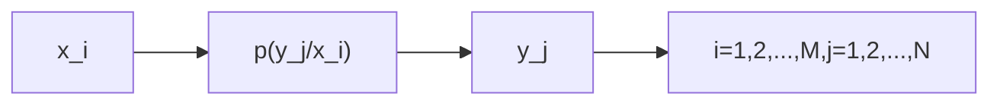
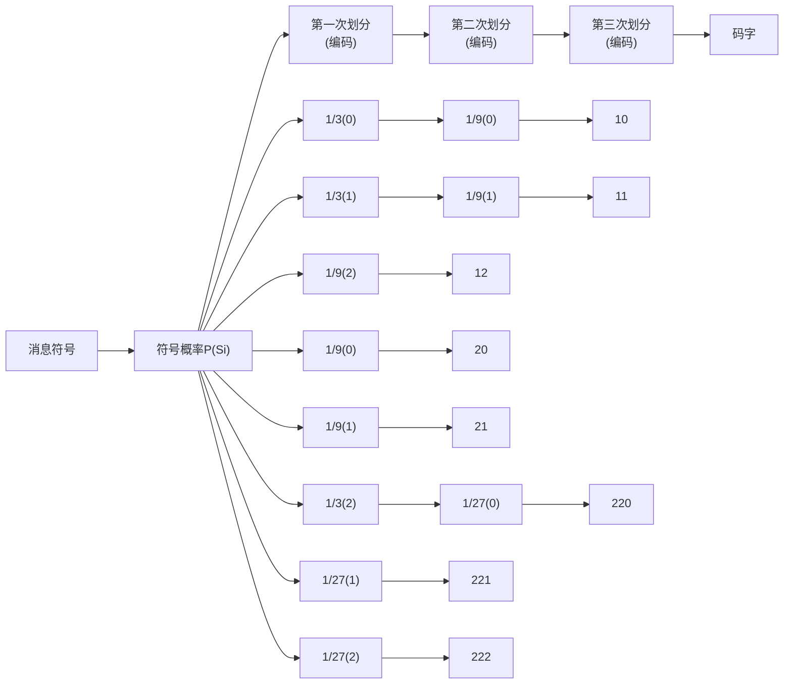
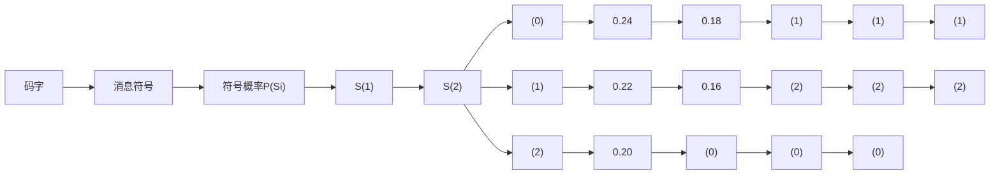
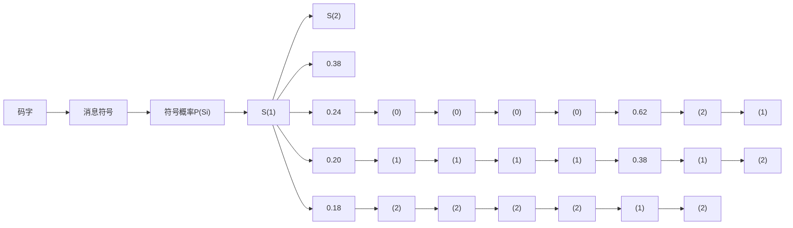
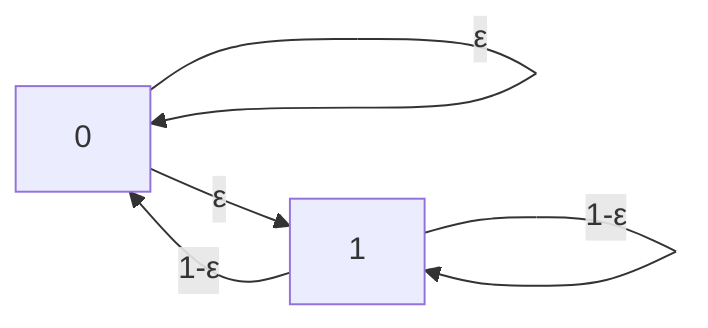

## 第4章 信息论基础

## 4.1 引言

人类社会已进入信息时代，处在信息时代的社会。人们在工作的各个领域，如科学研究、军事活动、生产运作、贸易经商、日常生活，都日益感觉到了了解和掌握信息的重要性。然而，在学习严格意义上的信息理论之前，人们关于信息的理解往往是模糊的，通常只是感到信息应该包含了新消息成分或自己原来未知的消息成分，而至于信息是什么、它应如何定义和度量并没有明确的概念。另外，我们说通信的目的是传递信息，传递信息需要什么条件，如何才能有效地传递信息，如何衡量某个信道或通信系统传递信息的能力，这些就是信息论所要回答的问题。信息论是人们在长期的实践活动中，将数学中的概率论、随机过程和数理统计等学科理论运用到通信领域，在解决通信基本理论问题的过程中逐步发展起来的一门专门学问。

1948 年，美国科学家香农（C. E. Shannon）发表的著名论文《通信的数学理论》奠定了信息论的理论基础。信息论发展到今天，主要内容包括有关离散信源特性与信道容量的分析、有关连续信源特性与信道容量的分析、无失真和限失真的信源编码方法、信道的差错控制编码方法以及网络信息理论等多个方面的内容[1]。本章主要介绍信息论的基本概念，讨论信息论中有关信息的定义和度量方法、离散与连续信源及信道容量的基本分析方法、信道编码的基本原理。这些内容加上已经介绍的无失真和限失真信源编码的基本方法等，为系统地学习通信的基本原理建立了必要的基础。

## 4.2 信息的度量

通信的目的是传递信息，信息总是以某种消息的形式来承载和表示的，消息的形式可以是数字、文字、符号、图形图像、一段声音或视频等，或其他可触发人的感觉器官产生感受的形式。人们收到一则消息，可能无动于衷，可能有所触动，也可能有极大的震撼。例如，某消息说，我国的东北12月份会下雪，人们感觉很正常，因为冬季东北下雪不是什么新鲜事；但如果某消息说，某月某日海南会下雪，人们一定会表现出极大的惊讶，因为这几乎是不可能出现的情况。这说明，消息中包含的内容给人的感受可以是有很大区别的。直观地，就人们听到消息时所处的情况和环境，对于出现原来越难预测内容的消息，人们会感到得到的东西越多。从这个意义上说，该消息中的“信息量”越大。

香农通过对通信基本要求和过程的分析，把通信系统传递信息的机制和本质，从“形式化”“非决定论”和“不确定性”三个方面加以抽象和描述，并从数学上进行了合理的定义[1]。所谓形式化，是指通信的基本任务是在接收端把发送端发出的消息从形式上恢复出来，而对消息内容的理解和判断则不是通信的任务。所谓非决定论，是指通信过程传递的消息中所包含的内容对接收者来说事先是无法预料的。所谓不确定性，是指收到该消息之前，对其中的内容出现与否具有不确定的因素，这种不确定的因素可以通过通信来加以消除或部分消除。“形式化”说明一个物理的通信系统的通信过程，一般是与其传送的内容无关的。例如，一个二元的通信系统所要完成的任务是如何正确地传递由符号“0”和“1”组成的序列，而这些不同的序列代表的消息的含义则不是通信系统所要关心的。而“非决定论”和“不确定性”把消息中所含的信息的多少，与数学中的概率论和数理统计、随机过程等联系起来，进而可以用数学的语言来对信息和信息的传递进行描述。

## 4.2.1 离散信源信息的度量

所谓某件事情是否出现的不确定性，换句话说就是该事情出现的可能性，可能性的大小可以用事件出现的概率来描述。因此某事件出现所提供的信息量，应该是该事件出现概率的函数。

数字通信系统中的信息源（简称信源）每次输出的，是包含有限的 N 个不同元素集合 $\{X: x_{i}, i=1,2,\cdots,N\}$ 中的某个符号。前面提到的所谓某事件的出现在这里对应的就是某个符号的出现，这种离散信源 X 的统计特性可以用如下一个称为概率场的形式来描述：

$$
\begin{array}{c c c c c} X: & x _ {1} & x _ {2} & \dots & x _ {N} \\ p (X): & p (x _ {1}) & p (x _ {2}) & \dots & p (x _ {N}) \end{array} \tag {4.2.1}
$$

式中， $p(x_{i})$ 是符号 $x_{i}$ 出现的概率，其概率和满足基本关系式

$$
\sum_ {i = 1} ^ {N} p (x _ {i}) = 1 \tag {4.2.2}
$$

信源符号的概率通常称为该系统的先验概率。

从信息论的角度，一个通信系统可以简单地视为由如图 4.2.1 所示的信源、信道和信宿三个部分组成的系统。

  
图 4.2.1 由信源、信道和信宿组成的通信系统

信源发出一个符号，通过信道到达信宿。信宿在通信过程中只知道传过来的是特定符号集中的某个符号，但不知道具体是哪个符号。既然某符号出现提供的信息量的大小与该符号出现的概论有关，因此收到某个符号 $x_{i}$ 后，信宿所获得的信息量应是该符号出现概率的某种函数：

$$
I (x _ {i}) = f \big [ p (x _ {i}) \big ] \tag {4.2.3}
$$

又如果信源输出的符号中, 每个符号都是独立的, 则信宿收到两个符号 $x_{i}, x_{j}$ 后所获得的信息量, 应是这两个符号信息量的和, 因此信息量函数应满足可加性:

$$
I (x _ {i} x _ {j}) = f \Big [ p (x _ {i} x _ {j}) \Big ] = f \Big [ p (x _ {i}) p (x _ {j}) \Big ] = f \Big [ p (x _ {i}) \Big ] + f \Big [ p (x _ {j}) \Big ] \tag {4.2.4}
$$

根据 4.1 节的讨论，某符号出现所提供的信息量的大小还应与该符号出现的概率呈某种 “反比” 关系，即该符号出现的概率越小，所提供的信息量越大。容易验证，当取描述信息量的函数为符号概率倒数的对数

$$
I (x _ {i}) = f \left[ p (x _ {i}) \right] = \log \left(\frac {1}{p (x _ {i})}\right) \tag {4.2.5}
$$

时，可以同时满足上面提到的是概率的函数、具有可加性、概率值越小信息量越大这三个基本要素的要求。

定义 4.2.1 符号出现概率的倒数的对数定义为该符号的信息量。

式（4.2.5）确定的函数称为信息函数。信息量的单位与对数的底的取值有关，当以“2”为对数的底时，信息量的单位为比特（bit）；当以“e”为底时，信息量的单位为奈特（nat）；当以“10”为底时，信息量的单位为哈特（hart）。在本书中，若未特别声明，均默认信息量的单位为比特。

【例 4.2.1】某离散信源由 0, 1, 2, 3 四种符号组成，其概率场为

$$
\begin{array}{c c c c c} X: & 0 & 1 & 2 & 3 \\ p (X): & 3 / 8 & 1 / 4 & 1 / 4 & 1 / 8 \end{array}
$$

假定信源输出的每个符号都是独立的，当信源输出的符号序列 S 为 “113200” 时，求其输出的信息量的大小。

解：按定义，信源输出的信息量为

$$
\begin{array}{l} I (S) = \log \frac {1}{p (S)} = \log \frac {1}{p (1) p (1) p (3) p (2) p (0) p (0)} \\ = \log \frac {1}{p (1)} + \log \frac {1}{p (1)} + \log \frac {1}{p (3)} + \log \frac {1}{p (2)} + \log \frac {1}{p (0)} + \log \frac {1}{p (0)} \\ = 2 + 2 + 3 + 2 + 1. 4 1 5 + 1. 4 1 5 = 1 1. 8 3 (\text {比特}) \\ \end{array}
$$

上式中第二个等号成立是因为符号的出现具有独立性。□

## 4.2.2 离散信源的平均信息量——信源的熵

通常信源中每个符号所包含的信息量不同，在通信系统中考虑传输效率时，往往还要分析信源的总体信息测度。信源的总体信息测度可以用信源符号集中每个符号的平均信息量来描述。

定义 4.2.2 离散信源 $\{X: x_{i}, i=1,2,\cdots,N\}$ 的熵 $H(X)$ 定义为

$$
H (X) = - \sum_ {i = 1} ^ {N} p (x _ {i}) \log p (x _ {i}) \tag {4.2.6}
$$

熵是信源中每个符号所含的统计平均信息量，单位是比特/符号。

【例 4.2.2】离散信源与例 4.2.1 相同，计算该离散信源的熵。

解：按式（4.2.6）的定义，该信源的熵

$$
H (X) = - \sum_ {i = 1} ^ {4} p (x _ {i}) \log p (x _ {i}) = - \left(\frac {3}{8} \log \frac {3}{8} + \frac {1}{4} \log \frac {1}{4} + \frac {1}{4} \log \frac {1}{4} + \frac {1}{8} \log \frac {1}{8}\right) = 1. 9 0 6 (\mathrm{比特/符号}) \quad \square
$$

利用信源的熵，可以很方便地估算信源发出的符号序列的信息总量。

【例 4.2.3】离散信源与例 4.2.1 相同，求：（1）消息“201 020 130 213 001 203 210 100 321 010 023 102 002 010 312 032 100 120 210”的信息量；（2）利用信源的熵估算该消息的信息量。

解：（1）此消息共包含 57 个符号，其中 “0” 出现 23 次，“1” 出现 14 次，“2” 出现 13 次，“3” 出现 7 次，此消息的总信息量为

$$
I = - \sum_ {i = 1} ^ {4} n _ {i} \log p (x _ {i}) = - \left(2 3 \log \frac {3}{8} + 1 4 \log \frac {1}{4} + 1 3 \log \frac {1}{4} + 7 \log \frac {1}{8}\right) = 1 0 7. 5 5 (\text {比特})
$$

(2) 根据例 4.2.2 计算的结果, 信源的熵为 1.906 比特/符号, 则此消息的信息量约为

$$
I \approx \left(\sum_ {i = 1} ^ {4} n _ {i}\right) H (X) = (2 3 + 1 4 + 1 3 + 7) \times 1. 9 0 6 = 1 0 8. 6 2 (\mathrm{比特})
$$

可以预料，随着消息中所包含的符号数的增加，上面两式的结果趋于一致。□

## 4.2.3 熵的最大化

数学上在分析函数的最大值或最小值等问题时，通常会用到凸函数的概念。下面先介绍有关的概念。

定义4.2.3 设 $x_{i} = (x_{1,i}, x_{2,i}, \cdots, x_{n,i})$ 和 $x_{j} = (x_{1,j}, x_{2,j}, \cdots, x_{n,j})$ 是 $n$ 维实向量集合 $\{x\} \in R^{n}$ 中的任意两个向量, 若对任意实数 $\alpha$ , $0 \leqslant \alpha \leqslant 1$ , 有

$$
\alpha \boldsymbol {x} _ {i} + (1 - \alpha) \boldsymbol {x} _ {j} \in \{\boldsymbol {x} \} \tag {4.2.7}
$$

则称集合 $\{x\}$ 是凸集。

定义4.2.4 设函数 $f(x)$ 定义在凸集 $\{x\} \in R^n$ 上，若对任意 $x_{i}, x_{j} \in \{x\}$ 和 $\alpha, 0 \leqslant \alpha \leqslant 1$ 均有

$$
f \left(\alpha \boldsymbol {x} _ {i} + (1 - \alpha) \boldsymbol {x} _ {j}\right) \leqslant \alpha f (\boldsymbol {x} _ {i}) + (1 - \alpha) f (\boldsymbol {x} _ {j}) \tag {4.2.8}
$$

则称函数 $f(x)$ 为 $\cup$ 形凸函数（下凸函数）。反之，若均有

$$
f \left(\alpha \boldsymbol {x} _ {i} + (1 - \alpha) \boldsymbol {x} _ {j}\right) \geqslant \alpha f (\boldsymbol {x} _ {i}) + (1 - \alpha) f (\boldsymbol {x} _ {j}) \tag {4.2.9}
$$

则称函数 $f(x)$ 为 $\cap$ 形凸函数（上凸函数）。

图 4.2.2 给出了一个一维∩形凸函数的示意图。

若 $\boldsymbol{p}=(p_{1},p_{2},\cdots,p_{N})$ 是一组概率， $f(\boldsymbol{x})$ 是一个 $\cap$ 形凸函数，则一般地有如下关系式：

$$
f \left(\sum_ {i = 1} ^ {N} p _ {i} x _ {i}\right) \geqslant \sum_ {i = 1} ^ {N} p _ {i} f (x _ {i}) \tag {4.2.10}
$$

line

| Point | X-coordinate | Y-coordinate |
| --- | --- | --- |
| f(x1) | x1 | f(x1) |
| \(\alpha f(x1) + (1-\alpha)f(x2)\) | \(\alpha x1 + (1-\alpha)x2\) | f(αx1 + (1-α)x2) |
| f(x2) | x2 | f(x2) |

图 4.2.2 一维∩形凸函数示意图

证明：令 $N = n + 1$ ，可将上式表示为 $f\left(\sum_{i=1}^{n+1} p_i x_i\right) \geqslant \sum_{i=1}^{n+1} p_i f(x_i)$ ，采用归纳法进行证明。

(1) 当 $n = 1$ 时, 式 (4.2.10) 变为 $f(p_{1}x_{1} + p_{2}x_{2}) \geqslant p_{1}f(x_{1}) + p_{2}f(x_{2})$ 。记 $\alpha = p_{1}$ , 由概率的基本关系式, 显然有 $p_{2} = 1 - p_{1} = 1 - \alpha$ 。因为 $f(x)$ 是一个 $\cap$ 形凸函数, 所以当 $n = 1$ 时, 式 (4.2.10) 成立。  
(2) 当 n=k 时，有 $f\left(\sum_{i=1}^{k+1}p_{i}x_{i}\right)\geqslant\sum_{i=1}^{k+1}p_{i}f(x_{i})$ 。  
（3）当 $n = k + 1$ 时，需要证明 $f\left(\sum_{i=1}^{k+2} p_i x_i\right) \geqslant \sum_{i=1}^{k+2} p_i f(x_i)$ 也成立。由 $n = 1$ 时的关系式成立的结论，可得

$$
f \left(\sum_ {i = 1} ^ {k + 2} p _ {i} x _ {i}\right) = f \left(p _ {1} x _ {1} + (1 - p _ {1}) \sum_ {i = 2} ^ {k + 2} \frac {p _ {i}}{(1 - p _ {1})} x _ {i}\right) \geqslant p _ {1} f (x _ {1}) + (1 - p _ {1}) f \left(\sum_ {i = 2} ^ {k + 2} \frac {p _ {i}}{(1 - p _ {1})} x _ {i}\right)
$$

因为 $0 < \frac{p_i}{(1 - p_1)} < 1, i = 2, \dots, k + 2$ ，且有 $\sum_{i=2}^{k+2} \frac{p_i}{(1 - p_1)} = 1$ ，由 $n = k$ 时关系式成立的假设，可得 $f\left(\sum_{i=2}^{k+2} \frac{p_i}{(1 - p_1)} x_i\right) \geqslant \sum_{i=2}^{k+2} \frac{p_i}{(1 - p_1)} f(x_i)$ 。因此有

$$
\begin{array}{l} f \left(\sum_ {i = 1} ^ {k + 2} p _ {i} x _ {i}\right) \geqslant p _ {1} f (x _ {1}) + (1 - p _ {1}) f \left(\sum_ {i = 2} ^ {k + 2} \frac {p _ {i}}{(1 - p _ {1})} x _ {i}\right) \\ \geqslant p _ {1} f (x _ {1}) + (1 - p _ {1}) \sum_ {i = 2} ^ {k + 2} \frac {p _ {i}}{(1 - p _ {1})} f (x _ {i}) = \sum_ {i = 1} ^ {k + 2} p _ {i} f (x _ {i}) \\ \end{array}
$$

综上，由归纳法原理，式（4.2.10）成立。证毕。□

通过作图很容易看出, 对于底数大于 1 的对数函数 $\log x$ , 当 $x > 0$ 时, 是一个 $\cap$ 形凸函数。下面我们来看一个本章中将会多次用到的对数关系式。设有两组不同的概率:

$$
\boldsymbol {p} = (p _ {1}, p _ {2}, \dots , p _ {N}), \quad \boldsymbol {p} ^ {\prime} = (p _ {1} ^ {\prime}, p _ {2} ^ {\prime}, \dots , p _ {N} ^ {\prime})
$$

由式（4.2.10）可得

$$
\log \left(\sum_ {i = 1} ^ {N} p _ {i} ^ {\prime}\right) = \log \left(\sum_ {i = 1} ^ {N} p _ {i} \frac {p _ {i} ^ {\prime}}{p _ {i}}\right) \geqslant \sum_ {i = 1} ^ {N} p _ {i} \log \frac {p _ {i} ^ {\prime}}{p _ {i}} \tag {4.2.11}
$$

因为 $\log\left(\sum_{i=1}^{N}p_{i}^{\prime}\right)=\log1=0$ ，有 $0\geqslant\sum_{i=1}^{N}p_{i}\log\frac{p_{i}^{\prime}}{p_{i}}=\sum_{i=1}^{N}p_{i}\log p_{i}^{\prime}-\sum_{i=1}^{N}p_{i}\log p_{i}$ ，由此可得

$$
- \sum_ {i = 1} ^ {N} p _ {i} \log p _ {i} ^ {\prime} \geqslant - \sum_ {i = 1} ^ {N} p _ {i} \log p _ {i} \tag {4.2.12}
$$

定理 4.2.1 熵函数 $H(X)$ 是概率 $\left(p(x_{1}), p(x_{2}), \cdots, p(x_{N})\right)$ 的 $\cap$ 形凸函数。

证明：设 $\boldsymbol{p}=(p(x_{1}),p(x_{2}),\cdots,p(x_{N}))$ 和 $\boldsymbol{p}^{\prime}=(p(x_{1}^{\prime}),p(x_{2}^{\prime}),\cdots,p(x_{N}^{\prime}))$ 是两个不同的概率向量，满足 $\sum_{i=1}^{N}p(x_{i})=1$ 和 $\sum_{i=1}^{N}p(x_{i}^{\prime})=1$ 。不妨假定 $p(x_{i})>0, p(x_{i}^{\prime})>0$ 。对任意 $\alpha, 0 \leqslant \alpha \leqslant 1$ 有

$$
\begin{array}{l} H \left[ \alpha \boldsymbol {p} + (1 - \alpha) \boldsymbol {p} ^ {\prime} \right] \\ = H \left[ \left(\alpha p (x _ {1}) + (1 - \alpha) p (x _ {1} ^ {\prime})\right), \dots , \left(\alpha p (x _ {N}) + (1 - \alpha) p (x _ {N} ^ {\prime})\right) \right] \\ = - \sum_ {i = 1} ^ {N} \left(\alpha p (x _ {i}) + (1 - \alpha) p (x _ {i} ^ {\prime})\right) \log \left(\alpha p (x _ {i}) + (1 - \alpha) p (x _ {i} ^ {\prime})\right) \\ = - \alpha \sum_ {i = 1} ^ {N} p (x _ {i}) \log \left(\alpha p (x _ {i}) + (1 - \alpha) p (x _ {i} ^ {\prime})\right) - \\ (1 - \alpha) \sum_ {i = 1} ^ {N} p (x _ {i} ^ {\prime}) \log \left(\alpha p (x _ {i}) + (1 - \alpha) p (x _ {i} ^ {\prime})\right) \\ = - \alpha \sum_ {i = 1} ^ {N} p (x _ {i}) \log \left(\frac {p (x _ {i})}{p (x _ {i})} \left(\alpha p (x _ {i}) + (1 - \alpha) p (x _ {i} ^ {\prime})\right)\right) - \tag {4.2.13} \\ (1 - \alpha) \sum_ {i = 1} ^ {N} p (x _ {i} ^ {\prime}) \log \left(\frac {p (x _ {i} ^ {\prime})}{p (x _ {i} ^ {\prime})} \big (\alpha p (x _ {i}) + (1 - \alpha) p (x _ {i} ^ {\prime}) \big)\right) \\ = - \alpha \sum_ {i = 1} ^ {N} p (x _ {i}) \log p (x _ {i}) - \alpha \sum_ {i = 1} ^ {N} p (x _ {i}) \log \left(\alpha p (x _ {i}) + (1 - \alpha) p (x _ {i} ^ {\prime})\right) - \\ \alpha \sum_ {i = 1} ^ {N} p (x _ {i}) \log \frac {1}{p (x _ {i})} - (1 - \alpha) \sum_ {i = 1} ^ {N} p (x _ {i} ^ {\prime}) \log p (x _ {i} ^ {\prime}) - \\ (1 - \alpha) \sum_ {i = 1} ^ {N} p (x _ {i} ^ {\prime}) \log \left(\alpha p (x _ {i}) + (1 - \alpha) p (x _ {i} ^ {\prime})\right) - (1 - \alpha) \sum_ {i = 1} ^ {N} p (x _ {i} ^ {\prime}) \log \frac {1}{p (x _ {i} ^ {\prime})} \\ = \alpha H (\boldsymbol {p}) + (1 - \alpha) H (\boldsymbol {p} ^ {\prime}) - \\ \alpha \sum_ {i = 1} ^ {N} p (x _ {i}) \log \left(\alpha p (x _ {i}) + (1 - \alpha) p (x _ {i} ^ {\prime})\right) - \alpha \sum_ {i = 1} ^ {N} p (x _ {i}) \log \frac {1}{p (x _ {i})} - \\ (1 - \alpha) \sum_ {i = 1} ^ {N} p (x _ {i} ^ {\prime}) \log \left(\alpha p (x _ {i}) + (1 - \alpha) p (x _ {i} ^ {\prime})\right) - (1 - \alpha) \sum_ {i = 1} ^ {N} p (x _ {i} ^ {\prime}) \log \frac {1}{p (x _ {i} ^ {\prime})} \\ \end{array}
$$

令 $\alpha p(x_{i})+(1-\alpha)p(x_{i}^{\prime})=\omega_{i},i=1,2,\cdots,N$ ，因为

$$
\alpha p \left(x _ {i}\right) + (1 - \alpha) p \left(x _ {i} ^ {\prime}\right) > 0 \rightarrow \omega_ {i} > 0, i = 1, 2, \dots , N \tag {4.2.14}
$$

且有

$$
\begin{array}{l} \sum_ {i = 1} ^ {N} \omega_ {i} = \sum_ {i = 1} ^ {N} \alpha p (x _ {i}) + (1 - \alpha) p (x _ {i} ^ {\prime}) \tag {4.2.15} \\ = \alpha \sum_ {i = 1} ^ {N} p (x _ {i}) + (1 - \alpha) \sum_ {i = 1} ^ {N} p (x _ {i} ^ {\prime}) = \alpha + (1 - \alpha) = 1 \\ \end{array}
$$

综合式（4.2.14）和式（4.2.15）的结果，可得

$$
0 <   \omega_ {i} \leqslant 1, \quad i = 1, 2, \dots , N, \quad \sum_ {i = 1} ^ {N} \omega_ {i} = 1 \tag {4.2.16}
$$

因此， $\boldsymbol{\omega}=(\omega_{1},\omega_{2},\cdots,\omega_{N})$ 可视为一组概率，可得

$$
\begin{array}{l} - \alpha \sum_ {i = 1} ^ {N} p (x _ {i}) \log \left(\alpha p (x _ {i}) + (1 - \alpha) p (x _ {i} ^ {\prime})\right) - \alpha \sum_ {i = 1} ^ {N} p (x _ {i}) \log \frac {1}{p (x _ {i})} \\ = - \alpha \sum_ {i = 1} ^ {N} p (x _ {i}) \log \omega_ {i} - \alpha \sum_ {i = 1} ^ {N} p (x _ {i}) \log \frac {1}{p (x _ {i})} \tag {4.2.17} \\ \geqslant - \alpha \sum_ {i = 1} ^ {N} p \left(x _ {i}\right) \log p \left(x _ {i}\right) + \alpha \sum_ {i = 1} ^ {N} p \left(x _ {i}\right) \log p \left(x _ {i}\right) = 0 \\ \end{array}
$$

其中不等号的成立是因为由式（4.2.12），可得

$$
- \sum_ {i = 1} ^ {N} p (x _ {i}) \log \omega_ {i} \geqslant - \sum_ {i = 1} ^ {N} p (x _ {i}) \log p (x _ {i}) \tag {4.2.18}
$$

同理有

$$
\begin{array}{l} - (1 + \alpha) \sum_ {i = 1} ^ {N} p \left(x _ {i} ^ {\prime}\right) \log \left(\alpha p \left(x _ {i}\right) + (1 - \alpha) p \left(x _ {i} ^ {\prime}\right)\right) - (1 + \alpha) \sum_ {i = 1} ^ {N} p \left(x _ {i} ^ {\prime}\right) \log \frac {1}{p \left(x _ {i} ^ {\prime}\right)} \\ = - (1 + \alpha) \sum_ {i = 1} ^ {N} p \left(x _ {i} ^ {\prime}\right) \log \omega_ {i} - (1 + \alpha) \sum_ {i = 1} ^ {N} p \left(x _ {i} ^ {\prime}\right) \log \frac {1}{p \left(x _ {i} ^ {\prime}\right)} \tag {4.2.19} \\ \geqslant - (1 + \alpha) \sum_ {i = 1} ^ {N} p (x _ {i} ^ {\prime}) \log p (x _ {i} ^ {\prime}) + (1 + \alpha) \sum_ {i = 1} ^ {N} p (x _ {i} ^ {\prime}) \log p (x _ {i} ^ {\prime}) = 0 \\ \end{array}
$$

综合式（4.2.13）、式（4.2.18）及式（4.2.19），最后可得

$$
H (\alpha \boldsymbol {p} + (1 - \alpha) \boldsymbol {p} ^ {\prime}) \geqslant \alpha H (\boldsymbol {p}) + (1 - \alpha) H (\boldsymbol {p} ^ {\prime}) \tag {4.2.20}
$$

其中的等号仅当 $\alpha = 0$ 或 $\alpha = 1$ 时成立。证毕。☐

定理 4.2.2 当信源符号服从均匀分布，即

$$
p \left(x _ {i}\right) = \frac {1}{N}, i = 1, 2, \dots , N \tag {4.2.21}
$$

时，其熵函数 $H(X)$ 达到最大值。

证明：熵函数 $H(X)$ 是 $\cap$ 形凸函数，因此一定存在最大值。因为 $H(X)$ 的最大值必须满足概率约束 $\sum_{i=1}^{N} p(x_i) = 1$ 的条件，根据拉格朗日求极值法，作辅助函数

$$
\begin{array}{l} F \left[ p \left(x _ {1}\right), p \left(x _ {1}\right), \dots , p \left(x _ {N}\right) \right] = H \left[ p \left(x _ {1}\right), p \left(x _ {2}\right), \dots , p \left(x _ {N}\right) \right] + \lambda \left[ \sum_ {i = 1} ^ {N} p \left(x _ {i}\right) - 1 \right] \tag {4.2.22} \\ = - \sum_ {i = 1} ^ {N} p (x _ {i}) \log p (x _ {i}) + \lambda \left[ \sum_ {i = 1} ^ {N} p (x _ {i}) - 1 \right] \\ \end{array}
$$

令

$$
\frac {\partial F \left[ p \left(x _ {1}\right) , p \left(x _ {2}\right) , \cdots , p \left(x _ {N}\right) \right]}{\partial p \left(x _ {i}\right)} = - \log p \left(x _ {i}\right) - 1 + \lambda = 0, i = 1, 2, \dots , N \tag {4.2.23}
$$

由此可解得

$$
p (x _ {i}) = 2 ^ {(\lambda - 1)} \tag {4.2.24}
$$

结合概率的约束条件 $\sum_{i=1}^{N} p(x_i) = 1$ ，可得熵函数取极大值时的概率分布为

$$
p \left(x _ {i}\right) = \frac {1}{N}, i = 1, 2, \dots , N \tag {4.2.25}
$$

证毕。□

熵函数 $H(X)$ 的最大值为

$$
\max H \left[ p (x _ {1}), p (x _ {2}), \dots , p (x _ {N}) \right] = H \left[ \frac {1}{N}, \frac {1}{N}, \dots , \frac {1}{N} \right] = - \sum_ {i = 1} ^ {N} \frac {1}{N} \log \frac {1}{N} = \log N \tag {4.2.26}
$$

直观地，当信源各符号呈现等概率分布时，各符号的出现没有任何倾向性，相应地最难以猜测可能出现的是哪个符号，因此具有最大的不确定性。

【例 4.2.4】设由 0,1,2,3 四种符号组成的离散信源，各符号的出现为等概分布，求信源的熵。

解：按定义

$$
H (X) = - \sum_ {i = 1} ^ {4} p (x _ {i}) \log p (x _ {i}) = - 4 \times \left(\frac {1}{4} \log \frac {1}{4}\right) = 2 (\mathrm{比特/符号})
$$

显然，此时的熵取值比前面例4.2.2中非等概离散信源熵的取值更大。□

等概信源的熵具有最大值的思想，可以指导我们对传输的符号进行某种变换或组合编码，使编码后的码元或码组具有等概或接近等概的特性，这样传输的每个码元或码组就能够携带最多的信息，从而提高信息传输的效率。

## 4.2.4 离散信源的联合熵与条件熵

当系统中有两个或两个以上的随机变量时，常常需要分析这一组随机变量的熵和它们之间的关系。这里主要讨论系统中有两个随机变量时的情况。

记两离散随机变量为 $\left\{XY:x_{i}y_{j},i=1,2,\cdots,M;j=1,2,\cdots,N\right\}$ ，其概率场可表示为

$$
X Y: p (X Y) \begin{array}{c c c c} x _ {1} y _ {1}: p (x _ {1} y _ {1}) & x _ {1} y _ {2}: p (x _ {1} y _ {2}) & \dots & x _ {1} y _ {N}: p (x _ {1} y _ {N}) \\ x _ {2} y _ {2}: p (x _ {2} y _ {1}) & x _ {2} y _ {2}: p (x _ {2} y _ {2}) & \dots & x _ {2} y _ {N}: p (x _ {2} y _ {N}) \\ \vdots & \vdots & \ddots & \vdots \\ x _ {M} y _ {1}: p (x _ {M} y _ {1}) & x _ {M} y _ {2}: p (x _ {M} y _ {2}) & \dots & x _ {M} y _ {N}: p (x _ {M} y _ {N}) \end{array} \tag {4.2.27}
$$

两随机变量的联合概率满足基本关系式

$$
\sum_ {i = 1} ^ {M} \sum_ {j = 1} ^ {N} p (x _ {i} y _ {j}) = 1 \tag {4.2.28}
$$

定义 4.2.5 两离散随机变量 $\{XY: x_{i}y_{j}, i=1,2,\cdots,M; j=1,2,\cdots,N\}$ 的联合熵 $H(XY)$ 定义为

$$
H (X Y) = - \sum_ {i = 1} ^ {M} \sum_ {j = 1} ^ {N} p (x _ {i} y _ {j}) \log p (x _ {i} y _ {j}) \quad (\mathrm{比特/符号}) \tag {4.2.29}
$$

若 $X$ 和 $Y$ 是两统计独立的信源产生的随机变量，则由

$$
p (x _ {i} y _ {j}) = p (x _ {i}) p (y _ {j}), \quad i = 1, 2, \dots , M, j = 1, 2, \dots , N \tag {4.2.30}
$$

可得

$$
\begin{array}{l} H (X Y) = - \sum_ {i = 1} ^ {M} \sum_ {j = 1} ^ {N} p (x _ {i} y _ {j}) \log p (x _ {i} y _ {j}) \\ = - \sum_ {i = 1} ^ {M} \sum_ {j = 1} ^ {N} p (x _ {i}) p (y _ {j}) \log \left[ p (x _ {i}) p (y _ {j}) \right] \tag {4.2.31} \\ = - \sum_ {j = 1} ^ {N} p (y _ {j}) \sum_ {i = 1} ^ {M} p (x _ {i}) \log p (x _ {i}) - \sum_ {i = 1} ^ {M} p (x _ {i}) \sum_ {j = 1} ^ {N} p (y _ {j}) \log p (y _ {j}) \\ = - \sum_ {i = 1} ^ {M} p (x _ {i}) \log p (x _ {i}) - \sum_ {j = 1} ^ {N} p (y _ {j}) \log p (y _ {j}) = H (X) + H (Y) \\ \end{array}
$$

上式说明，由两个统计独立的信源 X 和 Y 构成的联合信源 XY 的熵，等于信源 X 与信源 Y 的各自熵之和，统计独立是满足信息熵可加性的条件。

两个随机变量 $X$ 和 $Y$ 之间可能具有某种相关性, 此时一个随机变量的出现会带来一些有关另一随机变量的信息。例如已知随机变量 $Y$ , 有关随机变量 $X$ 的不确定性会降低。

定义 4.2.6 两随机变量 $\{XY: x_{i}y_{j}, i=1,2,\cdots,M; j=1,2,\cdots,N\}$ ，给定随机变量 Y 的条件下的随机变量 X 的熵定义为条件熵，条件熵可表示为

$$
H (X / Y) = - \sum_ {i = 1} ^ {M} \sum_ {j = 1} ^ {N} p (x _ {i} y _ {j}) \log p (x _ {i} / y _ {j}) \tag {4.2.32}
$$

同理可以定义随机变量 $Y$ 的条件熵为

$$
H (Y / X) = - \sum_ {i = 1} ^ {M} \sum_ {j = 1} ^ {N} p (x _ {i} y _ {j}) \log p (y _ {j} / x _ {i}) \tag {4.2.33}
$$

条件熵 $H(X / Y)$ 可理解为, 当已知 $Y$ 时, $X$ 的每个符号仍然存在的平均不确定性。稍后可以证明, 一般地有

$$
H (X / Y) \leqslant H (X) \tag {4.2.34}
$$

式中的等号仅当随机变量 X 和 Y 相互独立时成立。这说明对于具有某种相关性的两随机变量，一个随机变量的出现总是有助于降低另一随机变量的不确定性。

## 4.3 离散信道及容量

通信系统由信源、信道和信宿组成，通信的目的在于将信源发出的信息准确且迅速地传递到信宿。对于一个特定的信道，信号通过时会由于信道的不完善产生畸变，信道中还可能存在噪声的干扰，这时信源发出的信息就有可能不能全部正确地传送到信宿。人们希望建立信道的数学模型，以分析某个特定的信道究竟有多大的传递信息能力，或者说对于给定的信道，确定其可能获得的正确传递信源信息的最大速率。本节主要讨论最基本的单符号离散无记忆信道的容量。所谓单符号离散无记忆信道，是指信道输出的每个符号只与当前输入的符号有关，而与过去和未来的符号均无关。

## 4.3.1 信道的模型

离散信道模型可简单地用图 4.3.1 表示，图中的 $x_{i}$ 来自信源符号集 $\{X: x_{i}, i=1,2,\cdots,M\}$ ，信道输出 $y_{j}$ 构成的符号集记为 $\{Y: y_{j}, j=1,2,\cdots,N\}$ ，条件概率 $\{p(y_{j}/x_{i}), i=1,2,\cdots,M, j=1,2,\cdots,N\}$ 称为信道的转移概率，转移

flowchart

图 4.3.1 信道模型

概率也称传递概率。 $p(y_{j}/x_{i})$ 表示发送符号为 $x_{i}$ 时，收到符号为 $y_{j}$ 的条件概率。M 和 N 分别是输入、输出符号的个数，M 和 N 可以相等，也可以不等。信道的转移概率可用矩阵形式表示为

$$
\boldsymbol {p} (Y / X) = \left[ \begin{array}{c c c c} p (y _ {1} / x _ {1}) & p (y _ {2} / x _ {1}) & \dots & p (y _ {N} / x _ {1}) \\ p (y _ {1} / x _ {2}) & p (y _ {2} / x _ {2}) & \dots & p (y _ {N} / x _ {2}) \\ \vdots & \vdots & \ddots & \vdots \\ p (y _ {1} / x _ {M}) & p (y _ {2} / x _ {M}) & \dots & p (y _ {N} / x _ {M}) \end{array} \right] \tag {4.3.1}
$$

该矩阵称为离散无记忆信道的转移矩阵。输入/输出符号间的转移关系也可用另一种条件概率的关系式表示：

$$
\boldsymbol {p} (X / Y) = \left[ \begin{array}{c c c c} p (x _ {1} / y _ {1}) & p (x _ {2} / y _ {1}) & \dots & p (x _ {M} / y _ {1}) \\ p (x _ {1} / y _ {2}) & p (x _ {2} / y _ {2}) & \dots & p (x _ {M} / y _ {2}) \\ \vdots & \vdots & \ddots & \vdots \\ p (x _ {1} / y _ {N}) & p (x _ {2} / y _ {N}) & \dots & p (x _ {M} / y _ {N}) \end{array} \right] \tag {4.3.2}
$$

矩阵中的条件概率 $\{p(x_{i}/y_{j}), i=1,2,\cdots,M, j=1,2,\cdots,N\}$ 称为后验概率，该矩阵称为离散无记忆信道的后验概率矩阵。后验概率描述了接收端收到的符号为 $y_{j}$ 时，发送端发送的符号为 $x_{i}$ 的可能性的大小。

【例 4.3.1】设某二元离散无记忆对称信道，当发符号 “0” 和 “1” 时，经过信道传输后，能够正确接收的概率均为 0.99，不能正确接收的概率均为 0.01，求相应的转移矩阵。

解：发符号 “0” 和 “1”，经过信道传输后，能够正确接收的概率均为 0.99，这意味着

$$
p (y _ {j} = 0 / x _ {i} = 0) = 0. 9 9, \quad p (y _ {j} = 1 / x _ {i} = 1) = 0. 9 9
$$

而发符号 “0” 和 “1”，经过信道传输后，不能够正确接收的概率均为 0.01，这意味着

$$
p (y _ {j} = 0 / x _ {i} = 1) = 0. 0 1, \quad p (y _ {j} = 1 / x _ {i} = 0) = 0. 0 1
$$

相应地，转移矩阵为

$$
\boldsymbol {p} (Y / X) = \left[ \begin{array}{l l} 0. 9 9 & 0. 0 1 \\ 0. 0 1 & 0. 9 9 \end{array} \right] \quad \square
$$

## 4.3.2 互信息量

对于图 4.3.1 所示的通信系统，信宿在收到符号 $y_{j}$ 之前，对信源发符号 $x_{i}$ 的先验不确定性为 $I(x_{i})$ ，即信源的自信息量 $x_{i}$ 的大小。收到符号 $y_{j}$ 后，可根据 $y_{j}$ 推测 $x_{i}$ ，在信道不完善或存在干扰的情况下，所做的判断可能存在不确定性，其不确定性的大小可由后验概率 $p(x_{i}/y_{j})$ 决定，具体可以表示为

$$
I (x _ {i} / y _ {j}) = \log \frac {1}{p (x _ {i} / y _ {j})} \tag {4.3.3}
$$

因此信宿在收到符号 $y_{j}$ 后，获得有关符号 $x_{i}$ 的信息量为

$$
I (x _ {i}; y _ {j}) = I (x _ {i}) - I (x _ {i} / y _ {j}) \tag {4.3.4}
$$

定义 4.3.1 收到符号 $y_{j}$ 后，有关符号 $x_{i}$ 的不确定性的消除量的大小称为互信息量，记为 $I(x_{i};y_{j})$ 。
由式（4.3.4），经变换可得

$$
\begin{array}{l} I (x _ {i}; y _ {j}) = I (x _ {i}) - I (x _ {i} / y _ {j}) = \log \frac {1}{p (x _ {i})} - \log \frac {1}{p (x _ {i} / y _ {j})} \tag {4.3.5} \\ = \log \frac {p (x _ {i} / y _ {j})}{p (x _ {i})} = \log \frac {p (x _ {i} y _ {j})}{p (x _ {i}) p (y _ {j})} = \log \frac {p (y _ {j} / x _ {i})}{p (y _ {j})} = I (y _ {j}; x _ {i}) \\ \end{array}
$$

可见互信息具有对称性。

下面分析后验概率 $p(x_{i}/y_{j})$ 的不同取值对互信息量 $I(x_{i};y_{j})$ 的影响。

（1）若 $p(x_{i} / y_{j}) = 1$ ，则有 $I(x_{i} / y_{j}) = 0$ ，由式（4.3.4）可得

$$
I (x _ {i}; y _ {j}) = I (x _ {i}) \tag {4.3.6}
$$

此时 $y_{j}$ 的出现意味着必然有 $x_{i}$ 的出现。 $y_{j}$ 的出现提供了有关 $x_{i}$ 的全部信息，或者说收到 $y_{j}$ 后消除了 $x_{i}$ 的全部不确定性。

(2) 若 $p(x_{i}) < p(x_{i}/y_{j}) < 1$ ，此时显然有

$$
0 <   I (x _ {i}; y _ {j}) <   I (x _ {i}) \tag {4.3.7}
$$

$y_{j}$ 的出现只提供了 $x_{i}$ 的部分信息，或者说消除了 $x_{i}$ 的部分不确定性。

(3) 若 $p(x_{i}/y_{j}) = p(x_{i})$ ， $y_{j}$ 的出现与否与 $x_{i}$ 无关，两者统计独立，此时

$$
I (x _ {i}; y _ {j}) = 0 \tag {4.3.8}
$$

$y_{j}$ 的出现不能提供任何有关 $x_{i}$ 的信息。

（4）若 $0 < p(x_{i} / y_{j}) < p(x_{i})$ ，此时可得

$$
I (x _ {i}; y _ {j}) <   0 \tag {4.3.9}
$$

说明如果利用 $y_{j}$ 的出现来判断 $x_{i}$ 是否出现, 非但不能提供任何有关 $x_{i}$ 的信息, 反而会增加不确定性。

定义4.3.2 平均互信息量定义为

$$
I (X; Y) = \sum_ {i = 1} ^ {M} \sum_ {j = 1} ^ {N} p (x _ {i} y _ {j}) I (x _ {i}; y _ {j}) \tag {4.3.10}
$$

平均互信息量可以理解为，信道每传输信源 X 的一个符号，信宿能够获得的平均信息量。尽管单个的互信息量可能出现负值，但平均互信息量具有非负性，即

$$
I (X; Y) \geqslant 0 \tag {4.3.11}
$$

证明：对某个特定 $y_{j} \in \{Y : y_{j}, j = 1, 2, \cdots, N\}$ 的互信息量 $I(x_{i}; y_{j})$ 的统计平均值为

$$
\begin{array}{l} I (X; y _ {j}) = \sum_ {i = 1} ^ {M} p (x _ {i} / y _ {j}) I (x _ {i}; y _ {j}) = \sum_ {i = 1} ^ {M} p (x _ {i} / y _ {j}) \log \frac {p (x _ {i} / y _ {j})}{p (x _ {i})} \tag {4.3.12} \\ = - \sum_ {i = 1} ^ {M} p (x _ {i} / y _ {j}) \log \frac {p (x _ {i})}{p (x _ {i} / y _ {j})} \\ \end{array}
$$

因为对数函数 $\log x$ 是一个 $\cap$ 形凸函数，由此可得

$$
\begin{array}{l} - I (X; y _ {j}) = \sum_ {i = 1} ^ {M} p (x _ {i} / y _ {j}) \log \frac {p (x _ {i})}{p (x _ {i} / y _ {j})} \tag {4.3.13} \\ \leqslant \log \sum_ {i = 1} ^ {M} p (x _ {i} / y _ {j}) \frac {p (x _ {i})}{p (x _ {i} / y _ {j})} = \log \sum_ {i = 1} ^ {M} p (x _ {i}) = 0 \\ \end{array}
$$

因此有

$$
I (X; y _ {j}) \geqslant 0 \tag {4.3.14}
$$

进一步可得

$$
I (X; Y) = \sum_ {j = 1} ^ {N} p (y _ {j}) I (X; y _ {j}) \geqslant 0 \tag {4.3.15}
$$

证毕。□

## 4.3.3 熵函数与平均互信息量之间的关系

利用各种熵函数和平均互信息量的定义，很容易得到如下的各关系式：

(1) $I(X;Y)=I(Y;X)$ (4.3.16)

式（4.3.16）说明平均互信息具有互易性。互易性的证明参见习题。

(2) $I(X;Y)=H(X)-H(X/Y)$ (4.3.17)

证明：

$$
\begin{array}{l} I (X; Y) = \sum_ {i = 1} ^ {M} \sum_ {j = 1} ^ {N} p (x _ {i} y _ {j}) I (x _ {i}; y _ {j}) \\ = \sum_ {i = 1} ^ {M} \sum_ {j = 1} ^ {N} p \left(x _ {i} y _ {j}\right) \log \frac {p \left(x _ {i} / y _ {j}\right)}{p \left(x _ {i}\right)} = \sum_ {i = 1} ^ {M} \sum_ {j = 1} ^ {N} p \left(x _ {i} y _ {j}\right) \left[ \log \frac {1}{p \left(x _ {i}\right)} - \log \frac {1}{p \left(x _ {i} / y _ {j}\right)} \right] \\ = \sum_ {i = 1} ^ {M} \sum_ {j = 1} ^ {N} p (x _ {i} y _ {j}) \log \frac {1}{p (x _ {i})} - \sum_ {i = 1} ^ {M} \sum_ {j = 1} ^ {N} p (x _ {i} y _ {j}) \log \frac {1}{p (x _ {i} / y _ {j})} \\ = \sum_ {i = 1} ^ {M} p (x _ {i}) \log \frac {1}{p (x _ {i})} - \sum_ {i = 1} ^ {M} \sum_ {j = 1} ^ {N} p (x _ {i} y _ {j}) \log \frac {1}{p (x _ {i} / y _ {j})} = H (X) - H (X / Y) \\ \end{array}
$$

证毕。□

式（4.3.17）说明 $Y$ 能够提供关于 $X$ 的平均互信息 $I(X;Y)$ ，它等于原来关于 $X$ 的平均不确定性 $H(X)$ ，减去得到 $Y$ 后关于 $X$ 仍然存在的平均不确定性 $H(X / Y)$ 。显然，如果 $Y$ 的出现必然导致 $X$ 的出现，即 $X$ 与 $Y$ 两者间有一一对应的关系时， $I(X;Y) = H(X)$ ，表明 $Y$ 的出现能够提供有关 $X$ 的全部信息。因为很容易根据定义证明 $H(X / Y) \geqslant 0$ （参见习题），同时由式（4.2.34）可知，一般地有 $H(X / Y) \leqslant H(X)$ ，因此可得

$$
0 \leqslant I (X; Y) \leqslant H (X) \tag {4.3.18}
$$

该式在通信上的物理意义是：从信源发出的信息经过信道传递后，信息量只会减少，不会增加。有关平均互信息量的性质可推广到更为一般的情形：信源的信息经过处理后，信息量只会减少，不会增加 $^{[1]}$ 。

(3) $I(X;Y)=H(Y)-H(Y/X)$ (4.3.19)

式（4.3.19）的物理意义和证明可参照有关式（4.3.17）的分析获得。

熵、条件熵、平均互信息量之间的关系，可用图 4.3.2 形象地表示。

text_image

I(X;Y)=0
H(X)
H(Y)

(a) $X$ 与 $Y$ 统计独立时

text_image

H(X/Y)
I(X;Y)
H(Y/X)

(b) $X$ 与 $Y$ 有关联时  
图 4.3.2 熵、条件熵和平均互信息量之间的关系

另外，利用平均互信息量 $I(X;Y)$ 的非负性，以及式（4.3.17）、式（4.3.19），可得到如下关系式。

(1) $H(X/Y) \leqslant H(X)$ (4.3.20)

证明：由式（4.3.19）有 $I(X;Y) = H(Y) - H(Y / X)$ ，由式（4.3.18）有 $0\leqslant I(X;Y)\leqslant H(X)$ ，由此即可得 $H(X / Y)\leqslant H(X)$ 。证毕。□

(2) $H(Y / X)\leqslant H(Y)$ (4.3.21)

式（4.3.21）的证明方法与式（4.3.20）的证明方法完全相同。

式（4.3.20）和式（4.3.21）说明，有关 $X$ 与 $Y$ 的条件熵总是小于或等于其自身的熵本身。同时说明，如果 $X$ 与 $Y$ 之间有某种关联性时，其中一个随机变量的出现总是有利于消除另外一个随机变量的不确定性。

(3) $H(XY) \leqslant H(X) + H(Y)$ (4.3.22)

证明：

$$
\begin{array}{l} H (X Y) = \sum_ {i = 1} ^ {M} \sum_ {j = 1} ^ {N} p (x _ {i} y _ {j}) \log \frac {1}{p (x _ {i} y _ {j})} = \sum_ {i = 1} ^ {M} \sum_ {j = 1} ^ {N} p (x _ {i} y _ {j}) \log \frac {1}{p (x _ {i}) p (y _ {j} / x _ {i})} \\ = \sum_ {i = 1} ^ {M} \sum_ {j = 1} ^ {N} p (x _ {i} y _ {j}) \left[ \log \frac {1}{p (x _ {i})} + \log \frac {1}{p (y _ {j} / x _ {i})} \right] \\ = \sum_ {i = 1} ^ {M} \sum_ {j = 1} ^ {N} p (x _ {i} y _ {j}) \log \frac {1}{p (x _ {i})} + \sum_ {i = 1} ^ {M} \sum_ {j = 1} ^ {N} p (x _ {i} y _ {j}) \log \frac {1}{p (y _ {j} / x _ {i})} \\ = \sum_ {i = 1} ^ {M} p (x _ {i}) \log \frac {1}{p (x _ {i})} + \sum_ {i = 1} ^ {M} \sum_ {j = 1} ^ {N} p (x _ {i} y _ {j}) \log \frac {1}{p (y _ {j} / x _ {i})} \\ = H (X) + H (Y / X) \leqslant H (X) + H (Y) \\ \end{array}
$$

其中最后一个不等式利用了式（4.3.21）。证毕。□

式（4.3.22）说明，当 $X$ 与 $Y$ 之间有某种关联性时， $X$ 与 $Y$ 的联合熵小于或等于其各自的熵之和。而当两者统计独立时， $X$ 与 $Y$ 的联合熵能够提供的信息量达到最大。

## 4.3.4 离散信道的容量

给定信源的符号集 $\{X\mid x_{i},i=1,2,\cdots,M\}$ 和符号速率 $R_{S}$ ，若已知信道的转移概率矩阵

$$
\boldsymbol {p} (Y / X) = \left[ \begin{array}{c c c c} p (y _ {1} / x _ {1}) & p (y _ {2} / x _ {1}) & \dots & p (y _ {N} / x _ {1}) \\ p (y _ {1} / x _ {2}) & p (y _ {2} / x _ {2}) & \dots & p (y _ {N} / x _ {2}) \\ \vdots & \vdots & \ddots & \vdots \\ p (y _ {1} / x _ {M}) & p (y _ {2} / x _ {M}) & \dots & p (y _ {N} / x _ {M}) \end{array} \right]
$$

发送端平均每发送一个符号，接收端可得到的信息量为 $I(X;Y)$ ，因此单位时间内，信道可传输的平均信息量 $R_{I}$ 为

$$
\begin{array}{l} R _ {I} = I (X; Y \times R _ {\mathrm{S}} = \left[ \sum_ {i = 1} ^ {M} \sum_ {j = 1} ^ {N} p \left(x _ {i} y _ {j}\right) \log \frac {p \left(y _ {j} / x _ {i}\right)}{p \left(y _ {j}\right)} \right] \times R _ {\mathrm{S}} \\ = \left[ \sum_ {i = 1} ^ {M} \sum_ {j = 1} ^ {N} p \left(y _ {j} / x _ {i}\right) p \left(x _ {i}\right) \log \frac {p \left(y _ {j} / x _ {i}\right)}{p \left(y _ {j}\right)} \right] \times R _ {\mathrm{S}} \tag {4.3.23} \\ = \left[ \sum_ {i = 1} ^ {M} \sum_ {j = 1} ^ {N} p (y _ {j} / x _ {i}) p (x _ {i}) \log \frac {p (y _ {j} / x _ {i})}{\sum_ {i = 1} ^ {M} p (y _ {j} / x _ {i}) p (x _ {i})} \right] \times R _ {\mathrm{S}} \\ \end{array}
$$

其中最后一个等式利用了联合概率的如下性质：

$$
p (y _ {j}) = \sum_ {i = 1} ^ {M} p (y _ {j} x _ {i}) = \sum_ {i = 1} ^ {M} p (y _ {j} / x _ {i}) p (x _ {i}), j = 1, 2, \dots , N \tag {4.3.24}
$$

由此可见，当符号速率 $R_{S}$ 确定后，单位时间内信道可传输的平均信息量 $R_{I}$ 为信源统计特性 $\{p(x_{i}), i=1,2,\cdots,M\}$ 和信道转移概率 $\{p(y_{j}/x_{i}), i=1,2,\cdots,M; j=1,2,\cdots,N\}$ 的函数。对于一个给定信道转移概率的离散无记忆信道，人们关心的问题是，何种统计特性的信源 X 能够使信道发挥出最大的传输效率。

定义 4.3.3 信道的最大信息传输速率

$$
C = \max _ {\left\{p (x _ {i}), i = 1, 2, \dots , M \right\}} R _ {I} = \max _ {\left\{p (x _ {i}), i = 1, 2, \dots , M \right\}} \left[ I (X; Y) \times R _ {\mathrm{S}} \right] \tag {4.3.25}
$$

定义为信道容量。

匹配信源 对于一个给定的离散无记忆信道, 能使其传输的平均信息量 $R_{I}$ 达到信道容量 $C$ 的信源称为该信道的匹配信源。下面分析给定特定信道的转移概率时, 匹配信源统计特性的求解方法。因为式 (4.3.25) 中的 $R_{\mathrm{S}}$ 是常数, 求使平均信息量 $R_{I}$ 达到信道容量 $C$ 的信源分布问题转化为求使平均互信息量 $I(X;Y)$ 达到最大的信源分布问题。由拉格朗日极值法, 根据匹配信源应该满足的概率约束条件 $\sum_{i=1}^{M} p(x_{i}) = 1$ , 列出待定常数为 $\lambda$ 的辅助方程:

$$
F \left[ p (x _ {1}), p (x _ {2}), \dots , p (x _ {M}) \right] = I (X; Y) - \lambda \left(\sum_ {i = 1} ^ {M} p (x _ {i}) - 1\right) \tag {4.3.26}
$$

求式（4.3.26）关于各符号概率的偏导数并令其等于零，得方程组

$$
\frac {\partial F \left[ p (x _ {1}) , p (x _ {2}) , \cdots , p (x _ {M}) \right]}{\partial p (x _ {i})} = \frac {\partial I (X ; Y)}{\partial p (x _ {i})} - \lambda = 0, i = 1, 2, \dots , M \tag {4.3.27}
$$

将平均互信息量 $I(X;Y) = \sum_{i = 1}^{M}\sum_{j = 1}^{N}p(y_{j} / x_{i})p(x_{i})\log \left[p(y_{j} / x_{i}) / p(y_{j})\right]$ 代入上式，可得

$$
\frac {\partial F \left[ p (x _ {1}) , p (x _ {2}) , \cdots , p (x _ {M}) \right]}{\partial p (x _ {i})} = \sum_ {j = 1} ^ {N} p (y _ {j} / x _ {i}) \log \frac {p (y _ {j} / x _ {i})}{p (y _ {j})} - \lambda = 0, i = 1, 2, \dots , M
$$

由此，使之达到信道容量的信源 X 的概率分布应该是满足方程组

$$
\left\{ \begin{array}{l} \sum_ {j = 1} ^ {N} p (y _ {j} / x _ {i}) \log \frac {p (y _ {j} / x _ {i})}{p (y _ {j})} = \lambda , i = 1, 2, \dots , M \\ \sum_ {i = 1} ^ {M} p (x _ {i}) = 1 \end{array} \right. \tag {4.3.28}
$$

的一组解。若记这组解为 $\left[p_{m}(x_{1}),p_{m}(x_{2}),\cdots,p_{m}(x_{M})\right]$ ，相应地最大的平均互信息量 $I_{max}$ 为

$$
\begin{array}{l} I _ {\max} = \max _ {\left\{p \left(x _ {i}\right), i = 1, \dots , M \right\}} I (X; Y) = \sum_ {i = 1} ^ {M} \sum_ {j = 1} ^ {N} p \left(y _ {j} / x _ {i}\right) p _ {m} \left(x _ {i}\right) \log \frac {p \left(y _ {j} / x _ {i}\right)}{p \left(y _ {j}\right)} \tag {4.3.29} \\ = \sum_ {i = 1} ^ {M} p _ {m} (x _ {i}) \sum_ {j = 1} ^ {N} p (y _ {j} / x _ {i}) \log \frac {p (y _ {j} / x _ {i})}{p (y _ {j})} = \sum_ {i = 1} ^ {M} p _ {m} (x _ {i}) \lambda = \lambda \\ \end{array}
$$

下面具体分析如何求解信源分布 $\left[p_{m}(x_{1}),p_{m}(x_{2}),\cdots,p_{m}(x_{M})\right]$ 和最大平均互信息量 $I_{max}$ 。由式（4.3.28）和式（4.3.29），得

$$
\sum_ {j = 1} ^ {N} p (y _ {j} / x _ {i}) \log \frac {p (y _ {j} / x _ {i})}{p (y _ {j})} = I _ {\max}, i = 1, 2, \dots , M \tag {4.3.30}
$$

整理得

$$
\sum_ {j = 1} ^ {N} p \left(y _ {j} / x _ {i}\right) \left[ \log p \left(y _ {j} / x _ {i}\right) - \log p \left(y _ {j}\right) \right] = I _ {\max}, i = 1, 2, \dots , M \tag {4.3.31}
$$

$$
\sum_ {j = 1} ^ {N} p (y _ {j} / x _ {i}) \log p (y _ {j} / x _ {i}) = \sum_ {j = 1} ^ {N} p (y _ {j} / x _ {i}) \left[ I _ {\max} + \log p (y _ {j}) \right], i = 1, 2, \dots , M
$$

令

$$
\beta_ {j} = I _ {\max} + \log p \left(y _ {j}\right), i = 1, 2, \dots , M \tag {4.3.32}
$$

式（4.3.31）变为

$$
\sum_ {j = 1} ^ {N} p \left(y _ {j} / x _ {i}\right) \log p \left(y _ {j} / x _ {i}\right) = \sum_ {j = 1} ^ {N} p \left(y _ {j} / x _ {i}\right) \beta_ {j}, i = 1, 2, \dots , M \tag {4.3.33}
$$

如果给定信道条件，即转移概率 $p(y_{j}/x_{i}), i=1,2,\cdots,M; j=1,2,\cdots,N$ ，那么由式（4.3.33）可求得 $\beta_{j}, j=1,2,\cdots,N$ 。然后，再由式（4.3.32）可得

$$
p \left(y _ {j}\right) = 2 ^ {\beta_ {j} - I _ {\max}}, j = 1, 2, \dots , N \tag {4.3.34}
$$

根据概率的约束条件

$$
\sum_ {j = 1} ^ {N} p \left(y _ {j}\right) = \sum_ {j = 1} ^ {N} 2 ^ {\beta_ {j} - I _ {\max}} = 1 \tag {4.3.35}
$$

可导出最大的平均互信息量 $I_{\mathrm{max}}$ 为

$$
I _ {\max} = \log \left(\sum_ {j = 1} ^ {N} 2 ^ {\beta_ {j}}\right) \tag {4.3.36}
$$

式中， $\beta_{j}, j=1,2,\cdots,N$ 的取值只取决于信道的转移概率 $p(y_{j}/x_{i}), i=1,2,\cdots,M; j=1,2,\cdots,N$ 。

因此，根据转移概率即可求得最大的平均互信息量 $I_{\max}$ 和相应的信道容量C。求得最大的平均互信息量 $I_{\max}$ 后，可进一步得到各接收符号的概率 $p(y_{j}), j=1,2,\cdots,N$ 。进一步地，根据联合概率的基本关系式，可以得到关于 $p(x_{i}), i=1,2,\cdots,M$ 的线性方程组

$$
p \left(y _ {j}\right) = \sum_ {i = 1} ^ {M} p \left(y _ {j} x _ {i}\right) = \sum_ {i = 1} ^ {M} p \left(y _ {j} / x _ {i}\right) p _ {m} \left(x _ {i}\right), j = 1, 2, \dots , N \tag {4.3.37}
$$

解该方程组即可获得达到最大平均互信息量 $I_{\max}$ 的匹配信源的分布 $p_{m}(x_{i}), i=1,2,\cdots,M$ 。

综上，已知信道的转移概率矩阵时，匹配信源分布特性和相应信道容量的求解步骤可以归纳如下：

（1）由式（4.3.33），解线性方程组

$$
\sum_ {j = 1} ^ {N} p (y _ {j} / x _ {i}) \log p (y _ {j} / x _ {i}) = \sum_ {j = 1} ^ {N} p (y _ {j} / x _ {i}) \beta_ {j}, i = 1, 2, \dots , M
$$

获得参数 $\beta_{j}, j=1,2,\cdots,N$ 。

（2）由式（4.3.36）求解最大的平均互信息量 $I_{\mathrm{max}} = \log \left(\sum_{j=1}^{N} 2^{\beta_j}\right)$ 。  
（3）由式（4.3.34）求解接收符号概率分布 $p(y_{j})=2^{\beta_{j}-I_{\max}}, j=1,2,\cdots,N$ 。  
（4）由式（4.3.37），得联立方程组

$$
p (y _ {j}) = \sum_ {i = 1} ^ {M} p (y _ {j} x _ {i}) = \sum_ {i = 1} ^ {M} p (y _ {j} / x _ {i}) p _ {m} (x _ {i}), j = 1, 2, \dots , N
$$

求解上述方程组即可获得达到最大平均互信息量 $I_{\max}$ 的匹配信源的分布 $p_{m}(x_{i}), i=1,2,\cdots,M$ 。

（5）由式（4.3.25）求解得到相应的信道容量 $C = \max_{p(x_i),i = 1,2,\dots ,M}R_I = I_{\max}\times R_S$ 。

【例 4.3.2】已知某信道的转移矩阵为

$$
\boldsymbol {p} (y _ {j} / x _ {i}) = \left[ \begin{array}{c c c c} 1 / 2 & 1 / 4 & 0 & 1 / 4 \\ 0 & 1 & 0 & 0 \\ 0 & 0 & 1 & 0 \\ 1 / 4 & 0 & 1 / 4 & 1 / 2 \end{array} \right]
$$

求相应的匹配信源分布特性。若符号速率 $R_{s}$ 为 1000 波特，求信道容量 C。

解：步骤1。由

$$
\sum_ {j = 1} ^ {4} p (y _ {j} / x _ {i}) \beta_ {j} = \sum_ {j = 1} ^ {4} p (y _ {j} / x _ {i}) \log p (y _ {j} / x _ {i}), i = 1, 2, 3, 4
$$

根据给定的转移矩阵中的相应值，得求解参数 $\beta_{j}, j=1,2,3,4$ 的方程组

$$
\left\{ \begin{array}{l} 1 / 2 \beta_ {1} + 1 / 4 \beta_ {2} + 0 \beta_ {3} + 1 / 4 \beta_ {4} = - 3 / 2 \\ 0 \beta_ {1} + 1 \beta_ {2} + 0 \beta_ {3} + 0 \beta_ {4} = 0 \\ 0 \beta_ {1} + 0 \beta_ {2} + 1 \beta_ {3} + 0 \beta_ {4} = 0 \\ 1 / 4 \beta_ {1} + 0 \beta_ {2} + 1 / 4 \beta_ {3} + 1 / 2 \beta_ {4} = - 3 / 2 \end{array} \right.
$$

解方程组得

$$
\beta_ {1} = - 2, \quad \beta_ {2} = 0, \quad \beta_ {3} = 0, \quad \beta_ {4} = - 2
$$

步骤 2。信道的最大平均互信息量为

$$
I _ {\max} = \log \left(\sum_ {j = 1} ^ {N} 2 ^ {\beta_ {j}}\right) = \log (2 ^ {- 2} + 2 ^ {0} + 2 ^ {0} + 2 ^ {- 2}) = \log (5 / 2)
$$

步骤3。由 $p(y_{j}) = 2^{\beta_{j} - l_{\max}}$ ， $j = 1,2,3,4$ ，得

$$
\begin{array}{l} p (y _ {1}) = 2 ^ {- 2 - \log (5 / 2)} = 1 / 1 0, p (y _ {2}) = 2 ^ {0 - \log (5 / 2)} = 2 / 5 \\ p (y _ {3}) = 2 ^ {0 - \log (5 / 2)} = 2 / 5, \quad p (y _ {4}) = 2 ^ {- 2 - \log (5 / 2)} = 1 / 1 0 \\ \end{array}
$$

步骤4。由

$$
\sum_ {i = 1} ^ {4} p (y _ {j} / x _ {i}) p _ {m} (x _ {i}) = p (y _ {j}), j = 1, 2, 3, 4
$$

代入相应的值，得

$$
\left\{ \begin{array}{l} 1 / 2 p _ {m} (x _ {1}) + 0 p _ {m} (x _ {2}) + 0 p _ {m} (x _ {3}) + 1 / 4 p _ {m} (x _ {4}) = 1 / 1 0 \\ 1 / 4 p _ {m} (x _ {1}) + 1 p _ {m} (x _ {2}) + 0 p _ {m} (x _ {3}) + 0 p _ {m} (x _ {4}) = 2 / 5 \\ 0 p _ {m} (x _ {1}) + 0 p _ {m} (x _ {2}) + 1 p _ {m} (x _ {3}) + 1 / 4 p _ {m} (x _ {4}) = 2 / 5 \\ 1 / 4 p _ {m} (x _ {1}) + 0 p _ {m} (x _ {2}) + 0 p _ {m} (x _ {3}) + 1 / 2 p _ {m} (x _ {4}) = 1 / 1 0 \end{array} \right.
$$

解得匹配信源的统计特性分布为

$$
p _ {m} (x _ {1}) = 4 / 3 0, \quad p _ {m} (x _ {2}) = 1 1 / 3 0, \quad p _ {m} (x _ {3}) = 1 1 / 3 0, \quad p _ {m} (x _ {4}) = 4 / 3 0
$$

步骤 5。信道容量

$$
C = I _ {\mathrm{max}} \cdot R _ {\mathrm{S}} = \log (5 / 2) \times 1 0 0 0 = 1. 3 2 \times 1 0 0 0 = 1 3 2 0 (\mathrm{比特/秒}) \quad \square
$$

注意, 通过前面分析得到的求解匹配信源的方法, 由于未引入约束条件 $p_{m}(x_{i}) \geqslant 0, i = 1,2,\dots,N$ , 可能会导致出现某些不合理的计算结果, 如 $p_{m}(x_{i}) < 0$ , 此时可令这些值为零重新求解。另外, 当转移矩阵不是方阵或转移矩阵是奇异矩阵时, 求解会变得比较复杂, 需要通过多次反复调整和运算才能得到合理的结果。

## 4.3.5 离散无记忆对称信道及特性

已知信道的转移概率矩阵

$$
\boldsymbol {p} (y _ {j} / x _ {i}) = \left[ \begin{array}{c c c c} p (y _ {1} / x _ {1}) & p (y _ {2} / x _ {1}) & \dots & p (y _ {N} / x _ {1}) \\ p (y _ {1} / x _ {2}) & p (y _ {2} / x _ {2}) & \dots & p (y _ {N} / x _ {2}) \\ \vdots & \vdots & \ddots & \vdots \\ p (y _ {1} / x _ {M}) & p (y _ {2} / x _ {M}) & \dots & p (y _ {N} / x _ {M}) \end{array} \right]
$$

如果转移概率矩阵中的各行和各列均具有相同的元素集合，则称这种信道为对称信道。利用对称信道的这一特点可知，对矩阵中的任一列元素按下式计算其和值，可得

$$
\sum_ {i = 1} ^ {M} p (y _ {j} / x _ {i}) \log p (y _ {j} / x _ {i}) = \text {常数,} j = 1, 2, \dots , N \tag {4.3.38}
$$

同样，对矩阵中的任一行元素按下式计算其和值，也可得

$$
\sum_ {j = 1} ^ {N} p (y _ {j} / x _ {i}) \log p (y _ {j} / x _ {i}) = \text {常数,} i = 1, 2, \dots , M \tag {4.3.39}
$$

由此可导出对称信道的一些特殊性质。根据式（4.2.32）和式（4.2.33）有关条件熵的定义，利用对称信道的特点，可得

$$
\begin{array}{l} H (Y / X) = - \sum_ {i = 1} ^ {M} \sum_ {j = 1} ^ {N} p (x _ {i} y _ {j}) \log p (y _ {j} / x _ {i}) \\ = - \sum_ {i = 1} ^ {M} \sum_ {j = 1} ^ {N} p (x _ {i}) p (y _ {j} / x _ {i}) \log p (y _ {j} / x _ {i}) \\ = - \sum_ {i = 1} ^ {M} p (x _ {i}) \sum_ {j = 1} ^ {N} p (y _ {j} / x _ {i}) \log p (y _ {j} / x _ {i}) \tag {4.3.40} \\ = - \left[ \sum_ {j = 1} ^ {N} p (y _ {j} / x _ {i}) \log p (y _ {j} / x _ {i}) \right] \cdot \left[ \sum_ {i = 1} ^ {M} p (x _ {i}) \right] \\ = - \sum_ {j = 1} ^ {N} p (y _ {j} / x _ {i}) \log p (y _ {j} / x _ {i}) \\ \end{array}
$$

同理可得

$$
H (X / Y) = - \sum_ {i = 1} ^ {M} p (x _ {i} / y _ {j}) \log p (x _ {i} / y _ {j}) \tag {4.3.41}
$$

说明对称信道的条件熵与信源的统计特性无关，仅由信道的特性决定。根据条件熵的物理意义，可见随机符号经过对称信道后，接收端对随机符号仍然存在的不确定性全部是由信道的影响造成的，与信源的统计特性无关。

假如信源各符号等概分布，即

$$
p (x _ {i}) = \frac {1}{M}, \quad i = 1, 2, \dots , M \tag {4.3.42}
$$

由上式及概率的一般性质，有

$$
\begin{array}{l} p (y _ {j}) = \sum_ {i = 1} ^ {M} p (x _ {i} y _ {j}) = \sum_ {i = 1} ^ {M} p (x _ {i}) p (y _ {j} / x _ {i}) = \sum_ {i = 1} ^ {M} \frac {1}{M} p (y _ {j} / x _ {i}) \tag {4.3.43} \\ = \frac {1}{M} \sum_ {i = 1} ^ {M} p (y _ {j} / x _ {i}) = \frac {1}{N}, \quad j = 1, 2, \dots , N \\ \end{array}
$$

最后一个等式利用了对称信道各列元素相同的特性。上面的分析说明对于对称信道，若信源的符号是等概分布的，则经过信道传输后输出符号也是等概分布的。

式（4.3.40）和式（4.3.41）说明，对称信道的条件熵 $H(X / Y)$ 与信源的统计特性无关，是仅由信道的特性决定的常数，若将该常数记为 $K_{\mathrm{C}} = H(X / Y)$ ，根据信道容量的定义，以及平均互信息量与熵和条件熵之间的关系，对应一个给定的离散无记忆对称信道，其容量

$$
\begin{array}{l} C = \max _ {\left\{p \left(x _ {i}\right), i = 1, 2, \dots , M \right\}} \left[ I (X; Y) \cdot R _ {\mathrm{S}} \right] = \max _ {\left\{p \left(x _ {i}\right), i = 1, 2, \dots , M \right\}} \left[ H (X) - H (X / Y) \right] \cdot R _ {\mathrm{S}} \tag {4.3.44} \\ = \max _ {\left\{p (x _ {i}), i = 1, 2, \dots , M \right\}} \left[ H (X) - K _ {\mathrm{C}} \right] \cdot R _ {\mathrm{S}} = \left[ \max _ {\left\{p (x _ {i}), i = 1, 2, \dots , M \right\}} H (X) - K _ {\mathrm{C}} \right] \cdot R _ {\mathrm{S}} \\ \end{array}
$$

因为当信源的符号等概分布时，其熵取最大值，即有 $\max_{\{p(x_{i}),i=1,2,\cdots,M\}}H(X)=\log M$ 。因此，信道容量可由下式决定：

$$
C = \left[ \log M - K _ {\mathrm{C}} \right] \cdot R _ {\mathrm{S}} \tag {4.3.45}
$$

在许多信道特性较为简单的场合，都可以假定其满足离散无记忆对称信道的条件，这样在进行信源编码时，使输出的信源符号等概分布，这样就可以使信道得到尽可能充分的利用。

## 4.4 连续信源、信道及容量

除离散的信号和信源外，人们在日常生活和工作中，大量遇到的是时间和取值都是连续的信号，如由声音、图像、温度、湿度、压力等各种物理量转变而来的电信号。这种连续变化的信号，通常可以用一随机过程来描述。每个这种连续随机信号的较长时间段记录，可以近似地视为该随机过程的一个实现。在通信系统中，这类连续信号就是一种连续的信源。在连续信号的传输过程中，同样会遇到噪声的干扰和信道非理想特性对信号接收的影响。本节分析连续信源和信道的有关性质，包括其中最重要的信道参数：信道容量。本节的讨论限于一维连续信源与信道的情况，更深入的讨论和分析可参考文献[1]。

## 4.4.1 连续信源的相对熵

连续信源对应的是一个随机信号 $X(t)$ ，其任一时刻幅度的取值是一连续的随机变量 X，连续随机变量的统计特性可由其概率密度函数 $p(x)$ 描述。前面我们已经对离散随机变量进行了详细的讨论并得到了许多重要的结论，对于连续的信源，自然考虑如何将对离散信源分析的有关方法推广到连续信源的相关分析中。如图 4.4.1 所示，假定连续信号取值的范围为 $[a_{X}, b_{X}]$ ，仿照定积分中的极限求和方法，先将概率密度函数 $p(x)$ 的取值范围做 n 等分，每段的长度为

line

| Variable | Value |
| --- | --- |
| Initial p(x_i) | 1.5 |
| Shift in x | 1.5 |
| Shift in x | 1.0 |

图 4.4.1 概率密度函数的离散化

$$
\Delta x _ {i} = \Delta = \frac {b _ {X} - a _ {X}}{n}, i = 1, 2, \dots , n \tag {4.4.1}
$$

连续信号 $X$ 取值落在区间 $\left[x_i, x_i + \Delta x_i\right] = \left[a_X + (i - 1)\Delta, a_X + i\Delta\right]$ 的概率为

$$
\begin{array}{l} P \left(x _ {i}\right) = P \left(x _ {i} \leqslant X <   x _ {i} + \Delta x _ {i}\right) = P \left\{\left[ a _ {X} + (i - 1) \Delta \leqslant X <   a _ {X} + i \Delta \right] \right\} \tag {4.4.2} \\ = \int_ {a _ {X} + (i - 1) \Delta} ^ {a _ {X} + i \Delta} p (x) \mathrm{d} x, i = 1, 2, \dots , n \\ \end{array}
$$

当 $\Delta$ 足够小时，有

$$
P (x _ {i}) = \int_ {a _ {X} + (i - 1) \Delta} ^ {a _ {X} + i \Delta} p (x) \mathrm{d} x \approx p (x _ {i}) \Delta , i = 1, 2, \dots , n \tag {4.4.3}
$$

相应地，取值范围为 $[a_{X},b_{X}]$ 的连续随机变量可量化为包含n个离散值 $x_{i},i=1,2,\cdots,n$ 的离散随机变量 $X_{i}$ ，

$$
\begin{array}{l} X _ {i}: \quad x _ {1} \quad x _ {2} \quad \dots \quad x _ {N} \tag {4.4.4} \\ p (X _ {i}): \quad p (x _ {1}) \quad p (x _ {2}) \quad \dots \quad p (x _ {N}) \\ \end{array}
$$

且有

$$
\sum_ {i = 1} ^ {n} P (x _ {i}) = \sum_ {i = 1} ^ {n} p (x _ {i}) \Delta \approx \sum_ {i = 1} ^ {n} \int_ {a + (i - 1) \Delta} ^ {a + i \Delta} p (x) \mathrm{d} x = \int_ {a} ^ {b} p (x) \mathrm{d} x = 1 \tag {4.4.5}
$$

利用离散随机变量关于符号平均信息量的定义，离散随机变量 $X_{i}$ 的熵为

$$
H (X _ {n}) = - \sum_ {i = 1} ^ {n} P (x _ {i}) \log P (x _ {i}) = - \sum_ {i = 1} ^ {n} p (x _ {i}) \Delta \log \left[ p (x _ {i}) \Delta \right] \tag {4.4.6}
$$

连续信源 $X$ 的熵

$$
\begin{array}{l} H (X) = \lim _ {\Delta \rightarrow 0, n \rightarrow \infty} H \left(X _ {n}\right) = \lim _ {\Delta \rightarrow 0, n \rightarrow \infty} \left\{- \sum_ {i = 1} ^ {n} p \left(x _ {i}\right) \Delta \log \left[ p \left(x _ {i}\right) \Delta \right]\right\} \\ = - \lim _ {\Delta \rightarrow 0, n \rightarrow \infty} \left[ \sum_ {i = 1} ^ {n} p \left(x _ {i}\right) \Delta \log p \left(x _ {i}\right)\right] - \lim _ {\Delta \rightarrow 0, n \rightarrow \infty} \left[ \sum_ {i = 1} ^ {n} p \left(x _ {i}\right) \Delta \log \Delta \right] \tag {4.4.7} \\ = - \lim _ {\Delta \rightarrow 0, n \rightarrow \infty} \left[ \sum_ {i = 1} ^ {n} p \left(x _ {i}\right) \log p \left(x _ {i}\right)\right] \Delta - \lim _ {\Delta \rightarrow 0, n \rightarrow \infty} \log \Delta \\ = - \int_ {a} ^ {b} p (x) \log p (x) \mathrm{d} x - \lim _ {\Delta \rightarrow 0, n \rightarrow \infty} \log \Delta = - \int_ {a} ^ {b} p (x) \log p (x) \mathrm{d} x + \infty \\ \end{array}
$$

可见连续信源的熵，其符号的平均信息量为无限大。对于连续的随机变量，有无限多种可能的取值，而取某个特定值的概率趋于零。直观地，对于一个连续的随机数，一般不能用有限位的数值去精确地表示它。譬如，假定我们采用的是二进制系统，描述一个连续的随机数时，需要无限多的比特位，从这个意义上说，它包含了无限大的信息量。因此，对于连续信源，不能像离散信源那样定义连续信源的绝对熵。

值得注意的是，虽然式（4.4.7）导出的是一个不确定的无限大值，但其最后一个等式的第一项通常是一个有限的量，稍后我们会看到该量有特定的含义，因此可做如下的定义。

定义 4.4.1 连续信源 X 的相对熵定义为

$$
h (X) = - \int_ {a} ^ {b} p (x) \log p (x) \mathrm{d} x \tag {4.4.8}
$$

虽然连续信源的相对熵形式上与离散信源的熵有类似的形式，但其已经不含有原来信息熵的内涵。考察下面的例子。

【例 4.4.1】 $^{[2]}$ 某一连续信息源，其输出信号在 $[-1,1]$ 取值范围内均匀分布，求该信源的相对熵；若将信号放大一倍，再求其相对熵。

解：在 $[-1,1]$ 取值范围内均匀分布的随机变量，概率密度函数为 $p(x)=1/2$ ，按定义其相对熵为

$$
h _ {1} (X) = - \int_ {a} ^ {b} p (x) \log p (x) \mathrm{d} x = - \int_ {- 1} ^ {1} \frac {1}{2} \log \frac {1}{2} \mathrm{d} x = 1
$$

信号放大 2 倍，则相应的放大后的信号在 $[-2,2]$ 取值范围内均匀分布，概率密度函数为 $p(x)=1/4$ ，其相对熵变为

$$
h _ {2} (X) = - \int_ {a} ^ {b} p (x) \log p (x) \mathrm{d} x = - \int_ {- 2} ^ {2} \frac {1}{4} \log \frac {1}{4} \mathrm{d} x = 2
$$

在上面的例子中，只是对信号的简单放大，并未改变其信号的不确定性，即其信息特性，但信号的相对熵却增加了一倍。这个例子说明相对熵已经不具有信息熵的内涵。

下面讨论两连续随机变量 X 与 Y 间的关系。假定取值范围为 $[a_{X}, b_{X}]$ 的连续随机变量 X，经连续信道传输后，输出的连续随机变量 Y 的取值范围为 $[a_{Y}, b_{Y}]$ ，若已知连续信源的概率密度函数 $p(x)$ 和相应的信道转移概率密度函数 $p(y/x)$ ，由概率论原理，一般地，连续随机变量 X 与 Y 概率密度函数间有如下关系：

$$
p (x y) = p (x) p (y / x), a _ {X} \leqslant x \leqslant b _ {X}; a _ {Y} \leqslant y \leqslant b _ {Y} \tag {4.4.9}
$$

式中， $p(xy)$ 是 $X$ 与 $Y$ 的联合概率密度函数。而随机变量 $Y$ 的概率密度函数可表示为

$$
p (y) = \int_ {a _ {X}} ^ {b _ {X}} p (x y) \mathrm{d} x = \int_ {a _ {X}} ^ {b _ {X}} p (x) p (y / x) \mathrm{d} x, a _ {Y} \leqslant y \leqslant b _ {Y} \tag {4.4.10}
$$

而其后验概率密度函数

$$
p (x / y) = \frac {p (x y)}{p (y)} = \frac {p (x) p (y / x)}{\int_ {a _ {X}} ^ {b _ {X}} p (y x) \mathrm{d} x} = \frac {p (x) p (y / x)}{\int_ {a _ {X}} ^ {b _ {X}} p (x) p (y / x) \mathrm{d} x}, a _ {X} \leqslant x \leqslant b _ {X}; a _ {Y} \leqslant y \leqslant b _ {Y} \tag {4.4.11}
$$

## 4.4.2 连续信源的相对条件熵和互信息量

对连续随机变量 $Y$ 可做与随机变量 $X$ 完全平行的分析, 将概率密度函数 $p(y)$ 的取值范围做 $m$ 等分, 每段的长度为

$$
\Delta y _ {j} = \delta = \frac {b _ {Y} - a _ {Y}}{m}, j = 1, 2, \dots , m \tag {4.4.12}
$$

连续信号 $Y$ 取值落在区间 $[y_{j},y_{j} + \Delta y_{j}] = [a_{Y} + (j - 1)\delta ,a_{Y} + j\delta ]$ 的概率为

$$
\begin{array}{l} P (y _ {j}) = P (y _ {j} \leqslant Y <   y _ {j} + \Delta y _ {j}) = P \left\{\left[ a _ {Y} + (j - 1) \delta \leqslant Y <   a _ {Y} + j \delta \right] \right\} \tag {4.4.13} \\ = \int_ {a _ {Y} + (j - 1) \delta} ^ {a _ {Y} + j \delta} p (y) \mathrm{d} y, j = 1, 2, \dots , m \\ \end{array}
$$

当 $\delta$ 足够小时，有

$$
P (y _ {j}) = \int_ {a _ {X} + (j - 1) \delta} ^ {a _ {X} + j \delta} p (y) \mathrm{d} y \approx p (y _ {j}) \delta , j = 1, 2, \dots , m \tag {4.4.14}
$$

相应地，值域为 $\left[a_{Y},b_{Y}\right]$ 的连续随机变量可量化为m个离散值 $y_{j},j=1,2,\cdots,m$ 的离散随机变量 $Y_{j}$ ，

$$
Y _ {j}: \quad y _ {1} \quad y _ {2} \quad \dots \quad y _ {m} \tag {4.4.15}
$$

$$
p (Y _ {j}): \quad p (y _ {1}) \quad p (y _ {2}) \quad \dots \quad p (y _ {M})
$$

且有

$$
\sum_ {j = 1} ^ {m} P (y _ {j}) = \sum_ {j = 1} ^ {m} p (y _ {j}) \delta \approx \sum_ {j = 1} ^ {m} \int_ {a _ {Y} + (j - 1) \delta} ^ {a _ {Y} + j \delta} p (y) \mathrm{d} y = \int_ {a _ {Y}} ^ {b _ {Y}} p (y) \mathrm{d} y = 1 \tag {4.4.16}
$$

同理，连续随机信号 $X$ 取值落在区间 $[x_{i}, x_{i} + \Delta x_{i}] = [a_{X} + (i - 1)\Delta, a_{X} + i\Delta]$ 、连续随机信号 $Y$ 取值落在区间 $[y_{j}, y_{j} + \Delta y_{j}] = [a_{Y} + (j - 1)\delta, a_{Y} + j\delta]$ 的联合概率为

$$
\begin{array}{l} P (x _ {i} y _ {j}) = P \left(x _ {i} \leqslant X <   x _ {i} + \Delta x _ {i}; y _ {j} \leqslant Y <   y _ {j} + \Delta y _ {j}\right) \\ = P \left[ a _ {X} + (i - 1) \Delta \leqslant X <   a _ {X} + i \Delta ; a _ {Y} + (j - 1) \delta \leqslant Y <   a _ {Y} + j \delta \right] \tag {4.4.17} \\ \approx p (x _ {i} y _ {j}) \Delta \delta , i = 1, 2, \dots , n; j = 1, 2, \dots , m \\ \end{array}
$$

相应地，其条件概率

$$
\begin{array}{l} P (x _ {i} / y _ {j}) = \frac {P (x _ {i} \leqslant X <   x _ {i} + \Delta x _ {i} ; y _ {j} \leqslant Y <   y _ {j} + \Delta y _ {j})}{P (y _ {j} \leqslant Y <   y _ {j} + \Delta y _ {j})} \\ = \frac {P \left[ a _ {X} + (i - 1) \Delta \leqslant X <   a _ {X} + i \Delta ; a _ {Y} + (j - 1) \delta \leqslant Y <   a _ {Y} + j \delta \right]}{P \left[ a _ {Y} + (j - 1) \delta \leqslant Y <   a _ {Y} + j \delta \right]} \tag {4.4.18} \\ \approx \frac {p (x _ {i} y _ {j}) \Delta \delta}{p (y _ {j}) \delta} = \frac {p (x _ {i} y _ {j}) \Delta}{p (y _ {j})} = p (x _ {i} / y _ {j}) \Delta , i = 1, 2, \dots , n; j = 1, 2, \dots , m \\ \end{array}
$$

离散随机变量 $X_{i}, Y_{j}$ 的条件熵

$$
\begin{array}{l} H (X _ {n} / Y _ {m}) = - \sum_ {i = 1} ^ {n} \sum_ {j = 1} ^ {m} P (x _ {i} y _ {j}) \log P (x _ {i} / y _ {j}) \\ = - \sum_ {i = 1} ^ {n} \sum_ {j = 1} ^ {m} P (x _ {i} y _ {j}) \log \left[ p (x _ {i} / y _ {j}) \Delta \right] \\ = - \sum_ {i = 1} ^ {n} \sum_ {j = 1} ^ {m} p \left(x _ {i} y _ {j}\right) \Delta \delta \log p \left(x _ {i} / y _ {j}\right) - \sum_ {i = 1} ^ {n} \sum_ {j = 1} ^ {m} P \left(x _ {i} y _ {j}\right) \log \Delta \tag {4.4.19} \\ = - \sum_ {i = 1} ^ {n} \sum_ {j = 1} ^ {m} p (x _ {i} y _ {j}) \left[ \log p (x _ {i} / y _ {j}) \right] \Delta \delta - \sum_ {i = 1} ^ {n} \sum_ {j = 1} ^ {m} P (x _ {i} y _ {j}) \log \Delta \\ \approx - \sum_ {i = 1} ^ {n} \sum_ {j = 1} ^ {m} p (x _ {i} y _ {j}) \left[ \log p (x _ {i} / y _ {j}) \right] \Delta \delta - \log \Delta \\ \end{array}
$$

上式中最后一个式子成立是因为

$$
\sum_ {i = 1} ^ {n} \sum_ {j = 1} ^ {m} P (x _ {i} y _ {j}) = \sum_ {i = 1} ^ {n} \sum_ {j = 1} ^ {m} p (x _ {i} y _ {j}) \Delta \delta \approx 1 \tag {4.4.20}
$$

而对于连续随机变量 X, Y 的条件熵，则有

$$
\begin{array}{l} H (X / Y) = \lim _ {\Delta \rightarrow 0, \delta \rightarrow 0} H (X _ {n} / Y _ {m}) \\ = \lim _ {\Delta \rightarrow 0, \delta \rightarrow 0} \left\{- \sum_ {i = 1} ^ {n} \sum_ {j = 1} ^ {m} p \left(x _ {i} y _ {j}\right)\left[ \log p \left(x _ {i} / y _ {j}\right)\right] \Delta \delta - \log \Delta \right\} \tag {4.4.21} \\ = - \int_ {a _ {X}} ^ {b _ {X}} \int_ {a _ {Y}} ^ {b _ {Y}} p (x y) \log p (x / y) \mathrm{d} x \mathrm{d} y - \lim _ {\Delta \rightarrow 0, \delta \rightarrow 0} \log \Delta \\ = - \int_ {a _ {X}} ^ {b _ {X}} \int_ {a _ {Y}} ^ {b _ {Y}} p (y) p (x / y) \log p (x / y) \mathrm{d} x \mathrm{d} y - \lim _ {\Delta \to 0} \log \Delta \\ \end{array}
$$

显然，由于式（4.4.21）中最后一项的影响，连续随机变量 $X, Y$ 的条件熵随着 $\Delta \rightarrow 0$ 而趋于无限大，但其中的重积分项通常仍为一有限量，因此可做如下的定义。

定义4.4.2 连续信源 $X$ 的相对条件熵定义为

$$
h (X / Y) = - \int_ {a} ^ {b} p (y) p (x / y) \log p (x / y) \mathrm{d} x \mathrm{d} y \tag {4.4.22}
$$

相对熵和相对条件熵虽然都没有信息熵的内涵，但两者的差却可以确定连续随机变量 $X$ 与 $Y$ 的平均互信息量，仿照离散随机变量平均互信息量的定义，连续随机变量的 $X$ 和 $Y$ 的平均互信息量，利用式（4.4.7）和式（4.4.21）的结果，有

$$
\begin{array}{l} I (X; Y) = H (X) - H (X / Y) = \left[ h (X) - \lim _ {\Delta \rightarrow 0} \log \Delta \right] - \left[ h (X / Y) - \lim _ {\Delta \rightarrow 0} \log \Delta \right] \tag {4.4.23} \\ = h (X) - h (X / Y) \\ \end{array}
$$

由式（4.4.23），进一步可得

$$
\begin{array}{l} I (X; Y) = - \int_ {- \infty} ^ {\infty} p (x) \log p (x) \mathrm{d} x + \int_ {- \infty} ^ {\infty} \int_ {- \infty} ^ {\infty} p (x y) \log p (x / y) \mathrm{d} x \mathrm{d} y \\ = - \int_ {- \infty} ^ {\infty} \int_ {- \infty} ^ {\infty} p (x y) \log p (x) \mathrm{d} x \mathrm{d} y + \int_ {- \infty} ^ {\infty} \int_ {- \infty} ^ {\infty} p (x y) \log p (x / y) \mathrm{d} x \mathrm{d} y \\ = \int_ {- \infty} ^ {\infty} \int_ {- \infty} ^ {\infty} p (x y) \log \frac {p (x / y)}{p (x)} \mathrm{d} x \mathrm{d} y \\ = \int_ {- \infty} ^ {\infty} \int_ {- \infty} ^ {\infty} p (x y) \log \frac {p (x y)}{p (x) p (y)} \mathrm{d} x \mathrm{d} y \tag {4.4.24} \\ = \int_ {- \infty} ^ {\infty} \int_ {- \infty} ^ {\infty} p (x y) \log \frac {p (y / x)}{p (y)} \mathrm{d} x \mathrm{d} y \\ = - \int_ {- \infty} ^ {\infty} p (x) \log p (y) \mathrm{d} y + \int_ {- \infty} ^ {\infty} \int_ {- \infty} ^ {\infty} p (x y) \log p (y / x) \mathrm{d} x \mathrm{d} y \\ = h (Y) - h (Y / X) \\ \end{array}
$$

同理，可以证明

$$
I (X; Y) = h (X) + h (Y) - h (X Y) \tag {4.4.25}
$$

上面的分析说明，利用信源的相对熵和相对条件熵，可以获得两连续随机变量 X 与 Y 的平均互信息量。在通信系统中，平均互信息量是确定信道容量的关键因素之一，相对熵和相对条件熵的物理意义和作用主要体现在其与平均互信息量的关系上。

## 4.4.3 连续信源的相对熵的最大化

如果 $p(x)$ 和 $q(x)$ 是连续信源 $\{X: a < x < b\}$ 的两个不同的概率密度函数，其相对熵分别为 $h_p(x)$ 和 $h_q(x)$ ，则容易验证其组合 $\omega(x) = \alpha p(x) + (1 - \alpha) q(x), 0 \leqslant \alpha \leqslant 1$ 也是 $\{X: a < x < b\}$ 的概率密度函数，且与前面的离散随机变量一样，可以证明[1]

$$
h _ {\omega} (x) \geqslant \alpha h _ {p} (x) + (1 - \alpha) h _ {q} (x) \tag {4.4.26}
$$

即有如下的定理。

定理 4.4.1 连续信源的相对熵函数 $h(X)$ 是信源概率密度函数 $p(x)$ 的 $\cap$ 形凸函数。

该定理表明：相对熵 $h(X)$ 作为概率密度函数 $p(x)$ 的函数存在最大值。利用数学上泛函分析中有关变分极值问题的分析方法，可以证明[1]，若 $p(x)$ 和 $q(x)$ 是任意两个取值均在区间 $[a, b]$ 的连续随机变量的概率密度函数，则有关系式

$$
h _ {p} (X) = - \int_ {a} ^ {b} p (x) \log p (x) \mathrm{d} x \leqslant - \int_ {a} ^ {b} p (x) \log q (x) \mathrm{d} x \tag {4.4.27}
$$

同样有

$$
h _ {q} (X) = - \int_ {a} ^ {b} q (x) \log q (x) \mathrm{d} x \leqslant - \int_ {a} ^ {b} q (x) \log p (x) \mathrm{d} x \tag {4.4.28}
$$

由此，对于连续信源 X，若存在这样的概率密度函数 $p(x)$ ，对在同样取值区间的另外一个概率密度函数 $q(x)$ ，成立如下关系式：

$$
- \int_ {a} ^ {b} q (x) \log p (x) \mathrm{d} x = - \int_ {a} ^ {b} p (x) \log p (x) \mathrm{d} x \tag {4.4.29}
$$

则概率密度函数 $p(x)$ 就是能够使连续信源 X 的相对熵 $h(x)$ 达到最大值 $h_{\max}(X)$ 的概率密度函数，即有

$$
h _ {\max} (X) = - \int_ {a} ^ {b} p (x) \log p (x) \mathrm{d} x \tag {4.4.30}
$$

不同限定条件下的最大相对熵 对于离散信源来说，在信源等概分布的条件下熵达到最大。而对于连续信源的相对熵来说，其最大化问题与限定的条件有关。

(1) 峰值功率受限情况下的最大相对熵 所谓峰值功率受限, 是指信号的最大功率满足条件 $x_{\max}^{2} < \infty$ 。幅度在区间 $[a, b]$ 取值的信源, 其信号功率 $x^{2} < \max (a^{2}, b^{2})$ 显然满足峰值功率受限的条件。设在该区间取值的连续信源 $X$ 的概率密度函数 $p(x)$ 服从均匀分布, $q(x)$ 是在该区间满足峰值功率受限约束条件、服从除均匀分布以外的任一概率密度函数。此时应有

$$
\int_ {a} ^ {b} p (x) \mathrm{d} x = \int_ {a} ^ {b} \frac {1}{b - a} \mathrm{d} x = 1 \tag {4.4.31}
$$

和

$$
\int_ {a} ^ {b} q (x) \mathrm{d} x = 1 \tag {4.4.32}
$$

由式（4.4.27）以及式（4.4.29）确定的最大相对熵的条件

$$
\begin{array}{l} - \int_ {a} ^ {b} q (x) \log p (x) \mathrm{d} x = - \int_ {a} ^ {b} q (x) \log \frac {1}{b - a} \mathrm{d} x = \log (b - a) \int_ {a} ^ {b} q (x) \mathrm{d} x \tag {4.4.33} \\ = \log (b - a) = - \int_ {a} ^ {b} p (x) \log p (x) \mathrm{d} x = h _ {p} (X) = h _ {\max} (X) \\ \end{array}
$$

即当连续信源 $X$ 的概率密度函数 $p(x)$ 服从均匀分布时，该连续信源 $X$ 有最大的相对熵。

(2) 均值受限情况下的最大相对熵 所谓均值受限, 是指信号的均值满足 $\int_{0}^{\infty} x p(x) \mathrm{d} x < \infty$ 的条件。考虑非负的随机信号, 即信号取值范围为 $(0, \infty)$ 的连续信源 $X$ 。若概率密度函数 $p(x)$ 服从指数分布

$$
p (x) = \left\{ \begin{array}{l l} \frac {1}{a} \mathrm{e} ^ {- \frac {x}{a}}, & x > 0 \\ 0, & x \leqslant 0 \end{array} \right. \tag {4.4.34}
$$

则有

$$
\int_ {0} ^ {\infty} x p (x) \mathrm{d} x = a \tag {4.4.35}
$$

参数 $a$ 是常数，因此满足均值受限的条件。设 $q(x)$ 是有相同均值的、除指数分布以外的任意概率密度函数，即有

$$
\int_ {0} ^ {\infty} x q (x) \mathrm{d} x = a \tag {4.4.36}
$$

为分析方便起见，将式（4.4.29）中的对数转化成自然对数，

$$
- \int_ {a} ^ {b} q (x) \frac {\ln p (x)}{\ln 2} \mathrm{d} x = - \int_ {a} ^ {b} p (x) \frac {\ln p (x)}{\ln 2} \mathrm{d} x \tag {4.4.37}
$$

整理得相对熵达到最大的条件

$$
- \int_ {a} ^ {b} q (x) \ln p (x) \mathrm{d} x = - \int_ {a} ^ {b} p (x) \ln p (x) \mathrm{d} x \tag {4.4.38}
$$

将指数概率分布密度函数代入式（4.4.38）的左式，并利用式（4.4.35），得

$$
\begin{array}{l} - \int_ {0} ^ {\infty} q (x) \ln p (x) \mathrm{d} x = - \int_ {0} ^ {\infty} q (x) \ln \left(\frac {1}{a} \mathrm{e} ^ {- \frac {x}{a}}\right) \mathrm{d} x \tag {4.4.39} \\ = - \int_ {0} ^ {\infty} q (x) \ln \frac {1}{a} \mathrm{d} x + \int_ {0} ^ {\infty} q (x) \frac {x}{a} \mathrm{d} x = \ln a + 1 \\ \end{array}
$$

而由式（4.4.38）的右式，有

$$
\begin{array}{l} - \int_ {0} ^ {\infty} p (x) \ln p (x) \mathrm{d} x = - \int_ {0} ^ {\infty} \frac {1}{a} \mathrm{e} ^ {- \frac {x}{a}} \ln \left(\frac {1}{a} \mathrm{e} ^ {- \frac {x}{a}}\right) \mathrm{d} x \tag {4.4.40} \\ = - \int_ {0} ^ {\infty} \frac {1}{a} \mathrm{e} ^ {- \frac {x}{a}} \ln \frac {1}{a} \mathrm{d} x + \int_ {0} ^ {\infty} \frac {1}{a} \mathrm{e} ^ {- \frac {x}{a}} \frac {x}{a} \mathrm{d} x = \ln a + 1 \\ \end{array}
$$

即式（4.4.38）成立。这说明对输出非负且均值受限的连续信源，当概率密度函数为指数分布时，相对熵取最大值。

（3）平均功率受限情况下的最大相对熵 所谓平均功率受限，是指信号的平均功率满足条件 $\int_{-\infty}^{\infty} x^{2} p(x) \, dx < \infty$ 。考虑概率密度函数 $p(x)$ 服从高斯分布的随机信号

$$
p (x) = \frac {1}{\sqrt {2 \pi} \sigma} \mathrm{e} ^ {- \frac {(x - m) ^ {2}}{2 \sigma^ {2}}} \tag {4.4.41}
$$

则有

$$
\int_ {- \infty} ^ {\infty} x p (x) \mathrm{d} x = m, \int_ {- \infty} ^ {\infty} x ^ {2} p (x) \mathrm{d} x = \sigma^ {2} + m ^ {2} = P \tag {4.4.42}
$$

参数 $m$ 和 $\sigma$ 是常数，因此高斯分布的随机信号满足平均功率受限的条件。设 $q(x)$ 是满足式（4.4.42）

的约束条件、除高斯分布以外的任意概率密度函数，即有

$$
\int_ {- \infty} ^ {\infty} x q (x) \mathrm{d} x = m, \int_ {- \infty} ^ {\infty} x ^ {2} q (x) \mathrm{d} x = P \tag {4.4.43}
$$

由相对熵达到最大的条件

$$
- \int_ {a} ^ {b} q (x) \ln p (x) \mathrm{d} x = - \int_ {a} ^ {b} p (x) \ln p (x) \mathrm{d} x
$$

将高斯概率分布密度函数代入上式的左式，并利用式（4.4.43），得

$$
- \int_ {- \infty} ^ {\infty} q (x) \ln p (x) \mathrm{d} x = - \int_ {- \infty} ^ {\infty} q (x) \ln \left(\frac {1}{\sqrt {2 \pi} \sigma} \mathrm{e} ^ {- \frac {(x - m) ^ {2}}{2 \sigma^ {2}}}\right) \mathrm{d} x = \frac {1}{2} \ln (2 \pi \sigma^ {2}) + \frac {1}{2} \tag {4.4.44}
$$

而由相对熵达到最大的条件右式，有

$$
- \int_ {- \infty} ^ {\infty} p (x) \ln p (x) \mathrm{d} x = - \int_ {- \infty} ^ {\infty} \frac {1}{\sqrt {2 \pi} \sigma} \mathrm{e} ^ {- \frac {(x - m) ^ {2}}{2 \sigma^ {2}}} \ln \left(\frac {1}{\sqrt {2 \pi} \sigma} \mathrm{e} ^ {- \frac {(x - m) ^ {2}}{2 \sigma^ {2}}}\right) \mathrm{d} x = \frac {1}{2} \ln (2 \pi \sigma^ {2}) + \frac {1}{2} \tag {4.4.45}
$$

即当平均功率受限的连续信号的概率密度函数 $p(x)$ 服从高斯分布式时，相对熵取最大值。

## 4.4.4 加性高斯噪声干扰信道的容量

加性噪声干扰信道 信号在信道的传输过程中，不可避免地会受到各种干扰的影响，这些影响主要来自两方面：一种可能是由于信道非理想化造成的信号畸变；另一种是来自人为或自然界噪声的干扰。信道不完善造成的影响通常可以通过均衡的方法来改善，这将在第7章中讨论。本节主要分析加性干扰对信号传输的影响，对加性噪声干扰信道的分析具有典型意义。在一般的通信系统中，在信道估计的基础上对信号进行均衡处理后的信号，通常都可以转变为受加性噪声干扰影响的信号。加性噪声对接收的连续信号影响可用下式表示：

$$
y = x + n \tag {4.4.46}
$$

式中，y 是接收端实际收到的信号；x 是接收端在没有干扰时应收到的信号，该信号与在发送端发送时的信号相比，不同之处仅在于信号的幅度因传输距离的增大而使信号受到衰减；n 是信号经过信道时引入的干扰。无论信号在传输过程中经历的是何种复杂的信道，在经过信道估计与均衡处理后，往往都可以归结成式（4.4.46）表示的形式，因此对加性干扰下信号特性的分析具有特别重要的意义。

连续信号通常是一个时间和幅度取值连续的随机过程, 根据抽样定理, 对于带宽为 $W$ 的连续信号, 若用大于或等于其 2 倍的频率进行抽样, 理论上可由抽样值无失真地恢复原来的连续信号。根据前面有关连续随机变量相对平均互信息量的分析, 连续随机变量的相对平均互信息量等于其平均互信息量, 即有

$$
\begin{array}{l} I (X; Y) = H (X) - H (X / Y) = h (X) - h (X / Y) \tag {4.4.47} \\ = H (Y) - H (Y / X) = h (Y) - h (Y / X) \\ \end{array}
$$

$I(X;Y)$ 可视为信源输出的抽样值，经信道传输后在接收端可获得的平均信息量。

对于一个带宽为 $W\mathrm{Hz}$ 的信道, 如果对其充分利用, 则信号的最高频率为 $W\mathrm{Hz}$ 。而保证其无失真恢复所需的抽样频率至少应为 $2W\mathrm{Hz}$ , 相应的单位时间内抽样值的个数为 $2W$ 。若对发送端发送的每个样值 $X$ , 接收端可获得的平均信息量为 $I(X;Y)$ , 此时在单位时间内信道可传递的信息量, 即信息速率 $R_{\mathrm{b}}$ 为

$$
R _ {\mathrm{b}} = I (X; Y) \cdot 2 W = [ h (X) - h (X / Y) ] \cdot 2 W = [ h (Y) - h (Y / X) ] \cdot 2 W \tag {4.4.48}
$$

其最大可达的信息速率，与信源的分布特性有关，因此信道容量可表示为

$$
C = \max _ {p (x)} I (X; Y) \cdot 2 W \tag {4.4.49}
$$

一般来说，信道的转移概率密度函数 $p(y/x)$ 或后验概率密度函数 $p(x/y)$ ，反映了信道的固有特性。信道给定后，信道容量的求解问题归结为寻求使式（4.4.49）达到最大，即互信息量 $I(X;Y)$ 达到最大的信源概率密度函数 $p(x)$ 。

式（4.4.46）可以用方程组的形式表示：

$$
\left\{ \begin{array}{l} y (x, n) = x + n \\ x (x, n) = x \end{array} \right. \tag {4.4.50}
$$

或

$$
\left\{ \begin{array}{l} x (x, y) = x \\ n (x, y) = y - x \end{array} \right. \tag {4.4.51}
$$

根据概率密度函数的坐标变换公式 $^{[2]}$

$$
p (x y) = p (x n) \left| J \left(\frac {x n}{x y}\right) \right| \tag {4.4.52}
$$

式中， $|J(\cdot)|$ 是雅可比行列式。将式（4.4.51）代入雅可比行列式，可得

$$
\left| J \left(\frac {x n}{x y}\right) \right| = \left| \begin{array}{c c} \frac {\partial x (x , y)}{\partial x} & \frac {\partial x (x , y)}{\partial y} \\ \frac {\partial n (x , y)}{\partial x} & \frac {\partial n (x , y)}{\partial y} \end{array} \right| = \left| \begin{array}{c c} 1 & 0 \\ - 1 & 1 \end{array} \right| = 1 \tag {4.4.53}
$$

式（4.4.52）变为

$$
p (x y) = p (x n) = p (x) p (n) \tag {4.4.54}
$$

上式中的最后一个等式成立的原因是，假定信源信号与信道中的噪声两者间是统计独立的。通常，噪声与信号是由完全无关的噪声源和信号源分别产生的，因此这种假设具有合理性。利用式（4.4.54），得转移概率密度函数

$$
p (y / x) = \frac {p (x y)}{p (x)} = \frac {p (x n)}{p (x)} = \frac {p (x) p (n)}{p (x)} = p (n) \tag {4.4.55}
$$

条件概率密度函数 $p(y / x)$ 等于噪声的概率密度函数 $p(n)$ 。从物理意义上说，对于加性干扰的信道，符号经传输后接收端仍然存在的不确定性是由信道的噪声干扰引起的。

由式（4.4.52）、式（4.4.53）、式（4.4.54）和式（4.4.55），可得相对条件熵

$$
\begin{array}{l} h (Y / X) = - \int_ {- \infty} ^ {\infty} \int_ {- \infty} ^ {\infty} p (x y) \log p (y / x) \mathrm{d} x \mathrm{d} y = - \int_ {- \infty} ^ {\infty} \int_ {- \infty} ^ {\infty} p (x n) \log p (n) \left| J \left(\frac {x n}{x y}\right) \right| \mathrm{d} x \mathrm{d} n \tag {4.4.56} \\ = - \int_ {- \infty} ^ {\infty} \int_ {- \infty} ^ {\infty} p (x n) \log p (n) \mathrm{d} x \mathrm{d} n = - \int_ {- \infty} ^ {\infty} p (n) \log p (n) \mathrm{d} n = h (N) \\ \end{array}
$$

可见对于加性干扰信道，相对条件熵与信源的统计特性无关，完全由噪声 n 的统计特性决定。由此可得信道容量为

$$
\begin{array}{l} C = \max _ {p (x)} I (X; Y) \cdot 2 W = \max _ {p (x)} [ h (X) - h (X / Y) ] \cdot 2 W \tag {4.4.57} \\ = \max _ {p (x)} \left[ h (Y) - h (Y / X) \right] \cdot 2 W = \max _ {p (x)} \left[ h (Y) - h (N) \right] \cdot 2 W \\ \end{array}
$$

加性高斯噪声干扰信道及容量 下面重点讨论加性噪声干扰是高斯噪声时的情形，此时信道就是所谓的加性高斯噪声干扰信道，或简称为高斯信道。选择高斯加性噪声信道进行讨论，一方面是因为高斯分布易于分析和处理；另一方面是因为分析的结果具有较典型的意义，实际系统中的许多干扰，如热噪声等，都可近似地视为具有高斯分布特性的噪声。

一般地，假设高斯噪声 $n$ 的均值 $\mu_{n} = 0$ 、方差为 $\sigma_{n}^{2}$ ，则其概率密度函数为

$$
p (n) = \frac {1}{\sqrt {2 \pi} \sigma_ {n}} \mathrm{e} ^ {\frac {n ^ {2}}{2 \sigma_ {n} ^ {2}}} \tag {4.4.58}
$$

由此可导出高斯噪声的相对熵为

$$
\begin{array}{l} h (N) = - \int_ {- \infty} ^ {\infty} p (n) \log p (n) \mathrm{d} n \\ = - \int_ {- \infty} ^ {\infty} \frac {1}{\sqrt {2 \pi} \sigma_ {n}} \mathrm{e} ^ {- \frac {n ^ {2}}{2 \sigma_ {n} ^ {2}}} \log \left[ \frac {1}{\sqrt {2 \pi} \sigma_ {n}} \mathrm{e} ^ {- \frac {n ^ {2}}{2 \sigma_ {n} ^ {2}}} \right] \mathrm{d} n = \frac {1}{2} \log \left(2 \pi \mathrm{e} \sigma_ {n} ^ {2}\right) \end{array} \tag {4.4.59}
$$

已知噪声的相对熵 $h(N)$ ，对式（4.4.57）所示的信道容量的求解，归结为如何使接收信号 $Y$ 的相对熵达到最大的问题。假定接收的信号是平均功率受限的连续信号，根据连续信号相对熵最大化的条件，当信号的概率密度函数 $p(y)$ 服从高斯分布时，其相对熵取最大值，此时能够使信息速率达到最大，该速率即为加性高斯噪声信道的信道容量。

因为 $y = x + n$ ，根据概率论原理[2]，有限个独立高斯随机变量的和构成的随机变量仍为高斯变量， $x$ 和 $n$ 分别来自信号源和噪声源，一般满足独立性条件，所以只要 $x$ 服从高斯分布，即可满足 $y$ 服从高斯分布的要求。由此可见，当信源 $x$ 服从高斯分布时，信道的信息速率可达到信道容量。因为代表信号直流成分的均值不含信息，不妨假定信号 $x$ 的均值 $\mu_{x} = 0$ 、方差为 $\sigma_{x}^{2}$ ，则其概率密度函数

$$
p (x) = \frac {1}{\sqrt {2 \pi} \sigma_ {x}} \mathrm{e} ^ {- \frac {x ^ {2}}{2 \sigma_ {x} ^ {2}}} \tag {4.4.60}
$$

$x$ 和 $n$ 统计独立，容易证明（参见习题） $y$ 的均值和方差分别为

$$
\mu_ {y} = \mu_ {x} + \mu_ {n} = 0 \tag {4.4.61}
$$

$$
\sigma_ {y} ^ {2} = \sigma_ {x} ^ {2} + \sigma_ {n} ^ {2} \tag {4.4.62}
$$

因此 $y$ 的概率密度函数

$$
p (y) = \frac {1}{\sqrt {2 \pi} \sigma_ {y}} \mathrm{e} ^ {\frac {y ^ {2}}{2 \sigma_ {y} ^ {2}}} = \frac {1}{\sqrt {2 \pi (\sigma_ {x} ^ {2} + \sigma_ {n} ^ {2})}} \mathrm{e} ^ {\frac {y ^ {2}}{2 (\sigma_ {x} ^ {2} + \sigma_ {n} ^ {2})}} \tag {4.4.63}
$$

仿照式（4.4.59）的分析推导，可得

$$
h (Y) = - \int_ {- \infty} ^ {\infty} p (y) \log p (y) \mathrm{d} y = \frac {1}{2} \log (2 \pi \mathrm{e} \sigma_ {y} ^ {2}) = \frac {1}{2} \log \left[ 2 \pi \mathrm{e} (\sigma_ {x} ^ {2} + \sigma_ {n} ^ {2}) \right] \tag {4.4.64}
$$

综合式（4.4.57）、式（4.4.59）和式（4.4.64），得到加性高斯噪声干扰信道的信道容量为

$$
\begin{array}{l} C = \max _ {p (x)} [ h (Y) - h (N) ] \cdot 2 W = \left[ \frac {1}{2} \log \left(2 \pi \mathrm{e} \sigma_ {y} ^ {2}\right) - \frac {1}{2} \log \left(2 \pi \mathrm{e} \sigma_ {n} ^ {2}\right) \right] \cdot 2 W \tag {4.4.65} \\ = W \log \left(\frac {2 \pi \mathrm{e} \sigma_ {y} ^ {2}}{2 \pi \mathrm{e} \sigma_ {n} ^ {2}}\right) = W \log \left(\frac {\sigma_ {y} ^ {2}}{\sigma_ {n} ^ {2}}\right) = W \log \left(\frac {\sigma_ {x} ^ {2} + \sigma_ {n} ^ {2}}{\sigma_ {n} ^ {2}}\right) = W \log \left(1 + \frac {\sigma_ {x} ^ {2}}{\sigma_ {n} ^ {2}}\right) \\ \end{array}
$$

由第2章中有关随机信号的分析，信号 $X$ 的功率和噪声 $N_{n}$ 的功率分别为

$$
S = \sigma_ {x} ^ {2}, \quad N = \sigma_ {n} ^ {2} \tag {4.4.66}
$$

由此，信道容量的表达式又可表示为

$$
C = W \log (1 + S / N) \tag {4.4.67}
$$

这就是著名的香农定理，通常也称香农公式。上式中信号功率 S 与噪声功率 N 的比值通常称为信噪比，记为 SNR，

$$
\mathrm{SNR} = S / N \tag {4.4.68}
$$

香农公式虽然是在高斯信道的条件下导出的，但其揭示的原理具有普遍意义。对于非高斯信道，经过信道均衡处理后，很大程度上也可视为加性高斯噪声干扰信道。一般地，任何信道非理想特性对信道容量的影响，只会使其减少，不会使其增大。香农定理告诉我们，在信道带宽和信噪比确定后，信道容量，即可能实现无差错信息传输的最大速率的理论上限也随之确定。根据香农定理，我们可以判断某一通信系统的性能，据此也可估计对特定系统的改进可能获得的传输速率的最大增加量。

香农定理虽然没有告诉我们如何具体设计一个通信系统，使得其信息传输速率可达到或接近信道容量，但根据该定理，可以获得如下重要结论：

(1) 信道容量 C 随信噪比 SNR 的增大而增大。

(2) 信道容量 C 随带宽 W 的增大而增大。

(3) 当信道容量 $C$ 一定时, 信道的带宽 $W$ 和信噪比 $\mathrm{SNR}$ 可以互换。据此, 在通信系统设计时,根据不同的条件和应用环境, 可以通过带宽 $W$ 的增加, 换取 $\mathrm{SNR}$ 需求的降低, 或反之。这对于在信号功率 $S$ 受限或可用带宽 $W$ 受限条件下的通信系统设计有非常重要的指导意义。

(4) 当噪声功率 $N$ 趋于零时, 理论上, 信道容量 $C$ 可以趋于无限大。在后面的章节中讨论信号星座图时, 读者可以很形象地理解这一点, 当噪声信号的幅度趋于零时, 在任意一个特定大小的相幅平面上, 可以容纳无限多个可以彼此分辨的符号, 换句话说, 每个符号可携带无限多比特的信息。

(5) 假定高斯噪声为高斯白噪声, 高斯白噪声是指功率谱密度 $N_{0}$ 为常数、幅度取值的分布服从高斯分布的信号, 此时有 $N = W N_{0}$ 。当可用带宽 $W$ 趋于无限大时, 由式 (4.4.61) 可得

$$
\begin{array}{l} C = \lim _ {W \to \infty} W \log (1 + S / N) = \lim _ {W \to \infty} W \log \left(1 + \frac {S}{W N _ {0}}\right) \\ = \lim _ {W \to \infty} \frac {W N _ {0} / S}{N _ {0} / S} \log \left(1 + \frac {1}{W N _ {0} / S}\right) = \lim _ {W \to \infty} \frac {1}{N _ {0} / S} \log \left(1 + \frac {1}{W N _ {0} / S}\right) ^ {W N _ {0} / S} \tag {4.4.69} \\ = \lim _ {X \to \infty} \frac {S}{N _ {0}} \log \left(1 + 1 / X\right) ^ {X} = \frac {S}{N _ {0}} \log \lim _ {X \to \infty} \left(1 + 1 / X\right) ^ {X} = \frac {S}{N _ {0}} \log \mathrm{e} = 1. 4 4 \frac {S}{N _ {0}} \\ \end{array}
$$

上式告诉我们，在有噪声的场合，当带宽W趋于无限大时，信道容量C并不会变得无限大，而是趋于一个定值，其值的大小由信号功率S和噪声功率密度谱 $N_{0}$ 的比值决定。

上述这些结论，是通信系统设计最基本的原则。

## 4.4.5 信道容量和信道带宽的归一化分析

在分析通信系统的效率时，常常对系统的参数进行归一化处理，以便于进行性能的对比。在下面的讨论中，如无特别声明，均假定信道中的噪声是高斯白噪声。

归一化信道容量 归一化信道容量定义为

$$
\frac {C}{W} = \log \left(1 + \frac {S}{N}\right) \tag {4.4.70}
$$

归一化信道容量的特性曲线反映单位时间内单位频带可传输的最大信息量。如图 4.4.2 所示，式(4.4.70)所描述的归一化信道容量的特性曲线将平面分成上下两个区域，曲线下方表示的是物理上可能实现的归一化信息传输速率区域；曲线上方表示的是物理上不可实现的信息传输速率区域，或者说，若以该区域内的点对应的速率值传输信息，则不可能实现无差错的传输。

图 4.4.2 所示的曲线描述的特性实际上也反映了信噪比 SNR 与带宽 W 之间的互换性: 信噪比 SNR 越大, 单位频带内容许的传输速率越大, 带宽利用率越高。

归一化信道带宽 归一化信道带宽定义为

$$
\frac {W}{C} = \left[ \log \left(1 + \frac {S}{N}\right) \right] ^ {- 1} \tag {4.4.71}
$$

归一化信道带宽的特性曲线反映单位信息速率(1 比特/秒)所需的最小带宽, 如图 4.4.3 所示, 式(4.4.71)对应的曲线也将平面分成上下两个区域, 曲线上方的区域对应物理上可实现系统单位信息速率所需的带宽, 曲线下方表示物理不可达的带宽, 或者说, 如果按照曲线下方对应的点的带宽利用率设计系统, 则不可避免地会出现传输错误。

line

| SNR (dB) | C/W (bit/s/Hz) |
| --- | --- |
| -10 | 1/8 |
| 0 | 0 |
| 10 | 2 |
| 20 | 4 |
| 30 | 6 |
| 40 | 8 |
| 50 | 16 |

图 4.4.2 归一化信道容量特性曲线

line

| SNR (dB) | W/C (Hz/bit/s) |
| --- | --- |
| -10 | ~16 |
| 0 | 0 |
| 10 | ~1/4 |
| 20 | ~1/8 |
| 30 | ~1/8 |
| 40 | ~1/8 |
| 50 | ~1/8 |

图 4.4.3 归一化信道带宽特性曲线

香农极限 在香农公式中，噪声功率密度谱 $N_{0}$ 反映了高斯信道的噪声特性，而信号功率 $S$ 表示的是携带信息的符号的平均功率，对于不同的调制方式，每个符号可传输的比特数不同。因此，在数字通信系统中进行性能比较时，更常用的是采用比特能量，

$$
E _ {\mathrm{b}} = \frac {S}{R _ {\mathrm{b}}} \tag {4.4.72}
$$

$E_{b}$ 反映的是传输 1 比特信息所需使用的能量，是衡量通信系统性能的主要指标之一。传输速率达到信道容量的比特能量相应地为

$$
E _ {\mathrm{b}} = \frac {S}{C} \tag {4.4.73}
$$

将 $S = E_{\mathrm{b}}C$ ， $N = WN_{0}$ 代入香农公式，得

$$
C = W \log \left(1 + \frac {S}{W N _ {0}}\right) = W \log \left(1 + \frac {E _ {\mathrm{b}} C}{W N _ {0}}\right) \tag {4.4.74}
$$

line

| W/C (Hz/bit/s) | Eb/N0 (dB) |
| --- | --- |
| 16 | ~0 |
| 8 | ~0 |
| 4 | ~0 |
| 2 | ~0 |
| 1 | ~0 |
| 1/2 | ~0 |
| 1/4 | ~0 |
| 1/8 | ~0 |
| 1/16 | ~0 |

图4.4.4 关于 $E_{\mathrm{b}} / N_{0}$ 的带宽特性曲线

整理后可得

$$
\frac {E _ {\mathrm{b}}}{N _ {0}} = \frac {W}{C} \Bigg (2 ^ {\frac {C}{W}} - 1 \Bigg) \tag {4.4.75}
$$

首先作出式（4.4.75）的函数 $E_{b}/N_{0}$ 关于自变量 W/C 的特性曲线，由此很容易获得其反函数的特性曲线，如图 4.4.4 所示。曲线描绘了归一化的带宽特性，曲线把平面分成两个区域，其中曲线右上方为实际系统可能实现的带宽利用率区域，曲线的左下方为实际系统不可用的区域，或者说不可能实现无差错传输的区域。

注意到当W/C趋于无穷大时，这种情况相当于所需的信息传输速率为一固定值，而可用带宽趋于无限大时的情形。对式（4.4.75）做整理变换，可得

$$
1 = \frac {E _ {\mathrm{b}}}{N _ {0}} \log \left(1 + \frac {1}{\frac {W / C}{E _ {\mathrm{b}} / N _ {0}}}\right) ^ {\frac {W / C}{E _ {\mathrm{b}} / N _ {0}}} \tag {4.4.76}
$$

当W/C趋于无穷大时，式（4.4.76）变为

$$
1 = \frac {E _ {\mathrm{b}}}{N _ {0}} \log \lim _ {\frac {W / C}{E _ {\mathrm{b}} / N _ {0}} \rightarrow \infty} \left[\left(1 + \frac {1}{\frac {W / C}{E _ {\mathrm{b}} / N _ {0}}}\right) ^ {\frac {W / C}{E _ {\mathrm{b}} / N _ {0}}} \right] = \frac {E _ {\mathrm{b}}}{N _ {0}} \log \lim _ {X \rightarrow \infty} \left[\left(1 + \frac {1}{X}\right) ^ {X} \right] = \frac {E _ {\mathrm{b}}}{N _ {0}} \log \mathrm{e} \tag {4.4.77}
$$

最后可得

$$
\frac {E _ {\mathrm{b}}}{N _ {0}} = \frac {1}{\log \mathrm{e}} = 0. 6 9 3 = - 1. 5 9 (\mathrm{dB}) \tag {4.4.78}
$$

即当 $W / C$ 趋于无穷大时， $E_{\mathrm{b}} / N_{0}$ 无限接近 $-1.59\mathrm{dB}$ 。曲线作为实际系统可用区域和不可用区域的分隔线，可以得到这样的结论：实际系统的 $E_{\mathrm{b}} / N_{0}$ 取值必须大于 $-1.59\mathrm{dB}$ ，否则，无论用多大的带宽，都无法实现无差错传输。

## 4.5 信源编码的基本概念与方法

在通信系统中, 所谓信源, 是指产生要传输的原始消息的信息源。信源输出符号序列的统计特性, 自然与信源有密切的关系。例如, 输入信号经一个 8 位精度取值范围模数变换器 (ADC), 若将每次采样变换后输出的数组视为一个符号, 则符号空间是一有 $2^{8}$ 个可能取值的符号集。对于均值较小的输入信号, 输出符号中取值小的概率较输出符号中取值大的概率来得更大些; 反之, 对于均值较大的输入信号, 输出符号中取值大的概率就较大。而对于一个在 ADC 输入容许范围内均匀取值的输入信号, 变换后的输出则是一个均匀分布的符号序列。从本章有关熵的讨论可知, 不同分布的符号序列, 其信源的熵的大小一般是不同的。

信源编码是一种对从信源中获得的消息进行某种变换，以提高传输效率的方法。广义的信源编码，包括了对连续信号的采样、量化、压缩等多种信号处理过程。其中的量化，是将时间离散化后的一个连续取值的信号变换为一个有限种取值的数字信号的过程。量化将一个需要无限长位数表示的实数样值，转换成一个只有有限位精度的量化值，量化过程本质上是一个信号压缩过程，这种变换是不可逆的，是一种有损的变换。在实际应用中，对于绝大多数信号来说，并不需要精确地恢复采样量化前的信号。例如，8比特量化对应的256个灰度等级对于普通的图像信号来说已经足够，再多的灰度等级对人眼来说并不能分辨。在语音和图像信号处理过程中，人们常说的信号压缩主要是指对量化后的信号，在幅度和时间或空间上进行的某种进一步的处理，以减少信号中的冗余或者去掉某些不必要保留的部分。这种处理，可以是有损的，也可以是无损的。本节研究的信源编码，则主要分析对需要传输的信号，如何根据其统计特性进行某种变换，使其有更高的传输效率。同样，这种变换可以是有损的，也可以是无损的。

信源编码的基本做法主要有如下几种：（1）去除信息中的冗余度，使传输的符号间的相关性尽可能小，减少多余的成分。在本书第3章中介绍的差分脉冲编码调制就是一种减少信息中的冗余度的编码方法；（2）使编码后的符号具有近似等概的分布特性，使每个符号可能携带的信息量达到最大；（3）采用不等长编码，对出现概率大的符号用较短的码元序列表示，对概率小的符号用较长的码元序列表示，从而提高传输效率。本节主要介绍后面两种处理过程的基本原理和方法。

## 4.5.1 离散无记忆信源

信源编码的基本概念与参数 记信源的符号集为 $\{S:S_{i},i=1,2,\cdots,L\}$ ，它包含了 L 种不同的符号，信源的输出符号序列可表示为 $\cdots X_{-2}X_{-1}X_{0}X_{1}X_{2}\cdots X_{n}\cdots$ ，其中的每个符号 $X_{k}$ 均来自符号集，即有 $X_{k}\in\{S:S_{i},i=1,2,\cdots,L\}$ 。

对于符号序列 $\cdots X_{-2}X_{-1}X_{0}X_{1}X_{2}\cdots X_{n}\cdots$ ，若各个符号间彼此统计独立，相应的信源就称为离散无记忆信源（Discrete Memoryless Source，DMS），反之称为有记忆信源。

我们日常遇到的信源大多为有记忆信源，如话音信号或图像信号的采样值，相邻的采样值之间通常具有一定的相关性，这种相关性意味着这样的消息序列具有冗余性，如有某种理想的语音或图像压缩编码算法，能够去除采样值序列中的所有冗余成分，使得采样值之间没有任何相关性，则获得的就是一个理想的离散无记忆序列。白噪声的相关函数是一冲激函数，对其采样量化后获得的样值也是一种理想的离散无记忆序列。另外，对信源序列进行某种加扰的变换处理后，得到的序列常可近似视为离散无记忆信源输出的序列。

若将信源输出的符号按每 $J$ 个为一组进行编码，则任意的第 $m$ 个分组可以表示为

$$
\overline {{X}} _ {J} ^ {(m)} = \left(X _ {1} ^ {(m)} X _ {2} ^ {(m)}, \dots , X _ {J} ^ {(m)}\right), X _ {k} ^ {(m)} \in \{S: S _ {i}, i = 1, 2, \dots , L \} \tag {4.5.1}
$$

编码操作可用下面的关系式表示：

$$
\overline {{Y}} _ {N _ {J}} ^ {(m)} = C \Big (\overline {{X}} _ {J} ^ {(m)} \Big) \tag {4.5.2}
$$

$\bar{Y}_{N_{J}}^{(m)}$ 表示第 m 个信源符号分组编码后输出的码字，码字由码元集 $\{C:C_{i},i=1,2,\cdots,D\}$ 中的码元组成，码元集包含了 D 个元素，即采用 D 进制的编码。编码输出的码字可以表示为

$$
\overline {{Y}} _ {N _ {J}} ^ {(m)} = \left(Y _ {1} ^ {(m)} Y _ {2} ^ {(m)}, \dots , Y _ {N _ {J}} ^ {(m)}\right), Y _ {k} ^ {(m)} \in \{C: C _ {i}, i = 1, 2, \dots , D \} \tag {4.5.3}
$$

其中码字的长度 $n_j$ 根据采用的是等长编码或不等长编码，决定其是一个常数或是一个变数。译码是编码的逆过程，它对特定码字恢复出编码前的符号分组。译码操作可用如下关系式表示：

$$
\overline {{X}} _ {J} ^ {\prime (m)} = C ^ {- 1} \left(\overline {{Y}} _ {n _ {J}} ^ {(m)}\right) \tag {4.5.4}
$$

式中， $\bar{X}_{J}^{r(m)}$ 内的撇号表示译码输出可能会与编码前的符号分组不同，若 $\bar{X}_{J}^{r(m)} = \bar{X}_{J}^{(m)}$ ，则说明译码未出现错误；若 $\bar{X}_{J}^{r(m)} \neq \bar{X}_{J}^{(m)}$ 则表示译码出现了错误。在后面的分析中，为简单起见将去掉上标 “(m)”，符号码组和码字分别表示为

$$
\bar {X} _ {J} = \left(X _ {1} X _ {2}, \dots , X _ {J}\right), X _ {k} \in \{S: S _ {i}, i = 1, 2, \dots , L \} \tag {4.5.5}
$$

$$
\bar {Y} _ {N _ {J}} = \left(Y _ {1} Y _ {2}, \dots , Y _ {n _ {J}}\right), Y _ {k} \in \{C: C _ {i}, i = 1, 2, \dots , D \} \tag {4.5.6}
$$

定义 4.5.1 若对信源的每个不同的符号或不同的符号序列，编码后产生不同的码字，则称该码为唯一可译码。

若用 $\left|\bar{X}_{j}\right|$ 和 $\left|\bar{Y}_{n_{j}}\right|$ 分别表示不同符号分组的个数和码组可能形成的码字的个数，则有

$$
\left| \bar {X} _ {J} \right| = L ^ {J}, \quad \left| \bar {Y} _ {n _ {J}} \right| = D ^ {n _ {J}} \tag {4.5.7}
$$

为保证码的唯一可译性，显然应满足

$$
D ^ {n _ {J}} \geqslant L ^ {J} \tag {4.5.8}
$$

信源的编码和译码模型可用图 4.5.1 表示，信源编码和译码的研究主要关心编码的效率、性能和有关的代价，一般不考虑传输过程中出现的问题，因此通常假定信道是一个无扰信道。

flowchart

图 4.5.1 编码和译码模型

定义4.5.2 编码表示一个信源符号所需的平均信息量的定义为编码速率 $R$ 。

例如对长度为 $J$ 的符号码组采用 $D$ 进制的等长编码时, 若编码后码字的长度为 $n_{j}$ , 每个码元可携带的最大信息量 (比特数) 为 $\mathrm{lb} D$ , 而每个码字所能携带的最大信息量为 $n_{j} \mathrm{lb} D$ , 由此编码每个信源符号平均所需的信息量, 即编码速率为

$$
R = \frac {n _ {J}}{J} \mathrm{lb} D \tag {4.5.9}
$$

若对长度为 $J$ 的符号码组采用 $D$ 进制的不等长编码, 此时编码后码字的长度 $n_{J}$ 会随不同的符号码组而异, 假如其统计平均值为 $\bar{n}_{J}$ , 则编码速率为

$$
R = \frac {\bar {n} _ {J}}{J} \mathrm{lb} D \tag {4.5.10}
$$

定义 4.5.3 信源的熵 $H(S)$ 与编码速率 R 的比值定义为编码效率 $\eta_{C}$ ,

$$
\eta_ {\mathrm{C}} = \frac {H (S)}{R} \tag {4.5.11}
$$

编码效率 $\eta_{c}$ 是一个重要的指标，它描述了某个特定的编码方法，平均每个信源符号所含的平均信息量 $H(S)$ 与编码后平均表示一个符号所需要的信息量 R 的比值。显然，为了保证编码后不会丢失信息，要求

$$
R \geqslant H (S) \rightarrow \eta_ {\mathrm{C}} \leqslant 1 \tag {4.5.12}
$$

$R$ 与 $H(S)$ 的接近程度反映了编码效率的高低。

## 4.5.2 离散无记忆信源的等长编码

等长编码的概念 所谓等长编码，是指将信源的每个符号或每组符号，都编码成长度相等的码字的一种编码方式。

简单的等长编码 简单的等长编码可分为对信源输出的每个符号单独进行的普通编码和对输出的一组符号进行联合编码两种。下面先来看单独编码。

（1）单个符号编码 设信源符号集共有 $L$ 种符号，若采用 $D$ 进制的码元对每个符号进行编码，要保证编码后码字的唯一可译性，由式（4.5.8），此时 $J = 1$ ，应有 $D^{n_1} \geqslant L$ ，因此所需的码元的位数应满足

$$
n _ {1} \geqslant \frac {\mathrm{lb} L}{\mathrm{lb} D} \tag {4.5.13}
$$

因为要保证 $n_1$ 为整数，一般取

$$
n _ {1} = \left\{ \begin{array}{l l} \mathrm{lb} L / \mathrm{lb} D, & \mathrm{lb} L / \mathrm{lb} D \text {为整数} \\ \left\lfloor \mathrm{lb} L / \mathrm{lb} D \right\rfloor + 1, & \mathrm{lb} L / \mathrm{lb} D \text {不为整数} \end{array} \right. \tag {4.5.14}
$$

式中， $\lfloor x\rfloor$ 表示取 $x$ 的整数部分。此时 $R = n_{1}\mathrm{lb}D$ ，编码效率相应地为

$$
\eta_ {\mathrm{C}} = \frac {H (S)}{R} = \frac {H (S)}{n _ {1} \mathrm{lb} D} \tag {4.5.15}
$$

(2) 联合编码 联合编码是将输出的一组 $J$ 个符号同时进行编码, 联合编码也称扩展编码, 同样假定信源符号集共有 $L$ 种符号, 若采用 $n_{J}$ 个 $D$ 进制的码元对 $J$ 个符号进行联合编码, 要保证编码后码字的唯一可译性, 由式 (4.5.8), 应有 $D^{n_{J}} \geqslant L^{J}$ , 由此可得

$$
n _ {J} \geqslant J \frac {\mathrm{lb} L}{\mathrm{lb} D} \tag {4.5.16}
$$

同样，因为要保证 $n_j$ 为整数，应取

$$
n _ {J} = \left\{ \begin{array}{l l} J \mathrm{lb} L / \mathrm{lb} D, & J \mathrm{lb} L / \mathrm{lb} D \text {为整数} \\ \left\lfloor J \mathrm{lb} L / \mathrm{lb} D \right\rfloor + 1, & J \mathrm{lb} L / \mathrm{lb} D \text {不为整数} \end{array} \right. \tag {4.5.17}
$$

此时平均每个信源符号所需的码元数 $n_1$ 为

$$
n _ {1} = \frac {n _ {J}}{J} = \left\{ \begin{array}{l l} \mathrm{lb} L / \mathrm{lb} D, & J \mathrm{lb} L / \mathrm{lb} D \text {为整数} \\ \frac {\left\lfloor J \mathrm{lb} L / \mathrm{lb} D \right\rfloor}{J} + \frac {1}{J}, & J \mathrm{lb} L / \mathrm{lb} D \text {不为整数} \end{array} \right. \tag {4.5.18}
$$

由此可见，联合编码将原来每个符号最多可能需增加1位码元下降为只需增加1/J位码元。由式(4.5.15)可见，效率会得到提高，且J越大，可能获得的改善越多。

在上面的讨论中，编码时均没有考虑信源的统计特性，对于任意两个信源的符号集 $\{S:S_{i},i=1,2,\cdots,L\}$ 和 $\{S^{\prime}:S_{i}^{\prime},i=1,2,\cdots,L\}$ ，它们的熵 $H(S)$ 和 $H(S^{\prime})$ 的取值可能相差很大，但只要它们的符号数一样，采用上述的等长编码时，所得的码字长度 n 和 $n^{\prime}$ 相同，即有 $n=n^{\prime}$ 。由此，两者的编码效率 $\eta_{\mathrm{C}}=H(S)/(n_{1}\mathrm{lb}D)$ 与 $\eta_{\mathrm{C}}^{\prime}=H(S^{\prime})/n_{1}\mathrm{lb}D$ 也可能相差很大。

【例 4.5.1】（1）信源 $1\left\{S:S_{i},i=1,2,\cdots,8\right\}$ 的概率场为

$$
\begin{array}{c c c c c c c c c} S: & S _ {1} & S _ {2} & S _ {3} & S _ {4} & S _ {5} & S _ {6} & S _ {7} & S _ {8} \\ p (S): & 1 / 8 & 1 / 8 & 1 / 8 & 1 / 8 & 1 / 8 & 1 / 8 & 1 / 8 & 1 / 8 \end{array}
$$

(2) 信源 $2\left\{S':S_{i}',i=1,2,\cdots,8\right\}$ 的概率场为

$$
\begin{array}{c c c c c c c c c} S ^ {\prime}: & S _ {1} ^ {\prime} & S _ {2} ^ {\prime} & S _ {3} ^ {\prime} & S _ {4} ^ {\prime} & S _ {5} ^ {\prime} & S _ {6} ^ {\prime} & S _ {7} ^ {\prime} & S _ {8} ^ {\prime} \\ P (S ^ {\prime}): & 1 / 1 6 & 1 / 1 6 & 1 / 1 6 & 1 / 1 6 & 1 / 8 & 1 / 8 & 1 / 4 & 1 / 4 \end{array}
$$

采用二进制码元（D=2）分别对其进行符号长度为J=4的符号分组并联合编码，并求相应的编码效率。

解：（1） $H(S)=-\sum_{i=1}^{8}P(S_{i})\mathrm{lb}P(S_{i})=-8\times\left(\frac{1}{8}\mathrm{lb}\frac{1}{8}\right)=3$ 。

已知 $L = 8$ ， $J = 4$ ， $J\frac{\mathrm{lb}L}{\mathrm{lb}D} = 4\times \frac{\mathrm{lb}8}{\mathrm{lb}2} = 12$ 为整数，可取 $n_j = 12$ ， $n_1 = n_J / 4 = 12 / 4 = 3$ ，相应的编码效率为

$$
\eta_ {\mathrm{c}} = \frac {H (S)}{n _ {1} \mathrm{lb} D} = \frac {3}{3 \times 1} = 1
$$

(2)

$$
H (S ^ {\prime}) = - \sum_ {i = 1} ^ {8} P (S _ {i} ^ {\prime}) \mathrm{lb} P (S _ {i} ^ {\prime}) = - 4 \times \left(\frac {1}{1 6} \mathrm{lb} \frac {1}{1 6}\right) - 2 \times \left(\frac {1}{8} \mathrm{lb} \frac {1}{8}\right) - 2 \times \left(\frac {1}{4} \mathrm{lb} \frac {1}{4}\right) = \frac {1 1}{4}
$$

同（1），已知 $L = 8$ ， $J = 4$ ， $J\frac{\mathrm{lb}L}{\mathrm{lb}D} = 4\times \frac{\mathrm{lb}8}{\mathrm{lb}2} = 12$ 为整数，可取 $n_j = 12$ ， $n_1 = n_J / 4 = 12 / 4 = 3$ ，相应的编码效率为 $\eta_{\mathrm{c}}^{\prime} = \frac{H(S^{\prime})}{n_{1}\mathrm{lb}D} = \frac{11 / 4}{3\times 1} = \frac{11}{12}$ 。□

由例 4.5.1 可见，信源的统计特性会对编码效率产生影响。下面考虑如何采用基于信源的统计特性编码来提高编码的效率。

考虑信源统计特性的等长编码 设离散无记忆信源的符号集和相应的概率场为

$$
\begin{array}{c c c c c} S: & S _ {1} & S _ {2} & \dots & S _ {L} \\ p (S): & p (S _ {1}) & p (S _ {2}) & \dots & p (S _ {L}) \end{array} \tag {4.5.19}
$$

对信源输出以 J 个符号为一组进行联合编码，则共有 $L^{J}$ 个不同的符号组合。一般地，若信源符号的熵为 $H(S)$ ，根据熵 $H(S)$ 所表示的平均每个符号所含信息量的物理意义，长度为 J 的信源符号组 $\bar{X}_{J} = (X_{1} X_{2}, \cdots, X_{J})$ 的平均信息量为 $J \cdot H(S)$ 。而且容易理解，随着 J 的增大，绝大多数信源符号组所包含的实际信息量 $I_{J}(\bar{X}_{J})$ 将趋于 $J \cdot H(S)$ 。这是因为当 J 足够大时，每个信源符号组中所包含的各个不同符号的比例趋于各个符号出现的概率。相应地，每个码组所包含的信息量趋于相同。此时，每发送一个包含 J 个符号的信源码组，相当于从近似等概分布的符号集中发送一个包含信息量约为 $J \cdot H(S)$ 的符号组。另外，对于长度为 $n_{J}$ 、码元取自码元集 $\{C : C_{i}, i = 1, 2, \cdots, D\}$ 的编码输出，每个码字能够携带的信息量为 $n_{J}$ lb D，由译码的唯一性条件， $n_{J}$ 的取值应满足

$$
n _ {J} \mathrm{lb} D \geqslant J \mathrm{lb} L \geqslant J H (S) \tag {4.5.20}
$$

适当地选择一个大于0的数 $\varepsilon_{J}$ ，使得如下等式成立：

$$
n _ {J} \mathrm{lb} D = J \big [ H (S) + \varepsilon_ {J} \big ] \tag {4.5.21}
$$

从而可取

$$
n _ {J} = \frac {J \left[ H (S) + \varepsilon_ {J} \right]}{\mathrm{lb} D} \tag {4.5.22}
$$

因为对于给定的信源和编码输出码字集， $H(S)$ 和 1b D 是常数。当 J 足够大时，可以通过调整 $n_{j}$ 的取值，使 $\varepsilon_{j}$ 足够小，进而使得符号码组的编码效率趋于 1，即

$$
\eta_ {J} = \frac {J \left[ H (S) + \varepsilon_ {J} \right]}{n _ {J} \mathrm{lb} D} \rightarrow 1 \tag {4.5.23}
$$

信源划分方法 通过上面的分析，可知编码时取较大的分组值 J，有利于提高编码效率。下面进一步分析在保证预定的正确译码概率的前提下，应如何选择编码长度 J，才能达到特定的编码效率 $\eta_{C}$ 。

对于离散无记忆信源，按码组长度 J 对信源的符号序列 $\cdots X_{-2} X_{-1} X_{0} X_{1} X_{2} \cdots X_{n} \cdots$ 进行划分，得到长度为 J 的码组 $\overline{X}_{J}$ 。对于离散无记忆信源（DMS），由其每个符号出现的独立性假设，码组的概率满足

$$
P (\bar {X} _ {J}) = \prod_ {j = 1} ^ {J} P (X _ {j}) \tag {4.5.24}
$$

式中 $X_{j}$ 是信源符号集 $\{S:S_{i},i=1,2,\cdots,L\}$ 中的某个符号。 $\bar{X}_{j}$ 的自信息量为

$$
I \left(\bar {X} _ {J}\right) = - \log P \left(\bar {X} _ {J}\right) = - \log \prod_ {j = 1} ^ {J} P \left(X _ {j}\right) = - \sum_ {j = 1} ^ {J} \log P \left(X _ {j}\right) = \sum_ {j = 1} ^ {J} I \left(X _ {j}\right) \tag {4.5.25}
$$

式中 $I(X_{j})$ 是从信源符号集 $\{S: S_{i}, i=1,2,\cdots,L\}$ 中输出的相应字符的信息量。对长度为 J 的序列 $\bar{X}_{J}$ ，平均每个信源符号的信息量为

$$
\overline {{I}} _ {J} = \frac {I (\bar {X} _ {J})}{J} \tag {4.5.26}
$$

可以证明 $^{[1]}$ ，存在 $\varepsilon>0$ ，使下式成立：

$$
P \left(\left| \bar {I} _ {J} - H (S) \right| \leqslant \varepsilon\right) \geqslant 1 - \varepsilon \tag {4.5.27}
$$

即以概率 1，当 $J \to \infty$ ， $\overline{I}_{J} \to H(S)$ 。这表明随着 J 的增大，码组所含的信息量趋于相同。下面先引入典型序列集的概念，然后给出重要的信源划分定理。

定义 4.5.4 设 $H(S)$ 是符号集 $\{S: S_{i}, i=1,2,\cdots,L\}$ 的熵， $\varepsilon$ 是一正数，满足条件

$$
T _ {S} (J, \varepsilon) = \left\{\bar {X} _ {J}: H (S) - \varepsilon \leqslant \frac {I (\bar {X} _ {J})}{J} \leqslant H (S) + \varepsilon \right\} \tag {4.5.28}
$$

的码组序列集定义为信源 $S$ 的 $\varepsilon$ -典型序列集。称集 $T_{S}(J, \varepsilon)$ 的补集 $\overline{T_{S}}(J, \varepsilon)$ 为非典型序列集。

$T_{S}(J, \varepsilon)$ 与 $\bar{T}_{S}(J, \varepsilon)$ 的并构成了 $\bar{X}_{J}$ 的符号组的集, 即 $T_{S}(J, \varepsilon) \cup \bar{T}_{S}(J, \varepsilon) = \{\bar{X}_{J}\}$ 。典型序列集的物理意义是, 当 $J$ 足够大时, 以 $J$ 作为码组长度划分出来的码组, 绝大多数码组都将是式 (4.5.28) 定义的典型序列, 而出现的非典型序列将只占很小的一部分, 这部分码组将以很小的概率出现。由此, 有如下的信源划分定理。

定理 4.5.1（信源划分定理） 给定信源符号集 $\{S: S_{i}, i=1,2,\cdots,L\}$ 和其分布 $\{P(S): P(S_{i}), i=1,2,\cdots,L\}$ ，任给 $\varepsilon>0$ ，当 $J\to\infty$ 时，有

$$
\lim _ {J \to \infty} P \left[ T _ {S} (J, \varepsilon) \right] = 1 \tag {4.5.29}
$$

即对任何 $\varepsilon > 0$ ，存在正整数 $J_0$ ，使当 $J > J_0$ 时，有

$$
P \left[ \bar {X} _ {J} \in T _ {S} (J, \varepsilon) \right] \geqslant 1 - \varepsilon \tag {4.5.30}
$$

证明：对任一消息序列 $\bar{X}_{J}=(X_{1},X_{2},\cdots,X_{J}),X_{i}\in(S_{1},S_{2},\cdots,S_{L})$ ，消息序列中符号信息量 $I(X_{i})$ 的方差（符号信息量偏离其平均信息量 $H(S)$ 的统计平均值）为

$$
\begin{array}{l} \sigma_ {I} ^ {2} = \sum_ {i = 1} ^ {L} p \left(S _ {i}\right) \left[ I \left(S _ {i}\right) - H (S) \right] ^ {2} \tag {4.5.31} \\ = \sum_ {i = 1} ^ {L} p (S _ {i}) I ^ {2} (S _ {i}) - H ^ {2} (S) = \sum_ {i = 1} ^ {L} p (S _ {i}) \left[ \log p (S _ {i}) \right] ^ {2} - H ^ {2} (S) \\ \end{array}
$$

由概率论中的弱大数定理 $^{[2]}$ ，对于任何 $\varepsilon>0$ ，有

$$
P \left[ \left| \frac {I \left(\bar {X} _ {J}\right)}{J} - H (S) \right| > \varepsilon \right] <   \frac {\sigma_ {l} ^ {2}}{J \varepsilon^ {2}} = \delta \tag {4.5.32}
$$

由此得

$$
P \left[ \left| \frac {I (\bar {X} _ {J})}{J} - H (S) \right| \leqslant \varepsilon \right] \geqslant 1 - \frac {\sigma_ {l} ^ {2}}{J \varepsilon^ {2}} \tag {4.5.33}
$$

对任意给定的 $\varepsilon > 0$ ，当 $J$ 足够大时，总可使 $\frac{\sigma_I^2}{J\varepsilon^2} < \varepsilon$ ，由此可得

$$
P \left[ \left| \frac {I (\bar {X} _ {J})}{J} - H (S) \right| \leqslant \varepsilon \right] \geqslant 1 - \varepsilon \tag {4.5.34}
$$

即当 $J \to \infty$ 时，将 $\overline{I_j} = I(\overline{X_j}) / J$ 以概率1取值 $H(S)$ 。根据上述结论，对任意的 $\varepsilon > 0$ ，当 $J$ 足够大时，对于定义4.5.4定义的典型序列集，式（4.5.30）一定成立。证毕。□

（定理4.5.1）系1（典型序列出现的概率） 若 $\bar{X}_J\in T_S(J,\varepsilon)$ ，则

$$
2 ^ {- J [ H (S) + \varepsilon ]} \leqslant P (\bar {X} _ {J}) \leqslant 2 ^ {- J [ H (S) - \varepsilon ]} \tag {4.5.35}
$$

证明：由 $I(\bar{X}_J)$ 的定义、定义4.5.4和定理4.5.1直接可得。证毕。□

说明当J足够大时，典型序列趋于等概分布，

$$
P (\bar {X} _ {J}) \approx 2 ^ {- J H (S)} \tag {4.5.36}
$$

(定理 4.5.1) 系 2 (典型序列的数目) 若将典型序列的个数记为 $\left|T_{S}(J,\varepsilon)\right|$ ，则有

$$
(1 - \varepsilon) 2 ^ {J [ H (S) - \varepsilon ]} \leqslant \left| T _ {S} (J, \varepsilon) \right| \leqslant 2 ^ {J [ H (S) + \varepsilon ]} \tag {4.5.37}
$$

即当 $J$ 足够大时，典型序列的个数为

$$
\left| T _ {S} (J, \varepsilon) \right| \approx 2 ^ {J H (S)} \tag {4.5.38}
$$

证明：对所有可能的长为 $J$ 的符号序列组合，由式（4.5.35）有

$$
1 = \sum_ {\bar {X} _ {J} \in T _ {S} (J, \varepsilon) \cup \bar {T} _ {S} (J, \varepsilon)} p \left(\bar {X} _ {J}\right) \geqslant \sum_ {\bar {X} _ {J} \in T _ {S} (J, \varepsilon)} p \left(\bar {X} _ {J}\right) \geqslant \left| T _ {S} (J, \varepsilon) \right| 2 ^ {- J [ H (S) + \varepsilon ]} \tag {4.5.39}
$$

式中 $\left|T_{S}(J,\varepsilon)\right|$ 是典型序列集中元素的个数，从而有

$$
\left| T _ {S} (J, \varepsilon) \right| \leqslant 2 ^ {J [ H (S) + \varepsilon ]} \tag {4.5.40}
$$

由式（4.5.30）和式（4.5.35）有

$$
1 - \varepsilon \leqslant \sum_ {\bar {X} _ {J} \in T _ {S} (J, \varepsilon)} p (\bar {X} _ {J}) \leqslant \left| T _ {S} (J, \varepsilon) \right| 2 ^ {- J [ H (S) - \varepsilon ]} \tag {4.5.41}
$$

由此可得

$$
(1 - \varepsilon) 2 ^ {J [ H (S) - \varepsilon ]} \leqslant \left| T _ {S} (J, \varepsilon) \right| \tag {4.5.42}
$$

结合式（4.5.40）和式（4.5.42），即可得系2。证毕。□

综合上述有关信源划分定理及系的分析，有如下结论：

（1）典型序列集 $T_{S}(J,\varepsilon)$ 和其补集 $\overline{T_S}(J,\varepsilon)$ 构成整个输出符号组的集合

$$
T _ {S} (J, \varepsilon) \cup \overline {{T}} _ {S} (J, \varepsilon) = \{\overline {{X}} _ {J} \} \tag {4.5.43}
$$

(2) 典型序列集 $T_{S}(J,\varepsilon)$ 中各码组出现的概率近似相等

$$
P (\bar {X} _ {J}) \approx 2 ^ {- J H (S)} \tag {4.5.44}
$$

（3）典型序列集 $T_{S}(J,\varepsilon)$ 码组中平均每个信源符号所含的信息量

$$
\frac {I (\bar {X} _ {J})}{J} \approx H (S) \tag {4.5.45}
$$

（4）在输出序列中典型序列集所占的概率

$$
\sum_ {\overline {{X}} _ {J} \in T _ {S} (J, \varepsilon)} P (\overline {{X}} _ {J}) \approx \left| T _ {S} (J, \varepsilon) \right| \cdot 2 ^ {- J H (S)} \approx 1 \tag {4.5.46}
$$

式（4.5.46）说明典型序列集 $T_{S}(J, \varepsilon)$ 为高概率集，非典型序列集 $\overline{T_{S}}(J, \varepsilon)$ 为低概率集。另外，有两点需要注意：其一，个别非典型序列出现的概率并不一定比典型序列出现的概率低；其二，非典型序列总的概率很小，但非典型序列集中的码组数不一定小。典型序列的个数 $\left|T_{S}(J, \varepsilon)\right|$ 与总的所有可能的序列数目 $\left|\{\bar{X}_{j}\}\right|$ 的比例为

$$
\alpha = \frac {\left| T _ {S} (J , \varepsilon) \right|}{\left| \{\bar {X} _ {J} \} \right|} = \frac {\left| T _ {S} (J , \varepsilon) \right|}{L ^ {J}} \leqslant \frac {2 ^ {J [ H (S) + \varepsilon ]}}{2 ^ {J \log L}} = 2 ^ {- J \left\{\log L - [ H (S) + \varepsilon ] \right\}} \tag {4.5.47}
$$

从式（4.5.47）可见，对于给定的小的 $\varepsilon$ 取值， $\log L - [H(S) + \varepsilon] > 0$ 为一定值，当 $J \to \infty$ ， $\alpha \to 0$ 。

这一现象可以形象地如图 4.5.2 所示，当 J 足够大时，在总数为 $\left|S^{J}\right|$ 的序列空间中，典型序列只是其中很小的一部分，绝大部分是非典型序列，但非典型序列总的概率却很小。利用这一特性，我们就有可能在允许传输一定失真的场合，只对典型序列进行编码和传输；而对非典型序列则不进行编码和传输，或者每遇到信源发出的一个非典型序列，信源发送某个固定的序列，这个固定的序列只占编码后的一个码字。因为非典型序列总的出现概率很小，由此引入的错误的影响也非常有限。这样，相对于将整个空间的每个序列都进行编码，所需的码字长度就可以大大缩短，由此就可以有效地提高传输的效率。

text_image

典型序列集: T_S(J,ε)
整个序列空间: T_S(J,ε) ∪ T̅_S(J,ε) = {X̅_J}

图 4.5.2 序列空间与典型序列集示意图

由定义 4.5.4 确定的典型序列是与参数 $\varepsilon$ 有关的序列集。显然， $\varepsilon$ 取值越大，典型序列的个数就越多。考察下面简单的例子。

【例4.5.2】 某二元信源服从二项分布

$$
S _ {0}: P (S _ {0}) = 0. 8, \quad S _ {1}: P (S _ {1}) = 0. 2
$$

信源的熵

$$
\begin{array}{l} H (S) = - \sum_ {i = 0} ^ {1} P (S _ {i}) \mathrm{lb} P (S _ {i}) \\ = - 0. 8 \mathrm{lb} 0. 8 - 0. 2 \mathrm{lb} 0. 2 = 0. 8 \times 0. 3 2 1 9 + 0. 2 \times 2. 3 2 1 9 = 0. 7 2 1 9 \\ \end{array}
$$

（1）假如取 J=4， $\varepsilon=0.3$ ，求相应的典型序列集；（2）假如取 J=4， $\varepsilon=0.5$ ，求相应的典型序列集。

解：列出所有序列和它们所含的信息量，以及序列中平均每个符号的信息量如下。

| 序列集 | 序列出现概率P(SiSjSkSl) | 序列包含信息量I(SiSjSkSl) | 序列中平均每个符号信息量I(SiSjSkSl)/4 |
|---|---|---|---|
| S0S0S0S0 | 0.4096 | 1.2877 | 0.3219 |
| S0S0S0S1 | 0.1024 | 3.2877 | 0.8219 |
| S0S0S1S0 | 0.1024 | 3.2877 | 0.8219 |
| S0S0S1S1 | 0.0256 | 5.2876 | 1.3219 |
| S0S1S0S0 | 0.1024 | 3.2877 | 0.8219 |

| $S_0S_1S_0S_1$ | 0.0256 | 5.2876 | 1.3219 |
|---|---|---|---|
| $S_0S_1S_1S_0$ | 0.0256 | 5.2876 | 1.3219 |
| $S_0S_1S_1S_1$ | 0.0064 | 7.2877 | 1.8219 |
| $S_1S_0S_0S_0$ | 0.1024 | 3.2877 | 0.8219 |
| $S_1S_0S_0S_1$ | 0.0256 | 5.2876 | 1.3219 |
| $S_1S_0S_1S_0$ | 0.0256 | 5.2876 | 1.3219 |
| $S_1S_0S_1S_1$ | 0.0064 | 7.2877 | 1.8219 |
| $S_1S_1S_0S_0$ | 0.0256 | 5.2876 | 1.3219 |
| $S_1S_1S_0S_1$ | 0.0064 | 7.2877 | 1.8219 |
| $S_1S_1S_1S_0$ | 0.0064 | 7.2877 | 1.8219 |
| $S_1S_1S_1S_1$ | 0.0016 | 9.2877 | 2.3219 |

由式

$$
H (S) - \varepsilon \leqslant \frac {I (S _ {i} S _ {j} S _ {k} S _ {l})}{J} \leqslant H (S) + \varepsilon
$$

(1) 平均信息量落在

$$
0. 7 2 1 9 - 0. 3 0 0 0 = 0. 4 2 1 9 \leqslant \frac {I (S _ {i} S _ {j} S _ {k} S _ {l})}{4} \leqslant 0. 7 2 1 9 + 0. 3 0 0 0 = 1. 0 2 1 9
$$

范围的序列为典型序列，对照上面的表，满足条件的序列是 $S_0S_0S_0S_1, S_0S_0S_1S_0, S_0S_1S_0S_0$ 和 $S_1S_0S_0S_0$ 。只有4个序列，典型序列出现的概率为

$$
\begin{array}{l} \sum_ {\bar {X} _ {J} \in T S (J, \varepsilon)} P (\bar {X} _ {J}) = P (S _ {0} S _ {0} S _ {0} S _ {1}) + P (S _ {0} S _ {0} S _ {1} S _ {0}) + P (S _ {0} S _ {1} S _ {0} S _ {0}) + P (S _ {1} S _ {0} S _ {0} S _ {0}) \\ = 0. 1 0 2 4 + 0. 1 0 2 4 + 0. 1 0 2 4 + 0. 1 0 2 4 = 0. 4 0 9 6 \\ \end{array}
$$

(2) 平均信息量落在

$$
0. 7 2 1 9 - 0. 5 0 0 0 = 0. 2 2 1 9 \leqslant \frac {I (S _ {i} S _ {j} S _ {k} S _ {l})}{4} \leqslant 0. 7 2 1 9 + 0. 5 0 0 0 = 1. 2 2 1 9
$$

范围的序列为典型序列，对照上面的表，满足条件的序列是 $S_{0}S_{0}S_{0}S_{0}, S_{0}S_{0}S_{0}S_{1}, S_{0}S_{0}S_{1}S_{0}, S_{0}S_{1}S_{0}S_{0}$ 和 $S_{1}S_{0}S_{0}S_{0}$ 。在这种情况下，典型序列出现的概率为

$$
\begin{array}{l} \sum_ {\bar {X} _ {J} \in T S (J, \varepsilon)} P (\bar {X} _ {J}) = P (S _ {0} S _ {0} S _ {0} S _ {0}) + P (S _ {0} S _ {0} S _ {0} S _ {1}) + P (S _ {0} S _ {0} S _ {1} S _ {0}) + P (S _ {0} S _ {1} S _ {0} S _ {0}) + P (S _ {1} S _ {0} S _ {0} S _ {0}) \\ = 0. 4 0 9 6 + 0. 1 0 2 4 + 0. 1 0 2 4 + 0. 1 0 2 4 + 0. 1 0 2 4 = 0. 8 1 9 2 \\ \end{array}
$$

非典型序列虽然有11个，但出现的概率

$$
\sum_ {\bar {X} _ {J} \notin T S (J, \varepsilon)} P (\bar {X} _ {J}) = 1 - \sum_ {\bar {X} _ {J} \in T S (J, \varepsilon)} P (\bar {X} _ {J}) = 1 - 0. 8 1 9 2 = 0. 1 8 0 8
$$

此时，非典型序列虽然占据68.75%的序列组合，但其出现相对来说是小概率事件。□

若在编码时只对信源输出的典型序列进行编码 $C(\bar{X}_j)$ ，而对所有非典型序列均用某个码字替代，那么对于这种替代码字在译码时 $C^{-1}(\bar{X}_j)$ 会有错误。译码错误概率定义为

$$
P _ {\mathrm{E}} = P (\bar {X} _ {J} ^ {\prime} \neq \bar {X} _ {J}) \tag {4.5.48}
$$

定义 4.5.5（可达速率） 对于给定信源、编码速率 R 和任意 $\varepsilon > 0$ ，若存在整数 $J_{0}$ 、编码 $C(\bar{X}_{J})$ 和译码 $C^{-1}(\bar{Y}_{N_{J}})$ 方法，使码长 $J > J_{0}$ 时，译码的错误概率 $P_{E} < \varepsilon$ ，则称该编码速率 R 是可达的，反之就称 R 是不可达的。

判断一个编码速率 R 是否可达，有如下定理。

定理4.5.2 若 $R > H(S)$ ，则 $R$ 是可达的；若 $R < H(S)$ ，则 $R$ 是不可达的。

证明：（1）若 $R > H(S)$ ，由式（4.5.9）可得码字的位数 $n_J = JR / \mathrm{lb}D$ ，不妨假定编码采用二进制的码元，此时有 $D = 2$ ，由此码字的位数 $n_J = JR$ ，码字集中总的不同的码字个数为 $2^{n_J} = 2^{JR}$ ，将码字集中的每个码字按照 $1, 2, \dots, 2^{JR}$ 进行编号。由定理4.5.1的系2可知，对任意的 $\varepsilon > 0$ ，可选足够大的 $J$ ，满足 $\left|T_S(J, \varepsilon) \right| \leqslant 2^{J(H(S) + \varepsilon)}$ ，由 $R > H(S)$ 的条件，显然可选择 $J$ ，使其同时满足 $\left|T_S(J, \varepsilon) \right| \leqslant 2^{J(H(S) + \varepsilon)} < 2^{JR}$ 。对每个不同的典型序列，分别给予不同的码字编号，即每个典型序列与码字间可建立一一对应关系，由此典型序列不会出现译码错误。将所有的非典型序列均映射为编号为第 $2^{JR}$ 号的码字，因此译码错误只可能会出现在非典型序列，由定理4.5.1，有 $P\left[\bar{X}_J \in T_S(J, \varepsilon)\right] \geqslant 1 - \varepsilon$ ，又因为

$$
P \Big [ \overline {{X}} _ {J} \in T _ {S} (J, \varepsilon) \Big ] + P \Big [ \overline {{X}} _ {J} \notin T _ {S} (J, \varepsilon) \Big ] = 1 \tag {4.5.49}
$$

由此可得

$$
P \Big [ \overline {{X}} _ {J} \notin T _ {S} (J, \varepsilon) \Big ] <   \varepsilon \tag {4.5.50}
$$

因此，译码错误的概率

$$
P _ {\mathrm{E}} \leqslant P \Big [ \overline {{X}} _ {J} \notin T _ {S} (J, \varepsilon) \Big ] <   \varepsilon \tag {4.5.51}
$$

所以，如果 $R > H(S)$ ，则 R 是可达的。

（2）若 $R < H(S)$ ，不妨假定 $R = H(S) - 2\varepsilon$ ，同理，码字集中总不同的码字个数为 $2^{n_{j}} = 2^{JR} = 2^{J(H(S) - 2\varepsilon)}$ ，将码字集中的每个码字按照 $1, 2, \cdots, 2^{JR}$ 进行编号。因为由典型序列的定义，典型序列个数 $\left|T_{S}(J, \varepsilon)\right| \geqslant 2^{J(H(S) - \varepsilon)}$ ，如果将所有的不同码字对典型序列进行编码，最多只有 $2^{J(H(S) - 2\varepsilon)}$ 个典型序列与不同的码字有一一对应关系，其与典型序列总数的比例不大于 $2^{J(H(S) - 2\varepsilon)} / 2^{J(H(S) - \varepsilon)}$ ，所以不能正确译码的概率为

$$
P _ {\mathrm{E}} = 1 - \frac {2 ^ {J (H (S) - 2 \varepsilon)}}{2 ^ {J (H (S) - \varepsilon)}} = 1 - 2 ^ {- J \varepsilon} \tag {4.5.52}
$$

给定任意的 $\varepsilon > 0$ ，可见随着 J 的增加， $P_{E} \rightarrow 1$ ，因此显然 R 是不可达的。证毕。☐

该定理的含义是，只有用于承载每个符号信息的平均比特数大于信源的熵，才能使译码的误差任意小。该定理还说明，若 $R > H(S)$ ，则存在编码方法，它只需对典型序列进行编码，只要 $J$ 足够大，就能使译码的误差足够小。

【例4.5.3】二元信源的分布的信源特性仍如例4.5.2。（1）求采用 $J = 1$ 的等长二元无错编码时的编码效率；

（2）若只对典型序列编码，要求误码率 $P_{E}=10^{-4}$ ，编码效率 $\eta=0.9$ ，求所需的编码的符号码组长度J。

解：（1）采用等长的二元无错编码 $S_{1} \rightarrow 0, S_{2} \rightarrow 1$ ，相应地有 $J = 1$ ， $D = 2$ 和 $n_{j} = 1$

$$
R = \frac {n _ {J}}{J} \mathrm{lb} D = \frac {1}{1} \mathrm{lb} 2 = 1
$$

编码效率

$$
\eta = \frac {H (S)}{R} = \frac {0 . 7 2 2}{1} = 0. 7 2 2
$$

（2）由定理4.5.1可知，若要求编码速率 $R$ 是可达时，应有 $R > H(S)$ 。不妨记 $R = H(S) + \varepsilon$ ，其中 $\varepsilon > 0$ 则有

$$
\eta = \frac {H (S)}{R} = \frac {H (S)}{H (S) + \varepsilon} = 0. 9, \quad \varepsilon = \frac {0 . 1 H (S)}{0 . 9} = \frac {0 . 1 \times 0 . 7 2 2}{0 . 9} = 0. 0 8 0 2
$$

因为熵 $H(S)$ 表示符号的平均信息量，符号自信息量的方差为

$$
\begin{array}{l} \sigma_ {I} ^ {2} = \sum_ {i = 1} ^ {L} p \left(S _ {i}\right) \left[ I \left(S _ {i}\right) - H (S) \right] ^ {2} = p \left(S _ {1}\right) \left[ \log p \left(S _ {1}\right) - H (S) \right] ^ {2} + p \left(S _ {2}\right) \left[ \log p \left(S _ {2}\right) - H (S) \right] ^ {2} \\ = 0. 8 (0. 3 2 2 - 0. 7 2 2) ^ {2} + 0. 2 (2. 3 2 2 - 0. 7 2 2) ^ {2} = 0. 8 \times 0. 1 6 + 0. 2 \times 2. 5 6 = 0. 6 4 \\ \end{array}
$$

若只对典型序列进行编码，由式（4.5.28）有关典型序列的定义以及式（4.5.32），可得不能正确译码的概率为

$$
P _ {\mathrm{E}} = P \left[ \left| \frac {I (\bar {X} _ {J})}{J} - H (S) \right| > \varepsilon \right] <   \frac {\sigma_ {I} ^ {2}}{J \varepsilon^ {2}}
$$

现已知要求 $P_{\mathrm{E}} = 10^{-4}$ ，并已求得 $\sigma_I^2 = 0.64$ ，可得

$$
J = \frac {\sigma_ {I} ^ {2}}{\delta \varepsilon^ {2}} = \frac {0 . 6 4}{1 0 ^ {- 4} \times 0 . 0 8 0 2 ^ {2}} = 9. 9 5 \times 1 0 ^ {5}
$$

可见对于本例，要将编码效率从0.722提高到0.9，同时译码的错误概率不大于 $P_{\mathrm{E}} = 10^{-4}$ ，必须以近似 $10^{6}$ 为一个符号序列长度来进行编码，可见所需的缓冲空间和复杂性都很大。□

虽然通过等长编码提高编码效率并不一定实用，但通过本小节的讨论使我们可以较为深刻地了解随着分组长度 J 的变化，信源符号分组的有关统计特性。

## 4.5.3 离散无记忆信源的不等长编码

上一节我们讨论了离散无记忆信源的等长编码，等长编码输出码字的特点是码字的长度固定。从理论上说，对于给定的编码性能指标，如编码效率 $\eta$ 、译码错误概率 $P_{E}$ 等，可选择相应的等长编码参数来达到所需的要求。对于等长编码，典型序列集中的每个序列用不同的码字表示，而所有的非典型序列均用特定的一个码字表示。因每个码字长度相同，容易实现恒定的编码输出速率，这是等长编码的一个主要优点。但从例 4.5.3 我们看到，要实现高效率的编码，所需码字的长度往往很大，这会在实际应用中造成编码缓存空间很大和时延增大等问题。在实际系统中，大量应用的是不等长的编码方法。所谓不等长编码，是指可根据信源的统计特性，对不同的信源符号或符号组，采用不同长度的码字表示。不等长编码一般具有更高的效率。下面讨论离散无记忆信源的不等长编码。

不等长编码 不等长编码的一般规则是，对出现概率大的符号或符号组用位数较少的码字表示；而对出现概率小的符号或符号组用位数较大的码字表示。假定不等长编码与等长编码有相同的平均码字长度，在传送过程中大多数时间都在传输概率较大的较短码字，因此不难理解，不等长编码有更高的传输效率。不等长编码的唯一可译性仍由定义4.5.1描述。

【例4.5.4】设信源符号集 $\{S:S_i,i = 1,2,3,4\}$ 的概率场分布为

$$
\begin{array}{c c c c c} S: & S _ {1} & S _ {2} & S _ {3} & S _ {4} \\ p (S): & 0. 5 & 0. 2 5 & 0. 1 2 5 & 0. 1 2 5 \end{array}
$$

表 4.5.1 两种不等长编码的编码表

| 信源符号 | 符号概率 | 码A | 码B |
|---|---|---|---|
| $S_1$ | $P(S_1)=0.5$ | 0 | 0 |
| $S_2$ | $P(S_2)=0.25$ | 10 | 01 |
| $S_3$ | $P(S_3)=0.125$ | 110 | 011 |
| $S_4$ | $P(S_4)=0.125$ | 111 | 0111 |

试根据符号概率的大小对其进行不等长编码。

解：根据信源符号集中每个符号出现的概率的不同，分别给予不同的编码长度，可分别采用如表4.5.1表示的码 $A$ 和码 $B$ 两种编码方式。

因为对于码 A 和码 B，每个信源符号都有特定的不同码字与其对应，所以码 A 和码 B 均为唯一可译码。☐

稍后会进一步讨论不等长编码的一般方法。

定义 4.5.6 若码中的每个码字都含有一个特定的符号用于标识一个码字的起点，则称这种码为逗点码。

例如，例 4.5.4 中的码 B，每个码字的起点都有 “0” 标识码字的起始位置，码 B 是一种逗点码，逗点码有利于码字同步，但逗点的存在会降低编码效率。

定义 4.5.7 对任一码字 $\bar{Y}_{n}=Y_{1}Y_{2}\cdots Y_{n}$ ，称该码字的前面 i 位 $Y_{1}Y_{2}\cdots Y_{i}, i \leqslant n$ 为码字 $\bar{Y}_{n}$ 的长为 i 的字头或前缀。

定义 4.5.8 若码字集中任一码字都不是另一码字的字头，则称这种码为异字头码，或异前缀码。

例如, 例 4.5.4 中的码 $A$ , 任一码字都不是另一码字的字头或前缀, 所以码 $A$ 是一种异字头码。异字头码译码时具有即时性, 即当收到一个完整的码字后即可译码, 不用担心这一码字是另一码字的字头部分。

异字头码的编码树 下面讨论异字头码的编码方法，假定采用一 $D$ 元的码对信源符号进行编码。如图4.5.3所示，可以构造一棵根朝上的倒树，其中每个节点可以发出 $D$ 个分支，则该树有如下特点：

（1）从根朝下，第一级有 D 个节点，第二级有 $D^{2}$ 个节点，以此类推，第 r 级有 $D^{r}$ 个节点。  
（2）从任一节点引出的分支有 D 个，从根开始，可分别用 $1,2,\cdots,D-1,D$ 来标记。  
(3) 不再发出分支的节点称为端节点, 若用端节点表示不同的信源符号, 取相应的从根到该节点的标号序列为码字, 则必能保证码字的异字头条件。  
（4）若各分支均延伸到最高级的各端点，则可构成一棵对称的树，称为满树，否则称为非满树。

异字头码的编码原则 编码时应尽可能地使码字中的任一码元载荷达到其最大的信息量1b D，即应使每个节点发出的 D 种分支出现的概率尽可能相等。

异字头码的编码方法 将信源符号分成尽可能等概的 D 个子集, 与码树的第一级的 D 个节点对应; 对每个子集按同样的方法又分为 D 个二级子集, 与码树的第二级节点相对应; 以此类推, 直至子集不能再分为止, 如图 4.5.3 所示。

flowchart

This image displays a hierarchical tree structure (tree diagram) showing the relationships and node counts between nodes labeled 根, 第一级, 第二级, and 第三级.

图 4.5.3 异字头码的编码树

【例 4.5.5】 某信源的消息符号和其概率场为

$$
\begin{array}{c c c c c c c c c c} S: & S _ {1} & S _ {2} & S _ {3} & S _ {4} & S _ {5} & S _ {6} & S _ {7} & S _ {8} & S _ {9} \\ P (S): & \frac {1}{3} & \frac {1}{9} & \frac {1}{9} & \frac {1}{9} & \frac {1}{9} & \frac {1}{9} & \frac {1}{2 7} & \frac {1}{2 7} & \frac {1}{2 7} \end{array}
$$

试对该消息符号进行 D = 3 的三进制码元的异字头编码。

解：编码的过程如下所示，其中划分过程的每一步都是将符号集或其子集划分为等概的三个子集，直至不能再划分为止，最后将每一次划分的编码依次列出，每一级的编码结果如图 4.5.4 中括号内的符号所示，对应左边的消息符号，编码得到的异字头码列在图中的最右侧。☐

定义 4.5.9 对具有 L 个元素的信源符号集 $\{S: S_{i}, i=1,2,\cdots,L\}$ ，若符号 $S_{i}$ 用 D 元码编码后输出的码字长度为 $n_{i}$ ，则定义信源符号的平均码字长度为

$$
\overline {{n}} = \sum_ {i = 1} ^ {L} n _ {i} p (S _ {i}) \tag {4.5.53}
$$

【例4.5.6】 计算例4.5.5的编码结果的平均码长。

解：由例 4.5.4 中的信源的统计特性和编码结果，可得下表。

flowchart

图 4.5.4 异字头码的编码树

| 符号 | S1 | S2 | S3 | S4 | S5 | S6 | S7 | S8 | S9 |
|---|---|---|---|---|---|---|---|---|---|
| 概率 | 1/3 | 1/9 | 1/9 | 1/9 | 1/9 | 1/9 | 1/27 | 1/27 | 1/27 |
| 码长 | 1 | 2 | 2 | 2 | 2 | 2 | 3 | 3 | 3 |

据此可计算平均码长如下：

$$
\overline {{n}} = \sum_ {i = 1} ^ {9} n _ {i} p (S _ {i}) = \frac {1}{3} \times 1 + 5 \times \frac {1}{9} \times 2 + 3 \times \frac {1}{2 7} \times 3 = 4 8 / 2 7 = 1. 7 8
$$

下面介绍有关不等长编码的基本定理。

定理 4.5.3 对具有 L 个符号的信源符号集 $\{S: S_{i}, i=1,2,\cdots,L\}$ ，其相应的长度为 $n_{1}, n_{2}, n_{3}, \cdots, n_{L}$ 的 D 元异字头码存在的充要条件是如下不等式成立：

$$
\sum_ {i = 1} ^ {L} D ^ {- n _ {i}} \leqslant 1 \tag {4.5.54}
$$

证明：充分性。设码字长度满足不等式，不失一般性，假定 $n_{1}\leqslant n_{2}\leqslant\cdots\leqslant n_{L}$ 。取第 $n_{1}$ 级节点中的任一个作为端点，以 $C_{1}$ 表示，作为消息 $S_{1}$ 的码字。该节点作为端节点后，占去了满树中所有可能的 $n_{L}$ 级节点（最高级节点）的 $D^{n_{1}}$ 分之一；同理，一个 $n_{k}$ 级节点作为一个码字将占去满树中的 $D^{n_{k}}$ 分之一；当为最后第L个消息选择码字时，若有

$$
D ^ {- n _ {L}} \leqslant 1 - \sum_ {i = 1} ^ {L - 1} D ^ {- n _ {i}} \tag {4.5.55}
$$

就能保证在 $n_L$ 级码树中为第 $L$ 个符号选出一个 $n_L$ 级端点作为码字，从而构造出以长度为 $n_1, n_2, n_3, \dots, n_L$ 的异字头码。

必要性。设有一异字头码，各码字长度为 $n_1 \leqslant n_2 \leqslant \cdots \leqslant n_L$ ，作一 $n_L$ 级满树，根据字头条件，可将 $L$ 个符号与树中的某一级节点相对应，即将码字嵌入到树中，每个符号占有码树的 $D^{n_k}$ 分之一。由字头条件可知，这 $L$ 个码字（对应 $L$ 个端节点）至多覆盖整个码树，因而有 $\sum_{i=1}^{L} D^{-n_i} \leqslant 1$ 。证毕。 $\square$

式（4.5.54）称为 Kraft 不等式。

定理4.5.4 唯一可译码必满足Kraft不等式 $\sum_{i = 1}^{L}D^{-n_i}\leqslant 1$ 。

证明：若码 C 是唯一可译码，各码字 $C_{i}$ 相应的码长为 $n_{i}, i=1,2,\cdots,L$ 。设 K 是任意的正整数，则下式成立：

$$
\left(\sum_ {i = 1} ^ {L} D ^ {- n _ {i}}\right) ^ {K} = \sum_ {i _ {1} = 1} ^ {L} \sum_ {i _ {2} = 1} ^ {L} \dots \sum_ {i _ {K} = 1} ^ {L} D ^ {- \left(n _ {i _ {1}} + n _ {i _ {2}} + \dots + n _ {i _ {K}}\right)} \tag {4.5.56}
$$

式中，D 为码字集中元素的个数， $n_{i_{1}}, n_{i_{2}}, \cdots, n_{i_{K}}$ 取值遍历 L 个信源符号所对应码字的长度 $n_{i}$ ， $i = 1, 2, \cdots, L$ 。令

$$
M _ {i} = n _ {i _ {1}} + n _ {i _ {2}} + \dots + n _ {i _ {K}} \tag {4.5.57}
$$

则 $M_{i}$ 是信源所有 L 个码字组成的序列的长度。因为 $n_{i}, i=1,2,\cdots,L$ 中的最小值为 $n_{\min}=1$ ，所以 $M_{i}$ 的最小值为 L；记 $n_{i}$ 的最大值为 $n_{\max}$ ，则有

$$
L \leqslant M _ {i} \leqslant L \cdot n _ {\mathrm{max}} \tag {4.5.58}
$$

另外，在 $K\cdot L$ 个符号组成的序列中有的长度相同，记长度为 $l$ 的序列的个数为 $B_{l}$ ，则式（4.5.56）可写为

$$
\left(\sum_ {i = 1} ^ {L} D ^ {- n _ {i}}\right) ^ {K} = \sum_ {i = 1} ^ {K \times L} D ^ {- M _ {i}} = \sum_ {l = L} ^ {L \times n _ {\mathrm{max}}} B _ {l} D ^ {- l} \tag {4.5.59}
$$

由 $D$ 种不同元素的码字集构成的长度为 $l$ 的码字序列的种数是 $D^{l}$ , 因为码 $C$ 是唯一可译码, 由单义可译码组成的长度为 $l$ 的码符号序列的种数 $B_{l}$ 肯定不会超过 $D^{l}$ , 即有

$$
B _ {l} \leqslant D ^ {l} \tag {4.5.60}
$$

因为

$$
\left(\sum_ {i = 1} ^ {L} D ^ {- n _ {i}}\right) ^ {K} = \sum_ {l = L} ^ {L \times n _ {\mathrm{max}}} B _ {l} D ^ {- l} \leqslant \sum_ {l = L} ^ {L \times n _ {\mathrm{max}}} D ^ {l} D ^ {- l} = \sum_ {l = L} ^ {L \times n _ {\mathrm{max}}} 1 \leqslant L \cdot n _ {\mathrm{max}} \tag {4.5.61}
$$

所以有

$$
\sum_ {i = 1} ^ {L} D ^ {- n _ {i}} \leqslant \left(L \cdot n _ {\mathrm{max}}\right) ^ {1 / K} \tag {4.5.62}
$$

上式对任意的正整数 $K$ 均成立，当 $K \to \infty$ 时，有

$$
\lim _ {K \to \infty} \left(L \cdot n _ {\max}\right) ^ {1 / K} \to 1 \tag {4.5.63}
$$

所以有 $\sum_{i=1}^{L} D^{-n_i} \leqslant 1$ 。证毕。□

（定理 4.5.4）系任一唯一可译码可用相应的码字长度一样的异字头码代替。

证明：由定理 4.5.4，任一唯一可译码满足 Kraft 不等式，又由定理 4.5.4，满足 Kraft 不等式是异字头码存在的充要条件。由此，任一唯一可译码可用相应的码字长度一样的异字头码代替，而不改变该码的任何性质。证毕。☐

## 定理4.5.5（不等长编码定理）

（1）若 $D$ 是组成码字的元素的个数，则任一唯一可译码的平均码长满足

$$
\overline {{n}} \geqslant \frac {H (S)}{\log D} \tag {4.5.64}
$$

(2) 存在有 D 元的可译码，其平均长度

$$
\overline {{n}} <   \frac {H (S)}{\log D} + 1 \tag {4.5.65}
$$

证明：（1）因为

$$
\begin{array}{l} H (S) - \overline {{n}} \log D = - \sum_ {i = 1} ^ {L} P (S _ {i}) \log P (S _ {i}) - \left(\sum_ {i = 1} ^ {L} P (S _ {i}) n _ {i}\right) \log D \\ = \sum_ {i = 1} ^ {L} P (S _ {i}) \log \frac {D ^ {- n _ {i}}}{P (S _ {i})} \leqslant \log \mathrm{e} \sum_ {i = 1} ^ {L} P (S _ {i}) \left(\frac {D ^ {- n _ {i}}}{P (S _ {i})} - 1\right) \tag {4.5.66} \\ = \log \mathrm{e} \left(\sum_ {i = 1} ^ {L} D ^ {- n _ {i}} - 1\right) \\ \end{array}
$$

其中不等号成立利用了对数关系式 $\ln x \leqslant x - 1$ 。又因为码是唯一可译码，由定理 4.5.4，有 $\sum_{i=1}^{L} D^{-n_{i}} - 1 \leqslant 0$ ，从式（4.5.66）可得 $H(S) - \bar{n} \log D \leqslant 0$ ，即有

$$
\overline {{n}} \geqslant \frac {H (S)}{\log D}
$$

当满足 $P(S_{i}) = D^{-n_{i}}, i = 1,2,\dots,L$ 时，由

$$
\sum_ {i = 1} ^ {L} P (S _ {i}) = 1 \rightarrow \sum_ {i = 1} ^ {L} D ^ {- n _ {i}} = 1 \tag {4.5.67}
$$

此时式（4.5.64）的等号成立。

（2）给定信源符号集及分布 $\left\{S:S_{i},P(S_{i}),i=1,2,\cdots,L\right\}$ ，选 $n_{i}$ 使其满足不等式

$$
D ^ {- n _ {i}} \leqslant P (S _ {i}) <   D ^ {- (n _ {i} - 1)}, \quad i = 1, 2, \dots , L \tag {4.5.68}
$$

对左边的不等式求和得

$$
\sum_ {i = 1} ^ {L} D ^ {- n _ {i}} \leqslant \sum_ {i = 1} ^ {L} P (S _ {i}) = 1 \tag {4.5.69}
$$

由定理 4.5.3，存在码长为 $n_{i_{1}}, n_{i_{2}}, \cdots, n_{i_{L}}$ 的 D 元异字头码。对式（4.5.68）右边的不等式先取对数，然后做统计平均得

$$
\sum_ {i = 1} ^ {L} P (S _ {i}) \log P (S _ {i}) <   \sum_ {i = 1} ^ {L} P (S _ {i}) \log D ^ {- (n _ {i} - 1)} = - \sum_ {i = 1} ^ {L} P (S _ {i}) (n _ {i} - 1) \log D \tag {4.5.70}
$$

整理后即得

$$
- H (S) <   - \bar {n} \log D + \log D \quad \rightarrow \quad \bar {n} <   \frac {H (S)}{\log D} + 1 \tag {4.5.71}
$$

证毕。□

多个符号的不等长联合编码 下面进一步讨论 $J$ 个符号构成的符号序列分组的联合编码, 假定信源符号集及分布仍为 $\{S: S_{i}, P(S_{i}), i=1,2,\cdots,L\}$ , 编码输出仍为由 $D$ 元的集构成的码字。此时, 编码可视为对信源 $\{\bar{X}_{J}: \bar{x}_{i}, i=1,2,\cdots,J^{L}\}$ 进行不等长编码。若记某个符号序列分组 $\bar{x}_{i} \in \{\bar{X}_{J}\}$ 的编码长度为 $n(\bar{x}_{i}), \{\bar{X}_{J}\}$ 的平均编码长度为 $\bar{n}(\bar{X}_{J})$ , 则

$$
\overline {{n}} (\bar {X} _ {J}) = \sum_ {\bar {x} _ {i} \in \{\bar {X} _ {J} \}} n (\bar {x} _ {i}) P (\bar {x} _ {i}) \tag {4.5.72}
$$

若记 $\{\bar{X}_{J}:\bar{x}_{i},i=1,2,\cdots,J^{L}\}$ 的熵为 $H(\bar{X}_{J})$ 。则由定理 4.5.5，有

$$
\bar {n} \left(\bar {X} _ {J}\right) \geqslant \frac {H \left(\bar {X} _ {J}\right)}{\log D} \tag {4.5.73}
$$

和

$$
\bar {n} (\bar {X} _ {J}) \leqslant \frac {H (\bar {X} _ {J})}{\log D} + 1 \tag {4.5.74}
$$

定义4.5.10 对 $J$ 个信源符号进行不等长联合编码时，平均一个信源符号的编码长度定义为

$$
\overline {{n}} _ {1} = \frac {\overline {{n}} \left(\bar {X} _ {J}\right)}{J} \tag {4.5.75}
$$

由式（4.5.73）和式（4.5.74），可得

$$
\overline {{n}} _ {1} = \frac {\overline {{n}} (\bar {X} _ {J})}{J} \geqslant \frac {H (\bar {X} _ {J})}{J \log D} \tag {4.5.76}
$$

和

$$
\overline {{n}} _ {1} = \frac {\overline {{n}} (\overline {{X}} _ {J})}{J} \leqslant \frac {H (\overline {{X}} _ {J})}{J \log D} + \frac {1}{J} \tag {4.5.77}
$$

由此可见，与多个信源符号的联合等长编码一样，多个符号的不等长联合编码也同样有利于提高编码效率。

离散信源的 J 个信源符号的联合编码，可视为一种由离散无记忆信源 $\{S: S_{i}, P(S_{i}), i=1,2,\cdots,L\}$ 扩展而成的一个新的离散无记忆信源 $\left\{\overline{S}_{J}; P(\overline{S}_{J})\right\}$ 的编码，其中符号 $\overline{S}_{J}$ 的含义与符号 $\overline{X}_{J}$ 的含义相同。可以证明（见习题 4.24）， $\left\{\overline{S}_{J}; P(\overline{S}_{J})\right\}$ 的熵满足关系

$$
H (\overline {{S}} _ {J}) = J \cdot H (S) \tag {4.5.78}
$$

由式（4.5.76）和式（4.5.77），可得

$$
\frac {H (S)}{\log D} \leqslant \overline {{n}} _ {1} \leqslant \frac {H (S)}{\log D} + \frac {1}{J} \tag {4.5.79}
$$

比较式（4.5.65）和式（4.5.79），扩展而成的新的离散无记忆信源 $\{\overline{S}_J;P(\overline{S}_J)\}$ 编码有利于提高编码效率。随着 $J$ 的增大，有

$$
\lim _ {J \to \infty} \overline {{n}} _ {1} = \frac {H (S)}{\log D} \tag {4.5.80}
$$

定义4.5.11 不等长码的编码速率定义为

$$
R = \overline {{n}} _ {1} \log D \tag {4.5.81}
$$

式中， $\bar{n}_{1}$ 是平均每个信源符号编码时所需的码元的个数， $\log D$ 是每个码元可能携带的最大信息量，编码速率的物理意义是 $\bar{n}_{1}$ 个码元可携带的最大信息量。

不等长编码定理（定理4.5.5）和式（4.5.79）表明，对于给定的 $\varepsilon > 0$ ，若编码速率满足

$$
H (S) \leqslant R \leqslant H (S) + \varepsilon \tag {4.5.82}
$$

则存在唯一可译的不等长码；反之，若

$$
R <   H (S) \tag {4.5.83}
$$

则不存在唯一可译的不等长码。

定义 4.5.12 不等长码的编码效率定义为

$$
\eta = \frac {H (S)}{R} \tag {4.5.84}
$$

根据编码速率的物理意义，编码效率表示的是每个信源符号平均信息量与编码所需的平均码字符号可携带最大信息量的比值。显然，该比值越接近1，说明码字符号携带信息的能力得到越充分的利用，因而效率越高。

【例 4.5.7】某离散无记忆信源的消息符号和其概率场为

$$
\begin{array}{l} S: \quad S _ {1} \quad S _ {2} \\ P (S): \quad 3 / 4 \quad 1 / 4 \\ \end{array}
$$

试分析对其采用 D=2 的码字进行单个符号编码和两个符号的联合编码时的平均码长与编码效率。

解：信源的熵为 $H(S) = -\frac{3}{4} \log \frac{3}{4} - \frac{1}{4} \log \frac{1}{4} = 0.811$ 。

（1）若将输出的码元记为 $\{0,1\}$ ，对单个信源符号进行编码

$$
S _ {1} \rightarrow 0, \quad n _ {1} = 1; \quad S _ {2} \rightarrow 1, \quad n _ {2} = 1
$$

平均码长

$$
\overline {{n}} = 1 \times \frac {3}{4} + 1 \times \frac {1}{4} = 1
$$

编码速率

$$
R = \overline {{n}} \log D = 1 \times \log 2 = 1
$$

编码效率

$$
\eta = \frac {H (S)}{R} = \frac {0 . 8 1 1}{1} = 0. 8 1 1
$$

(2) 若对每两个信源符号进行联合编码

| 消息符号序列 | 概率P(SiSj) | 第一次划分(编码) | 第二次划分(编码) | 第三次划分(编码) | 码字 | 码长 |
|---|---|---|---|---|---|---|
| S1S1 | (3/4)(3/4)=9/16 | >(0) |  |  | 0 | n1=1 |
| S1S2 | (3/4)(1/4)=3/16 |  | >(0) |  | 10 | n2=2 |
| S2S1 | (3/4)(1/4)=3/16 | >(1) | >(1) | >(0) | 110 | n3=3 |
| S2S2 | (1/4)(1/4)=1/16 |  |  | >(1) | 111 | n4=3 |

符号序列平均码长

$$
\overline {{n}} (\overline {{S}} _ {j}) = 1 \times \frac {9}{1 6} + 2 \times \frac {3}{1 6} + 3 \times \frac {3}{1 6} + 3 \times \frac {1}{1 6} = \frac {2 7}{1 6}
$$

平均每个符号的编码长度

$$
\overline {{n}} _ {1} = \frac {\overline {{n}} (\overline {{S}} _ {j})}{J} = \frac {2 7 / 1 6}{2} = \frac {2 7}{3 2}
$$

编码速率

$$
R = \overline {{n}} _ {1} \log D = \frac {2 7}{3 2} \times \log 2 = \frac {2 7}{3 2}
$$

编码效率

$$
\eta = \frac {H (S)}{R} = \frac {0 . 8 1 1}{2 7 / 3 2} = 0. 9 6 1
$$

可见，对信源符号进行联合编码使编码效率得到了提高。□

到此，我们较深入地介绍了信源的等长与不等长编码的基本定义、定理和有关的方法，为深入研究信源编码奠定了基础。

## 4.5.4 霍夫曼编码

上一节讨论了不等长异字头码编码的构造方法，这种方法还不能保证在编码效率上的最佳性。本节介绍霍夫曼（Huffman）1952年提出的一种获得广泛应用的最佳的不等长编码方法，首先给出霍夫曼编码的步骤，由此可了解到霍夫曼编码的基本特点，然后介绍相关的定理及其性质。

霍夫曼编码实现步骤 信源符号集及分布仍记为 $\{S:S_{i},P(S_{i}),i=1,2,\cdots,L\}$ （简记为 $\{S\}$ ），其中 $\sum_{i=1}^{L}P(S_{i})=1$ 。构成编码后输出码字的码元集为 $\{C:C_{i},i=1,2,\cdots,D\}$ ，并假设有 $D\leqslant L$ 。下面首先讨论对单个信源符号 $\{S:S_{i},i=1,2,\cdots,L\}$ 编码的步骤：

（1）把 L 个信源符号 $S_{1}, S_{2}, S_{3}, \cdots, S_{L}$ 按其出现概率 $P(S_{i})$ 的大小，以递减顺序进行排列。  
(2) 用码字集中的符号 $C_1, C_2, C_3, \dots, C_D$ 分别代表概率最小的 $D$ 个信源符号; 然后将这 $D$ 个符号合并成一个新的符号, 其概率为这 $D$ 个符号的概率之和, 从而得到一个包含 $L - D + 1$ 个符号的新

信源集，称为其信源 $\{S\}$ 的第一次缩减信源 $\{S^{(1)}\}$ 。

(3) 把 $\{S^{(1)}\}$ 符号仍按照其概率的大小, 以递减的次序排列, 其中 $D$ 个概率最小的符号以前面 (2) 的同样方式, 用码字集中的符号 $C_1, C_2, C_3, \dots, C_D$ 表示, 同样将这 $D$ 个符号合并成一个新符号, 形成含有 $(L - D + 1) - D + 1 = L - 2(D - 1)$ 个符号的第二次缩减信源 $\{S^{(2)}\}$ 。  
(4) 按照上述方法不断缩减, 每次缩减减少的符号数为 $D - 1$ 个, 第 $k$ 次缩减后的信源 $\{S^{(k)}\}$ 含有的符号数为 $L - k(D - 1)$ , 若 $\{S^{(k)}\}$ 的符号个数仍大于 $D$ , 则缩减继续进行。  
(5) 若经过 $a$ 次缩减后信源的符号数 $L - a(D - 1) = D$ , 即信源刚好剩下 $D$ 个符号, 将最后这 $D$ 个符号分别用 $C_{1}, C_{2}, C_{3}, \cdots, C_{D}$ 表示。  
(6) 从最后一级缩减开始, 沿着码字符号授予的路线, 向前返回, 即可得到信源各符号对应的码字, 完成编码过程。  
(7) 若经过 $a$ 次缩减后信源的符号数 $L - a(D - 1) < D$ , 设 $m = D - [L - a(D - 1)]$ , 显然有 $m < D$ 。则在原来未编码的 $L$ 个信源符号集中概率最小的符号前增加 $m$ 个概率为零的虚假信源符号 $S_1', S_2', \cdots, S_m'$ ; $P(S_1') = P(S_2') = \cdots = P(S_m') = 0$ 。这个新定义的信源符号个数为

$$
Q = L + m = L + \left\{D - \left[ L - a (D - 1) \right] \right\} = a (D - 1) + D \tag {4.5.85}
$$

(8) 对新定义的信源集 $S_{1}^{\prime}, S_{2}^{\prime}, \cdots, S_{m}^{\prime}, S_{1}, S_{2}, S_{3}, \cdots, S_{L}$ 重新进行编码, 当缩减过程进行到第 $a$ 次时, 增加了虚假信源符号后的、新定义的信源符号集含有的符号个数必定恰好为 $D$ 个, 将最后这 $D$ 个符号分别用 $C_{1}, C_{2}, C_{3}, \cdots, C_{D}$ 表示; 此时按步骤 (6) 得到 $L + m$ 个对信源符号编码输出的码字, 其中 $L$ 个是所需的码字, 到此完成编码过程。

下面通过例子来说明编码过程具体如何实现。

【例4.5.8】设某信源 $\{S\}$ 的符号空间和其概率场为

$$
\begin{array}{c c c c c c c} S _ {i}: & S _ {1} & S _ {2} & S _ {3} & S _ {4} & S _ {5} & S _ {6} \\ P (S _ {i}): & 0. 2 4 & 0. 2 0 & 0. 1 8 & 0. 1 6 & 0. 1 4 & 0. 0 8 \end{array}
$$

试用码元集 $\{C:0,1,2\}$ 对信源 $\{S\}$ 的进行霍夫曼编码。

解：首先估计是否要对信源空间进行增加虚假符号的改造，已知 $L = 6, D = 3$ 。尝试取 $a = 2$ ，因为

$$
L - a (D - 1) = 6 - 2 (3 - 1) = 2 <   D = 3
$$

所以需要增加虚假符号，增加的数目为

$$
m = D - \left[ L - a (D - 1) \right] = 3 - \left[ 6 - 2 (3 - 1) \right] = 1
$$

经改造后的符号空间为

$$
\begin{array}{c c c c c c c c} S _ {i}: & S _ {1} & S _ {2} & S _ {3} & S _ {4} & S _ {5} & S _ {6} & S _ {1} ^ {\prime} \\ P (S _ {i}): & 0. 2 4 & 0. 2 0 & 0. 1 8 & 0. 1 6 & 0. 1 4 & 0. 0 8 & 0 \end{array}
$$

编码过程如下：

flowchart

其中码字 $C_7$ 是与虚假信源符号对应的码字，在实际的传输过程中不会出现。编码输出的平均码长

$$
\overline {{n}} = 1 \times 0. 2 4 + 2 \times 0. 2 0 + 2 \times 0. 1 8 + 2 \times 0. 1 6 + 2 \times 0. 1 4 + 2 \times 0. 0 8
$$

$= 1.76$ （码字符号/信源符号）

【例 4.5.9】信源 $\{S\}$ 的符号空间及分布仍如上例，试分析若不加入虚假符号，编码结果有什么变化。

解：编码过程如下：

flowchart

平均码长

$$
\overline {{n}} = 2 \times 0. 2 4 + 2 \times 0. 2 0 + 2 \times 0. 1 8 + 2 \times 0. 1 6 + 2 \times 0. 1 4 + 2 \times 0. 0 8
$$

$= 2$ （码字符号/信源符号）

由上面两个例子可见，通过增加虚假的字符，可以减少码字的平均码长，从而提高编码的有效性。这是因为在需要增加虚假符号的场合，可以更为充分地利用短码，把较长的码字留给不会出现的虚假符号，把短码留给概率大的信源符号。在上面两例我们还可看到，概率越小的符号，概率合并的次数越多，从而经过编码的环节越多。最后的结果是，概率越大的符号，其码字长度相对越短，显然这是我们期待的结果。

码字长度的均匀性通常也是编码时需要考虑的一个因素。对于随机变量，我们通常用方差来反映其偏离均值的程度。码长的均匀性也可用其“方差”的大小来反映。

定义 4.5.13 码字长度的方差定义为

$$
\sigma_ {\mathrm{C}} ^ {2} = E \Big [ (n _ {i} - \overline {{n}}) ^ {2} \Big ] = \sum_ {i = 1} ^ {L} P (S _ {i}) (n _ {i} - \overline {{n}}) ^ {2} \tag {4.5.86}
$$

式中， $\overline{n}=\sum_{i=1}^{L}n_{i}P(S_{i})$ ， $n_{i}$ 是符号 $S_{i}$ 编码后的码字长度。

下面通过一个例子说明在霍夫曼编码过程中排序不同对码长方差的影响。

【例 4.5.10】设某信源 $\{S\}$ 的符号空间为

$$
\begin{array}{c c c c c c} S _ {i}: & S _ {1} & S _ {2} & S _ {3} & S _ {4} & S _ {5} \\ P (S _ {i}): & 0. 4 & 0. 2 & 0. 2 & 0. 1 & 0. 1 \end{array}
$$

试分析用码元集 $\{C:0,1\}$ 对信源 $\{S\}$ 的每个符号进行编码时排序不同对码长的影响。

解：（1）编码实现方法A

flowchart

This diagram illustrates a signal processing or signal processing workflow involving five input codes (C1-C5) and their corresponding outputs (S1-S5), with probability probabilities and conditional outputs (0, 1) indicated by arrows.

平均码长

$$
\overline {{n}} _ {\mathrm{A}} = 1 \times 0. 4 + 2 \times 0. 2 + 3 \times 0. 2 + 4 \times 0. 1 + 4 \times 0. 1 = 2. 2 (\mathrm{码字符号/信源符号})
$$

码长的方差

$$
\begin{array}{l} \sigma_ {\mathrm{A}} ^ {2} = \sum_ {i = 1} ^ {5} P (S _ {i}) (n _ {i} - \overline {{n}}) ^ {2} \\ = 0. 4 \times (1 - 2. 2) ^ {2} + 0. 2 \times (2 - 2. 2) ^ {2} + 0. 2 \times (3 - 2. 2) ^ {2} + 0. 1 \times (4 - 2. 2) ^ {2} + 0. 1 \times (4 - 2. 2) ^ {2} \\ = 1. 3 6 \\ \end{array}
$$

(2) 编码实现方法 B

flowchart

This image displays a block diagram representing a signal processing or signal processing workflow, showing the relationship between input codes (C1-C5), output signals (S1-S5), probability probabilities, and a sequence of output signals (S(1) to S(3)).

方法 A 与方法 B 不同的是，在缩减信源符号的过程中，把合并后的概率值放在所有的等值概率之上。平均码长

$$
\overline {{n}} _ {\mathrm{B}} = 2 \times 0. 4 + 2 \times 0. 2 + 2 \times 0. 2 + 3 \times 0. 1 + 3 \times 0. 1 = 2. 2 \left(\mathrm{码字符号/信源符号}\right)
$$

此时，平均码长没有变化，而码长的方差

$$
\begin{array}{l} \sigma_ {\mathrm{B}} ^ {2} = \sum_ {i = 1} ^ {5} P (S _ {i}) (n _ {i} - \overline {{n}}) ^ {2} \\ = 0. 4 \times (2 - 2. 2) ^ {2} + 0. 2 \times (2 - 2. 2) ^ {2} + 0. 2 \times (3 - 2. 2) ^ {2} + 0. 1 \times (3 - 2. 2) ^ {2} + 0. 1 \times (3 - 2. 2) ^ {2} \\ = 0. 1 6 \\ \end{array}
$$

显然，有 $\sigma_{B}^{2} \ll \sigma_{A}^{2}$ ，即由方法 B 得到的码字序列更为均匀，这有利于与特定的传输速率匹配。☐

从上面的两个示例可得到如下结论：在霍夫曼编码过程中，在对缩减信源概率重新排列时，应使合并得到的局部概率和，尽量处于相同概率值中的最高位置，这样可以使得合并元素重复编码的次数减少，有利于降低码字长度的方差，使得码字长度更为均匀。

霍夫曼编码的特点 霍夫曼编码方法保证了概率大的信源符号对应较短的码字，概率小的信源符号对应较长的码字。另外，在需要加入虚假信源符号的场合，可使得所有短码都得到充分利用。下面的定理保证了霍夫曼码是最佳的不等长码。

定理 4.5.6 霍夫曼码是最佳的不等长码。

证明：（1）根据霍夫曼码编码的步骤，最后一步得到的第 $a$ 次缩减信源 $\{S^{(a)}\}$ 必然只有 $D$ 个符号，且概率之和仍然等于1。 $D$ 个码字分别只授予缩减信源 $\{S^{(a)}\}$ 中的 $D$ 个符号，所以 $\{S^{(a)}\}$ 对应的唯一可译码 $\{C^{(a)}\}$ 的平均码长 $\bar{n}(a)$ 一定等于1， $\bar{n}(a) = 1$ 的唯一可译码当然就是最佳码。

(2) 下面进一步证明, 若在霍夫曼码编码过程中, 对某一缩减信源 $\{S^{(k)}\}$ 已经找到一最佳码 $\{C^{(k)}\}$ , 则按霍夫曼码编码方法对 $\{S^{(k)}\}$ 前一个缩减信源 $\{S^{(k-1)}\}$ 构造的码一定是最佳码。设对缩减信源 $\{S^{(k)}\}$ 所得最佳码 $\{C^{(k)}\}$ 的平均码长为 $\bar{n}(k)$ , $\{S^{(k)}\}$ 中的某一符号 $S_{i}^{(k)}$ 是由前一缩减信源 $\{S^{(k-1)}\}$ 中概率最小的 $D$ 个符号合并而来的, 不妨设其为

$$
\begin{array}{c c c c} S _ {1} ^ {(k - 1)} & S _ {2} ^ {(k - 1)} & \dots & S _ {D} ^ {(k - 1)} \\ P (S _ {1} ^ {(k - 1)}) & P (S _ {2} ^ {(k - 1)}) & \dots & P (S _ {D} ^ {(k - 1)}) \end{array} , \quad \sum_ {j = 1} ^ {D} P (S _ {j} ^ {(k - 1)}) = P (S _ {i} ^ {(k)}) \tag {4.5.87}
$$

设有缩减信源 $\{S^{(k - 1)}\}$ ，根据霍夫曼编码方法，得到码 $\{C^{(k - 1)}\}$ ，平均码长为 $\overline{n} (k - 1)$ 。由于在 $\{C^{(k - 1)}\}$ 中，

除了上面的 $D$ 个符号比 $\{C^{(k)}\}$ 中的其他符号多一位 $D$ 进制的符号，其余的码字都相同，因此有

$$
\begin{array}{l} \overline {{n}} (k - 1) = \overline {{n}} (k) + \left[ 1 \times P (S _ {1} ^ {(k - 1)}) + 1 \times P (S _ {2} ^ {(k - 1)}) + \dots + 1 \times P (S _ {D} ^ {(k - 1)}) \right] \tag {4.5.88} \\ = \bar {n} (k) + P \left(S _ {1} ^ {(k - 1)}\right) + P \left(S _ {2} ^ {(k - 1)}\right) + \dots + P \left(S _ {D} ^ {(k - 1)}\right) \\ \end{array}
$$

现需证明，若 $\overline{n}(k)$ 是缩减信源 $\{S^{(k)}\}$ 的唯一可译码中的最小平均码长，则上式对应的 $\overline{n}(k - 1)$ 是缩减信源 $\{S^{(k - 1)}\}$ 的唯一可译码中的最小平均码长。用反证法：假如找到另一非霍夫曼唯一可译码 $\{C^{(k - 1)}\}$ 是缩减信源 $\{S^{(k - 1)}\}$ 的最佳码，有更小的平均码长 $\overline{n}'(k - 1)$ ，即

$$
\overline {{n}} ^ {\prime} (k - 1) <   \overline {{n}} (k - 1) \tag {4.5.89}
$$

其码字为

$$
C _ {1} ^ {\prime (k - 1)}, C _ {2} ^ {\prime (k - 1)}, C _ {3} ^ {\prime (k - 1)}, \dots ; C _ {L - (k - 1) (D - 1) - (D - 1)} ^ {\prime (k - 1)}, C _ {L - (k - 1) (D - 1) - (D - 2)} ^ {\prime (k - 1)}, \dots , C _ {L - (k - 1) (D - 1)} ^ {\prime (k - 1)} \tag {4.5.90}
$$

码字的下标是码字的序号，共有 $L-(k-1)(D-1)$ 个码字，这是因为 L 个符号经过 k-1 次缩减后减少了 $(k-1)(D-1)$ 符号数，相应地码字长度为

$$
n _ {1} ^ {\prime (k - 1)}, n _ {2} ^ {\prime (k - 1)}, n _ {3} ^ {\prime (k - 1)}, \dots ; n _ {L - (k - 1) (D - 1) - (D - 1)} ^ {\prime (k - 1)}, n _ {L - (k - 1) (D - 1) - (D - 2)} ^ {\prime (k - 1)}, \dots , n _ {L - (k - 1) (D - 1)} ^ {\prime (k - 1)} \tag {4.5.91}
$$

再假设这些码字的排列次序是按照码字出现概率递减的次序，则有

$$
n _ {1} ^ {\prime (k - 1)} \leqslant n _ {2} ^ {\prime (k - 1)} \leqslant n _ {3} ^ {\prime (k - 1)} \leqslant \dots \leqslant n _ {L - (k - 1) (D - 1) - (D - 1)} ^ {\prime (k - 1)} \leqslant n _ {L - (k - 1) (D - 1) - (D - 2)} ^ {\prime (k - 1)} \leqslant \dots \leqslant n _ {L - (k - 1) (D - 1)} ^ {\prime (k - 1)} \tag {4.5.92}
$$

将式（4.5.90）中最后的 $D$ 个概率最小的码字合并为一个码字，与式（4.5.88）类似，此时有

$$
\begin{array}{l} \overline {{n}} ^ {\prime} (k - 1) = \overline {{n}} ^ {\prime} (k) + \left[ 1 \times P \left(C _ {L - (k - 1) (D - 1) - (D - 1)} ^ {\prime (k - 1)}\right) + 1 \times P \left(C _ {L - (k - 1) (D - 1) - (D - 2)} ^ {\prime (k - 1)}\right) + \dots + P \left(C _ {L - (k - 1) (D - 1)} ^ {\prime (k - 1)}\right) \right] \tag {4.5.93} \\ = \overline {{n}} ^ {\prime} (k) + \left[ P (S _ {1} ^ {(k - 1)}) + P (S _ {2} ^ {(k - 1)}) + \dots + P (S _ {D} ^ {(k - 1)}) \right] \\ \end{array}
$$

比较式（4.5.88）和式（4.5.93），由 $\overline{n}^{\prime}(k-1)<\overline{n}(k-1)$ 可导出

$$
\overline {{n}} ^ {\prime} (k) <   \overline {{n}} (k) \tag {4.5.94}
$$

这与 $\bar{n}(k)$ 是缩减信源 $\{S^{(k)}\}$ 的唯一可译码中的最小平均码长的假设矛盾, 说明由霍夫曼编码法获得缩减信源 $\{S^{(k-1)}\}$ 的平均码长 $\bar{n}(k-1)$ 是最小的。以此类推, 由霍夫曼编码法获得缩减信源 $\{S^{(k-2)}\}$ 的平均码长 $\bar{n}(k-2)$ 也是最小的。即由霍夫曼编码法获得每一步的缩减信源的平均码长都是最小的, 因此有定理的结论。证毕。 $\square$

多个符号的霍夫曼联合编码 与上一节多个符号的不等长联合编码的情形类似，我们也可对 $J$ 个符号构成的符号序列组进行霍夫曼联合编码，此时符号序列组可视为由 $\{S: S_i, P(S_i), i = 1, 2, \dots, L\}$ 扩展而成的信源 $\{\overline{S}_J; P(\overline{S}_J)\}$ 的输出。同理，采用多个符号的霍夫曼联合编码可使原信源的每个符号的平均码长更容易接近理想的平均码长下限 $H(S)/\log D$ 。

## 4.6 信道编码的基本概念与方法

## 4.6.1 离散无记忆信道的转移矩阵与后验概率矩阵

数字通信系统本质上是一个离散系统，如图4.6.1所示，从有限个元素的信源符号集 $\{X\}$ 发出特定的符号序列，经过信道编码得到码字集 $\{C\}$ 。码字序列被发送到信道，接收端则从信道中接收到码字序列 $\{R\}$ 。码字集 $\{R\}$ 与码字集 $\{C\}$ 包含相同的元素，接收的序列有可能因为在传输过程中出错而与原来发送序列有所不同。

flowchart

图 4.6.1 信道模型

本节主要研究离散无记忆信道，对于有噪非理想的信道，传输有可能出现错误，因此信道的输入和输出不再一定是一一对应的关系。这里与4.3节中讨论的编码有所不同的是，此时考虑的信道是有噪的非理想信道。假定发送码字集 $\{C\}$ 的统计特性可以表示为

$$
\begin{array}{c} C \\ P (C) \end{array} : \left( \begin{array}{c c c c} c _ {1} & c _ {2} & \dots & c _ {M} \\ p (c _ {1}) & p (c _ {2}) & \dots & p (c _ {M}) \end{array} \right) \tag {4.6.1}
$$

$\{C\}$ 的分布特性也称先验概率。接收码字集的 $\{R\}$ 的统计特性可以表示为

$$
\begin{array}{c} R \\ P (R) \end{array} : \left( \begin{array}{c c c c} r _ {1} & r _ {2} & \dots & r _ {N} \\ p (r _ {1}) & p (r _ {2}) & \dots & p (r _ {N}) \end{array} \right) \tag {4.6.2}
$$

$\{C:c_{i},i=1,2,\cdots,M\}$ 与 $\{R:r_{j},j=1,2,\cdots,N\}$ 均是有限个元素的码字集，因此信道的特性可以用信道转移概率矩阵来描述：

$$
\boldsymbol {P} (R / C) = \left[ \begin{array}{c c c c} p (r _ {1} / c _ {1}) & p (r _ {2} / c _ {1}) & \dots & p (r _ {N} / c _ {1}) \\ p (r _ {1} / c _ {2}) & p (r _ {2} / c _ {2}) & \dots & p (r _ {N} / c _ {2}) \\ \vdots & \vdots & \ddots & \vdots \\ p (r _ {1} / c _ {M}) & p (r _ {2} / c _ {M}) & \dots & p (r _ {N} / c _ {M}) \end{array} \right] \tag {4.6.3}
$$

因为

$$
p (c _ {i} / r _ {j}) = \frac {p (c _ {i}) p (r _ {j} / c _ {i})}{p (r _ {j})} = \frac {p (c _ {i}) p (r _ {j} / c _ {i})}{\sum_ {i = 1} ^ {M} p (c _ {i}) p (r _ {j} / c _ {i})}, i = 1, 2, \dots , M; j = 1, 2, \dots , N \tag {4.6.4}
$$

如果已知发送码字的先验概率 $p(c_{i}), i=1,2,\cdots,M$ 和信道的转移概率，就可以得到所谓的后验概率矩阵

$$
\boldsymbol {P} (C / R) = \left[ \begin{array}{c c c c} p (c _ {1} / r _ {1}) & p (c _ {2} / r _ {1}) & \dots & p (c _ {M} / r _ {1}) \\ p (c _ {1} / r _ {2}) & p (c _ {2} / r _ {2}) & \dots & p (c _ {M} / r _ {2}) \\ \vdots & \vdots & \ddots & \vdots \\ p (c _ {1} / r _ {N}) & p (c _ {2} / r _ {N}) & \dots & p (c _ {M} / r _ {N}) \end{array} \right] \tag {4.6.5}
$$

以及 $\{R\}$ 的分布特性

$$
p (r _ {j}) = \sum_ {i = 1} ^ {M} p (c _ {i}) p (r _ {j} / c _ {i}) \quad j = 1, 2, \dots , N \tag {4.6.6}
$$

由此可见，若已知 $\{C\}$ 的先验概率 $p(c_{i}), i=1,2,\cdots,M$ 和信道转移概率矩阵 $p(r_{j}/c_{i})$ ，后验概率矩阵 $p(c_{i}/r_{j})$ 和 $\{R\}$ 的分布特性就完全确定。对于接收端的信道译码器来说，需要根据接收到的信息，确定译码的规则，以最大限度地正确恢复发送的码字序列。

译码规则和其对译码性能的影响 下面通过一个简单的例子来说明，不同译码规则的选择对于译码性能的影响很大。

【例 4.6.1】设发送的码字集为 $\{C:0,1\}$ ，假定先验等概 $p(c_{1})=p(c_{2})=0.5$ ；接收的码字集为 $\{R:0,1\}$ ，若两个二元对称信道（Binary Symmetrical Channel，BSC）的转移概率矩阵分别为

$$
\boldsymbol {p} (r _ {j} / c _ {i}) _ {1} = \left[ \begin{array}{l l} 0. 8 & 0. 2 \\ 0. 2 & 0. 8 \end{array} \right], \quad (2) \quad \boldsymbol {p} (r _ {j} / c _ {i}) _ {2} = \left[ \begin{array}{l l} 0. 2 & 0. 8 \\ 0. 8 & 0. 2 \end{array} \right]
$$

时，试分析不同的译码规则对译码性能的影响。

解：将译码函数记为 $D(r_{j}) = c_{i}$ ， $i = 1,2; j = 1,2$ 。有如下4种可能的译码规则：

(1) $\left\{ \begin{array}{l} D(0) = 0 \\ D(1) = 0 \end{array} \right.$ ; (2) $\left\{ \begin{array}{l} D(0) = 0 \\ D(1) = 1 \end{array} \right.$ ; (3) $\left\{ \begin{array}{l} D(0) = 1 \\ D(1) = 0 \end{array} \right.$ ; (4) $\left\{ \begin{array}{l} D(0) = 1 \\ D(1) = 1 \end{array} \right.$

（1）对于转移概率矩阵为 $\boldsymbol{p}(r_{j}/c_{i})_{1}$ 的信道：

(a) 对于译码规则 1: 发送 “0” 时, 一定不会出错, 而发送 “1” 时, 一定出错, 因此误码率为 $P_{E} = p(1) = 0.5$ , 错误概率也可以表示为

$$
P _ {\mathrm{E}} = p (1) p (0 / 1) + p (1) p (1 / 1) = 0. 5 (0. 2 + 0. 8) = 0. 5
$$

（b）对于译码规则2：由先验概率和信道的转移概率矩阵，其错误概率为

$$
P _ {\mathrm{E}} = p (0) p (1 / 0) + p (1) p (0 / 1) = 0. 5 \times 0. 2 + 0. 5 \times 0. 2 = 0. 2
$$

(c) 对于译码规则 3: 由先验概率和信道的转移概率矩阵, 其错误概率为

$$
P _ {\mathrm{E}} = p (0) p (0 / 0) + p (1) p (1 / 1) = 0. 5 \times 0. 8 + 0. 5 \times 0. 8 = 0. 8
$$

(d) 对于译码规则 4: 发送“0”时, 一定会出错, 而发送“1”时, 一定不会出错, 因此误码率为 $P_{E} = p(0) = 0.5$ , 此时的错误概率也可以表示为

$$
P _ {\mathrm{E}} = p (0) p (0 / 0) + p (0) p (1 / 0) = 0. 5 (0. 8 + 0. 2) = 0. 5
$$

可见采用译码规则（2）时，出错的概率最小。

（2）同理，对于转移概率矩阵为 $\boldsymbol{p}(r_{j}/c_{i})_{2}$ 的信道：

(a) 对于译码规则 1: $P_{E}=p(1)p(0/1)+p(1)p(1/1)=0.5(0.8+0.2)=0.5$  
(b) 对于译码规则 2: $P_{E}=p(0)p(1/0)+p(1)p(0/1)=0.5\times0.8+0.5\times0.8=0.8$  
(c) 对于译码规则 3: $P_{E}=p(1)p(0/0)+p(1)p(1/1)=0.5\times0.2+0.5\times0.2=0.2$  
(d) 对于译码规则 4: $P_{E}=p(0)p(0/0)+p(0)p(1/0)=0.5(0.2+0.8)=0.5$

可见此时采用译码规则（3）时，出错的概率最小。□

从上面的例子，可以得到两点启示：（1）给定发送码字的统计特性和信道的特性（信道转移概率矩阵），不同的译码规则对误码率的影响很大；（2）给定发送码字的统计特性，对不同的信道的特性，要使出错的概率达到最小，需要采用不同的译码规则。

## 4.6.2 最大后验概率译码准则

假定已知系统的后验概率矩阵 $\boldsymbol{p}(c_{i}/r_{j})$ ，若发送的码字为 $c_{i}$ ，收到码字 $r_{j}$ 后，译码输出的码字为 $D(r_{j})=\hat{c}_{i}$ 。若 $\hat{c}_{i}=c_{i}$ ，表示译码后输出正确；而若 $\hat{c}_{i}\neq c_{i}$ ，则表示出现了误码。误码的概率可表示为

$$
P _ {\mathrm{E}} = \sum_ {j = 1} ^ {N} p (r _ {j}) p (\hat {c} _ {i} \neq c _ {i} / r _ {j}) = 1 - \sum_ {j = 1} ^ {N} p (r _ {j}) p (\hat {c} _ {i} = c _ {i} / r _ {j}) \tag {4.6.7}
$$

而正确译码的概率则为

$$
\begin{array}{l} P _ {\mathrm{C}} = 1 - P _ {\mathrm{E}} = 1 - \sum_ {j = 1} ^ {N} p (r _ {j}) p (\hat {c} _ {i} \neq c _ {i} / r _ {j}) \tag {4.6.8} \\ = \sum_ {j = 1} ^ {N} p (r _ {j}) - \sum_ {j = 1} ^ {N} p (r _ {j}) p (\hat {c} _ {i} \neq c _ {i} / r _ {j}) = \sum_ {j = 1} ^ {N} p (r _ {j}) p (\hat {c} _ {i} \neq c _ {i} / r _ {j}) \\ \end{array}
$$

式中的 $p(\hat{c}_{i}=c_{i}/r_{j})$ 是收到 $r_{j}$ 后正确译码的概率，是选定某种译码规则后的一种后验概率。下面进一步寻求这一后验概率与系统已知条件间的关系，由此进一步获得译码准则。

若已知信道的后验概率矩阵 $\boldsymbol{p}(c_{i}/r_{j})$ ，最合理的译码规则是对每个收到的 $r_{j}$ ，取相应的最可能发送的码字作为译码输出，即应取

$$
p \left(\hat {c} _ {i} \neq c _ {i} / r _ {j}\right) = \max \left(p \left(c _ {1} / r _ {j}\right), p \left(c _ {2} / r _ {j}\right), \dots , p \left(c _ {M} / r _ {j}\right)\right), j = 1, 2, \dots , N \tag {4.6.9}
$$

这样可使得正确译码的概率 $P_{C}$ 达到最大，相应地 $P_{E}$ 达到最小。

最大后验概率译码方法：收到 $r_j$ 后，根据后验概率矩阵 $p(c_i / r_j)$ ，取

$$
\hat {c} = D \left(r _ {j}\right) = \arg \max \left(p \left(c _ {1} / r _ {j}\right), p \left(c _ {2} / r _ {j}\right), \dots , p \left(c _ {M} / r _ {j}\right)\right), \quad j = 1, 2, \dots , N \tag {4.6.10}
$$

作为译码输出 $\hat{c}\in\{c_{1},c_{2},\cdots,c_{M}\}$ ， $\arg\max\left(p(c_{1}/r_{j}),p(c_{2}/r_{j}),\cdots,p(c_{M}/r_{j})\right)$ 表示取可使后验概率 $p(c_{i}/r_{j})$ 达到最大的那个码字。

这就是所谓的最大后验概率译码准则。下面看一个例子。

【例 4.6.2】发送的码字集和信道的转移概率矩阵仍如例 4.6.1 给出的条件一样。采用最大后验译码准则，分析相应的误码特性。

解：（1）先分析信道转移概率为 $\boldsymbol{p}(r_{j}/c_{i})_{1}=\begin{bmatrix}0.8&0.2\\ 0.2&0.8\end{bmatrix}$ 时的情形。根据本书信息论基础一章中的分析可知，对于离散无记忆对称信道，若输入信道的码字等概分布，则信道输出的码字也等概分布，因此此时由 $p(c_{1})=p(c_{2})=0.5$ ，可得 $p(r_{1})=p(r_{2})=0.5$ 。进一步根据式（4.6.4），可得

$$
\begin{array}{l} p (c _ {1} / r _ {1}) = p (c _ {1}) p (r _ {1} / c _ {1}) / p (r _ {1}) = 0. 5 \times 0. 8 / 0. 5 = 0. 8 \\ p \left(c _ {1} / r _ {2}\right) = p \left(c _ {1}\right) p \left(r _ {2} / c _ {1}\right) / p \left(r _ {2}\right) = 0. 5 \times 0. 2 / 0. 5 = 0. 2 \\ p (c _ {2} / r _ {1}) = p (c _ {2}) p (r _ {1} / c _ {2}) / p (r _ {1}) = 0. 5 \times 0. 2 / 0. 5 = 0. 2 \\ p (c _ {2} / r _ {2}) = p (c _ {2}) p (r _ {2} / c _ {2}) / p (r _ {2}) = 0. 5 \times 0. 8 / 0. 5 = 0. 8 \\ \end{array}
$$

由此可得相应的后验概率矩阵为

$$
\boldsymbol {p} (c _ {i} / r _ {j}) = \left[ \begin{array}{l l} p (c _ {1} / r _ {1}) & p (c _ {2} / r _ {1}) \\ p (c _ {1} / r _ {2}) & p (c _ {2} / r _ {2}) \end{array} \right] = \left[ \begin{array}{l l} 0. 8 & 0. 2 \\ 0. 2 & 0. 8 \end{array} \right]
$$

由式（4.6.9）和式（4.6.10），可得相应的译码准则为

$$
D (r _ {1}) = \arg \max \left(p (c _ {1} / r _ {1}), p (c _ {2} / r _ {1})\right) = c _ {1}
$$

$$
D (r _ {2}) = \arg \max \left(p (c _ {1} / r _ {2}), p (c _ {2} / r _ {2})\right) = c _ {2}
$$

对本例来说，按最大后验概率译码，正确译码的概率为

$$
P _ {\mathrm{C}} = \sum_ {j = 1} ^ {2} p (r _ {j}) p (\hat {c} _ {i} = c _ {i} / r _ {j}) = \sum_ {i = j} p (r _ {j}) p (c _ {i} / r _ {j}) = 0. 5 \times 0. 8 + 0. 5 \times 0. 8 = 0. 8
$$

误码率为 $P_{E}=1-P_{C}=1-0.8=0.2$ 。

（2）下面再分析信道转移概率为 $\boldsymbol{p}(r_{j}/c_{i})_{2}=\begin{bmatrix}0.2&0.8\\ 0.8&0.2\end{bmatrix}$ 时的情形。仿照前面（1）的分析，可得

$$
\begin{array}{l} p \left(c _ {1} / r _ {1}\right) = p \left(c _ {1}\right) p \left(r _ {1} / c _ {1}\right) / p \left(r _ {1}\right) = 0. 5 \times 0. 2 / 0. 5 = 0. 2 \\ p \left(c _ {1} / r _ {2}\right) = p \left(c _ {1}\right) p \left(r _ {2} / c _ {1}\right) / p \left(r _ {2}\right) = 0. 5 \times 0. 8 / 0. 5 = 0. 8 \\ p \left(c _ {2} / r _ {1}\right) = p \left(c _ {2}\right) p \left(r _ {1} / c _ {2}\right) / p \left(r _ {2}\right) = 0. 5 \times 0. 8 / 0. 5 = 0. 8 \\ p (c _ {2} / r _ {2}) = p (c _ {2}) p (r _ {2} / c _ {2}) / p (r _ {2}) = 0. 5 \times 0. 2 / 0. 5 = 0. 2 \\ \end{array}
$$

相应的译码规则为

$$
\begin{array}{l} D (r _ {1}) = \arg \max \left(p (c _ {1} / r _ {1}), p (c _ {2} / r _ {1})\right) = c _ {2} \\ D (r _ {2}) = \arg \max \left(p (c _ {1} / r _ {2}), p (c _ {2} / r _ {2})\right) = c _ {1} \\ \end{array}
$$

此时正确译码的概率为

$$
P _ {\mathrm{C}} = \sum_ {j = 1} ^ {2} p (r _ {j}) p (c _ {i} = c _ {i} / r _ {j}) = \sum_ {i \neq j} p (r _ {j}) p (c _ {i} / r _ {j}) = 0. 5 \times 0. 8 + 0. 5 \times 0. 8 = 0. 8
$$

误码率为 $P_{\mathrm{E}} = 1 - P_{\mathrm{C}} = 1 - 0.8 = 0.2$ 。可见，采用最大后验概率译码准则，无论哪种情形，都可以得到最好的译码效果。□

## 4.6.3 最大似然译码准则

最大后验概率译码准则是根据信道的后验概率矩阵确定译码规则。根据概率的基本关系式

$$
p (c _ {i} r _ {j}) = p (c _ {i} / r _ {j}) p (r _ {j}) = p (r _ {j} / c _ {i}) p (c _ {i}) \tag {4.6.11}
$$

可得

$$
p (c _ {i} / r _ {j}) = \frac {p (r _ {j} / c _ {i}) p (c _ {i})}{p (r _ {j})} \tag {4.6.12}
$$

若发送到信道的码字先验等概，即 $\left\{C:c_{i},p(c_{i})=1/M;i=1,2,\cdots,M\right\}$ ，此时对于离散无记忆对称信道，信道输出的码字也将呈等概分布特性，即 $\{R:r_{j},p(r_{j})=1/N;j=1,2,\cdots,N\}$ ，此时概率 $p(c_{i}),i=1,2,\cdots,M$ 和 $p(r_{j}),j=1,2,\cdots,N$ 均为常数。在这种条件下有

$$
p (c _ {i} / r _ {j}) = \max _ {k = 1, 2, \dots , M} p (c _ {k} / r _ {j}) \xleftrightarrow {\mathrm{等价}} p (r _ {j} / c _ {i}) = \max _ {k = 1, 2, \dots , M} p (r _ {j} / c _ {k}) \tag {4.6.13}
$$

由此，式（4.6.10）确定的最优译码规则相应地改变为

$$
\hat {c} = D (r _ {j}) = \arg \max \left(p (r _ {j} / c _ {1}), p (r _ {j} / c _ {2}), \dots , p (r _ {j} / c _ {M})\right), \quad j = 1, 2, \dots , N \tag {4.6.14}
$$

转移概率也称似然率，因此这种译码方法就称为最大似然译码准则。在信源码字集先验等概和信道为离散无记忆对称信道的条件下，最大似然译码准则与最大后验译码准则完全等价。采用最大似然译码准则译码时不需要计算后验概率矩阵，通常会使运算简化。

【例 4.6.3】已知某信道为离散无记忆对称信道，其转移矩阵为

$$
\boldsymbol {p} (r _ {j} / c _ {1}) = \left[ \begin{array}{l l l} p (r _ {1} / c _ {1}) & p (r _ {2} / c _ {1}) & p (r _ {3} / c _ {1}) \\ p (r _ {1} / c _ {2}) & p (r _ {2} / c _ {2}) & p (r _ {3} / c _ {2}) \\ p (r _ {1} / c _ {3}) & p (r _ {2} / c _ {3}) & p (r _ {3} / c _ {3}) \end{array} \right] = \left[ \begin{array}{l l l} 0. 6 & 0. 2 & 0. 2 \\ 0. 2 & 0. 6 & 0. 2 \\ 0. 2 & 0. 2 & 0. 6 \end{array} \right]
$$

发送的码字等概分布 $\{C: c_i, p(c_i) = 1/3; i = 1, 2, 3\}$ ，试根据最大似然译码准则确定译码方法，并求相应的误码率。解：因为发送的码字等概分布 $\{C: c_i, p(c_i) = 1/3; i = 1, 2, 3\}$ ，且信道为离散无记忆对称信道，所以可以采用最大似然译码准则进行译码。

由式（4.6.14），可得

$$
D (r _ {1}) = \arg \max \left(p (r _ {1} / c _ {1}), p (r _ {1} / c _ {2}), p (r _ {1} / c _ {3})\right) = c _ {1}
$$

$$
D (r _ {2}) = \arg \max \left(p (r _ {2} / c _ {1}), p (r _ {2} / c _ {2}), p (r _ {2} / c _ {3})\right) = c _ {2}
$$

$$
D (r _ {3}) = \arg \max \left(p (r _ {3} / c _ {1}), p (r _ {3} / c _ {2}), p (r _ {3} / c _ {3})\right) = c _ {3}
$$

对本例来说，正确译码的概率为

$$
P _ {C} = \sum_ {j = 1} ^ {3} \sum_ {i = j} p (c _ {i}) p (r _ {j} / c _ {i}) = \frac {1}{3} (0. 6 + 0. 6 + 0. 6) = 0. 6
$$

误码率为 $P_{\mathrm{E}} = 1 - P_{\mathrm{C}} = 1 - 0.6 = 0.4$ 。□

从上面的讨论可知，一般情况下通过最大后验译码准则，可以在给定发送码字分布和信道特性的条件下得到最佳的译码效果。在发送码字等概和信道为离散无记忆对称信道的条件下，最佳的译码通过最大似然译码准则实现。

给定发送码字分布特性和信道特性后，简单的单个码字独立发送方式可获得的最低误码率就已经确定。如果最低误码率不能满足特定应用的要求，需要进一步提高系统的性能，可进一步考虑从两个方面入手：一是改变传输的条件，前面讨论的信道转移概率矩阵实际上是在一定的信号发射功率、带宽和调制解调方式等条件下，抽象得到的发送码字和接收码字之间的关系式，改变这些条件，就可以改变信道转移概率矩阵中的参数；二是改变信息发送的码字长度，有关这一点，将在后面介绍信道编码定理时讨论。

## 4.6.4 费诺不等式

费诺（Fano）不等式 费诺不等式描述了收到码字后仍然存在的有关发送码字的不确定性的上限，以及影响其大小的原因。假定发送的码字集和接收的码字集均有 $M$ 个元素，分别表示为 $\{C: c_i, p(c_i), i = 1, 2, \cdots, M\}$ 和 $\{R: r_j, p(r_j), j = 1, 2, \cdots, M\}$ ，其中 $c_i, r_j \in \{a_k, k = 1, 2, \cdots, M\}$ 。假定 $c_i, r_j$ 都按照同样的序号编号，若它们的下标相同，则表示同一个元素，即 $c_k = r_k = a_k$ 。发送的码字经过信道后，出错的概率可以表示为

$$
P _ {\mathrm{E}} = \sum_ {j \neq i} p (c _ {i}) p (r _ {j} / c _ {i}) = \sum_ {i \neq j} p (c _ {i} r _ {j}) = \sum_ {i \neq j} p (r _ {j}) p (c _ {i} / r _ {j}) \tag {4.6.15}
$$

根据条件熵的定义，可得在获得 $\{R\}$ 后有关 $\{C\}$ 仍存在的不确定性（疑义度）为

$$
H (C / R) = \sum_ {j = 1} ^ {M} H (C / r _ {j}) p (r _ {j}) \tag {4.6.16}
$$

因为译码判决错误的概率为 $P_{\mathrm{E}}$ ，判决正确的概率为 $P_{\mathrm{C}} = 1 - P_{\mathrm{E}}$ ，定义判决的不确定性为

$$
H (P _ {\mathrm{E}}) = - P _ {\mathrm{E}} \log P _ {\mathrm{E}} - (1 - P _ {\mathrm{E}}) \log (1 - P _ {\mathrm{E}}) \tag {4.6.17}
$$

显然，当 $P_{E}=0.5$ 时， $H(P_{E})$ 达到最大，即此时判决的不确定性达到最大。

定理 4.6.1 $H(C/R)$ 与 $H(P_{\mathrm{E}})$ 之间有如下关系式：

$$
H (C / R) \leqslant P _ {\mathrm{E}} \log (M - 1) + H (P _ {\mathrm{E}}) \tag {4.6.18}
$$

上式也称费诺不等式。该不等式界定了疑义度的上限。

证明：因为

$$
\begin{array}{l} H (C / r _ {j}) = - \sum_ {i = 1} ^ {M} p (c _ {i} / r _ {j}) \log p (c _ {i} / r _ {j}) \tag {4.6.19} \\ = - p (c _ {j} / r _ {j}) \log p (c _ {j} / r _ {j}) - \sum_ {i \neq j} p (c _ {i} / r _ {j}) \log p (c _ {i} / r _ {j}) \\ \end{array}
$$

若记

$$
p (e / r _ {j}) = 1 - p (c _ {j} / r _ {j}) = \sum_ {i \neq j} p (c _ {i} / r _ {j}) \tag {4.6.20}
$$

进一步整理式（4.6.19）可得

$$
\begin{array}{l} H (C / r _ {j}) = - \left(1 - p (e / r _ {j})\right) \log \left(1 - p (e / r _ {j})\right) - \sum_ {i \neq j} \frac {p (e / r _ {j}) p (c _ {i} / r _ {j})}{p (e / r _ {j})} \log \frac {p (e / r _ {j}) p (c _ {i} / r _ {j})}{p (e / r _ {j})} \\ = - \left(1 - p (e / r _ {j})\right) \log \left(1 - p (e / r _ {j})\right) - \\ \sum_ {i \neq j} \frac {p (e / r _ {j}) p (c _ {i} / r _ {j})}{p (e / r _ {j})} \left(\log p (e / r _ {j}) + \log \frac {p (c _ {i} / r _ {j})}{p (e / r _ {j})}\right) \\ \end{array}
$$

$$
\begin{array}{l} = - \left(1 - p (e / r _ {j})\right) \log \left(1 - p (e / r _ {j})\right) - \sum_ {i \neq j} \frac {p (e / r _ {j}) p (c _ {i} / r _ {j})}{p (e / r _ {j})} \log p (e / r _ {j}) - \\ \sum_ {i \neq j} \frac {p (e / r _ {j}) p (c _ {i} / r _ {j})}{p (e / r _ {j})} \log \frac {p (c _ {i} / r _ {j})}{p (c _ {i} / r _ {j})} \tag {4.6.21} \\ = - \left(1 - p (e / r _ {j})\right) \log \left(1 - p (e / r _ {j})\right) - p (e / r _ {j}) \log p (e / r _ {j}) - \\ p (e / r _ {j}) \sum_ {i \neq j} \frac {p (c _ {i} / r _ {j})}{p (e / r _ {j})} \log \frac {p (c _ {i} / r _ {j})}{p (e / r _ {j})} \\ \end{array}
$$

若定义 $p_{i}^{\prime}=p(c_{i}/r_{j})/p(e/r_{j}), i=1,2,\cdots,M-1$ ，显然有 $\sum_{i=1}^{M-1}p_{i}^{\prime}=1$ ，因此上式中最后一项的和式可视为一个 M-1 个事件的熵 $H(p^{\prime})$ ，由最大熵定理， $H(p^{\prime})\leqslant\log(M-1)$ 。将上述关系式应用于式（4.6.21），得

$$
H (C / r _ {j}) \leqslant - \left(1 - p (e / r _ {j})\right) \log \left(1 - p (e / r _ {j})\right) - p (e / r _ {j}) \log p (e / r _ {j}) + \tag {4.6.22}
$$

$$
p (e / r _ {j}) \log (M - 1) = H \left(p (e / r _ {j})\right) + p (e / r _ {j}) \log (M - 1)
$$

由此可得

$$
\begin{array}{l} H (C / R) = \sum_ {i = 1} ^ {M} p (r _ {j}) H (C / r _ {j}) \\ \leqslant \sum_ {i = 1} ^ {M} p (r _ {j}) H \left(p (e / r _ {j})\right) + \sum_ {i = 1} ^ {M} p (r _ {j}) p (e / r _ {j}) \log (M - 1) \tag {4.6.23} \\ = H (p (e / R)) + P _ {\mathrm{E}} \log (M - 1) \\ \end{array}
$$

因为条件熵总是不大于无条件熵，即有

$$
H (p (e / R)) = H (P _ {\mathrm{E}} / R) \leqslant H (P _ {\mathrm{E}}) \tag {4.6.24}
$$

有 $H(C / R)\leqslant P_{\mathrm{E}}\log (M - 1) + H(P_{\mathrm{E}})$ ，即式（4.6.18）成立。证毕□

由信息论的基本概念可知, 每收到一个码字 $r_j \in \{R\}$ , 可获得的有关 $\{C\}$ 的平均信息量为 $I(C;R)$ , 而仍然存在的平均不确定性则为 $H(C / R)$ 。费诺不等式表明: $H(C / R)$ 中的不确定性由两部分组成, 一是对判决正确与否的不确定性 $H(P_E)$ ; 二是出现错误时, 导致的不确定性, 该值应小于或等于 $P_E \log (M - 1)$ 。其中 $P_E$ 是出错的概率, $\log (M - 1)$ 是当已知出现判决错误, 需要在其余的 $M - 1$ 个码字中确定正确的码字时, 可能需要的最大信息量, 这种情况出现在这 $M - 1$ 个码字等概分布时, 此时最大的不确定性为 $\log (M - 1)$ 。

## 4.6.5 信道编码定理

$\varepsilon$ 联合典型序列集 前面我们已经给出典型序列的基本概念：典型序列是序列空间中的一个高概率集，且每个典型序列出现的概率接近相同。本节进一步讨论有关 $\varepsilon$ 联合典型序列的性质，为导出通信系统中重要的信道编码定理做准备。

定义 4.6.1 设 X 与 Y 是两个概率空间， $\boldsymbol{x}=(x_{1},x_{2},\cdots,x_{N})$ 与 $\boldsymbol{y}=(y_{1},y_{2},\cdots,y_{N})$ 是包含 N 个元素的序列，其中 $x_{i}\in X, y_{j}\in Y, \boldsymbol{x}\in X^{N}, \boldsymbol{y}\in Y^{N}$ 和 $xy\in X^{N}Y^{N}$ 。若对任意小的 $\varepsilon>0$ ，存在 N ，使得

$$
\begin{array}{l} \left| - \frac {1}{N} \log p (\boldsymbol {x}) - H (X) \right| \leqslant \varepsilon (4.6.25) \\ \left| - \frac {1}{N} \log p (\boldsymbol {y}) - H (Y) \right| \leqslant \varepsilon (4.6.26) \\ \end{array}
$$

$$
\left| - \frac {1}{N} \log p (\boldsymbol {x y}) - H (X Y) \right| \leqslant \varepsilon \tag {4.6.27}
$$

则满足上述关系式的序列分别称为 $x$ 的 $\varepsilon$ 典型序列、 $y$ 的 $\varepsilon$ 典型序列及 $x$ 与 $y$ 的联合 $\varepsilon$ 典型序列。

由 $\pmb{x}$ 的 $\varepsilon$ 典型序列构成的集合记为 $T_{X}(N,\varepsilon)$ ，由 $\pmb{y}$ 的 $\varepsilon$ 典型序列构成的集合记为 $T_{Y}(N,\varepsilon)$ ，由 $\pmb{x}$ 与 $\pmb{y}$ 的联合 $\varepsilon$ 典型序列构成的集合记为 $T_{XY}(N,\varepsilon)$ 。另外，还可定义满足 $\pmb{y} \in T_{Y}(N,\varepsilon)$ 条件下的 $\pmb{x}$ 的 $\varepsilon$ 典型序列集如下：

$$
\left| - \frac {1}{N} \log p (\boldsymbol {x y}) - H (X Y) \right| _ {\boldsymbol {y} \in T _ {Y} (N, \varepsilon)} \leqslant \varepsilon \tag {4.6.28}
$$

该 $\varepsilon$ 典型序列集记为 $T_{X/Y}(N,\varepsilon)=\left\{x:xy\in T_{XY}(N,\varepsilon)\right\}$ 。

下面进一步分析 $\varepsilon$ 典型序列集的有关性质。

性质 1: 当 N 足够大时, 有

$$
\left| T _ {X / Y} (N, \varepsilon) \right| \leqslant 2 ^ {N (H (X / Y) + 2 \varepsilon)} \tag {4.6.29}
$$

证明：因为

$$
1 = \sum_ {\boldsymbol {x}} p (\boldsymbol {x} / \boldsymbol {y}) \geqslant \sum_ {\boldsymbol {x} \in T _ {X / Y} (N, \varepsilon)} p (\boldsymbol {x} / \boldsymbol {y}) = \sum_ {\boldsymbol {x} \in T _ {X / Y} (N, \varepsilon)} \frac {p (\boldsymbol {x y})}{p (\boldsymbol {y})} \tag {4.6.30}
$$

由典型序列的基本性质可知，当 $xy \in T_{XY}(N, \varepsilon)$ ，有

$$
p (\boldsymbol {x y}) \geqslant 2 ^ {- N (H (X Y) + \varepsilon)} \tag {4.6.31}
$$

因为 $y \in T_{Y}(N, \varepsilon)$ ，又有

$$
p (\boldsymbol {y}) \leqslant 2 ^ {- N (H (Y) - \varepsilon)} \tag {4.6.32}
$$

代入式（4.6.30）得

$$
\begin{array}{l} 1 \geqslant \sum_ {\boldsymbol {x} \in T _ {X / Y} (N, \varepsilon)} \frac {p (\boldsymbol {x y})}{p (\boldsymbol {y})} \geqslant \sum_ {\boldsymbol {x} \in T _ {X / Y} (N, \varepsilon)} \frac {2 ^ {- N (H (X Y) + \varepsilon)}}{2 ^ {- N (H (Y) - \varepsilon)}} \\ = \sum_ {\boldsymbol {x} \in T _ {X / Y} (N, \varepsilon)} 2 ^ {- N (H (X Y) + \varepsilon) + N (H (Y) - \varepsilon)} = \sum_ {\boldsymbol {x} \in T _ {X / Y} (N, \varepsilon)} 2 ^ {- N (H (X Y) - H (Y) + 2 \varepsilon)} \tag {4.6.33} \\ = \left| T _ {X / Y} (N, \varepsilon) \right| 2 ^ {- N (H (X / Y) + 2 \varepsilon)} \\ \end{array}
$$

最后一个等式利用了关系式 $H(XY) = H(X) + H(Y) - I(X;Y)$ 和 $H(X / Y) = H(X) - I(X;Y)$ 。在上式的不等号两边同时乘以 $2^{N(H(X / Y) + 2\varepsilon)}$ 即得所证。证毕 □

性质2：对于 $x \in T_X(N, \varepsilon)$ ， $y \in T_Y(N, \varepsilon)$ 和 $xy \in T_{XY}(N, \varepsilon)$ ，当 $N$ 足够大时，有

$$
(1 - \varepsilon) 2 ^ {- N (I (X; Y) + 3 \varepsilon)} \leqslant \sum_ {\boldsymbol {x y} \in T _ {X Y} (N, \varepsilon)} p (\boldsymbol {x}) p (\boldsymbol {y}) \leqslant 2 ^ {- N (I (X; Y) - 3 \varepsilon)} \tag {4.6.34}
$$

证明：根据典型序列的基本性质，有

$$
2 ^ {- N (H (X) + \varepsilon)} \leqslant p (\boldsymbol {x}) \leqslant 2 ^ {- N (H (X) - \varepsilon)} \tag {4.6.35}
$$

$$
2 ^ {- N (H (Y) + \varepsilon)} \leqslant p (\mathbf {y}) \leqslant 2 ^ {- N (H (Y) - \varepsilon)} \tag {4.6.36}
$$

$$
(1 - \varepsilon) 2 ^ {N (H (X Y) - \varepsilon)} \leqslant \left| T _ {X Y} (N, \varepsilon) \right| \leqslant 2 ^ {N (H (X Y) + \varepsilon)} \tag {4.6.37}
$$

将上述三个不等式中的对应项相乘，可得

$$
(1 - \varepsilon) 2 ^ {N (H (X Y) - H (X) - H (Y) - 3 \varepsilon)} \leqslant \left| T _ {X Y} (N, \varepsilon) \right| p (\boldsymbol {x}) p (\boldsymbol {y}) \leqslant 2 ^ {N (H (X Y) - H (X) - H (Y) + 3 \varepsilon)} \tag {4.6.38}
$$

利用 $H(XY)=H(X)+H(Y)-I(X;Y)$ ，得

$$
(1 - \varepsilon) 2 ^ {- N (I (X; Y) + 3 \varepsilon)} \leqslant \left| T _ {X Y} (N, \varepsilon) \right| p (\boldsymbol {x}) p (\boldsymbol {y}) \leqslant 2 ^ {- N (I (X; Y) - 3 \varepsilon)} \tag {4.6.39}
$$

$$
\frac {1}{\left| T _ {X Y} (N , \varepsilon) \right|} (1 - \varepsilon) 2 ^ {- N (I (X; Y) + 3 \varepsilon)} \leqslant p (\boldsymbol {x}) p (\boldsymbol {y}) \leqslant \frac {1}{\left| T _ {X Y} (N , \varepsilon) \right|} 2 ^ {- N (I (X; Y) - 3 \varepsilon)} \tag {4.6.40}
$$

即 $x y \in T_{XY}(N, \varepsilon)$ 中每对 $x y$ 的 $p(x)p(y)$ 都满足上述不等式，而 $T_{XY}(N, \varepsilon)$ 中共有 $\left|T_{XY}(N, \varepsilon)\right|$ 个 $x y$ 元素，对其加以求和即可得

$$
\frac {\left| T _ {X Y} (N , \varepsilon) \right|}{\left| T _ {X Y} (N , \varepsilon) \right|} (1 - \varepsilon) 2 ^ {- N (I (X; Y) + 3 \varepsilon)} \leqslant \sum_ {\boldsymbol {x y} \in T _ {X Y} (N, \varepsilon)} p (\boldsymbol {x}) p (\boldsymbol {y}) \leqslant \frac {\left| T _ {X Y} (N , \varepsilon) \right|}{\left| T _ {X Y} (N , \varepsilon) \right|} 2 ^ {- N (I (X; Y) - 3 \varepsilon)} \tag {4.6.41}
$$

因此有 $(1 - \varepsilon)2^{-N(I(X;Y) + 3\varepsilon)}\leqslant \sum_{\boldsymbol {xy}\in T_{XY}(N,\varepsilon)}p(\boldsymbol {x})p(\boldsymbol {y})\leqslant 2^{-N(I(X;Y) - 3\varepsilon)}$ 。证毕 □

信道编码定理 信道编码定理提供了一条提高通信系统性能的思路。在后面的第8章我们将了解到，任何一种具有检错或同时具有检错和纠错功能的编码，都是通过增加不携带信息的监督位来实现的。监督位的增多可使得码的检错和纠错能力增强，但相应的码字冗余度的增大会降低传输效率，传输效率的大小可以用如下的编码速率来定义。下面的讨论假定码字由二进制符号组成。

定义 4.6.2 编码时每 K 比特信息与相应的编码输出的一个码字的长度 N 的比值定义为信道编码速率,

$$
R _ {\mathrm{I}} = \frac {K}{N} \tag {4.6.42}
$$

信道编码速率 $R_{\mathrm{I}}$ 也称信道编码的编码效率, 有文献也将其称为信息率。回顾前面有关信道容量的分析, 若 $\{X\}$ 和 $\{Y\}$ 分别是发送和接收的码字集, 当离散系统的信道特性 (转移概率) 给定时, 信道容量定义为

$$
C = \max _ {\left\{p \left(x _ {i}\right), i = 1, 2, \dots , M \right\}} \left[ I (X; Y) \cdot R _ {\mathrm{S}} \right] \tag {4.6.43}
$$

其中 $R_{\mathrm{S}}$ 是码字的波特率。另外，若码字空间 $\{X\}$ 中元素的个数为 $M$ ，则一般地有

$$
I (X; Y) \leqslant H (X) \leqslant \log M \tag {4.6.44}
$$

若对式（4.6.43）定义的信道容量进行关于 $\log M$ 和 $R_{\mathrm{S}}$ 的归一化，得到归一化信道容量 $C_{\mathrm{N}}$

$$
C _ {\mathrm{N}} = \frac {C}{R _ {\mathrm{S}} \log M} = \max _ {\{p (x _ {i}), i = 1, 2, \dots , M \}} \frac {I (X ; Y)}{\log M} \leqslant 1 \tag {4.6.45}
$$

本节中，将归一化信道容量 $C_{\mathrm{N}}$ 简称为信道容量。

对于离散无记忆信道，设信道的输入序列为 $\boldsymbol{x}=(x_{1},x_{2},\cdots,x_{N})$ ，输出序列为 $\boldsymbol{y}=(y_{1},y_{2},\cdots,y_{N})$ ，x 和 y 即为相应的输入、输出码字。由信道的离散无记忆特性，信道的转移概率可表示为

$$
p (\boldsymbol {y} / \boldsymbol {x}) = \prod_ {i = 1} ^ {N} p (y _ {i} / x _ {i}) \tag {4.6.46}
$$

假定采用二进制的码元，则由 N 个码元构成的码字集中总共可能有 $2^{N}$ 个可能的码字组合。若编码速率为 $R_{1}$ ，则其中合法的码字数为 $2^{K} = 2^{NR_{1}}$ ，因此码字的标号集为 $\{1, 2, \cdots, 2^{NR_{1}}\}$ 。编码可视为标号集到码字集的映射过程，设发送的消息为 m，则

$$
m \in \{1, 2, \dots , 2 ^ {N R _ {1}} \} \xrightarrow {\text {Encode}} \boldsymbol {x} \in \left\{X ^ {N} \right\} \tag {4.6.47}
$$

译码过程则是相应的反映射过程：

$$
y \in \left\{Y ^ {N} \right\} \xrightarrow {\text {Decode}} \hat {m} \in \{1, 2, \dots , 2 ^ {N R _ {1}} \} \tag {4.6.48}
$$

发送 $m$ 时出错的概率为

$$
P _ {\mathrm{E}} (m) = P (\hat {m} \neq m / m) \tag {4.6.49}
$$

平均误码率定义为

$$
P _ {\mathrm{E}} = \frac {\sum_ {m = 1} ^ {2 ^ {N R _ {\mathrm{I}}}} P _ {\mathrm{E}} (m)}{2 ^ {N R _ {\mathrm{I}}}} = \frac {\sum_ {m = 1} ^ {2 ^ {N R _ {\mathrm{I}}}} P (\hat {m} \neq m / m)}{2 ^ {N R _ {\mathrm{I}}}} \tag {4.6.50}
$$

定义 4.6.3 给定离散无记忆信道，若对任意的 $\varepsilon > 0$ 和编码速率 $R_{I}$ ，当码字的长度 N 足够大时，可使得 $P_{E} < \varepsilon$ ，则称 $R_{I}$ 是可达的。

对于给定的离散无记忆信道，判断 $R_{1}$ 是否可达，由如下的信道编码定理。

定理 4.6.2（信道编码定理） 给定容量为 $C_{N}$ 的离散无记忆信道，若编码速率 $R_{I} < C_{N}$ ，则 $R_{I}$ 是可达的。

证明：设采用一种随机编码方法，从 $\{X^{N}\}$ 中随机选择 $2^{NR_{1}}$ 个序列作为合法的码字，这相当于码字中的每个元素 $x_{i} \in \{X\}$ 独立等概地出现，则每个码字 $x$ 出现的概率为

$$
p (\boldsymbol {x}) = \prod_ {i = 1} ^ {N} p (x _ {i}) \tag {4.6.51}
$$

若发送的消息序列为 $x_{m} \leftrightarrow m \in w\{1,2,\dots,2^{NR_{1}}\}$ ，对接收到序列 $y$ 进行译码时，若存在唯一的 $x_{\hat{m}} \leftrightarrow \hat{m} \in \{1,2,\dots,2^{NR_{1}}\}$ ，使得 $x_{\hat{m}}y \in T_{XY}(N,\varepsilon)$ ，则将 $y$ 译码为 $D(y) = x_{\hat{m}} \leftrightarrow \hat{m} \in \{1,2,\dots,2^{NR_{1}}\}$ 。译码的结果是，若 $\hat{m} \neq m$ ，或同时有 $\hat{m}_{1}$ 和 $\hat{m}_{2}$ ，使 $x_{\hat{m}_{1}} \leftrightarrow \hat{m}_{1} \in \{1,2,\dots,2^{NR_{1}}\}$ ， $x_{\hat{m}_{1}}y \in T_{XY}(N,\varepsilon)$ ； $x_{\hat{m}_{2}} \leftrightarrow \hat{m}_{2} \in \{1,2,\dots,2^{NR_{1}}\}$ ， $x_{\hat{m}_{2}}y \in T_{XY}(N,\varepsilon)$ ，则认为译码错误。

采用随机编码方法，因没有任何的倾向性，当 N 足够大时，码字中各个 $x_{i} \in \{X\}$ 元素的组合出现以大概率具有均匀性，所以译码错误的概率与发送的消息（消息的编号）无关。不妨假定发送的是编号为 1 所对应的码字。定义事件

$$
E _ {m} = \{\boldsymbol {x} _ {m} \boldsymbol {y} \in T _ {X Y} (N, \varepsilon) \}, \quad m \in \{1, 2, \dots , 2 ^ {N R _ {1}} \} \tag {4.6.52}
$$

$$
E _ {m} ^ {c} = \{x _ {m} y \notin T _ {X Y} (N, \varepsilon) \}, \quad m \in \{1, 2, \dots , 2 ^ {N R _ {1}} \} \tag {4.6.53}
$$

则发送编号为 1 的码字时，译码错误的概率为

$$
P _ {\mathrm{E}} (1) = P \left\{\bigcup_ {m \neq 1} E _ {m} \bigcup E _ {1} ^ {c} \right\} \leqslant P (E _ {1} ^ {c}) + \sum_ {m \neq 1} P (E _ {m}) \tag {4.6.54}
$$

因为

$$
E _ {1} = \{\boldsymbol {x} _ {1} \boldsymbol {y} \in T _ {X Y} (N, \varepsilon) \}, \quad 1 \in \{1, 2, \dots , 2 ^ {N R _ {1}} \} \tag {4.6.55}
$$

由 $\varepsilon$ 联合典型序列的基本性质，当 N 足够大时，有

$$
P (E _ {1} ^ {c}) \rightarrow 0 \tag {4.6.56}
$$

且由 $\varepsilon$ 联合典型序列的性质2，当 $N$ 足够大时， $x \notin T_X(N, \varepsilon)$ ， $y \notin T_Y(N, \varepsilon)$ 和 $xy \notin T_{XY}(N, \varepsilon)$ 都是可以忽略的小概率事件。因此只需要考虑 $x \in T_X(N, \varepsilon)$ ， $y \in T_Y(N, \varepsilon)$ 和 $xy \in T_{XY}(N, \varepsilon)$ 中的码字。

当发送第一个码字时，定义 $E_{m,k}$ 是发送序号为 $m \in \{1, 2, \dots, 2^{NR_1}\}$ ，相应的发送码字 $\boldsymbol{x}_m \in T_X(N, \varepsilon)$ ，接收的码字是任意的 $\boldsymbol{y}_k \in T_Y(N, \varepsilon)$ ，且有 $\boldsymbol{x}_m \boldsymbol{y}_k \in T_{XY}(N, \varepsilon)$ 对应的事件。则有

$$
P (E _ {m, k}) = P (\boldsymbol {x} _ {m}) P (\boldsymbol {y} _ {k}) \Bigg | _ {m \in \{1, 2, \dots , 2 ^ {N R _ {1}} \} \cap \boldsymbol {x} _ {m} \in T _ {X} (N, \varepsilon) \cap \boldsymbol {y} _ {k} \in T _ {Y} (N, \varepsilon) \cap \boldsymbol {x} _ {m} \boldsymbol {y} _ {k} \in T _ {X Y} (N, \varepsilon)} \tag {4.6.57}
$$

由 $\varepsilon$ 联合典型序列的性质2，可得

$$
\begin{array}{l} \sum_ {m} P (E _ {m, k}) \leqslant \sum_ {\substack {\boldsymbol {x} _ {m} \in T _ {X} (N, \varepsilon) \cap \boldsymbol {y} _ {k} \in T _ {Y} (N, \varepsilon) \cap \boldsymbol {x} _ {m} \boldsymbol {y} _ {k} \in T _ {X Y} (N, \varepsilon)}} p (\boldsymbol {x} _ {m}) p (\boldsymbol {y} _ {k}) \\ \leqslant 2 ^ {- N (I (X; Y) - 3 \varepsilon)} \end{array} \tag{4.6.58}
$$

译码输出正确的码字应与发送的合法码字一样有 $2^{NR_1}$ 个，对所有的 $k \in \{1, 2, \dots, 2^{NR_1}\}$ ，上述不等式两边相加，得

$$
\begin{array}{r l} \sum_ {k} \sum_ {m} P (E _ {m, k}) & = \sum_ {m} \sum_ {k} P (E _ {m, k}) \\ & = \sum_ {m} P (E _ {m}) \leqslant 2 ^ {N R _ {1}} 2 ^ {- N (I (X; Y) - 3 \varepsilon)} = 2 ^ {N (R _ {1} - I (X; Y) + 3 \varepsilon)} \end{array} \tag {4.6.59}
$$

显然有

$$
\sum_ {m \neq 1} P (E _ {m}) \leqslant \sum_ {m} P (E _ {m}) \leqslant 2 ^ {N \left(R _ {1} - I (X; Y) + 3 \varepsilon\right)} \tag {4.6.60}
$$

综合式（4.6.56）和式（4.6.60），得

$$
P _ {\mathrm{E}} (1) = P \left\{\bigcup_ {m \neq 1} E _ {m} \bigcup E _ {1} ^ {c} \right\} \leqslant P (E _ {1} ^ {c}) + \sum_ {m \neq 1} P (E _ {m}) \leqslant 2 ^ {N (R _ {1} - I (X; Y) + 3 \varepsilon)} \tag {4.6.61}
$$

对于随机编码，平均错误概率就是任一特定码字的错误概率，因此有

$$
P _ {\mathrm{E}} = P _ {\mathrm{E}} (1) \leqslant 2 ^ {N \left(R _ {\mathrm{I}} - I (X; Y) + 3 \varepsilon\right)} \tag {4.6.62}
$$

将 $C_{\mathrm{N}} = \max I(X;Y)$ （对于二进制码元， $\max I(X;Y)\leqslant H(X)\leqslant \log 2 = 1$ ）代入上式得

$$
P _ {\mathrm{E}} \leqslant 2 ^ {N \left(R _ {\mathrm{I}} - C _ {\mathrm{N}} + 3 \varepsilon\right)} \tag {4.6.63}
$$

因为 $\varepsilon$ 是可以任意小的整数，由此若 $R_{I} \leqslant C_{N}$ ，当 $N \to \infty$ 时， $P_{E} \to 0$ ；反之若 $R_{I} > C_{N}$ ，则当 $N \to \infty$ 时， $P_{E} \to \infty$ 。即得所证。证毕 □

信道编码定理给出了两个重要启示：其一，要信息可靠地传输，要求满足 $R_{\mathrm{I}} \leqslant C_{\mathrm{N}}$ 这一基本条件，即首先要保证信息率不能超过信道的传输能力；其二，编码时只要满足条件 $R_{\mathrm{I}} \leqslant C_{\mathrm{N}}$ ，就可通过某种方式同时增加信息位 $K$ 和码字的长度 $N$ ，在保持 $R_{\mathrm{I}}$ 不变的情况下，降低误码的概率。信道编码定理确定了信息率的上限，并为我们提高编码的性能指明了方向。但与香农公式没有告诉我们如何达到信道容量一样，信道编码定理也没有告诉我们具体应该如何进行编码。具体应如何编码是需要另外研究的问题。

下面来看一个编码的示例。

【例 4.6.4】 $^{[4]}$ 设有一产生二进制符号序列的信源, 如不加编码, 经离散无记忆对称信道后, 差错概率 p = 0.1。现进行某种码率为 $R_{1} = 0.5$ 的纠错编码, 分析编码后的效果。

解：（1）将每两个信息码元 $a_1a_0$ 为一组，按如下规则编码为一个传输的码字 $c_{3}c_{2}c_{1}c_{0}$

$$
c _ {0} = a _ {0} + a _ {1}, c _ {1} = a _ {0}, c _ {2} = a _ {0}, c _ {3} = a _ {1}
$$

得到的编译码输出关系如表 4.6.1(a) 所示。在传输过程中，可能会出错，定义如下面的译码表所示的译码关系，使码字的前三位出现不多于 1 位的错误时，对应禁用的码组在同一列中。这样，当只有 1 位错误时，我们仍然能够正确地译码。

表 4.6.1(a) 编译码表

| 信息码组 $a_{1}$ $a_{0}$ | 00 | 01 | 10 | 11 |
|---|---|---|---|---|
| 编码码组 $c_{3}$ $c_{2}$ $c_{1}$ $c_{0}$ | 0000 | 0111 | 1001 | 1110 |
| 禁用码组 | 1000 | 1111 | 0001 | 0110 |
| 0100 | 0011 | 1101 | 1010 |  |
| 0010 | 0101 | 1011 | 1100 |  |

例如， $a_1a_0 = 01$ 生成的码组 $c_{3}c_{2}c_{1}c_{0} = 0111$ 。如出现1位的错误，只可能是下列三种情况之一：1111,0011和0101。在接收端，将0111,1111,0011和0101均译码为 $a_1a_0 = 01$ ，1位的错误得以纠正。按照该编码和译码规则，码字正确译码的概率 Q 为：四位码元均正确或只出现一位错误。

$$
\begin{array}{l} Q = (1 - p) ^ {4} + p (1 - p) ^ {3} + (1 - p) p (1 - p) ^ {2} + (1 - p) ^ {2} p (1 - p) \\ = (1 - p) ^ {4} + 3 p (1 - p) ^ {3} = 0. 8 7 4 8 \\ \end{array}
$$

码字的错误概率 $P_{E}$ 相应地为

$$
P _ {\mathrm{E}} = 1 - Q = 1 - 0. 8 7 4 8 = 0. 1 2 5 2
$$

记经过这样的编码和译码系统后，信息码组中每个信息码元的错误概率由没有纠错时的 $p$ 变为 $p_1$ ，若已知码字正确译码的概率为 $Q$ ，则 $Q$ 与每个信息码元的错误概率的关系为

$$
Q = (1 - p _ {1}) (1 - p _ {1}) = (1 - p _ {1}) ^ {2}
$$

因而有

$$
p _ {1} = 1 - \sqrt {Q} = 1 - \sqrt {0 . 8 7 4 8} = 0. 0 6 5
$$

可见该纠错编码使得误码率由原来的 0.1 下降到 0.065。

(2) 将每三个信息码元 $a_{2}a_{1}a_{0}$ 为一组，按如下规则编成一个传输的码字 $c_{5}c_{4}c_{3}c_{2}c_{1}c_{0}$ ，

$$
c _ {0} = a _ {1} + a _ {2}, c _ {1} = a _ {0} + a _ {2}, c _ {2} = a _ {0} + a _ {1}, c _ {3} = a _ {0}, c _ {4} = a _ {1}, c _ {5} = a _ {2}
$$

码率 $R = 3/6 = 1/2$ 不变，得到的编码和译码的码表如表 4.6.1(b) 所示。

表 4.6.1(b) 编译码表

| 信息码组 $a_3a_1a_0$ | 000 | 001 | 010 | 011 | 100 | 101 | 110 | 111 |
|---|---|---|---|---|---|---|---|---|
| 编码输出码字 $c_5c_4c_3c_2c_1c_0$ | 000000 | 001110 | 010101 | 011011 | 100011 | 101101 | 110110 | 111000 |
| 一位码元错误造成的禁用码字 | 000001 | 001111 | 010100 | 011010 | 100010 | 101100 | 110111 | 111001 |
| 000010 | 001100 | 010111 | 011101 | 100001 | 101111 | 110100 | 111010 |  |
| 000100 | 001010 | 010001 | 011111 | 100111 | 101001 | 110010 | 111100 |  |
| 001000 | 000110 | 011101 | 010011 | 101011 | 100101 | 111110 | 110000 |  |
| 010000 | 011110 | 000101 | 001011 | 110011 | 111101 | 100110 | 101000 |  |
| 100000 | 101110 | 110101 | 111011 | 000011 | 001101 | 010110 | 011000 |  |
| 由 $c_5c_2$ 码元错误造成的禁用码字 | 100100 | 101010 | 110001 | 111111 | 000111 | 001001 | 010010 | 011100 |

表中的编码码组和禁用码组共有 64 个，包括了 6 位二进制码组的所有可能组合图样，某码组任意的一位或特定的两位 $c_{5}c_{2}$ 误码，归类到该码组相应的列，其他错误的图样将是上面所有可能图样的重复。

如果译码时按列进行译码，即收到某列中的码字时，将其译码为该列第一行上对应的信息码组，则所有的1位或个别特定的 $c_{5}c_{2}$ 这2位的错误都可以纠正。因而一定能够正确译码的概率Q为所有码字中只有1位码元出错的概率：

$$
\begin{array}{l} Q = (1 - p) ^ {6} + p (1 - p) ^ {5} + (1 - p) p (1 - p) ^ {4} + (1 - p) ^ {2} p (1 - p) ^ {3} + (1 - p) ^ {3} p (1 - p) ^ {2} + \\ (1 - p) ^ {4} p (1 - p) ^ {1} + (1 - p) ^ {5} p + p (1 - p) ^ {2} p (1 - p) ^ {2} \\ = (1 - p) ^ {6} + 6 p (1 - p) ^ {5} + p ^ {2} (1 - p) ^ {4} = 0. 8 9 2 3 \\ \end{array}
$$

码字的错误概率 $P_{\mathrm{E}}$ 相应地为

$$
P _ {\mathrm{E}} = 1 - Q = 1 - 0. 8 9 2 3 = 0. 1 0 7 7
$$

记经过这样的编译码系统后，信息码元的误码率由没有纠错时的 p 变为 $p_{2}$ ，若已知码组 $a_{2}a_{1}a_{0}$ 正确译码的概率为 Q，则 $p_{2}$ 应满足

$$
Q = (1 - p _ {2}) (1 - p _ {2}) (1 - p _ {2}) = (1 - p _ {2}) ^ {3}
$$

因而有

$$
p _ {2} = 1 - \sqrt [ 3 ]{Q} = 1 - \sqrt [ 3 ]{0 . 8 9 2 3} = 0. 0 3 7 3
$$

编码使得误码率由原来的 0.1 下降到 0.037。☐

比较例 4.6.4 所得到的（1）和（2）的结果，可发现在反映编码效率的编码速率不变的情况下，通过增大码组长度，可以使信息码元的错误概率下降，如在上例中信息码组长度由 2 位变为 3 位，相应的码字长度由 4 位变为 6 位时，信息码元的错误概率 0.065 下降到 0.037。这就是信道编码定理起作用的一个例子。

## 4.7 率失真理论

从前面有关连续信源信息量的分析可知，自然界或人们在日常生活中遇到的各种各样的连续信息源包含了无限大的信息量。从理论上说，要准确无误地传递这些信息，需要无限大的信息速率。而对于一个实际的通信系统，可用的信道带宽通常是一个定值。香农定理告诉我们，在有噪声的环境和信号功率受限的情况下，信道的信息传输能力是有限的。因此需要对连续信源的信号进行某种“压缩”处理，才能在数字通信系统中有效传输。我们已经知道，抽样量化可以实现对连续信号的压缩，虽然这种压缩是不可逆的，但只要抽样频率足够高、量化的阶距足够小，就可以将失真控制到所需要的范围内。

在实际的系统中，人们通常根据不同的需要对信号进行不同的处理。例如，人耳只能感觉到 20kHz 以内的音频信号，同时人耳对声音大小层次的分辨能力也有限，所以即使要保留高品质的音乐或歌曲，通常采用略高于 2 倍 20kHz 如 44kHz 的采样频率 $f_{s}$ 、16 比特的量化精度一般就已足够。在另外一种应用场合，如在电话系统中，人们只需要能够辨别说话人和理解传送过来的话音的意思，采样频率 $f_{s}$ 通常取 8kHz，每个样点的量化精度为 8 位。又如对于图像信号，人眼分辨亮度信号灰度层次的能力不大于 256 等级，因此表示每个图像样点亮度大小时采用 8 位的量化精度。

上述这些以某些不可察觉或虽可察觉但不影响应用的信号失真代价，来换取所需的传输速率降低或存储这些数据所需空间减少的方法，是目前实际系统中大量用于各种媒体信号压缩处理和传输的基本做法。本节讨论的率失真理论，就是研究如何定量分析上述问题的理论。给定失真上限，从信号压缩处理的角度来说，可以对信号做多大比例的压缩；从信号重构的角度，至少需要多少信息量；这些从本质上说，都是所谓限定失真条件下的信源编码问题。率失真理论，是信号量化、数据压缩和传输等通信信号处理的重要理论基础之一。本节主要介绍率失真理论的基本概念和方法。

## 4.7.1 平均失真度

失真函数 若 $\{X: x_{i}, i=1,2,\cdots,M\}$ 为信道的输入符号集， $\{Y: y_{j}, j=1,2,\cdots,N\}$ 为信道的输出符号集，由式（4.3.1），对于离散无记忆信道（DMC），其信道模型可用转移概率矩阵表示为

$$
\boldsymbol {P} (Y / X) = \left[ \begin{array}{c c c c} p (y _ {1} / x _ {1}) & p (y _ {2} / x _ {1}) & \dots & p (y _ {N} / x _ {1}) \\ p (y _ {1} / x _ {2}) & p (y _ {2} / x _ {2}) & \dots & p (y _ {N} / x _ {2}) \\ \vdots & \dots & \ddots & \vdots \\ p (y _ {1} / x _ {M}) & p (y _ {2} / x _ {M}) & \dots & p (y _ {N} / x _ {M}) \end{array} \right]
$$

信号经过信道的传输，往往会引入失真。由输入符号 $x_{i}$ 变为输出符号 $y_{j}$ 所引起的误差所造成影响的大小，可人为定义一个实值的非负函数

$$
d (x _ {i}, y _ {j}) \geqslant 0, i = 1, 2, \dots , M; j = 1, 2, \dots , N \tag {4.7.1}
$$

来描述。该函数就称为关于符号 $x_{i}$ 和 $y_{j}$ 的失真函数。函数 $d(x_{i},y_{j})$ 可根据不同的评价标准定义。对于一个有 $M$ 个输入符号集和 $N$ 个输出符号集的系统， $M \times N$ 个失真函数可以构成一个失真矩阵

$$
\boldsymbol {D} = \left[ \begin{array}{c c c c} d (x _ {1}, y _ {1}) & d (x _ {1}, y _ {2}) & \dots & d (x _ {1}, y _ {N}) \\ d (x _ {2}, y _ {1}) & d (x _ {2}, y _ {2}) & \dots & d (x _ {2}, y _ {N}) \\ \vdots & \vdots & \ddots & \vdots \\ d (x _ {M}, y _ {1}) & d (x _ {M}, y _ {2}) & \dots & d (x _ {M}, y _ {N}) \end{array} \right] \tag {4.7.2}
$$

矩阵中的元素 $d(x_{i},y_{j})$ 就是关于符号 $x_{i}$ 和 $y_{j}$ 的失真函数。下面给出两个失真函数的示例。

（1）汉明失真函数 若 $x_{i}, y_{j} \in (a_{k}, k = 1, 2, \cdots, M)$ ，定义

$$
d \left(a _ {i}, a _ {j}\right) = \left\{ \begin{array}{l l} 0, & i = j \\ 1, & i \neq j \end{array} \right. \tag {4.7.3}
$$

则该失真函数称为汉明失真函数。相应的失真度矩阵为

$$
\boldsymbol {D} = \left[ \begin{array}{c c c c} 0 & 1 & \dots & 1 \\ 1 & 0 & \dots & 1 \\ \vdots & \vdots & \ddots & \vdots \\ 1 & 1 & \dots & 0 \end{array} \right] \tag {4.7.4}
$$

其中主对角线上的元素为 0，其余位置的元素均为 1。

(2) 指数失真函数 若 $x_{i}, y_{j} \in (a_{k}, k = 1, 2, \cdots, M)$ ，定义

$$
d \left(a _ {i}, a _ {j}\right) = \left\{ \begin{array}{c l} 0, & i = j \\ a ^ {| i - j |}, & i \neq j \end{array} \right. \tag {4.7.5}
$$

式中 $a$ 为大于1的常数，则该失真函数称为指数失真函数。其失真度矩阵相应地为

$$
\boldsymbol {D} = \left[ \begin{array}{c c c c} 0 & a & \dots & a ^ {M - 1} \\ a & 0 & \dots & a ^ {M - 2} \\ \vdots & \vdots & \ddots & \vdots \\ a ^ {M - 1} & a ^ {M - 2} & \dots & 0 \end{array} \right] \tag {4.7.6}
$$

其中主对角线上的元素为0，其余的元素随距离主对角线的增大而指数变化。

平均失真度 对于一个通信系统，输入符号转变成不同的输出符号的概率，随不同的信道转移概率矩阵而异。可能会出现这种情况，某个输入符号 $x_{i}$ 变为输出符号 $y_{j}$ 的失真函数值 $d(x_{i},y_{j})$ 可能取值很大，但出现的概率很小。因此，一般用统计平均意义上的失真度作为系统失真的度量值。

定义4.7.1 失真度的统计平均值

$$
\bar {D} = \sum_ {i = 1} ^ {M} \sum_ {j = 1} ^ {N} d (x _ {i}, y _ {j}) p (x _ {i} y _ {j}) = \sum_ {i = 1} ^ {M} \sum_ {j = 1} ^ {N} d (x _ {i}, y _ {j}) p (x _ {i}) p (y _ {j} / x _ {i}) \tag {4.7.7}
$$

定义为平均失真度。

由此可见，平均失真度 $\bar{D}$ 与信源的统计特性 $P(X):\{p(x_{i}),i=1,2,\cdots,M\}$ 、信道转移概率 $P(Y/X):\{p(y_{j}/x_{i}),i=1,2,\cdots,M;j=1,2,\cdots,N\}$ 以及失真函数 $D:\{d(x_{i},y_{j}),i=1,2,\cdots,M;j=1,2,\cdots,N\}$ 有关。给定信源的统计特性并定义失真度函数后，平均失真度的大小由信道的统计特性决定。因此，平均失真度又可表示为信道转移概率的函数：

$$
\bar {D} = D [ \boldsymbol {P} (Y / X) ] \tag {4.7.8}
$$

【例 4.7.1】离散无记忆信源的统计特性和信道转移矩阵分别为

$$
P: \left( \begin{array}{c c} x _ {1} & x _ {2} \\ \frac {1}{2} & \frac {1}{2} \end{array} \right), \quad P (Y / X) = \left[ \begin{array}{c c} p (y _ {1} / x _ {1}) & p (y _ {2} / x _ {1}) \\ p (y _ {1} / x _ {2}) & p (y _ {2} / x _ {2}) \end{array} \right] = \left[ \begin{array}{c c} \frac {3}{4} & \frac {1}{4} \\ \frac {1}{3} & \frac {2}{3} \end{array} \right]
$$

若失真测度采用汉明失真函数，求平均失真度 $\bar{D}$ 。

解：按照定义，其平均失真度为

$$
\bar {D} = \sum_ {i = 1} ^ {2} \sum_ {j = 1} ^ {2} d (x _ {i}, y _ {j}) p (x _ {i}) p (y _ {j} / x _ {i}) = 0 \times \frac {1}{2} \times \frac {3}{4} + 1 \times \frac {1}{2} \times \frac {1}{4} + 1 \times \frac {1}{2} \times \frac {1}{3} + 0 \times \frac {1}{2} \times \frac {1}{3} = \frac {7}{2 4} \quad \square
$$

## 4.7.2 率失真函数

率失真函数 回顾 4.3 节，平均互信息量定义为

$$
I (X; Y) = \sum_ {i = 1} ^ {M} \sum_ {j = 1} ^ {N} p (x _ {i} y _ {j}) I (x _ {i}; y _ {j})
$$

代入相应的关系式后可得

$$
I (X; Y) = \sum_ {i = 1} ^ {M} \sum_ {j = 1} ^ {N} p (y _ {j} / x _ {i}) p (x _ {i}) \log \frac {p (y _ {j} / x _ {i})}{p (y _ {j})} \tag {4.7.9}
$$

可见给定信源的统计特性后，平均互信息量 $I(X;Y)$ 是信道转移概率的函数。进一步可以证明如下定理。

定理 4.7.1 给定信源的统计特性 $P(X): \{p(x_{i}), i=1,2,\cdots,M\}$ ，平均互信息量 $I(X;Y)$ 是信道转移概率 $\left[P(Y/X)\right]: \{p(y_{j}/x_{i}), i=1,2,\cdots,M; j=1,2,\cdots,N\}$ 的 $\cup$ 形凸函数。

证明：已知信源的统计特性，对于两个不同的信道转移概率 $p_{1}(y_{j}/x_{i})$ 和 $p_{2}(y_{j}/x_{i})$ ，其中 $i=1,2,\cdots,M$ ， $j=1,2,\cdots,N$ ，可求得相应的平均互信息量为 $I_{1}(X;Y)$ 和 $I_{2}(X;Y)$ 。定义另一转移概率

$$
p (y _ {j} / x _ {i}) = \alpha p _ {1} (y _ {j} / x _ {i}) + (1 - \alpha) p _ {2} (y _ {j} / x _ {i}), 0 \leqslant \alpha \leqslant 1; i = 1, 2, \dots , M; j = 1, 2, \dots , N \tag {4.7.10}
$$

其平均互信息量记为 $I(X;Y)$ ，则有

$$
\begin{array}{l} I (X; Y) - \alpha I _ {1} (X; Y) - (1 - \alpha) I _ {2} (X; Y) \\ = \sum_ {i = 1} ^ {M} \sum_ {j = 1} ^ {N} p (y _ {j} / x _ {i}) p (x _ {i}) \log \frac {p (y _ {j} / x _ {i})}{p (y _ {j})} - \alpha \sum_ {i = 1} ^ {M} \sum_ {j = 1} ^ {N} p _ {1} (y _ {j} / x _ {i}) p (x _ {i}) \log \frac {p _ {1} (y _ {j} / x _ {i})}{p (y _ {j})} - \\ (1 - \alpha) \sum_ {i = 1} ^ {M} \sum_ {j = 1} ^ {N} p _ {2} (y _ {j} / x _ {i}) p (x _ {i}) \log \frac {p _ {2} (y _ {j} / x _ {i})}{p (y _ {j})} \\ = \sum_ {i = 1} ^ {M} \sum_ {j = 1} ^ {N} p (y _ {j} / x _ {i}) p (x _ {i}) \log \frac {q (x _ {i} / y _ {j})}{p (x _ {i})} - \alpha \sum_ {i = 1} ^ {M} \sum_ {j = 1} ^ {N} p _ {1} (y _ {j} / x _ {i}) p (x _ {i}) \log \frac {q _ {1} (x _ {i} / y _ {j})}{p (x _ {i})} - \\ (1 - \alpha) \sum_ {i = 1} ^ {M} \sum_ {j = 1} ^ {N} p _ {2} (y _ {j} / x _ {i}) p (x _ {i}) \log \frac {q _ {2} (x _ {i} / y _ {j})}{p (x _ {i})} \\ = \sum_ {i = 1} ^ {M} \sum_ {j = 1} ^ {N} \left(\alpha p _ {1} (x _ {i} y _ {j}) + (1 - \alpha) p _ {2} (x _ {i} y _ {j})\right) \log \frac {q (x _ {i} / y _ {j})}{p (x _ {i})} - \\ \alpha \sum_ {i = 1} ^ {M} \sum_ {j = 1} ^ {N} p _ {1} (x _ {i} y _ {j}) \log \frac {q _ {1} (x _ {i} / y _ {j})}{p (x _ {i})} - (1 - \alpha) \sum_ {i = 1} ^ {M} \sum_ {j = 1} ^ {N} p _ {2} (x _ {i} y _ {j}) \log \frac {q _ {2} (x _ {i} / y _ {j})}{p (x _ {i})} \\ = \alpha \sum_ {i = 1} ^ {M} \sum_ {j = 1} ^ {N} p _ {1} (x _ {i} y _ {j}) \log \frac {q (x _ {i} / y _ {j})}{q _ {1} (x _ {i} / y _ {j})} + (1 - \alpha) \sum_ {i = 1} ^ {M} \sum_ {j = 1} ^ {N} p _ {2} (x _ {i} y _ {j}) \log \frac {q (x _ {i} / y _ {j})}{q _ {2} (x _ {i} / y _ {j})} \\ \leqslant \alpha \log \sum_ {i = 1} ^ {M} \sum_ {j = 1} ^ {N} p _ {1} (x _ {i} y _ {j}) \frac {q (x _ {i} / y _ {j})}{q _ {1} (x _ {i} / y _ {j})} + (1 - \alpha) \log \sum_ {i = 1} ^ {M} \sum_ {j = 1} ^ {N} p _ {2} (x _ {i} y _ {j}) \frac {q (x _ {i} / y _ {j})}{q _ {2} (x _ {i} / y _ {j})} \\ = \alpha \log \sum_ {i = 1} ^ {M} \sum_ {j = 1} ^ {N} w _ {1} (y _ {j}) q (x _ {i} / y _ {j}) + (1 - \alpha) \log \sum_ {i = 1} ^ {M} \sum_ {j = 1} ^ {N} w _ {2} (y _ {j}) q (x _ {i} / y _ {j}) \\ = \alpha \log \sum_ {j = 1} ^ {N} w _ {1} (y _ {j}) \sum_ {i = 1} ^ {M} q (x _ {i} / y _ {j}) + (1 - \alpha) \log \sum_ {j = 1} ^ {N} w _ {2} (y _ {j}) \sum_ {i = 1} ^ {M} q (x _ {i} / y _ {j}) \\ = \alpha \log 1 + (1 - \alpha) \log 1 = 0 \\ \end{array}
$$

由此得

$$
I (X; Y) \leqslant \alpha I _ {1} (X; Y) + (1 - \alpha) I _ {2} (X; Y) \tag {4.7.12}
$$

这就证明了互信息量 $I(X;Y)$ 的 $\cup$ 形凸函数的特性。在上面的推导过程中，分别应用了 $p(x_{i}y_{j}) = p(y_{j} / x_{i})p(x_{i}) = q(x_{i} / y_{j})p(y_{j})$ 和对数函数 $\log x$ 是 $\cap$ 形凸函数等性质。证毕。□

上述定理证明了平均互信息量是信道转移概率的 $\cup$ 形凸函数，即对于给定统计特性的信源，可以通过改变信道的转移特性，使平均互信息量 $I(X;Y)$ 取最小值 $I_{\mathrm{min}}$ 。因为平均互信息量 $I(X;Y) \geqslant 0$ ，如果没有特定限定条件，信源不发送任何信息，即可使接收端所获得的信息量为零，即 $I(X;Y)=0$ ，因此选择信道使平均互信息量 $I(X;Y)$ 最小本身没有什么意义。引入失真度函数后，互信息量 $I(X;Y)$ 的 $\cup$ 形凸函数特性就有其特定意义了，例如对于一个通信系统，通常需要考虑如下的基本问题：收到经过信道传输的信号后，要保证使重构的信号的失真小于一定的程度，要求至少收到多少信源信息。

由平均失真度的定义可知, 给定信源统计特性和失真函数, 平均失真度 $\bar{D}$ 由信道转移矩阵 $P(Y / X)$ 决定。给定某一平均失真度限定值 $D_{\mathrm{C}}$ , 记所有满足条件 $\bar{D} \leqslant D_{\mathrm{C}}$ 的信道转移矩阵 $P(Y / X)$ 的集合为 $B_{D}$ , 则该集合可表示为 $B_{D}: \{P(Y / X); \bar{D} \leqslant D_{\mathrm{C}}\}$ 。 $B_{D}$ 中的转移矩阵 $P(Y / X)$ 所对应的信道称为 $D_{\mathrm{C}}$ 失真许可试验信道。

本章讨论问题时所称的信道转移矩阵中的所谓信道，并非一定是指实际的物理信道，例如率失真方法在通信系统的信源编码中应用时，“信道转移”通常是指编码过程中的某种变换。

另外，给定信源统计特性和信道转移矩阵，可以确定相应的平均互信息量 $I(X;Y)$ 。而由 $B_{D}$ 集合中所含的信道转移矩阵所得到的平均互信息量 $I(X;Y)$ ，可以使信号恢复时平均失真度 $\bar{D}$ 小于预定的失真上限 $D_{C}$ 。进一步地，可以做如下定义。

定义4.7.2 给定信源统计特性和平均失真度 $\bar{D} \leqslant D_{\mathrm{C}}$ 的要求，定义率失真函数 $R(D_{\mathrm{C}})$ 为

$$
R (D _ {\mathrm{C}}) = \min _ {P (Y / X) \in B _ {D}} I (X; Y) \tag {4.7.13}
$$

可见率失真函数 $R(D_{C})$ 是保证信号恢复时平均失真度 $\bar{D}$ 小于预定失真上限 $D_{C}$ 所需的最小平均互信息量。平均互信息量 $I(X;Y)$ 的 $\cup$ 形凸函数特性保证了该信道转移概率 $p(y_{j}/x_{i})$ 的存在和定义的合理性。对失真度要求不同的应用， $D_{C}$ 可以取不同的值，所以率失真函数通常记为 $R(\bar{D})$ ，表明其是 $\bar{D}$ 的函数。 $R(\bar{D})$

的典型特性如图4.7.1所示。当没有失真时， $\bar{D}=0$ ，率失真函数 $R(\bar{D})$ 达到 $I(X;Y)$ 的最大值 $\max I(X;Y)=H(X)$ ；而当失真达到最大时，如图4.7.1中的 $D_{max}$ 位置，系统不能传递任何信息， $I(X;Y)=0$ ，此时 $R(\bar{D})=0$ 。

失真函数 $R(\bar{D})$ 的定义域 给定信源的统计特性，并非所有的变量 $\bar{D}$ 对率失真函数 $R(\bar{D})$ 都是有意义的，因此有如何确定 $R(\bar{D})$ 定义域的问题。 $R(\bar{D})$ 的定义域记为 $[D_{\min}, D_{\max}]$ 。其中 $D_{\min}$ 称为最小允许失真度， $D_{\max}$ 称为最大允许失真度。

line

| Point | D | R(D) |
| --- | --- | --- |
| 1 | D1 | R(D1) |
| 2 | D2 | R(D2) |

图 4.7.1 率失真函数 $R(\bar{D})$

(1) 最小允许失真度 $D_{\min}$ ：一般地，如果有 $R(\bar{D}) = H(X)$ ，则没有失真。没有失真的系统并非总能实现，顾名思义， $D_{\min}$ 就是系统可能达到的最小平均失真度。 $D_{\min}$ 由下式确定：

$$
D _ {\min} = \min _ {\{P (Y / X) \}} \bar {D} = \min _ {\{P (Y / X) \}} \sum_ {i = 1} ^ {M} \sum_ {j = 1} ^ {N} d (x _ {i}, y _ {j}) p (x _ {i}) p (y _ {j} / x _ {i}) \tag {4.7.14}
$$

式中 $\{P(Y/X)\}$ 表示所有可能的转移概率矩阵构成的集合。通常假定信源统计特性已知，失真函数预先确定，式（4.7.14）的最小化就归结为信道转移概率的选择问题：

$$
D _ {\min} = \sum_ {i = 1} ^ {M} p (x _ {i}) \min _ {\{P (Y / X) \}} \sum_ {j = 1} ^ {N} d (x _ {i}, y _ {j}) p (y _ {j} / x _ {i}) \tag {4.7.15}
$$

其中第一个求和号中的第 $i$ 项为

$$
p (x _ {i}) \min _ {\{P (Y / X) \}} \sum_ {j = 1} ^ {N} d (x _ {i}, y _ {j}) p (y _ {j} / x _ {i}) \tag {4.7.16}
$$

这里失真函数是失真度矩阵 D 中的第 i 行元素： $d(x_{i},y_{1}),d(x_{i},y_{2}),\cdots,d(x_{i},y_{N})$ 。在第 i 行元素中必定有取值最小的失真函数，不妨设其有 s 个， $1\leqslant s\leqslant N$ ，即有

$$
\min _ {j} d (x _ {i}, y _ {j}) = d (x _ {i}, y _ {j 1}) = d (x _ {i}, y _ {j 2}) = \dots = d (x _ {i}, y _ {j s}) \tag {4.7.17}
$$

为使式（4.7.16）达到最小，应选与这些具有最小值失真函数所对应的转移概率 $p(y_{j_{k}}/x_{i})$ ， $j_{k} \in \{j_{1}, j_{2}, j_{3}, \cdots, j_{s}\}$ ，满足

$$
\sum_ {j \in (j _ {1}, j _ {2}, \dots , j _ {s})} p (y _ {j} / x _ {i}) = 1, \quad \sum_ {j \notin (j _ {1}, j _ {2}, \dots , j _ {s})} p (y _ {j} / x _ {i}) = 0 \tag {4.7.18}
$$

由此可得

$$
\begin{array}{l} p \left(x _ {i}\right) \min _ {\left\{\boldsymbol {P} (Y / X) \right\}} \sum_ {j = 1} ^ {N} d \left(x _ {i}, y _ {j}\right) p \left(y _ {j} / x _ {i}\right) = p \left(x _ {i}\right) \sum_ {j \in \left(j _ {1}, j _ {2}, \dots , j _ {s}\right)} d \left(x _ {i}, y _ {j}\right) p \left(y _ {j} / x _ {i}\right) \\ = p \left(x _ {i}\right) \min _ {j} d \left(x _ {i}, y _ {j}\right) \sum_ {j \in \left(j _ {1}, j _ {2}, \dots , j _ {s}\right)} p \left(y _ {j} / x _ {i}\right) \tag {4.7.19} \\ = p (x _ {i}) \min _ {j} d (x _ {i}, y _ {j}) \\ \end{array}
$$

进而有

$$
D _ {\min} = \sum_ {i = 1} ^ {M} p (x _ {i}) \min _ {\{P (Y / X) \}} \sum_ {j = 1} ^ {N} d (x _ {i}, y _ {j}) p (y _ {j} / x _ {i}) = \sum_ {i = 1} ^ {M} p (x _ {i}) \min _ {j} d (x _ {i}, y _ {j}) \tag {4.7.20}
$$

由此可见，当信源统计特性和失真函数确定后， $D_{min}$ 就完全确定。如果可以调整失真矩阵 D 中每行的最小值，使得

$$
\min _ {j} d (x _ {i}, y _ {j}) = 0, i = 1, 2, \dots , M \tag {4.7.21}
$$

则可以使得

$$
D _ {\min} = \sum_ {i = 1} ^ {M} p (x _ {i}) \min _ {j} d (x _ {i}, y _ {j}) = 0 \tag {4.7.22}
$$

(2) 最大允许失真度 $D_{\max}$ : 如图 4.7.1 所示, $D_{\max}$ 是指满足条件 $R(\bar{D}) = 0$ 时所对应的最小 $\bar{D}$ 的取值, $D_{\max} = \min_{R(\bar{D}) = 0} \bar{D}$ 。仅考虑该点的取值是因为考虑更大的 $D$ 的取值已无意义。 $R(\bar{D}) = 0 \Rightarrow I(X; Y) = 0$ , 这意味着信道的输入随机变量 $X$ 和输出随机变量 $Y$ 统计独立, 即有

$$
p (y _ {j} / x _ {i}) = p (y _ {j}), i = 1, 2, \dots , M, j = 1, 2, \dots , N \tag {4.7.23}
$$

从统计上说，若记由 $Y$ 不能获得任何有关 $X$ 信息时的最小平均失真度为 $\bar{D}_{\min}^{\prime}$ ，则由式（4.7.23），有

$$
\begin{array}{l} \bar {D} _ {\min} ^ {\prime} = \min _ {P (Y / X)} \sum_ {i = 1} ^ {M} \sum_ {j = 1} ^ {N} d \left(x _ {i}, y _ {j}\right) p \left(x _ {i}\right) p \left(y _ {j} / x _ {i}\right) \\ = \min _ {\left\{p (y _ {j}), j = 1, 2, \dots , N \right\}} \sum_ {i = 1} ^ {M} \sum_ {j = 1} ^ {N} d (x _ {i}, y _ {j}) p (x _ {i}) p (y _ {j}) \tag {4.7.24} \\ = \min _ {\left\{p (y _ {j}), j = 1, 2, \dots , N \right\}} \sum_ {j = 1} ^ {N} p (y _ {j}) \sum_ {i = 1} ^ {M} p (x _ {i}) d \left(x _ {i}, y _ {j}\right) \\ \end{array}
$$

在所有的 $N$ 个求和项

$$
\sum_ {i = 1} ^ {M} p (x _ {i}) d (x _ {i}, y _ {j}), j = 1, 2, \dots , N \tag {4.7.25}
$$

中，必有1个或若干具有相同最小值的求和项，不妨设其有 $s$ 个，将其记为

$$
\sum_ {i = 1} ^ {M} p (x _ {i}) d (x _ {i}, y _ {j}), j \in (j _ {1}, j _ {2}, \dots , j _ {s}) \tag {4.7.26}
$$

如果选择 $p(y_{j}), j=1,2,\cdots,N$ ，使得

$$
\sum_ {j \in (j _ {1}, j _ {2}, \dots , j _ {s})} p (y _ {j}) = 1, \quad \sum_ {j \notin (j _ {1}, j _ {2}, \dots , j _ {s})} p (y _ {j}) = 0 \tag {4.7.27}
$$

由此即可得

$$
\bar {D} _ {\min} ^ {\prime} = \sum_ {j \in (j _ {1}, j _ {2}, \dots , j _ {s})} p (y _ {j}) \sum_ {i = 1} ^ {M} p (x _ {i}) d (x _ {i}, y _ {j}) = \min _ {j} \sum_ {i = 1} ^ {M} p (x _ {i}) d (x _ {i}, y _ {j}) \tag {4.7.28}
$$

下面进一步说明 $R(\bar{D}_{\min}^{\prime})=0$ 。根据 $\bar{D}=\bar{D}_{\min}^{\prime}$ 时所需满足的条件 $p(y_{j}/x_{i})=p(y_{j})$ ， $i=1,2,\cdots,M$ ， $j=1,2,\cdots,N$ ，可得

$$
\begin{array}{l} H (Y / X) = - \sum_ {i = 1} ^ {M} \sum_ {j = 1} ^ {N} p (y _ {j} / x _ {i}) p (x _ {i}) \log p (y _ {j} / x _ {i}) \\ = - \sum_ {i = 1} ^ {M} \sum_ {j = 1} ^ {N} p (y _ {j}) p (x _ {i}) \log p (y _ {j}) \tag {4.7.29} \\ = - \sum_ {i = 1} ^ {M} p (x _ {i}) \sum_ {j = 1} ^ {N} p (y _ {j}) \log p (y _ {j}) = \sum_ {i = 1} ^ {M} p (x _ {i}) H (Y) = H (Y) \\ \end{array}
$$

因此有

$$
I (Y; X) = H (Y) - H (Y / X) = H (Y) - H (Y) = 0 \tag {4.7.30}
$$

而条件 $\sum_{j\in(j_{1},j_{2},\cdots,j_{s})}p(y_{j})=1,\sum_{j\notin(j_{1},j_{2},\cdots,j_{s})}p(y_{j})=0$ ，则保证在 $I(X;Y)=R(\bar{D})=0$ 的条件下， $\bar{D}_{\min}^{\prime}$ 取 $\bar{D}$ 最小的值。由 $D_{\max}$ 的定义可知，应有 $D_{\max}=\bar{D}_{\min}^{\prime}$ 。

【例4.7.2】已知二元信源 $X$ 的统计特性、失真矩阵分别为

$$
X: \left( \begin{array}{c c} x _ {1} & x _ {2} \\ p & 1 - p \end{array} \right), \quad p \leqslant 0. 5; \quad \boldsymbol {D} = \left[ \begin{array}{c c} d (x _ {1}, y _ {1}) & d (x _ {1}, y _ {2}) \\ d (x _ {2}, y _ {1}) & d (x _ {2}, y _ {2}) \end{array} \right] = \left[ \begin{array}{c c} 0 & 1 \\ 1 & 0 \end{array} \right]
$$

求最小允许失真度 $D_{\min}$ 和最大允许失真度 $D_{\max}$ ，并分析相应的转移概率矩阵。

解：（1）由式（4.7.20），可得

$$
D _ {\min} = \sum_ {i = 1} ^ {M} p (x _ {i}) \min _ {j} d (x _ {i}, y _ {j}) = p \cdot 0 + (1 - p) \cdot 0 = 0
$$

满足失真度准则 $\bar{D}=D_{\min}=0$ 的转移概率矩阵只能是如下具有输入、输出一一对应的矩阵：

$$
\boldsymbol {p} (y _ {j} / x _ {i}) = \left[ \begin{array}{l l} p (y _ {1} / x _ {1}) & p (y _ {2} / x _ {1}) \\ p (y _ {1} / x _ {2}) & p (y _ {2} / x _ {2}) \end{array} \right] = \left[ \begin{array}{l l} 1 & 0 \\ 0 & 1 \end{array} \right]
$$

因为只有一个转移概率矩阵，所以有 $\min_{\{P(Y / X)\} \in B_D}I(X;Y) = I(X;Y)$ ，且最小允许失真度 $\overline{D} = D_{\min} = 0$ ，有

$$
R (D _ {\min}) = R (0) = I (X; Y) = H (X) = - p \log p - (1 - p) \log (1 - p)
$$

(2) 由式 (4.7.28)，有

$$
\begin{array}{l} D _ {\max} = \min _ {j} \sum_ {i = 1} ^ {M} p (x _ {i}) d (x _ {i}, y _ {j}) \\ = \min \left(p d (x _ {1}, y _ {1}) + (1 - p) d (x _ {2}, y _ {1}), p d (x _ {1}, y _ {2}) + (1 - p) d (x _ {2}, y _ {2})\right) \\ = \min \left(p \cdot 0 + (1 - p) \cdot 1, p \cdot 1 + (1 - p) \cdot 0\right) = \min \left((1 - p), p\right) = p \\ \end{array}
$$

由式（4.7.23），满足 $R(D_{\max}) = 0$ 的转移概率矩阵具有如下输入、输出统计独立的形式：

$$
p (y _ {j} / x _ {i}) = p (y _ {j}), i = 1, 2, \dots , M, j = 1, 2, \dots , N
$$

同样，因为只有一个转移概率矩阵，有 $\min_{p(y_{j}/x_{i})\in B_{D}}I(X;Y)=I(X;Y)$ ，由此

$$
R (D _ {\max}) = I (X; Y) = H (Y) - H (Y / X)
$$

此时

$$
\begin{array}{l} H (Y / X) = - \sum_ {i = 1} ^ {2} \sum_ {j = 1} ^ {2} p (y _ {j} / x _ {i}) p (x _ {i}) \log p (y _ {j} / x _ {i}) \\ = - \sum_ {i = 1} ^ {2} \sum_ {j = 1} ^ {2} p (y _ {j}) p (x _ {i}) \log p (y _ {j}) \\ = \sum_ {i = 1} ^ {2} p (x _ {i}) \sum_ {j = 1} ^ {2} \left(- p (y _ {j} \log p (y _ {j})\right) \\ = \sum_ {i = 1} ^ {2} p (x _ {i}) H (Y) = H (Y) \\ \end{array}
$$

相应地 $R(D_{\max}) = H(Y) - H(Y/X) = H(Y) - H(Y) = 0$ 。☐

率失真函数 $R(D)$ 的主要性质 率失真函数 $R(D)$ 的主要性质由下面几个定理描述。

定理4.7.2 率失真函数 $R(D)$ 是 $D$ 的 $\cup$ 形凸函数，即有

$$
R \big (\alpha D _ {1} + (1 - \alpha) D _ {2} \big) \leqslant \alpha R (D _ {1}) + (1 - \alpha) R (D _ {2}), 0 \leqslant \alpha \leqslant 1 \tag {4.7.31}
$$

证明：给定信源的统计特性 $p(x_{i}), i=1,2,\cdots,M$ 和失真度矩阵 D。在 $[D_{\min}, D_{\max}]$ 中选择两个值 $D_{1}$ 和 $D_{2}$ ，在信道转移概率集合中，选择两个信道转移概率矩阵 $\boldsymbol{p}_{1}(y_{j}/x_{i})$ 和 $\boldsymbol{p}_{2}(y_{j}/x_{i}), i=1,2,\cdots,M, j=1,2,\cdots,N$ ，得其平均失真度 $\bar{D}_{1}$ 和 $\bar{D}_{2}$ 满足

$$
\bar {D} _ {1} = \sum_ {i = 1} ^ {M} \sum_ {j = 1} ^ {N} d (x _ {i}, y _ {j}) p (x _ {i}) p _ {1} (y _ {j} / x _ {i}) \leqslant D _ {1} \tag {4.7.32}
$$

$$
\bar {D} _ {2} = \sum_ {i = 1} ^ {M} \sum_ {j = 1} ^ {N} d (x _ {i}, y _ {j}) p (x _ {i}) p _ {2} (y _ {j} / x _ {i}) \leqslant D _ {2} \tag {4.7.33}
$$

且由互信息量 $I_{1}(X;Y)$ 和 $I_{2}(X;Y)$ 达到最小的两个信道转移概率矩阵，可得

$$
R (D _ {1}) = I _ {1} (X; Y) \tag {4.7.34}
$$

$$
R (D _ {2}) = I _ {2} (X; Y) \tag {4.7.35}
$$

若定义新的信道转移矩阵 $p(y_{j} / x_{i}) = \alpha p_{1}(y_{j} / x_{i}) + (1 - \alpha)p_{2}(y_{j} / x_{i}), 0 \leqslant \alpha \leqslant 1$ 。相应地，其平均失真度

$$
\begin{array}{l} \bar {D} = \sum_ {i = 1} ^ {M} \sum_ {j = 1} ^ {N} d (x _ {i}, y _ {j}) p (x _ {i}) p (y _ {j} / x _ {i}) \\ = \sum_ {i = 1} ^ {M} \sum_ {j = 1} ^ {N} d (x _ {i}, y _ {j}) p (x _ {i}) \left(\alpha p _ {1} (y _ {j} / x _ {i}) + (1 - \alpha) p _ {2} (y _ {j} / x _ {i})\right) \tag {4.7.36} \\ = \alpha \sum_ {i = 1} ^ {M} \sum_ {j = 1} ^ {N} d (x _ {i}, y _ {j}) p (x _ {i}) p _ {1} (y _ {j} / x _ {i}) + (1 - \alpha) \sum_ {i = 1} ^ {M} \sum_ {j = 1} ^ {N} d (x _ {i}, y _ {j}) p (x _ {i}) p _ {2} (y _ {j} / x _ {i}) \\ = \alpha \bar {D} _ {1} + (1 - \alpha) \bar {D} _ {2} \\ \end{array}
$$

由式（4.7.32）和式（4.7.33），显然有

$$
\bar {D} = \alpha \bar {D} _ {1} + (1 - \alpha) \bar {D} _ {2} \leqslant \alpha D _ {1} + (1 - \alpha) D _ {2} \tag {4.7.37}
$$

因此，若取新的失真度门限为

$$
D = \alpha D _ {1} + (1 - \alpha) D _ {2} \tag {4.7.38}
$$

则由 $\bar{D} \leqslant D$ ，可知 $p(y_{j}/x_{i})$ 是达到率失真 $R(D)$ 要求的一个转移概率。综合定理 4.7.1 及式（4.7.17），可得

$$
I (X; Y) \leqslant \alpha I _ {1} (X; Y) + (1 - \alpha) I _ {2} (X; Y) = \alpha R (D _ {1}) + (1 - \alpha) R (D _ {2}) \tag {4.7.39}
$$

同时，在集合 $B_{D}$ 中，一般地有 $R(D) \leqslant I(X; Y)$ ，可得

$$
R \big (\alpha D _ {1} + (1 - \alpha) D _ {2} \big) \leqslant \alpha R (D _ {1}) + (1 - \alpha) R (D _ {2}) \quad \text {证毕。} \square
$$

定理 4.7.3 率失真函数 $R(D)$ 是 D 的严格单调递减函数。

证明：设 D 的定义域为 $[D_{\min}, D_{\max}]$ ，根据率失真函数的定义，若有 $D_{1}$ 和 $D_{2}$ 满足条件 $D_{\min} < D_{1} < D_{2} < D_{\max}$ ，则一般地有 $R(D_{2}) \leqslant R(D_{1})$ 。若在 $[D_{1}, D_{2}]$ 区间内，上式的等号成立，即 $R(D_{2}) = R(D_{1})$ ，则 $R(D)$ 就不是严格单调的函数。因此仅需证明等式不可能成立。采用反证法来证明定理。设对任意的 $\alpha > 0$ ， $\alpha D_{1} < \alpha D_{\max}$ 成立，这一关系又可表示为 $D_{1} - (1 - \alpha) D_{1} < \alpha D_{\max}$ ，整理可得

$$
D _ {1} <   (1 - \alpha) D _ {1} + \alpha D _ {\max} \tag {4.7.40}
$$

当取 $\alpha$ 足够小时，总可以使如下关系式成立：

$$
\alpha (D _ {\max} - D _ {1}) <   D _ {2} - D _ {1} \tag {4.7.41}
$$

整理上式可得

$$
(1 - \alpha) D _ {1} + \alpha D _ {\max} <   D _ {2} \tag {4.7.42}
$$

综合式（4.7.41）和式（4.7.42）可知，存在 $\alpha>0$ ，使得如下关系式成立：

$$
D _ {1} <   (1 - \alpha) D _ {1} + \alpha D _ {\max} <   D _ {2} \tag {4.7.43}
$$

若令 $D_{\alpha} = (1 - \alpha)D_{1} + \alpha D_{\max}$ ，则同时有

$$
D _ {1} <   D _ {\alpha} <   D _ {2}, \quad D _ {1} <   D _ {\alpha} <   D _ {\max} \tag {4.7.44}
$$

由定理 4.7.2， $R(D)$ 是 $\cup$ 形凸函数，因此有

$$
R \left(D _ {\alpha}\right) = R \left((1 - \alpha) D _ {1} + \alpha D _ {\max}\right) \leqslant (1 - \alpha) R \left(D _ {1}\right) + \alpha R \left(D _ {\max}\right) \tag {4.7.45}
$$

因为根据 $D_{\mathrm{max}}$ 的定义， $R(D_{\mathrm{max}}) = 0$ ，由上式可得

$$
R \left(D _ {\alpha}\right) \leqslant (1 - \alpha) R \left(D _ {1}\right) <   R \left(D _ {1}\right) \tag {4.7.46}
$$

即存在 $D_{1} < D_{\alpha}$ ， $D_{\alpha} \in [D_{1}, D_{2}]$ 使得

$$
R \left(D _ {\alpha}\right) <   R \left(D _ {1}\right) \tag {4.7.47}
$$

这说明 $R(D_{2})=R(D_{1})$ 不可能成立。证毕。☐

定理 4.7.4 $R(D)$ 是 D 的连续函数。

证明：因为平均互信息量 $I(X;Y)$ 为

$$
\begin{array}{l} I (X; Y) = \sum_ {i = 1} ^ {M} \sum_ {j = 1} ^ {N} p \left(y _ {j} / x _ {i}\right) p \left(x _ {i}\right) \log \frac {p \left(y _ {j} / x _ {i}\right)}{p \left(y _ {j}\right)} \tag {4.7.48} \\ = \sum_ {i = 1} ^ {M} \sum_ {j = 1} ^ {N} p (y _ {j} / x _ {i}) p (x _ {i}) \log \frac {p (y _ {j} / x _ {i})}{\sum_ {i = 1} ^ {M} p (y _ {j} / x _ {i}) p (x _ {i})} \\ \end{array}
$$

所以给定信源的统计特性 $p(x_{i}), i=1,2,\cdots,M$ ，平均互信息量 $I(X;Y)$ 是信道转移概率 $p(y_{j}/x_{i})$ ， $i=1,2,\cdots,M$ ， $j=1,2,\cdots,N$ 的函数，即 $I(X;Y)=I\left(p(y_{j}/x_{i})\right)$ 。任给 $\Delta$ ，有

$$
I \left(p (y _ {j} / x _ {i}) + \Delta\right) = \sum_ {i = 1} ^ {M} \sum_ {j = 1} ^ {N} \left(p (y _ {j} / x _ {i}) + \Delta\right) p (x _ {i}) \log \frac {p (y _ {j} / x _ {i}) + \Delta}{\sum_ {i = 1} ^ {M} \left(p (y _ {j} / x _ {i}) + \Delta\right) p (x _ {i})} \tag {4.7.49}
$$

只要 $\Delta$ 的绝对值足够小, 就可保证上式是有意义的。当 $M$ 和 $N$ 取定后, $I\left(p(y_{j} / x_{i})\right)$ 是有限个连续函数的组合, 因此有

$$
\begin{array}{l} \lim _ {\Delta \to 0} I \left(p (y _ {j} / x _ {i}) + \Delta\right) \\ = \lim _ {\Delta \rightarrow 0} \sum_ {i = 1} ^ {M} \sum_ {j = 1} ^ {N} \left(p \left(y _ {j} / x _ {i}\right) + \Delta\right) p \left(x _ {i}\right) \log \frac {p \left(y _ {j} / x _ {i}\right) + \Delta}{\sum_ {i = 1} ^ {M} \left(p \left(y _ {j} / x _ {i}\right) + \Delta\right) p \left(x _ {i}\right)} \\ = \sum_ {i = 1} ^ {M} \sum_ {j = 1} ^ {N} \lim _ {\Delta \rightarrow 0} \left(\left(p \left(y _ {j} / x _ {i}\right) + \Delta\right) p \left(x _ {i}\right) \log \frac {p \left(y _ {j} / x _ {i}\right) + \Delta}{\sum_ {i = 1} ^ {M} \left(p \left(y _ {j} / x _ {i}\right) + \Delta\right) p \left(x _ {i}\right)}\right) \tag {4.7.50} \\ = \sum_ {i = 1} ^ {M} \sum_ {j = 1} ^ {N} p \left(y _ {j} / x _ {i}\right) p \left(x _ {i}\right) \log \frac {p \left(y _ {j} / x _ {i}\right)}{\sum_ {i = 1} ^ {M} p \left(y _ {j} / x _ {i}\right) p \left(x _ {i}\right)} \\ \end{array}
$$

所以 $I\left(p(y_{j}/x_{i})\right)$ 是 $p(y_{j}/x_{i})$ 的连续函数。

设有 $D_{1}, D_{2} \in [D_{\min}, D_{\max}]$ ，且有 $D_{2} = D_{1} \pm \Delta$ 。记 $B_{D_{1}}$ 和 $B_{D_{2}}$ 分别是满足失真度要求

$$
\bar {D} \leqslant D _ {1}, \quad \bar {D} \leqslant D _ {2} \tag {4.7.51}
$$

的两个信道转移概率的集合：

$$
B _ {D _ {1}}: \left\{p \left(y _ {j} / x _ {i}\right), i = 1, 2, \dots , M, j = 1, 2, \dots , N; \quad \bar {D} \leqslant D _ {1} \right\} \tag {4.7.52}
$$

$$
B _ {D _ {2}}: \left\{p \left(y _ {j} / x _ {i}\right), i = 1, 2, \dots , M, j = 1, 2, \dots , N; \quad \bar {D} \leqslant D _ {2} \right\} \tag {4.7.53}
$$

相应地，其率失真函数分别为

$$
R \left(D _ {1}\right) = \min _ {p \left(y _ {j} / x _ {i}\right) \in B _ {D _ {1}}} I \left(p \left(y _ {j} / x _ {i}\right)\right) \tag {4.7.54}
$$

$$
R \left(D _ {2}\right) = \min _ {p \left(y _ {j} / x _ {i}\right) \in B _ {D _ {2}}} I \left(p \left(y _ {j} / x _ {i}\right)\right) \tag {4.7.55}
$$

当 $\Delta \to 0$ 时， $D_{2}\rightarrow D_{1}$ ， $B_{D_2}\rightarrow B_{D_1}$ ，因为 $I\left(p(y_j / x_i)\right)$ 是 $p(y_{j} / x_{i})$ 的连续函数，所以有

$$
\lim _ {\Delta \rightarrow 0} R \left(D _ {2}\right) = \lim _ {B _ {D _ {2}} \rightarrow B _ {D _ {1}}} \min _ {p \left(y _ {j} / x _ {i}\right) \in B _ {D _ {2}}} I \left(p \left(y _ {j} / x _ {i}\right)\right) = \min _ {p \left(y _ {j} / x _ {i}\right) \in B _ {D _ {1}}} I \left(p \left(y _ {j} / x _ {i}\right)\right) = R \left(D _ {1}\right) \tag {4.7.56}
$$

证毕。□

【例 4.7.3】设有某一包含 2n 种不同符号的等概信源 $\{X: x_{i}, i=1,2,\cdots,2n\}$ ， $p(x_{i})=1/2n$ ，其转移概率矩阵为

$$
\begin{array}{c} 1 \quad 2 \quad \dots \quad n - 2 \quad n - 1 \quad n \\ 1 \quad \left[ \begin{array}{l l l l l l} 1 & 0 & \dots & 0 & 0 & 0 \\ 0 & 1 & \dots & 0 & 0 & 0 \\ \vdots & \vdots & \ddots & \vdots & \vdots & \vdots \\ 0 & 0 & \dots & 1 & 0 & 0 \\ 0 & 0 & \dots & 0 & 1 & 0 \\ 0 & 0 & \dots & 0 & 0 & 1 \\ \vdots & \vdots & \ddots & \vdots & \vdots & \vdots \\ 0 & 0 & \dots & 0 & 0 & 1 \end{array} \right] \\ \boldsymbol {p} (y _ {j} / x _ {i}) = n - 2 \\ n - 1 \\ n \\ \vdots \\ 2 n \end{array}
$$

若采用汉明失真函数，求相应的平均失真度和率失真函数值。

解：（1）已知若 $x_{i},y_{j}\in (a_{k},k = 1,2,\dots ,M)$ ，汉明失真函数为

$$
d (a _ {i}, a _ {j}) = \left\{ \begin{array}{l l} 0, & i = j \\ 1, & i \neq j \end{array} \right.
$$

得到平均失真度为

$$
\begin{array}{l} \bar {D} = \sum_ {i = 1} ^ {2 n} \sum_ {j = 1} ^ {n} d (x _ {i}, y _ {j}) p (x _ {i}) p (y _ {j} / x _ {i}) = \sum_ {i = n + 1} ^ {2 n} d (x _ {i}, x _ {n}) p (x _ {i}) p (x _ {n} / x _ {i}) \\ = \sum_ {i = n + 1} ^ {2 n} 1 \cdot \frac {1}{2 n} \cdot 1 = \frac {1}{2} \\ \end{array}
$$

（2）已知信源 $\left\{X:x_{i},i=1,2,\cdots,2n\right\}$ ， $p(x_{i})=1/2n$ 为等概分布。由转移概率矩阵，可得

$$
y _ {i} = \left\{ \begin{array}{l l} x _ {i}, & i \leqslant n \\ y _ {n} = x _ {n}, & i > n \end{array} \right.
$$

因此可得随机变量 $Y$ 的分布为

$$
p (Y): p (y _ {1} = x _ {1}) = \frac {1}{2 n}, p (y _ {2} = x _ {2}) = \frac {1}{2 n}, \dots , p (y _ {n - 1} = x _ {n - 1}) = \frac {1}{2 n}, p (y _ {n} = x _ {n}) = \frac {n + 1}{2 n}
$$

因为转移概率矩阵中的元素非0即1，所以有

$$
\begin{array}{l} H (Y / X) = - \sum_ {i = 1} ^ {2 n} \sum_ {j = 1} ^ {n} p (x _ {i} y _ {j}) \log p (y _ {j} / x _ {i}) \\ = - \sum_ {i = 1} ^ {2 n} \sum_ {j = 1} ^ {n} p (x _ {i}) p (y _ {j} / x _ {i}) \log p (y _ {j} / x _ {i}) = 0 \\ \end{array}
$$

可得平均互信息量

$$
\begin{array}{l} I (X; Y) = H (Y) - H (X / Y) = H (Y) = - \sum_ {j = 1} ^ {n} p (y _ {j}) \log p (y _ {j}) \\ = - \sum_ {j = 1} ^ {n - 1} \frac {1}{2 n} \log \frac {1}{2 n} - \frac {n + 1}{2 n} \log \frac {n + 1}{2 n} = \log (2 n) - \frac {n + 1}{2 n} \log (n + 1) \\ \end{array}
$$

根据率失真函数的定义，该平均互信息量即为 $\bar{D}=1/2$ 时，相应的率失真函数值：

$$
R (D) \Bigg | _ {\overline {{D}} = \frac {1}{2}} = \log (2 n) - \frac {n + 1}{2 n} \log (n + 1)
$$

因为信源的熵为

$$
H (X) = - \sum_ {i = 1} ^ {2 n} p (x _ {i}) \log p (x _ {i}) = 2 n \frac {1}{2 n} \log 2 n = \log 2 n
$$

即当允许平均失真度 $\bar{D}=1/2$ 时，从理论上说，只需要发送信源 $\left\{X:x_{i},i=1,2,\cdots,2n\right\}$ 前面的 n 个符号，而用 $x_{n}$ 来替代后面的 n 个符号，较之 $H(X)$ ，损失的信息量为 $(n+1)\log(n+1)/2n$ 。☐

汉明失真与传输差错概率 设信源的概率场为

$$
\begin{array}{c c c c c} X: & x _ {1} & x _ {2} & \dots & x _ {N} \\ p (X): & p (x _ {1}) & p (x _ {2}) & \dots & p (x _ {N}) \end{array}
$$

其中 $\sum_{i=1}^{N} p(x_i) = 1$ 。若规定失真函数为汉明失真函数

$$
\boldsymbol {D} = \begin{array}{c} x _ {1} \\ x _ {2} \\ \vdots \\ x _ {N} \end{array} \left[ \begin{array}{c c c c} 0 & 1 & \dots & 1 \\ 1 & 0 & \dots & 1 \\ \vdots & \vdots & \ddots & \vdots \\ 1 & 1 & \dots & 0 \end{array} \right]
$$

信道转移矩阵

$$
\begin{array}{c} y _ {1} \quad y _ {2} \quad \dots \quad y _ {N} \\ \boldsymbol {p} (y _ {j} / x _ {i}) = x _ {1} \\ \vdots \\ x _ {N} \end{array} \left[ \begin{array}{c c c c} p (y _ {1} / x _ {1}) & p (y _ {2} / x _ {1}) & \dots & p (y _ {N} / x _ {1}) \\ p (y _ {1} / x _ {2}) & p (y _ {2} / x _ {2}) & \dots & p (y _ {N} / x _ {2}) \\ \vdots & \vdots & \ddots & \vdots \\ p (y _ {1} / x _ {N}) & p (y _ {2} / x _ {N}) & \dots & p (y _ {N} / x _ {N}) \end{array} \right]
$$

此时平均失真度

$$
\bar {D} = \sum_ {i = 1} ^ {N} \sum_ {j = 1} ^ {N} d (x _ {i}, y _ {j}) p (x _ {i}) p (y _ {j} / x _ {i}) = \sum_ {i \neq j} p (x _ {i}) p (y _ {j} / x _ {i}) \tag {4.7.57}
$$

而传输出错的概率为

$$
P _ {\mathrm{E}} = \sum_ {i \neq j} p (x _ {i} y _ {j}) = \sum_ {i \neq j} p (x _ {i}) p (y _ {j} / x _ {i}) \tag {4.7.58}
$$

比较上面两式，有

$$
\overline {{D}} = P _ {\mathrm{E}} \tag {4.7.59}
$$

即平均失真度等于传输出错的概率，这很清楚地说明了造成失真的物理原因。

## 4.8 本章小结

本章介绍了信息论基础知识。主要讨论了信息量的定义和度量，以及如何利用概率论来描述信息量的大小和它们之间的关系。介绍了离散信源平均信息量、熵的概念和如何使信源的熵达到最大，包括各种熵的物理意义和它们之间的关系。通过互信息量引入信道容量的定义，并重点介绍了离散无记忆对称信道及特性。针对连续信源绝对熵无限大的性质，引入了相对熵的概念，并通过相对熵和相对条件熵，建立了它们与离散信源具有相同物理意义的连续信源的平均互信息量的关系。讨论了不同条件下连续信源相对熵的最大化问题。详细分析了高斯加性噪声信道的容量的计算，并由此导出了在通信系统中具有重要意义的香农公式。在本章中还讨论了信源编码问题，介绍了等长和不等长编码的有关定义与基本定理，特别介绍了获得广泛应用的最佳不等长编码——霍夫曼编码的特点和方法。本章中还讨论了信道编码的有关定理和方法，给出了信道编码速率的概念和信道编码速率可达的条件。在本章的最后，介绍了在通信信号处理中具有重要意义的率失真理论。

## 习题

4.1 某一信源以概率 1/2, 1/4, 1/8, 1/16, 1/32 和 1/32 产生 6 种不同的符号 $x_{1}, x_{2}, x_{3}, x_{4}, x_{5}$ 和 $x_{6}$ , 每个符号出现是独立的, 符号速率为 1000 (符号)/秒。(1) 请计算每个符号所含的信息量; (2) 求信源的熵; (3) 求单位时间内输出的平均信息量。  
4.2 一个离散信号源每毫秒发出 4 种符号中的一个，各相互独立符号出现的概率分别为 0.4, 0.3, 0.2 和 0.1，求该信号源的平均信息量与信息速率。  
4.3 设有 4 个消息符号，其出现的概率分别是 1/8, 1/8, 1/4 和 1/2，各消息符号的出现是相对独立的，求该符号集的平均信息量。  
4.4 计算字母集的信息熵。（1）若把英文的26个字母和空格共27个符号，视为等概出现，求其信息熵；（2）若英文字母和空格的概率分布如题4.4表所示，求其信息熵。

题 4.4 表 英文字母的概率分布

| 字母 | 空格 | E | T | O | A | N | I | R | S |
|---|---|---|---|---|---|---|---|---|---|
| 概率 | 0.1956 | 0.1050 | 0.0720 | 0.0654 | 0.0630 | 0.0590 | 0.0550 | 0.0540 | 0.0520 |
| 字母 | H | D | L | C | F | U | M | P | Y |
| 概率 | 0.0470 | 0.0350 | 0.0290 | 0.0230 | 0.0225 | 0.0225 | 0.0210 | 0.0175 | 0.0120 |
| 字母 | W | G | B | V | K | X | J | Q | Z |
| 概率 | 0.0120 | 0.0110 | 0.0105 | 0.0080 | 0.0030 | 0.0020 | 0.0010 | 0.0010 | 0.0010 |

4.5 中文电码表采用四位阿拉伯数字作为代号，假定这种数字代码出现的概率如题 4.5 表所示，如果一个报文中包含了 10000 个中文汉字，试估计该报文包含多少信息量。

题 4.5 表 汉字报文中数字代码的出现概率

| 数字 | 0 | 1 | 2 | 3 | 4 | 5 | 6 | 7 | 8 | 9 |
|---|---|---|---|---|---|---|---|---|---|---|
| 概率 | 0.260 | 0.160 | 0.080 | 0.062 | 0.060 | 0.063 | 0.155 | 0.062 | 0.048 | 0.052 |

4.6 证明平均互信息量的互易性，即 $I(X;Y)=I(Y;X)$ 。  
4.7 证明两离散信源的条件熵和熵之间满足关系式 $I(X;Y)=H(Y)-H(Y/X)$ 。  
4.8 若 X 与 Y 统计独立，证明 $H(Y/X)=H(Y)$ 。  
4.9 证明，一般地有 $H(X/Y) \geqslant 0$ 。  
4.10 证明，一般地有 $H(X/Y) \leqslant H(X)$ 和 $H(Y/X) \leqslant H(Y)$ 。  
4.11 已知非对称二进制信道，输入符号的概率场为

$$
\left( \begin{array}{c c} x _ {1} & x _ {2} \\ p (x _ {1}) & p (x _ {2}) \end{array} \right) = \left( \begin{array}{c c} 0 & 1 \\ \frac {1}{4} & \frac {3}{4} \end{array} \right)
$$

信道转移概率矩阵为

$$
\left[ \begin{array}{l l} p (y _ {1} / x _ {1}) & p (y _ {2} / x _ {1}) \\ p (y _ {1} / x _ {2}) & p (y _ {2} / x _ {2}) \end{array} \right] = \left[ \begin{array}{l l} p (0 / 0) & p (1 / 0) \\ p (0 / 1) & p (1 / 1) \end{array} \right] = \left[ \begin{array}{l l} 0. 8 & 0. 2 \\ 0. 1 & 0. 9 \end{array} \right]
$$

求:(1)输入符号集 X 的平均信息量 $H(X)$ ; (2)输出符号集 Y 的平均信息量 $H(Y)$ ; (3)条件熵 $H(X/Y)$ 和 $H(Y/X)$ ; (4)平均互信息量 $I(X/Y)$ 。

4.12 一个系统传输 4 脉冲组，每个脉冲的宽度为 1ms，高度分别为 0V, 1V, 2V 和 3V，且等概出现。每 4 个脉冲后紧跟一个负 1V 的脉冲（宽度也为 1ms），为不带信息的同步脉冲，试计算：（1）信源的熵；（2）系统传输信息的平均速率。

4.13 某数字通信系统用正弦波的 4 个相位 $45^{\circ}, 135^{\circ}, 225^{\circ}$ 和 $315^{\circ}$ 来表示 4 个不同的符号以传输信息，这 4 个符号是相互独立的。(1) 若每秒内 $45^{\circ}, 135^{\circ}, 225^{\circ}$ 和 $315^{\circ}$ 出现的次数分别为 1000, 250, 250 和 500，求此系统的符号速率和信息速率；(2) 若每秒这 4 个相位出现的次数都为 500 个，求此时的信息速率。

4.14 一个包含 4 个符号的信源，符号间独立，每个符号用二进制的脉冲分别编码为 00, 01, 10 和 11。二进制脉冲的宽度为 5ms。（1）不同的符号等概出现时，计算信源的平均信息速率；（2）若每个符号出现的概率分别为 $P_{1}=1/5$ , $P_{2}=1/4$ , $P_{3}=1/4$ 和 $P_{4}=3/10$ ，试计算传输的平均信息速率。

4.15 假定 $x$ 和 $n$ 是相互独立的随机变量，它们的均值分别为 $\mu_{x}$ 和 $\mu_{n}$ ，方差分别为 $\sigma_{x}^{2}$ 和 $\sigma_{n}^{2}$ ，若 $y = x + n$ ，证明其均值 $\mu_{y} = \mu_{x} + \mu_{n}$ ，方差 $\sigma_{y}^{2} = \sigma_{x}^{2} + \sigma_{n}^{2}$ 。

4.16 黑白电视图像每幅含有 $640 \times 480$ 个像素，每个像素有 $2^{8} = 256$ 个等概出现的亮度等级，要求每秒传输25帧图像，若信道的信噪比 $\mathrm{SNR} = 20\mathrm{dB}$ ，求传输该图像信息所需的最小带宽。

4.17 具有 6.5MHz 带宽的某高斯信道，若信道中信号功率与噪声功率谱密度之比为 45.5MHz，试求其信道容量。

4.18 设高斯信道带宽为 4kHz，信号与噪声功率比为 63，试确定利用这种信道的理想通信系统的信息速率和差错率。

4.19 某一待传输图片约含有 $2.25 \times 10^{6}$ 个像元。为了很好地重现图片，需要 12 个亮度电平。假若所有的这些亮度电平等概出现，试计算用 3 分钟传送一幅图片时所需的信道带宽（设信道中的信噪比为 30dB）。

4.20 已知彩色电视图像由 $5 \times 10^{5}$ 个像素组成。设每个像素有 64 种彩色度，每种彩色度有 16 个亮度等级。如果所有彩色度和亮度等级的组合机会均等，并统计独立。（1）试计算每秒传送 100 个画面所需的信道容量；（2）如果接收机的信噪比为 30 dB，为了传送彩色图像所需信道的带宽为多少？

4.21 某信源的符号集由 A, B, C, D 和 E 组成，设每一符号独立出现，其出现概率分别为 1/4, 1/8, 1/8, 3/16, 3/16；信源以 1000Baud 的速率传送信息。求 1 小时可发送的信息量。

4.22 设数字信号的每比特信号能量为 $E_{b}$ ，信道噪声的双边功率谱密度为 $n_{0}/2$ ，试证明：信道无差错传输的信噪比 $E_{b}/n_{0}$ 的最小值为 -1.6dB。

4.23 一个由字母 A, B, C, D 组成的系统，用二进制 “0” “1” 对字母进行编码，即 00 代替 A，01 代替 B，10 代替 C，11 代替 D。设二进制符号 “0” “1” 的宽度各为 10ms，试求：（1）①若各字母等概出现，计算平均信息速率；②若各字母不等概出现， $P(A)=0.2,\ P(B)=0.25,\ P(C)=0.25,\ P(D)=0.3$ ，计算平均信息速率；（2）①用四进制脉冲 “0” “1” “2” “3” 对字母进行编码，即 “0” 代替 A，“1” 代替 B，“2” 代替 C，“3” 代替 D，设各字母等概出现。当脉冲宽度为 10ms 时，计算平均信息速率；②当脉冲宽度为 20ms 时，计算平均信息速率；（3）从计算结果中，可以得出什么结论？

4.24 若离散无记忆信源 $\{S:S_{i},P(S_{i}),i=1,2,\cdots,L\}$ 的熵为 $H(S)$ ，证明：由 J 个该信源中的符号组合而成的扩展离散无记忆信源 $\{\overline{S}_{J}:\overline{S}_{J,i},P(\overline{S}_{J,i}),i=1,2,\cdots,L^{J}\}$ 的熵为 $H(\overline{S}_{J})=J\cdot H(S)$ 。

4.25 给定离散无记忆信源

$$
\begin{array}{c c c c} S _ {i}: & S _ {1} & S _ {2} & S _ {3} \\ P (S _ {i}): & 0. 1 & 0. 7 & 0. 2 \end{array}
$$

（1）对该信源进行二进制等长编码，并计算编码效率。  
（2）对该信源进行 J=3 的二进制等长编码，并计算编码效率。

4.26 设信源有8种符号，其相应的概率为

$$
\begin{array}{c c c c c c c c c} S _ {i}: & S _ {1} & S _ {2} & S _ {3} & S _ {4} & S _ {5} & S _ {6} & S _ {7} & S _ {8} \\ P (S _ {i}): & 0. 4 0 & 0. 1 8 & 0. 1 0 & 0. 1 0 & 0. 0 7 & 0. 0 6 & 0. 0 5 & 0. 0 4 \end{array}
$$

(1) 求采用 $J = 1$ 的等长二元无错编码时的编码效率; (2) 若只对典型序列编码, 要求误码率 $P_{\mathrm{E}} = 10^{-4}$ 和 $P_{\mathrm{E}} = 10^{-6}$ , 编码效率 $\eta = 0.9$ , 求所需的编码的符号码组长度 $J$ 。

4.27 设信源有8种符号，其相应的概率为

$$
\begin{array}{c c c c c c c c c} S _ {i}: & S _ {1} & S _ {2} & S _ {3} & S _ {4} & S _ {5} & S _ {6} & S _ {7} & S _ {8} \\ P (S _ {i}): & 0. 4 0 & 0. 1 8 & 0. 1 0 & 0. 1 0 & 0. 0 7 & 0. 0 6 & 0. 0 5 & 0. 0 4 \end{array}
$$

假定发出的符号是统计独立的，采用二进制码元对信源发出的符号进行编码。（1）当对信源发出的每个符号进行单独不等长编码时，估计可获得的平均编码长度 $\bar{n}$ （范围）；（2）试对信源发出的每个符号单独进行异字头码的不等长编码，并计算实际得到的平均码长、编码速率和编码效率；（3）当对信源发出的符号每4个一组联合进行不等长编码时，估计可获得的平均编码长度 $\bar{n}$ （范围）。

4.28 信源信源 S 的概率场为

$$
\begin{array}{c c c c c c c} S _ {i}: & S _ {1} & S _ {2} & S _ {3} & S _ {4} & S _ {5} & S _ {6} \\ P (S _ {i}): & 0. 4 & 0. 2 & 0. 2 & 0. 1 & 0. 0 5 & 0. 0 5 \end{array}
$$

试用码字符号集 $X:\{0,1\}$ 对信源 S 的符号进行霍夫曼编码，并求平均码长。

4.29 信源 $S$ 的概率场为

$$
\begin{array}{c c c c c c c c} S _ {i}: & S _ {1} & S _ {2} & S _ {3} & S _ {4} & S _ {5} & S _ {6} & S _ {7} \\ P (S _ {i}): & 0. 2 2 & 0. 2 0 & 0. 2 0 & 0. 1 6 & 0. 1 4 & 0. 0 6 & 0. 0 2 \end{array}
$$

试用码字符号集 $X:\{0,1,2\}$ 对信源 S 的符号进行霍夫曼编码，并求平均码长。

4.30 已知信源的概率场和信道的转移概率矩阵分别为

$$
\left( \begin{array}{c:ccc} X & x _ {1} & x _ {2} & x _ {3} \\ P (X) & \frac {1}{3} & \frac {1}{3} & \frac {1}{3} \end{array} \right), \quad \boldsymbol {p} (y _ {j} / x _ {i}) = \left[ \begin{array}{c c c} 0. 6 & 0. 2 & 0. 2 \\ 0. 2 5 & 0. 5 & 0. 2 5 \\ 0. 1 & 0. 1 & 0. 8 \end{array} \right]
$$

失真函数采用平方误差失真测度，失真矩阵为

$$
\boldsymbol {D} = \left[ d _ {i j} = (i - j) ^ {2} \right] = \left[ \begin{array}{l l l} 0 & 1 & 4 \\ 1 & 0 & 1 \\ 4 & 1 & 0 \end{array} \right]
$$

求其平均失真 $\bar{D}$ 。

4.31 试证明，在汉明失真度下，题图 4.31 所示的信道是满足失真度 $\overline{D} = \varepsilon$ （ $0 \leqslant \varepsilon \leqslant 1$ ）的转移信道。

4.32 一个四进制等概信源，其发送符号集 $X:\{0,1,2,3\}$ 和接收符号集 $Y:\{0,1,2,3\}$ 相同。

flowchart

题图 4.31

信源统计特性为 $P(X): \begin{pmatrix} 0 & 1 & 2 & 3 \\ \frac{1}{4} & \frac{1}{4} & \frac{1}{4} & \frac{1}{4} \end{pmatrix}$ ，失真矩阵为 $\boldsymbol{D} = \begin{bmatrix} 0 & 1 & 1 & 1 \\ 1 & 0 & 1 & 1 \\ 1 & 1 & 0 & 1 \\ 1 & 1 & 1 & 0 \end{bmatrix}$ 。试分别求：（1） $D_{\min}$ ，

$$
R (D _ {\min}); (2) D _ {\max}, R (D _ {\max}); (3) R (D) 。
$$

## 主要参考文献

[1] 姜丹．信息论与编码[M]. 北京：中国科学技术出版社，2002.  
[2] 中山大学数学力学系．概率论与数理统计[M]. 北京：人民教育出版社，1980.  
[3] [美]Bernard Sklar. 数字通信：基础与应用（第二版）[M]. 北京：电子工业出版社，2002.  
[4] 王新梅，肖国镇．纠错码——原理与方法[M]. 西安：西安电子科技大学出版社，1996.  
[5] 曹志刚，钱亚生．现代通信原理[M]. 北京：清华大学出版社，1992.
