## 第6章 数字载波调制传输系统

## 6.1 引言

在第 5 章中我们讨论了数字基带传输系统。然而，许多物理信道并不适合直接传送基带信号，此时必须将基带信号转变为其他形式的信号后方能进行传送。例如，无线通信系统中的信号必须有足够高的频率，才能使得发射无线电波的天线大小限定在工程上易于实现的尺度范围内；而对于光纤通信，则必须将信号变换到特定的光波波段，才能使信号在光纤中传输。在接收端则需要进行相反的变换来恢复原来的信号。这种变换与反变换，涉及对某一用于承载信息的较高频率信号的处理，这一过程通常称为调制与解调，相应的承载信息的高频信号就称为载波。

对于通信系统中的调制过程，可以从两种角度去理解：第一种是将其视为携带有用信息的基带信号，去控制和改变载波参量的过程；第二种是将其视为根据基带信号中的不同符号，去选取不同的载波信号的过程；具体到调制的实现过程中，实际上也可以采用这两种不同的方式。被基带信号调制后的载波通常称为已调信号。

从原理上说，只要已调信号适合信道传输，载波波形就可以任意选择。但实际上，大多数调制解调系统都选择正弦波信号作为载波，因为正弦波信号具有形式简单、便于在发送端产生以及在接收端接收等特点。

调制解调系统根据是否采用数字化的方式，可分为数字调制和模拟调制两大类。数字调制方式和模拟调制方式在原理上没有本质区别。模拟调制解调系统在发送端利用待传输的基带模拟信号对载波信号的参量进行连续控制和改变，在接收端则对载波信号的参量变化进行连续估计，从而恢复出基带信号；而数字调制解调系统在发送端则利用载波信号的有限种不同的参数取值对应的形态，来表征所传送的信息，在接收端只需对已调载波信号的有限种形态进行辨识，就可恢复传输的符号。

对于数字载波调制，有不同的分类方法，根据基带数字信号对载波不同参数的控制，可以分为调幅、调频和调相三种基本方式，在此基础上还可以由基本调制方式的组合派生出多种其他方式。数字调制与模拟调制的主要区别是，受调制的参数（如幅度、频率和相位等）只有有限种不同的取值，因此虽然已调信号的每个符号是以连续信号的形式出现的，但只有有限种参数取值状态，所以仍然保持着数字系统易于实现和数字信号抗干扰能力强的基本特点。数字载波调制信号的一般形式可以表示为

$$
s (t) = A _ {i} (t) \cos \left(\omega_ {j} (t) + \phi_ {l} (t)\right) \tag {6.1.1}
$$

式中，幅度 $A_{i}(t), i = 1,2,\dots,I$ 、频率 $\omega_{j}(t), j = 1,2,\dots,J$ 和相位 $\phi_{l}(t), l = 1,2,\dots,L$ 的形态或取值只有有限种。这里将幅度、频率和相位分别用一个时间的函数来表示，在这些参数的取值的转换过程中，可能是突变的，也可能是平滑过渡的。

因为数字调制离散地改变载波信号参数, 所以数字调制信号也称键控信号。图 6.1.1 给出了用二进制数字信号调制载波的幅度、相位和频率时产生的幅度键控 (Amplitude Shift Keying, ASK)、移频键控 (Frequency Shift Keying, FSK) 和移相键控 (Phase Shift Keying, PSK) 三种信号的波形示意图。 $M$ 进制的数字调制系统与二进制的系统类似, 所不同的是 $M$ 进制的数字载波调制信号的幅度、频率、相位或它们的某种组合有 $M$ 种不同的形态。

数字载波调制传输系统的基本结构如图 6.1.2 所示，在许多场合下，在进行调制前，通常都要经过波形变换，使调制后输出的信号的频谱特性满足特定的要求。除了频率调制方式，信号的载波调制过程包括两个步骤，一般是先经过符号映射，将 1 比特或若干比特构成的一个码组映射为星座图上的某一位置对应的信号，不同的信号有不同的幅度和相位组合，相应的两个正交分量分别与两个正交的载波信号相乘，两者再相加，完成符号映射和上变频的调制操作；解调过程则对信号进行相反的处理，即进行信号的下变频和符号的解映射等操作。为实现信号的解调，在信号接收过程中，通常还会包括信道估计与信道均衡等信号处理过程。


<details>
<summary>text_image</summary>

二进制数据
(a) ASK信号
(b) FSK信号
(c) FSK信号
</details>

图 6.1.1 正弦载波的三种键控波形  


<details>
<summary>flowchart</summary>


</details>

图 6.1.2 数字载波调制传输系统

本章首先讨论数字载波调制与解调的基本原理，在此基础上介绍二进制数字调制和解调的基本方法及其误码率性能分析；接着讨论多进制数字调制解调系统的基本方法及误码性能分析；然后介绍实际系统中常用的恒包络连续相位调制解调系统；最后介绍正交频分复用调制解调技术。有关数字载波传输系统的信道估计与均衡的内容，将在第7章中介绍。在本章中，调制、数字调制和数字载波调制这三个术语不加区别地使用。

## 6.2 数字载波调制与解调的基本原理

## 6.2.1 数字载波调制的基本原理

数字载波调制信号，通常都以第2章中讨论过的窄带信号的形式出现，信号的频谱集中在某一中心频率 $\omega_{c}$ 附近， $\omega_{c}$ 就是载波频率。对于式（6.1.1），如果把频率在载波频率 $\omega_{c}$ 附近的变化归结到相位变化中，即令

$$
\omega_ {j} (t) + \phi_ {l} (t) = \omega_ {\mathrm{c}} t + \Delta \omega_ {m} t + \phi_ {l} (t) = \omega_ {\mathrm{c}} t + \phi_ {k} (t) \tag {6.2.1}
$$

式（6.1.1）一般地可改写为

$$
s (t) = A _ {i} (t) \cos \left(\omega_ {\mathrm{c}} t + \phi_ {k} (t)\right) \tag {6.2.2}
$$

式中，幅度 $A_{i}(t), i=1,2,\cdots,I$ ；而频率及相位的变化可归结到 $\phi_{k}(t), k=1,2,\cdots,K$ 中。将上式展开并整理得

$$
\begin{array}{l} s (t) = A _ {i} (t) \cos \left(\omega_ {\mathrm{c}} t + \phi_ {k} (t)\right) = A _ {i} (t) \left(\cos \phi_ {k} (t) \cos \omega_ {\mathrm{c}} t - \sin \phi_ {k} (t) \sin \omega_ {\mathrm{c}} t\right) \\ = A _ {i} (t) \cos \phi_ {k} (t) \cos \omega_ {\mathrm{c}} t - A _ {i} (t) \sin \phi_ {k} (t) \sin \omega_ {\mathrm{c}} t \tag {6.2.3} \\ = x (t) \cos \omega_ {\mathrm{c}} t - y (t) \sin \omega_ {\mathrm{c}} t \\ \end{array}
$$

在调制前，可以将基带信号分成两路，作为上式中的 $x(t)$ 和 $y(t)$ ，可以视为之前讨论的基带信号

$$
x (t) = \sum_ {n = - \infty} ^ {\infty} a _ {n} g _ {T} (t - n T) \tag {6.2.4}
$$

$$
y (t) = \sum_ {n = - \infty} ^ {\infty} b _ {n} g _ {T} (t - n T) \tag {6.2.5}
$$

分别调制载波信号 $\cos\omega_{c}t$ 和 $-\sin\omega_{c}t$ ，合成输出的数字载波调制信号 $s(t)$ ，如图 6.2.1 所示，这就是数字载波调制的基本方法。


<details>
<summary>flowchart</summary>

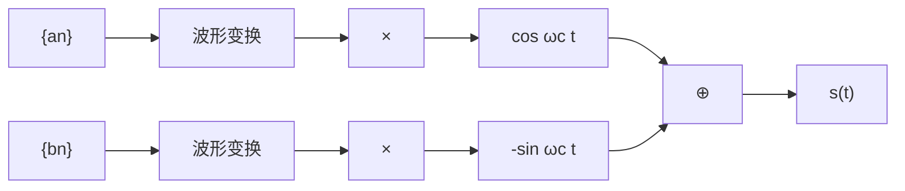
</details>

图 6.2.1 数字载波调制

在第 2 章中讨论过信号的向量表示，在 n 维的信号空间中，只要确定好 n 个正交的基向量，每个信号符号就可以用 n 维向量空间基向量的线性组合来表示。在数字载波调制（除调频信号外）方式中，如果选择载波频率 $\omega_{c}$ ，使其满足条件

$$
\omega_ {\mathrm{c}} = N \cdot \frac {2 \pi}{T} \tag {6.2.6}
$$

式中， $N$ 是整数， $T$ 是码元周期，则相应地， $\cos \omega_{\mathrm{c}}t$

和 $\sin \omega_{\mathrm{c}} t$ 都是周期为 $2 \pi / T$ 的函数。由此, 可保证在一个码元周期 $T$ 内有整数个载波周期, 由此严格保证满足条件

$$
\int_ {0} ^ {T} \cos \omega_ {\mathrm{c}} t \sin \omega_ {\mathrm{c}} t \mathrm{d} t = 1 / 2 \cdot \int_ {0} ^ {T} \sin 2 \omega_ {\mathrm{c}} t \mathrm{d} t = 0 \tag {6.2.7}
$$

即 $\cos\omega_{c}t$ 和 $\sin\omega_{c}t$ 在一个码元周期 T 内为两个正交函数。考虑到 $1/2\cdot\left|\int_{0}^{T}\sin2\omega_{c}tdt\right|=1/(4\omega_{c})\cdot\left|\int_{0}^{T}\sin(2\omega_{c}t)\right.$ $\mathrm{d}(2\omega_{c}t)\leqslant1/(2\omega_{c})$ ，当 $\omega_{c}$ 足够大时，总有 $\left|\int_{0}^{T}\cos\omega_{c}t\sin\omega_{c}tdt\right|\rightarrow0$ ，这个条件在实际系统中很容易满足。在后面的分析中，在一个码元周期 T 内，不管是否有整数个载波周期，均假定 $\cos\omega_{c}t$ 和 $\sin\omega_{c}t$ 是正交的。

由以上分析，若取

$$
\Psi_ {1} (t) = \cos \omega_ {\mathrm{c}} t, \quad 0 \leqslant t \leqslant T \tag {6.2.8}
$$

$$
\Psi_ {2} (t) = \sin \omega_ {\mathrm{c}} t, \quad 0 \leqslant t \leqslant T \tag {6.2.9}
$$

作为二维信号空间中的一组基向量，则数字载波调制信号 $s(t)$ 中的每个符号都可视为二维空间中的一个点，该点称为信号的一个星座点。以此表示的二维信号空间通常可用一个称为相幅平面的图来表示，星座点的横坐标值 $I_{n}$ 表示对基向量 $\Psi_{1}(t)$ 的加权系数 $x(t)$ 的样值，星座点的纵坐标值 $Q_{n}$ 表示对基向量 $\Psi_{2}(t)$ 的加权系数 $y(t)$ 的样值，习惯上该平面又称 $I - Q$ 平面。图6.2.2(a)至(d)分别表示实际系统中常用的二进制、四进制、十六进制和六十四进制的数字载波调制信号的星座图，它们分别包含了2,4,16和64个不同的星座点。


<details>
<summary>text_image</summary>

Q
Qn
O
I
In
</details>

(a)二进制


<details>
<summary>text_image</summary>

Q
Qn
O
I
In
</details>

(b)四进制


<details>
<summary>text_image</summary>

Q
I_n
O
Q_n
</details>

(c)十六进制


<details>
<summary>text_image</summary>

Q
Q_n
I_n
O
</details>

(d)六十四进制  
图6.2.2 相幅平面上的星座点

## 6.2.2 数字载波调制信号的功率谱分析

假定式（6.2.4）和式（6.2.5）中基带符号序列 $\{a_{n}\}$ 和 $\{b_{n}\}$ 是平稳随机序列，符号序列 $\{a_{n}\}$ 和 $\{b_{n}\}$ 之间是不相关的。由第2章的分析可知， $x(t)$ 和 $y(t)$ 均是循环平稳随机过程，且有

$$
\begin{array}{l} E \left[ x (t _ {1}) y (t _ {2}) \right] = E \left[ \sum_ {n = - \infty} ^ {\infty} a _ {n} g _ {T} (t _ {1} - n T) \sum_ {n ^ {\prime} = - \infty} ^ {\infty} b _ {n ^ {\prime}} g _ {T} (t _ {2} - n ^ {\prime} T) \right] \tag {6.2.10} \\ = \sum_ {n = - \infty} ^ {\infty} \sum_ {n ^ {\prime} = - \infty} ^ {\infty} E \left[ a _ {n} b _ {n ^ {\prime}} \right] g _ {T} \left(t _ {1} - n T\right) g _ {T} \left(t _ {2} - n ^ {\prime} T\right) = 0 \\ \end{array}
$$

其中最后一个等式成立利用了 $\{a_{n}\}$ 和 $\{b_n\}$ 之间不相关的条件。

下面进一步分析数字载波调制信号 $s(t)$ 的功率密度谱。按定义， $s(t)$ 的相关函数

$$
\begin{array}{l} R _ {s} (t _ {1}, t _ {2}) = E \left[ s (t _ {1}) s (t _ {2}) \right] \\ \begin{array}{l} = E \left[ \left(x \left(t _ {1}\right) \cos \omega_ {\mathrm{c}} t _ {1} - y \left(t _ {1}\right) \sin \omega_ {\mathrm{c}} t _ {1}\right) \left(x \left(t _ {2}\right) \cos \omega_ {\mathrm{c}} t _ {2} - y \left(t _ {2}\right) \sin \omega_ {\mathrm{c}} t _ {2}\right) \right] \\ = E \left[ x \left(t _ {1}\right) x \left(t _ {2}\right) \right] \cos \omega_ {\mathrm{c}} t _ {1} \cos \omega_ {\mathrm{c}} t _ {2} - E \left[ x \left(t _ {1}\right) y \left(t _ {2}\right) \right] \cos \omega_ {\mathrm{c}} t _ {1} \sin \omega_ {\mathrm{c}} t _ {2} - \end{array} \tag {6.2.11} \\ E \left[ y (t _ {1}) x (t _ {2}) \right] \cos \omega_ {\mathrm{c}} t _ {2} \sin \omega_ {\mathrm{c}} t _ {1} + E \left[ y (t _ {1}) y (t _ {2}) \right] \sin \omega_ {\mathrm{c}} t _ {1} \sin \omega_ {\mathrm{c}} t _ {2} \\ = E \left[ x \left(t _ {1}\right) x \left(t _ {2}\right) \right] \cos \omega_ {\mathrm{c}} t _ {1} \cos \omega_ {\mathrm{c}} t _ {2} + E \left[ y \left(t _ {1}\right) y \left(t _ {2}\right) \right] \sin \omega_ {\mathrm{c}} t _ {1} \sin \omega_ {\mathrm{c}} t _ {2} \\ \end{array}
$$

上式中最后一个等式成立利用了式（6.2.10）的结果。由式（6.2.11）的最后一个等号得到的两式可以分别进行分析。对于循环平稳随机过程 $x(t)$ ，根据第2章中有关循环平稳随机过程的讨论可知，其功率密度谱可由下式决定：

$$
P _ {x} (f) = \frac {1}{T} P _ {a} (f) \left| G _ {T} (f) \right| ^ {2} \tag {6.2.12}
$$

式中， $P_{a}(f) = \sum_{m = -\infty}^{\infty}R_{a}(m)\mathrm{e}^{-\mathrm{j}2\pi fmT}$ ， $R_{a}(m)$ 是序列 $\{a_{n}\}$ 的相关函数。同理可得循环平稳随机过程 $y(t)$ 的功率密度谱

$$
P _ {y} (f) = \frac {1}{T} P _ {b} (f) \left| G _ {T} (f) \right| ^ {2} \tag {6.2.13}
$$

式中， $P_{b}(f) = \sum_{m = -\infty}^{\infty}R_{b}(m)\mathrm{e}^{-\mathrm{j}2\pi fmT}$ ， $R_{b}(m)$ 是序列 $\{b_n\}$ 的相关函数。

首先分析式（6.2.11）中的 $E[x(t_1)x(t_2)]\cos \omega_{\mathrm{c}}t_{1}\cos \omega_{\mathrm{c}}t_{2}$ ，因为有

$$
E \left[ x (t _ {1}) x (t _ {2}) \right] \cos \omega_ {\mathrm{c}} t _ {1} \cos \omega_ {\mathrm{c}} t _ {2} = E \left[ \left(x (t _ {1}) \cos \omega_ {\mathrm{c}} t _ {1}\right) \left(x (t _ {2}) \cos \omega_ {\mathrm{c}} t _ {2}\right) \right] \tag {6.2.14}
$$

其中，

$$
x (t) \cos \omega_ {\mathrm{c}} t = \sum_ {n = - \infty} ^ {\infty} a _ {n} g _ {T} (t - n T) \cos \omega_ {\mathrm{c}} t \tag {6.2.15}
$$

如果选择载波频率 $\omega_{\mathrm{c}}$ 的取值是 $2\pi / T$ 的整数倍, 即在一个码元周期内包含 $N$ 个载波, 则

$$
\cos \omega_ {\mathrm{c}} (t - n T) = \cos \left(N \frac {2 \pi}{T} (t - n T)\right) = \cos \left(N \frac {2 \pi}{T} t - N \frac {2 \pi}{T} n T\right) = \cos \left(N \frac {2 \pi}{T} t\right) = \cos \omega_ {\mathrm{c}} t \tag {6.2.16}
$$

由此可得如下关系式：

$$
g _ {T} (t - n T) \cos \omega_ {\mathrm{c}} t = g _ {T} (t - n T) \cos \omega_ {\mathrm{c}} (t - n T) \tag {6.2.17}
$$

记

$$
f _ {T} (t) = g _ {T} (t) \cos \omega_ {\mathrm{c}} t \tag {6.2.18}
$$

$g_{T}(t)$ 和 $f_{T}(t)$ 可形象地用如图 6.2.3 中描述的波形表示。式（6.2.15）可表示为

$$
\begin{array}{l} x (t) \cos \omega_ {\mathrm{c}} t = \sum_ {n = - \infty} ^ {\infty} a _ {n} g _ {T} (t - n T) \cos \omega_ {\mathrm{c}} t \tag {6.2.19} \\ = \sum_ {n = - \infty} ^ {\infty} a _ {n} g _ {T} (t - n T) \cos \omega_ {\mathrm{c}} (t - n T) = \sum_ {n = - \infty} ^ {\infty} a _ {n} f _ {T} (t - n T) \\ \end{array}
$$

式（6.2.14）可表示为

$$
\begin{array}{l} R _ {x (t) \cos \omega_ {\mathrm{c}} t} (t _ {1}, t _ {2}) = E \left[ \left(x (t _ {1}) \cos \omega_ {\mathrm{c}} t _ {1}\right) \left(x (t _ {2}) \cos \omega_ {\mathrm{c}} t _ {2}\right) \right] \\ = E \left[ \sum_ {n = - \infty} ^ {\infty} a _ {n} f _ {T} \left(t _ {1} - n T\right) \sum_ {n ^ {\prime} = - \infty} ^ {\infty} a _ {n ^ {\prime}} f _ {T} \left(t _ {2} - n ^ {\prime} T\right) \right] \\ = E \left[ \sum_ {n = - \infty} ^ {\infty} \sum_ {n ^ {\prime} = - \infty} ^ {\infty} a _ {n} a _ {n ^ {\prime}} f _ {T} \left(t _ {1} - n T\right) f _ {T} \left(t _ {2} - n ^ {\prime} T\right) \right] \tag {6.2.20} \\ = \sum_ {n = - \infty} ^ {\infty} \sum_ {n ^ {\prime} = - \infty} ^ {\infty} E \left[ a _ {n} a _ {n ^ {\prime}} \right] f _ {T} (t _ {1} - n T) f _ {T} (t _ {2} - n ^ {\prime} T) \\ = \sum_ {n = - \infty} ^ {\infty} \sum_ {n ^ {\prime} = - \infty} ^ {\infty} R _ {a} (n - n ^ {\prime}) f _ {T} (t _ {1} - n T) f _ {T} (t _ {2} - n ^ {\prime} T) \\ \end{array}
$$

记 $t = t_{1}$ ， $t_2 = t + \tau$ ，上式可表示为

$$
R _ {x (t) \cos \omega_ {c} t} (t, t + \tau) = \sum_ {n = - \infty} ^ {\infty} \sum_ {n ^ {\prime} = - \infty} ^ {\infty} R _ {a} (n - n ^ {\prime}) f _ {T} (t - n T) f _ {T} (t + \tau - n ^ {\prime} T) \tag {6.2.21}
$$

用 $t + T$ 替代上式中的 $t$ ，直接可以证明

$$
R _ {x (t) \cos \omega_ {c} t} (t + T, t + T + \tau) = R _ {x (t) \cos \omega_ {c} t} (t, t + \tau) \tag {6.2.22}
$$

即若基带信号 $x(t) = \sum_{n = -\infty}^{\infty}a_{n}g_{T}(t - nT)$ 是一循环平稳随机信号，则 $x(t)\cos \omega_{\mathrm{c}}t$ 仍是循环平稳随机信号。

  
图 6.2.3 典型信号波形

同理，可以对式（6.2.11）中的 $E\left[y(t_{1})y(t_{2})\right]\sin\omega_{c}t_{1}\sin\omega_{c}t_{2}$ 做类似的分析，并证明 $y(t)\sin\omega_{c}t$ 也是循环平稳随机信号。

因此，数字载波调制信号 $s(t)=x(t)\cos\omega_{c}t-y(t)\sin\omega_{c}t$ 是循环平稳随机信号。因为

$$
f _ {T} (t) = g _ {T} (t) \cos \omega_ {\mathrm{c}} t \Leftrightarrow F _ {T} (f) = \frac {1}{2} \left(G _ {T} (f + f _ {\mathrm{c}}) + G _ {T} (f - f _ {\mathrm{c}})\right) \tag {6.2.23}
$$

由第 2 章中得到的循环平稳随机信号功率密度谱的一般计算关系式，可得 $x(t)\cos\omega_{c}t$ 信号的功率密度谱为

$$
\begin{array}{l} P _ {x (t) \cos \omega_ {\mathrm{c}} t} (f) = \frac {1}{T} P _ {a} (f) \left| F _ {T} (f) \right| ^ {2} = \frac {1}{T} P _ {a} (f) \frac {1}{2 ^ {2}} \left| G _ {T} \left(f + f _ {\mathrm{c}}\right) + G _ {T} \left(f - f _ {\mathrm{c}}\right) \right| ^ {2} \\ = \frac {1}{4 T} P _ {a} (f) \left(G _ {T} \left(f + f _ {\mathrm{c}}\right) + G _ {T} \left(f - f _ {\mathrm{c}}\right)\right) \left(G _ {T} ^ {*} \left(f + f _ {\mathrm{c}}\right) + G _ {T} ^ {*} \left(f - f _ {\mathrm{c}}\right)\right) \tag {6.2.24} \\ = \frac {1}{4 T} P _ {a} (f) \left(\left| G _ {T} \left(f + f _ {\mathrm{c}}\right) \right| ^ {2} + \left| G _ {T} \left(f - f _ {\mathrm{c}}\right) \right| ^ {2}\right) \\ \end{array}
$$

在上式的推导过程中 $G_{T}(f + f_{\mathrm{c}})G_{T}^{*}(f - f_{\mathrm{c}}) = 0$ ， $G_{T}^{*}(f + f_{\mathrm{c}})G_{T}(f - f_{\mathrm{c}}) = 0$ ，因为通常带通信号的频谱成分 $G_{T}(f + f_{\mathrm{c}})$ 与 $G_{T}^{*}(f - f_{\mathrm{c}})$ 、 $G_{T}^{*}(f + f_{\mathrm{c}})$ 与 $G_{T}(f - f_{\mathrm{c}})$ 间没有重叠部分。同理可得信号 $y(t)\sin \omega_{\mathrm{c}}t$ 的功率密度谱为

$$
P _ {y (t) \sin \omega_ {\mathrm{c}} t} (f) = \frac {1}{4 T} P _ {b} (f) \left(\left| G _ {T} (f + f _ {\mathrm{c}}) \right| ^ {2} + \left| G _ {T} (f - f _ {\mathrm{c}}) \right| ^ {2}\right) \tag {6.2.25}
$$

综上可得数字载波调制信号的功率密度谱为

$$
\begin{array}{l} \begin{array}{l} P _ {\mathrm{s}} (f) = P _ {x (t) \cos \omega_ {\mathrm{c}} t} (f) + P _ {y (t) \sin \omega_ {\mathrm{c}} t} (f) \\ = 1 \left(P (f) + P (f)\right) \left(| G _ {x} (f + f) | ^ {2} + | G _ {y} (f - f) | ^ {2}\right) \end{array} \tag {6.2.26} \\ = \frac {1}{4 T} \left(P _ {a} (f) + P _ {b} (f)\right) \left(\left| G _ {T} (f + f _ {\mathrm{c}}) \right| ^ {2} + \left| G _ {T} (f - f _ {\mathrm{c}}) \right| ^ {2}\right) \\ \end{array}
$$

式中， $P_{a}(f) = \sum_{m = -\infty}^{\infty}R_{a}(m)\mathrm{e}^{-\mathrm{j}2\pi fmT}$ ， $P_{b}(f) = \sum_{m = -\infty}^{\infty}R_{b}(m)\mathrm{e}^{-\mathrm{j}2\pi fmT}$ ， $R_{a}(m)$ 和 $R_{b}(m)$ 分别是基带符号序列 $\{a_{n}\}$ 和 $\{b_n\}$ 的自相关函数。

## 6.2.3 数字载波调制信号解调的基本原理

为了与星座图上的 $I 、 Q$ 坐标值对应, 习惯上, 由式 (6.2.3) 表示的数字载波调制信号通常又可记为

$$
s (t) = I (t) \cos \omega_ {\mathrm{c}} t - Q (t) \sin \omega_ {\mathrm{c}} t \tag {6.2.27}
$$

相应地有 $I(t) = x(t) = \sum_{n = -\infty}^{\infty}a_{n}g_{T}(t - nT),\quad Q(t) = y(t) = \sum_{n = -\infty}^{\infty}b_{n}g_{T}(t - nT)$ 。

数字载波调制信号 $s(t)$ 经过信道时，通常会受到加性高斯白噪声 $n_{\mathrm{W}}(t)$ 的干扰，因此接收的信号一般可以表示为

$$
r (t) = s (t) + n _ {\mathrm{W}} (t) \tag {6.2.28}
$$

信号解调的主要工作，就是要在收到受噪声干扰的信号中，正确地恢复出基带信号 $I(t)$ 和 $Q(t)$ 所携带的信息。解调的基本方法主要包括如下几类。

(1) 相干解调法 相干解调的原理可如图 6.2.4 所示，在相干解调前，通常都有带通滤波器，经过带通滤波后，接收端收到的信号通常可以表示为

$$
\begin{array}{l} \begin{array}{r l} r (t) & = s (t) + n _ {\mathrm{W}} (t) \\ & = I (t) \cos \omega_ {\mathrm{c}} t - Q (t) \sin \omega_ {\mathrm{c}} t + n _ {c} (t) \cos \omega_ {\mathrm{c}} t - n _ {s} (t) \sin \omega_ {\mathrm{c}} t \end{array} \tag {6.2.29} \\ = \left(I (t) + n _ {c} (t)\right) \cos \omega_ {c} t - \left(Q (t) + n _ {s} (t)\right) \sin \omega_ {c} t \\ \end{array}
$$


<details>
<summary>flowchart</summary>

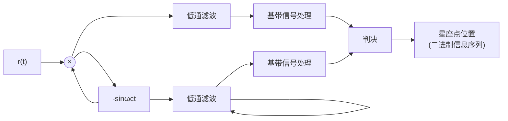
</details>

图 6.2.4 相干解调法

式中， $n_{c}(t)$ 和 $n_{s}(t)$ 是高斯噪声。相干解调时首先要在接收端恢复出与发送信号载波同频同相的本地载波信号 $\cos\omega_{c}t$ 与 $-\sin\omega_{c}t$ ，本地载波信号分别与接收信号 $r(t)$ 相乘，得到

$$
\begin{array}{l} r (t) \cdot \cos \omega_ {\mathrm{c}} t = \left(I (t) + n _ {c} (t)\right) \cos \omega_ {\mathrm{c}} t \cos \omega_ {\mathrm{c}} t - \left(Q (t) + n _ {s} (t)\right) \sin \omega_ {\mathrm{c}} t \cos \omega_ {\mathrm{c}} t \tag {6.2.30} \\ = \left(I (t) + n _ {c} (t)\right) \frac {1}{2} \left(1 + \cos 2 \omega_ {c} t\right) - \left(Q (t) + n _ {s} (t)\right) \frac {1}{2} \sin 2 \omega_ {c} t \\ \end{array}
$$

$$
\begin{array}{l} r (t) \cdot (- \sin \omega_ {\mathrm{c}} t) = - \left(I (t) + n _ {c} (t)\right) \cos \omega_ {\mathrm{c}} t \sin \omega_ {\mathrm{c}} t + \left(Q (t) + n _ {s} (t)\right) \sin \omega_ {\mathrm{c}} t \sin \omega_ {\mathrm{c}} t \tag {6.2.31} \\ = - \left(I (t) + n _ {c} (t)\right) \frac {1}{2} \sin 2 \omega_ {\mathrm{c}} t + \left(Q (t) + n _ {s} (t)\right) \frac {1}{2} \left(1 - \cos 2 \omega_ {\mathrm{c}} t\right) \\ \end{array}
$$

经过低通滤波器滤除含载波倍频成分的信号 $\cos 2\omega_{c}t$ 与 $\sin 2\omega_{c}t$ ，调整系数后可得

$$
r _ {I} (t) = I (t) + n _ {c} (t) \tag {6.2.32}
$$

$$
r _ {Q} (t) = Q (t) + n _ {s} (t) \tag {6.2.33}
$$

解调问题变为由基带信号 $I(t) + n_{c}(t)$ 和 $Q(t) + n_{s}(t)$ 求解基带符号序列 $\{a_{n}\}$ 和 $\{b_{n}\}$ 的问题, 该问题可通过第 5 章中介绍的基带信号的接收方法求解。一般来说, 对于加性高斯噪声干扰信道, 在采样时刻 $t = t_{n}$ 获得的 $r_{I}(t_{n})$ 和 $r_{Q}(t_{n})$ 是一对随机变量。因为其中的 $n_{c}(t_{n})$ 和 $n_{s}(t_{n})$ 为零均值的高斯随机变量,所以 $r_I(t_n)$ 和 $r_Q(t_n)$ 是均值为 $I_{n}(t_{n})$ 和 $Q_{n}(t_{n})$ 高斯随机变量，判决问题变为高斯噪声干扰下的信号检测问题。

(2) 匹配滤波器法（相关解调法）由 2.3 节的分析可知，若在 $N$ 维信号空间中能找到一组标准的正交基 $\Psi_{k}(t), k = 1,2,\dots,N$ ，则该信号空间中的任一 $M$ 进制的信号可表示为

$$
s _ {m} (t) = a _ {m 1} \Psi_ {1} (t) + a _ {m 2} \Psi_ {2} (t) + \dots + a _ {m N} \Psi_ {N} (t) = \sum_ {i = 1} ^ {N} a _ {m i} \Psi_ {i} (t) \tag {6.2.34}
$$

由此，信号 $s_{m}(t)$ 与 N 维实数空间中的向量 $S_{m}=\left[a_{m1},a_{m2},\cdots,a_{mN}\right]^{\mathrm{T}},m=1,2,\cdots,M$ 建立一一对应关系。在第 2 章中还了解到，匹配滤波器法是一种在判决时刻信噪比达到最大意义上的最佳接收方法。基于正交基 $\Psi_{k}(t),k=1,2,\cdots,N$ 的匹配滤波器解调 M 进制信号的方法一般可用图 6.2.5 表示。在图中用相关


<details>
<summary>flowchart</summary>

This image displays a block diagram of a signal processing system, showing multiple parallel signal paths (labeled with mathematical expressions like ψ1(t), ψ2(t)) and their corresponding integrators and decision points.
</details>

图 6.2.5 相关解调法

器在 t=T 时刻的取值替代滤波器的输出，图中判决器可根据各个匹配滤波器的输出组成的向量 $S_{m}^{\prime}=\left[a_{m1}^{\prime},a_{m2}^{\prime},\cdots,a_{mN}^{\prime}\right]^{\mathrm{T}}$ ，搜索信号空间中与其最相似（距离最小）的向量 $S_{m}=\left[a_{m1},a_{m2},\cdots,a_{mN}\right]^{\mathrm{T}}$ ， $m=1,2,\cdots,M$ ，作为判决输出。

在数字调制传输系统中，通常只有M进制的调频传输系统会采用M个基向量组成M进制的MFSK调制信号，有关该系统稍后会详细讨论。其他调制方式一般均采用同频、相位相差90°的两个信号 $\cos\omega_{c}t$ 与 $-\sin\omega_{c}t$ 。此时接收

端收到的数字载波调制信号一般可以表示为

$$
r (t) = s (t) + n _ {\mathrm{W}} (t) = \sum_ {n = - \infty} ^ {\infty} a _ {n} g _ {T} (t - n T) \cos \omega_ {\mathrm{c}} t - \sum_ {n = - \infty} ^ {\infty} b _ {n} g _ {T} (t - n T) \sin \omega_ {\mathrm{c}} t + n _ {\mathrm{W}} (t) \tag {6.2.35}
$$

由前面有关 $\cos\omega_{c}t$ 和 $\sin\omega_{c}t$ 在一个码元周期内的正交性的分析，一般地，对于 $g_{T}(t)\cos\omega_{c}t$ 和 $g_{T}(t)\sin\omega_{c}t$ ，仍可认为其在一个码元周期内满足正交性，即

$$
\int_ {0} ^ {T} \left(g _ {T} (t) \cos \omega_ {\mathrm{c}} t\right) \left(g _ {T} (t) \sin \omega_ {\mathrm{c}} t\right) \mathrm{d} t = \frac {1}{2} \int_ {0} ^ {T} g _ {T} ^ {2} (t) \sin 2 \omega_ {\mathrm{c}} t \mathrm{d} t = 0 \tag {6.2.36}
$$

因此可以定义一组二维正交基函数为

$$
\Psi_ {1} (t) = g _ {T} (t) \cos \omega_ {\mathrm{c}} t, \quad 0 \leqslant t \leqslant T \tag {6.2.37}
$$

$$
\Psi_ {2} (t) = - g _ {T} (t) \sin \omega_ {\mathrm{c}} t, \quad 0 \leqslant t \leqslant T \tag {6.2.38}
$$

接收的数字载波调制信号可以表示为

$$
r (t) = s (t) + n _ {\mathrm{W}} (t) = \sum_ {n = - \infty} ^ {\infty} a _ {n} \Psi_ {1} (t - n T) + \sum_ {n = - \infty} ^ {\infty} b _ {n} \Psi_ {2} (t - n T) + n _ {\mathrm{W}} (t) \tag {6.2.39}
$$

相应的相关解调法可以由图 6.2.6 表示。

其中，

$$
\begin{array}{l} a _ {n} ^ {\prime} = \int_ {(n - 1) T} ^ {n T} \left(\sum_ {k = - \infty} ^ {\infty} a _ {k} \Psi_ {1} (t - k T) + \sum_ {k = - \infty} ^ {\infty} b _ {k} \Psi_ {2} (t - k T) + n _ {\mathrm{W}} (t)\right) \Psi_ {1} (t - n T) \mathrm{d} t \\ = \int_ {(n - 1) T} ^ {n T} \sum_ {k = - \infty} ^ {\infty} a _ {k} \Psi_ {1} (t - k T) \Psi_ {1} (t - n T) \mathrm{d} t + \int_ {(n - 1) T} ^ {n T} n _ {\mathrm{W}} (t) \Psi_ {1} (t - n T) \mathrm{d} t \tag {6.2.40} \\ = \int_ {(n - 1) T} ^ {n T} a _ {n} \Psi_ {1} ^ {2} (t - n T) \mathrm{d} t + \int_ {(n - 1) T} ^ {n T} n _ {\mathrm{W}} (t) \Psi_ {1} (t - n T) \mathrm{d} t \\ = \int_ {0} ^ {T} a _ {n} \Psi_ {1} ^ {2} (t) \mathrm{d} t + \int_ {0} ^ {T} n _ {\mathrm{W}} (t + n T) \Psi_ {1} (t) \mathrm{d} t = a _ {n} + N ^ {\prime} \\ \end{array}
$$


<details>
<summary>flowchart</summary>

```mermaid
graph LR
  r["r(t)"] --> Sum1((×))
  Sum1 --> Sum2((×))
  Sum2 --> Sum3((×))
  Sum3 --> Sum4((×))
  Sum4 --> Sum5((×))
  Sum5 --> Sum6((×))
  Sum6 --> Sum7((×))
  Sum7 --> Sum8((×))
  Sum8 --> Sum9((×))
  Sum9 --> Sum10((×))
  Sum10 --> Sum11((×))
  Sum11 --> Sum12((×))
  Sum12 --> Sum13((×))
  Sum13 --> Sum14((×))
  Sum14 --> Sum15((×))
  Sum15 --> Sum16((×))
  Sum16 --> Sum17((×))
  Sum17 --> Sum18((×))
  Sum18 --> Sum19((×))
  Sum19 --> Sum20((×))
  Sum20 --> Sum21((×))
  Sum21 --> Sum22((×))
  Sum22 --> Sum23((×))
  Sum23 --> Sum24((×))
  Sum24 --> Sum25((×))
  Sum25 --> Sum26((×))
  Sum26 --> Sum27((×))
  Sum27 --> Sum28((×))
  Sum28 --> Sum29((×))
  Sum29 --> Sum30((×))
  Sum30 --> Sum31((×))
  Sum31 --> Sum32((×))
  Sum32 --> Sum33((×))
  Sum33 --> Sum34((×))
  Sum34 --> Sum35((×))
  Sum35 --> Sum36((×))
  Sum36 --> Sum37((×))
  Sum37 --> Sum38((×))
  Sum38 --> Sum39((×))
  Sum39 --> Sum40((×))
  Sum40 --> Sum41((×))
  Sum41 --> Sum42((×))
  Sum42 --> Sum43((×))
  Sum43 --> Sum44((×))
  Sum44 --> Sum45((×))
  Sum45 --> Sum46((×))
  Sum46 --> Sum47((×))
  Sum47 --> Sum48((×))
  Sum48 --> Sum49((×))
  Sum49 --> Sum50((×))
  Sum50 --> Sum51((×))
  Sum51 --> Sum52((×))
  Sum52 --> Sum53((×))
  Sum53 --> Sum54((×))
  Sum54 --> Sum55((×))
  Sum55 --> Sum56((×))
  Sum56 --> Sum57((×))
  Sum57 --> Sum58((×))
  Sum58 --> Sum59((×))
  Sum59 --> Sum60((×))
  Sum60 --> Sum61((×))
  Sum61 --> Sum62((×))
  Sum62 --> Sum63((×))
  Sum63 --> Sum64((×))
  Sum64 --> Sum65((×))
  Sum65 --> Sum66((×))
  Sum66 --> Sum67((×))
  Sum67 --> Sum68((×))
  Sum68 --> Sum69((×))
  Sum69 --> Sum70((×))
  Sum70 --> Sum71((×))
  Sum71 --> Sum72((×))
  Sum72 --> Sum73((×))
  Sum73 --> Sum74((×))
  Sum74 --> Sum75((×))
  Sum75 --> Sum76((×))
  Sum76 --> Sum77((×))
  Sum77 --> Sum78((×))
  Sum78 --> Sum79((×))
  Sum79 --> Sum80((×))
  Sum80 --> Sum81((×))
  Sum81 --> Sum82((×))
  Sum82 --> Sum83((×))
  Sum83 --> Sum84((×))
  Sum84 --> Sum85((×))
  Sum85 --> Sum86((×))
  Sum86 --> Sum87((×))
  Sum87 --> Sum88((×))
  Sum88 --> Sum89((×))
  Sum89 --> Sum90((×))
  Sum90 --> Sum91((×))
  Sum91 --> Sum92((×))
  Sum92 --> Sum93((×))
  Sum93 --> Sum94((×))
  Sum94 --> Sum95((×))
  Sum95 --> Sum96((×))
  Sum96 --> Sum97((×))
  Sum97 --> Sum98((×))
  Sum98 --> Sum99((×))
  Sum99 --> Sum100((×))
  Sum100 --> Sum11((×))
  Sum11 --> Sum12((×))
  Sum12 --> Sum13((×))
  Sum13 --> Sum14((×))
  Sum14 --> Sum15((×))
  Sum15 --> Sum16((×))
  Sum16 --> Sum17((×))
  Sum17 --> Sum18((×))
  Sum18 --> Sum19((×))
  Sum18 --> Sum20((×))
  Sum20 --> Sum21((×))
  Sum21 --> Sum22((×))
  Sum22 --> Sum23((×))
  Sum23 --> Sum24((×))
  Sum24 --> Sum25((×))
  Sum25 --> Sum26((×))
  Sum26 --> Sum27((×))
  Sum27 --> Sum28((×))
  Sum28 -.-> Sum29((×))
  Sum29 --> Sum30((×))
  Sum30 --> Sum31((×))
  Sum31 --> Sum32((×))
  Sum32 --> Sum33((×))
  Sum33 --> Sum34((×))
  Sum34 --> Sum35((×))
  Sum35 --> Sum36((×))
  Sum36 --> Sum37((×))
  Sum37 --> SUM38((×))
  SUM38 --> Sum39((×))
  Sum39 --> Sum40((×))
  Sum40 --> Sum41((×))
  Sum41 --> Sum42((×))
  Sum42 --> Sum43((×))
  Sum43 --> Sum44((×))
  Sum44 --> Sum45((×))
  Sum45 --> Sum46((×))
  Sum46 --> Sum47((×))
  Sum100 --> Sum11((×))
  Sum11 --> Sum12((×))
  Sum12 --> Sum13((×))
  Sum13 --> Sum14((×))
  Sum14 --> Sum15((×))
  Sum15 --> Sum16((×))
  Sum16 --> Sum17((×))
  Sum17 --> Sum18((×))
  Sum18 --> Sum17((×))
  Sum17 --> Sum18((×))
  Sum18 --> Sum19((×))
  Sum19 --> Sum20((×))
  Sum20 --> Sum21((×))
  Sum21 --> Sum22((×))
  Sum22 --> Sum23((×))
  Sum23 --> Sum24((×))
  Sum24 --> Sum25((×))
  Sum25 -.-> Sum26((×))
  Sum26 --> Sum27((×))
  Sum27 --> Sum28((×))
  Sum28 --> Sum29((×))
  Sum29 --> Sum30((×))
  Sum30 --> Sum31((×))
  Sum31 --> Sum32((×))
  Sum32 --> Sum33((×))
  Sum33 --> Sum34((×))
  Sum34 --> SUM35((×))
  SUM35 --> Sum36((×))
  Sum36 --> Sum37((×))
  Sum37 --> Sum38((×))
  Sum38 --> SUM39((×))
  SUM39 --> Sum40((×))
  Sum40 --> Sum41((×))
  Sum41 --> Sum42((×))
  Sum42 --> Sum43((×))
  Sum43 --> SUM44((×))
  SUM44 --> Sum45((×))
  Sum45 --> Sum46((×))
  Sum46 --> SUM47((×))
  SUM47 --> Sum48((×))
  SUM48 --> Sum49((×))
  Sum49 --> SUM50((×))
  SUM50 --> Sum51((×))
  Sum51 --> Sum52((×))
  Sum52 --> SUM53((×))
  SUM53 --> Sum54((×))
  SUM54 --> SUM55((×))
  SUM55 --> Sum56((×))
  SUM56 --> SUM57((×))
  SUM57 --> Sum58((×))
  SUM58 --> SUM59((×))
  SUM59 --> SUM60((×))
  SUM60 --> SUM61((×))
  SUM61 --> SUM62((×))
  SUM62 --> SUM63((×))
  SUM63 --> SUM64((×))
  SUM64 --> SUM65((×))
  SUM65 --> SUM66((×))
  SUM66 --> SUM67((×))
  SUM67 --> SUM68((×))
  SUM68 --> SUM69((×))
  SUM69 --> SUM70((×))
  SUM70 --> SUM71((×))
  SUM71 --> SUM72((×))
  SUM72 --> SUM73((×))
  SUM73 --> SUM74((×))
  SUM74 --> SUM75((×))
  SUM75 --> SUM76((×))
  SUM76 --> SUM77((×))
  SUM77 --> SUM78((×))
  SUM78 --> SUM79((×))
  SUM79 --> SUM80((×))
  SUM80 --> SUM81((×))
  SUM81 --> SUM82((×))
  SUM82 --> SUM83((×))
  SUM83 --> SUM84((×))
  SUM84 --> SUM85((×))
  SUM85 --> SUM86((×))
  SUM86 --> SUM87((×))
  SUM87 --> SUM88((×))
  SUM88 --> SUM89((×))
  SUM89 --> SUM90((×))
  SUM90 --> SUM91((×))
  SUM91 --> SUM92((×))
  SUM92 --> SUM93((×))
  SUM93 --> SUM94((×))
  SUM94 --> SUM95((×))
  SUM95 --> SUM96((×))
  SUM96 --> SUM97((×))
  SUM97 --> SUM98((×))
  SUM98 --> SUM99((×))
  SUM99 --> SUM100((×))
  Sum100 --> Sum11((×))
  Sum11 --> Sum12((×))
  Sum12 --> Sum13((×))
  Sum13 --> Sum14((×))
  Sum14 --> Sum15((×))
  Sum15 --> Sum16((×))
  Sum16 --> Sum17((×))
  Sum17 --> SUM18((×))
  SUM18 --> Sum19((×))
  SUM19 --> Sum20((×))
  SUM20 --> SUM21((×))
  SUM21 --> SUM22((×))
  SUM22 --> SUM23((×))
  SUM23 --> SUM24((×))
  SUM24 --> SUM25((×))
  SUM25 --> SUM26((×))
  SUM26 --> SUM27((×))
  SUM27 --> SUM28((×))
  SUM28 --> SUM29((×))
  SUM29 --> SUM30((×))
  SUM30 --> SUM31((×))
  SUM31 --> SUM32((×))
  SUM32 --> SUM33((×))
  SUM33 --> SUM34((×))
  SUM34 --> SUM35((×))
  SUM35 --> SUM36((×))
  SUM36 --> SUM37((×))
  SUM37 --> SUM38((×))
  SUM38 --> SUM39((×))
  SUM39 --> SUM40((×))
  SUM40 --> SUM41((×))
  SUM41 --> SUM42((×))
  SUM42 --> SUM43((×))
  SUM43 --> SUM44((×))
  SUM44 --> SUM45((×))
  SUM45 --> SUM46((×))
  SUM46 --> SUM47((×))
  SUM47 --> SUM48((×))
  SUM48 --> SUM49((×))
  SUM49 --> SUM50((×))
  SUM50 --> SUM51((×))
  SUM51 --> SUM52((×))
  SUM52 --> SUM53((×))
  SUM53 --> SUM54((×))
  SUM54 --> SUM55((×))
  SUM55 --> SUM56((×))
  SUM56 --> SUM57((×))
  SUM57 --> SUM58((×))
  SUM58 --> SUM59((×))
  SUM59 --> SUM60((×))
  SUM60 --> SUM61((×))
  SUM61 --> SUM62((×))
  SUM62 --> SUM63((×))
  SUM63 --> SUM64((×))
  SUM64 --> SUM65((×))
  SUM65 --> SUM66((×))
  SUM66 --> SUM20((×))
  SUM20 --> Sum21((×))
  Sum21 --> Sum22((×))
  Sum22 --> Sum23((×))
  Sum23 --> SUM24((×))
  SUM24 --> SUM25((×))
  SUM25 --> SUM26((×))
  SUM26 --> SUM27((×))
  SUM27 --> SUM28((×))
  SUM28 --> SUM29((×))
  SUM29 --> SUM30((×))
  SUM30 --> SUM31((×))
  SUM31 --> SUM32((×))
  SUM22((×)) --> Sum21((×))
  Sum21((×)) --> Sum22((×))
  Sum22((×)) --> Sum23((×))
  Sum23((×)) --> Sum24((×))
  Sum24((×)) --> Sum25((×))
  Sum25((×)) --> Sum26((×))
  Sum26((×)) --> Sum27((×))
  Sum27((×)) --> Sum28((×))
  Sum28((×)) --> SUM29((×))
  SUM29((×)) --> SUM30((×))
  SUM30((×)) --> SUM31((×))
  SUM31((×)) --> SUM32((×))
  SUM32((×)) --> SUM33((×))
  SUM33((×)) --> SUM34((×))
  SUM34((×)) --> SUM35((×))
  SUM35((×)) --> SUM36((×))
  SUM36((×)) --> SUM37((×))
  SUM37((×)) --> SUM38((×))
  SUM38((×)) --> SUM39((×))
  SUM39((×)) --> SUM40((×))
  SUM40((×)) --> SUM41((×))
  SUM41((×)) --> SUM42((×))
  SUM42((×)) --> SUM43((×))
  SUM43((×)) --> SUM44((×))
  SUM44((×)) --> SUM45((×))
  SUM45((×)) --> SUM46((×))
  SUM46((×)) --> SUM47((×))
  SUM47((×)) --> SUM48((×))
  SUM48((×)) --> SUM49((×))
  SUM49((×)) --> SUM50((×))
  SUM50((×)) --> SUM51((×))
  SUM51((×)) --> SUM52((×))
  SUM52((×)) --> SUM53((×))
  SUM53((×)) --> SUM54((×))
  SUM54((×)) --> SUM55((×))
  SUM55((×)) --> SUM56((×))
  SUM56((×)) --> SUM57((×))
  SUM57((×)) --> SUM58((×))
  SUM58((×)) --> SUM59((×))
  SUM59((×)) --> SUM60((×))
  SUM60((×)) --> SUM61((×))
  SUM61((×)) --> SUM62((×))
  SUM62((×)) --> SUM63((×))
  SUM63((×)) --> SUM64((×))
  SUM64((×)) --> SUM65((×))
  SUM65((×)) --> SUM66((×))
  SUM66((×)) --> SUM67((×))
  SUM67((×)) --> SUM68((×))
  SUM68((×)) --> SUM69((×))
  SUM69((×)) --> SUM70((×))
  SUM70((×)) --> SUM71((×))
  SUM71((×)) --> SUM72((×))
  SUM72((×)) --> SUM73((×))
  SUM73((×)) --> SUM74((×))
  SUM74((×)) --> SUM75((×))
  SUM75((×)) --> SUM76((×))
  SUM76((×)) --> SUM77((×))
  SUM77((×)) --> SUM78((×))
  SUM78((×)) --> SUM79((×))
  SUM79((×)) --> SUM80((×))
  SUM80((×)) --> SUM81((×))
  SUM81((×)) --> SUM82((×))
  SUM82((×)) --> SUM83((×))
  SUM83((×)) --> SUM84((×))
  SUM84((×)) --> SUM85((×))
  SUM85((×)) --> SUM86((×))
  SUM86((×)) --> SUM87((×))
  SUM87((×)) --> SUM88((×))
  SUM88((×)) --> SUM89((×))
  SUM89((×)) --> SUM90((×))
  SUM90((×)) --> SUM91((×))
  SUM91((×)) --> SUM92((×))
  SUM92((×)) --> SUM93((×))
  SUM93((×)) --> SUM94((×))
  SUM94((×)) --> SUM95((×))
  SUM95((×)) --> SUM96((×))
  SUM96((×)) --> SUM97((×))
  SUM97((×)) --> SUM98((×))
  SUM98((×)) --> SUM99((×))
  SUM99((×)) --> SUM100((×))
  SUM100((×)) --> Sum11((×))
  Sum11((×)) --> Sum12((×))
  Sum12((×)) --> Sum13((×))
  Sum13((×)) --> Sum14((×))
  Sum14((×)) --> Sum15((×))
  Sum15((×)) --> Sum16((×))
  Sum16((×)) --> Sum17((×))
  Sum17((×)) --> Sum18((×))
  Sum18((×)) --> SUM19((×))
  SUM19((×)) --> SUM20((×))
  SUM20((×)) --> Sum21((×))
  SUM21((×)) --> Sum22((×))
  SUM22((×)) --> Sum23((×))
  SUM23((×)) --> SUM24((×))
  SUM24((×)) --> SUM25((×))
  SUM25((×)) --> SUM26((×))
  SUM26((×)) --> SUM27((×))
  SUM27((×)) --> SUM28((×))
  SUM28((×)) --> SUM29((×))
  SUM29((×)) --> SUM30((×))
  SUM30((×)) --> SUM31((×))
  SUM31((×)) --> SUM32((×))
  SUM32((×)) --> SUM33((×))
  SUM33((×)) --> SUM34((×))
  SUM34((×)) --> SUM35((×))
  SUM34((×)) --> SUM36((×))
  SUM36((×)) --> SUM37((×))
  SUM37((×)) --> SUM38((×))
  SUM38((×)) --> SUM39((×))
  SUM39((×)) --> SUM40((×))
  SUM40((×)) --> SUM41((×))
  SUM41((×)) --> SUM42((×))
  SUM42((−×)) --> Sum43((×))
  SUM43((×)) --> Sum44((×))
  SUM44((×)) --> SUM45((×))
  SUM45((×)) --> SUM46((×))
  SUM46((×)) --> SUM47((×))
  SUM47((×)) --> SUM48((×))
  SUM48((×)) --> SUM49((×))
  SUM49((×)) --> SUM50((×))
  SUM50((×)) --> SUM59((×))
  SUM59((×)) --> SUM60((×))
  SUM60((×)) --> SUM61((×))
  SUM61((×)) --> SUM62((×))
  SUM62((×)) --> SUM63((×))
  SUM63((×)) --> SUM64((×))
  SUM64((×)) --> SUM65((×))
  SUM65((−×)) --> Sum66((×))
  SUM66((×)) --> SUM67((×))
  SUM67((×)) --> SUM68((×))
  SUM68((×)) --> SUM69((×))
  SUM69((×)) --> SUM70((×))
  SUM70((×)) --> SUM71((×))
  SUM71((×)) --> SUM72((×))
  SUM72((×)) --> SUM74((×))
  SUM74((×)) --> SUM75((×))
  SUM75((×)) --> SUM76((×))
  SUM76((×)) --> SUM77((×))
  SUM77((×)) --> SUM78((×))
  SUM78((×)) --> SUM79((×))
  SUM79((×)) --> SUM80((×))
  SUM80((−×)) --> Sum81((×))
  SUM81((×)) --> Sum82((×))
  SUM82((×)) --> SUM83((×))
  SUM83((×)) --> SUM84((×))
  SUM84((×)) --> SUM85((×))
  SUM85((×)) --> SUM86((×))
  SUM86((×)) --> SUM87((×))
  SUM87((×)) --> SUM88((×))
  SUM88((×)) --> SUM88((×))
  SUM88((×)) --> SUM89((×))
  SUM89((×)) --> SUM90((×))
  SUM90((×)) --> SUM91((×))
  SUM91((×)) --> SUM92((×))
  SUM92((×)) --> SUM93((×))
  SUM93((×)) --> SUM94((×))
  SUM94((−×)) --> Sum95((×))
  SUM95((×)) --> Sum96((×))
  SUM96((×)) --> SUM97((×))
  SUM97((×)) --> SUM98((×))
  SUM98((×)) --> SUM99((×))
  SUM99((×)) --> SUM100((×))
  SUM100((×)) --> Sum11((×))
  Sum11((×)) --> Sum12((×))
  Sum12((×)) --> SUM13((×))
  SUM13((×)) --> SUM14((×))
  SUM14((×)) --> SUM15((×))
  SUM15((×)) --> SUM16((×))
  SUM16((×)) --> SUM17((×))
  SUM17((×)) --> SUM18((×))
  SUM18((×)) --> SUM19((×))
  SUM19((×)) --> SUM20((×))
  SUM20((×)) --> Sum21((×))
  Sum21((×)) --> Sum22((×))
  Sum22((×)) --> SUM23((×))
  SUM23((×)) --> SUM24((×))
  SUM24((×)) --> SUM25((×))
  SUM25((×)) --> SUM26((×))
  SUM26((×)) --> SUM27((×))
  SUM27((×)) --> SUM28((×))
  SUM28((×)) --> SUM29((×))
  SUM29((×)) --> SUM31((×))
  SUM31((×)) --> SUM32((×))
  SUM32((×)) --> SUM33((×))
  SUM33((×)) --> SUM34((×))
  SUM34((×)) --> SUM35((×))
  SUM35((×)) --> SUM36((×))
  SUM36((×)) --> SUM37((×))
  SUM37((−×)) --> Sum38((×))
  SUM38((×)) --> SUM39((×))
  SUM39((×)) --> SUM40((×))
  SUM40((×)) --> SUM41((×))
  SUM41((×)) --> SUM42((×))
  SUM42((×)) --> SUM43((×))
  SUM43((×)) --> SUM44((×))
  SUM44((×)) --> SUM46((×))
  SUM46((×)) --> SUM47((×))
  SUM47((×)) --> SUM48((×))
  SUM48((×)) --> SUM49((×))
  SUM49((×)) --> SUM50((×))
  SUM50((×)) --> Sum51((×))
  Sum51((×)) --> Sum52((×))
  Sum52((×)) --> SUM53((×))
  SUM53((×)) --> SUM54((×))
  SUM54((×)) --> SUM55((×))
  SUM55((×)) --> SUM56((×))
  SUM56((×)) --> SUM57((×))
  SUM57((×)) --> SUM58((×))
  SUM58((×)) --> SUM59((×))
  SUM58((×)) --> SUM60((×))
  SUM59((×)) --> SUM61((×))
  SUM61((×)) --> SUM62((×))
  SUM62((×)) --> SUM63((×))
  SUM63((×)) --> SUM64((×))
  SUM64((×)) --> SUM65((×))
  SUM65((×)) --> SUM66((×))
  SUM66((×)) --> SUM67((×))
  SUM67((−×)) --> Sum68((×))
  SUM68((×)) --> SUM69((×))
  SUM69((×)) --> SUM70((×))
  SUM70((×)) --> SUM71((×))
  SUM71((×)) --> SUM72((×))
  SUM72((×)) --> SUM73((×))
  SUM73((×)) --> SUM74((×))
  SUM74((×)) --> SUM76((×))
  SUM76((×)) --> SUM77((×))
  SUM77((×)) --> SUM78((×))
  SUM78((×)) --> SUM79((×))
  SUM79((×)) --> SUM80((×))
  SUM80((×)) --> SUM81((×))
  SUM81((×)) --> SUM82((×))
  SUM82((−×)) --> Sum83((×))
  SUM83((×)) --> SUM84((×))
  SUM84((×)) --> SUM85((×))
  SUM85((×)) --> SUM86((×))
  SUM86((×)) --> SUM87((×))
  SUM87((×)) --> SUM88((×))
  SUM88((×)) --> SUM89((×))
  SUM89((×)) --> SUM91((×))
  SUM91((×)) --> SUM92((×))
  SUM92((×)) --> SUM93((×))
  SUM93((×)) --> SUM94((×))
  SUM94((×)) --> SUM95((×))
  SUM95((×)) --> SUM96((×))
  SUM96((×)) --> SUM97((×))
  SUM97((−×)) --> Sum98((×))
  SUM98((×)) --> SUM99((×))
  SUM99((×)) --> SUM100((×))
  SUM100((×)) --> Sum11((×))
  Sum11((×)) --> Sum12((×))
  Sum12((×)) --> Sum13((×))
  Sum13((×)) --> SUM14((×))
  SUM14((×)) --> SUM15((×))
  SUM15((×)) --> SUM16((×))
  SUM16((×)) --> SUM17((×))
  SUM17((×)) --> SUM18((×))
  SUM18((×)) --> SUM19((×))
  SUM19((×)) --> SUM20((×))
  SUM21((×)) --> Sum21((×))
  Sum21((×)) --> Sum22((×))
  Sum22((×
```
</details>

图 6.2.6 数字载波调制信号的相关解调法

其中第二和第三个等式利用了基向量间的正交性和任意两时间上不重叠信号的正交性：

$$
\int_ {0} ^ {T} \Psi_ {1} (t) \Psi_ {2} (t) \mathrm{d} t = 0 \tag {6.2.41}
$$

$$
\int_ {0} ^ {T} \Psi_ {i} (t) \Psi_ {j} (t - n T) \mathrm{d} t = 0, \quad n = \pm 1, \pm 2, \dots ; \quad i, j = 1, 2 \tag {6.2.42}
$$

$N'$ 是一高斯随机变量，其均值和方差分别为

$$
m _ {n} = E \left[ \int_ {0} ^ {T} n _ {\mathrm{W}} (t + n T) \Psi_ {1} (t) \mathrm{d} t \right] = \int_ {0} ^ {T} E \left[ n _ {\mathrm{W}} (t + n T) \right] \Psi_ {1} (t) \mathrm{d} t = 0 \tag {6.2.43}
$$

$$
\begin{array}{l} \sigma_ {N} ^ {2} = E \left[ \left(\int_ {0} ^ {T} n _ {\mathrm{W}} (t + n T) \Psi_ {1} (t) \mathrm{d} t - m _ {n}\right) ^ {2} \right] = E \left[ \left(\int_ {0} ^ {T} n _ {\mathrm{W}} (t + n T) \Psi_ {1} (t) \mathrm{d} t\right) ^ {2} \right] \\ = E \left[ \int_ {0} ^ {T} n _ {\mathrm{W}} (t _ {1} + n T) \Psi_ {1} (t _ {1}) \mathrm{d} t _ {1} \int_ {0} ^ {T} n _ {\mathrm{W}} (t _ {2} + n T) \Psi_ {1} (t _ {2}) \mathrm{d} t _ {2} \right] \\ = \int_ {0} ^ {T} \int_ {0} ^ {T} E \left[ n _ {\mathrm{W}} (t _ {1} + n T) n _ {\mathrm{W}} (t _ {2} + n T) \right] \Psi_ {1} (t _ {1}) \Psi_ {1} (t _ {2}) \mathrm{d} t _ {1} \mathrm{d} t _ {2} \tag {6.2.44} \\ = \int_ {0} ^ {T} \int_ {0} ^ {T} \frac {N _ {0}}{2} \delta (t _ {2} - t _ {1}) \Psi_ {1} (t _ {1}) \Psi_ {1} (t _ {2}) \mathrm{d} t _ {1} \mathrm{d} t _ {2} \\ = \frac {N _ {0}}{2} \int_ {0} ^ {T} \Psi_ {1} (t _ {2}) \Psi_ {1} (t _ {2}) \mathrm{d} t _ {2} = \frac {N _ {0}}{2} \int_ {0} ^ {T} \Psi_ {1} ^ {2} (t _ {2}) \mathrm{d} t _ {2} = \frac {N _ {0}}{2} E _ {\Psi_ {1}} \\ \end{array}
$$

若对基函数进行归一化处理，可使得 $E_{\psi_{1}}=1$ 。同理可得

$$
b _ {n} ^ {\prime} = \int_ {0} ^ {T} b _ {n} \Psi_ {2} ^ {2} (t) \mathrm{d} t + \int_ {0} ^ {T} n _ {\mathrm{W}} (t) \Psi_ {2} (t) \mathrm{d} t = b _ {n} + N ^ {\prime} \tag {6.2.45}
$$

因为受到传输过程中噪声干扰的影响，原信号星座点上坐标为 $\left(a_{n},b_{n}\right)$ 的信号经相关解调后的输出变为 $\left(a_{n}^{\prime},b_{n}^{\prime}\right)$ ，这种变化可以形象地如图6.2.7所示。图6.2.8给出了一个典型的十六进制正交幅度调制信号的原始星座图和解调星座图的示例。利用数字传输的特点，只要 $\left(a_{n}^{\prime},b_{n}^{\prime}\right)$ 没有偏离 $\left(a_{n},b_{n}\right)$ 的判决区域，信号可被无失真地恢复。


<details>
<summary>text_image</summary>

Q_n
b_n
O
a_n
I_n
</details>

(a) $(a_{n}, b_{n})$


<details>
<summary>scatter</summary>

| Series | I_n (range) | Q_n (range) |
| --- | --- | --- |
| Data Points | ~0.2 ~0.8 | ~0.3 ~0.9 |
</details>

(b) $(a_{n}^{\prime}, b_{n}^{\prime})$


<details>
<summary>natural_image</summary>

Grid of nine gray dots arranged in three rows and three columns (no text or symbols)
</details>

(a) $(a_{n}, b_{n})$


<details>
<summary>natural_image</summary>

Grid of 16 gray scatter plots arranged in 4 rows and 5 columns, no text or symbols present
</details>

(b) $(a_{n}^{\prime}, b_{n}^{\prime})$  
图 6.2.7 (a) 原始星座点；(b) 受扰星座点  
图 6.2.8 (a) 原始 16QAM 星座图；  
(b)受扰 16QAM 星座图

相关解调法本质上也是一种相干解调法，因为由式（6.2.37）和式（6.2.38）表示的用于相关运算的两个本地基向量信号，必须是与接收信号的载波同频同相的相干信号。

(3) 其他解调方法 除上述两种基本方法外, 还有一些与具体不同的调制方式有关的解调方法, 如包络检测法、差分相干法等。这在后面介绍特定的数字载波调制信号解调时会具体进行讨论。

## 6.3 二进制数字载波调制传输系统

二进制数字载波调制系统是最基本的系统，主要包括二进制幅度键控（2ASK）、二进制移频键控（2FSK）和二进制移相键控（2PSK）三种。与其他多进制的调制系统相比，二进制系统频带的利用率最低。但在同样大小的信号功率条件下，二进制调制系统有最好的抗噪声干扰性能。这类系统在实际通信系统中已有大量应用。下面分别讨论这三种二进制数字调制的基本原理。

## 6.3.1 2ASK调制解调系统

## 2ASK 载波调制信号及其功率密度谱

2ASK 信号 二进制幅度键控简称 2ASK，是一种二进制的数字载波调幅调制方式。2ASK 是一种只对载波信号幅度进行调制的一维调制方式，此时，数字载波调制信号的一般表达式（6.2.3）可以简化为

$$
s (t) = x (t) \cos \omega_ {\mathrm{c}} t = \sum_ {n = - \infty} ^ {\infty} a _ {n} g _ {T} (t - n T) \cos \omega_ {\mathrm{c}} t \tag {6.3.1}
$$

式中， $\{a_{n}\}$ 为二进制的码元序列。

2ASK 信号的功率密度谱 由式（6.2.24），可得一般的 2ASK 信号的功率密度谱为

$$
P _ {s} (f) = P _ {x (t) \cos \omega_ {\mathrm{c}} t} (f) = \frac {1}{4 T} P _ {a} (f) \left(\left| G _ {T} (f + f _ {\mathrm{c}}) \right| ^ {2} + \left| G _ {T} (f - f _ {\mathrm{c}}) \right| ^ {2}\right) \tag {6.3.2}
$$

式中， $f_{\mathrm{c}} = \omega_{\mathrm{c}} / 2\pi$ ， $P_{a}(f) = \sum_{m = -\infty}^{\infty}R_{a}(m)\mathrm{e}^{-\mathrm{j}2\pi fmT}$ 。 $R_{a}(m)$ 为基带符号序列 $\{a_{n}\}$ 的自相关函数。

特别地, 如果 $g_{T}(t)$ 是一个持续一个码元周期的矩形脉冲, $g_{T}(t) = u(t) - u(t - T)$ , $u(t)$ 是单位阶跃函数, 则称 $g_{T}(t)$ 为门函数。门函数的傅里叶变换为

$$
g _ {T} (t) \Leftrightarrow G _ {T} (f) = T \frac {\sin (\pi f T)}{\pi f T} \mathrm{e} ^ {- \mathrm{j} \pi f T} = T \mathrm{sinc} (f T) \mathrm{e} ^ {- \mathrm{j} \pi f T} \tag {6.3.3}
$$

因此 2ASK 信号的功率密度谱为

$$
P _ {s} (f) = \frac {T}{4} P _ {a} (f) \left(\operatorname{sinc} ^ {2} \left((f + f _ {\mathrm{c}}) T\right) + \operatorname{sinc} ^ {2} \left((f - f _ {\mathrm{c}}) T\right)\right) \tag {6.3.4}
$$

码元波形 $g_{T}(t)$ 为门函数的基带信号，简单且易于实现，但通常功率谱的旁瓣幅度较大，通过改变 $g_{T}(t)$ 的波形，可以获得旁瓣衰减较快的功率谱特性。

OOK 信号 OOK（On-and-Off Keying）信号也称通断键控信号，是一种特殊的、最简单的 2ASK 信号。若 $g_{T}(t)$ 为门函数，符号序列 $\{a_{n}\}$ 的取值为

$$
a _ {n} = \left\{ \begin{array}{l l} 0, & \text {概率为} P \\ a, & \text {概率为} 1 - P \end{array} \right. \tag {6.3.5}
$$

则这样的 2ASK 信号就称为 OOK 信号。OOK 信号波形如图 6.3.1(a) 所示，在 $a_{n} = 0$ 的码元周期, 保持零电平; 而当 $a_{n} = a$ 时, 输出一串包含若干周期的正弦波信号。OOK 信号的星座图如 6.3.1(b) 所示, 可见该信号在相幅平面上是一个一维信号。

  
图 6.3.1 OOK 信号波形图

在通信系统中，通常会根据需要对符号序列进行加扰处理或进行其他伪随机化处理。经过这样处理的基带符号序列 $\{a_{n}\}$ 可近似地视为纯随机序列，若其均值 $E[a_{n}] = m_{a}$ ，方差 $E[(a_{n} - m_{a})^{2}] = \sigma_{a}^{2}$ ，则其自相关函数

$$
R _ {a} (a _ {n} a _ {m}) = \left\{ \begin{array}{l l} \sigma_ {a} ^ {2} + m _ {a} ^ {2}, & n = m \\ m _ {a} ^ {2}, & n \neq m \end{array} \right. \tag {6.3.6}
$$

参见第 2 章中有关循环平稳随机序列的分析，此时有

$$
P _ {a} (f) = \sigma_ {a} ^ {2} + \frac {m _ {a} ^ {2}}{T} \sum_ {m = - \infty} ^ {\infty} \delta (f - m / T) \tag {6.3.7}
$$

若码元波形 $g_{T}(t)$ 为门函数，由式（6.3.4），其功率密度谱为

$$
\begin{array}{l} P _ {s} (f) = \frac {T}{4} P _ {a} (f) \left(\operatorname{sinc} ^ {2} \left((f + f _ {\mathrm{c}}) T\right) + \operatorname{sinc} ^ {2} \left((f - f _ {\mathrm{c}}) T\right)\right) \\ = \frac {T}{4} \left(\sigma_ {a} ^ {2} + \frac {m _ {a} ^ {2}}{T} \sum_ {m = - \infty} ^ {\infty} \delta (f - m / T)\right) \left(\operatorname{sinc} ^ {2} ((f + f _ {\mathrm{c}}) T) + \operatorname{sinc} ^ {2} ((f - f _ {\mathrm{c}}) T)\right) \tag {6.3.8} \\ = \frac {T}{4} \sigma_ {a} ^ {2} \left(\operatorname{sinc} ^ {2} \left((f + f _ {\mathrm{c}}) T\right) + \operatorname{sinc} ^ {2} \left((f - f _ {\mathrm{c}}) T\right)\right) + \frac {m _ {a} ^ {2}}{4} \left(\delta (f + f _ {\mathrm{c}}) + \delta (f - f _ {\mathrm{c}})\right) \\ \end{array}
$$

上式的最后一个等式的推导过程中，利用了 $f_{c}=N\cdot(1/T)$ ，N 是整数，以及 $\mathrm{sinc}(x)$ 函数的如下性质：

$$
\operatorname{sinc} (x) = \frac {\sin \pi x}{\pi x} = \left\{ \begin{array}{l l} 1, & x = 0 \\ 0, & x = \pm 1, \pm 2, \dots \end{array} \right. \tag {6.3.9}
$$

根据式（6.3.8）得到的 OOK 信号的功率密度谱如图 6.3.2 所示，图中 $f_{b}=1/T$ 。


<details>
<summary>spectrogram</summary>

| Frequency (f) | Probability Density (Ps(f)) |
| --- | --- |
| -fc | ~0.1 |
| -fb | ~0.2 |
| -fc | ~0.9 |
| -fc | ~0.1 |
| +fb | ~0.1 |
</details>

图 6.3.2 OOK 信号的功率密度谱

由上面的分析可以得到有关 2ASK 信号的主要特点:

(1) 2ASK 信号的功率谱由连续谱和离散谱两部分组成。其频谱特性主要由基带符号序列和基带信号的码型波形确定。  
(2) 2ASK 调制在将基带信号搬移到以 $f_{\mathrm{c}}$ 为中心的频带的过程中, 其信号频带的宽度 $W_{2 \mathrm{ASK}}$ 将扩大为原来基带信号频带宽度 $W_{\mathrm{B}}$ 的两倍。因此其频谱效率

$$
\eta_ {2 \mathrm{ASK}} = \frac {R _ {\mathrm{S}}}{W _ {2 \mathrm{ASK}}} = \frac {R _ {\mathrm{S}}}{2 W _ {\mathrm{B}}} = \frac {1}{2} \eta_ {\mathrm{B}} \tag {6.3.10}
$$

仅为基带传输系统的一半。

2ASK 载波调制实现方法 一般有模拟幅度调制和键控这两种产生 2ASK 信号的方法。如图 6.3.3 所示，其中图(a)为模拟幅度调制方法，它通过基带信号 $x(t)=\sum_{n=-\infty}^{\infty}a_{n}g_{T}(t-nT)$ 直接与正弦波信号 $\cos\omega_{c}t$ 相乘获得 2ASK 信号。图(b)为键控方法，其开关电路受二值的基带信号控制，产生 OOK 信号，当 $a_{n}=0$ 时，输出的信号状态始终为零，此时相当于输出端电路处在断开状态；当 $a_{n}=1$ 时，输出正弦波信号，此时相当于输出端电路处在接通状态。


<details>
<summary>text_image</summary>

xₙ(t)=Σₙ=−∞ aₙgₜ(t−nT)
正弦波信号发生器
cosωₐt
s(t)
</details>

(a)


<details>
<summary>text_image</summary>

正弦波信号发生器
cosωc t
xn(t)=∑∞n=-∞ a_n g_T(t-nT)
a_n∈{0,1} g_T(t):门函数
s(t)
</details>

(b)  
图 6.3.3 二进制幅度键控（2ASK）信号的产生

对于 OOK 信号，其码元波形 $g_{T}(t)$ 为门函数，调制输出的信号可以表示为

$$
s (t) = \sum_ {n = - \infty} ^ {\infty} a _ {n} g _ {T} (t - n T) \cos \omega_ {\mathrm{c}} t \tag {6.3.11}
$$

其中，

$$
g _ {T} (t) = \left\{ \begin{array}{l l} 1, & 0 \leqslant t \leqslant T \\ 0, & \text {其他} \end{array} \right. \tag {6.3.12}
$$

$s(t)$ 也可以表示为

$$
s (t) = \sum_ {n = - \infty} ^ {\infty} u _ {n} (t) \tag {6.3.13}
$$

其中 $u_{n}(t)$ 表示发送端在第 $n$ 个码元的持续时间内的输出波形：

$$
u _ {n} (t) = \left\{ \begin{array}{l l} s _ {1} (t - n T), & \text {发} “ 1 ” \\ 0, & \text {发} “ 0 ” \end{array} \right. \tag {6.3.14}
$$

式中，

$$
s _ {1} (t) = \left\{ \begin{array}{l l} a \cos \omega_ {\mathrm{c}} t, & 0 \leqslant t \leqslant T \\ 0, & \text {其他} \end{array} \right. \tag {6.3.15}
$$

2ASK 载波调制信号的解调 2ASK 信号可以采用 6.2.3 节介绍的相干解调、相关解调和包络检波等三种方法。这三种方法实现的复杂度不同，性能也各异。下面主要针对 OOK 信号分析其具体实现方法和有关的性能。

(1) OOK 信号的相干解调及性能分析 对于 OOK 信号, 图 6.2.4 所示的相干解调法可以简化为图 6.3.4 所示的结构。


<details>
<summary>flowchart</summary>

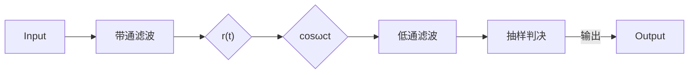
</details>

图 6.3.4 OOK 信号的相干解调

在相干解调前加入带通滤波器以滤除带外的噪声。经过带通滤波器后，接收信号的第 $n$ 个码元信号可以表示为

$$
r _ {n} (t) = u _ {n} (t) + n (t) \tag {6.3.16}
$$

式中， $n(t)$ 是白噪声 $n_{\mathrm{W}}(t)$ 经过带通滤波后的窄带噪声，

$$
n (t) = n _ {c} (t) \cos \omega_ {c} t - n _ {s} (t) \sin \omega_ {c} t \tag {6.3.17}
$$

由式（6.3.14）和式（6.3.15），第 $n$ 个接收的码元信号为

$$
\begin{array}{l} r _ {n} (t) = \left\{ \begin{array}{l l} a \cos \omega_ {\mathrm{c}} t + n _ {c} (t) \cos \omega_ {\mathrm{c}} t - n _ {s} (t) \sin \omega_ {\mathrm{c}} t, & \text {发“1”} \\ n _ {c} (t) \cos \omega_ {\mathrm{c}} t - n _ {s} (t) \sin \omega_ {\mathrm{c}} t, & \text {发“0”} \end{array} \right. \tag {6.3.18} \\ = \left\{ \begin{array}{l l} \left(a + n _ {c} (t)\right) \cos \omega_ {\mathrm{c}} t - n _ {s} (t) \sin \omega_ {\mathrm{c}} t, & \text {发“} 1" \\ n _ {c} (t) \cos \omega_ {\mathrm{c}} t - n _ {s} (t) \sin \omega_ {\mathrm{c}} t, & \text {发“} 0" \end{array} \right. \\ \end{array}
$$

相干解调法要求在接收端恢复载波信号，这里所谓的恢复载波信号不是简单地产生一个频率标称值相同的正弦波信号，而是一个与载波信号同频同相的同步信号。假定在接收端已获得载波同步信号 $\cos\omega_{c}t$ ，该信号与式（6.3.18）表示的第n个码元信号相乘后可得

$$
\begin{array}{l} r _ {n} (t) \cos \omega_ {\mathrm{c}} t = \left\{ \begin{array}{l l} \left(a + n _ {c} (t)\right) \cos \omega_ {\mathrm{c}} t \cos \omega_ {\mathrm{c}} t - n _ {s} (t) \sin \omega_ {\mathrm{c}} t \cos \omega_ {\mathrm{c}} t, & \text {发“1”} \\ n _ {c} (t) \cos \omega_ {\mathrm{c}} t \cos \omega_ {\mathrm{c}} t - n _ {s} (t) \sin \omega_ {\mathrm{c}} t \cos \omega_ {\mathrm{c}} t, & \text {发“0”} \end{array} \right. \tag {6.3.19} \\ = \left\{ \begin{array}{l l} \frac {1}{2} \left(a + n _ {c} (t)\right) \left(1 + \cos 2 \omega_ {\mathrm{c}} t\right) - \frac {1}{2} n _ {s} (t) \sin 2 \omega_ {\mathrm{c}} t, & \text {发“} 1 ^ {\prime \prime} \\ \frac {1}{2} n _ {c} (t) \left(1 + \cos 2 \omega_ {\mathrm{c}} t\right) - \frac {1}{2} n _ {s} (t) \sin 2 \omega_ {\mathrm{c}} t, & \text {发“} 0 ^ {\prime \prime} \end{array} \right. \\ \end{array}
$$

经低通滤波器后，得到包含有高斯噪声的基带信号

$$
z _ {n} (t) = \left\{ \begin{array}{l l} a + n _ {c} (t), & \text {发“} 1" \\ n _ {c} (t), & \text {发“} 0" \end{array} \right. \tag {6.3.20}
$$

在式中去除了系数 “1/2”，对于接收信号来说，重要的是信号中的信噪比，信号幅度与噪声幅度等比例的变化不会影响系统的性能。因为 $n_{c}(t)$ 是高斯噪声，若其幅度的分布函数为

$$
p (n _ {c}) = \frac {1}{\sqrt {2 \pi} \sigma_ {n _ {c}}} \exp \left(- \frac {n ^ {2}}{2 \sigma_ {n _ {c}} ^ {2}}\right) \tag {6.3.21}
$$

由此可得发 “0” 和 “1” 时信号的似然函数分别为

$$
p (z \mid s _ {0}) = \frac {1}{\sqrt {2 \pi} \sigma_ {n}} \exp \left(- \frac {z ^ {2}}{2 \sigma_ {n _ {c}} ^ {2}}\right) \tag {6.3.22}
$$

$$
p (z \mid s _ {1}) = \frac {1}{\sqrt {2 \pi} \sigma_ {n}} \exp \left(- \frac {(z - a) ^ {2}}{2 \sigma_ {n _ {c}} ^ {2}}\right) \tag {6.3.23}
$$

两似然函数的分布特性如图 6.3.5 所示。由图可知此时信号的接收变为一个单极性信号的判决问题。


<details>
<summary>violin</summary>

| 0 | 1 | 0 |
| --- | --- | --- |
| \(\gamma0\) | 0 | 0 |
| +a | 0 | 1 |
</details>

图 6.3.5 发 “0” 和 “1” 时信号的似然函数

根据 5.7 节有关最大似然判决的分析方法 [见式 (5.7.29)]，在发送 “0” 和发送 “1” 先验等概的条件下，最佳的判决门限应设在

$$
\gamma_ {0} = \frac {a}{2} \tag {6.3.24}
$$

判决规则为

$$
z \left\{ \begin{array}{l l} <   \gamma_ {0}, & \text {判决发“0”} \\ \geqslant \gamma_ {0}, & \text {判决发“1”} \end{array} \right. \tag {6.3.25}
$$

误码性能分析 参照式（5.7.35），直接可得先验等概条件下相干解调时的误码率为

$$
P _ {\mathrm{E}} = Q \left(\frac {a _ {1} - a _ {2}}{2 \sigma}\right) = Q \left(\frac {a - 0}{2 \sigma_ {n _ {c}}}\right) = Q \left(\frac {a}{2 \sigma_ {n _ {c}}}\right) = Q \left(\sqrt {\frac {a ^ {2}}{4 \sigma_ {n _ {c}} ^ {2}}}\right) \tag {6.3.26}
$$

式中的噪声功率 $\sigma_{n_{c}}^{2}$ 是 $n_{c}(t)$ 的噪声功率，根据第 2 章中有关窄带高斯随机信号的分析，噪声 $n_{c}(t)$ 与噪声 $n(t)$ 的功率值相同。若信道的噪声功率密度谱为 $N_{0}$ ，带通滤波器的带宽 $W_{c}$ 取码元周期倒数的两倍， $W_{c}=2(1/T)=2/T$ ，则噪声 $n(t)$ 的功率为

$$
\sigma_ {n} ^ {2} = W _ {c} N _ {0} = \frac {2 N _ {0}}{T} \tag {6.3.27}
$$

因此 $n_c(t)$ 的噪声功率也相应地为 $\sigma_{n_c}^2 = \sigma_n^2 = 2N_0 / T$ 。

因为发 “0” 时和发 “1” 时，码元的能量分别为

$$
E _ {s 0} = 0, \quad E _ {s 1} = \int_ {0} ^ {T} \left(a \cos \omega_ {\mathrm{c}} t\right) ^ {2} \mathrm{d} t = \frac {1}{2} a ^ {2} T \tag {6.3.28}
$$

在上式的计算过程中利用了载波足够大时的结论 $\int_{0}^{T} \cos 2\omega_{\mathrm{c}} t \mathrm{~d} t \approx 0$ 。另外，在先验等概的条件下，比特能量为

$$
E _ {\mathrm{b}} = \frac {1}{2} E _ {s 0} + \frac {1}{2} E _ {s 1} = \frac {1}{2} \cdot 0 + \frac {1}{2} \left(\frac {1}{2} a ^ {2} T\right) = \frac {1}{4} a ^ {2} T \tag {6.3.29}
$$

将式（6.3.27）和式（6.3.29）的结果代入式（6.3.26），可得

$$
P _ {\mathrm{E}} = Q \left(\sqrt {\frac {a ^ {2}}{4 \sigma_ {n _ {c}} ^ {2}}}\right) = Q \left(\sqrt {\frac {a ^ {2}}{8 N _ {0} / T}}\right) = Q \left(\sqrt {\frac {a ^ {2} T / 4}{2 N _ {0}}}\right) = Q \left(\sqrt {\frac {E _ {\mathrm{b}}}{2 N _ {0}}}\right) \tag {6.3.30}
$$


<details>
<summary>flowchart</summary>

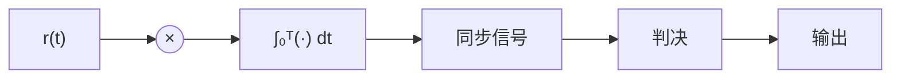
</details>

图 6.3.6 OOK 信号的相关解调（匹配滤波）

(2) OOK 信号的相关解调（匹配滤波法）及性能分析 对于 OOK 信号，前面图 6.2.6 所示的相关解调法（匹配滤波器法）可以简化为图 6.3.6 所示的结构。另外，第 5 章中图 5.7.3 给出的二元信号最佳接收的相关器实现方案具有一般性，无论是对于基带信号的接收还是对于调制信号的接收均适用。由此亦可直接得到图 6.3.6 所示的结构

在 t = T 时刻，相关器输出为

$$
z (T) = \int_ {0} ^ {T} r (t) s _ {1} (t) \mathrm{d} t \tag {6.3.31}
$$

（1）若当前接收的已调信号的码元是“1”，则判决时刻的抽样值

$$
\begin{array}{l} z _ {1} (T) = \int_ {0} ^ {T} r (t) s _ {1} (t) \mathrm{d} t = \int_ {0} ^ {T} \left(s _ {1} (t) + n _ {\mathrm{W}} (t)\right) s _ {1} (t) \mathrm{d} t \tag {6.3.32} \\ = \int_ {0} ^ {T} s _ {1} ^ {2} (t) \mathrm{d} t + \int_ {0} ^ {T} n _ {\mathrm{w}} (t) s _ {1} (t) \mathrm{d} t = E _ {s 1} + N _ {1} \\ \end{array}
$$

因为匹配滤波器是一种线性滤波器，对于输入高斯噪声 $n_{\mathrm{w}}(t)$ ，相应的噪声部分 $N_{1}$ 仍然是高斯噪声。 $E_{s1}=a^{2}T/2$ 是一常数，为发送“1”时码元的能量。

(2) 若当前接收的已调信号的码元是 “0”，则判决时刻的抽样值

$$
z _ {0} (T) = \int_ {0} ^ {T} r (t) s _ {1} (t) \mathrm{d} t = \int_ {0} ^ {T} \left(0 + n _ {\mathrm{w}} (t)\right) s _ {1} (t) \mathrm{d} t = \int_ {0} ^ {T} n _ {\mathrm{w}} (t) s _ {1} (t) \mathrm{d} t = N _ {1} \tag {6.3.33}
$$

由此可见 $z_{1}(T)$ 与 $z_{0}(T)$ 都是高斯随机变量。只要确定了其中高斯噪声 $N_{1}$ 的均值和方差，就可以得到 $z_{1}(T)$ 与 $z_{0}(T)$ 的分布特性，进而可确定最佳的判决门限。按定义， $N_{1}$ 的均值和方差分别为

$$
E \big [ N _ {1} \big ] = E \bigg [ \int_ {0} ^ {T} n _ {\mathrm{w}} (t) s _ {1} (t) \mathrm{d} t \bigg ] = \int_ {0} ^ {T} E \big [ n _ {\mathrm{w}} (t) \big ] s _ {1} (t) \mathrm{d} t = 0 \tag {6.3.34}
$$

$$
\begin{array}{l} \sigma_ {N} ^ {2} = E \left[ \left(N _ {1} - E \left[ N _ {1} \right]\right) ^ {2} \right] = E \left[ \left(N _ {1}\right) ^ {2} \right] = E \left[ \int_ {0} ^ {T} n _ {\mathrm{w}} (t _ {1}) s _ {1} (t _ {1}) \mathrm{d} t _ {1} \int_ {0} ^ {T} n _ {\mathrm{w}} (t _ {2}) s _ {1} (t _ {2}) \mathrm{d} t _ {2} \right] \\ = \int_ {0} ^ {T} \int_ {0} ^ {T} E \left[ n _ {\mathrm{w}} (t _ {1}) n _ {\mathrm{w}} (t _ {2}) \right] s _ {1} (t _ {1}) s _ {1} (t _ {2}) \mathrm{d} t _ {1} \mathrm{d} t _ {2} = \int_ {0} ^ {T} \int_ {0} ^ {T} \frac {N _ {0}}{2} \delta (t _ {2} - t _ {1}) s _ {1} (t _ {1}) s _ {1} (t _ {2}) \mathrm{d} t _ {1} \mathrm{d} t _ {2} \tag {6.3.35} \\ = \frac {N _ {0}}{2} \int_ {0} ^ {T} s _ {1} (t _ {2}) s _ {1} (t _ {2}) \mathrm{d} t _ {2} = \frac {N _ {0}}{2} E _ {s 1} \\ \end{array}
$$

由此，可得到 $z_0(T)$ 与 $z_{1}(T)$ 的概率密度函数，以及发“0”和发“1”的似然函数

$$
p (z \mid s _ {0}) = \frac {1}{\sqrt {2 \pi} \sigma_ {N}} \exp \left(- \frac {z ^ {2}}{2 \sigma_ {N} ^ {2}}\right) \tag {6.3.36}
$$

$$
p (z \mid s _ {1}) = \frac {1}{\sqrt {2 \pi} \sigma_ {N}} \exp \left(- \frac {(z - E _ {s 1}) ^ {2}}{2 \sigma_ {N} ^ {2}}\right) \tag {6.3.37}
$$

以上两式的分布特性与式（6.3.22）和式（6.3.23）有相同的形式，其特性曲线与图6.3.5类似，但要注意它们的均值与方差有所不同。当发“0”和发“1”所对应的符号先验等概时（ $P(s_{1})=P(s_{2})=1/2$ ），同样可由式（5.7.29）得到最佳的判决门限为

$$
\gamma_ {0} = \frac {E _ {s 1}}{2} \tag {6.3.38}
$$

判决规则与式（6.3.25）完全一样。在 $P(s_{1}) \neq P(s_{2})$ ，即非先验等概的情况下，判决门限 $\gamma_0$ 的取值将有所变化，具体结果可根据第5章中讨论过的方法导出。

误码性能分析 同样，先验等概条件下的相关解调时的误码率可参照式（5.7.35）直接得到

$$
P _ {\mathrm{E}} = Q \left(\frac {a _ {1} - a _ {2}}{2 \sigma}\right) = Q \left(\frac {E _ {s 1} - 0}{2 \sigma_ {N}}\right) = Q \left(\frac {E _ {s 1}}{2 \sqrt {N _ {0} E _ {s 1} / 2}}\right) = Q \left(\sqrt {\frac {E _ {s 1}}{2 N _ {0}}}\right) = Q \left(\sqrt {\frac {E _ {\mathrm{b}}}{N _ {0}}}\right) \tag {6.3.39}
$$

(3) OOK 信号的包络检波解调法及性能分析 OOK 信号的相干解调和相关解调都必须在本地恢复出与发送的载波信号同频同相的本地载波信号, 实现起来一般比较复杂。利用 OOK 信号发信息位“0”

时不发送信号、发信息位 “1” 时发送一串载波信号的特点，在接收信噪比较大的场合，可以采用较为简单的包络检波法解调 OOK 信号。图 6.3.7 给出了 OOK 信号的包络检波解调法的原理电路。


<details>
<summary>flowchart</summary>


</details>

图 6.3.7 OOK 信号的包络检波解调法的原理电路

接收机的输入经带通滤波后，第 n 个接收的码元信号仍如式（6.3.18）所示。该式可整理变换为

$$
\begin{array}{l} r _ {n} (t) = \left\{ \begin{array}{l l} \left(a + n _ {c} (t)\right) \cos \omega_ {\mathrm{c}} t - n _ {s} (t) \sin \omega_ {\mathrm{c}} t, & \text {发“1”} \\ n _ {c} (t) \cos \omega_ {\mathrm{c}} t - n _ {s} (t) \sin \omega_ {\mathrm{c}} t, & \text {发“0”} \end{array} \right. \\ = \left\{ \begin{array}{l l} \sqrt {\left(a + n _ {c} (t)\right) ^ {2} + n _ {s} ^ {2} (t)} \cos \left(\omega_ {c} t + \theta_ {n}\right), & \text {发“1”} \\ \sqrt {n _ {c} ^ {2} (t) + n _ {s} ^ {2} (t)} \cos \left(\omega_ {c} t + \theta_ {n} ^ {\prime}\right), & \text {发“0”} \end{array} \right. \tag {6.3.40} \\ \end{array}
$$

式中，

$$
\theta_ {n} = \arctan \frac {n _ {s} (t)}{a + n _ {c} (t)}, \quad \theta_ {n} ^ {\prime} = \arctan \frac {n _ {s} (t)}{n _ {c} (t)}
$$

由此，包络检波器在一个码元周期内检出的信号包络 $V(t)$ 为

$$
V (t) = \left\{ \begin{array}{l l} \sqrt {[ a + n _ {c} (t) ] ^ {2} + n _ {s} ^ {2} (t)}, & \text {发“1”} \\ \sqrt {n _ {c} ^ {2} (t) + n _ {s} ^ {2} (t)}, & \text {发“0”} \end{array} \right. \tag {6.3.41}
$$

根据第 2 章对窄带高斯随机信号和余弦波加窄带高斯随机信号的有关分析可知, 发 “0” 时, 接收到的信号的包络 $\sqrt{n_{c}^{2}(t)+n_{s}^{2}(t)}$ 服从瑞利分布

$$
p _ {0} (V) = \frac {V}{\sigma^ {2}} \exp \left(- \frac {V ^ {2}}{2 \sigma^ {2}}\right) \tag {6.3.42}
$$

而发“1”时，接收到的信号的包络 $\sqrt{[a + n_c(t)]^2 + n_s^2(t)}$ 服从莱斯分布

$$
p _ {1} (V) = \frac {V}{\sigma^ {2}} \exp \left(- \frac {V ^ {2} + a ^ {2}}{2 \sigma^ {2}}\right) \cdot I _ {0} \left(\frac {a V}{\sigma^ {2}}\right) \tag {6.3.43}
$$

上两式中的 $\sigma^2$ 是高斯信号 $n_c(t), n_s(t)$ 的方差。由此可得包络检波器输入的分布特性

$$
p (V) = \left\{ \begin{array}{l l} p _ {1} (V) = \frac {V}{\sigma^ {2}} \exp \left(- \frac {V ^ {2} + a ^ {2}}{2 \sigma^ {2}}\right) \cdot I _ {0} \left(\frac {a V}{\sigma^ {2}}\right), & \text {发“1”} \\ p _ {0} (V) = \frac {V}{\sigma^ {2}} \exp \left(- \frac {V ^ {2}}{2 \sigma^ {2}}\right), & \text {发“0”} \end{array} \right. \tag {6.3.44}
$$

瑞利分布与莱斯分布概率密度函数  


<details>
<summary>violin</summary>

| \(\gamma*\) | p0(V) (PDF) | p1(V) (PDF) |
| --- | --- | --- |
| 0 | 0 | 0 |
| 1 | ~0.61 | 0 |
| 2 | ~0.25 | ~0.05 |
| 2.5 | ~0.1 | ~0.1 |
| 3 | ~0.02 | ~0.25 |
| 4 | 0 | ~0.41 |
| 5 | 0 | ~0.25 |
| 6 | 0 | ~0.05 |
| 7 | 0 | ~0.01 |
</details>

图 6.3.8 瑞利分布 $p_{0}(V)$ 与莱斯分布 $p_{1}(V)$ 特性

$p_{0}(V)$ 和 $p_{1}(V)$ 的特性如图 6.3.8 所示。

包络检波器的输出信号 $V(t)$ ，通常先经过低通滤波器，滤除检波过程中非线性运算产生的谐波，低通滤波器的截止频率设置在基带信号范围内，包络信号 $V(t)$ 本身不受影响。 $V(t)$ 在判决器内进行抽样判决。判决器的工作原理与前面讨论过的高斯噪声干扰下信号的判决类似。如图6.3.8所示，假定抽样时刻为 $t=t_{0}$ ，判决门限为 $\gamma$ ，判决规则如下：

$$
V (t _ {0}) \left\{ \begin{array}{l l} \geqslant \gamma , & \text {判决发“1”} \\ <   \gamma , & \text {判决发“0”} \end{array} \right. \tag {6.3.45}
$$

误码性能分析 如图 6.3.8 所示，若发送的是符号 “0”，则错误判决的概率为

$$
P _ {\mathrm{E0}} = \operatorname * {P r} \big (V > \gamma \big) = \int_ {\gamma} ^ {\infty} p _ {0} (V) \mathrm{d} V = \int_ {\gamma} ^ {\infty} \frac {V}{\sigma^ {2}} \mathrm{e} ^ {- \frac {V ^ {2}}{2 \sigma^ {2}}} \mathrm{d} V = \mathrm{e} ^ {- \frac {\gamma^ {2}}{2 \sigma^ {2}}} = \mathrm{e} ^ {- \frac {\gamma_ {0} ^ {2}}{2}} \tag {6.3.46}
$$

式中， $\gamma_{0}=\gamma/\sigma$ 。同理，若发送的是符号“1”，则错误判决的概率为

$$
P _ {\mathrm{E1}} = \operatorname * {P r} \left(V \leqslant \gamma\right) = \int_ {0} ^ {\gamma} p _ {1} (V) \mathrm{d} V = 1 - \int_ {\gamma} ^ {\infty} p _ {1} (V) \mathrm{d} V = 1 - \int_ {\gamma} ^ {\infty} \frac {V}{\sigma^ {2}} I _ {0} \left(\frac {a V}{\sigma^ {2}}\right) \mathrm{e} ^ {- \frac {V ^ {2} + a ^ {2}}{2 \sigma^ {2}}} \mathrm{d} V \tag {6.3.47}
$$

根据数学中定义的马肯函数

$$
Q _ {\mathrm{M}} (\alpha , \beta) = \int_ {\beta} ^ {\infty} t I _ {0} (\alpha t) \mathrm{e} ^ {- \frac {t ^ {2} + \alpha^ {2}}{2}} \mathrm{d} t \tag {6.3.48}
$$

式中， $I_0(x)$ 是零阶贝塞尔函数。若令 $\alpha = a / \sigma, \beta = \gamma / \sigma, t = V / \sigma$ ，则式（6.3.47）可以表示为

$$
P _ {\mathrm{El}} = 1 - Q \left(\frac {a}{\sigma}, \frac {\gamma}{\sigma}\right) \tag {6.3.49}
$$

因为方差 $\sigma^{2}$ 表示零均值的噪声的功率， $a^{2}/2$ 表示信号的功率。若定义信噪比

$$
r = \frac {a ^ {2} / 2}{\sigma^ {2}} = \frac {a ^ {2}}{2 \sigma^ {2}} \tag {6.3.50}
$$

记 $\gamma_0 = \gamma / \sigma$ ，则式（6.3.49）可以进一步表示为

$$
P _ {\mathrm{E1}} = 1 - Q _ {\mathrm{M}} \left(\sqrt {2 r}, \gamma_ {0}\right) \tag {6.3.51}
$$

若发“0”和发“1”的先验概率分别为 $P(s_0)$ 和 $P(s_1)$ ，则总的误码率为

$$
P _ {\mathrm{E}} = P (s _ {0}) P _ {\mathrm{E0}} + P (s _ {1}) P _ {\mathrm{E1}} = P (s _ {0}) \mathrm{e} ^ {- \frac {\gamma_ {0} ^ {2}}{2}} + P (s _ {1}) \Big (1 - Q _ {\mathrm{M}} (\sqrt {2 r}, \gamma_ {0}) \Big) \tag {6.3.52}
$$

特别地，如果发符号“0”和发“1”先验等概，即有 $P(s_0) = P(s_1) = 1 / 2$ ，则有

$$
P _ {\mathrm{E}} = \frac {1}{2} \mathrm{e} ^ {- \frac {\gamma_ {0} ^ {2}}{2}} + \frac {1}{2} \Big (1 - Q _ {\mathrm{M}} (\sqrt {2 r}, \gamma_ {0}) \Big) \tag {6.3.53}
$$

最佳判决门限 $\gamma^{*}$ 由图6.3.8易见，在 $P(s_0) = P(s_1) = 1 / 2$ 的条件下，当判决门限 $\gamma$ 选择在 $p_0(V)$ 与 $p_1(V)$ 两曲线的交点所对应的横坐标时，面积

$$
\min _ {\gamma} \left(\int_ {\gamma} ^ {\infty} p _ {0} (V) \mathrm{d} V + \int_ {0} ^ {\gamma} p _ {1} (V) \mathrm{d} V\right) = \left(\int_ {\gamma^ {*}} ^ {\infty} p _ {0} (V) \mathrm{d} V + \int_ {0} ^ {\gamma^ {*}} p _ {1} (V) \mathrm{d} V\right) \bigg | _ {p _ {0} (\gamma^ {*}) = p _ {1} (\gamma^ {*})} \tag {6.3.54}
$$

达到最小，由此导出的最佳判决门限 $\gamma^{*}$ 可由下式确定：

$$
p _ {0} (\gamma^ {*}) = \frac {V}{\sigma^ {2}} \mathrm{e} ^ {- \frac {V ^ {2}}{2 \sigma^ {2}}} \Bigg | _ {V = \gamma^ {*}} = p _ {1} (\gamma^ {*}) = \frac {V}{\sigma^ {2}} I _ {0} \left(\frac {a V}{\sigma^ {2}}\right) \mathrm{e} ^ {- \frac {V ^ {2} + a ^ {2}}{2 \sigma^ {2}}} \Bigg | _ {V = \gamma^ {*}} \tag {6.3.55}
$$

整理上式可得

$$
1 = I _ {0} \left(\frac {a \gamma^ {*}}{\sigma^ {2}}\right) \mathrm{e} ^ {- \frac {a ^ {2}}{2 \sigma^ {2}}} \rightarrow \frac {a ^ {2}}{2 \sigma^ {2}} = \ln I _ {0} \left(\frac {a \gamma^ {*}}{\sigma^ {2}}\right) \tag {6.3.56}
$$

为得到更直观的结论，下面分别考虑大信噪比和小信噪比两种情况：

（a）在大信噪比（ $r=\frac{a^{2}/2}{\sigma^{2}}\gg1$ ）的条件下，一般相应地有 $\frac{a\gamma^{*}}{\sigma^{2}}\gg1$ ，由零阶贝塞尔函数的性质，有 $\ln I_{0}\left(\frac{a\gamma^{*}}{\sigma^{2}}\right)\approx\frac{a\gamma^{*}}{\sigma^{2}}$ ，由式（6.3.56）可得

$$
\frac {a ^ {2}}{2 \sigma^ {2}} \approx \frac {a \gamma^ {*}}{\sigma^ {2}} \tag {6.3.57}
$$

由此可得大信噪比情况下的判决门限

$$
\gamma^ {*} = \frac {a}{2} \tag {6.3.58}
$$

等于信号包络幅度取值的 $1 / 2$ 。由 $\gamma_0 = \gamma / \sigma$ ，可得利用噪声的均方根值 $\sigma$ 对包络检波后的电压进行“归一化”后的判决门限

$$
\gamma_ {0} ^ {*} = \frac {a / 2}{\sigma} = \frac {a}{2 \sigma} = \sqrt {\frac {r}{2}} \tag {6.3.59}
$$

包络检波解调法通常应用在大信噪比的场合，下面进一步分析在此条件下的误码性能。对于马肯函数，有

$$
Q _ {\mathrm{M}} (\alpha , \beta) \approx 1 - \frac {1}{2} \operatorname{erf} \left(\frac {\alpha - \beta}{\sqrt {2}}\right) = \frac {1}{2} \operatorname{erfc} \left(\frac {\alpha - \beta}{\sqrt {2}}\right) \tag {6.3.60}
$$

式中 $\operatorname{erf}(x) = \frac{2}{\sqrt{\pi}} \int_{0}^{x} \mathrm{e}^{-u^2} \mathrm{d}u$ 和 $\operatorname{erfc}(x) = 1 - \operatorname{erf}(x)$ 分别称为误差函数和互补误差函数。将式（6.3.59）的结果代入式（6.3.53），同时利用式（6.3.60），可得误码率

$$
P _ {\mathrm{E}} = \frac {1}{2} \mathrm{e} ^ {- \frac {r}{4}} + \frac {1}{4} \operatorname{erf} \left(\frac {\sqrt {r}}{2}\right) \approx \frac {1}{2} \mathrm{e} ^ {- \frac {r}{4}} = \frac {1}{2} \exp \left(- \frac {a ^ {2} T / 4}{4 N _ {0}}\right) = \frac {1}{2} \exp \left(- \frac {E _ {\mathrm{b}}}{4 N _ {0}}\right) \tag {6.3.61}
$$

其中的约等号成立是利用了当 $r \gg 1$ 时， $\frac{1}{2} \mathrm{e}^{-\frac{r}{4}} \gg \frac{1}{4} \mathrm{erf}\left(\frac{\sqrt{r}}{2}\right)$ 的性质。

（b）在小信噪比（ $r=\frac{a^{2}/2}{\sigma^{2}}\ll1$ ）的条件下，因为此时有 $\ln I_{0}\left(\frac{a\gamma^{*}}{\sigma^{2}}\right)\approx\frac{1}{4}\left(\frac{a\gamma^{*}}{\sigma^{2}}\right)^{2}$ ，式（6.3.56）可简化为

$$
\frac {a ^ {2}}{2 \sigma^ {2}} = \frac {1}{4} \left(\frac {a \gamma^ {*}}{\sigma^ {2}}\right) ^ {2} \tag {6.3.62}
$$

由此得到

$$
\gamma^ {*} = \sqrt {2 \sigma^ {2}} = \sqrt {2} \sigma \tag {6.3.63}
$$

或

$$
\gamma_ {0} ^ {*} = \sqrt {2} \tag {6.3.64}
$$

综上，对于三种不同的解调方法，其误码率的性能比较依次为

$$
P _ {\mathrm{E}} \big | _ {\mathrm{相关法}} = Q \bigg (\sqrt {\frac {E _ {\mathrm{b}}}{N _ {0}}} \bigg) <   P _ {\mathrm{E}} \big | _ {\mathrm{相干法}} = Q \bigg (\sqrt {\frac {E _ {\mathrm{b}}}{2 N _ {0}}} \bigg) <   P _ {\mathrm{E}} \big | _ {\mathrm{包络法}} = \frac {1}{2} \exp \bigg (- \frac {E _ {\mathrm{b}}}{4 N _ {0}} \bigg)
$$

相关解调、相干解调法与包络检波解调法的误码性能特性如图 6.3.9 所示。


<details>
<summary>line</summary>

| Eb/N0 (dB) | 2ASK包络检波解调 (PE) | 2ASK相干解调 (PE) | 2ASK相关解调 (PE) |
| --- | --- | --- | --- |
| -10 | ~0.4 | ~0.35 | ~0.3 |
| -5 | ~0.35 | ~0.25 | ~0.15 |
| 0 | ~0.3 | ~0.15 | ~0.05 |
| 5 | ~0.2 | ~0.05 | ~0.005 |
| 10 | ~0.05 | ~0.005 | ~0.0005 |
| 15 | ~0.0005 | ~0.00005 | ~0.000005 |
</details>

图 6.3.9 相干/相关解调法与包络检波解调法的误码性能

【例 6.3.1】某 2ASK（OOK）信号的码元速率 $R_{B}=4.8\times10^{6}$ 波特，接收端输入信号的幅度 a=1mV，信道中加性高斯白噪声的单边功率谱密度 $N_{0}=2\times10^{-15}$ W/Hz。

解：比特能量 $E_{\mathrm{b}} = \frac{1}{4} a^{2}T = \frac{1}{4}\left(10^{-3}\right)^{2}\frac{1}{4.8\times 10^{6}} = \frac{1}{4\times 4.8} 10^{-12}$ （焦耳）

(1) 采用包络检波法进行解调

$$
P _ {\mathrm{E}} \big | _ {\mathrm{包络法}} = \frac {1}{2} \exp \left(- \frac {E _ {\mathrm{b}}}{4 N _ {0}}\right) = \frac {1}{2} \exp \left(- \frac {1 0 ^ {- 1 2} / 4 \times 4 . 4 8}{4 \times 2 \times 1 0 ^ {- 1 5}}\right) = \frac {1}{2} \exp \left(- 6. 7\right) = 7. 5 \times 1 0 ^ {- 4}
$$

（2）采用相关解调法（匹配滤波器法）进行解调

由式（6.3.39），此时 $\sqrt{\frac{E_b}{N_0}} = \left(\left(\frac{1}{4\times 4.8} 10^{-12}\right) / \left(2\times 10^{-15}\right)\right)^{1 / 2} = 5.1 > 3$ ，因此可利用近似计算公式 $Q(x)\approx$ $\exp (-x^2 /2) / (x\sqrt{2\pi})$ 进行计算，即有

$$
\begin{array}{l} P _ {\mathrm{E}} = Q \left(\sqrt {\frac {E _ {\mathrm{b}}}{N _ {0}}}\right) \approx \exp \left(- \left(\sqrt {\frac {E _ {\mathrm{b}}}{N _ {0}}}\right) ^ {2} / 2\right) / \left(\sqrt {\frac {E _ {\mathrm{b}}}{N _ {0}}} \sqrt {2 \pi}\right) \\ = \frac {\exp \left(- \frac {5 . 1 ^ {2}}{2}\right)}{5 . 1 \times \sqrt {2 \pi}} = \frac {\exp \left(- \frac {5 . 1 ^ {2}}{2}\right)}{5 . 1 \times \sqrt {2 \pi}} \approx \frac {\exp (- 1 3)}{1 2 . 7 8} = 1. 7 7 \times 1 0 ^ {- 7} \\ \end{array}
$$

由此可见相关解调法的性能优于包络检波解调法。□

## 6.3.2 2PSK调制解调系统

2PSK 信号 二进制移相键控调制简称 2PSK, PSK 是利用载波信号的相位来携带信息的一种调制方式。在 2PSK 中, 为使代表信息 “0” 和信息 “1” 的信号相位最容易区分, 即差异最大, 通常选择 0° 和 180° 分别代表上述的两种不同信息。类似 2ASK, 2PSK 信号一般地仍可以表示为

$$
s (t) = x (t) \cos \omega_ {\mathrm{c}} t = \sum_ {n = - \infty} ^ {\infty} a _ {n} g _ {T} (t - n T) \cos \omega_ {\mathrm{c}} t \tag {6.3.65}
$$

其中的 $x_{n}(t)$ ，即二进制的码元序列 $\{a_{n}\}$ ，控制载波相位在 $0^{\circ}$ 和 $180^{\circ}$ 两种取值间变化。 $\{a_{n}\}$ 的分布特性可以表示为

$$
a _ {n} = \left\{ \begin{array}{l l} + a, & \text {概率为} P \\ - a, & \text {概率为} 1 - P \end{array} \right. \tag {6.3.66}
$$

如果基带信号的波形函数 $g_{T}(t)$ 取门函数，则 2PSK 信号的波形可如图 6.3.10 所示。图(a)描述了载波波形相位与发送信息的关系，图(b)描述了 2PSK 信号的星座图。此时 2PSK 信号可以简要地表示为

$$
s (t) = \left\{ \begin{array}{l l} + a \cos \omega_ {\mathrm{c}} t, & \text {概率为} P \\ - a \cos \omega_ {\mathrm{c}} t, & \text {概率为} 1 - P \end{array} \right. \tag {6.3.67}
$$


<details>
<summary>line</summary>

| Time (t) | Signal (a) | Oscillation (a) |
| --- | --- | --- |
| 0 | a | 0 |
| 1 | a | 0 |
| 2 | a | 0 |
| 3 | a | 0 |
| 4 | a | 0 |
| 5 | a | 0 |
| 6 | a | 0 |
| 7 | a | 0 |
| 8 | a | 0 |
| 9 | a | 0 |
| 10 | a | 0 |
| 11 | a | 0 |
| 12 | a | 0 |
| 13 | a | 0 |
| 14 | a | 0 |
| 15 | a | 0 |
| 16 | a | 0 |
| 17 | a | 0 |
| 18 | a | 0 |
| 19 | a | 0 |
| 20 | a | 0 |
</details>

(a)


<details>
<summary>text_image</summary>

Q
I
aₙ = -a O aₙ = a
</details>

(b)  
图 6.3.10 2PSK 信号波形及其星座图

2PSK 信号的功率密度谱 与 2ASK 信号类似，由式（6.2.24）可得一般的 2PSK 信号的功率密度谱为

$$
P _ {s} (f) = P _ {x (t) \cos \omega_ {\mathrm{c}} t} (f) = \frac {1}{4 T} P _ {a} (f) \left(\left| G _ {T} (f + f _ {\mathrm{c}}) \right| ^ {2} + \left| G _ {T} (f - f _ {\mathrm{c}}) \right| ^ {2}\right) \tag {6.3.68}
$$

式中， $f_{c}=\omega_{c}/2\pi$ ， $P_{a}(f)=\sum_{m=-\infty}^{\infty}R_{a}(m)\mathrm{e}^{-\mathrm{j}2\pi fmT}$ 。 $R_{a}(m)$ 为基带符号序列 $\left\{a_{n}\right\}$ 的自相关函数。在发送 “0” 和 “1” 先验等概的条件下，由式（6.3.66），可得 $m_{a}=E\left[a_{n}\right]=0$ 。同样假定 $\left\{a_{n}\right\}$ 为纯随机序列，此时式（6.3.6）变为

$$
R _ {a} (a _ {n} a _ {m}) = \left\{ \begin{array}{l l} \sigma_ {a} ^ {2} + m _ {a} ^ {2}, & n = m \\ m _ {a} ^ {2}, & n \neq m \end{array} \right. = \left\{ \begin{array}{l l} \sigma_ {a} ^ {2}, & n = m \\ 0, & n \neq m \end{array} \right. \tag {6.3.69}
$$

由此可得 2PSK 信号的功率谱

$$
\begin{array}{l} P _ {s} (f) = \frac {T}{4} P _ {a} (f) \left(\operatorname{sinc} ^ {2} \left((f + f _ {\mathrm{c}}) T\right) + \operatorname{sinc} ^ {2} \left((f - f _ {\mathrm{c}}) T\right)\right) \\ = \frac {T}{4} \left(\sigma_ {a} ^ {2} + \frac {m _ {a} ^ {2}}{T} \sum_ {m = - \infty} ^ {\infty} \delta (f - m / T)\right) \left(\operatorname{sinc} ^ {2} ((f + f _ {\mathrm{c}}) T) + \operatorname{sinc} ^ {2} ((f - f _ {\mathrm{c}}) T)\right) \tag {6.3.70} \\ = \frac {T}{4} \sigma_ {a} ^ {2} \left(\operatorname{sinc} ^ {2} \left((f + f _ {\mathrm{c}}) T\right) + \operatorname{sinc} ^ {2} \left((f - f _ {\mathrm{c}}) T\right)\right) \\ \end{array}
$$

比较 OOK 信号的功率谱，此时 2PSK 信号中不包含载波成分。2PSK 信号的功率密度谱如图 6.3.11 所示。


<details>
<summary>spectrogram</summary>

| Frequency Component | Frequency Range (f) | Peak Amplitude (Ps(f)) |
| --- | --- | --- |
| Left Peak | -fc ~ -fb | High |
| Right Peak | fc ~ -fb | High |
</details>

图 6.3.11 2PSK 信号的功率密度谱

## 2PSK 信号的主要特点

(1) 2PSK 信号的功率谱仅含连续谱。其频谱特性主要由基带符号序列和基带信号的码型波形确定。  
(2) 2PSK 调制在将基带信号搬移到以 $f_{\mathrm{c}}$ 为中心的频带的过程中, 其信号频带的宽度 $W_{2 \mathrm{PSK}}$ 将扩大为原来基带信号频带宽度 $W_{\mathrm{B}}$ 的两倍。因此其频谱效率

$$
\eta_ {2 \mathrm{PSK}} = \frac {R _ {\mathrm{S}}}{W _ {2 \mathrm{PSK}}} = \frac {R _ {\mathrm{S}}}{2 W _ {\mathrm{B}}} = \frac {1}{2} \eta_ {\mathrm{B}} \tag {6.3.71}
$$

仅为基带传输系统的一半。

2PSK 载波调制实现方法 与产生 2ASK 信号的方法类似, 2PSK 信号可采用模拟幅度调制和键控两种方法生成。如图 6.3.12 所示, 图(a)为模拟幅度调制方法, 它通过双极性的基带信号 $x(t) = \sum_{n=-\infty}^{\infty} a_n g_T (t - nT)$ 直接与正弦波信号 $\cos \omega_c t$ 相乘获得 2PSK 信号。图(b)为键控方法, 其开关电路受二值的基带信号控制, 产生 2PSK 信号, 当 $a_n = +a$ 时, 输出信号 $\cos \omega_c t$ ; 当 $a_n = -a$ 时, 输出信号 $-\cos \omega_c t$ 。

  
图 6.3.12 二进制移相键控（2PSK）信号的产生

同样，可将 $s(t)$ 视为由一个个符号脉冲 $u_{n}(t)$ 组成的信号，表示为

$$
s (t) = \sum_ {n = - \infty} ^ {\infty} u _ {n} (t) \tag {6.3.72}
$$

式中， $u_{n}(t)$ 表示发送端在第 n 个码元的持续时间内的输出波形

$$
u _ {n} (t) = \left\{ \begin{array}{l l} + s _ {1} (t - n T), & \text {发“1”} \\ - s _ {1} (t - n T), & \text {发“0”} \end{array} \right. \tag {6.3.73}
$$

式中，

$$
s _ {1} (t) = \left\{ \begin{array}{l l} a \cos \omega_ {\mathrm{c}} t, & 0 \leqslant t \leqslant T \\ 0, & \text {其他} \end{array} \right. \tag {6.3.74}
$$

2PSK 信号的解调 2PSK 信号可以采用相干解调和相关解调两种方法。这两种方法的基本原理与 OOK 信号的相干解调和相关解调非常类似，下面分别加以讨论。

(1) 2PSK 信号的相干解调及性能分析 2PSK 信号相干解调的实现方法如图 6.3.13 所示, 可见与图 6.3.4 给出的 OOK 信号相干解调系统的结构完全一致。


<details>
<summary>flowchart</summary>

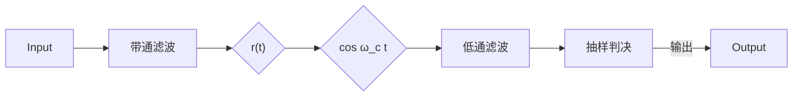
</details>

图 6.3.13 2PSK 信号的相干解调

经过带通滤波器后，接收信号的第 n 个码元信号可以表示为

$$
r _ {n} (t) = u _ {n} (t) + n (t) \tag {6.3.75}
$$

式中， $n(t)$ 是白噪声 $n_{\mathrm{W}}(t)$ 经过带通滤波后的窄带噪声，

$$
n (t) = n _ {c} (t) \cos \omega_ {c} t - n _ {s} (t) \sin \omega_ {c} t \tag {6.3.76}
$$

由式（6.3.73）和式（6.3.74），第 $n$ 个接收的码元信号为

$$
\begin{array}{l} r _ {n} (t) = \left\{ \begin{array}{l l} a \cos \omega_ {\mathrm{c}} t + n _ {c} (t) \cos \omega_ {\mathrm{c}} t - n _ {s} (t) \sin \omega_ {\mathrm{c}} t, & \text {发“1”} \\ - a \cos \omega_ {\mathrm{c}} t + n _ {c} (t) \cos \omega_ {\mathrm{c}} t - n _ {s} (t) \sin \omega_ {\mathrm{c}} t, & \text {发“0”} \end{array} \right. \tag {6.3.77} \\ = \left\{ \begin{array}{l l} (a + n _ {c} (t)) \cos \omega_ {\mathrm{c}} t - n _ {s} (t) \sin \omega_ {\mathrm{c}} t, & \text {发“1”} \\ (- a + n _ {c} (t)) \cos \omega_ {\mathrm{c}} t - n _ {s} (t) \sin \omega_ {\mathrm{c}} t, & \text {发“0”} \end{array} \right. \\ \end{array}
$$

假定在接收端可获得与载波同频同相的信号 $\cos\omega_{c}t$ ，该信号与式（6.3.77）表示的第 n 个码元信号相乘后可得

$$
\begin{array}{l} r _ {n} (t) \cos \omega_ {\mathrm{c}} t = \left\{ \begin{array}{l l} \left(a + n _ {c} (t)\right) \cos \omega_ {\mathrm{c}} t \cos \omega_ {\mathrm{c}} t - n _ {s} (t) \sin \omega_ {\mathrm{c}} t \cos \omega_ {\mathrm{c}} t, & \text {发“1”} \\ \left(- a + n _ {c} (t)\right) \cos \omega_ {\mathrm{c}} t \cos \omega_ {\mathrm{c}} t - n _ {s} (t) \sin \omega_ {\mathrm{c}} t \cos \omega_ {\mathrm{c}} t, & \text {发“0”} \end{array} \right. \tag {6.3.78} \\ = \left\{ \begin{array}{l l} \frac {1}{2} \left(a + n _ {c} (t)\right) \left(1 + \cos 2 \omega_ {\mathrm{c}} t\right) - \frac {1}{2} n _ {s} (t) \sin 2 \omega_ {\mathrm{c}} t, & \text {发“} 1" \\ \frac {1}{2} \left(- a + n _ {c} (t)\right) \left(1 + \cos 2 \omega_ {\mathrm{c}} t\right) - \frac {1}{2} n _ {s} (t) \sin 2 \omega_ {\mathrm{c}} t, & \text {发“} 0" \end{array} \right. \\ \end{array}
$$

经低通滤波器后，得到包含高斯噪声的基带信号

$$
z _ {n} (t) = \left\{ \begin{array}{l l} + a + n _ {c} (t), & \text {发“1”} \\ - a + n _ {c} (t), & \text {发“0”} \end{array} \right. \tag {6.3.79}
$$

在式中去除了系数 “1/2”，对于接收信号来说，重要的是信号中的信噪比，信号幅度与噪声幅度等比例的变化不会影响系统的性能。若已知高斯噪声 $n_{c}(t)$ 幅度取值的分布函数为

$$
p (n _ {c}) = \frac {1}{\sqrt {2 \pi} \sigma_ {n _ {c}}} \exp \left(- \frac {n _ {c} ^ {2}}{2 \sigma_ {n _ {c}} ^ {2}}\right) \tag {6.3.80}
$$

由此可得发“0”和“1”时信号的似然函数分别为

$$
p (z \mid s _ {0}) = \frac {1}{\sqrt {2 \pi} \sigma_ {n _ {c}}} \exp \left(- \frac {(z + a) ^ {2}}{2 \sigma_ {n _ {c}} ^ {2}}\right) \tag {6.3.81}
$$

$$
p (z \mid s _ {1}) = \frac {1}{\sqrt {2 \pi} \sigma_ {n _ {c}}} \exp \left(- \frac {(z - a) ^ {2}}{2 \sigma_ {n _ {c}} ^ {2}}\right) \tag {6.3.82}
$$

两似然函数的分布特性如图 6.3.14 所示。由图可知此时信号的接收变为两个双极性信号的判决问题。


<details>
<summary>area</summary>

| Left Region | \(-a\) | N/A |
| --- | --- | --- |
| Intersection | \(\gamma0\) | N/A |
| Right Region | +a | \(-\frac{(z-a)^2}{2\sigma_{n_c}^2}\) |
</details>

图 6.3.14 发 “0” 和 “1” 时信号的似然函数

在发送 “0” 和发送 “1” 先验等概的条件下，由式（5.7.29），最佳的判决门限应设在

$$
\gamma_ {0} = 0 \tag {6.3.83}
$$

此时判决规则为

$$
\left\{ \begin{array}{l l} z <   \gamma_ {0}, & \text {判决发“0”} \\ z \geqslant \gamma_ {0}, & \text {判决发“1”} \end{array} \right. \tag {6.3.84}
$$

误码性能分析 参照式（5.7.35），直接可得先验等概条件下相干解调时的误码率为

$$
P _ {\mathrm{E}} = Q \left(\frac {a _ {1} - a _ {2}}{2 \sigma}\right) = Q \left(\frac {a - (- a)}{2 \sigma_ {n _ {c}}}\right) = Q \left(\frac {2 a}{2 \sigma_ {n _ {c}}}\right) = Q \left(\sqrt {\frac {a ^ {2}}{\sigma_ {n _ {c}} ^ {2}}}\right) \tag {6.3.85}
$$

噪声功率 $\sigma_{n_{c}}^{2}$ 的计算与 OOK 信号接收时的情形类似，其取值为

$$
\sigma_ {n _ {c}} ^ {2} = \sigma_ {n} ^ {2} = W _ {c} N _ {0} = \frac {2 N _ {0}}{T} \tag {6.3.86}
$$

因为发 “0” 时码元的能量为

$$
E _ {s 0} = \int_ {0} ^ {T} \left(- a \cos \omega_ {\mathrm{c}} t\right) ^ {2} \mathrm{d} t = \frac {1}{2} a ^ {2} T \tag {6.3.87}
$$

发“1”时码元的能量为

$$
E _ {s 1} = \int_ {0} ^ {T} \left(a \cos \omega_ {\mathrm{c}} t\right) ^ {2} \mathrm{d} t = \frac {1}{2} a ^ {2} T \tag {6.3.88}
$$

显然有 $E_{s1}=E_{s0}$ 。在先验等概的条件下，比特能量为

$$
E _ {\mathrm{b}} = \frac {1}{2} E _ {s 0} + \frac {1}{2} E _ {s 1} = \frac {1}{2} \left(\frac {1}{2} a ^ {2} T\right) + \frac {1}{2} \left(\frac {1}{2} a ^ {2} T\right) = \frac {1}{2} a ^ {2} T \tag {6.3.89}
$$

将上述结果代入式（6.3.85），可得

$$
P _ {\mathrm{E}} = Q \Bigg (\sqrt {\frac {a ^ {2}}{\sigma_ {n _ {c}} ^ {2}}} \Bigg) = Q \Bigg (\sqrt {\frac {a ^ {2} T / 2}{N _ {0}}} \Bigg) = Q \Bigg (\sqrt {\frac {E _ {\mathrm{b}}}{N _ {0}}} \Bigg) \tag {6.3.90}
$$

可见 2PSK 系统的误码性能优于 OOK 系统的误码性能。这与基带系统中双极性系统的性能优于单极性系统的性能类似。

(2) 2PSK 信号的相关解调（匹配滤波法）及性能分析 对于 2PSK 信号的相关解调法（匹配滤波器法），同样可以采用一般的二元信号最佳接收的相关器实现方案，如图 6.3.15 所示。

在 t = T 时刻，相关器输出为

$$
z (T) = \int_ {0} ^ {T} r (t) s _ {1} (t) \mathrm{d} t \tag {6.3.91}
$$


<details>
<summary>flowchart</summary>

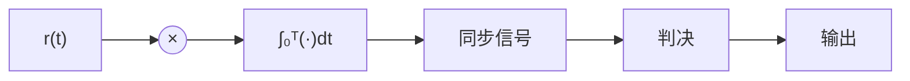
</details>

图 6.3.15 2PSK 信号的相关解调（匹配滤波）

（1）若当前接收的已调信号的码元是“1”，则判决时刻的抽样值

$$
\begin{array}{l} z _ {1} (T) = \int_ {0} ^ {T} r (t) s _ {1} (t) \mathrm{d} t = \int_ {0} ^ {T} \left(s _ {1} (t) + n _ {\mathrm{W}} (t)\right) s _ {1} (t) \mathrm{d} t \tag {6.3.92} \\ = \int_ {0} ^ {T} s _ {1} ^ {2} (t) \mathrm{d} t + \int_ {0} ^ {T} n _ {\mathrm{W}} (t) s _ {1} (t) \mathrm{d} t = E _ {s 1} + N _ {1} \\ \end{array}
$$

因为匹配滤波器是一种线性滤波器，对于输入高斯噪声 $n_{\mathrm{w}}(t)$ ，相应的噪声部分 $N_{1}$ 仍然是高斯噪声。 $E_{s1}=a^{2}T/2$ 是一常数，为发“1”时码元的能量。

(2) 若当前接收的已调信号的码元是 “0”，则判决时刻的抽样值

$$
\begin{array}{l} z _ {0} (T) = \int_ {0} ^ {T} r (t) s _ {1} (t) \mathrm{d} t = \int_ {0} ^ {T} \left(- s _ {1} (t) + n _ {\mathrm{W}} (t)\right) s _ {1} (t) \mathrm{d} t \tag {6.3.93} \\ = \int_ {0} ^ {T} - s _ {1} ^ {2} (t) \mathrm{d} t + \int_ {0} ^ {T} n _ {\mathrm{W}} (t) s _ {1} (t) \mathrm{d} t = - E _ {s 1} + N _ {1} \\ \end{array}
$$

$z_{1}(T)$ 与 $z_{0}(T)$ 都是高斯随机变量。只要确定了其中高斯噪声 $N_{1}$ 的均值和方差，就可得到 $z_{1}(T)$ 与 $z_{0}(T)$ 的分布特性，进而可确定最佳的判决门限。由式 (6.3.34) 和式 (6.3.35) 可知， $E[N_{1}]=0,\sigma_{N}^{2}=N_{0}E_{s1}/2$ 。由此，可得到 $z_{0}(T)$ 与 $z_{1}(T)$ 的概率密度函数，即发 “0” 和发 “1” 时的似然函数为

$$
p (z \mid s _ {0}) = \frac {1}{\sqrt {2 \pi} \sigma_ {N}} \exp \left(- \frac {(z + E _ {s 1}) ^ {2}}{2 \sigma_ {N} ^ {2}}\right) \tag {6.3.94}
$$

$$
p (z \mid s _ {1}) = \frac {1}{\sqrt {2 \pi} \sigma_ {N}} \exp \left(- \frac {(z - E _ {s 1}) ^ {2}}{2 \sigma_ {N} ^ {2}}\right) \tag {6.3.95}
$$

$p(z \mid s_{0})$ 和 $p(z \mid s_{1})$ 特性曲线同样与图 6.3.14 类似，只是均值与方差不同。当发 “0” 和 “1” 所对应的符号先验等概时 $(P(s_{1}) = P(s_{2}) = 1/2)$ ，同样由式（5.7.29）可得最佳的判决门限为

$$
\gamma_ {0} = 0 \tag {6.3.96}
$$

判决规则同样与式（6.3.84）完全一样。

误码性能分析 在先验等概条件下，参照式（5.7.35）直接得到误码率的表达式为

$$
P _ {\mathrm{E}} = Q \left(\frac {a _ {1} - a _ {2}}{2 \sigma}\right) = Q \left(\frac {E _ {s 1} - (- E _ {s 1})}{2 \sigma_ {N}}\right) = Q \left(\frac {2 E _ {s 1}}{2 \sqrt {N _ {0} E _ {s 1} / 2}}\right) = Q \left(\sqrt {\frac {2 E _ {s 1}}{N _ {0}}}\right) = Q \left(\sqrt {\frac {2 E _ {\mathrm{b}}}{N _ {0}}}\right) \tag {6.3.97}
$$

对于 2PSK 信号，发 “0” 和发 “1” 时只是载波信号的相位不同，其包络一样，因此一般不能利用包络检波的方法进行解调。

综上，对于两种不同的解调方法，其误码率的性能有如下关系：

$$
P _ {\mathrm{E}} \big | _ {\mathrm{相关法}} = Q \bigg (\sqrt {\frac {2 E _ {\mathrm{b}}}{N _ {0}}} \bigg) <   P _ {\mathrm{E}} \big | _ {\mathrm{相干法}} = Q \bigg (\sqrt {\frac {E _ {\mathrm{b}}}{N _ {0}}} \bigg)
$$

即相关解调法（匹配滤波器法）的性能优于相干解调法。

## 6.3.3 2DPSK 调制解调系统

由式（6.3.70）和图6.3.11可见，2PSK信号中没有纯载波成分，携带信息的已调载波信号的相位在 $0^{\circ}$ 和 $180^{\circ}$ 两种取值中变化。由2PSK信号的解调一节的讨论可知，解调过程需要恢复载波信号作为相干或相关解调时的基准信号。在稍后介绍同步的第9章中将了解到，在接收端从接收信号提取载波信息的过程中，实际上并不能确切地知道恢复后的载波信号的相位。而只能知道恢复的载波信号的相位与发送端载波的相位相差0°或180°，具体是0°还是180°则具有随机性，这就是2PSK信号解调时的相位模糊问题。相位模糊会导致解调后基带信号符号的反转，即原来的“0”变为“1”，原来的“1”变为“0”。实际上，对所有的相位调制信号，在解调时都会存在类似的相位模糊问题。

为了解决相位调制信号解调时的相位模糊问题，在实际系统中，基本上采用的都是差分相位调制的工作方式。前面介绍的 2PSK 调制信号，二进制符号的取值与载波的相位建立的是一种绝对的对应关系，


<details>
<summary>flowchart</summary>

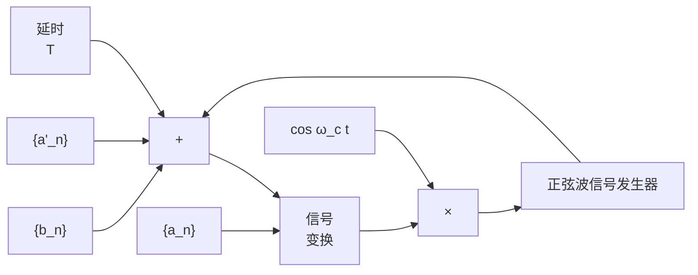
</details>

图 6.3.16 2DPSK 信号的产生

如 “0” 对应 “180°”，“1” 对应 “0°”；或者反之，“0” 对应 “0°”，“1” 对应 “180°”。差分相位调制采用的则是在相邻码元间建立相对相位关系的方法，根据前后码元的载波相位的相对变化来确定其携带的信息。

2DPSK 载波调制实现方法 所谓 2DPSK, 就是二进制的差分移相键控。下面首先分析如何产生 2DPSK 信号。如图 6.3.16 所示, 首先对二进制信息序列 $\{b_{n}\}, b_{n} \in \{0,1\}$ 进行差分编码:

$$
a _ {n} ^ {\prime} = b _ {n} \oplus a _ {n - 1} ^ {\prime} \tag {6.3.98}
$$

其中得到的 $a_{n}^{\prime}\in \{0,1\}$ ，对得到的差分码 $\{a_n^{\prime}\}$ 进行变换：

$$
a _ {n} = \left\{ \begin{array}{l l} + a, & a _ {n} ^ {\prime} = 1 \\ - a, & a _ {n} ^ {\prime} = 0 \end{array} \right. \text {或} a _ {n} = \left\{ \begin{array}{l l} + a, & a _ {n} ^ {\prime} = 0 \\ - a, & a _ {n} ^ {\prime} = 1 \end{array} \right. \tag {6.3.99}
$$

得到调制载波的基带符号序列 $\left\{a_{n}\right\}$ 。然后, 利用前面介绍过的 2PSK 信号的绝对相位调制的方法, 就可以生成 2DPSK 信号。

2DPSK 载波调制信号及频谱特性 2DPSK 载波调制信号的波形如图 6.3.17 所示，图(a)是输入的信息序列 $\left\{b_{n}\right\}$ ，图(b)是差分编码后得到的序列 $\left\{a_{n}^{\prime}\right\}$ ，图(c)是经过信号变换后的序列 $\left\{a_{n}\right\}$ ，图(d)是输出的 2DPSK 信号 $s(t)$ 。

2DPSK 信号实际上是由输入序列 $\left\{b_{n}\right\}$ 经过变换后得到的 $\left\{a_{n}\right\}$ 直接进行绝对相位调制的结果。若输入序列 $\left\{b_{n}\right\}$ 是一个取 “0” 和取 “1” 等概的二进制信息序列，不难想象所得到的是一个取 “-a” 和取 “+a” 等概的二进制符号序列 $\left\{a_{n}\right\}$ 。因此，2DPSK 与 2PSK 的统计特性完全一样，两者的功率密度谱也完全一样，2DPSK 信号的功率密度谱同样可由图 6.3.11 所示的特性曲线表示。


<details>
<summary>line</summary>

| Signal | Waveform Description |
| --- | --- |
| (a) | Square wave with period T, period 1, period 0, period 1, period 0, period 1, period 1 |
| (b) | Square wave with period T, period 1, period 0, period 1, period 0, period 1, period 1 |
| (c) | Square wave with period a, period -a, period 0, period 1, period 0, period 1, period 1 |
| (d) | Oscillating waveform with period T, period 0, period 1, period 0, period 1, period 0 |
</details>

图 6.3.17 2DPSK 载波调制信号的波形

2DPSK 载波调制信号的解调 2DPSK 载波调制信号的解调方法主要有下面两种。

(1) 相干解调和相关解调 采用相干解调或相关解调方式时, 首先采用 2PSK 信号解调的方法对 2DPSK 信号解调, 获得二进制符号序列 $\{a_{n}\}$ , 由 $\{a_{n}\}$ 通过变换获得相应的二进制差分序列 $\{a_{n}^{\prime}\}$ , 然后通过差分码的译码

$$
a _ {n} ^ {\prime} \oplus a _ {n - 1} ^ {\prime} = \left(b _ {n} \oplus a _ {n - 1} ^ {\prime}\right) \oplus a _ {n - 1} ^ {\prime} = b _ {n} \oplus \left(a _ {n - 1} ^ {\prime} \oplus a _ {n - 1} ^ {\prime}\right) = b _ {n} \tag {6.3.100}
$$

恢复出原来的二进制信息序列 $\{b_{n}\}$ 。在解调 $\{a_{n}\}$ 的过程中，2PSK 信号可能会由于相位模糊问题导致 $\{a_{n}\}$ 序列符号的倒转，由此引起 $\{a_{n}^{\prime}\}$ 序列的“0”“1”取值倒换，但由差分码译码时，是根据前后两个码元的取值状态是否发生变换确定其输出的。对于传号差分码，若前一码元与当前码元的取值发生变化，则判 $b_{n}$ 为“1”，否则判 $b_{n}$ 为“0”；而对于空号差分码，若前一码元与当前码元的取值发生变化，则判 $b_{n}$ 为“0”，否则判 $b_{n}$ 为“1”。因此恢复载波时出现的相位模糊问题，不会影响最后的译码输出。

误码性能分析 下面分析上述方法解调时的误码性能。

如果首先采用的 2PSK 信号解调方法是相干解调法，其误码率 $P_{E}$ 由式（6.3.90）确定；如果首先采用的 2PSK 信号解调方法是相关解调法（匹配滤波器法），其误码率 $P_{E}$ 由式（6.3.97）确定。但此时得

到的误码率还不是 2DPSK 信号的误码率, 因为要获得信息码, 还需要进行差分码的译码运算。

差分码的译码由式（6.3.100）确定，图6.3.18(a)、(b)和(c)分别给出了接收到的差分码没有误码、出现1位误码和连续出现4位误码时的差分码译码结果。当接收到的差分码有1位误码时，译码后有2位误码；当接收到的差分码有连续的4位误码时，译码后仍然只有2位误码。由此不难类推，当收到的差分码出现任意多位的连续误码时，译码后仍然只会有2位误码。

因此，假定 $P_{E}$ 为 2DPSK 信号经 2PSK 解调的误码率， $P_{n}$ 为出现连续 n 位误码的概率，则只出现 1 位误码的概率为，某位出现误码和该位前后均没有误码的概率的乘积，即

  
图 6.3.18 差分码的译码

$$
P _ {1} = (1 - P _ {\mathrm{E}}) P _ {\mathrm{E}} (1 - P _ {\mathrm{E}}) \tag {6.3.101}
$$

类似地，连续出现 2 位误码的概率为，某两位连续出现误码和该两位误码前后均没有误码的概率的乘积，即

$$
P _ {2} = (1 - P _ {\mathrm{E}}) P _ {\mathrm{E}} ^ {2} (1 - P _ {\mathrm{E}}) \tag {6.3.102}
$$

显然，一般地有

$$
P _ {n} = (1 - P _ {\mathrm{E}}) P _ {\mathrm{E}} ^ {n} (1 - P _ {\mathrm{E}}) \tag {6.3.103}
$$

因为差分码任意连续 n 位误码经译码后均仅出现两位误码，综合各种误码的可能性，可得 2DPSK 信号译码后的误码率为

$$
\begin{array}{l} P _ {\mathrm{E,2DPSK}} = 2 P _ {1} + 2 P _ {2} + \dots + 2 P _ {n} + \dots = \sum_ {k = 1} ^ {\infty} 2 P _ {k} \tag {6.3.104} \\ = \sum_ {k = 1} ^ {\infty} 2 (1 - P _ {\mathrm{E}}) P _ {\mathrm{E}} ^ {k} (1 - P _ {\mathrm{E}}) = 2 (1 - P _ {\mathrm{E}}) ^ {2} \sum_ {k = 1} ^ {\infty} P _ {\mathrm{E}} ^ {k} = 2 (1 - P _ {\mathrm{E}}) P _ {\mathrm{E}} \\ \end{array}
$$

(2) 差分相干解调 差分相干解调的基本原理如图 6.3.19 所示, 这种解调方法的特点是无须在本地恢复载波信号, 因此也没有相位模糊问题, 直接可以得到调制 2DPSK 信号的信息位。


<details>
<summary>flowchart</summary>

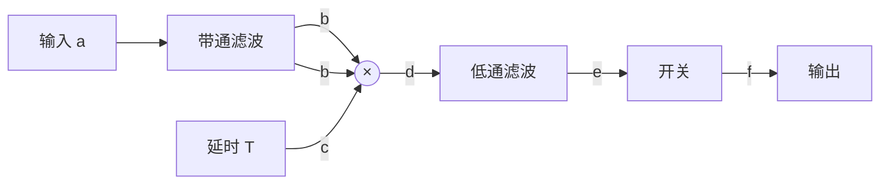
</details>

图 6.3.19 2DPSK 信号的差分相干解调

下面分析 2DPSK 信号的差分相干解调方法，先忽略传输过程中引入的噪声干扰的影响，假定带通滤波器带宽的选择使得接收的 2DPSK 信号没有失真，则在第 n 个码元时刻，在图中 b 点处接收到的信号为

$$
u _ {n} (t) = a _ {n} \cos \omega_ {\mathrm{c}} t, \quad 0 \leqslant t \leqslant T,   a _ {n} \in \{+ a, - a \} \tag {6.3.105}
$$

图中 $d$ 点的信号为

$$
\begin{array}{l} u _ {n} (t) u _ {n - 1} (t) = a _ {n} a _ {n - 1} \cos \omega_ {\mathrm{c}} t \cos \omega_ {\mathrm{c}} t \\ = \frac {a _ {n} a _ {n - 1}}{2} (1 + \cos 2 \omega_ {\mathrm{c}} t), \quad 0 \leqslant t \leqslant T; a _ {n - 1}, a _ {n} \in \{+ a, - a \} \tag {6.3.106} \\ \end{array}
$$

上两式中的“ $0 \leqslant t \leqslant T$ ”表示一个码元信号持续的时间。经过低通滤波器后，忽略1/2倍数的影响，在点e处可以得到


<details>
<summary>text_image</summary>

接收信号
b
延时信号
c
乘法器
输出信号
e
判决
输出信号
f
</details>

图 6.3.20 2DPSK 信号差分相干解调信号的处理过程

$$
\begin{array}{l} u _ {e} (t) = a _ {n} a _ {n - 1}, \tag {6.3.107} \\ 0 \leqslant t \leqslant T; a _ {n - 1}, a _ {n} \in \{+ a, - a \} \\ \end{array}
$$

抽样后，假定差分码采用传号差分码的编码方式，对第 n 个码元携带的信息按如下规则进行判决：

$$
u _ {e} (t) = a _ {n} a _ {n - 1} = \left\{ \begin{array}{l l} a ^ {2} \geqslant 0, & \text {判决发“0”} \\ - a ^ {2} <   0, & \text {判决发“1”} \end{array} \right. \tag {6.3.108}
$$

2DPSK 信号差分相干解调信号的处理过程如图 6.3.20 所示。

差分相干解调误码性能分析 下面分析差分相干解调时的误码性能。2DPSK 信号在传输过程中会受到噪声干扰的影响, 接收端收到的任意第 n-1 个码元和第 n 个码元信号一般可以表示为

$$
u _ {n - 1} ^ {\prime} (t) = \left(a _ {n - 1} + n _ {c, n - 1} (t)\right) \cos \omega_ {\mathrm{c}} t - n _ {s, n - 1} (t) \sin \omega_ {\mathrm{c}} t, (n - 2) T \leqslant t \leqslant (n - 1) T \tag {6.3.109}
$$

$$
u _ {n} ^ {\prime} (t) = \left(a _ {n} + n _ {c, n} (t)\right) \cos \omega_ {c} t - n _ {s, n} (t) \sin \omega_ {c} t, (n - 1) T \leqslant t \leqslant n T \tag {6.3.110}
$$

其中 $a_{n-1}, a_n \in \{+a, -a\}$ 。在解调过程中，第 $n-1$ 个码元和第 $n$ 个码元信号相乘后，得

$$
\begin{array}{l} = \left(\left(a _ {n - 1} + n _ {c, n - 1} (t)\right) \cos \omega_ {\mathrm{c}} t - n _ {s, n - 1} (t) \sin \omega_ {\mathrm{c}} t\right) \left(\left(a _ {n} + n _ {c, n} (t)\right) \cos \omega_ {\mathrm{c}} t - n _ {s, n} (t) \sin \omega_ {\mathrm{c}} t\right) \\ = \left(a _ {n - 1} + n _ {c, n - 1} (t)\right) \left(a _ {n} + n _ {c, n} (t)\right) \cos \omega_ {\mathrm{c}} t \cos \omega_ {\mathrm{c}} t - \left(a _ {n - 1} + n _ {c, n - 1} (t)\right) n _ {s, n} (t) \sin \omega_ {\mathrm{c}} t \cos \omega_ {\mathrm{c}} t - \\ \left(a _ {n} + n _ {c, n} (t)\right) n _ {s, n - 1} (t) \sin \omega_ {\mathrm{c}} t \cos \omega_ {\mathrm{c}} t + n _ {s, n - 1} (t) n _ {s, n} (t) \sin \omega_ {\mathrm{c}} t \sin \omega_ {\mathrm{c}} t \tag {6.3.111} \\ = \left(a _ {n - 1} + n _ {c, n - 1} (t)\right) \left(a _ {n} + n _ {c, n} (t)\right) \frac {1 + \cos 2 \omega_ {\mathrm{c}} t}{2} - \left(a _ {n - 1} + n _ {c, n - 1} (t)\right) n _ {s, n} (t) \frac {\sin 2 \omega_ {\mathrm{c}} t}{2} - \\ \left(a _ {n} + n _ {c, n} (t)\right) n _ {s, n - 1} (t) \frac {\sin 2 \omega_ {\mathrm{c}} t}{2} + n _ {s, n - 1} (t) n _ {s, n} (t) \frac {1 - \cos 2 \omega_ {\mathrm{c}} t}{2}, \quad (n - 1) T \leqslant t \leqslant n T \\ \end{array}
$$

$$
u _ {n - 1} ^ {\prime} (t) u _ {n} ^ {\prime} (t)
$$

再经过低通滤波器，得到

$$
v _ {n} (t) = \Big (a _ {n} + n _ {c, n} (t) \Big) \Big (a _ {n - 1} + n _ {c, n - 1} (t) \Big) + n _ {s, n} (t) n _ {s, n - 1} (t), \quad (n - 1) T \leqslant t \leqslant n T \tag {6.3.112}
$$

利用数学中的如下恒等式：

$$
x _ {1} x _ {2} + y _ {1} y _ {2} = \frac {1}{4} \left(\left(\left(x _ {1} + x _ {2}\right) ^ {2} + \left(y _ {1} + y _ {2}\right) ^ {2}\right) - \left(\left(x _ {1} - x _ {2}\right) ^ {2} + \left(y _ {1} - y _ {2}\right) ^ {2}\right)\right) \tag {6.3.113}
$$

以 $x_{1} = a_{n} + n_{c,n}(t), x_{2} = a_{n - 1} + n_{c,n - 1}(t), y_{1} = n_{s,n}(t), y_{2} = n_{s,n - 1}(t)$ 代入上式，则式（6.3.112）变为

$$
\begin{array}{c} v _ {n} (t) = \frac {1}{4} \left(\left(a _ {n} + a _ {n - 1} + n _ {c, n} (t) + n _ {c, n - 1} (t)\right) ^ {2} + \left(n _ {s, n} (t) + n _ {s, n - 1} (t)\right) ^ {2}\right) - \\ \frac {1}{4} \left(\left(a _ {n} - a _ {n - 1} + n _ {c, n} (t) - n _ {c, n - 1} (t)\right) ^ {2} + \left(n _ {s, n} (t) - n _ {s, n - 1} (t)\right) ^ {2}\right) \end{array} \tag {6.3.114}
$$

式中， $(n-1)T \leqslant t \leqslant nT$ ， $a_{n-1}, a_{n} \in \{+a, -a\}$ 。

下面进一步分析什么情况下会发生错误的判决。已知 $a_{n - 1},a_n\in \{ + a, - a\}$ ，下面分两种情况进行讨论

（1）若第 $n$ 个码元为“0”，则应有 $a_{n - 1} = +a, a_n = +a$ 或 $a_{n - 1} = -a, a_n = -a$ 。由式（6.3.112）有

$$
v _ {n} (t) = \left(a _ {n} + n _ {c, n} (t)\right) \left(a _ {n - 1} + n _ {c, n - 1} (t)\right) + n _ {s, n} (t) n _ {s, n - 1} (t) \left\{ \begin{array}{l l} \geqslant 0, & \text {判决发“0”}, \text {判决正确} \\ <   0, & \text {判决发“1”}, \text {判决错误} \end{array} \right. \tag {6.3.115}
$$

若 $a_{n - 1} = +a, a_n = +a$ ，由式（6.3.114）有

$$
\begin{array}{l} v _ {n} (t) = \frac {1}{4} \left((2 a + n _ {c, n} (t) + n _ {c, n - 1} (t)) ^ {2} + (n _ {s, n} (t) + n _ {s, n - 1} (t)) ^ {2}\right) - \\ \frac {1}{4} \left((n _ {c, n} (t) - n _ {c, n - 1} (t)) ^ {2} + (n _ {s, n} (t) - n _ {s, n - 1} (t)) ^ {2}\right) \end{array} \tag {6.3.116}
$$

由式（6.3.115），

$$
\begin{array}{l} \left(2 a + n _ {c, n} (t) + n _ {c, n - 1} (t)\right) ^ {2} + \left(n _ {s, n} (t) + n _ {s, n - 1} (t)\right) ^ {2} \\ \geqslant \left(n _ {c, n} (t) - n _ {c, n - 1} (t)\right) ^ {2} + \left(n _ {s, n} (t) - n _ {s, n - 1} (t)\right) ^ {2}: \text {判决发“} 0 \text {”,判决正确} \tag {6.3.117} \\ \end{array}
$$

$$
\left(2 a + n _ {c, n} (t) + n _ {c, n - 1} (t)\right) ^ {2} + \left(n _ {s, n} (t) + n _ {s, n - 1} (t)\right) ^ {2}
$$

$$
<   \left(n _ {c, n} (t) - n _ {c, n - 1} (t)\right) ^ {2} + \left(n _ {s, n} (t) - n _ {s, n - 1} (t)\right) ^ {2}: \text {判决发“1”}, \text {判决错误}
$$

因为 $n_{c,n}(t), n_{c,n-1}(t), n_{s,n}(t), n_{s,n-1}(t)$ 均为均值为0、方差为 $\sigma_{n}^{2}$ 的相互独立的高斯随机过程。直接可以证明 $n_{c,n}(t) + n_{c,n-1}(t), n_{s,n}(t) + n_{s,n-1}(t), n_{c,n}(t) - n_{c,n-1}(t)$ 和 $n_{s,n}(t) + n_{s,n-1}(t)$ 均为均值为0、方差为 $\sigma_{n}^{\prime 2} = 2\sigma_{n}^{2}$ 的高斯随机过程。而 $2a + n_{c,n}(t) + n_{c,n-1}(t)$ 则相应地为均值为 $a' = 2a$ 、方差为 $\sigma_{n}^{\prime 2} = 2\sigma_{n}^{2}$ 的高斯随机过程。上述随机过程在判决时刻的抽样值则相应地为高斯随机变量。

同样，根据第2章对窄带高斯随机信号和余弦波加窄带高斯随机信号的有关分析可知 $V_{0}(t) = \sqrt{(n_{c,n}(t) - n_{c,n - 1}(t))^{2} + (n_{s,n}(t) - n_{s,n - 1}(t))^{2}}$ 的取值服从瑞利分布：

$$
p (V _ {0}) = \frac {V _ {0}}{\sigma_ {n} ^ {\prime 2}} \exp \left(- \frac {V _ {0} ^ {2}}{2 \sigma_ {n} ^ {\prime 2}}\right) \tag {6.3.118}
$$

而 $V_{1}(t) = \sqrt{(2a + n_{c,n}(t) + n_{c,n - 1}(t))^2 + (n_{s,n}(t) + n_{s,n - 1}(t))^2}$ 的取值服从莱斯分布：

$$
p (V _ {1}) = \frac {V _ {1}}{\sigma_ {n} ^ {\prime 2}} \exp \left(- \frac {V _ {1} ^ {2} + a ^ {\prime 2}}{2 \sigma_ {n} ^ {\prime 2}}\right) \cdot I _ {0} \left(\frac {a ^ {\prime} V _ {1}}{\sigma_ {n} ^ {\prime 2}}\right) \tag {6.3.119}
$$

因此第 $n$ 个码元为“0”时，发生错误判决的概率为

$$
\begin{array}{l} P _ {\mathrm{E0}} = \Pr (V _ {1} <   V _ {0}) = \int_ {0} ^ {\infty} p (V _ {1}) \int_ {V _ {0} = V _ {1}} ^ {\infty} p (V _ {0}) \mathrm{d} V _ {0} \mathrm{d} V _ {1} \\ = \int_ {0} ^ {\infty} \frac {V _ {1}}{\sigma_ {n} ^ {\prime 2}} \exp \left(- \frac {V _ {1} ^ {2} + a ^ {\prime 2}}{2 \sigma_ {n} ^ {\prime 2}}\right) \cdot I _ {0} \left(\frac {a ^ {\prime} V _ {1}}{\sigma_ {n} ^ {\prime 2}}\right) \int_ {V _ {0} = V _ {1}} ^ {\infty} \frac {V _ {0}}{\sigma_ {n} ^ {\prime 2}} \exp \left(- \frac {V _ {0} ^ {2}}{2 \sigma_ {n} ^ {\prime 2}}\right) \mathrm{d} V _ {0} \mathrm{d} V _ {1} \tag {6.3.120} \\ = \int_ {0} ^ {\infty} \frac {V _ {1}}{\sigma_ {n} ^ {\prime 2}} \exp \left(- \frac {V _ {1} ^ {2} + a ^ {\prime 2}}{2 \sigma_ {n} ^ {\prime 2}}\right) \cdot I _ {0} \left(\frac {a ^ {\prime} V _ {1}}{\sigma_ {n} ^ {\prime 2}}\right) \cdot \exp \left(- \frac {V _ {1} ^ {2}}{2 \sigma_ {n} ^ {\prime 2}}\right) \mathrm{d} V _ {1} \\ = \exp \left(- \frac {a ^ {\prime 2}}{2 \sigma_ {n} ^ {\prime 2}}\right) \int_ {0} ^ {\infty} \frac {V _ {1}}{\sigma_ {n} ^ {\prime 2}} \cdot I _ {0} \left(\frac {a ^ {\prime} V _ {1}}{\sigma_ {n} ^ {\prime 2}}\right) \cdot \exp \left(- \frac {V _ {1} ^ {2}}{\sigma_ {n} ^ {\prime 2}}\right) \mathrm{d} V _ {1} \\ \end{array}
$$

令 $t = \frac{\sqrt{2}V_1}{\sigma_n'}$ ， $\alpha = \frac{a'}{\sqrt{2}\sigma_n'}$ ，上式可整理为

$$
P _ {\mathrm{E0}} = \frac {1}{2} \exp \left(- \frac {\alpha^ {2}}{2}\right) \int_ {0} ^ {\infty} t I _ {0} (\alpha t) \exp \left(- \frac {\alpha^ {2} + t ^ {2}}{2}\right) \mathrm{d} t \tag {6.3.121}
$$

上式中的积分项是马肯函数 $Q_{\mathrm{M}}(\alpha ,\beta) = \int_{\beta}^{\infty}tI_0(\alpha t)\mathrm{e}^{-\frac{t^2 + \alpha^2}{2}}\mathrm{d}t$ 在 $\beta = 0$ 时的取值。利用马肯函数的性质

$$
\left. Q _ {\mathrm{M}} (\alpha , \beta) \right| _ {\beta = 0} = 1, \left. Q _ {\mathrm{M}} (\alpha , \beta) \right| _ {\alpha = 0} = \exp \left(- \frac {\beta^ {2}}{2}\right) \tag {6.3.122}
$$

中的第一个特性，可得

$$
P _ {\mathrm{E0}} = \frac {1}{2} \exp \left(- \frac {\alpha^ {2}}{2}\right) = \frac {1}{2} \exp \left(- \frac {a ^ {\prime 2}}{4 \sigma_ {n} ^ {\prime 2}}\right) = \frac {1}{2} \exp \left(- \frac {a ^ {2}}{2 \sigma_ {n} ^ {2}}\right) \tag {6.3.123}
$$

上式中的最后一个等式利用了 $a' = 2a$ ， $\sigma_{n}'^{2} = 2\sigma_{n}^{2}$ 。

（2）若第 $n$ 个码元为“1”，则应有 $a_{n - 1} = -a, a_n = +a$ 或 $a_{n - 1} = +a, a_n = -a$ 。由式（6.3.112）有

$$
v _ {n} (t) = \left(a _ {n} + n _ {c, n} (t)\right) \left(a _ {n - 1} + n _ {c, n - 1} (t)\right) + n _ {s, n} (t) n _ {s, n - 1} (t) \left\{ \begin{array}{l l} \geqslant 0, & \text {判决发“0”}, \text {判决错误} \\ <   0, & \text {判决发“1”}, \text {判决正确} \end{array} \right. \tag {6.3.124}
$$

在式（6.3.115）中 $a_{n} = a_{n - 1}$ ，而在式（6.3.124）中 $a_{n} = -a_{n - 1}$ 。因此，若对式（6.3.124）的结果乘以“-1”，则有

$$
\begin{array}{l} v _ {n} ^ {\prime} (t) = - v _ {n} (t) \\ = \left(- a _ {n} + n _ {c, n} (t)\right) \left(a _ {n - 1} + n _ {c, n - 1} (t)\right) + n _ {s, n} (t) n _ {s, n - 1} (t) \left\{ \begin{array}{l l} \leqslant 0, & \text {判决发“0”,判决错误} \\ > 0, & \text {判决发“1”,判决正确} \end{array} \right. \tag {6.3.125} \\ = \left(a _ {n} ^ {\prime} + n _ {c, n} (t)\right) \left(a _ {n - 1} + n _ {c, n - 1} (t)\right) + n _ {s, n} (t) n _ {s, n - 1} (t) \left\{ \begin{array}{l l} \leqslant 0, & \text {判决发“0”}, \text {判决错误} \\ > 0, & \text {判决发“1”}, \text {判决正确} \end{array} \right. \\ \end{array}
$$

此时有 $a_{n}^{\prime} = a_{n - 1}$ 。由此可以导出发生错误判决的概率与式（6.3.123）完全相同的结果，即第 $n$ 个码元为“1”时，发生错误判决的概率为

$$
P _ {\mathrm{EI}} = \frac {1}{2} \exp \left(- \frac {a ^ {2}}{2 \sigma_ {n} ^ {2}}\right) \tag {6.3.126}
$$

综合上面（1）和（2）的分析，若发“0”和发“1”的先验概率分别为 $P(s_{0})$ 和 $P(s_{1})$ ，则总的错误概率为

$$
P _ {\mathrm{E}} = P (s _ {0}) P _ {\mathrm{E0}} + P (s _ {1}) P _ {\mathrm{E1}} = \frac {1}{2} \exp \left(- \frac {a ^ {2}}{2 \sigma_ {n} ^ {2}}\right) \tag {6.3.127}
$$

解调器的输入信号的码元能量 $E_{s0}=E_{s1}=E_{b}=a^{2}T/2$ 。因为带通的带宽通常取 W=2/T ，噪声功率 $\sigma_{n}^{2}=WN_{0}$ ，由此可将误码率表示为

$$
P _ {\mathrm{E}} = \frac {1}{2} \exp \left(- \frac {a ^ {2}}{2 \sigma_ {n} ^ {2}}\right) = \frac {1}{2} \exp \left(- \frac {E _ {\mathrm{b}}}{2 N _ {0}}\right) \tag {6.3.128}
$$

## 6.3.4 2FSK 调制解调系统

2FSK 信号 二进制移频键控调制简称 2FSK，它是一种二进制的、利用载波信号的频率来携带信息的调制方式。2FSK 信号一般可以表示为

$$
s (t) = \sum_ {n = - \infty} ^ {\infty} a _ {n} a g _ {T} (t - n T) \cos \omega_ {\mathrm{c} 1} t + \sum_ {n = - \infty} ^ {\infty} \bar {a} _ {n} a g _ {T} (t - n T) \cos \omega_ {\mathrm{c} 2} t \tag {6.3.129}
$$

式中， $a_{n}\in \{0,1\}$ 。上式也可以表示为

$$
s (t) = \sum_ {n = - \infty} ^ {\infty} u _ {n} (t) \tag {6.3.130}
$$

其中第 $n$ 个码元信号 $u_{n}(t)$ 为

$$
u _ {n} (t) = \left\{ \begin{array}{l l} a g _ {T} (t - n T) \cos \omega_ {\mathrm{c1}} t, & a _ {n} = 1 (\text {概率为} P) \\ a g _ {T} (t - n T) \cos \omega_ {\mathrm{c2}} t, & a _ {n} = 0 (\text {概率为} 1 - P) \end{array} \right. \tag {6.3.131}
$$

如果波形函数 $g_{T}(t)$ 为门函数，则有

$$
u _ {n} (t) = \left\{ \begin{array}{l l} a \cos \omega_ {\mathrm{c1}} t, & a _ {n} = 1 (\text {概率为} P) \\ a \cos \omega_ {\mathrm{c2}} t, & a _ {n} = 0 (\text {概率为} 1 - P) \end{array} , (n - 1) T \leqslant t <   n T \right. \tag {6.3.132}
$$

为便于在解调时分辨这两个不同频率的信号，通常希望在一个码元周期内，信号 $a \cos \omega_{c1} t$ 与信号 $a \cos \omega_{c2} t$ 具有正交性，即满足

$$
\begin{array}{l} \int_ {0} ^ {T} \cos (\omega_ {\mathrm{c} 1} t + \phi) \cos \omega_ {\mathrm{c} 2} t \mathrm{d} t = \cos \phi \int_ {0} ^ {T} \cos \omega_ {\mathrm{c} 1} t \cos \omega_ {\mathrm{c} 2} t \mathrm{d} t - \sin \phi \int_ {0} ^ {T} \sin \omega_ {\mathrm{c} 1} t \cos \omega_ {\mathrm{c} 2} t \mathrm{d} t \\ = \frac {1}{2} \cos \phi \left(\frac {\sin \left(\omega_ {\mathrm{c} 1} + \omega_ {\mathrm{c} 2}\right) T}{\omega_ {\mathrm{c} 1} + \omega_ {\mathrm{c} 2}} + \frac {\sin \left(\omega_ {\mathrm{c} 1} - \omega_ {\mathrm{c} 2}\right) T}{\omega_ {\mathrm{c} 1} - \omega_ {\mathrm{c} 2}}\right) + \tag {6.3.133} \\ \frac {1}{2} \sin \phi \left(\frac {\cos \left(\omega_ {\mathrm{c} 1} + \omega_ {\mathrm{c} 2}\right) T - 1}{\omega_ {\mathrm{c} 1} + \omega_ {\mathrm{c} 2}} + \frac {\cos \left(\omega_ {\mathrm{c} 1} - \omega_ {\mathrm{c} 2}\right) T - 1}{\omega_ {\mathrm{c} 1} - \omega_ {\mathrm{c} 2}}\right) = 0 \\ \end{array}
$$

式中引入相位 $\phi$ 的目的主要是考虑信号 $a \cos \omega_{\mathrm{c} 1} t$ 与信号 $a \cos \omega_{\mathrm{c} 2} t$ 的起始相位可能不同。因为一般地有 $\omega_{\mathrm{c} 1} + \omega_{\mathrm{c} 2} \gg 1$ ，有

$$
\frac {\sin (\omega_ {\mathrm{c1}} + \omega_ {\mathrm{c2}}) T}{\omega_ {\mathrm{c1}} + \omega_ {\mathrm{c2}}} \approx 0, \quad \frac {\cos (\omega_ {\mathrm{c1}} + \omega_ {\mathrm{c2}}) T - 1}{\omega_ {\mathrm{c1}} + \omega_ {\mathrm{c2}}} \approx 0 \tag {6.3.134}
$$

因此，式（6.3.133）正交性的条件简化为

$$
\cos \phi \sin (\omega_ {\mathrm{c1}} - \omega_ {\mathrm{c2}}) T + \sin \phi (\cos (\omega_ {\mathrm{c1}} - \omega_ {\mathrm{c2}}) T - 1) = 0 \tag {6.3.135}
$$

因为相位 $\phi$ 的取值具有任意性，所以上式的条件等效为

$$
\begin{array}{l} \sin (\omega_ {\mathrm{c1}} - \omega_ {\mathrm{c2}}) T = 0 \\ \cos (\omega_ {\mathrm{c1}} - \omega_ {\mathrm{c2}}) T - 1 = 0 \end{array} \tag {6.3.136}
$$

容易验证，当满足条件

$$
(\omega_ {\mathrm{c1}} - \omega_ {\mathrm{c2}}) T = 2 \pi k \longrightarrow \omega_ {\mathrm{c1}} - \omega_ {\mathrm{c2}} = \frac {2 \pi k}{T}, \quad k \mathrm{为正整数} \tag {6.3.137}
$$

时，式（6.3.136）成立，即信号 $a \cos(\omega_{c1} t + \phi)$ 与信号 $a \cos \omega_{c2} t$ 在一个码元周期内具有正交性。其中满足条件的最小 k 值为 k = 1，即满足条件的最小频率间隔为

$$
\min \Delta \omega = \min \left| \omega_ {\mathrm{c1}} - \omega_ {\mathrm{c2}} \right| = \frac {2 \pi}{T} \tag {6.3.138}
$$

2FSK 信号波形如图 6.3.21 所示，图中假定取 $\omega_{c1} > \omega_{c2}$ ， $\omega_{c1} = 3 \cdot \frac{2\pi}{T}$ ，则由式（6.3.138），有 $\omega_{c2} = \omega_{c1} - \frac{2\pi}{T} = 3 \cdot \frac{2\pi}{T} - \frac{2\pi}{T} = 2 \cdot \frac{2\pi}{T}$ 。


<details>
<summary>line</summary>

| Time Interval | Square Wave Signal | Oscillating Signal |
| --- | --- | --- |
| 1 | 1 | ~0.5 |
| 2 | 1 | ~0.5 |
| 3 | 0 | ~0.5 |
| 4 | 0 | ~0.5 |
| 5 | 0 | ~0.5 |
| 6 | 1 | ~0.5 |
| 7 | 1 | ~0.5 |
| 8 | 1 | ~0.5 |
| 9 | 0 | ~0.5 |
| 10 | 0 | ~0.5 |
| 11 | 1 | ~0.5 |
| 12 | 1 | ~0.5 |
</details>

图 6.3.21 2FSK 信号波形示例

特别地，如果已知 $\phi=0$ ，式（6.3.135）可进一步简化为

$$
\sin (\omega_ {\mathrm{c1}} - \omega_ {\mathrm{c2}}) T = 0 \longrightarrow \omega_ {\mathrm{c1}} - \omega_ {\mathrm{c2}} = \frac {\pi k}{T}, k \text {为正整数} \tag {6.3.139}
$$

满足条件的最小 $k$ 值为 $k = 1$ ，即满足条件的最小频率间隔为

$$
\min \Delta \omega = \min \left| \omega_ {\mathrm{c1}} - \omega_ {\mathrm{c2}} \right| = \frac {\pi}{T} \tag {6.3.140}
$$

通常为保证 $\phi$ 取任意值时正交性的条件均成立，2FSK 信号两频率的最小间隔一般取 $2\pi/T$ 。

2FSK 信号的功率谱 由式（6.3.129），2FSK 信号可视为由两个不同载波的 2ASK（OOK）信号合成的信号。由式（6.3.2）可直接导出 2FSK 信号的功率谱为

$$
P _ {s} (f) = \frac {1}{4 T} P _ {a} (f) \left(\left| G _ {T} (f + f _ {\mathrm{c1}}) \right| ^ {2} + \left| G _ {T} (f - f _ {\mathrm{c1}}) \right| ^ {2}\right) + \frac {1}{4 T} P _ {\bar {a}} (f) \left(\left| G _ {T} (f + f _ {\mathrm{c2}}) \right| ^ {2} + \left| G _ {T} (f - f _ {\mathrm{c2}}) \right| ^ {2}\right) \tag {6.3.141}
$$

式中， $P_{a}(f)=\sum_{m=-\infty}^{\infty}R_{a}(m)\mathrm{e}^{-\mathrm{j}2\pi fmT}$ ， $P_{\overline{a}}(f)=\sum_{m=-\infty}^{\infty}R_{\overline{a}}(m)\mathrm{e}^{-\mathrm{j}2\pi fmT}$ ，其中 $R_{a}(m)$ 是基带符号序列 $\left\{a_{n}^{\prime}\right\}$ ， $a_{n}^{\prime}=a_{n}a$ 的自相关函数； $R_{\overline{a}}(m)$ 是基带符号序列 $\left\{\overline{a}_{n}^{\prime}\right\}$ ， $\overline{a}_{n}^{\prime}=\overline{a}_{n}a$ 的自相关函数。图6.3.22为 $\omega_{c1}-\omega_{c2}=2\pi/T$ 时2FSK信号的功率谱。


<details>
<summary>spectrogram</summary>

| Frequency | Peak Value |
| --- | --- |
| Left Peak | -f1 |
| Right Peak | f0 |
| Center | f1 |
</details>

图 6.3.22 $\omega_{c1}-\omega_{c2}=2\pi/T$ 时 2FSK 信号的功率谱

若只考虑每个信号的主瓣，2FSK 信号的频带宽度一般可以表示为

$$
W _ {2 \mathrm{FSK}} = f _ {\mathrm{c1}} - f _ {\mathrm{c2}} + 2 \frac {1}{T} \tag {6.3.142}
$$

当两载波的间隔按照式（6.3.138）选取时，有

$$
W _ {2 \mathrm{FSK}} = f _ {\mathrm{c1}} - f _ {\mathrm{c2}} + 2 \frac {1}{T} = \frac {1}{T} + \frac {2}{T} = \frac {3}{T} \tag {6.3.143}
$$

若基带的波形信号为门函数，相应的两载波信号的频谱特性如图 6.3.23 所示。相应地 2FSK 的频带利用率为

$$
\eta_ {2 \mathrm{FSK}} = \frac {R _ {\mathrm{S}}}{W _ {2 \mathrm{FSK}}} = \frac {1 / T}{3 / T} = \frac {R _ {\mathrm{S}}}{3 W _ {\mathrm{B}}} = \frac {1}{3} \eta_ {\mathrm{B}} \tag {6.3.144}
$$

显然相对于 2ASK 和 2PSK/2DPSK，2FSK 信号在频谱利用率方面没有优势。稍后在多进制 FSK 信号的调制与解调系统的分析中可见，相对于多进制 ASK 和 PSK 系统，多进制 FSK 系统有较好的抗噪声干扰的性能，因此更适合在低信噪比的场合中应用。

2FSK 载波调制实现方法 2FSK 载波调制如图 6.3.24 所示，其中图(a)是一个由变容二极管实现的模拟调频电路，二值符号序列对应的两个不同电平加到调频电路的变容二极管上，可产生两个不同频率的正弦波信号，采用这种调制方式在两个频率的正弦波信号间切换时，通常有平滑的相位过渡特性，但这种电路很难产生频率准确且稳定度很高的调制信号。图(b)是由两个正弦波信号发生器和一个切换电路构成的 2FSK 载波调制电路，这种方法通常更容易获得稳定度较高的调制输出信号，但通过切换电路选择两路信号输出时，一般难以保证两信号间频率的平滑过渡，容易产生带外的频率干扰。


<details>
<summary>line</summary>

| Parameter | Value |
| --- | --- |
| Period (Solid Line) | 1/T |
| Period (Dashed Line) | 1/T |
| Peak Frequency | \(f_0\) |
| Period (Dashed Line) | 1/T |
| Period (Solid Line) | 1/T |
| Period (Dashed Line) | 1/T |
</details>

图 6.3.23 2FSK 信号的频谱特性


<details>
<summary>flowchart</summary>

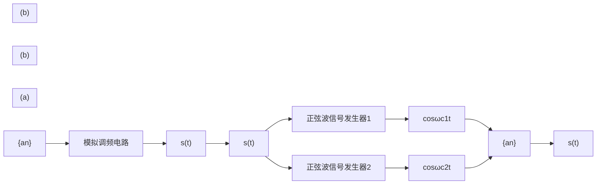
</details>

图 6.3.24 2FSK 载波调制

2FSK 信号的解调 2FSK 信号的解调方法包括相干解调、相关解调（匹配滤波器法）和包络检波解调等三种方法，下面分别加以介绍。

(1) 2FSK 信号的相干解调及性能分析 2FSK 信号相干解调的实现方法如图 6.3.25 所示, 形式上类似由两个 2ASK 信号相干解调系统组合而成, 其中一路带通滤波器的中心频率选在 $\omega_{\mathrm{c} 1}$ , 相干的载波信号为 $\cos \omega_{\mathrm{c} 1} t$ ; 另外一路带通滤波器的中心频率选在 $\omega_{\mathrm{c} 2}$ , 相干的载波信号为 $\cos \omega_{\mathrm{c} 2} t$ 。


<details>
<summary>flowchart</summary>

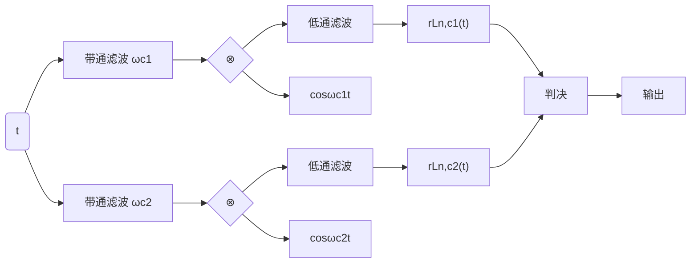
</details>

图 6.3.25 2FSK 信号的相干解调

对任意的第 n 个码元信号，若发送的是符号 “1”，则相应的 2FSK 信号为

$$
u _ {n} (t) = a \cos \omega_ {\mathrm{cl}} t, (n - 1) T \leqslant t <   n T \tag {6.3.145}
$$

经过传输，接收的信号 $r_n(t)$ 经过带通滤波后可得

$$
r _ {n, \mathrm{cl}} (t) = a \cos \omega_ {\mathrm{cl}} t + n _ {\mathrm{cl}} (t) \cos \omega_ {\mathrm{cl}} t - n _ {s 1} (t) \sin \omega_ {\mathrm{cl}} t, (n - 1) T \leqslant t <   n T \tag {6.3.146}
$$

$$
r _ {n, \mathrm{c2}} (t) = n _ {c 2} (t) \cos \omega_ {\mathrm{c2}} t - n _ {s 2} (t) \sin \omega_ {\mathrm{c2}} t, (n - 1) T \leqslant t <   n T \tag {6.3.147}
$$

上式中的两信号分别与本地载波信号 $\cos\omega_{c1}t$ 与 $\cos\omega_{c2}t$ 相乘，并经低通滤波后得到相应的输出为

$$
r _ {\mathrm{Ln,cl}} (t) = a + n _ {\mathrm{cl}} (t), (n - 1) T \leqslant t <   n T \tag {6.3.148}
$$

$$
r _ {\mathrm{Ln,c2}} (t) = n _ {\mathrm{c2}} (t), (n - 1) T \leqslant t <   n T \tag {6.3.149}
$$

同理，对任意的第 n 个码元信号，若发送的符号是 “0”，则相应的信号为

$$
u _ {n} (t) = a \cos \omega_ {\mathrm{c2}} t, (n - 1) T \leqslant t <   n T \tag {6.3.150}
$$

经过传输，接收的信号 $r_n(t)$ 经过带通滤波、与本地载波相乘及低通滤波后可得

$$
r _ {\mathrm{L} n, \mathrm{cl}} (t) = n _ {\mathrm{cl}} (t), (n - 1) T \leqslant t <   n T \tag {6.3.151}
$$

$$
r _ {\mathrm{Ln,c2}} (t) = a + n _ {\mathrm{c2}} (t), (n - 1) T \leqslant t <   n T \tag {6.3.152}
$$

注意, 对于 2FSK 信号的相干解调, 有两路解调输出, 判决规则与 2ASK 和 2PSK 时只有一路输出时的情形不同, 采用的是对两路输出进行比较后, 做 “择大判决” 的策略, 即在抽样判决时刻 $t$

$$
\left\{\begin{array}{l}r _ {\mathrm{Ln,cl}} (t) \geqslant r _ {\mathrm{Ln,c2}} (t) \rightarrow \text {判决发“1”}\\r _ {\mathrm{Ln,cl}} (t) <   r _ {\mathrm{Ln,c2}} (t) \rightarrow \text {判决发“0”}\end{array}\right. \tag {6.3.153}
$$

显然，发“1”时，错误判决的概率为

$$
\Pr \left(r _ {\mathrm{Ln,cl}} (t) <   r _ {\mathrm{Ln,c2}} (t)\right) = \Pr \left(a + n _ {\mathrm{cl}} (t) <   n _ {\mathrm{c2}} (t)\right) = \Pr \left(a <   n _ {\mathrm{c2}} (t) - n _ {\mathrm{cl}} (t)\right) \tag {6.3.154}
$$

而发 “0” 时，错误判决的概率为

$$
\mathrm{Pr} \left(r _ {\mathrm{Ln,c2}} (t) <   r _ {\mathrm{Ln,c1}} (t)\right) = \mathrm{Pr} \left(a + n _ {\mathrm{c2}} (t) <   n _ {\mathrm{c1}} (t)\right) = \mathrm{Pr} \left(a <   n _ {\mathrm{c1}} (t) - n _ {\mathrm{c2}} (t)\right) \tag {6.3.155}
$$

因为在抽样判决时刻 t，获得的 $n_{\mathrm{c}1}(t)$ 与 $n_{\mathrm{c}2}(t)$ 是相互间独立且均值为 0、方差为 $\sigma_{n}^{2}$ 的高斯随机变量， $\sigma_{n}^{2}=N_{0}W_{c}\approx N_{0}(2/T)$ 。容易证明 $n_{\mathrm{c}2}(t)-n_{\mathrm{c}1}(t)$ 与 $n_{\mathrm{c}1}(t)-n_{\mathrm{c}2}(t)$ 是均值为 0、方差为 $2\sigma_{n}^{2}$ 的高斯随机变量 $n_{\mathrm{c}}^{\prime}(t)$ 。 $n_{\mathrm{c}}^{\prime}(t)$ 幅度取值的概率密度函数可以表示为

$$
p _ {n _ {\mathrm{c}} ^ {\prime} (t)} (n) = \frac {1}{\sqrt {2 \pi} \sqrt {2} \sigma_ {n}} \exp \left(- \frac {n ^ {2}}{2 (2 \sigma_ {n} ^ {2})}\right) = \frac {1}{2 \sqrt {\pi} \sigma_ {n}} \exp \left(- \frac {n ^ {2}}{4 \sigma_ {n} ^ {2}}\right) \tag {6.3.156}
$$

因此，发“0”和发“1”时错误判决的概率可统一表示为

$$
\begin{array}{l} P _ {\mathrm{E}} = \Pr \left(a <   n _ {\mathrm{c}} ^ {\prime} (t)\right) = \int_ {a} ^ {\infty} p _ {n _ {\mathrm{c}} ^ {\prime} (t)} (n) \mathrm{d} n \tag {6.3.157} \\ = \int_ {a} ^ {\infty} \frac {1}{2 \sqrt {\pi} \sigma_ {n}} \exp \left(- \frac {n ^ {2}}{4 \sigma_ {n} ^ {2}}\right) \mathrm{d} n = \int_ {\frac {a}{\sqrt {2} \sigma_ {n}}} ^ {\infty} \frac {1}{\sqrt {2 \pi}} \exp \left(- \frac {u ^ {2}}{2}\right) \mathrm{d} u = Q \left(\frac {a}{\sqrt {2} \sigma_ {n}}\right) \\ \end{array}
$$

若以 $\sigma_{n}^{2} = N_{0}W\approx N_{0}(2 / T)$ ， $E_{\mathrm{b}} = E_{s1} = E_{s2} = \frac{1}{2} a^{2}T$ 的关系式代入上式，可得

$$
P _ {\mathrm{E}} = Q \left(\sqrt {\frac {E _ {\mathrm{b}}}{2 N _ {0}}}\right) \tag {6.3.158}
$$

(2) 2FSK 信号的相关解调及性能分析 2FSK 信号的相关解调原理如图 6.3.26 所示。


<details>
<summary>flowchart</summary>

This diagram illustrates a feedback control system for a synchronous signal, showing signal processing through summation, sampling, and decision-making to produce output.
</details>

图 6.3.26 2FSK 信号的相关解调（匹配滤波器）

若记

$$
u _ {n} (t) = \left\{ \begin{array}{l l} a \cos \omega_ {\mathrm{c1}} t = s _ {1} (t), & a _ {n} = 1 (\text {概率为} P) \\ a \cos \omega_ {\mathrm{c2}} t = s _ {2} (t), & a _ {n} = 0 (\text {概率为} 1 - P) \end{array} , (n - 1) T \leqslant t <   n T \right. \tag {6.3.159}
$$

对第 $n$ 个码元 $t = T$ 的采样判决时刻，相关器输出为

$$
z _ {i} (T) = \int_ {0} ^ {T} r (t) s _ {i} (t) \mathrm{d} t, \quad i = 1, 2 \tag {6.3.160}
$$

（a）若当前发送的码元是 $s_1(t)$ ，则判决时刻得到的抽样值

$$
\begin{array}{l} z _ {1} (T) = \int_ {0} ^ {T} r (t) s _ {1} (t) \mathrm{d} t = \int_ {0} ^ {T} \left(s _ {1} (t) + n _ {\mathrm{w1}} (t)\right) s _ {1} (t) \mathrm{d} t = \int_ {0} ^ {T} s _ {1} ^ {2} (t) \mathrm{d} t + \int_ {0} ^ {T} n _ {\mathrm{w1}} (t) s _ {1} (t) \mathrm{d} t = E _ {s 1} + N _ {1} (6.3.161) \\ z _ {2} (T) = \int_ {0} ^ {T} r (t) s _ {2} (t) \mathrm{d} t = \int_ {0} ^ {T} n _ {\mathrm{W2}} (t) s _ {2} (t) \mathrm{d} t = N _ {1} ^ {\prime} (6.3.162) \\ \end{array}
$$

$E_{s1}=a^{2}T/2$ 是一常数，为发送“1”时码元的能量。因为匹配滤波器是一种线性滤波器，对于输入高斯噪声 $n_{\mathrm{W}i}(t), i=1,2$ ，相应的噪声部分 $N_{1}$ 与 $N_{1}^{\prime}$ 仍然是高斯噪声，且因为 $n_{\mathrm{W}i}(t), i=1,2$ 均为具有相同特性的高斯白噪声，所以 $N_{1}$ 与 $N_{1}^{\prime}$ 的特性完全相同。由式（6.3.34）和式（6.3.35）可知， $E[N_{1}]=E[N_{1}^{\prime}]=0$ ， $\sigma_{N_{1}}^{2}=\sigma_{N_{2}}^{2}=N_{0}E_{s1}/2$ 。

对于 2FSK 信号的相关解调，同样采用的是与 2FSK 信号相干解调时相同的择大判决的策略，此时出现错误判决，即误码的概率为

$$
\mathrm{Pr} \big (z _ {1} (T) <   z _ {2} (T) \big) = \mathrm{Pr} (E _ {s 1} + N _ {1} <   N _ {1} ^ {\prime}) = \mathrm{Pr} (E _ {s 1} <   N _ {1} ^ {\prime} - N _ {1}) \tag {6.3.163}
$$

$N_{1}$ 与 $N_{1}^{\prime}$ 是相互独立且均值为 0、方差为 $N_{0}E_{s1}/2$ 的高斯随机变量。同样容易证明 $N = N_{1}^{\prime} - N_{1}$ 是均值为 0、方差为 $2\sigma_{N_{1}}^{2}$ 的高斯随机变量。N 幅度取值的概率密度函数可以表示为

$$
p _ {N} (n) = \frac {1}{\sqrt {2 \pi} \sqrt {2} \sigma_ {N _ {1}}} \exp \left(- \frac {n ^ {2}}{2 (2 \sigma_ {N _ {1}} ^ {2})}\right) = \frac {1}{2 \sqrt {\pi} \sigma_ {N _ {1}}} \exp \left(- \frac {n ^ {2}}{4 \sigma_ {N _ {1}} ^ {2}}\right) \tag {6.3.164}
$$

(b) 若当前发送的码元是 $s_2(t)$ ，则相应可得判决时刻得到的抽样值

$$
z _ {1} (T) = N _ {2} ^ {\prime} \tag {6.3.165}
$$

$$
z _ {2} (T) = E _ {s 2} + N _ {2} \tag {6.3.166}
$$

此时出现错误判决的概率为

$$
\mathrm{Pr} \big (z _ {2} (T) <   z _ {1} (T) \big) = \mathrm{Pr} (E _ {s 2} + N _ {2} <   N _ {2} ^ {\prime}) = \mathrm{Pr} (E _ {s 2} <   N _ {2} ^ {\prime} - N _ {2}) \tag {6.3.167}
$$

同样可得 $E[N_2] = E[N_2'] = 0$ ， $\sigma_{N_2}^2 = \sigma_{N_2'}^2 = N_0E_{s2} / 2$ 。因为 $E_{s2} = E_{s1} = a^2 T / 2$ ， $N_2' - N_2$ 的分布特性同样可由式（6.3.164）确定。

由此，由 $E_{\mathrm{b}} = E_{s2} = E_{s1}$ ，发 $s_1(t)$ 和发 $s_2(t)$ 时错误判决的概率可统一表示为

$$
\begin{array}{l} P _ {\mathrm{E}} = \Pr (E _ {\mathrm{b}} <   N) = \int_ {a} ^ {\infty} p _ {N} (n) \mathrm{d} n = \int_ {E _ {\mathrm{b}}} ^ {\infty} \frac {1}{2 \sqrt {\pi} \sigma_ {N _ {1}}} \exp \left(- \frac {n ^ {2}}{4 \sigma_ {N _ {1}} ^ {2}}\right) \mathrm{d} n \tag {6.3.168} \\ = \int_ {\frac {E _ {\mathrm{b}}}{\sqrt {2} \sigma_ {N _ {1}}}} ^ {\infty} \frac {1}{\sqrt {2 \pi}} \exp \left(- \frac {u ^ {2}}{2}\right) \mathrm{d} u = Q \left(\frac {E _ {\mathrm{b}}}{\sqrt {2} \sigma_ {N _ {1}}}\right) Q \left(\sqrt {\frac {E _ {\mathrm{b}}}{N _ {0}}}\right) \\ \end{array}
$$

比较式（6.3.158）与式（6.3.168），可知相关解调的抗误码性能优于相干解调。

(3) 2FSK 信号的包络检波法解调及性能分析 除上述两种解调法之外, 2FSK 信号也可以用包络检波法进行解调。2FSK 信号包络检波的原理如图 6.3.27 所示。

(a) 假定对第 $n$ 个码元发送的是信号 $s_{1}(t)$ , 接收的信号 $r_{n}(t)$ 经过带通滤波后同样可由式 (6.3.146) 和式 (6.3.147) 表示。经包络检波后, 分别得到包络信号

$$
V _ {1} (t) = \sqrt {\left(a + n _ {\mathrm{cl}} (t)\right) ^ {2} + n _ {s 1} ^ {2} (t)} \tag {6.3.169}
$$

$$
V _ {2} (t) = \sqrt {n _ {\mathrm{c2}} ^ {2} (t) + n _ {s 2} ^ {2} (t)} \tag {6.3.170}
$$

式中， $V_{1}(t)$ 服从莱斯分布

$$
p (V _ {1}) = \frac {V _ {1}}{\sigma_ {n} ^ {2}} \exp \left(- \frac {V _ {1} ^ {2} + a ^ {2}}{2 \sigma_ {n} ^ {2}}\right) \cdot I _ {0} \left(\frac {a V _ {1}}{\sigma_ {n} ^ {2}}\right) \tag {6.3.171}
$$

而 $V_{2}(t)$ 服从瑞利分布

$$
p (V _ {2}) = \frac {V _ {2}}{\sigma_ {n} ^ {2}} \exp \left(- \frac {V _ {2} ^ {2}}{2 \sigma_ {n} ^ {2}}\right) \tag {6.3.172}
$$

参照由式（6.3.120）到式（6.3.123）的分析，可得第 $n$ 个码元发生错误判决的概率为

$$
P _ {\mathrm{E1}} = \mathrm{Pr} (V _ {1} <   V _ {2}) = \int_ {0} ^ {\infty} p (V _ {1}) \int_ {V _ {2} = V _ {1}} ^ {\infty} p (V _ {2}) \mathrm{d} V _ {2} \mathrm{d} V _ {1} = \frac {1}{2} \exp \left(- \frac {a ^ {2}}{4 \sigma_ {n} ^ {2}}\right) \tag {6.3.173}
$$


<details>
<summary>flowchart</summary>

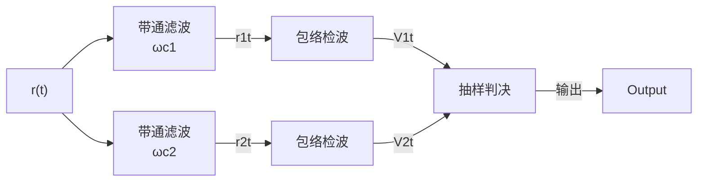
</details>

图 6.3.27 2FSK 信号的包络检波解调

(b) 假定对第 $n$ 个码元发送的是信号 $s_2(t)$ ，此时相应地得到

$$
V _ {1} (t) = \sqrt {n _ {\mathrm{cl}} ^ {2} (t) + n _ {s 1} ^ {2} (t)} \tag {6.3.174}
$$

$$
V _ {2} (t) = \sqrt {\left(a + n _ {\mathrm{c2}} (t)\right) ^ {2} + n _ {s 2} ^ {2} (t)} \tag {6.3.175}
$$

同理可得第 $n$ 个码元发生错误判决的概率为

$$
P _ {\mathrm{E2}} = \mathrm{Pr} (V _ {2} <   V _ {1}) = \int_ {0} ^ {\infty} p (V _ {2}) \int_ {V _ {1} = V _ {2}} ^ {\infty} p (V _ {1}) \mathrm{d} V _ {1} \mathrm{d} V _ {2} = \frac {1}{2} \exp \left(- \frac {a ^ {2}}{4 \sigma_ {n} ^ {2}}\right) \tag {6.3.176}
$$

综上，总的误码率为

$$
P _ {\mathrm{E}} = P (s _ {1}) P _ {\mathrm{E1}} + P (s _ {2}) P _ {\mathrm{E2}} = \frac {1}{2} \exp \left(- \frac {a ^ {2}}{4 \sigma_ {n} ^ {2}}\right) \tag {6.3.177}
$$

通常，带通滤波器的带宽为信号的主瓣宽度，即 $W = 2 / T$ ，相应的通过带通滤波器的噪声功率为 $\sigma_{n}^{2} = WN_{0} = 2N_{0} / T$ ， $E_{\mathrm{b}} = E_{s2} = E_{s1} = a^{2}T / 2$ ，代入上式得

$$
P _ {\mathrm{E}} = \frac {1}{2} \exp \left(- \frac {a ^ {2}}{4 \sigma_ {n} ^ {2}}\right) = \frac {1}{2} \exp \left(- \frac {E _ {\mathrm{b}}}{4 N _ {0}}\right) \tag {6.3.178}
$$

## 6.3.5 二进制调制解调系统的性能比较

前面详细地分析了 2ASK, 2PSK, 2DPSK 和 2FSK 等二进制调制解调系统的工作原理，表 6.3.1 归纳了各种不同方法在信号主瓣所占的带宽和误码性能的计算公式。图 6.3.28 给出的曲线则比较了不同调制解调方法误码性能。

表 6.3.1 不同调制解调方式的性能比较

| 调制方式 | 信号带宽 | 解调方式 | 误码率 |
|---|---|---|---|
| 2ASK(OOK) | $W_{2ASK} = 2W_B$ | 相关解调 | $P_E = Q\left(\sqrt{\frac{E_b}{N_0}}\right)$ |
| 相干解调 | $P_E = Q\left(\sqrt{\frac{E_b}{2N_0}}\right)$ |  |  |
| 包络检波解调 | $P_E = \frac{1}{2} \exp\left(-\frac{E_b}{4N_0}\right)$ |  |  |
| 2PSK | $W_{2PSK} = 2W_B$ | 相关解调 | $P_E = Q\left(\sqrt{\frac{2E_b}{N_0}}\right)$ |
| 相干解调 | $P_E = Q\left(\sqrt{\frac{E_b}{N_0}}\right)$ |  |  |
| 2DPSK | $W_{2DPSK} = 2W_B$ | 相关解调或相干解调 | $P_{E,2DPSK} = 2(1 - P_E)P_E$ ( $P_E$ 为2PSK信号的误码率) |
| 差分相干解调 | $P_E = \frac{1}{2} \exp\left(-\frac{E_b}{2N_0}\right)$ |  |  |
| 2FSK | $W_{2FSK} = 3W_{B}$ (取两载波频率之差为 $W_{B}$ 时) | 相关解调 | $P_{E} = Q\left(\sqrt{\frac{E_{b}}{N_{0}}}\right)$ |
| 相干解调 | $P_{E} = Q\left(\sqrt{\frac{E_{b}}{2N_{0}}}\right)$ |  |  |
| 包络检波解调 | $P_{E} = \frac{1}{2} \exp\left(-\frac{E_{b}}{4N_{0}}\right)$ |  |  |

注： $W_{B}$ 表示基带信号带宽。


<details>
<summary>line</summary>

| Eb/N0 (dB) | 2ASK包络检波解调 | 2FSK包络检波解调 | 2ASK相干解调, 2FSK相干解调 | 2DPSK差分相干解调 | 2DPSK相干解调 | 2ASK相关解调, 2FSK相关解调, 2PSK相干解调 | 2DPSK相关解调 | 2PSK相关解调 |
| --- | --- | --- | --- | --- | --- | --- | --- | --- |
| -10 | ~0.4 | ~0.35 | ~0.3 | ~0.25 | ~0.2 | ~0.15 | ~0.1 | ~0.05 |
| 0 | ~0.35 | ~0.3 | ~0.25 | ~0.2 | ~0.15 | ~0.1 | ~0.05 | ~0.02 |
| 5 | ~0.2 | ~0.15 | ~0.1 | ~0.08 | ~0.05 | ~0.02 | ~0.01 | ~0.005 |
| 10 | ~0.05 | ~0.02 | ~0.01 | ~0.005 | ~0.002 | ~0.001 | ~0.0005 | ~0.0002 |
| 15 | ~0.005 | ~0.002 | ~0.001 | ~0.0005 | ~0.0002 | ~0.0001 | ~0.00005 | ~0.00002 |
</details>

图 6.3.28 不同调制解调方法的误码性能比较

## 6.4 多进制数字载波调制传输系统

以上详细讨论了二进制数字载波调制解调系统的原理及性能，下面将讨论多进制数字调制系统。在实际的数字通信系统中，二进制和多进制数字调制都是常用的工作方式。多进制数字调制利用多进制数字基带信号去调制载波的幅度、频率或相位。因此，相应地有多进制数字幅度调制、多进制数字频率调制以及多进制数字相位调制等三种基本方式，此外在多进制载波调制传输系统中，通常还会同时调制载波信号的幅度和相位，以充分利用相幅平面的信号空间。

在二进制系统中，码元速率等于比特率，码元周期等于比特周期。而在多进制系统中码元周期与比特周期、码元速率与比特率之间的关系，与进制数有关。在本节中，为区分这些参数，特别用符号的下标加以说明： $R_{b}$ 表示比特率， $T_{b}=1/R_{b}$ 表示比特周期； $R_{S}$ 表示码元速率， $T_{S}=1/R_{S}$ 表示码元周期。

多进制系统的进制数用 $M$ 表示，通常取 $M = 2^{k}$ ，其中 $k$ 是正整数。由此，一个 $M$ 进制的码元，可以携带 $k = \mathrm{lb}M$ 比特的信息。

多进制数字载波调制最大的特点是，一个码元符号可以携带更多的比特信息，例如，四进制系统的每个码元符号可以携带2比特信息；八进制系统的每个符号可以携带3比特信息。因此对于相同的比特率，多进制系统的码元速率比二进制系统的码元速率要低。在第1章中，曾经给出M进制系统码元速率 $R_{s}$ 与其比特率 $R_{b}$ 之间的一般关系：

$$
R _ {\mathrm{b}} = R _ {\mathrm{S}} \mathrm{lb} M \tag {6.4.1}
$$

由此可见，在相同的码元速率下，多进制系统的比特率比二进制系统的高；或者说，在相同的比特率下，多进制码元速率比二进制的低。数字载波调制信号的频带宽度很大程度上取决于码元速率，除了多进制数字载波频率调制系统，一般来说，多进制系统都会比二进制系统有更高的频带利用率。

图 6.4.1 给出了一个十六进制调制系统与其相应基带信号两者的功率谱特性，显然十六进制系统所需的带宽仅约为二进制系统的 1/4。


<details>
<summary>flowchart</summary>


</details>

图 6.4.1 十六进制调制系统的结构及其功率谱特性

本节主要讨论多进制幅度键控（MASK）、多进制移相键控（MPSK）、多进制正交幅度调制（MQAM）和多进制移频键控（MFSK）等几种典型多进制数字载波调制传输系统的原理及误码率性能。

在基带传输系统中的讨论已知，满足无码间串扰的基带传输系统的频带利用率 $\eta_{\mathrm{B}}$ 为

$$
\eta_ {\mathrm{B}} = \frac {R _ {\mathrm{b}}}{W _ {\mathrm{B}}} = \frac {R _ {\mathrm{S}} \mathrm{lb} M}{W _ {\mathrm{B}}} = \frac {2}{1 + \alpha} \mathrm{lb} M (\mathrm{bit/s/Hz}) \tag {6.4.2}
$$

式中， $W_{B}$ 为基带系统的带宽， $\alpha$ 为滚降系数。在 MASK, MPSK 和 MQAM 等系统中，数字载波调制信号均是双边带信号，若记 $W_{\mathrm{C}}(W_{\mathrm{C}} = 2W_{\mathrm{B}})$ 为上述载波调制信号的带宽，则相应地有

$$
\eta_ {\mathrm{C}} = \frac {R _ {\mathrm{b}}}{W _ {\mathrm{C}}} = \frac {R _ {\mathrm{S}} \mathrm{lb} M}{W _ {\mathrm{C}}} = \frac {1}{1 + \alpha} \mathrm{lb} M = \frac {1}{2} \eta_ {\mathrm{B}} \tag {6.4.3}
$$

即频带利用率将为基带信号的 1/2。由上式可见，随着进制数 M 的增大，频带利用率 $\eta_{C}$ 将相应地增大。但在一个实际系统中，M 的增大通常会受到信道条件和信噪比大小等因素的制约。图 6.4.2 给出了 M 取不同值、信号功率为一定值时的 MPSK 信号的星座图。图中用 $V_{n}$ 表示噪声容限，噪声容限 $V_{n}$ 等于两星座点间的最小距离，即最近的两星座点间距离的 1/2，显然当 M 增大时， $V_{n}$ 的取值将相应地减小，说明其抗噪声（抗误码）性能下降。因此对于给定信号功率大小和噪声容限要求的场合，M 的取值不能够任意地增大。

  
图 6.4.2 不同 M 取值的 MPSK 系统的噪声容限

现代数字通信系统，通常都具备可根据信道特性和噪声大小动态调整调制进制数的自适应功能，以最大限度地利用频谱的资源。

## 6.4.1 信号统计判决的基本原理

前面我们在详细讨论二进制数字载波调制解调系统时，主要采用的是传统的分析方法，这有利于对数字信号的发送与接收过程有较为形象的认识和理解。介绍多进制数字载波之前，首先讨论信号的统计判决的基本原理。在现代通信系统中，数字信号处理技术被大量地引入通信系统的信号收发处理，信号的接收许多过程，都可在数字信号处理器或计算机中实现，其中的基本理论与技术，就是信号的统计判决原理。

信号空间的基本概念 数字通信系统中的信号集，通常可视为由一组基向量构成的信号空间中的元素。在本章中所说的信号，通常是指持续一个码元周期的某种信号波形。由第2章的分析，N维信号空间中的标准正交基函数 $\left\{\Psi_{k}(t),k=1,2,\cdots,N\right\}$ 具有如下特点：

$$
\left\langle \Psi_ {i} (t), \Psi_ {j} (t) \right\rangle = \int_ {0} ^ {T _ {\mathrm{S}}} \Psi_ {i} (t) \Psi_ {j} (t) \mathrm{d} t = \left\{ \begin{array}{l l} 1, & i = j \\ 0, & i \neq j \end{array} \right. \tag {6.4.4}
$$

该信号空间中的任何一个信号，均可用基函数的线性组合来表示。对于 M 进制系统，发送端在任码元周期内发送的信号，是信号集 $\{s_{m}(t)\}$ ， $m=1,2,\cdots,M$ ， $t\in[0,T]$ 中的某个信号，信号集中的任一信号均可以表示为

$$
s _ {m} (t) = s _ {m 1} \Psi_ {1} (t) + s _ {m 2} \Psi_ {2} (t) + \dots + s _ {m N} \Psi_ {N} (t) = \sum_ {i = 1} ^ {N} s _ {m i} \Psi_ {i} (t) \tag {6.4.5}
$$

其中的系数为

$$
s _ {m i} = \int_ {0} ^ {T _ {\mathrm{S}}} s _ {m} (t) \Psi_ {i} (t) \mathrm{d} t, i = 1, 2, \dots , N \tag {6.4.6}
$$

因此，当基函数 $\left\{\Psi_{k}(t)\right\}$ 确定后，信号 $s_{m}(t), m=1,2,\cdots,M$ 可由其系数向量

$$
S _ {m} = \left[ s _ {m 1}, s _ {m 2}, \dots , s _ {m N} \right] ^ {\mathrm{T}}, m = 1, 2, \dots , M \tag {6.4.7}
$$

唯一确定，其中信号的能量与信号的系数向量间有如下关系：

$$
E _ {m} = \int_ {0} ^ {T _ {\mathrm{S}}} s _ {m} ^ {2} (t) \mathrm{d} t = \int_ {0} ^ {T _ {\mathrm{S}}} \left[ \sum_ {i = 1} ^ {N} s _ {m i} \Psi_ {i} (t) \right] ^ {2} \mathrm{d} t = \sum_ {i = 1} ^ {N} s _ {m i} ^ {2}, m = 1, 2, \dots , M \tag {6.4.8}
$$

信号间的相关系数 定义信号集 $\{s_m(t)\}$ 中任意两个信号间的相关系数为

$$
\begin{array}{l} \rho_ {m k} = \frac {1}{\sqrt {E _ {m}} \sqrt {E _ {k}}} \int_ {0} ^ {T _ {S}} s _ {m} (t) s _ {k} (t) \mathrm{d} t = \frac {1}{\sqrt {E _ {m} E _ {k}}} \int_ {0} ^ {T _ {S}} \left(\sum_ {i = 1} ^ {N} s _ {m i} \Psi_ {i} (t)\right) \left(\sum_ {j = 1} ^ {N} s _ {k j} \Psi_ {j} (t)\right) \mathrm{d} t \\ = \frac {1}{\sqrt {E _ {m} E _ {k}}} \int_ {0} ^ {T _ {\mathrm{S}}} \left(\sum_ {i = 1} ^ {N} \sum_ {j = 1} ^ {N} S _ {m i} S _ {k j} \Psi_ {i} (t) \Psi_ {j} (t)\right) \mathrm{d} t = \frac {1}{\sqrt {E _ {m} E _ {k}}} \sum_ {i = 1} ^ {N} \sum_ {j = 1} ^ {N} S _ {m i} S _ {k j} \int_ {0} ^ {T _ {\mathrm{S}}} \Psi_ {i} (t) \Psi_ {j} (t) \mathrm{d} t \tag {6.4.9} \\ = \frac {1}{\sqrt {E _ {m} E _ {k}}} \sum_ {i = 1} ^ {N} S _ {m i} S _ {k i} = \frac {S _ {m} \cdot S _ {k}}{\sqrt {E _ {m} E _ {k}}} \\ \end{array}
$$

两信号间的相关系数等于其相应的系数向量的点积的 $\sqrt{E_{m}E_{k}}$ 归一化值。

信号间的距离 定义信号集中两信号 $s_m(t)$ 和 $s_k(t)$ 间的欧氏距离为

$$
d _ {m k} = \left\{\int_ {0} ^ {T _ {\mathrm{S}}} \left[ s _ {m} (t) - s _ {k} (t) \right] ^ {2} \mathrm{d} t \right\} ^ {1 / 2} \tag {6.4.10}
$$

由式（6.4.9），展开式（6.4.10）可得

$$
\begin{array}{l} d _ {m k} = \left\{\int_ {0} ^ {T _ {\mathrm{S}}} \left(s _ {m} (t) - s _ {k} (t)\right) ^ {2} \mathrm{d} t \right\} ^ {1 / 2} = \left\{\int_ {0} ^ {T _ {\mathrm{S}}} \left(s _ {m} ^ {2} (t) - 2 s _ {m} (t) s _ {k} (t) + s _ {k} ^ {2} (t)\right) \mathrm{d} t \right\} ^ {1 / 2} \\ = \left\{\int_ {0} ^ {T _ {\mathrm{S}}} s _ {m} ^ {2} (t) \mathrm{d} t + \int_ {0} ^ {T _ {\mathrm{S}}} s _ {k} ^ {2} (t) \mathrm{d} t - 2 \int_ {0} ^ {T _ {\mathrm{S}}} s _ {m} (t) s _ {k} (t) \mathrm{d} t \right\} ^ {1 / 2} \tag {6.4.11} \\ = \left(E _ {m} + E _ {k} - 2 \sqrt {E _ {m} E _ {k}} \rho_ {m k}\right) ^ {1 / 2} = \left(E _ {m} + E _ {k} - 2 \boldsymbol {S} _ {m} \cdot \boldsymbol {S} _ {k}\right) ^ {1 / 2} \\ \end{array}
$$

（1）若两信号正交，即其两个信号间的相关系数为0， $\int_0^{T_S}s_m(t)s_k(t)\mathrm{d}t = 0$ （ $S_{m}\cdot S_{k} = 0$ ），则有

$$
d _ {m k} = \left(E _ {m} + E _ {k}\right) ^ {1 / 2} \tag {6.4.12}
$$

特别地，如果两信号的能量相同，即 $E_{m}=E_{k}$ ，则有

$$
d _ {m k} = \sqrt {2 E _ {m}} \tag {6.4.13}
$$

（2）若两信号间是一种对极关系，即 $s_m(t) = -s_k(t)$ ，容易证明，此时有 $E_{m} = E_{k}$ ，其相关系数

$$
\rho_ {m k} = \frac {1}{\sqrt {E _ {m}} \sqrt {E _ {k}}} \int_ {0} ^ {T _ {\mathrm{S}}} s _ {m} (t) s _ {k} (t) \mathrm{d} t = - \frac {1}{E _ {m}} \int_ {0} ^ {T _ {\mathrm{S}}} s _ {m} ^ {2} (t) \mathrm{d} t = - 1 \tag {6.4.14}
$$

两信号间的距离

$$
d _ {m k} = \left\{\int_ {0} ^ {T _ {\mathrm{S}}} \left(s _ {m} (t) - \left(- s _ {m} (t)\right)\right) ^ {2} \mathrm{d} t \right\} ^ {1 / 2} = \left\{\int_ {0} ^ {T _ {\mathrm{S}}} 4 s _ {m} ^ {2} (t) \mathrm{d} t \right\} ^ {1 / 2} = 2 \sqrt {E _ {m}} \tag {6.4.15}
$$

另外，由式（6.4.11），还可导出两信号间的距离与其系数向量间的关系：

$$
\begin{array}{l} d _ {m k} = \left(E _ {m} + E _ {k} - 2 \boldsymbol {S} _ {m} \cdot \boldsymbol {S} _ {k}\right) ^ {1 / 2} = \left(\sum_ {i = 1} ^ {N} s _ {m i} ^ {2} + \sum_ {i = 1} ^ {N} s _ {k i} ^ {2} - 2 \sum_ {i = 1} ^ {N} s _ {m i} s _ {k i}\right) ^ {1 / 2} \tag {6.4.16} \\ = \left(\sum_ {i = 1} ^ {N} \left(s _ {m i} ^ {2} - 2 s _ {m i} s _ {k i} + s _ {k i} ^ {2}\right)\right) ^ {1 / 2} = \left(\sum_ {i = 1} ^ {N} \left(s _ {m i} - s _ {k i}\right) ^ {2}\right) ^ {1 / 2} = \left| \boldsymbol {S} _ {m} - \boldsymbol {S} _ {k} \right| \\ \end{array}
$$

可见，在引入信号的标准正交基的情况下，两信号间的距离与普通代数学中的向量空间中两向量间的距离建立起了一一对应的关系。

由图 6.4.2 可见，在信号集中，任两信号间的最小距离的 1/2 等于该信号集的噪声容限，因此信号集中的两信号间的最小距离，决定了该信号抗噪声干扰的性能。

统计判决的基本概念 统计判决的基本思想是寻求在概率上使差错达到最小意义上的最佳接收方法。一般假定发送符号的先验概率已知，即 $\left\{S_{i}, P(S_{i}); i=1,2,\cdots,M\right\}$ 已经确定。根据第 4 章 4.6 节的分析，一般情况下，根据最大后验概率判决（MAP）准则，可达到差错概率最小意义上的最佳接收效果。

最大后验概率判决（MAP）准则 若已知接收信号的后验概率

$$
P (S _ {i} \mid r), \quad i = 1, 2, \dots , M \tag {6.4.17}
$$

及接收信号的概率密度函数 $p(r)$ ，可得最大后验概率判决准则

$$
\hat {S} = \arg \max _ {S _ {i} \in \{S \}} P (S _ {i} \mid r) p (r), \quad i = 1, 2, \dots , M \tag {6.4.18}
$$

一般来说, 接收信号的后验概率 $P(S_{i} \mid r), i = 1,2,\dots,M$ 和其概率密度函数 $p(r)$ , 都不容易确定。此时可采用最大似然判决 (ML) 准则来寻求最佳的接收效果。

最大似然判决（ML）准则 根据概率论的基本关系式

$$
p (r, S _ {i}) = P (S _ {i} \mid r) p (r) = P (S _ {i}) p (r \mid S _ {i}), \quad i = 1, 2, \dots , M \tag {6.4.19}
$$

最大后验概率判决准则所进行的对 $P(S_{i} \mid r)p(r), i=1,2,\cdots,M$ 的判决，可由对 $P(S_{i})p(r \mid S_{i}), i=1,2,\cdots,M$ 的判决替代，式中 $p(r \mid S_{i})$ 是关于 $S_{i}, i=1,2,\cdots,M$ 的似然函数。

设与发送符号集 $\left\{S_{i}, i=1,2,\cdots,M\right\}$ 对应的发送信号集为 $\left\{s_{i}(t), i=1,2,\cdots,M\right\}$ ，信号集中的每个信号，持续的时间一般为一个码元周期 $T_{S}$ 。相应地，接收信号为

$$
r (t) = s _ {i} (t) + n _ {\mathrm{W}} (t), \quad i = 1, 2, \dots , M \tag {6.4.20}
$$

其中 $n_{\mathrm{W}}(t)$ 为高斯白噪声。若已知各个信号的似然函数 $p(r\mid S_i), i = 1,2,\dots ,M$ ，则最大似然判决准则为

$$
\hat {S} = \arg \max _ {S _ {i} \in \{S \}} P (S _ {i}) p (r \mid S _ {i}) \tag {6.4.21}
$$

具体的判决操作过程是：在判决时刻 $t'$ ，根据所获得的样值 $r = r(t')$ ，计算所有信号集中所有似然函数 $p(r \mid S_i), S_i \in \{S\}$ 的取值，然后搜索 $P(S_i)p(r \mid S_i), S_i \in \{S\}$ 的最大值，选择使该式达到最大值所对应的符号 $S_i$ ，判决接收的信号为 $\hat{S} = S_i$ 。特别地，若发送的码元信号先验等概，即满足条件

$$
P (s _ {i}) = 1 / M, i = 1, 2, \dots , M \tag {6.4.22}
$$

时，最大似然判决的准则可以简化为

$$
\hat {S} = \arg \max _ {S _ {i} \in \{S \}} p (r \mid S _ {i}) \tag {6.4.23}
$$

M 进制信号的最佳接收方法 如果没有特别说明，均假定发送的信号先验等概，根据最大似然判决（ML）准则，可以得到一般的 M 进制信号的误码最小意义上的最佳接收方法。

设发送信号为

$$
s (t) = \sum_ {i = 1} ^ {N} s _ {i} \Psi_ {i} (t) \tag {6.4.24}
$$

式中 $\left\{\Psi_{k}(t), k=1,2,\cdots,N\right\}$ 是 N 维信号空间中的一组标准正交基函数。接收信号相应地可以表示为

$$
r (t) = s (t) + n _ {\mathrm{W}} (t) = \sum_ {i = 1} ^ {N} s _ {i} \Psi_ {i} (t) + n _ {\mathrm{W}} (t) \tag {6.4.25}
$$

最佳接收系统的基本原理如图 6.2.5 所示，结合本节的符号，这里把它重新用图 6.4.3 表示。

$$
\begin{array}{l} r _ {i} = \int_ {0} ^ {T _ {\mathrm{S}}} r (t) \Psi_ {i} (t) \mathrm{d} t = \int_ {0} ^ {T _ {\mathrm{S}}} [ s (t) + n _ {\mathrm{W}} (t) ] \Psi_ {i} (t) \mathrm{d} t = \int_ {0} ^ {T _ {\mathrm{S}}} s (t) \Psi_ {i} (t) \mathrm{d} t + \int_ {0} ^ {T _ {\mathrm{S}}} n _ {\mathrm{W}} (t) \Psi_ {i} (t) \mathrm{d} t \tag {6.4.26} \\ = \int_ {0} ^ {T _ {\mathrm{S}}} \left(\sum_ {k = 1} ^ {N} s _ {k} \Psi_ {k} (t)\right) \Psi_ {i} (t) \mathrm{d} t + \int_ {0} ^ {T _ {\mathrm{S}}} n _ {\mathrm{W}} (t) \Psi_ {i} (t) \mathrm{d} t = s _ {i} + n _ {i}, \quad i = 1, 2, \dots , N \\ \end{array}
$$


<details>
<summary>flowchart</summary>

```mermaid
graph LR
  r["r(t)"] --> Sum1((×))
  Sum1 --> Sum2((×))
  Sum2 --> Sum3((×))
  Sum3 --> Sum4((×))
  Sum4 --> Sum5((×))
  Sum5 --> Sum6((×))
  Sum6 --> Sum7((×))
  Sum7 --> Sum8((×))
  Sum8 --> Sum9((×))
  Sum9 --> Sum10((×))
  Sum10 --> Sum11((×))
  Sum11 --> Sum12((×))
  Sum12 --> Sum13((×))
  Sum13 --> Sum14((×))
  Sum14 --> Sum15((×))
  Sum15 --> Sum16((×))
  Sum16 --> Sum17((×))
  Sum17 --> Sum18((×))
  Sum18 --> Sum19((×))
  Sum19 --> Sum20((×))
  Sum20 --> Sum21((×))
  Sum21 --> Sum22((×))
  Sum22 --> Sum23((×))
  Sum23 --> Sum24((×))
  Sum24 --> Sum25((×))
  Sum25 --> Sum26((×))
  Sum26 --> Sum27((×))
  Sum27 --> Sum28((×))
  Sum28 --> Sum29((×))
  Sum29 --> Sum30((×))
  Sum30 --> Sum31((×))
  Sum31 --> Sum32((×))
  Sum32 --> Sum33((×))
  Sum33 --> Sum34((×))
  Sum34 --> Sum35((×))
  Sum35 --> Sum36((×))
  Sum36 --> Sum37((×))
  Sum37 --> Sum38((×))
  Sum38 --> Sum39((×))
  Sum39 --> Sum40((×))
  Sum40 --> Sum41((×))
  Sum41 --> Sum42((×))
  Sum42 --> Sum43((×))
  Sum43 --> Sum44((×))
  Sum44 --> Sum45((×))
  Sum45 --> Sum46((×))
  Sum46 --> Sum47((×))
  Sum47 --> Sum48((×))
  Sum48 --> Sum49((×))
  Sum49 --> Sum50((×))
  Sum50 --> Sum51((×))
  Sum51 --> Sum52((×))
  Sum52 --> Sum53((×))
  Sum53 --> Sum54((×))
  Sum54 --> Sum55((×))
  Sum55 --> Sum56((×))
  Sum56 --> Sum57((×))
  Sum57 --> Sum58((×))
  Sum58 --> Sum59((×))
  Sum59 --> Sum60((×))
  Sum60 --> Sum61((×))
  Sum61 --> Sum62((×))
  Sum62 --> Sum63((×))
  Sum63 --> Sum64((×))
  Sum64 --> Sum65((×))
  Sum65 --> Sum66((×))
  Sum66 --> Sum67((×))
  Sum67 --> Sum68((×))
  Sum68 --> Sum69((×))
  Sum69 --> Sum70((×))
  Sum70 --> Sum71((×))
  Sum71 --> Sum72((×))
  Sum72 --> Sum73((×))
  Sum73 --> Sum74((×))
  Sum74 --> Sum75((×))
  Sum75 --> Sum76((×))
  Sum76 --> Sum77((×))
  Sum77 --> Sum78((×))
  Sum78 --> Sum79((×))
  Sum79 --> Sum80((×))
  Sum80 --> Sum81((×))
  Sum81 --> Sum82((×))
  Sum82 --> Sum83((×))
  Sum83 --> Sum84((×))
  Sum84 --> Sum85((×))
  Sum85 --> Sum86((×))
  Sum86 --> Sum87((×))
  Sum87 --> Sum88((×))
  Sum88 --> Sum89((×))
  Sum89 --> Sum90((×))
  Sum90 --> Sum91((×))
  Sum91 --> Sum92((×))
  Sum92 --> Sum93((×))
  Sum93 --> Sum94((×))
  Sum94 --> Sum95((×))
  Sum95 --> Sum96((×))
  Sum96 --> Sum97((×))
  Sum97 --> Sum98((×))
  Sum98 --> Sum99((×))
  Sum99 --> Sum100((×))
  Sum100 --> Sum11((×))
  Sum11 --> Sum12((×))
  Sum12 --> Sum13((×))
  Sum13 --> Sum14((×))
  Sum14 --> Sum15((×))
  Sum15 --> Sum16((×))
  Sum16 --> Sum17((×))
  Sum17 --> Sum18((×))
  Sum18 --> Sum19((×))
  Sum18 --> Sum20((×))
  Sum20 --> Sum21((×))
  Sum21 --> Sum22((×))
  Sum22 --> Sum23((×))
  Sum23 --> Sum24((×))
  Sum24 --> Sum25((×))
  Sum25 --> Sum26((×))
  Sum26 --> Sum27((×))
  Sum27 --> Sum28((×))
  Sum28 -.-> Sum29((×))
  Sum29 --> Sum30((×))
  Sum30 --> Sum31((×))
  Sum31 --> Sum32((×))
  Sum32 --> Sum33((×))
  Sum33 --> Sum34((×))
  Sum34 --> Sum35((×))
  Sum35 --> Sum36((×))
  Sum36 --> Sum37((×))
  Sum37 --> Res1((×))
  Sum37 --> Res2((×))
  Sum37 --> Res3((×))
  Res1 --> Sum1
  Res2 --> Sum2
  Res3 --> Sum3
  Res4 --> Sum4
  Res5 --> Sum5
  Res6 --> Sum6
  Res7 --> Sum7
  Res8 --> Sum8
  Res9 --> Sum9
  Res10 --> Sum11
  Res11 --> Sum12
  Res12 --> Sum13
  Res13 --> Sum14
  Res14 --> Sum15
  Res15 --> Sum16
  Res16 --> Sum17
  Res17 --> Sum18
  Res18 --> Sum19
  Res19 --> Sum20
  Res20 --> Sum21
  Res21 --> Sum22
  Res22 --> Sum23
  Res23 --> Sum24
  Res24 --> Sum25
  Res25 --> Sum26
  Res26 --> Sum27
  Res27 --> Sum28
  Res28 --> Sum29
  Res29 --> Sum30
  Res30 --> Sum31
  Res31 --> Sum32
  Res32 --> Sum33
  Res33 --> Sum34
  Res34 --> Sum35
  Res35 --> Sum36
  Res36 --> Sum37
  Res37 --> Sum38
  Res38 --> Sum39
  Res39 --> Sum40
  Res40 --> Sum41
  Res41 --> Sum42
  Res42 --> Sum43
  Res43 --> Sum44
  Res44 --> Sum45
  Res45 --> Sum46
  Res46 --> Sum47
  Res47 --> Sum48
  Res48 --> Sum49
  Res49 --> Sum50
  Res50 --> Sum51
  Res51 --> Sum52
  Res52 --> Sum53
  Res53 --> Sum54
  Res54 --> Sum55
  Res55 --> Sum56
  Res56 --> Sum57
  Res57 --> Sum58
  Res58 --> Sum59
  Res59 --> Sum60
  Res60 --> Sum61
  Res61 --> Sum62
  Res62 --> Sum63
  Res63 --> Sum64
  Res64 --> Sum65
  Res65 --> Sum66
  Res66 --> Sum67
  Res67 --> Sum68
  Res68 --> Sum69
  Res69 --> Sum70
  Res70 --> Sum71
  Res71 --> Sum72
  Res72 --> Sum73
  Res73 --> Sum74
  Res74 --> Sum75
  Res75 --> Sum76
  Res76 --> Sum77
  Res77 --> Sum78
  Res78 --> Sum79
  Res79 --> Sum80
  Res80 --> Sum81
  Res81 --> Sum82
  Res82 --> Sum83
  Res83 --> Sum84
  Res84 --> Sum85
  Res85 --> Sum86
  Res86 --> Sum87
  Res87 --> Sum88
  Res88 --> Sum89
  Res89 --> Sum90
  Sum90 --> Sum91
  Sum91 --> Sum92
  Sum92 --> Sum93
  Sum93 --> Sum94
  Sum94 --> Sum95
  Sum95 --> Sum96
  Sum96 --> Sum97
  Sum97 --> Sum98
  Sum98 --> Sum99
  Sum99 --> Sum100
  Sum100 --> Final["最佳判决"]
  Sum100 --> Final
```
</details>

图 6.4.3 最佳接收原理

式中 $s_{i}=\int_{0}^{T_{S}}s(t)\Psi_{i}(t)\mathrm{d}t,\ n_{i}=\int_{0}^{T_{S}}n_{\mathrm{W}}(t)\Psi_{i}(t)\mathrm{d}t$ 。其中 $n_{i}$ 是高斯白噪声通过关于 $\Psi_{i}(t)$ 的匹配滤波器系统在抽样时刻的取值，因此是高斯随机变量，其均值为 0；而其方差的确定可直接利用式（6.3.35）的结果，因为基向量 $\Psi_{i}(t)$ 是能量 $E_{\Psi_{i}}=1$ 的信号，可得

$$
\sigma_ {n i} ^ {2} = \frac {N _ {0}}{2} E _ {\psi_ {i}} = \frac {N _ {0}}{2} \tag {6.4.27}
$$

由此可得，高斯随机变量 $r_i$ 的分布特性由发送的符号 $s_i(t)$ 对应的向量 $\boldsymbol{S} = [s_1, s_2, \dots, s_N]^{\mathrm{T}}$ 中的第 $i$ 个分量 $s_i$ 及 $n_i$ 的方差 $\sigma_{ni}^2$ 确定，即有

$$
p (r _ {i} \mid s _ {i}) = \frac {1}{\sqrt {2 \pi \sigma_ {n i} ^ {2}}} \exp \left(- \frac {(r _ {i} - s _ {i}) ^ {2}}{2 \sigma_ {n i} ^ {2}}\right) = \frac {1}{\sqrt {\pi N _ {0}}} \exp \left(- \frac {(r _ {i} - s _ {i}) ^ {2}}{N _ {0}}\right) \tag {6.4.28}
$$

因为 $r_i, i = 1,2,\dots,M$ 相互间统计独立，可得收到 $r(t)$ 后， $r(t)$ 关于信号集中 $s_m(t)$ 的似然函数为

$$
\begin{array}{l} p (r \mid S _ {m}) = p (r _ {1} r _ {2} \dots r _ {N} \mid s _ {m 1} s _ {m 2} \dots s _ {m N}) = p (r _ {1} \mid s _ {m 1}) p (r _ {2} \mid s _ {m 2}) \dots p (r _ {N} \mid s _ {m N}) \\ = \prod_ {i = 1} ^ {N} p (r _ {i} \mid s _ {m i}) = \prod_ {i = 1} ^ {N} \frac {1}{\sqrt {\pi N _ {0}}} \exp \left(- \frac {(r _ {i} - s _ {m i}) ^ {2}}{N _ {0}}\right), m = 1, 2, \dots , M \tag {6.4.29} \\ \end{array}
$$

因为似然函数取对数后并不会改变其取值大小的相对位置关系，即有

$$
\max _ {S _ {m} \in \{S \}} p (r \mid S _ {m}) \leftrightarrow \max _ {S _ {m} \in \{S \}} \ln p (r \mid S _ {m}) \tag {6.4.30}
$$

对式（6.4.29）取对数可得

$$
\begin{array}{l} \ln p (r \mid S _ {m}) = \ln \left(\prod_ {i = 1} ^ {N} \frac {1}{\sqrt {\pi N _ {0}}} \exp \left(- \frac {(r _ {i} - s _ {m i}) ^ {2}}{N _ {0}}\right)\right) \tag {6.4.31} \\ = \ln \left(\frac {1}{\sqrt {\pi N _ {0}}}\right) ^ {N} - \frac {1}{N _ {0}} \sum_ {i = 1} ^ {N} \left(r _ {i} - s _ {m i}\right) ^ {2}, m = 1, 2, \dots , M \\ \end{array}
$$

由此可得

$$
\max _ {S _ {m} \in \{S \}} p (r \mid S _ {m}) \leftrightarrow \max _ {S _ {m} \in \{S \}} \ln p (r \mid S _ {m}) \leftrightarrow \min _ {S _ {m} \in \{S \}} \sum_ {i = 1} ^ {N} (r _ {i} - s _ {m i}) ^ {2} \tag {6.4.32}
$$

信号最佳接收的过程可以归纳为：（1）根据接收信号通过相关运算求相应的系数向量 $R=[r_{1},r_{2},\cdots,r_{N}]^{T}$ ;（2）将 R 与信号集中的每个信号的系数向量 $S_{m}=[s_{m1},s_{m2},\cdots,s_{mN}]^{T}$ ， $m=1,2,\cdots,M$ 进行比较，找出与其距离最小的系数向量，其所对应的符号就是最佳的接收判决输出。

下面具体讨论上述统计判决原理在各种不同的多进制载波调制传输系统中的应用。

## 6.4.2 MASK 调制解调系统

MASK 载波调制信号及频谱特性 MASK 是 2ASK（即 OOK）调制解调方式的推广，在 MASK 系统中，一个码元周期 $T_{s}$ 内根据所需传输的 k = lb M 比特二进制码组的不同取值，选择相应幅度的一个码元信号对载波进行调制。参见基带传输系统中有关单极性码与双极性码能量效率的有关分析，在 MASK 中，通常幅度取值也为双极性信号。一般地，MASK 信号可以表示为

$$
s _ {i} (t) = a _ {i} g _ {T} (t) \cos \omega_ {\mathrm{c}} t \tag {6.4.33}
$$

其中幅度加权值 $a_{i} = 2i - 1 - M, i = 1,2,\dots ,M$ 。可见 $M$ 个不同幅度的加权值 $a_{i}$ 具有双极性的特点，

$$
a _ {i} \in \{- (M - 1), - (M - 3), \dots , - 3, - 1, 1, 3, \dots , M - 3, M - 1 \} \tag {6.4.34}
$$

理论上， $a_{i}$ 幅度加权值也可以采用单极性的幅度信号，但在幅度间具有相同幅度差的条件下，其码元的能量效率相对较低。式（6.4.33）中 $g_{T}(t)$ ， $0 \leqslant t \leqslant T_{S}$ 是调制信号的波形函数，波形函数的能量为

$$
E _ {g} = \int_ {0} ^ {T _ {S}} g _ {T} ^ {2} (t) \mathrm{d} t \tag {6.4.35}
$$

MASK 信号只有载波幅度的变化，没有相位的变化，在 IQ 相幅平面上，信号的星座点分布在 I 轴上，是一种一维的信号，因此只有一个基函数，若定义基函数为

$$
\Psi_ {1} (t) = \sqrt {\frac {2}{E _ {g}}} g _ {T} (t) \cos \omega_ {\mathrm{c}} t \tag {6.4.36}
$$

则有

$$
\begin{array}{l} \int_ {0} ^ {T _ {\mathrm{S}}} \Psi_ {1} ^ {2} (t) \mathrm{d} t = \int_ {0} ^ {T _ {\mathrm{S}}} \left(\sqrt {\frac {2}{E _ {\mathrm{g}}}} g _ {T} (t) \cos \omega_ {\mathrm{c}} t\right) ^ {2} \mathrm{d} t = \int_ {0} ^ {T _ {\mathrm{S}}} \frac {2}{E _ {\mathrm{g}}} g _ {T} ^ {2} (t) \frac {1 + \cos 2 \omega_ {\mathrm{c}} t}{2} \mathrm{d} t \tag {6.4.37} \\ = \frac {1}{E _ {g}} \left(\int_ {0} ^ {T _ {\mathrm{S}}} g _ {T} ^ {2} (t) \mathrm{d} t + \int_ {0} ^ {T _ {\mathrm{S}}} g _ {T} ^ {2} (t) \cos 2 \omega_ {\mathrm{c}} t \mathrm{d} t\right) = 1 \\ \end{array}
$$

最后一个等式利用了 $E_{g}=\int_{0}^{T_{S}}g_{T}^{2}(t)\mathrm{d}t$ 和载波频率足够高时有 $\int_{0}^{T_{S}}g_{T}^{2}(t)\cos2\omega_{c}t\mathrm{d}t\approx0$ 的性质。可见（6.4.36）表示的是一个能量归一化的基函数。

若将 $s_{i}(t)$ , $i=1,2,\cdots,M$ 记为

$$
s _ {i} (t) = a _ {i} g _ {T} (t) \cos \omega_ {\mathrm{c}} t = s _ {i} \Psi_ {1} (t), i = 1, 2, \dots , M \tag {6.4.38}
$$

则有

$$
s _ {i} = \sqrt {\frac {E _ {g}}{2}} a _ {i}, i = 1, 2, \dots , M \tag {6.4.39}
$$

直接由式（6.4.16），可得任两码元信号 $s_{i}(t)$ , $s_{j}(t)$ ; $i, j \in \{1, 2, \cdots, M\}$ 间的距离

$$
d _ {i j} = \left| s _ {i} - s _ {j} \right| = \left| \sqrt {\frac {E _ {g}}{2}} a _ {i} - \sqrt {\frac {E _ {g}}{2}} a _ {j} \right| = \sqrt {\frac {E _ {g}}{2}} \left| a _ {i} - a _ {j} \right| \tag {6.4.40}
$$

观察式（6.4.33）和式（6.4.34）不难想象，MASK 信号可视为 M 个 OOK 信号叠加得到的结果，而多个信号频谱的叠加后信号的带宽与其中单个 OOK 信号的带宽相同，因此 MASK 的功率谱特性与 OOK 信号基本一样。

MASK 信号的调制方法 MASK 信号的调制实现方法如图 6.4.4 所示。首先将二进制的电平序列转变为 M 进制的电平序列，其电平值对码元的波形信号 $g_{T}(t)$ 的幅度进行加权，然后对载波信号 $\cos\omega_{c}t$ 调制，即可产生 MASK 信号。


<details>
<summary>flowchart</summary>

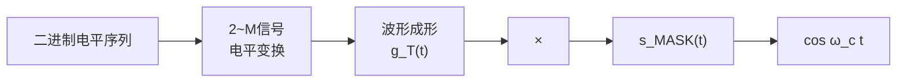
</details>

图 6.4.4 MASK 信号调制实现方法

MASK 信号的最佳接收 对于 MASK 信号，图 6.4.3 所示一般形式的最佳接收机此时变为一维的结构，如图 6.4.5 所示。相应地，式（6.4.29）给出的似然函数简化为

$$
p (r \mid s _ {i}) = \frac {1}{\sqrt {\pi N _ {0}}} \exp \left(- \frac {(r - s _ {i}) ^ {2}}{N _ {0}}\right), i = 1, 2, \dots , M \tag {6.4.41}
$$

相应地，最大似然的判决准则为

$$
\hat {s} = \arg \max _ {s _ {i} \in \{S \}} p (r \mid s _ {i}) = \arg \min _ {s _ {i} \in \{S \}} (r - s _ {i}) ^ {2} \tag {6.4.42}
$$

简单地说，就是将采样时刻相关器输出的值 r 与 $s_{i}=\sqrt{\frac{E_{g}}{2}}a_{i}, i=1,2,\cdots,M$ 进行比较，与其最接近的值作为判决输出。


<details>
<summary>flowchart</summary>

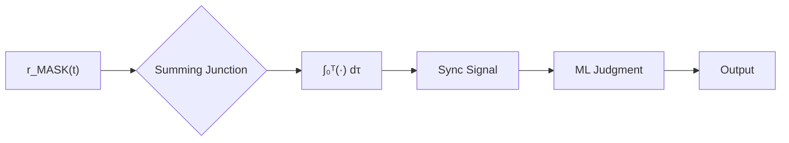
</details>

图 6.4.5 MASK 信号的相关解调器

MASK 最佳接收机的误码性能分析下面先分析 MASK 信号在 M=2 时的情形，这对应双极性的 2ASK 信号，实际上就是前面讨论过的 2PSK 信号。对于似然函数为高斯分布特性的情形，参照式（5.7.35），直接可得先验等概条件下的相关解调时的误码率

一般地为 $P_{\mathrm{E}} = Q((a_{1} - a_{2}) / 2\sigma)$ ，其中 $a_{1}, a_{2}$ 分别为两高斯分布函数的均值， $\sigma$ 为其标准差。由式（6.4.34）和式（6.4.39），可知 $r_{i} = s_{i} + n, i = 1, 2$ 的均值分别为

$$
s _ {i} = \sqrt {\frac {E _ {g}}{2}} a _ {i}, i = 1, 2 \rightarrow s _ {1} = - \sqrt {\frac {E _ {g}}{2}}, s _ {2} = \sqrt {\frac {E _ {g}}{2}} \tag {6.4.43}
$$

而方差则为

$$
\sigma^ {2} = N _ {0} / 2 \tag {6.4.44}
$$

相应地，其特性函数如图6.4.6所示。因此在 $M = 2$ 时，误码率为

$$
P _ {\mathrm{E}} = Q \left(\frac {a _ {1} - a _ {2}}{2 \sigma}\right) = Q \left(\frac {\sqrt {E _ {g} / 2} - \left(- \sqrt {E _ {g} / 2}\right)}{2 (\sqrt {N _ {0} / 2})}\right) = Q \left(\sqrt {\frac {E _ {g}}{N _ {0}}}\right) \tag {6.4.45}
$$

根据前面的讨论已知，误码率 $P_{E}$ 在数值上等于图 6.4.6 所示阴影部分面积的 1/2，因此图中阴影的面积 $S_{A}$ 为

$$
P _ {\mathrm{E}} = Q \left(\sqrt {\frac {E _ {\mathrm{g}}}{N _ {0}}}\right) = \frac {1}{2} S _ {A} \rightarrow S _ {A} = 2 Q \left(\sqrt {\frac {E _ {\mathrm{g}}}{N _ {0}}}\right) \tag {6.4.46}
$$


<details>
<summary>area</summary>

| p(r | s1) | \(1 / \sqrt{2\pi}\sigma exp(-(r-s1)^2 / 2\sigma^2)\) |
| --- | --- | --- |
| p(r | s2) | \(1 / \sqrt{2\pi}\sigma exp(-(r-s2)^2 / 2\sigma^2)\) |
</details>

图 6.4.6 M=2 时似然函数的分布特性

下面进一步分析 MASK 信号 M > 2 且 $M = 2^{k}$ ，k 为整数时的情形。当 M = 4 时 $p(r \mid s_{i})$ ，i = 1, 2, 3, 4 的分布特性如图 6.4.7 所示，其中各个高斯分布特性的均值由 $s_{i}$ ，i = 1, 2, 3, 4 决定，而形状由其方差 $\sigma^{2} = N_{0}/2$ 决定，显然，当信道的噪声功率密度谱确定后，各个似然函数的形状与二进制时的一样，相应地各个阴影的面积的大小均与二进制时的面积相同。当码元先验等概时，可知判决门限 $\gamma_{i}$ ，i = 1, 2, 3 应设在两相邻似然函数特性曲线的交点所对应的横坐标上。


<details>
<summary>area</summary>

| Peak | r-value |
| --- | --- |
| Peak 1 | s1 |
| Peak 2 | s2 |
| Peak 3 | s3 |
| Peak 4 | s4 |
</details>

图 6.4.7 M=4 时似然函数的分布特性

与 $M = 2$ 时的情形做同样的分析可知, 对于如图设定的判决门限 $\gamma_{i}, i = 1,2,3$ , 错误判决的概率同样由图中的阴影面积 $S_{A}$ 确定, 其中每块阴影的面积大小相同, 为 $S_{A} = 2Q(\sqrt{E_{g}/N_{0}})$ , 当 $M = 4$ 时共有 $4 - 1 = 3$ 块面积, 总面积大小为 $3 \times S_{A} = 3 \times 2Q(\sqrt{E_{g}/N_{0}})$ 。在发送符号先验等概即 $P(s_{i}) = 1/4, i = 1,2,3,4$ 的条件下, 三块阴影面积之和再乘以每个符号出现的概率, 就得到 4ASK 最佳接收机的平均误码率

$$
P _ {\mathrm{E}} = \frac {1}{4} \big (3 \times S _ {A} \big) = \frac {1}{4} \big (3 \times 2 Q (\sqrt {E _ {\mathrm{g}} / N _ {0}}) \big) \tag {6.4.47}
$$

将式（6.4.47）的分析结果推广到一般的 $M$ 进制时的情形。当发送码元先验等概时，误码率为

$$
P _ {\mathrm{E}} = \frac {1}{M} \Big ((M - 1) \times S _ {A} \Big) = \frac {2}{M} (M - 1) Q \Big (\sqrt {E _ {g} / N _ {0}} \Big) \tag {6.4.48}
$$

由 $s_{i}(t)=a_{i}g_{T}(t)\cos\omega_{c}t=s_{i}\Psi_{1}(t),\;i=1,2,\cdots,M$ ，码元 $s_{i}(t)$ 的能量为

$$
\begin{array}{l} E _ {i} = \int_ {0} ^ {T _ {\mathrm{S}}} s _ {i} ^ {2} (t) \mathrm{d} t = \int_ {0} ^ {T _ {\mathrm{S}}} s _ {i} ^ {2} \cdot \Psi_ {1} ^ {2} (t) \mathrm{d} t \tag {6.4.49} \\ = s _ {i} ^ {2} = (\sqrt {E _ {g} / 2} a _ {i}) ^ {2} = \frac {E _ {g}}{2} (2 i - 1 - M) ^ {2}, i = 1, 2, \dots , M \\ \end{array}
$$

码元的平均能量相应地为

$$
E _ {\mathrm{av}} = \frac {1}{M} \sum_ {i = 1} ^ {M} E _ {i} = \frac {1}{M} \sum_ {i = 1} ^ {M} \frac {E _ {g}}{2} (2 i - 1 - M) ^ {2} = \frac {E _ {g}}{2} \frac {M ^ {2} - 1}{3}, \quad i = 1, 2, \dots , M \tag {6.4.50}
$$

因为每个码元可携带 $k$ 比特数据，可得平均的比特能量 $E_{\mathrm{b}}$ 与 $E_{g}$ 间的关系为

$$
E _ {\mathrm{b}} = \frac {E _ {\mathrm{av}}}{k} = \frac {E _ {\mathrm{av}}}{\mathrm{lb} M} = \frac {M ^ {2} - 1}{6 \mathrm{lb} M} E _ {\mathrm{g}} \rightarrow E _ {\mathrm{g}} = \frac {6 \mathrm{lb} M}{M ^ {2} - 1} E _ {\mathrm{b}} \tag {6.4.51}
$$

将结果代入式（6.4.48），误码率又可表示为

$$
P _ {\mathrm{E}} = \frac {2 (M - 1)}{M} Q \left(\sqrt {\frac {6 \mathrm{lb} M}{M ^ {2} - 1} \cdot \frac {E _ {\mathrm{b}}}{N _ {0}}}\right) \tag {6.4.52}
$$

MASK 系统的误比特率性能如图 6.4.8 所示。由图可见，MASK 系统的误比特率性能随着信噪比的增加而下降，即其性能随着信噪比的增加而提高；在同样的信噪比条件下，性能则随着进制数的增大而下降。

一般地，在多进制通信系统的设计过程中，当码元间的距离 $d_{ij}$ ; $i,j\in\{1,2,\cdots,M\}$ 不是常数时，原则上都会采用格雷码的编码方式，使得相邻码元间对应的二进制码组只有1比特的差异，图6.4.9所示为8ASK系统的格雷码编码的一个示例。假定噪声干扰的影响只会


<details>
<summary>contour</summary>

| Eb/N0 (dB) | PE (M=2) | PE (M=4) | PE (M=8) | PE (M=16) | PE (M=32) |
| --- | --- | --- | --- | --- | --- |
| -10 | ~0.3 | ~0.4 | ~0.5 | ~0.6 | ~0.7 |
| 0 | ~0.1 | ~0.2 | ~0.3 | ~0.4 | ~0.5 |
| 10 | ~10^-5 | ~10^-3 | ~10^-2 | ~10^-1 | ~10^0 |
| 20 | — | — | ~10^-5 | ~10^-3 | ~10^-1 |
| 30 | — | — | — | — | ~10^-5 |
</details>

图 6.4.8 MASK 系统的误码性能

使得误码的错误发生在相邻的码元间，此时每个携带 k 比特数据的码元出错时，只会导致其中 1 比特的错误，因此采用格雷码编码后，MASK 系统的误比特率为

$$
P _ {\mathrm{b}} = \frac {1}{k} P _ {\mathrm{E}} = \frac {1}{\mathrm{lb} M} P _ {\mathrm{E}} = \frac {1}{\mathrm{lb} M} \frac {2 (M - 1)}{M} Q \left(\sqrt {\frac {6 \mathrm{lb} M}{M ^ {2} - 1} \cdot \frac {E _ {\mathrm{b}}}{N _ {0}}}\right) \tag {6.4.53}
$$


<details>
<summary>line</summary>

| I | Q |
| --- | --- |
| 0 | 0 |
| 100 | 0 |
| 110 | 0 |
| 111 | 0 |
| 101 | 0 |
| 001 | 0 |
| 011 | 0 |
| 010 | 0 |
</details>

图 6.4.9 8ASK 系统的格雷码编码

## 6.4.3 MPSK调制解调系统

MPSK 载波调制信号及频谱特性 MPSK 是一种多进制的调相信号, 它通过 $M$ 个不同相位的信号来表示 $M$ 个不同的符号, 通常为了使得两符号间的最小相位差达到最大, 一般使 $M$ 个不同相位取值在 $0^{\circ} \sim 360^{\circ} (0 \sim 2 \pi)$ 的相位空间中均匀分布。MPSK 信号一般可以表示为

$$
s _ {i} (t) = g _ {T} (t) \cos \Big [ \omega_ {\mathrm{c}} t + \frac {2 \pi (i - 1)}{M} \Big ], i = 1, 2, \dots , M \tag {6.4.54}
$$

式中 $g_{T}(t)$ 是一个持续时间为一个码元周期 $T_{s}$ 的波形信号。上述的 MPSK 信号可以展开为

$$
s _ {i} (t) = a _ {i c} g _ {T} (t) \cos \omega_ {c} t - a _ {i s} g _ {T} (t) \sin \omega_ {c} t \tag {6.4.55}
$$

其中，

$$
a _ {i c} = \cos \frac {2 \pi}{M} (i - 1), a _ {i s} = \sin \frac {2 \pi}{M} (i - 1), i = 1, 2, \dots , M \tag {6.4.56}
$$

MPSK 信号是一组幅度均由脉冲波形 $g_{T}(t)$ 加权的信号，因此每个码元的能量相同，等于

$$
\begin{array}{l} E _ {\mathrm{S}} = \int_ {0} ^ {T _ {\mathrm{S}}} s _ {i} ^ {2} (t) \mathrm{d} t = \int_ {0} ^ {T _ {\mathrm{S}}} g _ {T} ^ {2} (t) \cos^ {2} \left[ \omega_ {\mathrm{c}} t + \frac {2 \pi (i - 1)}{M} \right] \mathrm{d} t \\ = \frac {1}{2} \int_ {0} ^ {T _ {\mathrm{S}}} g _ {T} ^ {2} (t) \mathrm{d} t + \frac {1}{2} \int_ {0} ^ {T _ {\mathrm{S}}} \cos \left[ 2 \omega_ {\mathrm{c}} t + \frac {4 \pi (i - 1)}{M} \right] \mathrm{d} t \tag {6.4.57} \\ = \frac {1}{2} \int_ {0} ^ {T _ {\mathrm{S}}} g _ {T} ^ {2} (t) \mathrm{d} t = \frac {1}{2} E _ {g}, \quad i = 1, 2, \dots , M \\ \end{array}
$$

其中倒数第二个等式利用了在一个码元周期内有整数个码元周期的假设。

MPSK 信号是定义在二维相幅平面上的信号，若定义归一化的基函数为

$$
\Psi_ {1} (t) = \sqrt {\frac {2}{E _ {g}}} g _ {T} (t) \cos \omega_ {c} t, \quad \Psi_ {2} (t) = - \sqrt {\frac {2}{E _ {g}}} g _ {T} (t) \sin \omega_ {c} t \tag {6.4.58}
$$

则 $s_i(t)$ 可以表示为

$$
s _ {i} (t) = s _ {i 1} \Psi_ {1} (t) + s _ {i 2} \Psi_ {2} (t) \tag {6.4.59}
$$

其中，

$$
s _ {i 1} = \sqrt {\frac {E _ {g}}{2}} a _ {i c} = \sqrt {E _ {S}} a _ {i c}, s _ {i 2} = \sqrt {\frac {E _ {g}}{2}} a _ {i s} = \sqrt {E _ {S}} a _ {i s}, i = 1, 2, \dots , M \tag {6.4.60}
$$


<details>
<summary>text_image</summary>

2π/M
dmin
0
|s_i|
</details>

图 6.4.10 MPSK 信号间的最小距离

比较式（6.4.59）与式（6.4.38），不难发现MPSK信号的功率密度谱可视为由两个MASK信号的功率密度谱组合而成。给定基函数 $\Psi_{1}(t)$ ， $\Psi_{2}(t)$ 后，信号 $s_i(t)$ 与二维向量 $(s_{i1},s_{i2})$ 间建立起一一的对应关系。由图6.4.10，直接利用 $IQ$ 相幅平面的几何关系，可得符号集中任两符号间的最小距离为

$$
d _ {\mathrm{min}} = 2 \cdot \left| s _ {i} \right| \sin \frac {2 \pi / M}{2} = 2 \sqrt {E _ {\mathrm{S}}} \sin \frac {\pi}{M} \tag {6.4.61}
$$

MPSK 调制的实现方法 MPSK 调制的实现方法如图 6.4.11 所示, 首先对串行的二进制序列 $\{b_{n}\}$ 进行串并变换, $k = \mathrm{lb} M$ 比特数据为一组, 根据每组二进制数据与 MPSK 信号星座图中码元信号的对应关系, 利用式 (6.4.56) 确定输入电平变换电路的二进制码组相应的输出电平 $a_{ic} = \cos \frac{2\pi}{M} (i - 1)$ , $a_{is} = \sin \frac{2\pi}{M} (i - 1)$ 。利用得到的两个输出电平对码元波形信号进行加权, 然后对两正交的载波进行调制, 对两路调制信号合并后生成 MPSK 信号。


<details>
<summary>flowchart</summary>

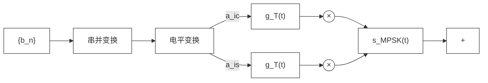
</details>

图 6.4.11 MPSK 调制信号的产生

MPSK 信号的解调 MPSK 信号的最佳接收可通过相关器加似然判决器来实现。图 6.4.12 给出了 MPSK 信号最佳接收机的结构。接收信号可以表示为

$$
r (t) = s _ {i} (t) + n _ {\mathrm{W}} (t), \quad i = 1, 2, \dots , M \tag {6.4.62}
$$

经过相关器后得到的输出

$$
\begin{array}{l} r _ {1} = \int_ {0} ^ {T _ {\mathrm{S}}} r (t) \Psi_ {1} (t) \mathrm{d} t = \int_ {0} ^ {T _ {\mathrm{S}}} \left(s _ {i} (t) + n _ {\mathrm{w}} (t)\right) \Psi_ {1} (t) \mathrm{d} t \\ = \int_ {0} ^ {T _ {\mathrm{S}}} \left(s _ {i 1} \Psi_ {1} (t) + s _ {i 2} \Psi_ {2} (t) + n _ {\mathrm{W}} (t)\right) \Psi_ {1} (t) \mathrm{d} t \tag {6.4.63} \\ = s _ {i 1} + \int_ {0} ^ {T _ {\mathrm{S}}} n _ {\mathrm{w}} (t) \Psi_ {1} (t) \mathrm{d} t = s _ {i 1} + n _ {1} \\ \end{array}
$$

同理可得

$$
r _ {2} = s _ {i 2} + \int_ {0} ^ {T _ {\mathrm{S}}} n _ {\mathrm{W}} (t) \Psi_ {2} (t) \mathrm{d} t = s _ {i 2} + n _ {2} \tag {6.4.64}
$$

其中 $n_{1}, n_{2}$ 同为均值为 0、方差为 $\sigma^{2} = N_{0}/2$ 的高斯随机变量。由 $r_{1}, r_{2}$ 可通过下式计算接收信号相位 $\theta_{r}$ :

$$
\theta_ {\mathrm{r}} = \arctan \frac {r _ {2}}{r _ {1}} \tag {6.4.65}
$$

MPSK 信号的最佳似然判决可以表示为

$$
\hat {s} _ {i} = \arg \min _ {\theta_ {i} \in \{\theta \}} \left| \theta_ {i} - \theta_ {\mathrm{r}} \right|, \quad \left\{\theta_ {i} = \frac {2 \pi (i - 1)}{M}, i = 1, 2, \dots , M \right\} \tag {6.4.66}
$$

式中的 $\left\{\theta_{i}=\frac{2\pi(i-1)}{M},i=1,2,\cdots,M\right\}$ 是发送的 MPSK 信号的相位集。

MPSK 信号最佳接收机的误码性能分析 在有高斯噪声干扰的场合, 解调得到的 $r_1, r_2$ 均为高斯随机变量。对 MPSK 信号的任何一个星座符号点, 高斯噪声对相位的影响可视为如图 6.4.13 描述的情形,其中图(a)是噪声干扰的一般情形, 灰色和黑色的点表示受噪声干扰后星座点偏移的位置; 图(b)描述了对特定的点 A, 导致产生的相位偏移 $\Delta \theta_n$ 的情况, 显然有


<details>
<summary>flowchart</summary>

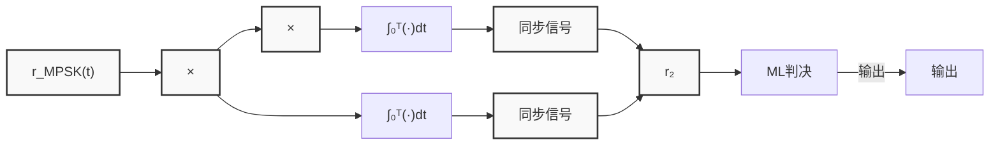
</details>

图 6.4.12 MPSK 信号的最佳接收


<details>
<summary>text_image</summary>

0
A
(a)
r'₁ = √Eₛ + n₁
0
r'₂ = n₂
Δθₙ = arctan r'₂ / r'₁
n₁
A
(b)
</details>

图 6.4.13 噪声导致的相位偏移

$$
\Delta \theta_ {n} = \arctan \frac {r _ {2} ^ {\prime}}{r _ {1} ^ {\prime}} \tag {6.4.67}
$$

式中 $r_{1}^{\prime}=\sqrt{E_{S}}+n_{1}$ ， $r_{2}^{\prime}=n_{2}$ 。 $r_{1}^{\prime}, r_{2}^{\prime}$ 是相互独立的高斯随机变量，其均值分别为 $\sqrt{E_{S}}$ 和 0，而方差为 $\sigma^{2}=N_{0}/2$ 。

由此可得

$$
p (r _ {1} ^ {\prime}, r _ {2} ^ {\prime}) = p (r _ {1} ^ {\prime}) p (r _ {2} ^ {\prime}) = \frac {1}{\sqrt {2 \pi} \sigma} \exp \left\{- \frac {(r _ {1} ^ {\prime} - \sqrt {E _ {S}}) ^ {2}}{2 \sigma^ {2}} \right\} \frac {1}{\sqrt {2 \pi} \sigma} \exp \left\{- \frac {r _ {2} ^ {\prime 2}}{2 \sigma^ {2}} \right\} \tag {6.4.68}
$$

$$
= \frac {1}{2 \pi \sigma^ {2}} \exp \left\{- \frac {(r _ {1} ^ {\prime} - \sqrt {E _ {S}}) ^ {2} + r _ {2} ^ {\prime 2}}{2 \sigma^ {2}} \right\}
$$

若将 $r_1', r_2'$ 视为向量 $r' = (r_1', r_2')$ ，将其用极坐标表示时，相应的幅度和相位分别为

$$
V _ {r} = \sqrt {r _ {1} ^ {\prime 2} + r _ {2} ^ {\prime 2}} \tag {6.4.69}
$$

$$
\Delta \theta_ {n} = \arctan \frac {r _ {2} ^ {\prime}}{r _ {1} ^ {\prime}} \tag {6.4.70}
$$

根据第 2 章中有关窄带信号的分析 [见式（2.10.33）] 可知，其幅度和相位的联合分布特性为

$$
p (V, \Delta \theta_ {n}) = \frac {V}{2 \pi \sigma^ {2}} \exp \left(- \frac {V ^ {2} + E _ {\mathrm{S}} - 2 V \sqrt {E _ {\mathrm{S}}} \cos \Delta \theta_ {n}}{2 \sigma^ {2}}\right) \tag {6.4.71}
$$

式中 $\sigma^{2}=N_{0}/2$ 。由此可得 $\Delta\theta_{n}$ 的分布特性

$$
p (\Delta \theta_ {n}) = \int_ {0} ^ {\infty} p (\Delta \theta_ {n}, V) \mathrm{d} V \tag {6.4.72}
$$

当满足条件 $E_{s}/N_{0}\gg1$ 时，可得如下的近似结果：

$$
p (\Delta \theta_ {n}) \approx \sqrt {\frac {E _ {\mathrm{S}}}{\pi N _ {0}}} \cos \Delta \theta_ {n} \exp \left\{- \frac {E _ {\mathrm{S}}}{N _ {0}} \sin^ {2} \Delta \theta_ {n} \right\} \tag {6.4.73}
$$

参见图 6.4.10，对于 MPSK 信号，两符号相位间的判决门限通常取值在两相位间的中点上，因此，若噪声干扰导致的相位偏差 $\Delta\theta_{n}$ 满足条件

$$
- \frac {2 \pi / M}{2} <   \Delta \theta_ {n} <   \frac {2 \pi / M}{2} \longrightarrow - \frac {\pi}{M} <   \Delta \theta_ {n} <   \frac {\pi}{M} \tag {6.4.74}
$$

则不会发生误码。因此，正确译码的概率为

$$
P _ {\mathrm{c}} = \int_ {- \pi / M} ^ {\pi / M} p (\Delta \theta_ {n}) \mathrm{d} (\Delta \theta_ {n}) \tag {6.4.75}
$$

而误码的概率则相应地为

$$
\begin{array}{l} P _ {\mathrm{E}} = 1 - P _ {\mathrm{c}} = 1 - \int_ {- \pi / M} ^ {\pi / M} p \left(\Delta \theta_ {n}\right) \mathrm{d} \left(\Delta \theta_ {n}\right) \approx 1 - \int_ {- \pi / M} ^ {\pi / M} \sqrt {\frac {E _ {\mathrm{S}}}{\pi N _ {0}}} \cos \Delta \theta_ {n} \exp \left\{- \frac {E _ {\mathrm{S}}}{N _ {0}} \sin^ {2} \Delta \theta_ {n} \right\} \mathrm{d} \left(\Delta \theta_ {n}\right) \tag {6.4.76} \\ = \frac {2}{\sqrt {2 \pi}} \int_ {\sqrt {\frac {2 E _ {\mathrm{S}}}{N _ {0}}} \sin (\pi / M)} ^ {\infty} \exp \left(- \frac {u ^ {2}}{2}\right) \mathrm{d} u = 2 Q \left(\sqrt {\frac {2 E _ {\mathrm{S}}}{N _ {0}}} \sin \frac {\pi}{M}\right) = 2 Q \left(\sqrt {2 k \frac {E _ {\mathrm{b}}}{N _ {0}}} \sin \frac {\pi}{M}\right) \\ \end{array}
$$

在最后一个等式中，利用了码元能量 $E_{\mathrm{S}}$ 与比特能量 $E_{\mathrm{b}}$ 之间的关系式 $E_{\mathrm{S}} = kE_{\mathrm{b}}$ 。图6.4.14给出了不同进制数时误码率与信噪比 $E_{\mathrm{b}} / N_{0}$ 之间关系的特性曲线，显然，对于特定的 $E_{\mathrm{b}} / N_{0}$ 取值，随着 $M$ 的增大，误码性能将显著下降。

对于 MPSK 信号，因为码元间的距离不是常数，可以采用格雷码编码来使得其在一定的误码率情况下有较好的误比特率性能，图 6.4.15 给出了一个 8PSK 格雷码编码信号的星座图示例。采用格雷码编码后，MPSK 信号最佳接收机的误比特率为

$$
P _ {\mathrm{b}} = \frac {P _ {\mathrm{E}}}{k} = \frac {P _ {\mathrm{E}}}{\mathrm{lb} M} = \frac {2}{\mathrm{lb} M} Q \left(\sqrt {2 k \frac {E _ {\mathrm{b}}}{N _ {0}}} \sin \frac {\pi}{M}\right) \tag {6.4.77}
$$


<details>
<summary>contour</summary>

| Eb/N0 (dB) | PE (M=2) | PE (M=4) | PE (M=8) | PE (M=16) | PE (M=32) | PE (M=64) |
| --- | --- | --- | --- | --- | --- | --- |
| -5 | ~0.2 | ~0.3 | ~0.4 | ~0.5 | ~0.6 | ~0.7 |
| 0 | ~0.05 | ~0.1 | ~0.2 | ~0.3 | ~0.4 | ~0.5 |
| 5 | ~0.005 | ~0.01 | ~0.03 | ~0.06 | ~0.1 | ~0.15 |
| 10 | ~0.0001 | ~0.0005 | ~0.002 | ~0.006 | ~0.02 | ~0.04 |
| 15 | — | — | — | ~0.0001 | ~0.002 | ~0.006 |
| 20 | — | — | — | — | ~0.0001 | ~0.0005 |
| 25 | — | — | — | — | — | ~0.00001 |
</details>

图 6.4.14 MPSK 信号最佳接收机的误码特性曲线


<details>
<summary>radar</summary>

| Point | X | Y |
| --- | --- | --- |
| s7 | 0 | 1 |
| s8 | 1 | 0 |
| s1 | 0 | 0 |
| s2 | 1 | 0 |
| s3 | 1 | 0 |
| s4 | 1 | 0 |
| s5 | 0 | 0 |
| s6 | 0 | 0 |
</details>

图 6.4.15 8PSK 格雷码编码星座图

## 6.4.4 MQAM 调制解调系统

前面讨论的 MASK 和 MPSK 两种多进制的载波调制信号, 前者通过载波的幅度的不同取值来携带信息, 后者通过载波的相位的不同取值来携带信息。本节讨论的 MQAM 调制解调系统, 可同时利用载波的幅度和相位的不同取值来携带信息, 因为 MQAM 信号可以通过两个同频正交的幅度调制信号组合而成，所以称其为正交幅度调制信号，相应的收发系统就是所谓的正交幅度调制解调系统。MASK 信号只调制了信号的幅度，只利用了相幅平面的一维信号空间；MPSK 信号虽然利用了相幅平面上的两个信号空间维度，但其星座点的位置局限于一个特定的圆周上。而 MQAM 信号可以分布在相幅平面的任何位置，因此星座点的位置设置有更大的自由度。通过稍后的分析可以了解到，对于同样的进制数，在相同的信号峰值功率条件下，MQAM 与 MASK 和 MPSK 信号方式相比，符号（星座点）间有更大的最小距离，因而有更好的抗噪声干扰的性能，且相对于 MPSK 信号，其平均功率更低。MQAM 系统的这些优点使其成为高阶（M 取较大值）调制系统的最主要信号形式。实际上，MASK 和 MPSK 信号都可视为 MQAM 信号的一个特例。

MQAM 载波调制信号及频谱特性 MQAM 信号通过 M 个不同幅度和相位的信号来表示 M 个不同的符号。形式上与 MPSK 信号类似，MQAM 信号一般可以表示为

$$
\begin{array}{l} s _ {i} (t) = a _ {j c} g _ {T} (t) \cos \omega_ {c} t - a _ {k s} g _ {T} (t) \sin \omega_ {c} t \tag {6.4.78} \\ j = 1, 2, \dots , \sqrt {M}; k = 1, 2, \dots , \sqrt {M}; i = j \cdot k; i = 1, 2, \dots , M \\ \end{array}
$$

式中 $g_{T}(t)$ 是一个持续时间为一个码元周期 $T_{\mathrm{S}}$ 的波形信号； $a_{jc}$ 和 $a_{ks}$ 分别是具有 $\sqrt{M}$ 种不同幅度的加权值：

$$
a _ {j \mathrm{c}} \in 2 j - 1 - \sqrt {M}, j = 1, 2, \dots , \sqrt {M}; a _ {k \mathrm{s}} \in 2 k - 1 - \sqrt {M}, k = 1, 2, \dots , \sqrt {M} \tag {6.4.79}
$$

若记波形函数 $g_{T}(t)$ 的能量为 $E_{g}$ ，可定义两标准正交的基向量

$$
\Psi_ {1} (t) = \sqrt {\frac {2}{E _ {g}}} g _ {T} (t) \cos \omega_ {c} t \tag {6.4.80}
$$

$$
\Psi_ {2} (t) = - \sqrt {\frac {2}{E _ {\mathrm{g}}}} g _ {T} (t) \sin \omega_ {\mathrm{c}} t \tag {6.4.81}
$$

利用上述两个标准基向量，MQAM 信号又可以表示为

$$
s _ {i} (t) = s _ {i j} \Psi_ {1} (t) + s _ {i k} \Psi_ {2} (t), \quad i = 1, 2, \dots , M \tag {6.4.82}
$$

其中，

$$
s _ {i j} = \int_ {0} ^ {T _ {\mathrm{S}}} s _ {i} (t) \Psi_ {1} (t) \mathrm{d} t = a _ {j \mathrm{c}} \sqrt {\frac {E _ {\mathrm{g}}}{2}}, j = 1, 2, \dots , \sqrt {M} \tag {6.4.83}
$$

$$
s _ {i k} = \int_ {0} ^ {T _ {\mathrm{S}}} s _ {i} (t) \Psi_ {2} (t) \mathrm{d} t = a _ {k \mathrm{s}} \sqrt {\frac {E _ {\mathrm{g}}}{2}}, k = 1, 2, \dots , \sqrt {M} \tag {6.4.84}
$$

由此，信号 $s_{i}(t)$ 可与下列二维向量建立一一对应关系：

$$
s _ {i} (t) \leftrightarrow s _ {i} = \left(s _ {i j}, s _ {i k}\right) = \left(a _ {j c} \sqrt {\frac {E _ {g}}{2}}, a _ {k s} \sqrt {\frac {E _ {g}}{2}}\right), \quad i = 1, 2, \dots , M \tag {6.4.85}
$$

同样，由式（6.4.16）可计算符号集内任两信号 $s_i(t)$ 与 $s_m(t)$ 间的距离：

$$
d _ {i m} = \left(\left(s _ {i j} - s _ {m j ^ {\prime}}\right) ^ {2} + \left(s _ {i k} - s _ {m k ^ {\prime}}\right) ^ {2}\right) ^ {1 / 2} = \sqrt {\frac {E _ {g}}{2}} \left(\left(a _ {j c} - a _ {j ^ {\prime} c}\right) ^ {2} + \left(a _ {k s} - a _ {k ^ {\prime} s}\right) ^ {2}\right) ^ {1 / 2} \tag {6.4.86}
$$

$$
j, j ^ {\prime} = 1, 2, \dots , \sqrt {M}; k, k ^ {\prime} = 1, 2, \dots , \sqrt {M}; i = j \cdot k, m = j ^ {\prime} \cdot k ^ {\prime}; i, m = 1, 2, \dots , M
$$

参见图 6.2.2，以相邻两点的取值， $a_{jc}=a_{j'c}=2j-1-\sqrt{M}$ ， $a_{ks}=2j-1-\sqrt{M}$ ， $a_{k's}=2(j+1)-1-\sqrt{M}$ ，代入上式，得两符号间的最小距离

$$
\begin{array}{l} d _ {\min} = \min d _ {i m} = \sqrt {\frac {E _ {g}}{2}} \left(\left(a _ {j c} - a _ {j ^ {\prime} c}\right) ^ {2} + \left(a _ {k s} - a _ {k ^ {\prime} s}\right) ^ {2}\right) ^ {1 / 2} \tag {6.4.87} \\ = \sqrt {\frac {E _ {g}}{2}} \left(\left((2 j - 1 - \sqrt {M}) - (2 j - 1 - \sqrt {M})\right) ^ {2} + \left((2 j - 1 - \sqrt {M}) - (2 j + 1 - \sqrt {M})\right) ^ {2}\right) ^ {1 / 2} = \sqrt {2 E _ {g}} \\ \end{array}
$$

同样，比较式（6.4.82）与式（6.4.38），MQAM 信号的功率密度谱可视为由两个 MASK 信号的功率密度谱组合而成。

MQAM 调制信号的产生方法 MQAM 调制的实现方法如图 6.4.16 所示，首先交将串行输入的二进制序列 $\left\{b_{n}\right\}$ 分为两路，然后分别进行串并变换，每一路以 $k = \mathrm{lb}\sqrt{M}$ 比特数据为一组，对波形信号 $g_{T}(t)$ 加权后，分别对两正交的载波信号 $\cos\omega_{c}t$ 和 $\sin\omega_{c}t$ 进行调制，然后合并生成 MQAM 信号。


<details>
<summary>flowchart</summary>

```mermaid
graph LR
  A["二进制电平序列"] --> B["串并变换"]
  B --> C["{b2n}"]
  B --> D["{b2n+1}"]
  C --> E["电平变换"]
  D --> F["电平变换"]
  E --> G["a_ic"]
  F --> H["a_is"]
  G --> I["g_T(t)"]
  H --> J["g_T(t)"]
  I --> K["×"]
  J --> L["×"]
  K --> M["+"]
  L --> N["-"]
  M --> O["s_MQAM(t)"]
  N --> O
```
</details>

图 6.4.16 MQAM 调制信号的产生

MQAK 信号的最佳接收 MQAM 信号的最佳接收可通过相关器加似然判决器来实现，形式上与 MPSK 接收电路的结构完全一样。图 6.4.17 给出了 MQAM 信号最佳接收机的结构。与 MPSK 信号的接收做完全相同的分析，可得

$$
r _ {1} = s _ {i 1} + n _ {1} \tag {6.4.88}
$$

$$
r _ {2} = s _ {i 2} + n _ {2} \tag {6.4.89}
$$

其中 $n_{1}, n_{2}$ 同为均值为 0、方差为 $\sigma^{2} = N_{0}/2$ 的高斯随机变量。


<details>
<summary>flowchart</summary>

This diagram illustrates a signal processing system architecture, showing the relationship between a Multimodal AM (rMQAM) signal, two parallel processing signals (Ψ1 and Ψ2), and a Multimodal (ML) decision output.
</details>

图 6.4.17 MQAM 信号的最佳接收

MQAM 信号的最大似然判决准则为

$$
\hat {s} = \arg \max _ {s _ {i} \in \{S \}} p (r \mid s _ {i}) = \arg \min _ {s _ {i} \in \{S \}} \left((r _ {1} - s _ {i 1}) ^ {2} + (r _ {2} - s _ {i 2}) ^ {2}\right) \tag {6.4.90}
$$

MQAM 信号最佳接收机的误码性能分析 MQAM 信号的解调也可视为分别对两路 $\sqrt{M}$ 进制的 $\sqrt{M}$ ASK 信号进行解调，得到 $r_{1}$ 和 $r_{2}$ ，合成得到向量 $(r_{1}, r_{2})$ ，然后与每个码字集中的向量 $(s_{i1}, s_{i2}) \in \{S\}$ 进行比较，以最相似的向量作为判决输出的过程。假定对每个 $\sqrt{M}$ ASK 信号进行解调的误码率为 $P_{\sqrt{M}, E}$ ，显然，将 MASK 误码率表达式中的 M 替换为 $\sqrt{M}$ ，即可得

$$
P _ {\sqrt {M}, \mathrm{E}} = \frac {2 (\sqrt {M} - 1)}{\sqrt {M}} Q \left(\sqrt {\frac {6 E _ {\mathrm{b}} \mathrm{lb} \sqrt {M}}{((\sqrt {M}) ^ {2} - 1) N _ {0}}}\right) = 2 \left(1 - \frac {1}{\sqrt {M}}\right) Q \left(\sqrt {\frac {3 E _ {\mathrm{b}} \mathrm{lb} M}{(M - 1) N _ {0}}}\right) \tag {6.4.91}
$$

因为正确译码要求两路解调输出均无误码，MQAM 信号正确解调的概率为

$$
P _ {\mathrm{c}} = (1 - P _ {\sqrt {M}, \mathrm{E}}) ^ {2} \tag {6.4.92}
$$

相应地，MQAM 信号解调时的误码率为

$$
P _ {\mathrm{E}} = 1 - P _ {\mathrm{c}} = 1 - (1 - P _ {\sqrt {M}, \mathrm{E}}) ^ {2} = 2 P _ {\sqrt {M}, \mathrm{E}} - P _ {\sqrt {M}, \mathrm{E}} ^ {2} \approx 2 P _ {\sqrt {M}, \mathrm{E}} = 4 \left(1 - \frac {1}{\sqrt {M}}\right) Q \left(\sqrt {\frac {3 E _ {\mathrm{b}} \mathrm{lb} M}{(M - 1) N _ {0}}}\right) \tag {6.4.93}
$$

MQAM 信号的误码特性如图 6.4.18 所示。同样，对 MQAM 信号可以采用格雷码编码，假定 MQAM 的误码只会出现在相邻的码元间，则可得 MQAM 系统的误比特率为

$$
P _ {\mathrm{b}} = \frac {P _ {\mathrm{E}}}{k} = \frac {P _ {\mathrm{E}}}{\mathrm{lb} M} \tag {6.4.94}
$$


<details>
<summary>contour</summary>

| Eb/N0 (dB) | PE (M=2) | PE (M=4) | PE (M=8) | PE (M=16) | PE (M=32) |
| --- | --- | --- | --- | --- | --- |
| -10 | ~0.3 | ~0.4 | ~0.5 | ~0.6 | ~0.7 |
| 0 | ~0.05 | ~0.1 | ~0.2 | ~0.3 | ~0.4 |
| 5 | ~0.001 | ~0.005 | ~0.01 | ~0.02 | ~0.03 |
| 10 | — | — | ~0.0001 | ~0.0005 | ~0.001 |
| 15 | — | — | — | — | ~0.00001 |
</details>

图 6.4.18 MQAM 信号的误码特性

MQAM 系统与 MPSK 系统的抗噪声干扰性能比较 MQAM 和 MPSK 信号都利用了 IQ 相幅平面的二维信号空间尺度。下面首先分析两系统的抗噪声干扰性能。图 6.4.19 给出了 M = 16 时 MQAM 信号和 MPSK 信号的星座点在相幅平面的分布。假定两信号的最大幅度相同，在此处取单位 1，两者有相同的信号峰值功率。由图直接可以导出，MPSK 信号符号（星座点）间的最小距离为

$$
d _ {1 6 \mathrm{PSK,min}} = 2 \sin \left(\frac {2 \pi}{2 \times 1 6}\right) = 2 \sin \left(\frac {\pi}{1 6}\right) = 0. 3 9 \tag {6.4.95}
$$

MQAM 信号符号（星座点）间的最小距离为

$$
d _ {1 6 \mathrm{QAM,min}} = \frac {1}{3} \times 2 \times \sin \left(\frac {\pi}{4}\right) = \frac {\sqrt {2}}{3} = 0. 4 7 \tag {6.4.96}
$$

可见有

$$
d _ {1 6 \mathrm{PSK,min}} <   d _ {1 6 \mathrm{QAM,min}} \tag {6.4.97}
$$

即 16QAM 系统比 16PSK 系统有更大的噪声容限，从而有更强的抗噪声干扰的性能。

  
图 6.4.19 MPSK 信号与 MQAM 信号星座图比较

不难导出一般的 MPSK 信号星座点间的最小距离为

$$
d _ {\mathrm{MPSK,min}} = 2 \sin \left(\frac {\pi}{M}\right) \tag {6.4.98}
$$

MQAM 信号星座点的分布可以有许多不同的形式，若仍为上述的“矩形”分布特性，则相应的信号星座点间的最小距离为

$$
d _ {\mathrm{MQAM,min}} = \frac {\sqrt {2}}{\sqrt {M} - 1} \tag {6.4.99}
$$

此时，依然有

$$
d _ {\mathrm{MPSK,min}} <   d _ {\mathrm{MQAM,min}} \tag {6.4.100}
$$

即一般地，对于同样大小的信号峰值功率，MQAM 信号星座点间比 MPSK 信号星座点间有更大的最小距离。

## 6.4.5 MFSK 调制解调系统

MFSK 载波调制信号及频谱特性 相对前面讨论的 MASK、MPSK 与 MQAM 系统，MFSK 信号是通过不同的频率变化携带信息的，因此各个符号不能用简单单一频率的相幅平面上的星座点来描述，MFSK 信号通常分布在 M 维频率正交的信号空间内。一般地，MFSK 信号可以表示为

$$
s _ {i} (t) = g _ {T} (t) \cos (\omega_ {\mathrm{c}} t + i \Delta \omega t + \theta_ {i}), i = 1, 2, \dots , M \tag {6.4.101}
$$

其中 $g_{T}(t)$ 是持续时间为一个码元周期 $T_{\mathrm{S}}$ 的波形信号。每个码元的能量

$$
\begin{array}{l} E _ {\mathrm{S}} = \int_ {0} ^ {T _ {\mathrm{S}}} s _ {i} ^ {2} (t) \mathrm{d} t = \int_ {0} ^ {T _ {\mathrm{S}}} g _ {T} ^ {2} (t) \cos^ {2} \left(\omega_ {\mathrm{c}} t + i \Delta \omega t + \theta_ {i}\right) \mathrm{d} t \\ = \frac {1}{2} \int_ {0} ^ {T _ {\mathrm{S}}} g _ {T} ^ {2} (t) \mathrm{d} t + \frac {1}{2} \int_ {0} ^ {T _ {\mathrm{S}}} \cos \left(2 \omega_ {\mathrm{c}} t + 2 i \Delta \omega t + \theta_ {i}\right) \mathrm{d} t \tag {6.4.102} \\ = \frac {1}{2} \int_ {0} ^ {T _ {\mathrm{S}}} g _ {T} ^ {2} (t) \mathrm{d} t = \frac {1}{2} E _ {g}, \quad i = 1, 2, \dots , M \\ \end{array}
$$

其中第四个等式的成立利用了 $\omega_{\mathrm{c}}$ 足够大时 $\int_{0}^{T_{\mathrm{s}}} \cos (2\omega_{\mathrm{c}} t + 2i\Delta \omega t + \theta_{i}) \mathrm{d}t \approx 0$ 的性质。由此可见MFSK信号是一种每个码元的能量均相同的信号。在信号集内，任两码元信号 $s_{i}(t)$ 和 $s_{j}(t)$ 间的相关系数为

$$
\begin{array}{l} \rho_ {i j} = \frac {1}{E _ {S}} \int_ {0} ^ {T _ {S}} s _ {i} (t) s _ {j} (t) \mathrm{d} t = \frac {1}{E _ {S}} \int_ {0} ^ {T _ {S}} g _ {T} ^ {2} (t) \cos \left(\omega_ {c} t + i \Delta \omega t + \theta_ {i}\right) \cos \left(\omega_ {c} t + j \Delta \omega t + \theta_ {j}\right) \mathrm{d} t \tag {6.4.103} \\ = \frac {1}{2 E _ {\mathrm{S}}} \int_ {0} ^ {T _ {\mathrm{S}}} g _ {T} ^ {2} (t) \left[ \cos \left((i - j) \Delta \omega t + (\theta_ {i} - \theta_ {j})\right) + \cos \left(2 \omega_ {\mathrm{c}} t + (i + j) \Delta \omega t + (\theta_ {i} + \theta_ {j})\right) \right] \mathrm{d} t \\ \end{array}
$$

只要波形函数 $g_{T}(t)$ 具有图6.2.3所示的“对称性”，则

(1) 若满足条件 $\theta_{i} = \theta_{j}, \forall i, j \in (1,2,\cdots,M)$ , 则当 $\Delta \omega = k \frac{\pi}{T_{\mathrm{S}}}$ , $k$ 是正整数时, $\rho_{ij} = 0$ , 此时满足符号间正交性的最小频率间隔为 $\min \Delta \omega = \pi / T_{\mathrm{S}}$ , 相应地, MFSK 信号的带宽为

$$
W \approx (M - 1) \frac {1}{2 T _ {\mathrm{S}}} + 2 \frac {1}{T _ {\mathrm{S}}} = \frac {M + 3}{2 T _ {\mathrm{S}}} \xrightarrow {M \gg 1} \approx \frac {M}{2 T _ {\mathrm{S}}} \tag {6.4.104}
$$

(2) 若不满足条件 $\theta_{i} = \theta_{j}, \forall i, j \in (1,2,\dots,M)$ , 则当 $\Delta \omega = k \frac{2\pi}{T_{\mathrm{S}}}$ , $k$ 是正整数时, $\rho_{ij} = 0$ , 此时满足符号间正交性的最小频率间隔为 $\min \Delta \omega = 2\pi / T_{\mathrm{S}}$ , 相应地, MFSK 信号的带宽为

$$
W \approx (M - 1) \frac {1}{T _ {\mathrm{S}}} + 2 \frac {1}{2 T _ {\mathrm{S}}} = \frac {M + 1}{T _ {\mathrm{S}}} \xrightarrow {M \gg 1} \approx \frac {M}{T _ {\mathrm{S}}} \tag {6.4.105}
$$

一般来说，MFSK 信号的频带利用率远小于 MASK, MPSK 和 MQAM 信号。

对于满足正交性的一组 MFSK 信号的载波频率 $\omega_{c} + i\Delta\omega, i = 1, 2, \cdots, M$ ，可以定义一组标准的正交基函数

$$
\Psi_ {i} (t) = \sqrt {\frac {2}{E _ {\mathrm{S}}}} g _ {T} (t) \cos \left(\omega_ {\mathrm{c}} t + i \Delta \omega t + \theta_ {i}\right), \quad i = 1, 2, \dots , M \tag {6.4.106}
$$

其中 $\Delta\omega$ 的取值与 $\theta_{i}, i=1,2,\cdots,M$ 的取值有关。对于 MFSK 信号，特别地有

$$
s _ {i} (t) = s _ {i 1} \Psi_ {1} (t) + s _ {i 2} \Psi_ {2} (t) + \dots + s _ {i i} \Psi_ {i} (t) + \dots + s _ {i M} \Psi_ {M} (t) = s _ {i i} \Psi_ {i} (t), i = 1, 2, \dots , M \tag {6.4.107}
$$

即有

$$
s _ {i j} = 0, i \neq j, i, j \in \{1, 2, \dots , M \} \tag {6.4.108}
$$

MFSK 信号码元的能量为

$$
E _ {\mathrm{S}} = \int_ {0} ^ {T _ {\mathrm{S}}} s _ {i} ^ {2} (t) \mathrm{d} t = \int_ {0} ^ {T _ {\mathrm{S}}} \left[ s _ {i i} \varPsi_ {i} (t) \right] ^ {2} \mathrm{d} t = s _ {i i} ^ {2} \int_ {0} ^ {T _ {\mathrm{S}}} \varPsi_ {i} ^ {2} (t) \mathrm{d} t = s _ {i i} ^ {2}, \quad i = 1, 2, \dots , M \tag {6.4.109}
$$

由此可得

$$
s _ {i i} = \sqrt {E _ {\mathrm{S}}}, \quad i = 1, 2, \dots , M \tag {6.4.110}
$$

综合式（6.4.108）和式（6.4.110），可得

$$
s _ {i j} = \left\{ \begin{array}{l l} \sqrt {E _ {\mathrm{S}}}, & i = j \\ 0, & i \neq j, \end{array} \right., i, j \in \{1, 2, \dots , M \} \tag {6.4.111}
$$

由此可得信号 $s_{i}(t)$ 与向量 $\boldsymbol{s}_{i}=(s_{i1},s_{i2},\cdots,s_{iM})$ 之间的对应关系：

$$
\begin{array}{l} s _ {i} (t) \leftrightarrow s _ {i} = (s _ {i 1}, s _ {i 2}, \dots , s _ {i M}) \\ i = 1, 2, \dots , M \end{array} \leftrightarrow \left\{ \begin{array}{c} s _ {1} = (\sqrt {E _ {\mathrm{S}}}, 0, \dots , 0) \\ s _ {2} = (0, \sqrt {E _ {\mathrm{S}}}, \dots , 0) \\ \vdots \\ s _ {M} = (0, 0, \dots , \sqrt {E _ {\mathrm{S}}}) \end{array} \right. \tag {6.4.112}
$$

由式（6.4.16），可得任意两MFSK信号 $s_i(t)$ 和 $s_j(t)$ 间的距离

$$
d _ {i j} = \left(\sum_ {k = 1} ^ {M} (s _ {i k} - s _ {j k}) ^ {2}\right) ^ {1 / 2} = \sqrt {(s _ {i i} - 0) ^ {2} + (0 - s _ {j j}) ^ {2}} = \sqrt {E _ {\mathrm{S}} + E _ {\mathrm{S}}} = \sqrt {2 E _ {\mathrm{S}}} \tag {6.4.113}
$$

可见，MFSK 信号集中任两信号间的距离均相同。

将式（6.4.101）与式（6.3.11）比较不难发现，MFSK信号可视为 $M$ 个不同频率的OOK信号组合的结果，其功率谱可由相应的 $M$ 个不同频率的OOK的功率谱叠加而成。

MFSK 载波调制实现方法 如图 6.4.20(a)所示，MFSK 信号可以用模拟调制的方法实现，信息序列 $\left\{a_{n}\right\}$ 经串并变换后形成每组 k 比特的并行信号，由此产生 $M = 2^{k}$ 种电平中的一种电平信号，控制模拟调频电路产生一个特定频率的码元信号。如图 6.4.20(b)所示，MFSK 信号也可通过 M 个正弦波信号发生器加选频电路实现，信息序列 $\left\{a_{n}\right\}$ 经串并变换后形成每组 k 比特的并行信号，由此产生 $M = 2^{k}$ 种切换开关的控制信号，选择 M 种频率中的一种产生一个特定频率的码元信号。

  
图 6.4.20 MFSK 调制信号的产生

MFSK 信号的最佳接收 M 进制的 MFSK 信号有 M 个基向量，相应的最佳接收机的结构如图 6.4.21 所示。首先通过关于各个基向量函数的匹配滤波器获得接收向量：

$$
r = (r _ {1}, r _ {2}, \dots , r _ {M}), r _ {i} = s _ {i} + n _ {i}, i = 1, 2, \dots , M \tag {6.4.114}
$$

因为上式的各个分量统计独立，因而其似然函数为


<details>
<summary>flowchart</summary>

```mermaid
graph LR
  r(t) --> Sum1((×))
  Sum1 --> Sum2((×))
  Sum2 --> Sum3((×))
  Sum3 --> Sum4((×))
  Sum4 --> Sum5((×))
  Sum5 --> Sum6((×))
  Sum6 --> Sum7((×))
  Sum7 --> Sum8((×))
  Sum8 --> Sum9((×))
  Sum9 --> Sum10((×))
  Sum10 --> Sum11((×))
  Sum11 --> Sum12((×))
  Sum12 --> Sum13((×))
  Sum13 --> Sum14((×))
  Sum14 --> Sum15((×))
  Sum15 --> Sum16((×))
  Sum16 --> Sum17((×))
  Sum17 --> Sum18((×))
  Sum18 --> Sum19((×))
  Sum19 --> Sum20((×))
  Sum20 --> Sum21((×))
  Sum21 --> Sum22((×))
  Sum22 --> Sum23((×))
  Sum23 --> Sum24((×))
  Sum24 --> Sum25((×))
  Sum25 --> Sum26((×))
  Sum26 --> Sum27((×))
  Sum27 --> Sum28((×))
  Sum28 --> Sum29((×))
  Sum29 --> Sum30((×))
  Sum30 --> Sum31((×))
  Sum31 --> Sum32((×))
  Sum32 --> Sum33((×))
  Sum33 --> Sum34((×))
  Sum34 --> Sum35((×))
  Sum35 --> Sum36((×))
  Sum36 --> Sum37((×))
  Sum37 --> Sum38((×))
  Sum38 --> Sum39((×))
  Sum39 --> Sum40((×))
  Sum40 --> Sum41((×))
  Sum41 --> Sum42((×))
  Sum42 --> Sum43((×))
  Sum43 --> Sum44((×))
  Sum44 --> Sum45((×))
  Sum45 --> Sum46((×))
  Sum46 --> Sum47((×))
  Sum47 --> Sum48((×))
  Sum48 --> Sum49((×))
  Sum49 --> Sum50((×))
  Sum50 --> Sum51((×))
  Sum51 --> Sum52((×))
  Sum52 --> Sum53((×))
  Sum53 --> Sum54((×))
  Sum54 --> Sum55((×))
  Sum55 --> Sum56((×))
  Sum56 --> Sum57((×))
  Sum57 --> Sum58((×))
  Sum58 --> Sum59((×))
  Sum59 --> Sum60((×))
  Sum60 --> Sum61((×))
  Sum61 --> Sum62((×))
  Sum62 --> Sum63((×))
  Sum63 --> Sum64((×))
  Sum64 --> Sum65((×))
  Sum65 --> Sum66((×))
  Sum66 --> Sum67((×))
  Sum67 --> Sum68((×))
  Sum68 --> Sum69((×))
  Sum69 --> Sum70((×))
  Sum70 --> Sum71((×))
  Sum71 --> Sum72((×))
  Sum72 --> Sum73((×))
  Sum73 --> Sum74((×))
  Sum74 --> Sum75((×))
  Sum75 --> Sum76((×))
  Sum76 --> Sum77((×))
  Sum77 --> Sum78((×))
  Sum78 --> Sum79((×))
  Sum79 --> Sum80((×))
  Sum80 --> Sum81((×))
  Sum81 --> Sum82((×))
  Sum82 --> Sum83((×))
  Sum83 --> Sum84((×))
  Sum84 --> Sum85((×))
  Sum85 --> Sum86((×))
  Sum86 --> Sum87((×))
  Sum87 --> Sum88((×))
  Sum88 --> Sum89((×))
  Sum89 --> Sum90((×))
  Sum90 --> Sum91((×))
  Sum91 --> Sum92((×))
  Sum92 --> Sum93((×))
  Sum93 --> Sum94((×))
  Sum94 --> Sum95((×))
  Sum95 --> Sum96((×))
  Sum96 --> Sum97((×))
  Sum97 --> Sum98((×))
  Sum98 --> Sum99((×))
  Sum99 --> Sum100((×))
  Sum100 --> Sum11((×))
  Sum11 --> Sum12((×))
  Sum12 --> Sum13((×))
  Sum13 --> Sum14((×))
  Sum14 --> Sum15((×))
  Sum15 --> Sum16((×))
  Sum16 --> Sum17((×))
  Sum17 --> Sum18((×))
  Sum18 --> Sum19((×))
  Sum18 --> Sum20((×))
  Sum20 --> Sum21((×))
  Sum21 --> Sum22((×))
  Sum22 --> Sum23((×))
  Sum23 --> Sum24((×))
  Sum24 --> Sum25((×))
  Sum25 --> Sum26((×))
  Sum26 --> Sum27((×))
  Sum27 --> Sum28((×))
  Sum28 -.-> Sum29((×))
  Sum29 --> Sum30((×))
  Sum30 --> Sum31((×))
  Sum31 --> Sum32((×))
  Sum32 --> Sum33((×))
  Sum33 --> Sum34((×))
  Sum34 --> Sum35((×))
  Sum35 --> Sum36((×))
  Sum36 --> Sum37((×))
  Sum37 --> Res1((×))
  Res1 --> Sum38((×))
  Sum38 --> Sum39((×))
  Sum39 --> Sum40((×))
  Sum40 --> Sum41((×))
  Sum41 --> Sum42((×))
  Sum42 --> Sum43((×))
  Sum43 --> Sum44((×))
  Sum44 --> Sum45((×))
  Sum45 --> Sum46((×))
  Sum46 -.-> Sum47((×))
  Sum47 --> Sum48((×))
  Sum48 --> Sum49((×))
  Sum49 --> Sum50((×))
  Sum50 --> Sum51((×))
  Sum51 --> Sum52((×))
  Sum52 --> Sum53((×))
  Sum53 --> Sum54((×))
  Sum54 --> Sum55((×))
  Sum55 --> Res2((×))
  Res2 --> Sum56((×))
  Sum56 --> Sum57((×))
  Sum57 --> Sum58((×))
  Sum58 --> Sum59((×))
  Sum59 --> Res22((×))
  Res22 --> Sum59((×))
  Sum59 --> Res23((×))
  Res23 --> Sum59((×))
  Res23 --> Res24((×))
  Res24 --> Sum59((×))
  Res24 --> Res25((×))
  Res25 --> Sum59((×))
  Res25 --> Res26((×))
  Res26 --> Sum59((×))
  Res26 --> Res27((×))
  Res27 --> Sum59((×))
  Res27 --> Res28((×))
  Res28 --> Sum59((×))
  Res28 --> Res29((×))
  Res29 --> Sum59((×))
  Res29 --> Res30((×))
  Res30 --> Sum59((×))
  Res30 --> Res31((×))
  Res31 --> Sum59((×))
  Res31 --> Res32((×))
  Res32 --> Sum59((×))
  Res32 --> Res33((×))
  Res33 --> Sum59((×))
  Res33 --> Res34((×))
  Res34 --> Sum59((×))
  Res34 --> Res35((×))
  Res35 --> Sum59((×))
  Res35 --> Res36((×))
  Res36 --> Sum59((×))
  Res36 --> Res37((×))
  Res37 --> Sum59((×))
  Res37 --> Res38((×))
  Res38 --> Sum59((×))
  Res38 --> Res39((×))
  Res39 --> Sum59((×))
  Res39 --> Res30((×))
  Res30 --> Sum59((×))
  Res30 --> Res31((×))
  Res31 --> Sum59((×))
  Res31 --> Res32((×))
  Res32 --> Sum59((×))
  Res32 --> Res33((×))
  Res33 --> Sum59((×))
  Res33 --> Res34((×))
  Res33 --> Res35((×))
  Res35 --> Res36((×))
  Res36 --> Sum59((×))
  Res36 --> Res37((×))
  Res37 --> Res38((×))
  Res38 --> Res39((×))
  Res39 --> Res30((×))
  Res30 --> Sum59((×))
  Res30 --> Res31((×))
  Res31 --> Sum59((×))
  Res31 --> Res32((×))
  Res32 --> Sum59((×))
  Res32 --> Res33((×))
  Res33 --> Sum59((×))
  Res33 --> Res35((×))
  Res35 --> Res36((×))
  Res36 --> Res37((×))
  Res37 --> Res38((×))
  Res38 --> Res39((×))
  Res39 --> Res30((×))
  Res30 --> Sum59((×))
  Res30 --> Res31((×))
  Res31 --> Sum59((×))
  Res31 --> Res32((×))
  Res32 --> Sum59 ((×))
  Res32 --> Res33((×))
  Res33 --> Res34((×))
  Res34 --> Res35((×))
  Res35 --> Res36((×))
  Res36 --> Res37((×))
  Res37 --> Res38((×))
  Res38 --> Res39((×))
  Res39 --> Res30((×))
  Res30 --> Sum59((×))
  Res30 --> Res31((×))
  Res31 --> Res32((×))
  Res32 --> Res33((×))
  Res33 --> Res34((×))
  Res34 --> Res35((×))
  Res35 --> Res36((×))
  Res36 --> Res37((×))
  Res37 --> Res38((×))
  Res38 --> Res39((×))
  Res39 --> Res30((×))
  Res30 --> Sum59(( ×))
  Res30 --> Res31((×))
  Res31 --> Res32((×))
  Res32 --> Res33((×))
  Res33 --> Res34((×))
  Res34 --> Res35((×))
  Res35 --> Res36((×))
  Res36 --> Res37((×))
  Res37 --> Res38((×))
  Res38 --> Res39((×)))
  Res39 --> Res30((×))
  Res30 --> Res31((×))
  Res31 --> Res32((×))
  Res32 --> Res33((×))
  Res33 --> Res34((×))
  Res34 --> Res35((×)))
  Res35 --> Res36((×)))
  Res36 --> Res37((×)))
  Res37 --> Res38((×)))
  Res38 --> Res39((×)))
  Res39 --> Res30((×)))
  Res30 --> Res31((×)))
  Res31 --> Res32((×)))
  Res32 --> Res33((×)))
  Res33 --> Res34((×)))
  Res34 --> Res35((×)))
  Res35 --> Res36((×)))
  Res36 --> Res37((×)))
  Res37 --> Res38((×)))
  Res38 --> Res39((×)))
  Res39 --> Res30((×)))
  Res30 --> Res31((×)))
  Res31 --> Res32((×)))
  Res32 --> Res33((×)))
```
</details>

图 6.4.21 MFSK 信号的最佳接收机

$$
p (\boldsymbol {r} \mid s _ {i}) = \prod_ {k = 1} ^ {M} \frac {1}{\sqrt {2 \pi (N _ {0} / 2)}} \exp \left[ - \frac {(r _ {k} - s _ {i k}) ^ {2}}{2 (N _ {0} / 2)} \right] \tag {6.4.115}
$$

由此，可导出相应的最大似然判决准则

$$
\hat {s} = \arg \max _ {s _ {i} \in \{S \}} p (\boldsymbol {r} \mid s _ {i}) \leftrightarrow \arg \max _ {s _ {i} \in \{S \}} \ln p (\boldsymbol {r} \mid s _ {i}) \leftrightarrow \arg \min _ {s _ {i} \in \{S \}} \sum_ {i = 1} ^ {M} \left(r _ {k} - s _ {i k}\right) ^ {2} \tag {6.4.116}
$$

做出判决。上式可做进一步的分解：

$$
\begin{array}{l} \sum_ {k = 1} ^ {M} \left(r _ {k} - s _ {i k}\right) ^ {2} = \sum_ {k = 1} ^ {M} r _ {k} ^ {2} - 2 \sum_ {k = 1} ^ {M} r _ {k} s _ {i k} + \sum_ {k = 1} ^ {M} s _ {i k} ^ {2} \tag {6.4.117} \\ = \left| \boldsymbol {r} \right| ^ {2} - 2 \boldsymbol {r} \cdot s _ {i} + \left| s _ {i} \right| ^ {2}, \quad i = 1, 2, \dots , M \\ \end{array}
$$

因为对于 MFSK 信号，有

$$
\left| s _ {i} \right| = \left| s _ {j} \right|, \quad \forall i, j \in \{1, 2, \dots , M \} \tag {6.4.118}
$$

由此可得

$$
\hat {s} = \arg \min _ {s _ {i} \in \{S \}} \sum_ {k = 1} ^ {M} \left(r _ {k} - s _ {i k}\right) ^ {2} \xrightarrow {\text {等效于}} \arg \max _ {s _ {i} \in \{S \}} \boldsymbol {r} \cdot s _ {i} \tag {6.4.119}
$$

根据上式，最佳接收的判决可按如下操作实现：根据获得的接收向量 $\boldsymbol{r} = (r_{1}, r_{2}, \cdots, r_{M})$ ，用该向量与信号集中的每个可能的向量 $s_{i} \in \{S\}$ 进行点积运算，选择最大的点积运算结果所对应的向量作为判决输出。

MFSK 信号最佳接收的误码性能分析 若记发送符号 $s_i(t)$ 的先验概率为 $P(s_i)$ ，接收时出现错误的概率为 $P(e|s_i)$ ，则误码率为

$$
P _ {\mathrm{E}} = \sum_ {i = 1} ^ {M} P (s _ {i}) P (e \mid s _ {i}) \tag {6.4.120}
$$

在先验等概的情况下，误码率为

$$
P _ {\mathrm{E}} = \frac {1}{M} \sum_ {i = 1} ^ {M} P (e \mid s _ {i}) \tag {6.4.121}
$$

对于普通的高斯噪声干扰信道（非频率选择性信道），误码与载波频率没有关系，只取决于码元间的距离，而由式（6.4.113）可知，MFSK 信号各码元间的距离相等，因此有

$$
P (e \mid s _ {i}) = P (e \mid s _ {j}), \quad \forall i, j \in \{1, 2, \dots , M \} \tag {6.4.122}
$$

进而有

$$
P _ {\mathrm{E}} = P (e \mid s _ {i}), i = 1, 2, \dots , M \tag {6.4.123}
$$

下面分析发送符号 $s_i(t)$ 时的错误概率 $P(e|s_i)$ 。当发送符号 $s_i(t)$ 时，接收向量为

$$
\boldsymbol {r} = (n _ {1}, n _ {2}, \dots , \sqrt {E _ {\mathrm{S}}} + n _ {i}, \dots , n _ {M}) \tag {6.4.124}
$$

正确判决的概率为

$$
P _ {\mathrm{c}} = \int_ {- \infty} ^ {\infty} P (n _ {1} <   r _ {i}, n _ {2} <   r _ {i}, \dots , n _ {M} <   r _ {i} \mid s _ {i}) p (r _ {i} \mid s _ {i}) \mathrm{d} r _ {i} \tag {6.4.125}
$$

因为 $n_1, n_2, \cdots, \sqrt{E_S} + n_i, \cdots, n_M$ 均服从高斯分布且相互独立，有

$$
P _ {\mathrm{c}} = \int_ {- \infty} ^ {\infty} \prod_ {k = 1, k \neq i} ^ {M} P (n _ {k} <   r _ {i} \mid s _ {i}) p (e \mid s _ {i}) \mathrm{d} r _ {i} \tag {6.4.126}
$$

其中，

$$
P (n _ {k} <   r _ {i} \mid s _ {i}) = \int_ {- \infty} ^ {r _ {i}} \frac {1}{\sqrt {\pi N _ {0}}} \exp \left(- \frac {n _ {k} ^ {2}}{N _ {0}}\right), k \neq i, k \in \{1, 2, \dots , M \} \tag {6.4.127}
$$

$$
p (r _ {i} \mid s _ {i}) = \frac {1}{\sqrt {2 \pi (N _ {0} / 2)}} \exp \left[ - \frac {(r _ {i} - s _ {i i}) ^ {2}}{2 (N _ {0} / 2)} \right] \tag {6.4.128}
$$

因此得到

$$
P _ {\mathrm{c}} = \int_ {- \infty} ^ {\infty} \left[ \int_ {- \infty} ^ {r _ {i}} \frac {1}{\sqrt {\pi N _ {0}}} \exp \left(- \frac {n _ {k} ^ {2}}{N _ {0}}\right) \mathrm{d} n _ {k} \right] ^ {M - 1} \frac {1}{\sqrt {2 \pi (N _ {0} / 2)}} \exp \left[ - \frac {(r _ {i} - s _ {i i}) ^ {2}}{2 (N _ {0} / 2)} \right] \mathrm{d} r _ {i} \tag {6.4.129}
$$

相应的误码率为

$$
P _ {\mathrm{E}} = 1 - P _ {\mathrm{c}} \tag {6.4.130}
$$

不同 $M = 2^{k}$ 取值的情形如图 6.4.22 所示。由图 6.4.22 可见，对于 MFSK 信号，在相同的信噪比条件下，随着进制数 M 的增加，误码性能会相应地改善，MFSK 信号的这一特性与 MASK 及 MPSK 信号有很大的区别。MFSK 信号有这样的特性，因此特别适合在低信噪比的环境中应用，这也是香农定理有关信道容量中带宽换取信噪比的一个示例。

MFSK 传输系统的误比特率 MFSK 是一种符号集中任两码元间距离相等的信号，因此 MFSK 信号不能通过格雷码编码在一定的误码率下提高系统的误比特率性能。换句话说，某一 MFSK 信号的码元经传输后，错误解调为任何另外一个码元的概率是相同的。下面进一步分析 MFSK 信号误码率与误比特率之间的关系。


<details>
<summary>line</summary>

| Eb/N0 (dB) | k=1 | k=2 | k=3 | k=4 | k=5 | k=6 | k=7 | k=8 | k=9 | k=10 | k=15 | k=20 |
| --- | --- | --- | --- | --- | --- | --- | --- | --- | --- | --- | --- | --- |
| -10 | ~0.9 | ~0.8 | ~0.7 | ~0.6 | ~0.5 | ~0.4 | ~0.3 | ~0.2 | ~0.15 | ~0.1 | ~0.08 | ~0.06 |
| -5 | ~0.8 | ~0.7 | ~0.6 | ~0.5 | ~0.4 | ~0.3 | ~0.2 | ~0.15 | ~0.1 | ~0.08 | ~0.06 | ~0.04 |
| 0 | ~0.2 | ~0.2 | ~0.2 | ~0.2 | ~0.2 | ~0.2 | ~0.2 | ~0.2 | ~0.2 | ~0.2 | ~0.2 | ~0.2 |
| 5 | ~0.02 | ~0.01 | ~0.008 | ~0.006 | ~0.004 | ~0.003 | ~0.002 | ~0.0015 | ~0.001 | ~0.0008 | ~0.0006 | ~0.0004 |
| 10 | ~0.002 | ~0.001 | ~0.0008 | ~0.0006 | ~0.0004 | ~0.0003 | ~0.0002 | ~0.00015 | ~0.0001 | ~0.00008 | ~0.00006 | ~0.00004 |
</details>

图 6.4.22 MFSK 信号的误码特性 $^{[2]}$

首先来看一个 $M = 2^{3} = 8$ 的特例。8FSK 信

号有 8 个不同的码元符号，分别对应二进制数的码组 000, 001, 010, 011, 100, 101, 110, 111。假定对应于码组 100 的符号出现了错误，错误判决为其他的码元符号，除了出错成对应于 011 码组的符号会导致 3 比特的误码，其他情形都不会出现相应码组全部比特的错误。图 6.4.23 给出了本例讨论的情形，图中

| 000 | 100(正确码组) |
|---|---|
| 001 | 101 |
| 010 | 110 |
| 011 | 111 |

码组内斜体的比特部分表示出错的比特位。对于这样的 $k = 3$ 比特的码组，不难观察得到，每一比特位的总的可能的错误数为 $2^{3 - 1} = 4$ ，总的可能出错的位数为 $3\times 2^{3 - 1} = 3\times 4 = 12$ 。

图 6.4.23 误码导致的比特错误示例

显然可将该例推广到一般的情形。对于一个 $k$ 比特的码组，每一比特位总的可能的错误数为 $2^{k - 1}$ ，总的可能出错的位数为 $k \times 2^{k - 1}$ 。在所有可能出错（除了正确的码组自身）的 $M - 1 = 2^{k} - 1$ 个码组中，总的比特数为 $k \times (M - 1) = k \times (2^{k} - 1)$ 。由此可得误比特数与总比特数的比值为 $k \times 2^{k - 1} / k \times (2^{k} - 1)$ ，因此，若MFSK解调的误码率为 $P_{\mathrm{E}}$ ，则误比特率为

$$
P _ {\mathrm{b}} = \frac {k \times 2 ^ {k - 1}}{k \times (2 ^ {k} - 1)} P _ {\mathrm{E}} = \frac {2 ^ {k - 1}}{2 ^ {k} - 1} P _ {\mathrm{E}} = \frac {M}{2 (M - 1)} P _ {\mathrm{E}} \tag {6.4.131}
$$

当 $M$ 足够大时，有

$$
P _ {\mathrm{b}} \approx \frac {1}{2} P _ {\mathrm{E}} \tag {6.4.132}
$$

## 6.5 恒包络连续相位调制

在前面讨论的各种载波调制方式中，从当前发送的一种码元切换到另外一种码元时，都有可能发生载波信号幅度或相位的突变，或者出现载波信号的幅度和相位两个参量的同时突变，信号的这些突变将导致信号频率的瞬间极大变化，使得信号功率谱旁瓣的成分所占的比例很大，大量能量泄漏到远大于码元周期倒数 $1/T_{s}$ 两倍的带宽之外。这将使得相邻的信道为避免受到干扰而需要保持较大的间隔，进而导致总的频率使用效率降低。

本节讨论实际系统中常用的恒包络连续相位调制，顾名思义，这种调制方式产生的信号包络恒定，符号间的相位变化具有较为平滑过渡的特性，因而信号功率谱的旁瓣较之之前讨论的信号将大大降低，从而可更为有效地提高频谱的利用效率。本节将分别介绍恒包络连续相位调制方式中的最小频移键控（Minimum Shift Keying，MSK）和高斯滤波最小频移键控（Gaussian filtered Minimum Shift Keying，GMSK）两种载波调制系统。

## 6.5.1 MSK 调制解调系统

MSK 载波调制信号及频谱特性 在前面讨论 2FSK 信号时已知，当 2FSK 的两个频率信号有相同的初始相位时，使 2FSK 两符号信号正交的最小频率间隔为 $\Delta f = 1/(2T_{\mathrm{s}})$ 。具有最小频移的键控信号 MSK 就是一种满足上述最小频率间隔且相位连续的信号。

假定发送的符号序列为 $\{a_{n}\}, a_{n} \in \{-1, +1\}$ ，相应的基带信号可表示为 $s_{\mathrm{B}}(t) = \sum_{n=-\infty}^{\infty} a_{n} g_{T}(t - nT)$ 。若采用该信号对载波的频率进行调制，记未调制前载波的中心频率为 $f_{\mathrm{c}}$ ，定义调频指数 $K_{\mathrm{f}}$ 为单位电压导致的频率变化量，则信号的频率变化可表示为

$$
f (t) = f _ {\mathrm{c}} + K _ {\mathrm{f}} s _ {\mathrm{B}} (t) = f _ {\mathrm{c}} + K _ {\mathrm{f}} \sum_ {n = - \infty} ^ {\infty} a _ {n} g _ {T} (t - n T _ {\mathrm{S}}) \tag {6.5.1}
$$

相应地，信号的相位为

$$
\theta (t) = 2 \pi f _ {\mathrm{c}} t + \int_ {- \infty} ^ {t} 2 \pi K _ {\mathrm{f}} \sum_ {n = - \infty} ^ {\infty} a _ {n} g _ {T} (\tau - n T _ {\mathrm{S}}) \mathrm{d} \tau \tag {6.5.2}
$$

MSK 信号可以表示为

$$
s _ {\mathrm{MSK}} (t) = a \cos \theta (t) = a \cos \left(2 \pi f _ {\mathrm{c}} t + \int_ {- \infty} ^ {t} 2 \pi K _ {\mathrm{f}} \sum_ {n = - \infty} ^ {\infty} a _ {n} g _ {T} (\tau - n T _ {\mathrm{S}}) \mathrm{d} \tau\right) \tag {6.5.3}
$$

若基带信号的波形函数 $g_{T}(t)$ 是一个幅度取值为1的门函数，则有

$$
\int_ {- \infty} ^ {t} g _ {T} (\tau - i T _ {\mathrm{S}}) \mathrm{d} \tau = \left\{ \begin{array}{l l} 0, & t <   i T _ {\mathrm{S}} \\ t - i T _ {\mathrm{S}}, & i T _ {\mathrm{S}} \leqslant t \leqslant (i + 1) T _ {\mathrm{S}} \\ T _ {\mathrm{S}}, & t \geqslant (i + 1) T _ {\mathrm{S}} \end{array} \right. \tag {6.5.4}
$$

将上式的结果代入式（6.5.3），当 $nT_{\mathrm{S}} \leqslant t < (n + 1)T_{\mathrm{S}}$ ， $n$ 为任意整数时，可得

$$
\begin{array}{l} s _ {\mathrm{MSK}} (t) = a \cos \left(2 \pi f _ {\mathrm{c}} t + 2 \pi K _ {\mathrm{f}} (t - n T _ {\mathrm{S}}) a _ {n} + 2 \pi K _ {\mathrm{f}} T _ {\mathrm{S}} \sum_ {i = - \infty} ^ {n - 1} a _ {i}\right) \tag {6.5.5} \\ = a \cos \left(2 \pi f _ {\mathrm{c}} t + 2 \pi K _ {\mathrm{f}} a _ {n} t - 2 \pi K _ {\mathrm{f}} a _ {n} n T _ {\mathrm{S}} + 2 \pi K _ {\mathrm{f}} T _ {\mathrm{S}} \sum_ {i = - \infty} ^ {n - 1} a _ {i}\right) \\ \end{array}
$$

式中的 $-2\pi K_{\mathrm{f}}a_{n}nT_{\mathrm{S}} + 2\pi K_{\mathrm{f}}T_{\mathrm{S}}\sum_{i = -\infty}^{n - 1}a_{i}$ 部分，在 $nT_{\mathrm{S}}\leqslant t < (n + 1)T_{\mathrm{S}}$ 期间是一常数，可将其记为

$$
x _ {n} = - 2 \pi K _ {\mathrm{f}} a _ {n} n T _ {\mathrm{S}} + 2 \pi K _ {\mathrm{f}} T _ {\mathrm{S}} \sum_ {i = - \infty} ^ {n - 1} a _ {i} \tag {6.5.6}
$$

由此，式（6.5.5）可表示为

$$
s _ {\mathrm{MSK}} (t) = a \cos \left[ 2 \pi (f _ {\mathrm{c}} + K _ {\mathrm{f}} a _ {n}) t + x _ {n} \right] = \left\{ \begin{array}{l l} a \cos (2 \pi f _ {1} t + x _ {n}), & a _ {n} = + 1 \\ a \cos (2 \pi f _ {2} t + x _ {n}), & a _ {n} = - 1 \end{array} \right. \tag {6.5.7}
$$

考虑到 $a_{n}$ 取值在 $-1, +1$ 间变化时，相应的频率变化为最小的频率间隔 $\Delta f = 1 / (2T_{\mathrm{s}})$ ，则应有如下的关系：

$$
a _ {n} = \left\{ \begin{array}{l} + 1 \leftrightarrow f _ {1} = f _ {\mathrm{c}} + \frac {1}{4 T _ {\mathrm{S}}} \\ - 1 \leftrightarrow f _ {2} = f _ {\mathrm{c}} - \frac {1}{4 T _ {\mathrm{S}}} \end{array} \right. \tag {6.5.8}
$$

相应地，调制指数 $K_{\mathrm{f}}$ 应取值为

$$
K _ {\mathrm{f}} = \frac {1}{4 T _ {\mathrm{S}}} \tag {6.5.9}
$$

将其代入式（6.5.6），可得

$$
\begin{array}{l} x _ {n} = - \frac {\pi}{2} a _ {n} n + \frac {\pi}{2} \sum_ {i = - \infty} ^ {n - 1} a _ {i} = - \frac {\pi}{2} a _ {n} n + \frac {\pi}{2} a _ {n - 1} n - \frac {\pi}{2} a _ {n - 1} n + \frac {\pi}{2} \sum_ {i = - \infty} ^ {n - 1} a _ {i} \\ = - \frac {\pi}{2} a _ {n} n + \frac {\pi}{2} a _ {n - 1} n + \left(- \frac {\pi}{2} a _ {n - 1} (n - 1) + \frac {\pi}{2} \sum_ {i = - \infty} ^ {n - 2} a _ {i}\right) \tag {6.5.10} \\ = - \frac {\pi}{2} (a _ {n} - a _ {n - 1}) n + x _ {n - 1} \\ \end{array}
$$

由此，一般地，在第 $n$ 个码元周期 $nT_{\mathrm{S}} \leqslant t \leqslant (n + 1)T_{\mathrm{S}}$ 内，MSK信号可以表示为

$$
s _ {\mathrm{MSK}, n} (\frac {\pi}{2}) = A \cos \left[ 2 \pi \left(f _ {\mathrm{c}} + \frac {a _ {n}}{4 T _ {\mathrm{S}}}\right) t + x _ {n} \right] = A \cos \left(2 \pi f _ {\mathrm{c}} t + \frac {\pi a _ {n}}{2 T _ {\mathrm{S}}} t + x _ {n}\right) \tag {6.5.11}
$$

其中 $x_{n} = x_{n - 1} + \frac{\pi n}{2} (a_{n - 1} - a_n)$ 。 $x_{n}$ 是第 $n$ 个码元信号中的一个固定相位值。

$s_{MSK}(t)$ 显然有恒包络特性，下面进一步观察其相位特性：

（1）在一个码元周期 $nT_{\mathrm{S}} < t < (n + 1)T_{\mathrm{S}}$ 内，信号的相位取值

$$
\theta_ {n} (t) = 2 \pi \Big (f _ {\mathrm{c}} + \frac {a _ {n}}{4 T _ {\mathrm{S}}} \Big) t + x _ {n} \tag {6.5.12}
$$

可见， $\theta_{n}(t)$ 是时间 t 的一个线性函数，在一个码元周期内其取值的变化是连续的。

(2) 再观测从一个码元到另外一个码元的过渡过程中相位的变化情况。在第 $n - 1$ 个码元结束前瞬间, $s_{\mathrm{MSK}}(t)$ 的相位取值为

$$
\theta_ {n - 1} (n T _ {\mathrm{S}}) = 2 \pi \left(f _ {\mathrm{c}} + \frac {a _ {n - 1}}{4 T _ {\mathrm{S}}}\right) n T _ {\mathrm{S}} + x _ {n - 1} = 2 \pi f _ {\mathrm{c}} n T _ {\mathrm{S}} + \frac {\pi n a _ {n - 1}}{2} + x _ {n - 1} \tag {6.5.13}
$$

而在第 $n$ 个码元开始的瞬间， $s_{\mathrm{MSK}}(t)$ 信号的相位取值为

$$
\begin{array}{l} \theta_ {n} (n T _ {\mathrm{S}}) = 2 \pi \left(f _ {\mathrm{c}} + \frac {a _ {n}}{4 T _ {\mathrm{S}}}\right) n T _ {\mathrm{S}} + x _ {n} = 2 \pi f _ {\mathrm{c}} n T _ {\mathrm{S}} + \frac {\pi n a _ {n}}{2} + x _ {n} \\ = 2 \pi f _ {\mathrm{c}} n T _ {\mathrm{S}} + \frac {\pi n a _ {n}}{2} + \left[ x _ {n - 1} + \frac {\pi n}{2} \left(a _ {n - 1} - a _ {n}\right) \right] \tag {6.5.14} \\ = 2 \pi f _ {\mathrm{c}} n T _ {\mathrm{S}} + \frac {\pi k a _ {n - 1}}{2} + x _ {n - 1} \\ \end{array}
$$

比较式（6.5.13）与式（6.5.14），可见

$$
\theta_ {n - 1} (n T _ {\mathrm{S}}) = \theta_ {n} (n T _ {\mathrm{S}}) \tag {6.5.15}
$$

说明在两码元的过渡过程中，依然保持相位的连续性。MSK 信号的相位变化特性可用图 6.5.1 所示的所谓相位树来描述，相位树描述了 MSK 信号相位 $\Delta\theta_{n}(t)=2\pi\frac{a_{n}}{4T_{S}}t+x_{n}$ 的所有可能的变化路径，图中假设初相 $x_{0}=0$ 。若输入的信息序列为 101101101，相应符号序列 $\left\{a_{n}\right\}$ 的取值为 $+1-1+1+1-1+1+1-1+1$ ，图中加粗的线段描述了对应这一信息序列的相位取值路径。


<details>
<summary>line</summary>

| Time (t) | \(\Delta\theta n(t)\) |
| --- | --- |
| 0 | 0 |
| Ts | 0 |
| 2Ts | 0 |
| 3Ts | 0 |
| 4Ts | 0 |
| 5Ts | 0 |
| 6Ts | 0 |
| 7Ts | 0 |
| 8Ts | 0 |
</details>

图 6.5.1 MSK 信号的相位树及特定的取值路径示意图

综上， $s_{\mathrm{MSK}}(t)$ 信号具有恒包络和连续相位的特点。

下面进一步分析 MSK 信号的特点。将式（6.5.11）展开，可得

$$
\begin{array}{l} s _ {\mathrm{MSK}, n} (t) = a \cos \left[ 2 \pi f _ {\mathrm{c}} t + \frac {\pi a _ {n}}{2 T _ {\mathrm{S}}} t + x _ {n} \right] = a \left[ \cos \left(\frac {\pi a _ {n}}{2 T _ {\mathrm{S}}} t + x _ {n}\right) \cos \omega_ {\mathrm{c}} t - \sin \left(\frac {\pi a _ {n}}{2 T _ {\mathrm{S}}} t + x _ {n}\right) \sin \omega_ {\mathrm{c}} t \right] \\ = a \left[ \cos x _ {n} \cos \left(\frac {\pi}{2 T _ {\mathrm{S}}} t\right) \cos \omega_ {\mathrm{c}} t - a _ {n} \cos x _ {n} \sin \left(\frac {\pi}{2 T _ {\mathrm{S}}} t\right) \sin \omega_ {\mathrm{c}} t \right] \tag {6.5.16} \\ \end{array}
$$

记

$$
I _ {n} = \cos x _ {n} \tag {6.5.17}
$$

$$
Q _ {n} = a _ {n} \cos x _ {n} \tag {6.5.18}
$$

则式（6.5.16）可以表示为

$$
s _ {\mathrm{MSK}, n} (t) = a \left[ I _ {n} \cos \left(\frac {\pi}{2 T _ {\mathrm{S}}} t\right) \cos \omega_ {\mathrm{c}} t - Q _ {n} \sin \left(\frac {\pi}{2 T _ {\mathrm{S}}} t\right) \sin \omega_ {\mathrm{c}} t \right] \tag {6.5.19}
$$

注意， $I_{n}$ 和 $Q_{n}$ 并不是独立的两个变量，不能用两个随机信息序列作为 $I_{n}$ 和 $Q_{n}$ ，因此 MSK 本质上还是一种二进制调制信号。 $I_{n}$ 和 $Q_{n}$ 的变化特性显然与序列 $\{a_{n}\}$ 的变化特性有关，通常调制 MSK 信号的符号序列 $\{a_{n}\}$ 是信息序列 $\{b_{n}\}$ 经差分编码后的输出。若 $a_{n}, b_{n} \in \{-1, +1\}$ ，则两序列的符号间有如下关系：

编码时： $a_{n} = b_{n}\cdot b_{n - 1},b_{0} = +1$ (6.5.20)

译码时： $a_{n}\cdot b_{n - 1} = (b_{n}\cdot b_{n - 1})\cdot b_{n - 1} = b_{n}\cdot (b_{n - 1}\cdot b_{n - 1}) = b_{n}$ (6.5.21)

变量 $I_{n}$ 与 $Q_{n}$ 间有如下性质：

$$
I _ {2 n} = I _ {2 n - 1}, Q _ {2 n + 1} = Q _ {2 n} \tag {6.5.22}
$$

证明：采用归纳法进行证明。

（1）一般地，可设定初始值 $x_0 = 0, b_{-1} = 1$ ，则当 $n = 0$ 时，有

$$
I _ {0} = \cos x _ {0} = 1 \tag {6.5.23}
$$

$$
Q _ {0} = a _ {0} \cos x _ {0} = b _ {- 1} b _ {0} \cos x _ {0} = b _ {0} \tag {6.5.24}
$$

当 $n = 1$ 时，有

$$
x _ {1} = x _ {0} + \frac {\pi}{2} (a _ {0} - a _ {1}) = x _ {0} + \frac {\pi}{2} b _ {0} (b _ {- 1} - b _ {1}) = \frac {\pi}{2} b _ {0} (1 - b _ {1}) \tag {6.5.25}
$$

因为 $b_{1} = +1\rightarrow \frac{\pi}{2} b_{0}(1 - b_{1}) = 0$ ， $b_{1} = -1\rightarrow \frac{\pi}{2} b_{0}(1 - b_{1}) = b_{0}\pi$ ，而 $b_{0}\in \{-1, + 1\}$ ，所以均有 $\cos x_1 = b_1$ ，由此可得

$$
I _ {1} = \cos x _ {1} = \cos \left[ \frac {\pi}{2} b _ {0} (1 - b _ {1}) \right] = b _ {1} \tag {6.5.26}
$$

$$
Q _ {1} = a _ {1} \cos x _ {1} = a _ {1} b _ {1} = (b _ {1} b _ {0}) b _ {1} = b _ {0} b _ {1} ^ {2} = b _ {0} \tag {6.5.27}
$$

当 $n = 2$ 时，有

$$
x _ {2} = x _ {1} + \frac {\pi}{2} 2 (a _ {1} - a _ {2}) = x _ {1} + \pi b _ {1} (b _ {0} - b _ {2}) \tag {6.5.28}
$$

因为 $b_{i}\in \{-1, + 1\}$ ，所以 $(b_0 - b_2)\in \{-2,0,2\}$ ，因此总有 $\cos x_2 = \cos x_1$ ，可得

$$
I _ {2} = \cos x _ {2} = \cos x _ {1} = b _ {1} \tag {6.5.29}
$$

$$
Q _ {2} = a _ {2} \cos x _ {2} = (b _ {2} b _ {1}) b _ {1} = b _ {2} b _ {1} ^ {2} = b _ {2} \tag {6.5.30}
$$

当 $n = 3$ 时，有

$$
x _ {3} = x _ {2} + \frac {\pi}{2} 3 (a _ {2} - a _ {3}) = x _ {2} + \frac {3 \pi}{2} b _ {2} (b _ {1} - b _ {3}) \tag {6.5.31}
$$

$$
\begin{array}{l} \cos x _ {3} = \cos \left[ x _ {2} + \frac {3 \pi}{2} b _ {2} (b _ {1} - b _ {3}) \right] \\ = \cos \left[ x _ {2} + \pi b _ {2} (b _ {1} - b _ {3}) + \frac {\pi}{2} b _ {2} (b _ {1} - b _ {3}) \right] \tag {6.5.32} \\ = \cos \left[ x _ {2} + \frac {\pi}{2} b _ {2} (b _ {1} - b _ {3}) \right] \\ \end{array}
$$

最后一个等式成立是因为有 $(b_{1}-b_{3})\in\{-2,0,+2\}$ 。进一步，若 $b_{1}=b_{3}$ ， $I_{3}=\cos x_{2}=b_{1}=b_{3}$ ，其中第二个等式利用了式（6.5.29）的结果，最后一个等式成立是因为 $b_{1}=b_{3}$ ；若 $b_{1}\neq b_{3}$ ， $I_{3}=\cos(x_{2}\pm\pi b_{2})=-\cos x_{2}=-b_{1}=b_{3}$ ，其中第二个等式成立是因为 $b_{2}\in\{-1,+1\}$ ，第三个等式利用了式（6.5.29）的结果，最后一个等式利用了条件 $b_{1}\neq b_{3}$ 及 $b_{1},b_{3}\in\{-1,+1\}$ 。综上分析，可得

$$
I _ {3} = \cos x _ {3} = b _ {3} \tag {6.5.33}
$$

利用上式的结果，直接可得

$$
Q _ {3} = a _ {3} \cos x _ {3} = b _ {3} b _ {2} \cos x _ {3} = b _ {3} b _ {2} I _ {3} = b _ {3} b _ {2} b _ {3} = b _ {2} \tag {6.5.34}
$$

由此可得 $I_{2} = I_{1}, Q_{3} = Q_{2}$ ，即当 $n = 1$ 时，式（6.5.22）成立，即有

$$
I _ {2 n} = I _ {2 n - 1}, Q _ {2 n + 1} = Q _ {2 n}, n = 1 \tag {6.5.35}
$$

（2）设 $n = k$ 时，有 $I_{2k} = I_{2k - 1}, Q_{2k + 1} = Q_{2k}$ ，即式（6.5.22）成立，有

$$
I _ {2 k} = I _ {2 k - 1} = \cos x _ {2 k - 1} = b _ {2 k - 1} \tag {6.5.36}
$$

$$
Q _ {2 k + 1} = Q _ {2 k} = a _ {2 k} \cos x _ {2 k} = b _ {2 k} \tag {6.5.37}
$$

（3）现需进一步证明，当 $n = k + 1$ 时，式（6.5.22）依然成立，即有

$$
I _ {2 (k + 1)} = \cos x _ {2 (k + 1)} = I _ {2 (k + 1) - 1} = I _ {2 k + 1} = \cos x _ {2 k + 1} = b _ {2 k + 1} \tag {6.5.38}
$$

$$
Q _ {2 (k + 1) + 1} = a _ {2 (k + 1) + 1} \cos x _ {2 (k + 1) + 1} = Q _ {2 (k + 1)} = a _ {2 (k + 1)} \cos x _ {2 (k + 1)} = b _ {2 (k + 1)} \tag {6.5.39}
$$

首先分析式（6.5.38），因为

$$
x _ {2 (k + 1)} = x _ {2 k + 1} + \frac {\pi}{2} 2 (k + 1) b _ {2 k + 1} (b _ {2 k} - b _ {2 (k + 1)}) = x _ {2 k + 1} + \pi (k + 1) b _ {2 k + 1} (b _ {2 k} - b _ {2 (k + 1)}) = x _ {2 k + 1} \tag {6.5.40}
$$

其中最后一个等式成立是因为 $(b_{2k}-b_{2(k+1)})\in\{-2,0,+2\}$ 。因此有

$$
I _ {2 (k + 1)} = \cos x _ {2 (k + 1)} = \cos x _ {2 k + 1} = I _ {2 k + 1} \tag {6.5.41}
$$

另外，因为

$$
\begin{array}{l} I _ {2 k + 1} = \cos x _ {2 k + 1} = \cos \left[ x _ {2 k} + \frac {\pi}{2} (2 k + 1) b _ {2 k} (b _ {2 k - 1} - b _ {2 k + 1}) \right] \\ = \cos \left[ x _ {2 k} + \pi k b _ {2 k} \left(b _ {2 k - 1} - b _ {2 k + 1}\right) + \frac {\pi}{2} b _ {2 k} \left(b _ {2 k - 1} - b _ {2 k + 1}\right) \right] \tag {6.5.42} \\ = \cos \left[ x _ {2 k} + \frac {\pi}{2} b _ {2 k} \left(b _ {2 k - 1} - b _ {2 k + 1}\right) \right] \\ \end{array}
$$

其中最后一个等式成立仍然是因为 $(b_{2k-1}-b_{2k+1})\in\{-2,0,+2\}$ 。在上式中，若 $b_{2k-1}=b_{2k+1}$ ， $I_{2k+1}=\cos x_{2k}=b_{2k-1}=b_{2k+1}$ ，其中第二个等式利用了归纳法在n=k时式（6.5.36）成立的假设，最后一个等式的原因是条件 $b_{2k-1}=b_{2k+1}$ ；若 $b_{2k-1}\neq b_{2k+1}$ ， $I_{2k+1}=\cos[x_{2k}\pm\pi b_{2k}]=-\cos x_{2k}=-b_{2k-1}=b_{2k+1}$ ，其中第二个等式利用了 $b_{2k}\in\{-1,+1\}$ ，第三个等式利用了归纳法n=k时式（6.5.36）的假设，最后一个等式利用了条件 $b_{2k-1}\neq b_{2k+1}$ 及 $b_{2k-1},b_{2k+1}\in\{-1,+1\}$ 。综合上述分析，可见式（6.5.38）成立。

下面分析式（6.5.39）。因为 $Q_{2(k+1)+1}=a_{2(k+1)+1}\cos x_{2(k+1)+1}=a_{2k+3}\cos x_{2k+3}$ ，其中

$$
\begin{array}{l} \cos x _ {2 k + 3} = \cos \left[ x _ {2 k + 2} + \frac {\pi}{2} (2 k + 3) b _ {2 k + 2} \left(b _ {2 k + 1} - b _ {2 k + 3}\right) \right] \\ = \cos \left[ x _ {2 k + 2} + \pi k b _ {2 k + 2} \left(b _ {2 k + 1} - b _ {2 k + 3}\right) + \frac {\pi}{2} 3 b _ {2 k + 2} \left(b _ {2 k + 1} - b _ {2 k + 3}\right) \right] \\ = \cos \left[ x _ {2 k + 2} + \frac {\pi}{2} 3 b _ {2 k + 2} \left(b _ {2 k + 1} - b _ {2 k + 3}\right) \right] = \cos \left[ x _ {2 k + 2} + \frac {\pi}{2} b _ {2 k + 2} \left(b _ {2 k + 1} - b _ {2 k + 3}\right) \right] (6.5.43) \\ = \left\{ \begin{array}{l l} \cos x _ {2 k + 2} = b _ {2 k + 1}, & b _ {2 k + 1} = b _ {2 k + 3} \\ - \cos x _ {2 k + 2} = - b _ {2 k + 1}, & b _ {2 k + 1} \neq b _ {2 k + 3} \end{array} \right. \\ Q _ {2 (k + 1) + 1} = a _ {2 (k + 1) + 1} \cos x _ {2 (k + 1) + 1} = b _ {2 k + 3} b _ {2 k + 2} \cos x _ {2 (k + 1) + 1} \\ = \left\{ \begin{array}{l l} b _ {2 k + 3} b _ {2 k + 2} \cos x _ {2 k + 2} = b _ {2 k + 3} b _ {2 k + 2} b _ {2 k + 1}, & b _ {2 k + 1} = b _ {2 k + 3} \\ - b _ {2 k + 3} b _ {2 k + 2} \cos x _ {2 k + 2} = - b _ {2 k + 3} b _ {2 k + 2} b _ {2 k + 1}, & b _ {2 k + 1} \neq b _ {2 k + 3} \end{array} \right. (6.5.44) \\ = b _ {2 k + 2} \\ \end{array}
$$

因此当 $n=k+1$ 时，式（6.5.39）同样成立。

由归纳法原理，一般地，式（6.5.22）即 $I_{2n} = I_{2n - 1}, Q_{2n + 1} = Q_{2n}$ 成立。证毕□

关系式 $I_{2n}=I_{2n-1}$ 的物理意义是，变量 $I_{m}$ 只可能在 $m=1,3,5,\cdots,2n-1,\cdots$ 即m为奇数的位置发生变化；而关系式 $Q_{2n+1}=Q_{2n}$ 的物理意义是，变量 $Q_{m}$ 只可能在 $m=0,2,4,\cdots,2n,\cdots$ 即m为偶数的位置发生变化。即 $I_{m}$ 与 $Q_{m}$ 实际上均是宽度为两个码元间隔（ $2T_{S}$ ）的变量，而且 $I_{m}$ 与 $Q_{m}$ 在发生变化的时刻相隔一个码元间隔（ $T_{S}$ ）。

由式（6.5.19），在第 $n$ 个码元周期， $nT_{\mathrm{S}}\leqslant t\leqslant (n + 1)T_{\mathrm{S}}$ ， $s_{\mathrm{MSK}}(t)$ 可以表示为

$$
s _ {\mathrm{MSK}, n} (t) = I _ {n} a \cos \left(\frac {\pi}{2 T _ {\mathrm{S}}} t\right) \cos \omega_ {\mathrm{c}} t - Q _ {n} a \sin \left(\frac {\pi}{2 T _ {\mathrm{S}}} t\right) \sin \omega_ {\mathrm{c}} t \tag {6.5.45}
$$

因为 $I_{2n} = I_{2n - 1} = b_{2n - 1}$ ， $Q_{2n + 1} = Q_{2n} = b_{2n}$ ，若定义

$$
g _ {2 T} (t) = \left\{ \begin{array}{l l} a \cos \left(\frac {\pi}{2 T _ {\mathrm{S}}} t\right), & - T _ {\mathrm{S}} \leqslant t \leqslant T _ {\mathrm{S}} \\ 0, & \text {其他} \end{array} \right. \tag {6.5.46}
$$

相应地有

$$
g _ {2 T} (t - T _ {\mathrm{S}}) = \left\{ \begin{array}{l l} a \cos \left(\frac {\pi}{2 T _ {\mathrm{S}}} (t - T _ {\mathrm{S}})\right), & - T _ {\mathrm{S}} \leqslant t \leqslant T _ {\mathrm{S}} \\ 0, & \text {其他} \end{array} = \left\{ \begin{array}{l l} a \sin \left(\frac {\pi}{2 T _ {\mathrm{S}}} t\right), & - T _ {\mathrm{S}} \leqslant t \leqslant T _ {\mathrm{S}} \\ 0, & \text {其他} \end{array} \right. \right. \tag {6.5.47}
$$

则 MSK 信号可表示为

$$
\begin{array}{l} s _ {\mathrm{MSK}} (t) = \sum_ {n ^ {\prime} = - \infty} ^ {\infty} s _ {\mathrm{MSK}, n ^ {\prime}} (t) \tag {6.5.48} \\ = \sum_ {n = - \infty} ^ {\infty} \left(b _ {2 n - 1} g _ {2 T} (t - 2 n T _ {\mathrm{S}}) \cos \omega_ {\mathrm{c}} t - b _ {2 n} g _ {2 T} (t - (2 n + 1) T _ {\mathrm{S}}) \sin \omega_ {\mathrm{c}} t\right) \\ \end{array}
$$

图 6.5.2 给出了当输入信息序列 $b_{0}b_{1}\cdots b_{14}$ 为 $+1+1+1-1-1+1-1+1+1+1+1-1-1+1+1$ 时， $s_{\mathrm{MSK}}(t)$ 信号中各种成分的波形特性和合成的 $s_{\mathrm{MSK}}(t)$ 信号波形。

根据 6.2 节中有关调制信号功率密度谱的分析可知 [见式（6.2.26）]，若

$$
x _ {n} (t) \cos \omega_ {\mathrm{c}} t = \sum_ {n = - \infty} ^ {\infty} a _ {n} g _ {T} (t - n T _ {\mathrm{S}}) \cos \omega_ {\mathrm{c}} t, \quad y _ {n} (t) \sin \omega_ {\mathrm{c}} t = \sum_ {n = - \infty} ^ {\infty} b _ {n} g _ {T} (t - n T _ {\mathrm{S}}) \sin \omega_ {\mathrm{c}} t
$$


<details>
<summary>line</summary>

| Time Interval | Sum of Gain Components | sMSK Signal |
| --- | --- | --- |
| -Ts to 0 | b-1 = +1 | N/A |
| 0 to 2Ts | b1 = +1 | N/A |
| 2Ts to 3Ts | b3 = -1 | N/A |
| 3Ts to 5Ts | b5 = +1 | N/A |
| 5Ts to 7Ts | b7 = +1 | N/A |
| 7Ts to 9Ts | b9 = +1 | N/A |
| 9Ts to 11Ts | b11 = -1 | N/A |
| 11Ts to 13Ts | b13 = +1 | N/A |
| 13Ts to 15Ts | N/A | N/A |
</details>

图 6.5.2 MSK 信号的波形特性

则其功率密度谱为 $P_{s}(f) = \frac{1}{4T_{\mathrm{S}}}\big(P_{a}(f) + P_{b}(f)\big)\bigg(\big|G_{T}(f + f_{\mathrm{c}})\big|^2 +\big|G_{T}(f - f_{\mathrm{c}})\big|^2\big)$ ，其中

$$
P _ {a} (f) = \sum_ {m = - \infty} ^ {\infty} R _ {a} (m) \mathrm{e} ^ {- \mathrm{j} 2 \pi f m T _ {\mathrm{S}}}, \quad P _ {b} (f) = \sum_ {m = - \infty} ^ {\infty} R _ {b} (m) \mathrm{e} ^ {- \mathrm{j} 2 \pi f m T _ {\mathrm{S}}}
$$

而 $R_{a}(m)$ 和 $R_{b}(m)$ 分别是基带符号序列 $\{a_{n}\}$ 和 $\{b_{n}\}$ 的自相关函数。对照式（6.5.48），若记符号序列 $\{b_{2n-1}\}$ 和 $\{b_{2n}\}$ 的自相关函数为 $R_{\{b_{2n-1}\}}$ 和 $R_{\{b_{2n}\}}$ ，则其相应的功率密度谱为

$$
P _ {\{b _ {2 n - 1} \}} (f) = \sum_ {n = - \infty} ^ {\infty} R _ {\{b _ {2 n - 1} \}} (n) \mathrm{e} ^ {- \mathrm{j} 2 \pi f (2 n - 1) (2 T _ {\mathrm{S}})} \tag {6.5.49}
$$

$$
P _ {\{b _ {2 n} \}} (f) = \sum_ {n = - \infty} ^ {\infty} R _ {\{b _ {2 n} \}} (n) \mathrm{e} ^ {- \mathrm{j} 2 \pi f (2 n) (2 T _ {\mathrm{S}})} \tag {6.5.50}
$$

若记波形函数 $g_{2T}(t)$ 的傅里叶变换为 $G_{2T}(f)$ ，由式（6.5.46）可得

$$
G _ {2 T} (f) = \frac {4 a T _ {\mathrm{s}}}{\pi} \frac {\cos (2 \pi f T _ {\mathrm{s}})}{1 - 1 6 T _ {\mathrm{s}} ^ {2} f ^ {2}} = \frac {4}{\pi} \sqrt {2 E _ {\mathrm{b}} T _ {\mathrm{s}}} \frac {\cos (2 \pi f T _ {\mathrm{s}})}{1 - 1 6 T _ {\mathrm{s}} ^ {2} f ^ {2}} \tag {6.5.51}
$$

其中最后一个等式利用了关系式 $E_{b}=a^{2}T_{S}/2$ 。则可得 $s_{\mathrm{MSK}}(t)$ 信号的功率密度谱为

$$
\begin{array}{l} P _ {s} (f) = \frac {1}{4 T _ {\mathrm{S}}} \left(P _ {\left\{b _ {2 n - 1} \right\}} (f) + P _ {\left\{b _ {2 n} \right\}} (f)\right) \left(\left| G _ {2 T} \left(f + f _ {\mathrm{c}}\right) \right| ^ {2} + \left| G _ {2 T} \left(f - f _ {\mathrm{c}}\right) \right| ^ {2}\right) \tag {6.5.52} \\ = \frac {1}{4 T _ {\mathrm{S}}} P _ {\left\{b _ {n} \right\}} (f) \left(\left| G _ {2 T} \left(f + f _ {\mathrm{c}}\right) \right| ^ {2} + \left| G _ {2 T} \left(f - f _ {\mathrm{c}}\right) \right| ^ {2}\right) \\ \end{array}
$$

其中 $P_{\{b_{n}\}}(f)=P_{\{b_{2n-1}\}}(f)+P_{\{b_{2n-1}\}}(f)=\sum_{n=-\infty}^{\infty}R_{\{b_{n}\}}(n)\mathrm{e}^{-\mathrm{j}2\pi fn(2T_{S})}$ 。若信息符号序列 $\{b_{n}\}$ 取 -1, +1 先验等概，即 $P(b_{n}=+1)=P(b_{n}=-1)=1/2$ ，且经伪随机化处理后不同的符号间互不相关，即有

$$
R _ {\left\{b _ {n} \right\}} (n) = \left\{ \begin{array}{l l} 1, & n = 0 \\ 0, & n \neq 0 \end{array} \right. \tag {6.5.53}
$$

由式（6.5.51）和式（6.5.52）， $s_{\mathrm{MSK}}(t)$ 信号的功率密度谱可进一步表示为

$$
\begin{array}{l} P _ {s} (f) = \frac {1}{4 T _ {\mathrm{S}}} \left(\left| G _ {2 T} \left(f + f _ {\mathrm{c}}\right) \right| ^ {2} + \left| G _ {2 T} \left(f - f _ {\mathrm{c}}\right) \right| ^ {2}\right) \\ = \frac {8 E _ {\mathrm{b}}}{\pi^ {2}} \left(\left| \frac {\cos \left(2 \pi \left(f + f _ {\mathrm{c}}\right) T _ {\mathrm{S}}\right)}{1 - 1 6 T _ {\mathrm{S}} ^ {2} \left(f + f _ {\mathrm{c}}\right) ^ {2}} \right| ^ {2} + \left| \frac {\cos \left(2 \pi \left(f - f _ {\mathrm{c}}\right) T _ {\mathrm{S}}\right)}{1 - 1 6 T _ {\mathrm{S}} ^ {2} \left(f - f _ {\mathrm{c}}\right) ^ {2}} \right| ^ {2}\right) \tag {6.5.54} \\ \end{array}
$$


<details>
<summary>psd</summary>

| (f-fc)Ts | MSK (Ps(f)) | 2PSK (Ps(f)) |
| --- | --- | --- |
| -2.0 | ~-35 | ~-25 |
| -1.0 | ~-25 | ~-25 |
| 0 | 0 | 0 |
| 1.0 | ~-25 | ~-25 |
| 2.0 | ~-35 | ~-25 |
</details>

图 6.5.3 MSK 信号的功率密度谱

MSK 信号的功率密度谱如图 6.5.3 所示。由图可见，较之 2PSK 信号，MSK 信号功率密度谱的旁瓣迅速下降，从而有利于提高频谱的利用率。

MSK 信号的调制 由式 (6.5.48), MSK 可通过图 6.5.4 所示的方法产生。码元序列 $\{b_{n}\}$ 的周期为 $T_{S}$ ，经串并变换后产生两个码元分支序列 $\{b_{2n-1}\}$ 和 $\{b_{2n}\}$ ，两分支序列的码元周期为 $2T_{S}$ 。

MSK 信号的最佳接收 MSK 信号的最佳接收机如图 6.5.5 所示，注意图中上下两路相关器中积分器的积分时间区间分别为 $(2n-1)T_{\mathrm{S}} \sim (2n+1)T_{\mathrm{S}}$ 和 $2nT_{\mathrm{S}} \sim 2(n+1)T_{\mathrm{S}}$ ，抽样时

刻分别在 $(2n+1)T_{S}$ 和 $2(n+1)T_{S}$ 。


<details>
<summary>flowchart</summary>

This diagram illustrates a two-stage digital signal processing system, showing the sequence of input signals (b_n and b_2n) being combined to produce a summing circuit with feedback loops and error signals.
</details>

图 6.5.4 MSK 信号的调制

MSK 信号的最佳接收机的误码性能分析 对于接收含有高斯白噪声干扰的 MSK 信号为

$$
r (t) = s _ {\mathrm{MSK}} (t) + n _ {\mathrm{W}} (t) \tag {6.5.55}
$$

其中MSK信号部分为 $s_{\mathrm{MSK}}(t) = \sum_{n = -\infty}^{\infty}\left(b_{2n - 1}g_{2T}(t - 2nT_{\mathrm{S}})\cos \omega_{\mathrm{c}}t - b_{2n}g_{2T}(t - (2n + 1)T_{\mathrm{S}})\sin \omega_{\mathrm{c}}t\right)$ ，因为


<details>
<summary>flowchart</summary>

This image depicts a block diagram of a feedback control system, showing signal processing through integrators, synchronization, and decision-making to produce output.
</details>

图 6.5.5 MSK 信号的最佳接收

$$
g _ {2 T} (t) \cos \omega_ {\mathrm{c}} t = \left\{ \begin{array}{l l} a \cos \left(\frac {\pi}{2 T _ {\mathrm{S}}} t\right) \cos \omega_ {\mathrm{c}} t, & - T _ {\mathrm{S}} \leqslant t \leqslant T _ {\mathrm{S}} \\ 0, & \text {其他} \end{array} \right. \tag {6.5.56}
$$

$$
\begin{array}{l} g _ {2 T} (t - T _ {\mathrm{S}}) \sin \omega_ {\mathrm{c}} t = \left\{ \begin{array}{l l} a \cos \left(\frac {\pi}{2 T _ {\mathrm{S}}} (t - T _ {\mathrm{S}})\right) \sin \omega_ {\mathrm{c}} t, & - T _ {\mathrm{S}} \leqslant t \leqslant T _ {\mathrm{S}} \\ 0, & \text {其他} \end{array} \right. \tag {6.5.57} \\ = \left\{ \begin{array}{l l} a \sin \left(\frac {\pi}{2 T _ {\mathrm{S}}} t\right) \sin \omega_ {\mathrm{c}} t, & - T _ {\mathrm{S}} \leqslant t \leqslant T _ {\mathrm{S}} \\ 0, & \text {其他} \end{array} \right. \\ \end{array}
$$

两函数在两个码元周期内的相关运算结果为

$$
\begin{array}{l} \int_ {- T _ {\mathrm{S}}} ^ {T _ {\mathrm{S}}} g _ {2 T} (t) \cos \omega_ {\mathrm{c}} t g _ {2 T} (t - T _ {\mathrm{S}}) \sin \omega_ {\mathrm{c}} t \mathrm{d} t = \int_ {- T _ {\mathrm{S}}} ^ {T _ {\mathrm{S}}} a ^ {2} \cos \left(\frac {\pi}{2 T _ {\mathrm{S}}} t\right) \sin \left(\frac {\pi}{2 T _ {\mathrm{S}}} t\right) \cos \omega_ {\mathrm{c}} t \sin \omega_ {\mathrm{c}} t \mathrm{d} t \tag {6.5.58} \\ = \frac {a ^ {2}}{4} \int_ {- T _ {\mathrm{S}}} ^ {T _ {\mathrm{S}}} \sin \left(\frac {\pi}{T _ {\mathrm{S}}} t\right) \sin 2 \omega_ {\mathrm{c}} t \mathrm{d} t = 0 \\ \end{array}
$$

其中最后一个等号成立利用了载波 $\omega_{\mathrm{c}}$ 一般有较大取值的假定。同理可以证明

$$
\int_ {0} ^ {2 T _ {\mathrm{S}}} g _ {2 T} (t) \cos \omega_ {\mathrm{c}} t g _ {2 T} (t - T _ {\mathrm{S}}) \sin \omega_ {\mathrm{c}} t \mathrm{d} t = 0 \tag {6.5.59}
$$

可见 $g_{2T}(t)\cos \omega_{\mathrm{c}}t$ 与 $g_{2T}(t - T_{\mathrm{S}})\sin \omega_{\mathrm{c}}t$ 在两个码元周期内是正交的，因此在图6.5.5所示的MSK信号的最佳接收机中，这两路正交的信号可以有效地分离。观察图6.5.2，对每一路信号来说，本质上就是一种对极信号，此时等效的“码元信号”为 $g_{2T}(t)\cos \omega_{\mathrm{c}}t$ 和 $g_{2T}(t - T_{\mathrm{S}})\sin \omega_{\mathrm{c}}t$ ，其中 $g_{2T}(t)\cos \omega_{\mathrm{c}}t$ 经过相关器后，输出信号幅度的取值为

$$
\begin{array}{l} V = \int_ {- T _ {\mathrm{S}}} ^ {T _ {\mathrm{S}}} a \left(\cos \left(\frac {\pi}{2 T _ {\mathrm{S}}} t\right) \cos \omega_ {\mathrm{c}} t\right) ^ {2} \mathrm{d} t = a \int_ {- T _ {\mathrm{S}}} ^ {T _ {\mathrm{S}}} \frac {1}{2} \left(1 + \cos \left(\frac {\pi}{T _ {\mathrm{S}}} t\right)\right) \frac {1}{2} \left(1 + \cos 2 \omega_ {\mathrm{c}} t\right) \mathrm{d} t \tag {6.5.60} \\ = \frac {1}{4} a \int_ {- T _ {\mathrm{S}}} ^ {T _ {\mathrm{S}}} \left(1 + \cos \left(\frac {\pi}{T _ {\mathrm{S}}} t\right) + \cos 2 \omega_ {\mathrm{c}} t + \cos \left(\frac {\pi}{T _ {\mathrm{S}}} t\right) \cos 2 \omega_ {\mathrm{c}} t\right) \mathrm{d} t = \frac {1}{2} a T _ {\mathrm{S}} \\ \end{array}
$$

同理可得 $g_{2T}(t - T_{\mathrm{S}})\sin \omega_{\mathrm{c}}t$ 经过相关器后，输出信号幅度的取值为

$$
V ^ {\prime} = \int_ {0} ^ {2 T _ {\mathrm{S}}} a \left(\sin \left(\frac {\pi}{T _ {\mathrm{S}}} t\right) \sin 2 \omega_ {\mathrm{c}} t\right) ^ {2} \mathrm{d} t = \frac {1}{2} a T _ {\mathrm{S}} \tag {6.5.61}
$$

V 和 $V'$ 是相关器在判决时刻输出的信号部分的幅度值，而其符号则由信息序列 $\{b_{n}\}$ 决定。

下面进一步分析高斯白噪声经过相关器后的统计特性。对于图 6.5.5 所示的接收器的上支路, 输出噪声 ${N}_{1}$ 的均值和方差分别为

$$
E \left[ N _ {1} \right] = E \left[ \int_ {- T _ {\mathrm{S}}} ^ {T _ {\mathrm{S}}} n _ {\mathrm{W}} (t) \cos \left(\frac {\pi}{2 T _ {\mathrm{S}}} t\right) \cos \omega_ {\mathrm{c}} t \mathrm{d} t \right] = \int_ {- T _ {\mathrm{S}}} ^ {T _ {\mathrm{S}}} E \left[ n _ {\mathrm{W}} (t) \right] \cos \left(\frac {\pi}{2 T _ {\mathrm{S}}} t\right) \cos \omega_ {\mathrm{c}} t \mathrm{d} t = 0 \tag {6.5.62}
$$

$$
\begin{array}{l} \sigma_ {N} ^ {2} = E \left[ \left(N _ {1} - E \left[ N _ {1} \right]\right) ^ {2} \right] = E \left[ \left(N _ {1}\right) ^ {2} \right] \\ = E \left[ \int_ {- T _ {\mathrm{S}}} ^ {T _ {\mathrm{S}}} n _ {\mathrm{W}} \left(t _ {1}\right) \cos \left(\frac {\pi}{2 T _ {\mathrm{S}}} t _ {1}\right) \cos \omega_ {\mathrm{c}} t _ {1} \mathrm{d} t _ {1} \int_ {- T _ {\mathrm{S}}} ^ {T _ {\mathrm{S}}} n _ {\mathrm{W}} \left(t _ {2}\right) \cos \left(\frac {\pi}{2 T _ {\mathrm{S}}} t _ {2}\right) \cos \omega_ {\mathrm{c}} t _ {2} \mathrm{d} t _ {2} \right] \\ = \int_ {- T _ {\mathrm{S}}} ^ {T _ {\mathrm{S}}} \int_ {- T _ {\mathrm{S}}} ^ {T _ {\mathrm{S}}} E \left[ n _ {\mathrm{W}} (t _ {1}) n _ {\mathrm{W}} (t _ {2}) \right] \cos \left(\frac {\pi}{2 T _ {\mathrm{S}}} t _ {1}\right) \cos \omega_ {\mathrm{c}} t _ {1} \cos \left(\frac {\pi}{2 T _ {\mathrm{S}}} t _ {2}\right) \cos \omega_ {\mathrm{c}} t _ {2} \mathrm{d} t _ {1} \mathrm{d} t _ {2} \tag {6.5.63} \\ = \int_ {- T _ {\mathrm{S}}} ^ {T _ {\mathrm{S}}} \int_ {- T _ {\mathrm{S}}} ^ {T _ {\mathrm{S}}} \frac {N _ {0}}{2} \delta (t _ {2} - t _ {1}) \cos \left(\frac {\pi}{2 T _ {\mathrm{S}}} t _ {1}\right) \cos \omega_ {\mathrm{c}} t _ {1} \cos \left(\frac {\pi}{2 T _ {\mathrm{S}}} t _ {2}\right) \cos \omega_ {\mathrm{c}} t _ {2} \mathrm{d} t _ {1} \mathrm{d} t _ {2} \\ = \frac {N _ {0}}{2} \int_ {- T _ {\mathrm{S}}} ^ {T _ {\mathrm{S}}} \left(\cos \left(\frac {\pi}{2 T _ {\mathrm{S}}} t _ {2}\right) \cos \omega_ {\mathrm{c}} t _ {2}\right) ^ {2} \mathrm{d} t _ {2} = \frac {N _ {0}}{2} \frac {T _ {\mathrm{S}}}{2} = \frac {N _ {0}}{4} T _ {\mathrm{S}} \\ \end{array}
$$

同理可得图 6.5.5 所示的接收器的下支路，输出噪声 $N_{1}^{\prime}$ 的均值 $E\left[N_{1}^{\prime}\right]=0$ 和方差 $\sigma_{N^{\prime}}^{2}=\frac{N_{0}}{4}T_{S}$ 。由此对每个支路来说，输出的对极信号的值分别为 V 和 -V 。因此误符号率均为

$$
P _ {\mathrm{E1}} = P _ {\mathrm{E2}} = Q \left(\frac {V - (- V)}{2 \sigma_ {n}}\right) = Q \left(\frac {V}{\sigma_ {n}}\right) = Q \left(\frac {a T _ {\mathrm{S}} / 2}{\sqrt {N _ {0} T _ {\mathrm{S}} / 4}}\right) = Q \left(\sqrt {\frac {2 (a ^ {2} T _ {\mathrm{S}} / 2)}{N _ {0}}}\right) = Q \left(\sqrt {\frac {2 E _ {\mathrm{S}}}{N _ {0}}}\right) = Q \left(\sqrt {\frac {2 E _ {\mathrm{b}}}{N _ {0}}}\right) \tag {6.5.64}
$$

其中 $E_{\mathrm{S}} = E_{\mathrm{b}} = a^{2}T_{\mathrm{S}} / 2$ 。两个支路的码元各占 $1 / 2$ ，因此总的误码率为

$$
P _ {\mathrm{E}} = \frac {1}{2} P _ {\mathrm{E1}} + \frac {1}{2} P _ {\mathrm{E2}} = Q \left(\sqrt {\frac {2 E _ {\mathrm{b}}}{N _ {0}}}\right) \tag {6.5.65}
$$

实际上，因为每一路的输出为对极信号，其相关系数为 $\rho = -1$ ，由此直接可得误码率计算公式为

$$
P _ {\mathrm{E}} = Q \left(\sqrt {\frac {E _ {\mathrm{b}}}{N _ {0}} (1 - \rho)}\right) = Q \left(\sqrt {\frac {2 E _ {\mathrm{b}}}{N _ {0}}}\right) \tag {6.5.66}
$$

## 6.5.2 GMSK 调制解调系统

GMSK 载波调制信号及频谱特性 由 6.5.1 节的讨论可知，MSK 信号具有恒定的包络和连续的相位特性，因此信号的功率谱在主瓣以外得以较快地衰减。但由图 6.5.1 所示的 MSK 信号的相位路径图可见，MSK 信号虽然实现了相位的连续变化，当相邻的码元取值发生变化（如由+1 变为-1，或由-1 变为+1）瞬间，相位的变化并不平滑，相位导数，即频率的变化仍然具有突变性，在对信号带外辐射功率具有更加严格限制的通信场合，例如在第二代（2G）GSM 移动通信系统中，MSK 信号仍不能满足要求。高斯滤波最小移频键控（GMSK）就是针对上述要求提出来的一种 MSK 调制的改进方式。

对于 MSK 信号, 其频率取值为 $f_{\mathrm{c}} + K_{\mathrm{f}} s_{\mathrm{B}} (t) = f_{\mathrm{c}} + \frac{1}{4 T_{\mathrm{S}}} \sum_{n=-\infty}^{\infty} a_{n} g_{T} (t - n T_{\mathrm{S}})$ , 其中的波形函数 $g_{T}(t)$ 是一门函数。门函数的突变特性造成了 MSK 信号相位变化的非圆滑过渡。针对这一问题, GMSK 在 MSK 调制器之前加入一高斯低通滤波器, 作为 MSK 调制的前置滤波器, 使得原来相位的折线变化特性变得更加光滑。高斯低通滤波器具有如下的冲激响应特性:

$$
h (t) = \frac {\sqrt {\pi}}{\alpha} \exp \left(- \frac {\pi^ {2}}{\alpha^ {2}} t ^ {2}\right) \tag {6.5.67}
$$

相应的高斯低通滤波器的傅里叶变换为

$$
H (f) = \Im^ {- 1} \left[ h (t) \right] = \exp (- \alpha^ {2} f ^ {2}) \tag {6.5.68}
$$

式中 $\alpha$ 是与高斯低通滤波器下降过渡特性有关的参数。若 $H(f)$ 的 3dB 带宽为 $W_{3dB}$ ，则由

$$
H ^ {2} (W _ {\mathrm{3dB}}) = \exp (- 2 \alpha^ {2} W _ {\mathrm{3dB}} ^ {2}) = 1 / 2
$$

可得

$$
\alpha = \sqrt {\frac {\ln 2}{2}} \frac {1}{W _ {3 \mathrm{dB}}} \tag {6.5.69}
$$

在调制频率前，基带信号 $\sum_{n=-\infty}^{\infty}a_{n}g_{T}(t-nT_{\mathrm{S}})$ 首先通过高斯低通滤波器的平滑处理，其波形函数相应地变为

$$
g (t) = g _ {T} (t) * h (t) \tag {6.5.70}
$$

因为门函数 $g_{T}(t)$ 可以表示为

$$
g _ {T} (t) = u \left(t + \frac {T _ {\mathrm{S}}}{2}\right) - u \left(t - \frac {T _ {\mathrm{S}}}{2}\right) \tag {6.5.71}
$$

式中 $u(t)$ 为单位阶跃函数。基带信号经高斯低通滤波器后的输出为

$$
\begin{array}{l} g (t) = g _ {T} (t) * h (t) = \frac {\mathrm{d} g _ {T} (t)}{\mathrm{d} t} * \int_ {- \infty} ^ {t} h (\tau) \mathrm{d} \tau = \frac {\mathrm{d}}{\mathrm{d} t} \left(u \left(t + \frac {T _ {\mathrm{S}}}{2}\right) - u \left(t - \frac {T _ {\mathrm{S}}}{2}\right)\right) * \int_ {- \infty} ^ {t} h (\tau) \mathrm{d} \tau \\ = \left(\delta \left(t + \frac {T _ {\mathrm{S}}}{2}\right) - \delta \left(t - \frac {T _ {\mathrm{S}}}{2}\right)\right) * \frac {\sqrt {\pi}}{\alpha} \int_ {- \infty} ^ {t} \exp \left(- \frac {\pi^ {2}}{\alpha^ {2}} \tau^ {2}\right) \mathrm{d} \tau \tag {6.5.72} \\ = \left(\delta \left(t + \frac {T _ {\mathrm{S}}}{2}\right) - \delta \left(t - \frac {T _ {\mathrm{S}}}{2}\right)\right) * \frac {1}{\sqrt {2 \pi}} \int_ {- \infty} ^ {\frac {\sqrt {2} \pi t}{\alpha}} \exp \left(- \frac {x ^ {2}}{2}\right) \mathrm{d} x \\ = Q \left(\frac {\sqrt {2} \pi}{\alpha} \left(t - \frac {T _ {\mathrm{S}}}{2}\right)\right) - Q \left(\frac {\sqrt {2} \pi}{\alpha} \left(t + \frac {T _ {\mathrm{S}}}{2}\right)\right) \\ \end{array}
$$

图 6.5.6 分别给出了采用参数 $W_{3dB}T_{S}=0.3\left(\alpha=\sqrt{\frac{\ln2}{2}\frac{T_{S}}{0.3}}\right)$ 的蜂窝移动通信系统 GSM 信号的 $h(t)$ ， $H(f)$ 的波形特性。图 6.5.7 给出了相应的 $g(t)$ 波形特性。

  
图 6.5.6 $W_{3dB}T_{S}=0.3$ 时 $h(t)$ , $H(f)$ 和 $g(t)$ 的波形特性曲线

基带信号经高斯低通滤波器后的相位变化特性为

$$
\theta_ {\Sigma} (t) = 2 \pi f _ {\mathrm{c}} t + \int_ {- \infty} ^ {t} \frac {\pi}{2 T _ {\mathrm{S}}} \sum_ {n = - \infty} ^ {\infty} a _ {n} g (t - n T _ {\mathrm{S}}) \mathrm{d} t \tag {6.5.73}
$$

由此，GMSK 信号可以表示为

$$
\begin{array}{l} s _ {\mathrm{GMSK}} (t) = a \cos \theta_ {\Sigma} (t) = a \cos \left(2 \pi f _ {\mathrm{c}} t + \theta (t)\right) \\ = a \cos \left(2 \pi f _ {\mathrm{c}} t + \frac {\pi}{2 T _ {\mathrm{S}}} \int_ {- \infty} ^ {t} \sum_ {n = - \infty} ^ {\infty} a _ {n} g (t - n T _ {\mathrm{S}}) \mathrm{d} t\right) \tag {6.5.74} \\ \end{array}
$$

  
图 6.5.7 GMSK 相位变化特性示例

由基带信号导致的信号的相位变化特性可以表示为

$$
\theta (t) = \frac {\pi}{2 T _ {\mathrm{S}}} \int_ {- \infty} ^ {t} \sum_ {n = - \infty} ^ {\infty} a _ {n} g (\tau - n T _ {\mathrm{S}}) \mathrm{d} \tau = \frac {\pi}{2 T _ {\mathrm{S}}} \sum_ {n = - \infty} ^ {\infty} a _ {n} \int_ {- \infty} ^ {t} g (\tau - n T _ {\mathrm{S}}) \mathrm{d} \tau \tag {6.5.75}
$$

当 $W_{3dB}T_{S}=0.3$ 时，在数学上可以证明，波形函数 $g(t)$ 具有如下特性：

$$
\int_ {- \infty} ^ {\infty} g (\tau) \mathrm{d} \tau = \int_ {- \infty} ^ {\infty} Q \left(\frac {\sqrt {2} \pi}{\alpha} \left(\tau - \frac {T _ {\mathrm{S}}}{2}\right)\right) - Q \left(\frac {\sqrt {2} \pi}{\alpha} \left(\tau + \frac {T _ {\mathrm{S}}}{2}\right)\right) \mathrm{d} \tau = T _ {\mathrm{S}} \tag {6.5.76}
$$

且当整数 $N \geqslant 2$ 时，

$$
\left| t \right| > \left(N + \frac {1}{2}\right) T _ {\mathrm{S}}, g (t) \approx 0 \tag {6.5.77}
$$

例如 N = 2 时，

$$
\begin{array}{l} g (2. 5 T _ {\mathrm{S}}) = Q \left(\frac {\sqrt {2 \pi}}{\alpha} 2 T _ {\mathrm{S}}\right) - Q \left(\frac {\sqrt {2 \pi}}{\alpha} 3 T _ {\mathrm{S}}\right) = Q \left(\frac {1 . 2 \pi}{\sqrt {\ln 2}}\right) - Q \left(\frac {1 . 8 \pi}{\sqrt {\ln 2}}\right) \tag {6.5.78} \\ = Q (4. 5 2 8) - Q (6. 7 9 2) \approx 2. 9 8 \times 1 0 ^ {- 6} - 5. 5 3 \times 1 0 ^ {- 1 2} \approx 0 \\ \end{array}
$$

$$
\begin{array}{l} g (- 2. 5 T _ {\mathrm{S}}) = Q \left(- \frac {\sqrt {2} \pi}{\alpha} 3 T _ {\mathrm{S}}\right) - Q \left(- \frac {\sqrt {2} \pi}{\alpha} 2 T _ {\mathrm{S}}\right) = Q \left(- \frac {1 . 8 \pi}{\sqrt {\ln 2}}\right) - Q \left(- \frac {1 . 2 \pi}{\sqrt {\ln 2}}\right) \tag {6.5.79} \\ = Q (- 6. 7 9 2) - Q (- 4. 5 2 8) \approx 1 - 1 = 0 \\ \end{array}
$$

因此只需考虑 $g(\tau - nT_{\mathrm{S}})$ 在 $nT_{\mathrm{S}} - (N + \frac{1}{2})T_{\mathrm{S}} \leqslant t < nT_{\mathrm{S}} + (N + \frac{1}{2})T_{\mathrm{S}}$ 期间对相位的影响。同样，假定输入的信息序列为101101101，相应符号序列 $\{a_{n}\}$ 的取值为 $+1 - 1 + 1 + 1 - 1 + 1 + 1 - 1 + 1$ ，由式(6.5.75)，可得 $\Delta \theta(t)$ 的相位变化特性。图6.5.7给出了GMSK信号的相位路径图，其中加粗的曲线对应这一信息序列的相位取值路径。由此可见，GMSK信号较之MSK信号，有更为平滑的相位变化特性。

参考文献[8]给出了通过统计分析得到的不同 $\alpha$ 参数取值的 GMSK 信号的功率密度谱, 其特性如图 6.5.8 所示。可见 GMSK 信号功率密度谱的旁瓣迅速下降, 较之 MSK 信号有更好的性能。

GMSK 载波调制实现方法 严格来说, $g(t)$ 的取值范围为 $(- \infty, + \infty)$ , 物理不可实现。在实际的调制系统中, 对信号 $g(t)$ , 通常仅考虑其在 $-NT_{\mathrm{S}} \sim +NT_{\mathrm{S}}$ 时间区间的取值, 其他时刻值近似地视为 $0$ 。 $g(t)$ 脉冲波形的宽度为 $2N + 1$ 。当取 $\alpha = \sqrt{\frac{\ln 2}{2}} \frac{T_{\mathrm{S}}}{0.3}$ 时, 一般取 $N = 2$ 即可。因此, 在调制过程中, GMSK 信号的相位通常可表示为

$$
\theta (t) = \frac {\pi}{2 T _ {\mathrm{S}}} \int_ {- \infty} ^ {t} \sum a _ {n} g \left(\tau - n T _ {\mathrm{S}} - \frac {T _ {\mathrm{S}}}{2}\right) \mathrm{d} \tau \tag {6.5.80}
$$

在第 $n$ 个码元周期 $nT_{\mathrm{S}} \leqslant t < (n + 1)T_{\mathrm{S}}$ 内，上式可表示为

$$
\theta (t) = \theta (n T _ {\mathrm{S}}) + \Delta \theta (t) \tag {6.5.81}
$$


<details>
<summary>contour</summary>

| (f-fc) Ts | 0.16 | 0.20 | 0.25 | 0.30 | 0.50 |
| --- | --- | --- | --- | --- | --- |
| -2.0 | ~-115 | ~-110 | ~-105 | ~-100 | ~-95 |
| -1.5 | ~-105 | ~-100 | ~-95 | ~-90 | ~-85 |
| -1.0 | ~-85 | ~-80 | ~-75 | ~-70 | ~-65 |
| -0.5 | ~-40 | ~-35 | ~-30 | ~-25 | ~-20 |
| 0 | 0 | 0 | 0 | 0 | 0 |
| 0.5 | ~-40 | ~-35 | ~-30 | ~-25 | ~-20 |
| 1.0 | ~-85 | ~-80 | ~-75 | ~-70 | ~-65 |
| 1.5 | ~-105 | ~-100 | ~-95 | ~-90 | ~-85 |
| 2.0 | ~-115 | ~-110 | ~-105 | ~-100 | ~-95 |
</details>

图 6.5.8 $\alpha$ 取不同值时的 GMSK 信号的功率密度谱

式中，

$$
\Delta \theta (t) = \frac {\pi}{2 T _ {\mathrm{S}}} \int_ {n T _ {\mathrm{S}}} ^ {t} \sum a _ {k} g \left(\tau - k T _ {\mathrm{S}} - \frac {T _ {\mathrm{S}}}{2}\right) \mathrm{d} \tau = \frac {\pi}{2 T _ {\mathrm{S}}} \sum_ {k = n - N} ^ {n + N} \int_ {n T _ {\mathrm{S}}} ^ {t} a _ {k} g \left(\tau - k T _ {\mathrm{S}} - \frac {T _ {\mathrm{S}}}{2}\right) \mathrm{d} \tau \tag {6.5.82}
$$

上式表明在 $nT_{\mathrm{S}} \leqslant t < (n + 1)T_{\mathrm{S}}$ 时间区间内，若考虑的 $g(t)$ 脉冲波形的宽度为 $2N + 1$ ，则在计算积分时需要考虑前后共 $2N + 1$ 个脉冲在时域混叠的影响：

$$
\begin{array}{l} \theta (n T _ {\mathrm{S}}) = \frac {\pi}{2 T _ {\mathrm{S}}} \int_ {- \infty} ^ {n T _ {\mathrm{S}}} \sum a _ {k} g \left(\tau - k T _ {\mathrm{S}} - \frac {T _ {\mathrm{S}}}{2}\right) \mathrm{d} \tau \\ = \frac {\pi}{2 T _ {\mathrm{S}}} \sum_ {k = - \infty} ^ {n - N} \int_ {- \infty} ^ {(n - N) T _ {\mathrm{S}}} a _ {k} g \left(\tau - k T _ {\mathrm{S}} - \frac {T _ {\mathrm{S}}}{2}\right) \mathrm{d} \tau + \frac {\pi}{2 T _ {\mathrm{S}}} \sum_ {k = n - N} ^ {n + N} \int_ {(n - N) T _ {\mathrm{S}}} ^ {n T _ {\mathrm{S}}} a _ {k} g \left(\tau - k T _ {\mathrm{S}} - \frac {T _ {\mathrm{S}}}{2}\right) \mathrm{d} \tau \tag {6.5.83} \\ = \frac {\pi}{2} \sum_ {k = - \infty} ^ {n - N} a _ {k} + \frac {\pi}{2 T _ {\mathrm{S}}} \sum_ {k = n - N} ^ {n + N} \int_ {(n - N) T} ^ {n T _ {\mathrm{S}}} a _ {k} g \left(\tau - k T _ {\mathrm{S}} - \frac {T _ {\mathrm{S}}}{2}\right) \mathrm{d} \tau \\ = \frac {\pi}{2} L + \frac {\pi}{2 T _ {\mathrm{S}}} \sum_ {k = n - N} ^ {n + N} \int_ {(n - N) T} ^ {n T _ {\mathrm{S}}} a _ {k} g \left(\tau - k T _ {\mathrm{S}} - \frac {T _ {\mathrm{S}}}{2}\right) \mathrm{d} \tau \\ \end{array}
$$

因为 $a_{k} \in \{-1, +1\}$ ，所以对相位 $\frac{\pi}{2} \sum_{k=-\infty}^{n-N} a_{k}$ 取模 $2\pi \pmod{2\pi}$ 后， $L \in \{0,1,2,3\}$ 。因此虽然上式中 $\frac{\pi}{2} \sum_{k=-\infty}^{n-N} a_{k}$ 的求和是从 $-\infty$ 到 $n-N$ ，但只有有限种取值。因此在调制时，可以将 $\theta(t) = \Delta\theta(t) + \theta(nT_{\mathrm{S}})$ 离散和量化后的有限种取值对应的 $\cos\theta(t)$ 和 $\sin\theta(t)$ 函数值以电子表格的方式保存，采用如图6.5.9所示的查表方式产生GMSK信号。


<details>
<summary>flowchart</summary>

```mermaid
graph LR
  A["{an}"] --> B["查找表\n地址\n发生器"]
  B --> C["cosθ(t)\n查找表"]
  B --> D["sinθ(t)\n查找表"]
  C --> E["数模\n变换"]
  D --> F["数模\n变换"]
  E --> G["低通\n滤波"]
  F --> H["低通\n滤波"]
  G --> I((×))
  H --> J((×))
  I --> K["sGMSK(t)"]
  J --> K
  K --> L["+"]
  style A fill:#fff,stroke:#333
  style B fill:#fff,stroke:#333
  style C fill:#fff,stroke:#333
  style D fill:#fff,stroke:#333
  style E fill:#fff,stroke:#333
  style F fill:#fff,stroke:#333
  style G fill:#fff,stroke:#333
  style H fill:#fff,stroke:#333
  style I fill:#fff,stroke:#333
  style J fill:#fff,stroke:#333
  style K fill:#fff,stroke:#333
  style L fill:#fff,stroke:#333
```
</details>

图 6.5.9 GMSK 信号发生器

GMSK 载波调制信号的解调 GMSK 调制方式为了获得信号频谱的旁瓣具有比 MSK 信号下降更为迅速的特性，在调制过程中加入了高斯低通滤波器，高斯低通滤波器输出的波形信号 $g(t)$ 非零的取值范围虽然理论上为 $-\infty < t < +\infty$ ，但在时间取值偏离 0 的若干码元之后，其幅度取值迅速趋近于 0。因此一般采用近似的方法实现。另外，由式（6.5.82）和式（6.5.83）可知， $\theta(t)$ 是一个有记忆的相位值，其取值不仅与当前信息符号值有关，而且与之前的信息符号值也有关。综合这些因素的影响，对 GMSK 信号难以采用匹配滤波器（相关解调器）的方法解调，实际系统中一般采用相干解调或差分相干解调的方法。下面分别讨论这两种方法，首先分析实现原理上较为简单的差分相干解调器。

(1) GMSK 信号的差分相干解调[7] GMSK 信号差分解调器的基本结构如图 6.5.10 所示。对于加性高斯噪声干扰的信道, 接收的 GMSK 信号经过带通滤波后, 可以表示为

$$
r (t) = a \cos \left(\omega_ {\mathrm{c}} t + \theta (t)\right) + n (t) \tag {6.5.84}
$$


<details>
<summary>flowchart</summary>

```mermaid
graph LR
  A["r(t)"] --> B["带通"]
  B --> C["时延Ts"]
  C --> D["π/2相移"]
  D --> E{"×"}
  E --> F["低通"]
  F --> G["抽样\n判决"]
  G --> H["输出"]
  B -.-> E
```
</details>

图 6.5.10 GMSK 差分相干解调器

式中 $n(t) = n_{\mathrm{c}}(t)\cos \omega_{\mathrm{c}}t + n_{\mathrm{s}}(t)\sin \omega_{\mathrm{c}}t$ 为窄带高斯噪声信号。对上式进行整合后可改写为

$$
r (t) = R (t) \cos \left(\omega_ {\mathrm{c}} t + \theta (t) + \varphi_ {n} (t)\right) \tag {6.5.85}
$$

其中，

$$
R (t) = \sqrt {\left(a + n _ {\mathrm{c}} (t)\right) ^ {2} + n _ {\mathrm{s}} ^ {2} (t)} \tag {6.5.86}
$$

$$
\varphi_ {n} (t) = - \arctan \left(\frac {n _ {\mathrm{s}} (t)}{a + n _ {\mathrm{c}} (t)}\right) \tag {6.5.87}
$$

信号 $r(t)$ 与其自身经一个码元周期时延和 $90^{\circ}$ 相移的信号相乘，得到

$$
r _ {\mathrm{o}} (t) = R (t) \cos \left(\omega_ {\mathrm{c}} t + \theta (t) + \varphi_ {n} (t)\right) R (t - T _ {\mathrm{S}}) \sin \left(\omega_ {\mathrm{c}} (t - T _ {\mathrm{S}}) + \theta (t - T _ {\mathrm{S}}) + \varphi_ {n} (t - T _ {\mathrm{S}})\right) \tag {6.5.88}
$$

经低通滤波器后的输出

$$
\begin{array}{l} y (t) = R (t) R \left(t - T _ {\mathrm{S}}\right) \sin \left(\omega_ {\mathrm{c}} T _ {\mathrm{S}} + \theta (t) - \theta \left(t - T _ {\mathrm{S}}\right) + \varphi_ {n} (t) - \varphi_ {n} \left(t - T _ {\mathrm{S}}\right)\right) \tag {6.5.89} \\ = R (t) R (t - T _ {\mathrm{S}}) \sin \left(\theta (t) - \theta (t - T _ {\mathrm{S}}) + \varphi_ {n} (t) - \varphi_ {n} (t - T _ {\mathrm{S}})\right) \\ \end{array}
$$

第二个等式成立是假定在一个码元周期内有 k 个载波周期，即有 $\omega_{c}T_{s}=2\pi k$ 。假定噪声对相位的影响不足以造成错误的判决，暂时忽略噪声导致相位变化因素，即 $\varphi_{n}(t)-\varphi_{n}(t-T_{s})$ 的影响。因为信号的幅度 $R(t)R(t-T_{s})$ 恒为正数，有

$$
\begin{array}{l} \theta (t) - \theta (t - T _ {\mathrm{S}}) = \frac {\pi}{2 T _ {\mathrm{S}}} \int_ {- \infty} ^ {t} \sum a _ {n} g \left(\tau - n T _ {\mathrm{S}} - \frac {T _ {\mathrm{S}}}{2}\right) \mathrm{d} \tau - \frac {\pi}{2 T _ {\mathrm{S}}} \int_ {- \infty} ^ {t - T _ {\mathrm{S}}} \sum a _ {n} g \left(\tau - n T _ {\mathrm{S}} - \frac {T _ {\mathrm{S}}}{2}\right) \mathrm{d} \tau \tag {6.5.90} \\ = \frac {\pi}{2 T _ {\mathrm{S}}} \int_ {t - T _ {\mathrm{S}}} ^ {t} \sum a _ {n} g \left(\tau - n T _ {\mathrm{S}} - \frac {T _ {\mathrm{S}}}{2}\right) \mathrm{d} \tau \\ \end{array}
$$

参见图 6.5.11，对于码元 $a_{n}$ 来说，信号波形 $a_{n}g\left(\tau-nT_{\mathrm{S}}-\frac{T_{\mathrm{S}}}{2}\right)$ 的主要能量成分出现在 $nT_{\mathrm{S}}\sim(n+1)T_{\mathrm{S}}$ 区域，若采用参数 $W_{3\mathrm{dB}}T_{\mathrm{S}}=0.3$ ，在 $nT_{\mathrm{S}}\sim(n+1)T_{\mathrm{S}}$ 区域内，式（6.5.90）的积分值除了受到 $a_{n}g\left(\tau-nT_{\mathrm{S}}-\frac{T_{\mathrm{S}}}{2}\right)$ 的影响，主要还会受到前面和后面两个码元的影响，若对码元 $a_{n}$ 的判决时刻选择在 $t=(n+1)T_{\mathrm{S}}$ ，获得正确的判决要求保证 $\sin\left(\theta\left((n+1)T_{\mathrm{S}}\right)-\theta(nT_{\mathrm{S}})\right)$ 的符号与 $a_{n}$ 值的极性一致，即应有

$$
a _ {n} > 0 \leftrightarrow \sin \left(\theta \big ((n + 1) T _ {\mathrm{S}} \big) - \theta (n T _ {\mathrm{S}})\right) > 0 \leftrightarrow 0 <   \theta \big ((n + 1) T _ {\mathrm{S}} \big) - \theta (n T _ {\mathrm{S}}) <   \pi \tag {6.5.91}
$$

$$
a _ {n} <   0 \leftrightarrow \sin \left(\theta \big ((n + 1) T _ {\mathrm{S}} \big) - \theta (n T _ {\mathrm{S}})\right) <   0 \leftrightarrow - \pi <   \theta \big ((n + 1) T _ {\mathrm{S}} \big) - \theta (n T _ {\mathrm{S}}) <   0 \tag {6.5.92}
$$

即噪声对相位变化影响不能偏离该判决区域。图 6.5.11 描述了各种典型的情况，显然其中标记 “①” 是对应于 $a_{n} = +1$ ，而 $a_{n-2} = a_{n-1} = a_{n+1} = a_{n+2} = -1$ ，积分面积取最小值时情形；标记 “②” 的面积是对应于 $a_{n+3} = a_{n+4} = a_{n+5} = a_{n+6} = a_{n+7} = +1$ ，连续出现多个 $+1$ ，即积分面积取最大值时情形。上述最小和最大积分面积均可以通过函数 $g(t)$ 的各个特定部分的面积组合得到。

函数 $g(t)$ 各个特定部分所占面积的大小如图 6.5.12 所示，通过具体的计算可得


图 6.5.11 GMSK 信号的差分相干解调相位变化波形特性  


<details>
<summary>area</summary>

| Interval | Value |
| --- | --- |
| Left (approx. -1.5Ts to -0.5Ts) | \(2 \times 8.93 \times 10^{-4}\) |
| Right (approx. 0.5Ts to 1.5Ts) | \(2 \times 0.0861\) |
| Center (0) | 0.3254 |
</details>

图 6.5.12 函数 $g(t)$ 各个部分所占面积的情况

$$
\int_ {- 0. 5 T _ {\mathrm{S}}} ^ {+ 0. 5 T _ {\mathrm{S}}} g (t) \mathrm{d} t = 0. 6 5 0 8 T _ {\mathrm{S}} \tag {6.5.93}
$$

$$
\int_ {- 1. 5 T _ {\mathrm{S}}} ^ {- 0. 5 T _ {\mathrm{S}}} g (t) \mathrm{d} t = \int_ {+ 0. 5 T _ {\mathrm{S}}} ^ {+ 1. 5 T _ {\mathrm{S}}} g (t) \mathrm{d} t = 0. 1 7 2 2 T _ {\mathrm{S}} \tag {6.5.94}
$$

$$
\int_ {- 2. 5 T _ {\mathrm{S}}} ^ {- 1. 5 T _ {\mathrm{S}}} g (t) \mathrm{d} t = \int_ {+ 1. 5 T _ {\mathrm{S}}} ^ {+ 2. 5 T _ {\mathrm{S}}} g (t) \mathrm{d} t = 0. 0 0 2 0 T _ {\mathrm{S}} \tag {6.5.95}
$$

因此，标记为“①”的面积为

$$
\begin{array}{l} \theta \left((n + 1) T _ {\mathrm{S}}\right) - \theta (n T _ {\mathrm{S}}) = \frac {\pi}{2 T _ {\mathrm{S}}} \int_ {n T _ {\mathrm{S}}} ^ {(n + 1) T _ {\mathrm{S}}} \sum a _ {n} g \left(\tau - n T _ {\mathrm{S}} - \frac {T _ {\mathrm{S}}}{2}\right) \mathrm{d} \tau \tag {6.5.96} \\ = \frac {\pi}{2 T _ {\mathrm{S}}} (0. 6 5 0 8 - 2 \times 0. 1 7 2 2 - 2 \times 0. 0 0 2 0) T _ {\mathrm{S}} = 0. 1 5 3 2 \pi \\ \end{array}
$$

而标记为“②”的面积为

$$
\begin{array}{l} \theta \big ((n + 6) T _ {\mathrm{S}} \big) - \theta \big ((n + 5) T _ {\mathrm{S}} \big) = \frac {\pi}{2 T _ {\mathrm{S}}} \int_ {(n + 5) T _ {\mathrm{S}}} ^ {(n + 6) T _ {\mathrm{S}}} \sum a _ {n} g \left(\tau - n T _ {\mathrm{S}} - \frac {T _ {\mathrm{S}}}{2}\right) \mathrm{d} \tau \tag {6.5.97} \\ = \frac {\pi}{2 T _ {\mathrm{S}}} (0. 6 5 0 8 + 2 \times 0. 1 7 2 2 + 2 \times 0. 0 0 2 0) T _ {\mathrm{S}} \approx 0. 5 \pi \\ \end{array}
$$

同理可知，当 $a_{n} < 0$ 时，极端情况下 $\theta \big((n + 1)T_{\mathrm{S}}\big) - \theta (nT_{\mathrm{S}})$ 的取值分别为 $-0.1532\pi$ 和 $-0.5\pi$ ，由此可见，对任意的码元 $a_{n}$ ， $g(t)$ 波形参数的取值能够保证：即使在最不利的情况， $\sin \big(\theta (t) - \theta (t - T_{\mathrm{S}})\big)$ 的极性与码元 $a_{n}$ 的极性一致，因此，解调时的判决规则为

$$
y \big ((n + 1) T _ {\mathrm{S}} \big) \left\{\begin{array}{l l}\geqslant 0 \rightarrow a _ {n} = + 1\\<   0 \rightarrow a _ {n} = - 1\end{array}\right. \tag {6.5.98}
$$

图 6.5.11 中阴影部分面积的大小反映了 GMSK 系统的噪声容限，该面积越接近 $0.5\pi$ ，相应的抗噪声干扰的性能越强。

(2) GMSK 信号的相干解调 典型的 GMSK 信号的相干解调如图 6.5.13 所示, 这是一个由前半部分的模拟电路和后半部分的数字逻辑电路混合而成的非线性系统。数字逻辑电路部分由两个比较器和两个异或门电路构成, 时钟信号是周期为 $2T_{\mathrm{S}}$ 的方波信号, 在最后一个异或门中, 时钟信号参与异或逻辑运算。由于 GMSK 信号 $s_{\mathrm{GMSK}}(t) = a \cos \left(\omega_{\mathrm{c}} t + \theta(t)\right)$ 中相位函数 $\theta(t)$ 的记忆效应和 $g(t - nT_{\mathrm{S}} - T_{\mathrm{S}} / 2)$ 前后的波形函数间 “串扰” 的影响, 对这样一种模数混合的非线性电路进行严格的数学分析比较困难。下面通过对一种输入符号序列解调实例的分析, 说明 GMSK 信号的相干解调原理。由式 (6.5.84), 一般地, 输入信号可以表示为

$$
r (t) = a \cos \left(\omega_ {\mathrm{c}} t + \theta (t)\right) + n (t) = a \cos \theta (t) \cos \omega_ {\mathrm{c}} t - a \sin \theta (t) \sin \omega_ {\mathrm{c}} t + n (t) \tag {6.5.99}
$$


<details>
<summary>flowchart</summary>

This diagram illustrates a signal processing system architecture involving low-pass filtering, comparison, and clock signal processing with feedback loops.
</details>

图 6.5.13 GMSK 信号相干解调器

若忽略噪声干扰的影响，经过由乘法器和低通滤波器构成的相干解调电路，得到上下两路的解调输出分别为 $\frac{1}{2}\cos\theta(t)$ 和 $-\frac{1}{2}\sin\theta(t)$ 。假定信号中携带的信息符号序列为101010101110000110，相应的相位 $\theta(t)$ 的变化路径， $\cos\theta(t)$ 与 $-\sin\theta(t)$ 的取值变化，以及这些信号与时钟间的关系如图6.5.14所示，其中图(a)描述了相位 $\theta(t)$ 的变化特性，图(b)描述了相干解调输出 $\cos\theta(t)$ 的变化特性，图(c)描述了相干解调输出 $-\sin\theta(t)$ 的变化特性；在时钟信号C和 $\bar{C}$ 上升沿做如下比较运算：

$$
D = \left\{ \begin{array}{l l} 0, & \cos (2 k T _ {\mathrm{s}}) \leqslant 0 \\ 1, & \cos (2 k T _ {\mathrm{s}}) > 0 \end{array} \right. \tag {6.5.100}
$$

$$
E = \left\{ \begin{array}{l l} 0, & \sin \big ((2 k - 1) T _ {\mathrm{s}} \big) \leqslant 0 \\ 1, & \sin \big ((2 k - 1) T _ {\mathrm{s}} \big) > 0 \end{array} \right. \tag {6.5.101}
$$

由此得到图(d)中的波形 $D$ 和 $E$ ; 图(d)中的波形 $D \oplus E$ 是 $D$ 和 $E$ 异或运算的结果, 波形 $C \oplus (D \oplus E)$ 是时钟信号 $C$ 与 $D \oplus E$ 异或运算的结果。比较信息调制序列 $\{a_{n}\}$ 与解调的输出 $C \oplus (D \oplus E)$ , 如果建立对应关系: 逻辑 “0” 对应电平 “-1”; 逻辑 “1” 对应电平 “+1”, 可见除了 1 位码元周期的时间偏移，该解调器可获得正确的输出。由图6.5.14还可发现，变量 $D$ 和 $E$ 判决为“1”的时刻总是出现在波形“上凸”的位置，判决为“0”的时刻总是出现在“下凹”的位置，因此有良好的抗噪声干扰性能。


<details>
<summary>line</summary>

| Time (t) | Phase \((\theta(t))\) | \(cos(\theta(t))\) | \(-sin(\theta(t))\) | Digital Square Waveform (d) |
| --- | --- | --- | --- | --- |
| -1 | 0 | 1 | 0 | 0 |
| -0.5 | ~0.1 | ~0.8 | ~-0.2 | 0 |
| 0 | 0 | 0 | 0 | 0 |
| 0.5 | ~0.1 | ~0.8 | ~-0.2 | 0 |
| 1 | 0 | 1 | 0 | 0 |
| 1.5 | ~0.1 | ~0.8 | ~-0.2 | 0 |
| 2 | 0 | 0 | 0 | 0 |
| 2.5 | ~0.1 | ~0.8 | ~-0.2 | 0 |
| 3 | 0 | 1 | 0 | 0 |
| 3.5 | ~0.1 | ~0.8 | ~-0.2 | 0 |
| 4 | 0 | 0 | 0 | 0 |
| 4.5 | ~0.1 | ~0.8 | ~-0.2 | 0 |
| 5 | 0 | 1 | 0 | 0 |
| 5.5 | ~0.1 | ~0.8 | ~-0.2 | 0 |
| 6 | 0 | 0 | 0 | 0 |
| 6.5 | ~0.1 | ~0.8 | ~-0.2 | 0 |
| 7 | 0 | 1 | 0 | 0 |
| 7.5 | ~0.1 | ~0.8 | ~-0.2 | 0 |
| 8 | 0 | 0 | 0 | 0 |
| 8.5 | ~0.1 | ~0.8 | ~-0.2 | 0 |
| 9 | 0 | 1 | 0 | 0 |
| 9.5 | ~0.1 | ~0.8 | ~-0.2 | 0 |
| 10 | 0 | 0 | 0 | 0 |
| 10.5 | ~0.1 | ~0.8 | ~-0.2 | 0 |
| 11 | 0 | 1 | 0 | 0 |
| 11.5 | ~0.1 | ~0.8 | ~-0.2 | 0 |
| 12 | 0 | 0 | 0 | 0 |
| 12.5 | ~0.1 | ~0.8 | ~-0.2 | 0 |
| 13 | 0 | 1 | 0 | 0 |
| 13.5 | ~0.1 | ~0.8 | ~-0.2 | 0 |
| 14 | 0 | 0 | 0 | 0 |
| 14.5 | ~0.1 | ~0.8 | ~-0.2 | 0 |
| 15 | 0 | 1 | 0 | 0 |
| 15.5 | ~0.1 | ~0.8 | ~-0.2 | 0 |
| 16 | 0 | 0 | 0 | 0 |
| 16.5 | ~0.1 | ~0.8 | ~-0.2 | 0 |
| 17 | 0 | 1 | 0 | 0 |
| 17.5 | ~0.1 | ~0.8 | ~-0.2 | 0 |
| 18 | 0 | 0 | 0 | 0 |
| 18.5 | ~0.1 | ~0.8 | ~-0.2 | 0 |
| 19 | 0 | 1 | 0 | 0 |
| 19.5 | ~0.1 | ~0.8 | ~-0.2 | 0 |
| 20 | 0 | 0 | 0 | 0 |
| 20.5 | ~0.1 | ~0.8 | ~-0.2 | 0 |
| 21 | 0 | 1 | 0 | 0 |
| 21.5 | ~0.1 | ~0.8 | ~-0.2 | 0 |
| 22 | 0 | 0 | 0 | 0 |
| 22.5 | ~0.1 | ~0.8 | ~-0.2 | 0 |
| 23 | 0 | 1 | 0 | 0 |
| 23.5 | ~0.1 | ~0.8 | ~-0.2 | 0 |
| 24 | 0 | 0 | 0 | 0 |
| 24.5 | ~0.1 | ~0.8 | ~-0.2 | 0 |
| 25 | 0 | 1 | 0 | 0 |
| 25.5 | ~0.1 | ~0.8 | ~-0.2 | 0 |
| 26 | 0 | 0 | 0 | 0 |
| 26.5 | ~0.1 | ~0.8 | ~-0.2 | 0 |
| 27 | 0 | 1 | 0 | 0 |
| 27.5 | ~0.1 | ~0.8 | ~-0.2 | 0 |
| 28 | 0 | 0 | 0 | 0 |
| 28.5 | ~0.1 | ~0.8 | ~-0.2 | 0 |
| 29 | 0 | 1 | 0 | 0 |
| 29.5 | ~0.1 | ~0.8 | ~-0.2 | 0 |
| 30 | 0 | 0 | 0 | 0 |
| 30.5 | ~0.1 | ~0.8 | ~-0.2 | 0 |
| 31 | 0 | 1 | 0 | 0 |
| 31.5 | ~0.1 | ~0.8 | ~-0.2 | 0 |
| 32 | 0 | 0 | 0 | 0 |
| 32.5 | ~0.1 | ~0.8 | ~-0.2 | 0 |
| 33 | 0 | 1 | 0 | 0 |
| 33.5 | ~0.1 | ~0.8 | ~-0.2 | 0 |
| 34 | 0 | 0 | 0 | 0 |
| 34.5 | ~0.1 | ~0.8 | ~-0.2 | 0 |
| 35 | 0 | 1 | 0 | 0 |
| 35.5 | ~0.1 | ~0.8 | ~-0.2 | 0 |
| 36 | 0 | 0 | 0 | 0 |
| 36.5 | ~0.1 | ~0.8 | ~-0.2 | 0 |
| 37 | 0 | 1 | 0 | 0 |
| 37.5 | ~0.1 | ~0.8 | ~-0.2 | 0 |
| 38 | 0 | 0 | 0 | 0 |
| 38.5 | ~0.1 | ~0.8 | ~-0.2 | 0 |
| 39 | 0 | 1 | 0 | 0 |
| 39.5 | ~0.1 | ~0.8 | ~-0.2 | 0 |
| 40 | 0 | 0 | 0 | 0 |
| 40.5 | ~0.1 | ~0.8 | ~-0.2 | 0 |
| 41 | 0 | 1 | 0 | 0 |
| 41.5 | ~0.1 | ~0.8 | ~-0.2 | 0 |
| 42 | 0 | 0 | 0 | 0 |
| 42.5 | ~0.1 | ~0.8 | ~-0.2 | 0 |
| 43 | 0 | 1 | 0 | 0 |
| 43.5 | ~0.1 | ~0.8 | ~-0.2 | 0 |
| 44 | 0 | 0 | 0 | 0 |
| 44.5 | ~0.1 | ~0.8 | ~-0.2 | 0 |
| 45 | 0 | 1 | 0 | 0 |
| 45.5 | ~0.1 | ~0.8 | ~-0.2 | 0 |
| 46 | 0 | 0 | 0 | 0 |
| 46.5 | ~0.1 | ~0.8 | ~-0.2 | 0 |
| 47 | 0 | 1 | 0 | 0 |
| 47.5 | ~0.1 | ~0.8 | ~-0.2 | 0 |
| 48 | 0 | 0 | 0 | 0 |
| 48.5 | ~0.1 | ~0.8 | ~-0.2 | 0 |
| 49 | 0 | 1 | 0 | 0 |
| 49.5 | ~0.1 | ~0.8 | ~-0.2 | 0 |
| 50 | 0 | 0 | 0 | 0 |
| 50.5 | ~0.1 | ~0.8 | ~-0.2 | 0 |
| 51 | 0 | 1 | 0 | 0 |
| 51.5 | ~0.1 | ~0.8 | ~-0.2 | 0 |
| 52 | 0 | 0 | 0 | 0 |
| 52.5 | ~0.1 | ~0.8 | ~-0.2 | 0 |
| 53 | 0 | 1 | 0 | 0 |
| 53.5 | ~0.1 | ~0.8 | ~-0.2 | 0 |
| 54 | 0 | 0 | 0 | 0 |
| 54.5 | ~0.1 | ~0.8 | ~-0.2 | 0 |
| 55 | 0 | 1 | 0 | 0 |
| 55.5 | ~0.1 | ~0.8 | ~-0.2 | 0 |
| 56 | 0 | 0 | 0 | 0 |
| 56.5 | ~0.1 | ~0.8 | ~-0.2 | 0 |
| 57 | 0 | 1 | 0 | 0 |
| 57.5 | ~0.1 | ~0.8 | ~-0.2 | 0 |
| 58 | 0 | 0 | 0 | 0 |
| 58.5 | ~0.1 | ~0.8 | ~-0.2 | 0 |
| 59 | 0 | 1 | 0 | 0 |
| 59.5 | ~0.1 | ~0.8 | ~-0.2 | 0 |
| 60 | 0 | 0 | 0 | 0 |
| 60.5 | ~0.1 | ~0.8 | ~-0.2 | 0 |
| 61 | 0 | 1 | 0 | 0 |
| 61.5 | ~0.1 | ~0.8 | ~-0.2 | 0 |
| 62 | 0 | 0 | 0 | 0 |
| 62.5 | ~0.1 | ~0.8 | ~-0.2 | 0 |
| 63 | 0 | 1 | 0 | 0 |
| 63.5 | ~0.1 | ~0.8 | ~-0.2 | 0 |
| 64 | 0 | 0 | 0 | 0 |
| 64.5 | ~0.1 | ~0.8 | ~-0.2 | 0 |
| 65 | 0 | 1 | 0 | 0 |
| 65.5 | ~0.1 | ~0.8 | ~-0.2 | 0 |
| 66 | 0 | 0 | 0 | 0 |
| 66.5 | ~0.1 | ~0.8 | ~-0.2 | 0 |
| 67 | 0 | 1 | 0 | 0 |
| 67.5 | ~0.1 | ~0.8 | ~-0.2 | 0 |
| 68 | 0 | 0 | 0 | 0 |
| 68.5 | ~0.1 | ~0.8 | ~-0.2 | 0 |
| 69 | 0 | 1 | 0 | 0 |
| 69.5 | ~0.1 | ~0.8 | ~-0.2 | 0 |
| 70 | 0 | 0 | 0 | 0 |
| 70.5 | ~0.1 | ~0.8 | ~-0.2 | 0 |
| 71 | 0 | 1 | 0 | 0 |
| 71.5 | ~0.1 | ~0.8 | ~-0.2 | 0 |
| 72 | 0 | 0 | 0 | 0 |
| 72.5 | ~0.1 | ~0.8 | ~-0.2 | 0 |
| 73 | 0 | 1 | 0 | 0 |
| 73.5 | ~0.1 | ~0.8 | ~-0.2 | 0 |
| 74 | 0 | 0 | 0 | 0 |
| 74.5 | ~0.1 | ~0.8 | ~-0.2 | 0 |
| 75 | 0 | 1 | 0 | 0 |
| 75.5 | ~0.1 | ~0.8 | ~-0.2 | 0 |
| 76 | 0 | 0 | 0 | 0 |
| 76.5 | ~0.1 | ~0.8 | ~-0.2 | 0 |
| 77 | 0 | 1 | 0 | 0 |
| 77.5 | ~0.1 | ~0.8 | ~-0.2 | 0 |
| 78 | 0 | 0 | 0 | 0 |
| 78.5 | ~0.1 | ~0.8 | ~-0.2 | 0 |
| 79 | 0 | 1 | 0 | 0 |
| 79.5 | ~0.1 | ~0.8 | ~-0.2 | 0 |
| 80 | 0 | 0 | 0 | 0 |
| 80.5 | ~0.1 | ~0.8 | ~-0.2 | 0 |
| 81 | 0 | 1 | 0 | 0 |
| 81.5 | ~0.1 | ~0.8 | ~-0.2 | 0 |
| 82 | 0 | 0 | 0 | 0 |
| 82.5 | ~0.1 | ~0.8 | ~-0.2 | 0 |
| 83 | 0 | 1 | 0 | 0 |
| 83.5 | ~0.1 | ~0.8 | ~-0.2 | 0 |
| 84 | 0 | 0 | 0 | 0 |
| 84.5 | ~0.1 | ~0.8 | ~-0.2 | 0 |
| 85 | 0 | 1 | 0 | 0 |
| 85.5 | ~0.1 | ~0.8 | ~-0.2 | 0 |
| 86 | 0 | 0 | 0 | 0 |
| 86.5 | ~0.1 | ~0.8 | ~-0.2 | 0 |
| 87 | 0 | 1 | 0 | 0 |
| 87.5 | ~0.1 | ~0.8 | ~-0.2 | 0 |
| 88 | 0 | 0 | 0 | 0 |
| 88.5 | ~0.1 | ~0.8 | ~-0.2 | 0 |
| 89 | 0 | 1 | 0 | 0 |
| 89.5 | ~0.1 | ~0.8 | ~-0.2 | 0 |
| 90 | 0 | 0 | 0 | 0 |
| 90.5 | ~0.1 | ~0.8 | ~-0.2 | 0 |
| 91 | 0 | 1 | 0 | 0 |
| 91.5 | ~0.1 | ~0.8 | ~-0.2 | 0 |
| 92 | 0 | 0 | 0 | 0 |
| 92.5 | ~0.1 | ~0.8 | ~-0.2 | 0 |
| 93 | 0 | 1 | 0 | 0 |
| 93.5 | ~0.1 | ~0.8 | ~-0.2 | 0 |
| 94 | 0 | 0 | 0 | 0 |
| 94.5 | ~0.1 | ~0.8 | ~-0.2 | 0 |
| 95 | 0 | 1 | 0 | 0 |
| 95.5 | ~0.1 | ~0.8 | ~-0.2 | 0 |
| 96 | 0 | 0 | 0 | 0 |
| 96.5 | ~0.1 | ~0.8 | ~-0.2 | 0 |
| 97 | 0 | 1 | 0 | 0 |
| 97.5 | ~0.1 | ~0.8 | ~-0.2 | 0 |
| 98 | 0 | 0 | 0 | 0 |
| 98.5 | ~0.1 | ~0.8 | ~-0.2 | 0 |
| 99 | 0 | 1 | 0 | 0 |
| 99.5 | ~0.1 | ~0.8 | ~-0.2 | 0 |
| 100 | 0 | 0 | 0 | 0 |
</details>

图 6.5.14 GMSK 信号相干解调波形图

GMSK 载波信号的误码性能分析 由式（6.5.66）可知，MSK 信号相干解调的误码率为 $P_{\mathrm{E}} = Q(\sqrt{2E_{\mathrm{b}} / N_{0}})$ ，GMSK 信号与 MSK 信号的主要差异在其相位的路径图上，比较图 6.5.7 和图 6.5.1 可见，GMSK 信号为了获得更为圆滑的相位过渡特性，以使得频谱的旁瓣有更好的下降特性，在相邻码元出现 “-1” 到 “+1” 的变化，或出现 “+1” 到 “-1” 的变化时，因为要避免折角的出现，其相位差的变化较之 MSK 调制时的较小。由此将导致码元抗噪声干扰的性能降低，使得误码性能略有下降，当 $BT_{B} = 0.3$ 时，误码率可由下式表示 $^{[8]}$ ：

$$
P _ {\mathrm{E}} = Q \left(\sqrt {\frac {1 . 8 9 E _ {\mathrm{b}}}{N _ {0}}}\right) \tag {6.5.102}
$$

其中根号内的常数由 2 下降为 1.89，因为 Q 函数是一个单调降函数，由此可见 GMSK 信号的误码性能较之 MSK 信号的误码性能略低。

## 6.6 正交频分复用载波调制传输系统

## 6.6.1 并行传输的基本概念

前面讨论过的各种调制解调方式，其共同特点是在信息传输过程中，每个时刻只有一个载波频率在工作。对于各类调幅、调相或同时进行相幅调制的 ASK, PSK 和 QAM 等系统，只有一个载波频率是不言而喻的，对于 FSK，特别是多进制的 FSK，虽然有多个不同的频率，但在每个码元周期，也只有一个频率在工作。上述的这类载波调制传输系统，统称为单载波系统。根据香农定理，在一定信噪比条件下，要提高信息传输速率，需要通过增加传输带宽来实现。对于单载波系统，在传输带宽内局部的严重衰落或干扰可能导致整个信道不能正常工作。另外，在单载波系统中，伴随着传输信息速率的提高，码元周期将减小，码元周期的减小使得为避免码间串扰所需进行的信道均衡的运算量大大增加，其复杂性很可能导致系统物理上难以实现。

并行传输是人们提出的一种利用多个载波同时进行调制传输来提高传输速率的实现方案, 其基本概念是将一高速的数据流, 分解为多个较低速率的信息流进行传输。在传统的并行传输方案中,每个速率相对较低的传输流均采用单载波系统的工作方式, 此时为避免相邻信道带外频谱能量泄漏造成的干扰, 在并行传输信道的任意两个相邻信道频域间, 都必须预留一定宽度的隔离带, 如图6.6.1(a)所示, 以保证相邻信号带外功率谱的成分所造成的干扰衰减到足够小的程度。隔离带的存在将降低频谱的利用率。

正交频分复用（Orthogonal Frequency Division Modulation，OFDM）是一种采用多载波的并行传输方式，如图 6.6.1(b)所示，与传统的并行传输方法不同，当采用 OFDM 方式进行并行传输时，相邻的信道间不仅没有隔离带，而且有 50% 的频谱重叠，从而可以有效地提高频谱的利用效率。


<details>
<summary>text_image</summary>

1
2
N-1
N
(a)
节省带宽
N-1 N
...
f
f
(b)
</details>

图 6.6.1 两种不同并行传输系统的频带使用方式

OFDM 的基本概念早在 20 世纪 50 年代就已提出，当时虽然实现了高效率的频谱利用率的并行传输，但每路信号发送和接收要单独处理，物理实现异常复杂，难以获得实际应用。直到 1971 年，Weinstein 和 Ebert 把离散傅里叶变换（DFT）的方法应用到并行传输系统中，在基带信号处理过程中实现频分复用，而 DFT 运算则可用快速傅里叶变换（FFT）来实现，从而从根本上降低了系统实现的复杂度，特别是随着高速数字信号处理器和计算机实时信号处理在通信系统的广泛应用，OFDM 技术目前已成为宽带无线通信系统中最核心的技术之一，无论是在无线个域网、无线局域网，还是在无线城域网和第四代的移动通信系统等的标准中，都已经将其列为基本的技术规范。

## 6.6.2 OFDM 的基本原理

OFDM 是一种多载波并行传输系统, 它调制多个载波同时传递信息, 其中的每一个载波称为 OFDM 符号的一个子载波, 在目前实际应用的 OFDM 系统中, 子载波的个数已可以多达 2048 个, 相当于 2048 个收发系统在同时工作。正交频分复用技术的最大特点是, 在保证一个符号周期 $T_{\mathrm{S}}$ 内携带信息的各个子载波间相互正交的同时, 频带的利用率又达到最大。对 OFDM 系统来说, 首先要解决子载波间间隔的选择问题。

OFDM 子载波的间隔选择 在讨论 2FSK 系统时已知，若符号周期为 $T_{s}$ ，则当两频率间有相同的初始相位时，在一个符号周期内两不同频率信号间满足正交的最小间隔为

$$
\min \Delta f = \min \left| f _ {\mathrm{c1}} - f _ {\mathrm{c2}} \right| = 1 / T _ {\mathrm{S}} \tag {6.6.1}
$$

当两频率间有任意的初始相位时，在一个符号周期内两不同频率信号间满足正交的最小间隔则需增大一倍，变为

$$
\min \Delta f = \min \left| f _ {\mathrm{c1}} - f _ {\mathrm{c2}} \right| = 1 / T _ {\mathrm{S}} \tag {6.6.2}
$$

在 OFDM 系统中，对每个子载波分别独立地进行正交幅度调制（QAM），相互间的相位随携带信息的不同而随机变化，不可能一致，因此要保证子载波间的正交性，相邻子载波间最小的频率间隔不能小于 $\min \Delta f = 1/T_{S}$ ，且只能是该取值的整数倍。通过下面的分析还可发现，当选择相邻子载波间的间隔为 $\min \Delta f = 1/T_{S}$ 时，OFDM 信号的调制与逆离散傅里叶变换（IDFT）可建立其特定的对应关系，从而有效地简化 OFDM 信号调制的实现过程。图 6.6.2 给出了在一个码元周期内 4 个正交正弦波信号的示意图，由图可见，在 $T_{S}$ 内每个子载波都有整数倍的周期数。

正交载波并行传输的基本概念 通过前面有关相位调制（PSK）和正交幅度调制（QAM）的分析已知，无论是PSK，还是QAM，本质上获得的调制输出信号都可视为由分别调制 $\cos \omega_{\mathrm{c}}t$ 和 $\sin \omega_{\mathrm{c}}t$ 两个载波得到的正交符号合成的信号，PSK信号可视为QAM信号的一个特例。从原理上说，只要相邻载波间的频率差满足约束条件 $\Delta f = 1 / T_{\mathrm{s}}$ $N$ 路并行传输的正交幅度调制（QAM）信号就以采用图6.6.3所示的方法实现：首先将高速的数据

流通过串并变换变为 N 个速率较低的数据流，然后分别进行 QAM 调制，合成后发送到信道，解调过程则做相反的变换，恢复原来的数据流。但采用这种实现方案时，相当于有 N 个独立的收发信机，随着 N 的增大，系统将变得异常复杂，以致物理上难以实现。

OFDM 信号调制解调的基本概念 OFDM 技术获得应用的关键在于，将 OFDM 信号的调制与解调过程与离散傅里叶变换（DFT）建立起特定的对应关系，而 DFT 变换的计算可以通过快速傅里叶变换 FFT 的算法完成，从而从根本上解决 OFDM 系统实现的复杂性问题。

一般地, OFDM 信号的调制过程如图 6.6.4 所示。假定系统共有 $N$ 个子载波, 输入的信息序列 $\{b_{n}\}$ 根据每个子载波所对应的子信道的特性所确定的调制阶数 (传输的进制数), 将比特码组映射为星座中的某个星座点, 在每个 OFDM 符号周期 $T_{\mathrm{S}}$ 内, 形成由 $S_{0}, S_{1}, \cdots, S_{N-1}$ 复数构成的共 $N$ 个子载波的星座映射点，分别对 N 个复数子载波 $e^{j2\pi f_{0}t}, e^{j2\pi f_{1}t}, \cdots, e^{j2\pi f_{N-1}t}$ 进行调制（相乘），将这 N 个已调的子载波信号合并后，构成一个 OFDM 符号：


<details>
<summary>line</summary>

| Time (t) | Waveform 1 | Waveform 2 | Waveform 3 | Waveform 4 |
| --- | --- | --- | --- | --- |
| 0 | 0 | 0 | 0 | 0 |
| T_S | 0 | 0 | 0 | 0 |
</details>

图 6.6.2 在一个符号周期内不同频率的正交正弦波信号

$$
S _ {\mathrm{OFDM}} (t) = \sum_ {n = 0} ^ {N - 1} S _ {n} \mathrm{e} ^ {\mathrm{j} 2 \pi f _ {n} t} \tag {6.6.3}
$$


<details>
<summary>flowchart</summary>

```mermaid
graph LR
  Input["输入 {b_n}_K"] --> ParallelSplit["串/并变换"]
  ParallelSplit --> QAM["QAM调制 ω_c0"]
  ParallelSplit --> QAM_C["QAM调制 ω_c1"]
  ParallelSplit --> QAM_C2["QAM调制 ω_cN-1"]
  
  QAM --> Sum1["+"]
  QAM_C --> Sum1
  QAM_C2 --> Sum1
  
  Sum1 --> Channel(("信道"))
  Channel --> Decomposition1["QAM解调 ω_c0"]
  Channel --> Decomposition2["QAM解调 ω_c1"]
  Channel --> Decomposition3["QAM解调 ω_cN-1"]
  
  Decomposition1 --> Output["并/串变换"]
  Decomposition2 --> Output
  Decomposition3 --> Output
  
  Output --> Output
```
</details>

图 6.6.3 并行传输的 N 路 QAM 信号


<details>
<summary>flowchart</summary>

```mermaid
graph LR
  Input["输入 {b_n}"] --> Map["QAM 星座图映射"]
  Map --> Sub1["串/并变换"]
  Sub1 --> Sum1["S_0"]
  Sub1 --> Sum2["S_1"]
  Sub1 --> Sum3["S_{N-1}"]
  Sum1 --> Merge1["Merge"]
  Sum2 --> Merge1
  Sum3 --> Merge2["Merge"]
  Merge1 --> RealTime["合并分离实部虚部"]
  Merge2 --> RealTime
  RealTime --> Output["输出 s_{OFDM,RF}(t)"]
  Output --> Output
  Output --> Output2["cos 2πf_c t"]
  Output2 --> Sum2
  Output2 --> Sum3
  Sum2 --> Sum3
  Sum3 --> Sum3
```
</details>

图 6.6.4 OFDM 信号调制的实现过程

这里采用复数子载波的主要原因是，前面提及的 OFDM 的调制解调可以通过离散傅里叶变换来实现。在传输前进一步地，将每个 OFDM 符号分离出实部 $I_{\mathrm{OFDM}}(t)$ 和虚部 $Q_{\mathrm{OFDM}}(t)$ :

$$
S _ {\mathrm{OFDM}} (t) = \sum_ {k = 0} ^ {N - 1} S _ {k} \mathrm{e} ^ {\mathrm{j} 2 \pi f _ {k} t} = I _ {\mathrm{OFDM}} (t) + \mathrm{j} Q _ {\mathrm{OFDM}} (t) \tag {6.6.4}
$$

分别对射频载波信号进行调制，最后将射频形式的 OFDM 符号 $s_{\mathrm{OFDM,RF}}(t)$ 发送到信道上。

OFDM 信号的解调过程则如图 6.6.5 所示, 接收到的射频形式的 OFDM 符号 $s_{\mathrm{OFDM,RF}}(t)$ 经射频信号的下变频变换后恢复出 $s_{\mathrm{OFDM}}(t) = I_{\mathrm{OFDM}}(t) + \mathrm{j}Q_{\mathrm{OFDM}}(t)$ , 然后对每个已调的子载波信号分别进行相关解调, 可得

$$
\frac {1}{T _ {\mathrm{S}}} \int_ {0} ^ {T _ {\mathrm{S}}} s _ {\mathrm{OFDM}} (t) \mathrm{e} ^ {- \mathrm{j} 2 \pi f _ {i} t} \mathrm{d} t = \frac {1}{T _ {\mathrm{S}}} \int_ {0} ^ {T _ {\mathrm{S}}} \left(\sum_ {k = 0} ^ {N - 1} S _ {k} \mathrm{e} ^ {\mathrm{j} 2 \pi f _ {k} t}\right) \mathrm{e} ^ {- \mathrm{j} 2 \pi f _ {i} t} \mathrm{d} t = S _ {i}, \quad i = 0, 2, \dots , N - 1 \tag {6.6.5}
$$


<details>
<summary>flowchart</summary>

```mermaid
graph LR
  A["sOFDM,RF(t)"] --> B["Cos 2πfc t"]
  A --> C["Cos 2πfc t"]
  B --> D["Low Pass Filter"]
  C --> E["Low Pass Filter"]
  D --> F["IOFDM"]
  E --> G["QOFDM"]
  F --> H["Merge Duplex"]
  G --> H
  H --> I["Merge Duplex"]
  I --> J["e^-j2πf0 t"]
  I --> K["e^-j2πf1 t"]
  I --> L["e^-j2πfN-1 t"]
  J --> M["∫0 Ts(·)dt"]
  K --> N["∫0 Ts(·)dt"]
  L --> O["∫0 Ts(·)dt"]
  M --> P["S0"]
  N --> Q["S1"]
  O --> R["S N-1"]
  P --> S["并/串变换"]
  Q --> S
  R --> S
  S --> T["QAM 星座图\n解映射"]
  T --> U["输出 {bn}"]
```
</details>

图 6.6.5 OFDM 信号解调的实现过程

最后一个等式利用了复子载波 $e^{j2\pi f_{k}t}, k=0,1,\cdots,N-1$ 在满足相邻载波频率间隔等于 $\Delta f=1/T_{s}$ 的条件时，有如下的正交关系：

$$
\frac {1}{T _ {\mathrm{S}}} \int_ {0} ^ {T _ {\mathrm{S}}} \mathrm{e} ^ {\mathrm{j} 2 \pi f _ {j} t} \mathrm{e} ^ {- \mathrm{j} 2 \pi f _ {k} t} \mathrm{d} t = \left\{ \begin{array}{l l} 1, & j = k \\ 0, & j \neq k, \end{array} \right., j, k = 0, 1, \dots , N - 1 \tag {6.6.6}
$$

对解调获得的 $d_{i}, i = 0,2,\dots,N - 1$ 进行QAM的解映射，即可获得原来的二进制数据序列 $\{b_n\}$ 。

OFDM 信号调制解调的 IFFT/FFT 算法实现 图 6.6.4 和图 6.6.5 描述的 OFDM 信号调制解调系统虽然在射频部分采用了一个收发单元, 但是当子载波数 $N$ 的取值较大时, 典型的如 64, 256 和 2048 等,子载波调制和解调的运算量依然非常大, 工程上难以实现。下面进一步讨论如何用快速傅里叶变换的方法, 实现 OFDM 信号调制与解调。由式 (6.6.3), 一个 OFDM 符号可以表示为 $s_{\mathrm{OFDM}}(t) = \sum_{n=0}^{N-1} S_n \mathrm{e}^{\mathrm{j}2\pi f_n t}$ , 其中每个 $S_n, n=0,1,\cdots,N-1$ 是一个小的二进制数据分组进行 QAM 映射后, 在相幅平面上的一个星座点的复数取值, 该值在一个 OFDM 符号周期内是一个常数。将 OFDM 符号用离散化的方法表示, 设采样周期为 $T$ , 在一个码元周期 $T_S$ 内共有 $N$ 个采样值, 即有

$$
T _ {\mathrm{S}} = N T \tag {6.6.7}
$$

在一个符号周期内的第 $k$ 个样值可以表示为

$$
s _ {\mathrm{OFDM}} (k T) = \sum_ {n = 0} ^ {N - 1} S _ {n} \mathrm{e} ^ {\mathrm{j} 2 \pi f _ {n} k T} \tag {6.6.8}
$$

若定义

$$
f _ {n} = n \frac {1}{T _ {\mathrm{S}}} = \frac {n}{N T} \tag {6.6.9}
$$

代入式（6.6.8），则有

$$
s _ {\mathrm{OFDM}} (k T) = \sum_ {n = 0} ^ {N - 1} S _ {n} \mathrm{e} ^ {\frac {\mathrm{j} 2 \pi k n}{N}}, \quad k = 0, 1, \dots , N - 1 \tag {6.6.10}
$$

根据数字信号处理的基本理论，时域信号 $x(nT)$ , $n=0,1,\cdots,N-1$ 的离散傅里叶变换（DFT）和其相应的反变换（IDFT）可定义为

$$
\mathrm{DFT:} X (n) = \frac {1}{\sqrt {N}} \sum_ {k = 0} ^ {N - 1} x (k) \mathrm{e} ^ {- \frac {\mathrm{j} 2 \pi k n}{N}}, \quad n = 0, 1, \dots , N - 1 \tag {6.6.11}
$$

$$
\mathrm{IDFT}: x (k) = \frac {1}{\sqrt {N}} \sum_ {n = 0} ^ {N - 1} X (n) \mathrm{e} ^ {\frac {\mathrm{j} 2 \pi k n}{N}}, \quad k = 0, 1, \dots , N - 1 \tag {6.6.12}
$$

忽略系数 $1 / \sqrt{N}$ 的差异，若将调制子载波的过程对应傅里叶反变换，已调子载波的解调过程对应傅里叶变换，则可得

$$
\text {调制} (\mathrm{IDFT}): s _ {\mathrm{OFDM}} (k) = \frac {1}{\sqrt {N}} \sum_ {n = 0} ^ {N - 1} S _ {n} \mathrm{e} ^ {\frac {\mathrm{j} 2 \pi k n}{N}}, \quad k = 0, 1, \dots , N - 1 \tag {6.6.13}
$$

$$
\mathrm{解调(DFT)}: S _ {n} = \frac {1}{\sqrt {N}} \sum_ {k = 0} ^ {N - 1} s _ {\mathrm{OFDM}} (k) \mathrm{e} ^ {- \frac {\mathrm{j} 2 \pi k n}{N}}, n = 0, 1, \dots , N - 1 \tag {6.6.14}
$$

将 OFDM 调制与解调过程表达为一傅里叶变换对还不是解决问题的所在，关键在于 IDFT/DFT 可以用快速傅里叶变换 IFFT/FFT 的算法来计算。记 $W_{N}^{nk} = \exp\left(-\frac{j2\pi kn}{N}\right)$ ，式（6.6.13）和式（6.6.14）可以用（IFFT/FFT）一般的记法来表示：

$$
\text {调制(IFFT):} s _ {\mathrm{OFDM}} (k) = \frac {1}{\sqrt {N}} \sum_ {n = 0} ^ {N - 1} S _ {n} W _ {N} ^ {- n k}, \quad k = 0, 1, \dots , N - 1 \tag {6.6.15}
$$

$$
\mathrm{解调(FFT)}: \quad S _ {n} = \frac {1}{\sqrt {N}} \sum_ {k = 0} ^ {N - 1} s _ {\mathrm{OFDM}} (k) W _ {N} ^ {n k}, \quad n = 0, 1, \dots , N - 1 \tag {6.6.16}
$$

由此可见，图 6.6.4 和图 6.6.5 表示的 OFDM 调制和解调过程可以用数字信号处理中 IFFT 和 FFT 的方法来实现，图 6.6.6 描述了调制的过程，图 6.6.7 描述了解调的过程。


<details>
<summary>flowchart</summary>

```mermaid
graph LR
  A["输入 {b_n}"] --> B["QAM 星座图映射"]
  B --> C["串/并变换"]
  C --> D["S_0"]
  C --> E["S_1"]
  C --> F["..."]
  D --> G["IFFT"]
  E --> G
  F --> G
  G --> H["S_OFDM0"]
  G --> I["S_OFDM1"]
  G --> J["..."]
  H --> K["并/串变换"]
  I --> K
  J --> K
  K --> L["Re(s_OFDM,k)"]
  K --> M["Im(s_OFDM,k)"]
  L --> N["cos 2πf_c t"]
  M --> O["-sin 2πf_c t"]
  N --> P["输出 s_OFDM,RF(t)"]
  O --> P
```
</details>

图 6.6.6 采用 IFFT 变换实现的 OFDM 调制方法  


<details>
<summary>flowchart</summary>

```mermaid
graph LR
  A["sOFDM,RF(t)"] --> B{"Cos 2πfc t"}
  B --> C["Low Pass Filter"]
  B --> D["Low Pass Filter"]
  C -->|ResOFDM,k| E["串/并变换"]
  D -->|ImsOFDM,k| E
  E -->|sOFDM0| F["FFT"]
  E -->|sOFDM1| F
  F -->|S0| G["并/串变换"]
  F -->|S1| G
  F -->|S_N-1| G
  G --> H["QAM 星座图解映射"]
  H -->|输出 {bn}| I["
```
</details>

图 6.6.7 采用 FFT 变换实现的 OFDM 解调方法

在讨论 OFDM 技术时，因为待传输的数据先经过 IFFT 变换然后进行传输。习惯上，将经过 QAM 星座图映射得到的星座点值 $S_{n}, n = 0,1,\dots,N - 1$ 称为 OFDM 的频域值；而将经过 IFFT 变换的值 $s_{\mathrm{OFDM},k}, k = 0,1,\dots,N - 1$ 称为 OFDM 的时域值。相应地，在接收端进行各种信号处理时，如果处理时直接针对 $s_{\mathrm{OFDM},k}, k = 0,1,\dots,N - 1$ 的值进行，称为在时域中进行处理；如果是对 FFT 变换后的数据 $S_{n}, n = 0,1,\dots,N - 1$ 的值进行处理，则称为在频域中进行处理。

## 6.6.3 OFDM 信号的时间保护间隔与循环前缀

OFDM 信号在无线信道传输过程中, 可能会受到多径和非理想冲激响应等产生的前一码元拖尾等因素的影响, 造成码间串扰, 因此如图 6.6.8 所示, 需要在码元间保留一定宽度的时间保护间隔 $T_{\mathrm{g}}$ 。一般需要 $T_{\mathrm{g}}$ 的长度大于无线信道的最大时延扩展, 这样上一个符号的多径分量和各种时延因素只会落在下个符号的保护间隔内。显然, 时间保护间隔的加入会降低系统的传输效率, 在实际系统中, 可以根据信道的特性设定时间保护间隔的大小。


<details>
<summary>text_image</summary>

OFDM符号间的时间保护间隔
Tg
-Tg
0
码间串扰
t
</details>

图 6.6.8 OFDM 信号的时间保护间隔

在引入时间保护间隔之后，假定信道的群时延不是一个常数，不同的子载波可能会有时延上的差异，如图6.6.9(a)中两子载波间出现时间为 $\Delta t$ 的差异，在图中子载波 $f_{2}$ 的 $0\sim T_{s}$ 时间区间内，子载波 $f_{3}$ 不再具有整数倍的周期数。这就会破坏在一个码元周期内各个子载波的正交性，造成在一个码元周期内子载波间的相互串扰。因此，除了引入时间保护间隔，通常还要在时间的保护间隔内加入所谓的循环前缀，所谓加入循环前缀，是指截取每个子载波在码元结束前一段长为 $T_{g}$ 的信号，放置在该码元的时间保护间隔内。这样，在对每个码元的解调过程中，只要抽样的时间间隔落在保护间隔到码元结束[图 6.6.9(b)中的 $-T_{g} \sim T_{S}$ ] 的时间区间内，就可以保证在任一长为 $T_{S}$ 的时间段内，各子载波都有整数倍的周期数，避免子载波间因时延不同而造成的子载波间的串扰。从图中可以看出，在对当前的信号抽样进行 FFT 信号处理时，为避免前一码元码间串扰和抽样到下一码元的信号值，FFT 变换的抽样的时间区间应选择在图中的 $-\Delta T \sim T_{S} - \Delta T$ 这一段时间区域内，其中 $0 \leqslant \Delta T \leqslant T_{g}$ ，并使 $\Delta T$ 尽可能地小，以避免上一码元串扰的影响。


<details>
<summary>line</summary>

| Time Interval | f2 | f3 |
| --- | --- | --- |
| Tg | 0 | — |
| \(\Delta t\) | — | 0 |
</details>

(a)


<details>
<summary>line</summary>

| 时间点 | 波形特征 |
| --- | --- |
| Tg | 上升沿 |
| Ts | 下降沿 |
| Ts-ΔT | 波形的半高 |
| Tg | 下降沿 |
| Ts | 下降沿 |
| Ts-ΔT | 波形的半高 |
| Tg | 下降沿 |
| Ts | 下降沿 |
| Ts-ΔT | 波形的半高 |
| Tg | 下降沿 |
| Ts | 下降沿 |
| Ts-ΔT | 波形的半高 |
| Tg | 下降沿 |
| Ts | 下降沿 |
| Ts-ΔT | \(FFT变换的区域与窗口宽度\) |
</details>

(b)  
图 6.6.9 OFDM 信号中的循环前缀

图中为便于分析，给出的信号波形采用正弦的形式，实际系统中的每个子载波是以复数值表示的星座点与复子载波的乘积，即 $S_{n}e^{j2\pi f_{n}t}, n=0,1,\cdots,N-1$ 。

## 6.6.4 OFDM 信号的功率谱及 OFDM 信号的特点

OFDM 信号的功率谱 已知一般地，OFDM 信号的一个码元可以表示为 $s_{\mathrm{OFDM}}(t)=\sum_{n=0}^{N-1}S_{n}\mathrm{e}^{\mathrm{j}2\pi f_{n}t}$ ，展开后可得

$$
\begin{array}{l} S _ {\mathrm{OFDM}} (t) = \sum_ {n = 0} ^ {N - 1} S _ {n} \mathrm{e} ^ {\mathrm{j} \omega_ {n} t} = \sum_ {n = 0} ^ {N - 1} \left(S _ {I, n} + \mathrm{j} S _ {Q, n}\right) \left(\cos \omega_ {n} t + \mathrm{j} \sin \omega_ {n} t\right) \tag {6.6.17} \\ = \sum_ {n = 0} ^ {N - 1} \left(S _ {I, n} \cos \omega_ {n} t - S _ {Q, n} \sin \omega_ {n} t\right) + \mathrm{j} \sum_ {n = 0} ^ {N - 1} \left(S _ {Q, n} \cos \omega_ {n} t + S _ {I, n} \sin \omega_ {n} t\right) \\ \end{array}
$$

其实部和虚部分别调制载波信号 $\cos\omega_{c}t,\sin\omega_{c}t$ ，产生的射频输出信号为

$$
s _ {\mathrm{OFDM,RF}} (t) = \sum_ {n = 0} ^ {N - 1} \left(S _ {I, n} \cos \omega_ {n} t - S _ {Q, n} \sin \omega_ {n} t\right) \cos \omega_ {\mathrm{c}} t - \sum_ {n = 0} ^ {N - 1} \left(S _ {Q, n} \cos \omega_ {n} t + S _ {I, n} \sin \omega_ {n} t\right) \sin \omega_ {\mathrm{c}} t \tag {6.6.18}
$$

信号的频谱特性由 $\sum_{n=0}^{N-1}\left(S_{Q,n}\cos\omega_{n}t+S_{I,n}\sin\omega_{n}t\right)$ 和 $\sum_{n=0}^{N-1}\left(S_{I,n}\cos\omega_{n}t-S_{Q,n}\sin\omega_{n}t\right)$ 确定。而上述两组信号均可以视为 N 个 QAM 信号的线性组合，因此其相应信号的功率谱即为这两组 N 个 QAM 功率密

度谱的和。

同样，根据6.2节中有关调制信号功率密度谱的分析可知[见式（6.2.26)]，若

$$
x _ {n} (t) \cos \omega_ {\mathrm{c}} t = \sum_ {n = - \infty} ^ {\infty} a _ {n} g _ {T} (t - n T) \cos \omega_ {\mathrm{c}} t, \quad y _ {n} (t) \sin \omega_ {\mathrm{c}} t = \sum_ {n = - \infty} ^ {\infty} b _ {n} g _ {T} (t - n T) \sin \omega_ {\mathrm{c}} t
$$

则其功率密度谱为 $P_{s}(f) = \frac{1}{4T}\big(P_{a}(f) + P_{b}(f)\big)\Big(\big|G_{T}(f + f_{\mathrm{c}})\big|^{2} + \big|G_{T}(f - f_{\mathrm{c}})\big|^{2}\big)$ ，其中 $P_{a}(f) = \sum_{m = -\infty}^{\infty}R_{a}(m)\mathrm{e}^{-\mathrm{j}2\pi fmT}$ ， $P_{b}(f) = \sum_{m = -\infty}^{\infty}R_{b}(m)\mathrm{e}^{-\mathrm{j}2\pi fmT}$ 。而 $R_{a}(m)$ 和 $R_{b}(m)$ 分别是基带符号序列 $\{a_n\}$ 和 $\{b_n\}$ 的自相关函数。

若记调制每个子载波的星座点实部值和虚部值的符号序列为 $\{S_{I,n}\}$ 和 $\{S_{Q,n}\}$ ，其相应的自相关函数 $R_{\{S_{I,n}\}}(k)$ 和 $R_{\{S_{Q,n}\}}(k)$ 的傅里叶级数为

$$
P _ {\{S _ {I, n} \}} (f) = \sum_ {k = - \infty} ^ {\infty} R _ {\{S _ {I, n} \}} (k) \mathrm{e} ^ {- \mathrm{j} 2 \pi f k T _ {\mathrm{S}}} \tag {6.6.19}
$$

$$
P _ {\{S _ {Q, n} \}} (f) = \sum_ {k = - \infty} ^ {\infty} R _ {\{S _ {Q, n} \}} (k) \mathrm{e} ^ {- \mathrm{j} 2 \pi f k T _ {\mathrm{S}}} \tag {6.6.20}
$$

同时 $g_{T}(t)$ 取门函数，则 OFDM 信号的功率密度谱为

$$
\begin{array}{l} P _ {s} (f) = \sum_ {n = 1} ^ {N - 1} 2 \times \frac {1}{4 T _ {\mathrm{S}}} \left(P _ {\{S _ {I, n} \}} (f) + P _ {\{S _ {Q, n} \}} (f)\right) \left(\left| G _ {T} \left(f + f _ {n}\right) \right| ^ {2} + \left| G _ {T} \left(f - f _ {n}\right) \right| ^ {2}\right) \tag {6.6.21} \\ = \frac {1}{2 T _ {\mathrm{S}}} \sum_ {n = 1} ^ {N - 1} \left(P _ {\{S _ {I, n} \}} (f) + P _ {\{S _ {Q, n} \}} (f)\right) \left(\left| \frac {\sin \pi (f + f _ {n}) T _ {\mathrm{S}}}{\pi (f + f _ {n}) T _ {\mathrm{S}}} \right| ^ {2} + \left| \frac {\sin \pi (f + f _ {n}) T _ {\mathrm{S}}}{\pi (f - f _ {n}) T _ {\mathrm{S}}} \right| ^ {2}\right) \\ \end{array}
$$


<details>
<summary>line</summary>

| f | Ps(f) (16) | Ps(f) (64) | Ps(f) (256) |
| --- | --- | --- | --- |
| 0 | 0 | 0 | 0 |
| ~1 | ~-2 | ~-10 | ~-30 |
| ~2 | 0 | 0 | 0 |
| ~3 | ~-2 | ~-10 | ~-30 |
| ~4 | 0 | 0 | 0 |
</details>

图 6.6.10 不同子载波数的 OFDM 信号功率谱

在一个特定的频带范围内，取不同子载波数的OFDM信号的功率密度谱的特性如图6.6.10所示。一般地，随着子载波数的增加，OFDM信号的功率密度谱越呈现我们期待获得的矩形的理想频谱特性。

OFDM 信号的特点 与前面介绍的各种传统单载波调制方式相比，OFDM 系统主要有以下优点。

(1) 可有效对抗频率选择性衰落或窄带干扰 在单载波系统中, 传输带宽内局部的严重衰落或干扰能够导致整个通信链路失败。但在多载波系统中, 当信道中出现频率选择性衰落时, 只有落在频带凹陷处的子载波以及其携带的信息受影响, 其他的子载波未受损害。可以

对这些受影响的子信道采用抗误码性能较强的低阶调制（如 2PSK、QPSK）以及具有较强纠错能力编码方式，而对信道条件较好的子载波采用效率较高的高阶调制方式（如 16QAM、64QAM）。也可以通过调整各个子载波信号的功率分配，使得系统的频谱和功率等资源达到最有效的利用。

(2) 可有效克服符号间的串扰 OFDM 技术通过把高速数据流转换为并行传输较低速率的数据流, 使得每个子载波上的数据符号持续时间增大, 同样大小的无线信道时间弥散所带来的影响相对一个码元周期变得较小, 从而使得信道估计与均衡处理的复杂性大大降低, 因此可以有效克服符号间的串扰。OFDM 技术适合应用于存在多径和衰落信道环境的宽带高速数据传输。  
(3) 信道频谱利用率高 OFDM 系统通过合理地选择子载波之间的频率间隔, 使得相邻子信道间的频谱有 $50 \%$ 相互重叠的情况下仍然保持正交性, 因此与常规的需要有频率保护间隔的频分复用系统相比, OFDM 系统可最大限度地利用频谱资源。当子载波的数目很大时, 系统的频谱利用率趋于只有理想基带系统才可能达到的 2Baud/Hz 水平。  
(4) 可采用 IFFT/FFT 的快速算法进行调制与解调 在子载波数量很大的系统中, 并行传输系统的实现非常复杂, 但 OFDM 系统调制与解调可以通过具有快速算法的离散傅里叶变换 (DFT) 及其反变换 (IDFT) 来完成, 便于直接利用数字信号处理的方法加以实现。

(5) 由子载波组成的子信道在不同用户间可高效地灵活分配 在多用户系统中, 基站与不同的用户或不同的用户间, 信道的特性一般不尽相同, 某些频段对一些用户来说较差, 但对另外一些用户来说可能较好, 这样可以通过将特定的子载波分配给信道条件较好的用户, 使得系统的综合效益达到最佳。

与单载波系统相比，OFDM 系统也有缺点，这些缺点主要可以归纳如下。

(1) 易受频率偏差的影响 由于相邻子载波间的频谱存在互相重叠的部分, 这就对它们之间的正交性提出了严格的要求。频率偏差会使 OFDM 系统子载波之间的正交性遭到破坏, 从而导致子载波间的信号的互相干扰, 对频率偏差敏感是 OFDM 系统的主要缺点之一。  
(2) 存在较高的峰值平均功率比 多载波调制系统的输出在时域上是多个子载波调制信号叠加的结果, 因此如果出现大量的已调子载波信号的相位一致时, 所得到的叠加信号的瞬时功率就会远远大于信号的平均功率, 导致出现很大的峰值功率和平均功率比 (简称峰均比)。这对发射机内功率放大器的线性度提出了很高的要求, 如果放大器不能在信号的动态范围保持量化的线性度, 就会使信号产生畸变, 使叠加信号的频谱结构发生变化, 产生严重的非线性干扰, 使系统性能恶化。

针对如何减少 OFDM 技术的上述缺点的影响，已有大量的相关研究，如各种基于信道估计的频偏补偿技术，利用信号预畸变或编码的峰均比抑制技术等。OFDM 系统已成为宽带无线通信的最核心的基本技术。

## 6.7 本章小结

本章详细分析了数字载波调制传输的基本原理，其中包括基础的二进制调制解调系统和多进制调制解调系统。在讨论这两大类调制解调系统时，分别采用了两种不同方式，在介绍二进制载波调制系统时，运用的是传统分析方法，这种方法直观形象、物理概念易于理解。而在介绍多进制载波调制系统时，主要运用的是统计信号和向量空间的分析方法，这种方法具有更高的抽象性和一般性，容易与现代数字信号处理的方法相对应。现在广泛应用的各种现代通信系统，大都是调制进制数可根据信道情况自适应动态调整变化的系统，在一个物理系统中同时包括了本章中讨论的二进制和多进制载波两种工作模式。本章在讨论调幅、调相、调频和相幅同时调制的每种系统中，从信号形式、功率密度谱、信号的产生、信号的接收解调和误码误比特率性能分析等各个方面进行了详细的阐述。本章还讨论了在实际系统中广泛应用的恒包络连续相位调制方式的基本原理，特别针对GMSK信号的调制和解调，通过大量的信号波形形象地介绍了这一技术的具体实现方法。本章最后讨论了正交频分复用技术的原理和特点，分析了如何用离散傅里叶变换的方法实现这种并行传输技术的调制与解调过程。

## 习题

6.1 当输入二元序列为 1101001 时，若载波频率为码元速率的 2 倍，画出 2ASK, 2PSK, 2DPSK 和 2FSK ( $f_{c2} = 2f_{c1}$ ) 信号的波形。  
6.2 二进制 OOK 数字通信系统

$$
s _ {1} (t) = A \cos \omega_ {\mathrm{c}} t, \quad 0 \leqslant t \leqslant T _ {\mathrm{b}}
$$

$$
s _ {2} (t) = 0, \quad 0 \leqslant t \leqslant T _ {\mathrm{b}}
$$

OOK 信号在信道传输中受到加性白高斯噪声 $n_{\mathrm{w}}(t)$ 的干扰，加性噪声的均值为 0，双边功率谱密度为 $N_{0}/2$ ，接收带通滤波器的带宽为 B（B 足够宽），滤波后的接收信号

$$
r (t) = s _ {i} (t) + n (t), i = 1 \text {或} 2, 0 \leqslant t \leqslant T _ {\mathrm{b}}
$$

(1) 请画出相干解调框图。  
（2）请推导出它的平均误比特率计算公式 [设 $s_{1}(t)$ 与 $s_{2}(t)$ 等概率出现]。

6.3 已知传输的二元序列为 10110010，采用 2DPSK 调制，假定在一个码元周期内包含 2 个载波周期。

（1）画出发送端的框图和各功能模块输出点的波形图。  
(2) 画出相干接收机的框图和其各模块输出点的波形图。  
（3）画出差分相干接收机的框图和其各模块输出点的波形图。

6.4 已知二进制 2FSK 通信系统的两个信号波形为

$$
s _ {1} (t) = \sin \left(\frac {2 \pi}{T _ {\mathrm{b}}} t\right), \quad 0 \leqslant t \leqslant T _ {\mathrm{b}}; \quad s _ {2} (t) = \sin \left(\frac {4 \pi}{T _ {\mathrm{b}}} t\right), \quad 0 \leqslant t \leqslant T _ {\mathrm{b}}
$$

其中 $T_{b}$ 是二进制码元间隔，设 $T_{b}=1s$ ，2FSK 信号在信道传输中受到加性白高斯噪声的干扰，加性噪声的均值为 0，双边功率谱密度为 $N_{0}/2$ ， $s_{1}(t)$ 与 $s_{2}(t)$ 等概率出现。

(1) 请画出两信号的波形图。  
(2) 计算两信号波形的互相关系数 $\rho$ 及平均比特能量 $E_{b}$ 的值。  
（3）请画出带通匹配滤波器形式的最佳接收框图。  
(4) 若发 $s_{1}(t)$ ，请问错判为 $s_{2}(t)$ 的概率 $P(e|s_{1})$ 如何计算？

6.5 如题图 6.5 所示，设二进制信息速率为 1Mbps，二进制序列中的两个二进制符号等概率出现，且各符号之间统计独立，请画出下列信号的双边平均功率谱密度图（标上频率值）：


<details>
<summary>flowchart</summary>

```mermaid
graph LR
  A["基带信号序列\n(双极性不归零码)"] --> B((""))
  C["载波信号cos2πfc t"] --> B
  B --> D["2PSK信号"]
```
</details>

题图 6.5

(1) 双极性矩形不归零码序列。  
(2) 双极性矩形不归零码序列通过乘法器后的 2PSK 信号。

6.6 已知发送信号的载波幅度取值 $A = 10\mathrm{V}$ ，在 $4\mathrm{kHz}$ 带宽的电话信道中分别利用2ASK, 2PSK及2FSK系统进行传输，信道对信号功率的衰减为 $1\mathrm{dB / km}$ ， $N_0 = 10^{-8}\mathrm{W / Hz}$ ，若采用相干解调，要求误比特率不大于 $10^{-5}$ 。试分别求各种不同传输方式可获得的传输速率，以及可传多少千米。  
6.7 2PSK 相关解调器所需的相干载波若与理想载波有相位差，求相位差 $\theta$ 对系统误比特率的影响。  
6.8 若采用 2ASK 方式传送二进制数字信息，已知发送端发出的信号振幅为 5V，输入接收端解调器的高斯噪声功率 $\sigma_{n}^{2}=3\times10^{-12}W$ ，今要求误码率 $P_{E}=10^{-4}$ 。试分析：

(1) 非相干接收时，信号由发送端到解调器输入端的衰减应不大于多少。  
(2) 相干接收时, 信号由发送端到解调器输入端的衰减应不大于多少。

6.9 2ASK 包络检测接收机输入端的平均信噪比 $r_{dB} = 10dB$ ，输入端高斯白噪声的双边功率谱密度为 $2 \times 10^{-14}W/Hz$ 。码元传输速率为 50Baud，设 “1” “0” 等概率出现。试计算：（1）最佳判决门限；（2）系统误码率；（3）其他条件不变，相干解调器的误码率。  
6.10 若相干 2PSK 和差分检测 2DPSK 系统的输入噪声功率相同，系统工作在大信噪比条件下。

（1）试计算它们达到同样误码率所需的相对比特能量 $K_{E_{b}} = E_{b,DPSK} / E_{b,PSK}$ 。  
（2）若要求输入信噪比一样，则系统性能相对比值 $K_{R_{b}} = P_{b,DPSK} / P_{b,PSK}$ 为多大？并讨论以上结果。

6.11 在信道带宽 $W = 10\mathrm{kHz}$ 的加性高斯白噪声信道上，噪声双边功率谱密度 $N_{0} / 2 = 10^{-10}\mathrm{W / Hz}$ ，数据速率为 $R_{\mathrm{b}} = 10^{3}\mathrm{bps}$ 。试求： $P_{\mathrm{E}} = 10^{-5}$ 情况下对非相干2ASK、差分相干2DPSK、非相干2FSK系统，各自要求的接收端比特能量和信号平均功率；如果传输信道的衰减为80dB，发送端的比特能量和信号平均功率应为多少。

6.11 在信道带宽 $W = 10\mathrm{kHz}$ 的加性高斯白噪声信道上，噪声双边功率谱密度 $N_{0} / 2 = 10^{-10}\mathrm{W / Hz}$ ，数据速率为 $R_{\mathrm{b}} = 10^{3}\mathrm{bps}$ 。试求： $P_{\mathrm{E}} = 10^{-5}$ 情况下对非相干2ASK、差分相干2DPSK、非相干2FSK系统，各自要求的接收端比特能量和信号平均功率；如果传输信道的衰减为80dB，发送端的比特能量和信号平均功率应为多少。

6.11 在信道带宽 $W = 10\mathrm{kHz}$ 的加性高斯白噪声信道上，噪声双边功率谱密度 $N_{0} / 2 = 10^{-10}\mathrm{W / Hz}$ ，数据速率为 $R_{\mathrm{b}} = 10^{3}\mathrm{bps}$ 。试求： $P_{\mathrm{E}} = 10^{-5}$ 情况下对非相干2ASK、差分相干2DPSK、非相干2FSK系统，各自要求的接收端比特能量和信号平均功率；如果传输信道的衰减为80dB，发送端的比特能量和信号平均功率应为多少。

6.11 在信道带宽 $W = 10\mathrm{kHz}$ 的加性高斯白噪声信道上，噪声双边功率谱密度 $N_{0} / 2 = 10^{-10}\mathrm{W / Hz}$ ，数据速率为 $R_{\mathrm{b}} = 10^{3}\mathrm{bps}$ 。试求： $P_{\mathrm{E}} = 10^{-5}$ 情况下对非相干2ASK、差分相干2DPSK、非相干2FSK系统，各自要求的接收端比特能量和信号平均功率；如果传输信道的衰减为80dB，发送端的比特能量和信号平均功率应为多少。

6.11 在信道带宽 $W = 10\mathrm{kHz}$ 的加性高斯白噪声信道上，噪声双边功率谱密度 $N_{0} / 2 = 10^{-10}\mathrm{W / Hz}$ ，数据速率为 $R_{\mathrm{b}} = 10^{3}\mathrm{bps}$ 。试求： $P_{\mathrm{E}} = 10^{-5}$ 情况下对非相干2ASK、差分相干2DPSK、非相干2FSK系统，各自要求的接收端比特能量和信号平均功率；如果传输信道的衰减为80dB，发送端的比特能量和信号平均功率应为多少。

6.11 在信道带宽 $W = 10\mathrm{kHz}$ 的加性高斯白噪声信道上，噪声双边功率谱密度 $N_{0} / 2 = 10^{-10}\mathrm{W / Hz}$ ，数据速率为 $R_{\mathrm{b}} = 10^{3}\mathrm{bps}$ 。试求： $P_{\mathrm{E}} = 10^{-5}$ 情况下对非相干2ASK、差分相干2DPSK、非相干2FSK系统，各自要求的接收端比特能量和信号平均功率；如果传输信道的衰减为80dB，发送端的比特能量和信号平均功率应为多少。

6.11 在信道带宽 $W = 10\mathrm{kHz}$ 的加性高斯白噪声信道上，噪声双边功率谱密度 $N_{0} / 2 = 10^{-10}\mathrm{W / Hz}$ ，数据速率为 $R_{\mathrm{b}} = 10^{3}\mathrm{bps}$ 。试求： $P_{\mathrm{E}} = 10^{-5}$ 情况下对非相干2ASK、差分相干2DPSK、非相干2FSK系统，各自要求的接收端比特能量和信号平均功率；如果传输信道的衰减为80dB，发送端的比特能量和信号平均功率应为多少。

6.11 在信道带宽 $W = 10\mathrm{kHz}$ 的加性高斯白噪声信道上，噪声双边功率谱密度 $N_{0} / 2 = 10^{-10}\mathrm{W / Hz}$ ，数据速率为 $R_{\mathrm{b}} = 10^{3}\mathrm{bps}$ 。试求： $P_{\mathrm{E}} = 10^{-5}$ 情况下对非相干2ASK、差分相干2DPSK、非相干2FSK系统，各自要求的接收端比特能量和信号平均功率；如果传输信道的衰减为80dB，发送端的比特能量和信号平均功率应为多少。

6.11 在信道带宽 $W = 10\mathrm{kHz}$ 的加性高斯白噪声信道上，噪声双边功率谱密度 $N_{0} / 2 = 10^{-10}\mathrm{W / Hz}$ ，数据速率为 $R_{\mathrm{b}} = 10^{3}\mathrm{bps}$ 。试求： $P_{\mathrm{E}} = 10^{-5}$ 情况下对非相干2ASK、差分相干2DPSK、非相干2FSK系统，各自要求的接收端比特能量和信号平均功率；如果传输信道的衰减为80dB，发送端的比特能量和信号平均功率应为多少。

6.11 在信道带宽 $W = 10\mathrm{kHz}$ 的加性高斯白噪声信道上，噪声双边功率谱密度 $N_{0} / 2 = 10^{-10}\mathrm{W / Hz}$ ，数据速率为 $R_{\mathrm{b}} = 10^{3}\mathrm{bps}$ 。试求： $P_{\mathrm{E}} = 10^{-5}$ 情况下对非相干2ASK、差分相干2DPSK、非相干2FSK系统，各自要求的接收端比特能量和信号平均功率；如果传输信道的衰减为80dB，发送端的比特能量和信号平均功率应为多少。

6.11 在信道带宽 $W = 10\mathrm{kHz}$ 的加性高斯白噪声信道上，噪声双边功率谱密度 $N_{0} / 2 = 10^{-10}\mathrm{W / Hz}$ ，数据速率为 $R_{\mathrm{b}} = 10^{3}\mathrm{bps}$ 。试求： $P_{\mathrm{E}} = 10^{-5}$ 情况下对非相干2ASK、差分相干2DPSK、非相干2FSK系统，各自要求的接收端比特能量和信号平均功率；如果传输信道的衰减为80dB，发送端的比特能量和信号平均功率应为多少。

6.11 在信道带宽 $W = 10\mathrm{kHz}$ 的加性高斯白噪声信道上，噪声双边功率谱密度 $N_{0} / 2 = 10^{-10}\mathrm{W / Hz}$ ，数据速率为 $R_{\mathrm{b}} = 10^{3}\mathrm{bps}$ 。试求： $P_{\mathrm{E}} = 10^{-5}$ 情况下对非相干2ASK、差分相干2DPSK、非相干2FSK系统，各自要求的接收端比特能量和信号平均功率；如果传输信道的衰减为80dB，发送端的比特能量和信号平均功率应为多少。

6.11 在信道带宽 $W = 10\mathrm{kHz}$ 的加性高斯白噪声信道上，噪声双边功率谱密度 $N_{0} / 2 = 10^{-10}\mathrm{W / Hz}$ ，数据速率为 $R_{\mathrm{b}} = 10^{3}\mathrm{bps}$ 。试求： $P_{\mathrm{E}} = 10^{-5}$ 情况下对非相干2ASK、差分相干2DPSK、非相干2FSK系统，各自要求的接收端比特能量和信号平均功率；如果传输信道的衰减为80dB，发送端的比特能量和信号平均功率应为多少。

6.11 在信道带宽 $W = 10\mathrm{kHz}$ 的加性高斯白噪声信道上，噪声双边功率谱密度 $N_{0} / 2 = 10^{-10}\mathrm{W / Hz}$ ，数据速率为 $R_{\mathrm{b}} = 10^{3}\mathrm{bps}$ 。试求： $P_{\mathrm{E}} = 10^{-5}$ 情况下对非相干2ASK、差分相干2DPSK、非相干2FSK系统，各自要求的接收端比特能量和信号平均功率；如果传输信道的衰减为80dB，发送端的比特能量和信号平均功率应为多少。

6.11 在信道带宽 $W = 10\mathrm{kHz}$ 的加性高斯白噪声信道上，噪声双边功率谱密度 $N_{0} / 2 = 10^{-10}\mathrm{W / Hz}$ ，数据速率为 $R_{\mathrm{b}} = 10^{3}\mathrm{bps}$ 。试求： $P_{\mathrm{E}} = 10^{-5}$ 情况下对非相干2ASK、差分相干2DPSK、非相干2FSK系统，各自要求的接收端比特能量和信号平均功率；如果传输信道的衰减为80dB，发送端的比特能量和信号平均功率应为多少。

6.12 一种自身携带载波同步信号的相关 2PSK 系统传输的信号可以表示为

$$
\begin{array}{l} s _ {1} (t) = A \cdot K \sin 2 \pi f _ {\mathrm{c}} t - A \cdot \sqrt {1 - K ^ {2}} \cos 2 \pi f _ {\mathrm{c}} t, 0 \leqslant t \leqslant T _ {\mathrm{b}} \\ s _ {2} (t) = A \cdot K \sin 2 \pi f _ {\mathrm{c}} t + A \cdot \sqrt {1 - K ^ {2}} \cos 2 \pi f _ {\mathrm{c}} t, 0 \leqslant t \leqslant T _ {\mathrm{b}} \\ \end{array}
$$

其中的 A 和 K 均为常数；“+”号对应发送“1”，“-”号对应发送“0”。

（1）证明误比特率为 $P_{\mathrm{b}} = Q(\sqrt{\frac{2E_{\mathrm{b}}}{N_{0}}(1 - K^{2})})$ ，其中 $E_{\mathrm{b}} = A^{2}T_{\mathrm{b}} / 2$ ， $N_0 / 2$ 为双边功率密度谱。  
（2）若载波分量占发送功率的10%，求误比特率为 $10^{-4}$ 所要求的 $E_{b}/N_{0}$ 。  
（3）将（2）中的计算结果与通常的2PSK系统比较。

6.13 采用 8PSK 调制传输 $R_{b}=4800bps$ 数据：（1）最小理论带宽是多少？（2）若传输带宽不变，而数据率加倍，则调制方式应做何改变？（3）若依然采用 8PSK 调制方式不变，而数据率加倍，为达到相同误

比特率，发送功率应做何变化？

6.14 已知电话信道可用的传输频带为 300～3000Hz，若取载频为 1800Hz，试说明：

(1) $\alpha=1$ 升余弦滚降基带信号的 QPSK（4PSK）调制可获得 2400bps 的传输速率。  
(2) $\alpha = 0.5$ 升余弦滚降基带信号的 8PSK 调制可获得 4800bps 的传输速率。  
（3）对于参数为 $\alpha$ 的，-6dB 带宽各为多少？

6.15 4PSK 调制时的误码率 $P_{E}=10^{-6}$ ，为减少传输频带，改用 16PSK，传输的比特率不变。试分析在保证误码率不变的情况下，要求发射功率增加多少分贝。

6.16 比特率为 9600bps 的数据经过 2400Hz 带宽的电话信道传输，要求误比特率为 $10^{-5}$ ，若采用 16PSK 或 16QAM 调制，分别求所需的信噪比 S/N。

6.17 已知一个 M=8 的 MFSK 载波传输系统。

（1）如果符号速率为1000波特（1000符号/秒），请问其比特率为多少？  
(2) 在一般情况下, 要满足不同符号间的正交性, MFSK 信号的不同符号间的频率间隔最小应为多少?  
(3) 若已知 MFSK 各信号是正交的, 该带宽大致为多少?  
（4）试画出 MFSK 最佳接收机的结构图。  
（5）已知发送符集与信号向量集的对应关系为

$$
\left\{S _ {1}, S _ {2}, S _ {3}, S _ {4}, S _ {5}, S _ {6}, S _ {7}, S _ {8} \right\} \leftrightarrow \left\{(\sqrt {E _ {\mathrm{S}}}, 0, 0, \dots , 0), (0, \sqrt {E _ {\mathrm{S}}}, 0, \dots , 0), \dots , (0, 0, \dots , 0, \sqrt {E _ {\mathrm{S}}}) \right\}
$$

任两符号间信号的距离为多少？

（6）若最佳接收机解调得到的接收向量为 $(-2.0,+1.3,-3.5,+4.5,+4.0,-2.1,-1.8,-4.2)$ ，请问应该判收哪一个符号？

(7) 若误符号率为 $P_{E}=10^{-4}$ ，请问误比特率 $P_{b}$ 为多少？

6.18 8PSK 系统及 8QAM 系统的星座图如题图 6.18 所示。

(1) 若 8QAM 信号空间图中两相邻向量端点间的最近欧氏距离为 A，请求出其内圆及外圆之半径 a 与 b 的值。

(2) 若 8PSK 信号空间图中两相邻向量端点间的最近欧氏距离为 A，请求出圆的半径 r 值。

(3) 请求出两信号星座的平均发送功率（假设各信号点等概率出现），并对这两种星座结构做出比较。

6.19 MSK 和 GMSK 都是相位连续的恒包络信号, 两者间性能上有何差异?

6.20 假定传统的频分复用系统相邻载波间的保护间隔为 $\Delta f = 1/T_{s}$ ，其中 $T_{s}$ 为符号周期。试分析要实现 256 路相同符号速率信号的并行传输，采用正交频分复用技术比采用传统的频分复用技术可节省多少带宽。

  
题图6.18

## 主要参考文献

[1] 曹志刚，钱亚生．现代通信原理[M]. 北京：清华大学出版社，1992.  
[2] [美]Bernard Sklar. 著数字通信：基础与应用（第二版）[M]. 徐平平等译. 北京：电子工业出版社，2002.  
[3] 周炯槃，庞沁华，续大我，吴伟陵，杨鸿文．通信原理[M]. 北京：北京邮电大学出版社，2009.  
[4] 姚彦，梅顺良，高葆新，等．数字微波中继通信工程[M]. 北京：人民邮电出版社，1990.  
[5] 冯重熙，等．现代数字通信技术[M]. 北京：人民邮电出版社，1987.  
[6] 郭梯云，刘增基，王新梅．数据传输[M]. 北京：人民邮电出版社，1986.  
[7] M. K. Simon, C. C. Wang. Differential Detection of Gaussian MSK in a Mobile Radio Environment[J]. IEEE Trans, 1984, VT-33(4).  
[8] K. Murota, K. Hirade. GMSK Modulation for Digital Mobile Radio Telephony[J]. IEEE Trans on Comm., Vol. COM. 29, No.7 July 1981.
