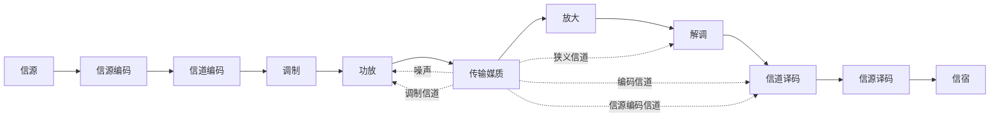
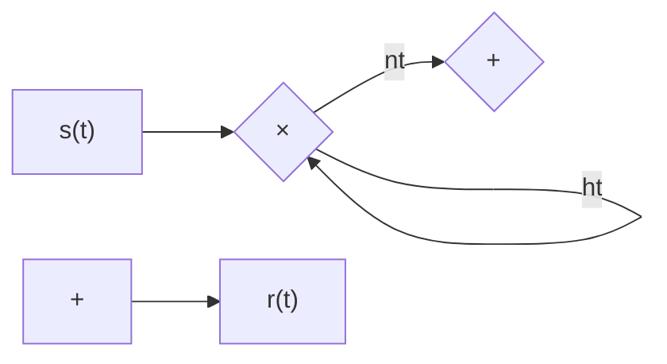
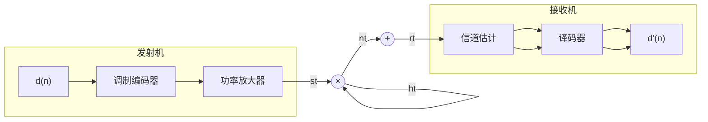
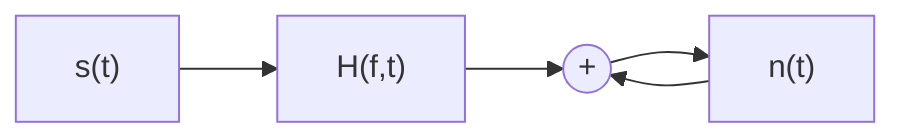
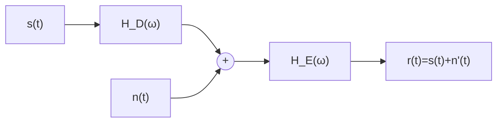
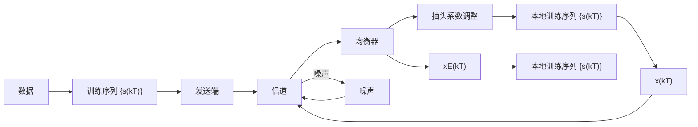

## 第7章 传输信道

## 7.1 引言

信道是信息传输的物理媒介，信道的构成可以是有线的，也可以是无线的；其中的特性可能是稳定的，也可能时变的，根据信道的不同特性可以将其分成多种不同的类型，本章将分析讨论各种不同信道的特性以及其对通信系统的影响。在一个信道复杂多变的通信系统中，信道的许多因素并不能够人为控制，只能够针对不同的通信系统工作环境，通过大量的统计分析，建立相应的信道模型。使得通信系统的接收端能够根据信道模型和当前获取的信道状态信息，估计当前的信道参数，预测其变化。在此基础上，对信道特性进行均衡等处理，才能实现信号的正确接收。

## 7.2 信道的定义和分类

## 7.2.1 信道的定义

通信的目的是要克服距离的障碍，实现信息的传递。从狭义上说，电磁波信号从通信系统的发送端发出，到达接收端，其间信号经过的传送路径，就是通信系统的信道。

通过前面各个有关通信系统章节的介绍可知，一个通信系统，从信源到信宿，中间会经历许多成对出现的功能模块，如信源编码器和信源译码器、信道编码器和信道译码器、调制器与解调器等。对通信系统的进一步深入学习还可了解到，仅就通信系统的物理层来说，这些成对出现的功能模块还可能包括交织和解交织、数据的复接和分接等更多的信号处理过程。因此，如果将这些成对出现的功能模块视为一种变换和反变换的关系，从研究任何一对特定功能模块的角度，数据经过发送端的某一功能模块的变换处理后发出，经过后续的功能模块和狭义的信道，到达接收端与其对应的功能模块，进行相应反变换处理后恢复输出，就这一对功能模块来说，中间经过的部分，就是它们的信道。如图7.2.1所示，典型地，在信道编码器和信道译码器之间，数据传输经过的路径可定义为编码信道；在调制器和解调器之间，信号传输经过的路径可定义为调制信道，等等。这样定义的信道统称为广义信道。

flowchart

图7.2.1 狭义信道与广义信道

实际上，在一个通信系统中，各种功能模块的加入，从本质上说都要经过相应的变换，使得经过处理后的信号，适合在特定的狭义信道中传输。对于不同的传输环境，狭义的信道也有多种不同的类型，如有线电缆或光纤组成的有线信道、收发两端定点直线（视距）传输的微波信道、经过大气层中电离层反射传输的短波信道、收发两端相互间有相对运动和有障碍物的移动通信信道等。通信系统研究与设计的最大挑战，就在于如何克服电磁波信号在传输信道中受到的衰落、畸变和噪声干扰等因素的影响，在接收端最大限度地恢复出原来发送端发出的信息。

信道特性分析、信道特性的估计和信道失真的校正等，都是通信信号处理与通信系统设计的核心问题，大量文献和专门著作论述了这些方面的内容。本章将扼要分析各种典型的信道（主要是指狭义信道）的特性，研究这些信道对信号传输的影响，以及消除这些影响的基本原理和方法。在分析过程中，通常把各个环节中引入的噪声统一视为在狭义信道中引入的加性噪声。本章中如果没有特别说明，信道都是指狭义的物理信道。

## 7.2.2 恒参信道

顾名思义，所谓恒参信道，一般是指信道的特性参数恒定不变的信道。严格来说，没有特性参数永远保持不变的信道，在对实际系统的分析过程中，若信道的参数在一段较长的时间内基本保持不变，就可以近似地视为恒参信道。有线的信号传输和较为理想的无线传输环境，信号经过的路径就可以视为恒参信道。典型地，由下面的传输媒质构成的信道通常都认为是恒参信道：

(1) 有线电缆 如过去电话载波传输系统中常用的架空明线; 目前仍然在大量使用的连接电话机到电信运营商端局交换机的双绞线, 计算机局域网中广泛使用的各类双绞线; 实现传统电话交换机间互连互通的同轴电缆, 有线电视系统网中使用的同轴电缆等。

有线电缆通常采用金属作为传输媒质，通常需要一对传输线构成一个传输信道，如架空明线中的一对导线、双绞线中绞合而成的两根铜线、同轴电缆中构成内导体的金属芯线和构成外导体的金属丝编织物，在这一对线间采用空气（如架空明线）或塑料（如双绞线和同轴电缆）进行相互隔离。

应用中主要根据信号传输的要求、经济性和架设的便利性等综合因素，选择使用不同的传输电缆。例如双绞线的价格相对低廉，其信号通带在十几 kHz 到几百 kHz 之间，双绞线特殊的绞合方式使得两根电缆在传输过程中受到的干扰基本相同，在传输差分信号时特别有利于抑制共模干扰；同轴电缆的信号通带在几十 kHz 到几十 MHz 之间，通过将其外导体接地，可有效屏蔽外界干扰。不同的电缆虽然传输特性不同，但信号在其传输过程中，信道的各种参数基本上保持不变。

(2) 光纤 光纤是以光导纤维作为传输媒质构成传输信道, 光纤构成传输信道时每个传输方向只需要一根光纤。光纤根据其适合传输不同类型光源的信号可分为多模光纤和单模光纤。多模光纤适合传输较为便宜的发光二极管发出的光信号, 光信号在光纤中以多种不同角度反射向前传播, 多模光纤的衰减较大, 通常若干千米就须进行信号的中继再生。单模光纤的光源需要采用较为昂贵的半导体激光器, 光纤对激光来说就像波导一样, 光线在其中一直向前传播, 单模光纤的衰减较小, 通常中继的距离可达数十千米以上。

因为光波的频率在 $10^{14} \mathrm{~Hz}$ 附近, 光纤的信道带宽可达上万 $\mathrm{GHz}$ 。目前传输比特率从几百 Mbps 到几百 Gbps 的光纤已经获得广泛应用。光纤不易受干扰, 物理特性稳定, 因此是性能良好的恒参信道。除此之外, 相比电缆, 光纤还具有体积小、质量轻、传输损耗小和不易被窃听等优点。另外, 制作光纤的原材料是硅玻璃, 几乎取之不尽。光纤可以说是人类迄今为止发现的最有效的有线传输媒质, 华裔科学家高锟因发明光纤获得 2009 年的诺贝尔物理学奖。

(3) 无线视距中继 这里所说的无线视距中继特指采用定向天线或通过卫星转发信号实现的电磁波信号的视距传播。无线视距中继系统工作在超短波或微波波段。在地面实现直射传播中继时, 由于地球表面曲率的影响, 中继站点的距离一般在 $50 \mathrm{~km}$ 左右。利用定向天线使电磁波波束集中, 信号能量可高效利用, 架设位置的选择可使得两传输站点之间没有障碍物等因素影响, 传输信道条件稳定, 因此可视为一种恒参信道。卫星通信是以人造地球卫星作为中继站的一种通信方式, 当人造地球卫星运行在赤道平面上的地球同步轨道上时, 卫星的自转与地球的自转同步, 24 小时自转一周, 地球与卫星是相对静止的, 在没有阻挡的环境下, 卫星与地面虽然相距数千千米, 也是一种直射的视距传输, 在没有雨雪影响的情况下, 信道的特性稳定, 同样可视为一种恒参信道。

恒参信道的传递函数可以表示为

$$
H (\omega) = | H (\omega) | \mathrm{e} ^ {\mathrm{j} \varphi (\omega)} \tag {7.2.1}
$$

注意到传递函数的幅频特性 $|H(\omega)|$ 和相频特性 $\varphi(\omega)$ 都是与时间无关的函数。对于大量并不处于与地球同步轨道卫星与地面站间的星地信道，则一般不能视为恒参信道。

## 7.2.3 随参信道

无线传输可使人们在通信过程中摆脱对电缆或光缆的约束，实现包括在移动等复杂环境下的通信。无线信道的频率范围及主要应用如图 7.2.2 所示，图中左边一列是按照电波波长数量级来进行划分的频带名称，右边一列是对频段范围的形象定义，中间列出的则是不同频率范围的主要应用。

other

| Frequency Band | Optical Type | Frequency Range | Frequency Range |
| :--- | :--- | :--- | :--- |
| 10^-8 cm | 紫外光 | N/A | N/A |
| 10^-8 cm | 可见光 | N/A | N/A |
| 10^-8 cm | 红外光 | N/A | N/A |
| 10^-8 cm | 光波 | 10^14 Hz | N/A |
| 0.1 cm | 毫米波 | N/A | 300 GHz |
| 0.1 cm | EHF | N/A | 30 GHz |
| 0.1 cm | 超高频 | N/A | 3 GHz |
| 0.1 cm | SHF | N/A | 3 GHz |
| 0.1 cm | 特高频 | N/A | 300 MHz |
| 0.1 cm | UHF | N/A | 300 MHz |
| 0.1 cm | 甚高频 | N/A | 30 MHz |
| 0.1 cm | VHF | N/A | 30 MHz |
| 0.1 cm | 高频 | N/A | 3 MHz |
| 0.1 cm | HF | N/A | 3 MHz |
| 0.1 cm | 中频 | N/A | 300 kHz |
| 0.1 cm | MF | N/A | 300 kHz |
| 0.1 cm | 低频 | N/A | 30 kHz |
| 0.1 cm | LF | N/A | 30 kHz |
| 0.1 cm | 甚低频 | N/A | 3 kHz |
| 0.1 cm | VLF | N/A | 3 kHz |

图 7.2.2 电磁波信号频率划分及应用

在无线信道中,除了上面列举的无线视距传输信道,绝大多数都是信道特性参数随时间随机变化的信道,通常称这种信道为随参信道。下面列出三种不同类型的随参信道及其基本特性:

(1) 短波和短波电离层反射信道 短波一般是指波长为 10\~100m、相应的频率范围为 3\~30MHz 的无线电信号。短波信号可以在地球表面传播，也可以通过天空中的电离层反射传播。短波信号在地面传播同样会受到地球表面曲率的影响，一般通信距离在几十千米的范围内。通过电离层的反射进行传播是短波信号的重要特点，信号经过电离层的一次反射或与地球表面形成的若干次反射传播，可使通信的距离达到数千千米甚至上万千米。电离层是大气层受到太阳紫外线等宇宙射线照射后产生的一个包围地球的离子层，位于从地球表面上方 60\~400km 的不同高度位置。电离层可多达 4 层（分别定义为 D, E, F₁ 和 F₂ 层），电离层的电子密度、高度等特性会随太阳照射条件等环境因素的影响而发生变化。最明显

的特征是其特性随白昼和夜晚的变化。白天太阳照射强烈时，高度为60～80km的D层中电离子浓度增大，能够吸收大量的2MHz以下的电磁波，信号衰减严重；晚上D层浓度降低，几乎完全消失，此时电磁波可到达外层的F层，F层能够有效地反射30MHz以下的电磁波信号，信道传输条件明显改善。

短波通信的接收端通常收到的是经过多个不同途径到达的信号。特别是当接收经电离层一次或多次反射的短波信号时，信号会同时经历多条复杂的时变路径的传输。通信中使用的无线电信号一般是交变的电磁波向量，接收端收到的是经过多个不同路径到达的交变向量信号合成的结果，这种信号称为多径信号。由于经历的不同路径的特性是时变的，多个向量信号在接收端合并时，可能因同相的成分增多可使信号增强，也可能相位抵消的成分增多而使信号衰落。信号的增强或衰落受多种复杂因素的影响，通常是随时间变化的。另外，接收到的多径信号往往还不能仅仅考虑其幅度是增加或衰落，因为经不同路径到达的信号时延不同，当这种时延的差异与码元的周期大小可以比拟时，会出现严重的码间串扰，从而对接收符号的正确判决造成很大的影响。

(2) 散射信道 距离地面高度在 $10 \sim 12 \mathrm{~km}$ 的大气层称为对流层, 处于这一高度的大气层由于大气的湍流运动使得这一部分大气密度不均匀, 入射的电磁波信号进入对流层时会产生散射现象, 散射的信号部分会回到地面, 形成散射传输信道。这种信道称之为对流层散射信道。另外, 太空中大量高速进入大气层的流星也会使得气体产生电离, 形成大量散射体, 由此也可构成所谓的流星余迹散射信道。

对流层的大气湍流活动受多种因素的影响，本身就是一种复杂的随机运动，因此由此构成的散射信道是一种典型的时变随参信道。相对电离层，对流层距离地面较低，散射形成的宏观折射的一跳通信距离为 100～500km。从 40MHz 到 4GHz 的电波信号都可以通过对流层散射进行远距离传播。

(3) 移动通信信道 典型的移动通信信道是指移动通信网中用户到基站之间的无线传输路径部分。由于受地形地貌、植被及建筑物等反射、折射和散射等多种因素的影响，加之用户终端通信时可能处在移动的环境中，电波的传播过程会遇到包括路径衰落、多径、时延和移动等综合问题，信号的传输路径可以非常复杂，移动通信信道也是一种典型的随参信道。移动通信系统的工作频率一般从几百MHz到若干GHz。

随参信道形式上可以表示为

$$
H (\omega , t) = \left| H (\omega , t) \right| \mathrm{e} ^ {\mathrm{j} \varphi (\omega , t)} \tag {7.2.2}
$$

注意此时传递函数的幅频特性 $|H(\omega, t)|$ 与相频特性 $\varphi(\omega, t)$ 一般是一个随机过程。

## 7.3 信道的损耗与衰落特性

发送与接收信号的简要表达形式 在实际系统中传输的都是实信号，在大多数场合，发送信号都可以表达为如下形式：

$$
s (t) = x _ {\mathrm{I}} (t) \cos \omega_ {\mathrm{c}} t - x _ {\mathrm{O}} (t) \sin \omega_ {\mathrm{c}} t \tag {7.3.1}
$$

为分析方便起见，通常引入相应的复基带信号表示方式

$$
x (t) = x _ {\mathrm{I}} (t) + \mathrm{j} x _ {\mathrm{O}} (t) \tag {7.3.2}
$$

由此，式（7.3.1）可以简洁地表示为

$$
s (t) = \operatorname{Re} \left(x (t) \mathrm{e} ^ {\mathrm{j} \omega_ {\mathrm{c}} t}\right) \tag {7.3.3}
$$

同样，接收信号可以表示为

$$
r (t) = y _ {\mathrm{I}} (t) \cos \omega_ {\mathrm{c}} t - y _ {\mathrm{O}} (t) \sin \omega_ {\mathrm{c}} t + n (t) = \operatorname{Re} \left(y (t) \mathrm{e} ^ {\mathrm{j} \omega_ {\mathrm{c}} t}\right) + n (t) \tag {7.3.4}
$$

式中，

$$
y (t) = y _ {1} (t) + \mathrm{j} y _ {0} (t) \tag {7.3.5}
$$

是信号 $s(t)$ 经过信道传输后，接收端收到的信号所对应的复基带信号，而 $n(t)$ 是信号在传输过程中引入的加性噪声。

路径损耗值 发送的信号经信道传输后，会受到传输媒质的吸收、热损、信号能量扩散、物体阻挡和经历多路径等各种因素的影响，使接收端得到的信号功率受到衰减。在恒参信道中，路径损耗通常只与传输距离有关；而在随参信道中，路径损耗值不仅与距离有关，还会受到上述多种因素的影响而呈现随机性。因此，一般采用统计平均值来描述信号的功率。

发送信号 $s(t)$ 的功率一般记为 $P_{t}$ ，接收信号 $r(t)$ 的功率一般记为 $P_{r}$ 。信道的路径损耗值定义为

$$
L _ {\mathrm{P}} = P _ {\mathrm{t}} / P _ {\mathrm{r}} \tag {7.3.6}
$$

在工程上，信道的路径损耗值通常采用分贝值的形式表示，此时上式变为

$$
L _ {\mathrm{p}} \mathrm{dB} = 1 0 \lg P _ {\mathrm{t}} / P _ {\mathrm{r}} \tag {7.3.7}
$$

式中，符号lg表示以10为底的对数。

信号功率的 dBm 值 在通信工程中，习惯上采用与 1 毫瓦（mW）比值的相对功率值表示信号功率的大小。若信号以瓦（W）为单位的功率值为 P，则其相应的 dBm 值为

$$
P (\mathrm{dBm}) = 1 0 \lg P / 0. 0 0 1 \tag {7.3.8}
$$

## 7.3.1 自由空间传输损耗模型

自由空间传输信道 自由空间传输信道是指发射机与接收机之间没有任何障碍，信号沿直射传播的信道。这种信道也称视距（Line-Of-Sight，LOS）信道。在自由空间传输信道中，信号功率的损失主要受到信号能量在传递过程中扩散的影响，因此，接收到的信号功率只与传输距离 $d$ 、发射天线的增益 $G_{\mathrm{t}}$ 、接收天线的增益 $G_{\mathrm{r}}$ 有关。根据电磁波信号传播的基本原理，若发射信号的功率为 $P_{\mathrm{t}}$ ，接收信号的功率可以表示为

$$
P _ {\mathrm{r}} = G _ {\mathrm{t}} G _ {\mathrm{r}} \left(\frac {\lambda}{4 \pi d}\right) ^ {2} \cdot P _ {\mathrm{t}} \tag {7.3.9}
$$

式中， $\lambda$ 是信号的波长， $\lambda$ 与光速 $c$ 和信号频率 $f$ 间的关系为

$$
\lambda = c / f \tag {7.3.10}
$$

相应地，对于自由空间传输路径，接收信号可以表示为

$$
r (t) = \operatorname{Re} \left(\frac {\sqrt {G _ {\mathrm{t}} G _ {\mathrm{r}}} \lambda}{4 \pi \mathrm{d}} x (t) \mathrm{e} ^ {- \mathrm{j} \frac {2 \pi d}{\lambda}} \mathrm{e} ^ {\mathrm{j} \omega_ {\mathrm{c}} t}\right) + n (t) \tag {7.3.11}
$$

式中， $\frac{\sqrt{G_{t}G_{r}}\lambda}{4\pi d}$ 是信号在传输过程中引入的幅度衰减因子， $e^{-j\frac{2\pi d}{\lambda}}$ 是信号经过传播距离d后引入的附加相移。

自由空间路径损耗可以表示为

$$
L _ {\mathrm{P}} = P _ {\mathrm{t}} / P _ {\mathrm{r}} = (G _ {\mathrm{t}} G _ {\mathrm{r}}) ^ {- 1} \left(\frac {\lambda}{4 \pi d}\right) ^ {- 2} \tag {7.3.12}
$$

相应地，其自由空间路径损耗的 dB 值为

$$
L _ {\mathrm{p}} \mathrm{dB} = 1 0 \lg P _ {\mathrm{t}} / P _ {\mathrm{r}} = - 1 0 \lg \left(G _ {\mathrm{t}} G _ {\mathrm{r}} \left(\frac {\lambda}{4 \pi d}\right) ^ {2}\right) \tag {7.3.13}
$$

【例 7.3.1】某一移动接入网基站信号覆盖的半径为 500m，载波频率 $f_{c}=1.8GHz$ ，基站与用户均使用全向天线，用户终端正常接收通信时要求接收功率不小于 $0.1\mu W$ ，假定用户终端与基站间存在视距传播路径，若传输路径损耗采用自由空间传输损耗模型，基站所需的发射功率应为多少？

解：因为基站与用户均使用全向天线，所以 $G_{t}=G_{r}=1$ 。基站的小区半径为 500m，考虑小区边缘的用户终端能够可靠工作，因此应保证在 d=500m 时，接收功率 $P_{r}=0.1\mu W$ 。由式（7.3.9），基站所需的发射功率为

$$
\begin{array}{l} P _ {\mathrm{t}} = \left(G _ {\mathrm{t}} G _ {\mathrm{r}}\right) ^ {- 1} \left(\left(\frac {\lambda}{4 \pi d}\right)\right) ^ {- 2} \cdot P _ {\mathrm{r}} = \left(\frac {4 \pi d}{\lambda}\right) ^ {2} \cdot P _ {\mathrm{r}} \\ = \left(\frac {4 \pi d}{c / f _ {c}}\right) ^ {2} \cdot P _ {\mathrm{r}} = \left(\frac {4 \pi \times 5 0 0}{3 \times 1 0 ^ {8} / 1 . 8 \times 1 0 ^ {9}}\right) ^ {2} \times 0. 1 \times 1 0 ^ {- 6} = 1 4 2. 1 2 \mathrm{W} \\ \end{array}
$$

□

## 7.3.2 传输路径损耗模型

对于恒参信道, 路径损耗通常只与传输路径的长度和传输媒质 (材料) 有关。通常单位长度 (距离) 的路径损耗值是一个常数, 因此路径损耗很容易计算。

对于随参信道，由于电波传播的路径随机时变的复杂性，使得很难有一般的方法，可以准确地计算传输路径损耗的大小。在工程实际中，通常只能根据系统的工作环境和特点，采用如下几种方法建立传输路径的损耗模型。

(1) 射线跟踪模型 射线跟踪法采用几何方法来近似电波在传播过程中直射、反射和绕射等因素对信号的综合影响。当分析某一发射机发出的信号在某一具体位置的衰减大小时, 根据传播路径上主要物体的几何形状和其介电性质，计算信号经各主要传播路径到达该特定位置的信号值，然后得到合成的结果。在静止的环境下，射线跟踪法能够较精确地建模接收信号的功率，现在业界已经有一些专门基于射线跟踪法的路径损耗软件分析工具。但对于发射机和接收机之间有相对运动的场合，虽然理论上可以通过逐点的分析计算整个路径的传输功率损耗，但其结果一般很难反映因移动产生的多普勒效应，以及因多径传输产生的时延扩展等综合复杂因素的影响。

(2) 路径损耗经验模型 另一种随参信道的建模方法是所谓的路径损耗经验模型, 这种方法通常不需要传播路径上非常具体的几何结构条件, 而是根据大量实测统计得到的具体数据, 将电波传播的环境分为若干大类, 根据不同的类别设置相应的衰减系数, 由此建立路径损耗的经验估计公式。典型的路径损耗经验模型为

$$
L _ {\mathrm{p}} = \frac {P _ {\mathrm{t}}}{P _ {\mathrm{r}}} = K \left(\frac {d _ {0}}{d}\right) ^ {- \gamma} \tag {7.3.14}
$$

式中 $d_0$ 称为天线远场参考距离，经验公式必须在 $d \geqslant d_0$ 的条件下才有效； $\gamma$ 是路径损耗指数，它是一个与公式的运用环境有关的参数。表7.3.1给出了不同环境下路径损耗指数的典型值。在某一环境下， $\gamma$ 取值也还有差异，可根据

表 7.3.1 路径损耗指数值 $^{[1]}$

| 环境 | γ取值范围 |
|---|---|
| 城市宏小区 | 3.7~6.5 |
| 城市微小区 | 2.7~3.5 |
| 商务写字楼同层内部 | 1.6~3.5 |
| 商务写字楼异层间 | 2.0~6.0 |
| 商店 | 1.8~2.2 |
| 工厂 | 1.6~3.3 |
| 家居 | 3.0 |

具体情况在一定范围内进行调整。例如，损耗指数会随着信号频率的升高而增大，随着天线位置增高而减小等。K 是一个与天线特性和信道平均损耗有关的常数，其取值一般等于全向天线在距离为 $d_{0}$ 处的自由空间路径增益，

$$
K = \left(\frac {\lambda}{4 \pi d _ {0}}\right) ^ {- 2} \tag {7.3.15}
$$

式（7.3.14）定义的衰落 $L_{\mathrm{p}}$ 是传输距离 $d$ 的函数。与后面将要讨论的影响信号衰落特性的物理量相比， $d$ 具有最大的物理尺度，因此 $L_{\mathrm{p}}$ 通常也称大尺度衰落。

## 7.3.3 传输信道阴影衰落模型

无线电波在传播路径上遇到起伏的地形、建筑物、高大的植被等障碍物的阻挡时，会产生信号的衰落，这种影响就像光线受到阻挡时产生的阴影效应一样，因此形象地称之为阴影衰落。接收机在这些障碍物之间移动时，阴影衰落的大小会相应地起伏变化，这种变化的速度与后面将要讨论的信号功率急剧变化的快衰落特性相比，要缓慢得多，因此阴影衰落呈现一种慢衰落的特性。阴影衰落的大小与多种因素有关，如障碍物的位置、大小和介电特性等，通常需要用统计模型来描述其随机衰落特性。大量实测数据的统计分析表明，阴影衰落的大小满足对数正态分布特性，即阴影衰落值 $SL_{p}=P_{t}/P_{r}$ 作为随机变量，其分布特性为

$$
p (\mathrm{SL} _ {\mathrm{P}}) = \frac {a}{\sqrt {2 \pi} \cdot 1 0 \lg \sigma_ {\mathrm{SL} _ {\mathrm{P}}}} \exp \left(- \frac {\left(1 0 \lg \mathrm{SL} _ {\mathrm{P}} - 1 0 \lg E [ \mathrm{SL} _ {\mathrm{P}} ]\right) ^ {2}}{2 (1 0 \lg \sigma_ {\mathrm{SL} _ {\mathrm{P}}}) ^ {2}}\right) \tag {7.3.16}
$$

式中 $a=10/\ln10$ 是一常数， $E[\cdot]$ 表示取均值。若记 $\mu_{SL_{PdB}}=10\lg E[SL_{P}]$ ， $\sigma_{SL_{PdB}}=10\lg\sigma_{SL_{P}}$ ， $SL_{PdB}=10\lg SL_{P}$ ，则上式又可以表示为

$$
p (\mathrm{SL} _ {\mathrm{PdB}}) = \frac {a}{\sqrt {2 \pi} \cdot \sigma_ {\mathrm{SL} _ {\mathrm{PdB}}}} \exp \left(- \frac {(\mathrm{SL} _ {\mathrm{PdB}} - \mu_ {\mathrm{SL} _ {\mathrm{PdB}}}) ^ {2}}{2 (\sigma_ {\mathrm{SL} _ {\mathrm{PdB}}}) ^ {2}}\right) \tag {7.3.17}
$$

即阴影衰落 $\mathrm{SL}_{\mathrm{P}} = P_{\mathrm{t}} / P_{\mathrm{r}}$ 的dB值 $\mathrm{SL}_{\mathrm{PdB}}$ 满足正态分布。在移动通信的传输场合，建筑物等障碍物因素造成的阴影衰落的物体尺度与信号的传输距离相比通常不能忽略，所以阴影衰落有时也称中等尺度衰落。

信号衰落的大小习惯上又称衰落深度，其变化与信号的频率与障碍物的状况有关。一般地，频率较高的信号比频率较低的信号容易穿透建筑物，而频率较低的信号比频率较高的信号具有较强的绕射能力。方差 $\sigma_{SL_{p}}$ 的 dB 值 $\sigma_{SL_{p}dB}$ 与地形地貌特性及电波频率之间的关系可由表 7.3.2 大致描述。

表7.3.2 $\sigma_{\mathrm{SL\_pdB}}$ 取值表[2]

| 频率/MHz | 准平坦地形 | 不规则地形(高度变化 $\Delta h/m$ ) |  |  |  |
|---|---|---|---|---|---|
| 市区 | 郊区 | 50 | 150 | 300 |  |
| 50 |  |  | 8 | 9 | 10 |
| 150 | 3.5~5.5 | 4.0~7.0 | 9 | 11 | 13 |
| 450 | 6.0 | 7.5 | 11 | 15 | 18 |
| 900 | 6.5 | 8.0 | 14 | 18 | 24 |

## 7.3.4 路径损耗与阴影衰落综合模型

路径损耗与阴影衰落对信号综合的影响就构成了综合衰落模型，形成信号功率沿着传输距离的宏观变化。由式（7.3.14），若路径损耗为 $L_{\mathrm{p}} = P_{\mathrm{t}} / P_{\mathrm{r}} = K\left(\frac{d_{0}}{d}\right)^{-\gamma}$ ，阴影衰落为 $\mathrm{SL}_{\mathrm{p}}$ ，则总的衰落可以表示为

$$
L _ {\mathrm{PS}} = L _ {\mathrm{P}} \cdot \mathrm{SL} _ {\mathrm{P}} = K \left(\frac {d _ {0}}{d}\right) ^ {- \gamma} \cdot \mathrm{SL} _ {\mathrm{P}} \tag {7.3.18}
$$

若采用 dB 值，则总的衰落又可以表示为

$$
L _ {\mathrm{PSdB}} = 1 0 \lg K - 1 0 \gamma \lg \frac {d _ {0}}{d} + \mathrm{SL} _ {\mathrm{PdB}} \tag {7.3.19}
$$

图 7.3.1(a) 描述了随着接收机与发射机距离的增大, 路径损耗倒数 $\lg L_{\mathrm{p}}^{-1} = 10 \lg (P_{\mathrm{r}} / P_{\mathrm{t}})$ 的变化特性; 若接收机与发射机间除了距离的影响, 中间还有若干障碍物造成的阴影衰落影响, 则当接收机经过这段距离时, 综合的衰落特性如图 7.3.1(b) 所示。

line

| lg d/d0 | Gain (K/dB) |
| --- | --- |
| 0 | K |
| lg d/d0 | 0 |

(a) 路径损耗

line

| lg d/d0 | K/dB |
| --- | --- |
| 0 | ~10 |
| ~0.1 | ~9 |
| ~0.2 | ~8 |
| ~0.3 | ~6 |
| ~0.4 | ~7 |
| ~0.5 | ~8 |
| ~0.6 | ~7 |
| ~0.7 | ~6 |
| ~0.8 | ~5 |
| ~0.9 | ~6 |
| ~1.0 | ~5 |
| ~1.1 | ~4 |
| ~1.2 | ~3 |
| ~1.3 | ~2 |
| ~1.4 | ~1 |
| ~1.5 | 0 |

(b) 路径损耗与阴影衰落的综合影响  
图 7.3.1 路径损耗与阴影衰落的影响

## 7.4 信道的统计多径模型

## 7.4.1 多普勒频移与多径接收信号

多普勒频移 当发射机与接收机间有相对移动时，接收信号的频率通常会发生变化，这种变化称为多普勒频移或多普勒效应。多普勒频移的几何关系如图7.4.1所示，图中 $\theta$ 是入射电波与接收机运动方向的夹角， $-\pi/2\leqslant\theta\leqslant\pi/2$ ，v是运动速度。若接收机朝着接近发射机的方向运动， $\theta$ 取正值；若接收机朝着远离发射机的方向运动， $\theta$ 取负值。若信号的波长为 $\lambda$ ，在一个很短的时间 $\Delta t$ 内，发射机与接收机间的移动相对静止状态会产生行程差

text_image

入射电波
vcosθ·Δt
θ
运动方向
Δd=v·Δt

图 7.4.1 多普勒频移几何示意图

$$
\Delta d = v \cos \theta \cdot \Delta t
$$

(7.4.1)

行程差 $\Delta d$ 对于波长为 $\lambda$ 的信号，产生的相应相位变化为

$$
\Delta \phi = \frac {\Delta d}{\lambda} \cdot 2 \pi = \frac {v \cos \theta \cdot \Delta t}{\lambda} \cdot 2 \pi \tag {7.4.2}
$$

由频率与相位间的关系，可得相应的频率变化为

$$
f _ {\mathrm{D}} = \frac {1}{2 \pi} \frac {\Delta \phi}{\Delta t} = \pm \frac {v}{\lambda} \cos \theta \tag {7.4.3}
$$

$f_{D}$ 就是所谓的多普勒频移。由 $\theta$ 取值的特点，若接收机朝着接近发射机的方向运动， $f_{D}$ 取正值，反之 $f_{D}$ 取负值。换句话说，若接收机迎向发射机运动，相应地信号载波的频率会增大；而背离其运动时，相应地信号载波的频率会减小。

若发射的信号为 $s(t) = \mathrm{Re}(x(t)\mathrm{e}^{\mathrm{j}\omega_{\mathrm{c}}t})$ ，则由于发射机与接收机间的移动引入多普勒频移的影响后，由式（7.4.4）表示的接收信号变为

$$
r (t) = \operatorname{Re} \left(a \cdot x (t) \mathrm{e} ^ {\mathrm{j} \left(\omega_ {\mathrm{c}} t + 2 \pi f _ {\mathrm{D}} t\right)}\right) + n (t) = \operatorname{Re} \left(a \cdot x (t) \mathrm{e} ^ {\mathrm{j} \left(\omega_ {\mathrm{c}} t \pm 2 \pi \left(\frac {\nu}{\lambda} \cos \theta\right) t\right)}\right) + n (t) \tag {7.4.4}
$$

式中 $f_{\mathrm{D}} = v \cos \theta / \lambda$ 是多普勒效应引起的频移, $2 \pi (v \cos \theta / \lambda) t$ 是相应的附加相移, 多普勒频移中的“±”符号说明多普勒频移可能会导致载波频率变大, 也可能会导致载波频率变小, 与运动方向有关。在后面的讨论中, 为简化起见, 把“±”归并到速度变量 $v$ 中, 使其具有方向属性。

【例 7.4.1】已知信号的载波频率 $f_{c}=900MHz$ ，接收机以速度 $v=100km/h$ 背离发射机运动，电波的入射角度 $\theta=45^{\circ}$ ，求此时接收信号的载波频率。

解：已知电磁波的速度与光速相同，为 $c = 300000\mathrm{km / s}$ ，因此载波信号的波长

$$
\lambda = \frac {c}{f _ {\mathrm{c}}} = \frac {3 0 0 0 0 0 \times 1 0 ^ {3}}{9 0 0 \times 1 0 ^ {6}} = \frac {1}{3} (\mathrm{m})
$$

相应地，多普勒频移为

$$
f _ {\mathrm{D}} = \frac {\nu}{\lambda} \cos \theta = \frac {- 1 0 0 \times 1 0 ^ {3} / (6 0 \times 6 0)}{1 / 3} \cos 4 5 ^ {\circ} = - 5 8. 9 (\mathrm{Hz})
$$

式中，多普勒频移取负数是因为接收机背离发射机运动，此时收到信号的载波频率变为

$$
f _ {\mathrm{c}} ^ {\prime} = 9 0 0 \times 1 0 ^ {3} - 5 8. 9 = 8 9 9. 9 4 1 \times 1 0 ^ {3} (\mathrm{Hz}) \quad \square
$$

多径接收信号 信号在传输过程中，传输路径上可能存在各种反射体，此时到达接收机的信号是可能包括直射信号和反射信号在内的多个信号叠加的结果。发射机发射一个脉冲，经过多径信道后到达接收机的将是一个脉冲序列，其中的每个脉冲对应于一个径的信号。图7.4.2(a)给出了一个多径传输的示意图，图7.4.2(b)给出了信道相应的冲激响应。在接收机收到的多径信号中，有些径的信号是由单个反射体反射造成的，如传输的时延差异较大，会形成一个可分辨信号，如图中的信号 $r_{2}$ 。有些径的信号是由一个反射体簇的反射造成的，这些反射信号的传输时延差异可能很小，加上每一径的信号本身有一定的时间宽度，因此这些信号形成了一簇不可分辨的信号，如图中的信号 $r_{3}, r_{4}, r_{5}, r_{6}$ 。

一般地，若发射机与接收机位置固定不变，两者之间共有 N 条传输路径，则信道的冲激响应可以表示为

$$
h (\tau) = \sum_ {i = 1} ^ {N} \alpha_ {i} \mathrm{e} ^ {- \mathrm{j} \phi_ {i}} \delta \left(\tau - \tau_ {i}\right) \tag {7.4.5}
$$

式中， $\alpha_{i}$ 是第 $i$ 条路径的幅度衰减系数； $\tau_{i}$ 是第 $i$ 条路径的传输时延； $\phi_{i} = \omega_{\mathrm{c}}\tau_{i} = 2\pi f_{\mathrm{c}}\tau_{i}$ 是第 $i$ 条路径的

附加相移。相应地，接收信号可以表示为

$$
r (t) = \mathrm{Re} \left(\sum_ {i = 1} ^ {N} \alpha_ {i} x (t - \tau_ {i}) \mathrm{e} ^ {- \mathrm{j} \phi_ {i}} \mathrm{e} ^ {\mathrm{j} \omega_ {\mathrm{c}} t}\right) + n (t) \tag {7.4.6}
$$

text_image

反射体簇
r6
r5
r4
r3
r1
r2
s
单反射体
ΣN
i=1ri

(a)

text_image

r₁
r₂
r₃
r₄
r₅
r₆
O
t

(b)  
图 7.4.2 信号的多径传输和多径信道的冲激响应

若发射机与接收机之间除了存在多径传输的影响，两者之间还有相对运动，此时由于多普勒效应和信号衰落变化等因素的影响，幅度的衰减和附加的相移都可能成为时变的函数，此时信道的等效基带冲激响应可以用如下的形式表示 $^{[1]}$ ：

$$
h _ {\mathrm{L}} (\tau , t) = \sum_ {i = 1} ^ {N (t)} \alpha_ {i} (t) \mathrm{e} ^ {- \mathrm{j} \phi_ {i} (t)} \delta \big (\tau - \tau_ {i} (t) \big) \tag {7.4.7}
$$

此时冲激响应 $h(\tau, t)$ 是以时间 $t$ 作为参量的时变函数, 其中第 $i$ 径的幅度衰减系数 $\alpha_{i}(t)$ 、附加相移 $\phi_{i}(t)$ 、时延 $\tau_{i}(t)$ 都将是随时间变化的函数。甚至多径信号径的数量 $N(t)$ 也可能是一个时间的函数。此时, 接收信号可以一般地表示为

$$
\begin{array}{l} r (t) = \operatorname{Re} \left(\left(h _ {\mathrm{L}} (\tau , t) * x (t)\right) \mathrm{e} ^ {\mathrm{j} 2 \pi f _ {\mathrm{c}} t}\right) = \operatorname{Re} \left(\left(\int_ {- \infty} ^ {\infty} h _ {\mathrm{L}} (\tau , t) x (t - \tau) \mathrm{d} \tau\right) \mathrm{e} ^ {\mathrm{j} 2 \pi f _ {\mathrm{c}} t}\right) \\ = \operatorname{Re} \left(\left(\int_ {- \infty} ^ {\infty} \sum_ {i = 1} ^ {N (t)} \alpha_ {i} (t) \mathrm{e} ^ {- \mathrm{j} \phi_ {i} (t)} \delta \left(t - \tau_ {i} (t)\right) x (t - \tau) \mathrm{d} \tau\right) \mathrm{e} ^ {\mathrm{j} 2 \pi f _ {\mathrm{c}} t}\right) \tag {7.4.8} \\ = \operatorname{Re} \left(\left(\sum_ {i = 1} ^ {N (t)} \alpha_ {i} (t) \mathrm{e} ^ {- \mathrm{j} \phi_ {i} (t)} \int_ {- \infty} ^ {\infty} \delta \left(t - \tau_ {i} (t)\right) x (t - \tau) \mathrm{d} \tau\right) \mathrm{e} ^ {\mathrm{j} 2 \pi f _ {c} t}\right) \\ = \operatorname{Re} \left(\left(\sum_ {i = 1} ^ {N (t)} \alpha_ {i} (t) \mathrm{e} ^ {- \mathrm{j} \phi_ {i} (t)} x (t - \tau_ {i} (t))\right) \mathrm{e} ^ {\mathrm{j} 2 \pi f _ {\mathrm{c}} t}\right) \\ \end{array}
$$

由上式可见，此时每一径信号的时延、幅度和相位都可能是时变的量。

## 7.4.2 窄带衰落模型

从前面有关信号的基带传输和调制传输的分析可知, 信号的带宽主要由基带信号的脉冲波形决定, 已调信号频谱的主瓣宽度一般等于基带信号脉冲周期倒数的 2 倍。如果多径信号的时延与信号带宽的倒数相比很小, 意味着多径时延与符号周期相比很小, 此时时延信号的波形很大程度上是同相叠加, 信号不会有明显的失真。反之, 如果多径信号的时延与信号带宽的倒数相比相当或较大时, 时延信号的波形叠加后就会被明显地扩展, 从而造成信号的严重失真和码间串扰。本节首先考虑多径时延与符号周期相比很小的情形。

记发送符号的码元周期为 $T_{\mathrm{S}}$ ，由奈奎斯特准则，对于基带传输系统，满足无码间串扰最大频带利用率为每秒每赫兹2波特，而对于调制传输系统，相应的最大频带利用率为每秒每赫兹1波特。若引入滚降系数 $\alpha$ ，则频带利用率降低为每秒每赫兹 $1 / (1 + \alpha)$ 波特。因此，一般地，根据无码间串扰设计的调制传输系统，信号的带宽 $W$ 与码元周期 $T_{\mathrm{S}}$ 之间有如下关系：

$$
R _ {\mathrm{S}} = \frac {1}{T _ {\mathrm{S}}} = \frac {W}{1 + \alpha}, \quad T _ {\mathrm{S}} = \frac {1 + \alpha}{W} \tag {7.4.9}
$$

式中 $0 \leqslant \alpha \leqslant 1$ ，即一般地有 $T_{\mathrm{S}} \propto W^{-1}$ 。记信道的最大时延

$$
\tau_ {\max} = \max _ {i \in N (t)} \left\{\tau_ {i} (t) \right\} \tag {7.4.10}
$$

若满足条件

$$
\tau_ {\mathrm{max}} \ll W ^ {- 1} \tag {7.4.11}
$$

则意味着所有径的时延 $\tau_{i}(t), i=1,2,\cdots,N(t)$ 均远小于码元周期 $T_{S}$ ，此时有

$$
x \big (t - \tau_ {i} (t) \big) \approx x (t), i = 1, 2, \dots , N (t) \tag {7.4.12}
$$

由此，式（7.4.8）可以改写为

$$
\begin{array}{l} r (t) = \mathrm{Re} \left(\left(\sum_ {i = 1} ^ {N (t)} \alpha_ {i} (t) \mathrm{e} ^ {- \mathrm{j} \phi_ {i} (t)} x (t - \tau_ {i} (t))\right) \mathrm{e} ^ {\mathrm{j} 2 \pi f _ {\mathrm{c}} t}\right) \tag {7.4.13} \\ \approx \mathrm{Re} \left(\left(\sum_ {i = 1} ^ {N (t)} \alpha_ {i} (t) \mathrm{e} ^ {- \mathrm{j} \phi_ {i} (t)} x (t)\right) \mathrm{e} ^ {\mathrm{j} 2 \pi f _ {\mathrm{c}} t}\right) = \mathrm{Re} \left(\left(\sum_ {i = 1} ^ {N (t)} \alpha_ {i} (t) \mathrm{e} ^ {- \mathrm{j} \phi_ {i} (t)}\right) x (t) \mathrm{e} ^ {\mathrm{j} 2 \pi f _ {\mathrm{c}} t}\right) \\ \end{array}
$$

通常把满足条件 $\tau_{\max} \ll W^{-1}$ 的这种多径特性的信道称为窄带衰落信道, 相应的分析模型称为窄带衰落模型。图 7.4.3 给出了一个调制的符号脉冲, 经 3 径的窄带衰落信道后产生变化的示意图, 其中图(a)表示发送的一个调制脉冲信号, 图(b)表示 3 个具有不同时延路径的信号, 图(c)是 3 个信号叠加后的结果。可见, 若各个径的时延差异很小, 除符号波形略有展宽外, 信号没有明显的失真。

line

| Time (t) | Amplitude (Relative) |
| --- | --- |
| 0 | 0 |
| ~0.25 | ~0.6 |
| ~0.5 | ~-0.6 |
| ~0.75 | ~0.6 |
| 1 | 0 |

(a) 调制的符号脉冲

text_image

1
2
3
O
T_S

(b) 3径信号的相对位移

line

| t | Y |
| --- | --- |
| 0 | 0 |
| ~0.25 | ~0.4 |
| ~0.5 | 0 |
| ~0.75 | ~-0.8 |
| ~1.0 | 0 |
| ~1.25 | ~0.8 |
| ~1.5 | 0 |
| ~1.75 | ~-0.8 |
| ~2.0 | 0 |
| ~2.25 | ~0.4 |
| ~2.5 | 0 |
| ~2.75 | ~-0.4 |
| ~3.0 | 0 |

(c) 3径信号的叠加结果  
图 7.4.3 符号脉冲经窄带衰落信道后的变化

进一步整理式（7.4.13）可得

$$
r (t) = \mathrm{Re} \left(\left(\sum_ {i = 1} ^ {N (t)} \alpha_ {i} (t) \mathrm{e} ^ {- \mathrm{j} \phi_ {i} (t)} x (t - \tau_ {i} (t))\right) \mathrm{e} ^ {\mathrm{j} 2 \pi f _ {\mathrm{c}} t}\right) = r _ {\mathrm{I}} (t) \cos 2 \pi f _ {\mathrm{c}} t - r _ {\mathrm{Q}} (t) \sin 2 \pi f _ {\mathrm{c}} t \tag {7.4.14}
$$

式中，

$$
r _ {\mathrm{I}} (t) = \sum_ {i = 1} ^ {N (t)} \alpha_ {i} (t) x (t) \cos \phi_ {i} (t) \tag {7.4.15}
$$

$$
r _ {\mathrm{Q}} (t) = \sum_ {i = 1} ^ {N (t)} \alpha_ {i} (t) x (t) \sin \phi_ {i} (t) \tag {7.4.16}
$$

式中 $\alpha_{i}(t), \phi_{i}(t)$ $i=1,2,\cdots,N(t)$ 是相互独立的随机过程。假定在多径信号中没有某径特别强的信号，则当 $N(t)$ 足够大时，由中心极限定理， $r_{\mathrm{I}}(t)$ 与 $r_{\mathrm{Q}}(t)$ 将均为高斯随机过程。通常 $r_{\mathrm{I}}(t)$ 与 $r_{\mathrm{Q}}(t)$ 的幅度的均值为 0，其方差相同，若用 $\sigma^{2}$ 表示其方差，则它们的幅度取值的分布特性可以表示为

$$
p (r _ {\mathrm{I}}) = \frac {1}{\sqrt {2 \pi} \sigma} \exp \left(- \frac {r _ {\mathrm{I}} ^ {2}}{2 \sigma^ {2}}\right), p (r _ {\mathrm{Q}}) = \frac {1}{\sqrt {2 \pi} \sigma} \exp \left(- \frac {r _ {\mathrm{Q}} ^ {2}}{2 \sigma^ {2}}\right) \tag {7.4.17}
$$

这实际上就是在第2章中讨论过的窄带高斯随机过程，因此可知信号 $r(t)$ 包络a服从瑞利分布特性：

$$
p (a) = \frac {a}{\sigma^ {2}} \exp \left(- \frac {a ^ {2}}{2 \sigma^ {2}}\right) \tag {7.4.18}
$$

信号 $r(t)$ 载波的相位服从均匀分布特性：

$$
p (\phi) = \frac {1}{2 \pi}, - \pi \leqslant \phi \leqslant \pi \tag {7.4.19}
$$

若多径信号中有一径特别强的信号，该径通常是所谓的直射径，则此时信号的包络呈现第2章中讨论过的莱斯分布特性，信号的相位很大程度上将由该直射径信号决定。

窄带衰落信号的相关函数 一般形式的窄带衰落信号的相关函数的分析比较复杂。为便于对窄带衰落信号物理概念的理解，假设发射的是一个初始相位为 $\phi_{0}$ 的单载波信号

$$
s (t) = \operatorname{Re} \left(a \mathrm{e} ^ {\mathrm{j} \left(2 \pi f _ {\mathrm{c}} t + \phi_ {0}\right)}\right) = a \cos \left(2 \pi f _ {\mathrm{c}} t + \phi_ {0}\right) \tag {7.4.20}
$$

假定信号在传播过程中没有直射路径，或直射路径的信号与其他多径信号的强弱相当。同时设在某一时间段内各径信号的幅度 $\alpha_{i}$ 、时延 $\tau_{i}$ 和多普勒频移 $f_{Di}$ 等取值的变化缓慢，可以近似视为常数， $i=1,2,\cdots,N$ 。同时暂忽略噪声的影响，则接收信号可以表示为

$$
\begin{array}{l} r (t) = \mathrm{Re} \left(\sum_ {i = 1} ^ {N} \alpha_ {i} \mathrm{e} ^ {\mathrm{j} \left(2 \pi f _ {\mathrm{c}} (t + \tau_ {i}) + 2 \pi f _ {\mathrm{D} i} t + \phi_ {0}\right)}\right) = \sum_ {i = 1} ^ {N} \alpha_ {i} \cos \left(2 \pi f _ {\mathrm{c}} (t + \tau_ {i}) + 2 \pi f _ {\mathrm{D} i} t + \phi_ {0}\right) \tag {7.4.21} \\ = r _ {1} (t) \cos 2 \pi f _ {\mathrm{c}} t - r _ {\mathrm{Q}} (t) \sin 2 \pi f _ {\mathrm{c}} t \\ \end{array}
$$

式中，

$$
r _ {1} (t) = \sum_ {i = 1} ^ {N} \alpha_ {i} \cos \phi_ {i} (t) \tag {7.4.22}
$$

$$
r _ {\mathrm{Q}} (t) = \sum_ {i = 1} ^ {N} \alpha_ {i} \sin \phi_ {i} (t) \tag {7.4.23}
$$

式中 $\phi_{i}(t)$ 是由发送的初始相位 $\phi_{0}$ 、第 i 径的时延 $\tau_{i}$ 和多普勒频移 $f_{Di}$ 等因素决定的相位，可视为均匀分布在 $[-\pi, +\pi]$ 上的随机变量，

$$
\phi_ {i} (t) = 2 \pi f _ {\mathrm{c}} \tau_ {i} + 2 \pi f _ {\mathrm{D} i} t + \phi_ {0} = 2 \pi f _ {\mathrm{c}} \tau_ {i} + 2 \pi \left(\frac {v}{\lambda} \cos \theta_ {i}\right) t + \phi_ {0} \tag {7.4.24}
$$

接收信号的相关函数

$$
\begin{array}{l} R _ {\mathrm{r}} (t + \tau , t) = E \big [ r (t + \tau) r (t) \big ] \\ = E \left[ \left(r _ {\mathrm{I}} (t + \tau) \cos 2 \pi f _ {\mathrm{c}} (t + \tau) - r _ {\mathrm{Q}} (t + \tau) \sin 2 \pi f _ {\mathrm{c}} (t + \tau)\right) \cdot \left(r _ {\mathrm{I}} (t) \cos 2 \pi f _ {\mathrm{c}} t - r _ {\mathrm{Q}} (t) \sin 2 \pi f _ {\mathrm{c}} t\right) \right] \\ = E \left[ r _ {1} (t + \tau) r _ {1} (t) \cos 2 \pi f _ {\mathrm{c}} (t + \tau) \cos 2 \pi f _ {\mathrm{c}} t - r _ {1} (t + \tau) r _ {\mathrm{Q}} (t) \cos 2 \pi f _ {\mathrm{c}} (t + \tau) \sin 2 \pi f _ {\mathrm{c}} t - \right. \\ \left. r _ {\mathrm{Q}} (t + \tau) r _ {\mathrm{I}} (t) \sin 2 \pi f _ {\mathrm{c}} (t + \tau) \cos 2 \pi f _ {\mathrm{c}} t + r _ {\mathrm{Q}} (t + \tau) r _ {\mathrm{Q}} (t) \sin 2 \pi f _ {\mathrm{c}} (t + \tau) \sin 2 \pi f _ {\mathrm{c}} t \right] \tag {7.4.25} \\ = \frac {1}{2} E \left[ r _ {1} (t + \tau) r _ {1} (t) \left(\cos 2 \pi f _ {\mathrm{c}} \tau + \cos 2 \pi f _ {\mathrm{c}} (2 t + \tau)\right) + r _ {1} (t + \tau) r _ {\mathrm{Q}} (t) \left(\sin 2 \pi f _ {\mathrm{c}} \tau - \sin 2 \pi f _ {\mathrm{c}} (2 t + \tau)\right) - \right. \\ r _ {\mathrm{Q}} (t + \tau) r _ {1} (t) \left(\sin 2 \pi f _ {\mathrm{c}} \tau + \sin 2 \pi f _ {\mathrm{c}} (2 t + \tau)\right) + r _ {\mathrm{Q}} (t + \tau) r _ {\mathrm{Q}} (t) \left(\cos 2 \pi f _ {\mathrm{c}} \tau - \cos 2 \pi f _ {\mathrm{c}} (2 t + \tau)\right) \bigg ] \\ = \frac {1}{2} \left(E \left[ r _ {1} (t + \tau) r _ {1} (t) \right] \left(\cos 2 \pi f _ {\mathrm{c}} \tau + \cos 2 \pi f _ {\mathrm{c}} (2 t + \tau)\right) + E \left[ r _ {1} (t + \tau) r _ {\mathrm{Q}} (t) \right] \left(\sin 2 \pi f _ {\mathrm{c}} \tau - \sin 2 \pi f _ {\mathrm{c}} (2 t + \tau)\right) - \right. \\ E \left[ r _ {\mathrm{Q}} (t + \tau) r _ {\mathrm{I}} (t) \right]\left(\sin 2 \pi f _ {\mathrm{c}} \tau + \sin 2 \pi f _ {\mathrm{c}} (2 t + \tau)\right) + E \left[ r _ {\mathrm{Q}} (t + \tau) r _ {\mathrm{Q}} (t) \right]\left(\cos 2 \pi f _ {\mathrm{c}} \tau - \cos 2 \pi f _ {\mathrm{c}} (2 t + \tau)\right) \Bigg ]\left. \right) \\ \end{array}
$$

下面深入分析 $E\left[r_{1}(t + \tau)r_{1}(t)\right], E\left[r_{1}(t + \tau)r_{Q}(t)\right], E\left[r_{Q}(t + \tau)r_{1}(t)\right]$ 和 $E\left[r_{Q}(t + \tau)r_{Q}(t)\right]$ 的有关特性。首先来看 $E\left[r_{1}(t + \tau)r_{1}(t)\right]$ ,

$$
\begin{array}{l} E \left[ r _ {1} (t + \tau) r _ {1} (t) \right] = E \left[ \sum_ {i = 1} ^ {N} \alpha_ {i} \cos \phi_ {i} (t + \tau) \sum_ {i = 1} ^ {N} \alpha_ {i} \cos \phi_ {i} (t) \right] \\ = E \left[ \sum_ {i = 1} ^ {N} \sum_ {j = 1} ^ {N} \alpha_ {i} \alpha_ {j} \cos \phi_ {i} (t + \tau) \cos \phi_ {j} (t) \right] \tag {7.4.26} \\ = \sum_ {i = 1} ^ {N} \sum_ {j = 1} ^ {N} E \left[ \alpha_ {i} \alpha_ {j} \right] E \left[ \cos \phi_ {i} (t + \tau) \cos \phi_ {j} (t) \right] \\ = \sum_ {i = 1} ^ {N} E \left[ \alpha_ {i} ^ {2} \right] E \left[ \cos \phi_ {i} (t + \tau) \cos \phi_ {i} (t) \right] \\ \end{array}
$$

其中第三个等式成立是因为经历多径传输的信号，其幅度与相位的变化一般是不相关的；第四个等号成立是因为经历不同路径幅度衰减的变化一般是不相关的。由式（7.4.24）可知， $\phi_{i}(t)=2\pi f_{c}\tau_{i}+2\pi f_{Di}t+\phi_{0}$ 。因此，

$$
\begin{array}{l} E \left[ \cos \phi_ {i} (t + \tau) \cos \phi_ {i} (t) \right] \\ = E \left[ \cos \left(2 \pi f _ {\mathrm{c}} \tau_ {i} + 2 \pi f _ {\mathrm{D} i} (t + \tau) + \phi_ {0}\right) \cos \left(2 \pi f _ {\mathrm{c}} \tau_ {i} + 2 \pi f _ {\mathrm{D} i} t + \phi_ {0}\right) \right] \tag {7.4.27} \\ = \frac {1}{2} E \left[ \cos 2 \pi f _ {\mathrm{D} i} \tau + \cos \left(4 \pi f _ {\mathrm{c}} \tau_ {i} + 4 \pi f _ {\mathrm{D} i} t + 2 \pi f _ {\mathrm{D} i} \tau_ {i} + 2 \phi_ {0}\right) \right] \\ \approx \frac {1}{2} E \left[ \cos 2 \pi f _ {\mathrm{Di}} \tau \right] \\ \end{array}
$$

式中最后一个约等号成立是因为当 $f_{\mathrm{c}} \gg f_{\mathrm{D}i}$ 时， $4\pi f_{\mathrm{c}}\tau_{i}$ 相对其他项变化很快且满足均匀分布，因此有 $E\left[\cos (4\pi f_{\mathrm{c}}\tau_{i} + 4\pi f_{\mathrm{D}i}t + 2\pi f_{\mathrm{D}i}\tau_{i} + 2\phi_{0})\right] \approx 0$ 。由此可得

$$
\begin{array}{l} R _ {r _ {1}} (t + \tau , t) = E \left[ r _ {1} (t + \tau) r _ {1} (t) \right] = \sum_ {i = 1} ^ {N} E \left[ \alpha_ {i} ^ {2} \right] E \left[ \cos \phi_ {i} (t + \tau) \cos \phi_ {i} (t) \right] \\ = \frac {1}{2} \sum_ {i = 1} ^ {N} E \left[ \alpha_ {i} ^ {2} \right] E \left[ \cos 2 \pi f _ {\mathrm{D} i} \tau \right] \tag {7.4.28} \\ = \frac {1}{2} \sum_ {i = 1} ^ {N} E \left[ \alpha_ {i} ^ {2} \right] E \left[ \cos 2 \pi \left(\frac {\nu}{\lambda} \cos \theta_ {i}\right) \tau \right] = R _ {\eta} (\tau) \\ \end{array}
$$

同理可以证明

$$
R _ {r _ {\mathrm{Q}}} (t + \tau , t) = \frac {1}{2} \sum_ {i = 1} ^ {N} E \left[ \alpha_ {i} ^ {2} \right] E \left[ \cos 2 \pi \left(\frac {v}{\lambda} \cos \theta_ {i}\right) \tau \right] = R _ {r _ {\mathrm{Q}}} (\tau) \tag {7.4.29}
$$

$$
\begin{array}{l} R _ {r _ {1} r _ {Q}} (t + \tau , t) = - R _ {r _ {Q} r _ {1}} (t + \tau , t) (7.4.30) \\ = \frac {1}{2} \sum_ {i = 1} ^ {N} E \left[ \alpha_ {i} ^ {2} \right] E \left[ \sin 2 \pi \left(\frac {\nu}{\lambda} \cos \theta_ {i}\right) \tau \right] = R _ {r _ {Q} r _ {Q}} (\tau) = - R _ {r _ {Q} r _ {1}} (\tau) (7.4.30) \\ \end{array}
$$

将上述结果代入式（7.4.25），可得

$$
R _ {\mathrm{r}} (t + \tau , t) = \frac {1}{2} \left(R _ {r _ {1}} (\tau) \left(\cos 2 \pi f _ {\mathrm{c}} \tau + \cos 2 \pi f _ {\mathrm{c}} (2 t + \tau)\right) + R _ {r _ {1} r _ {0}} (\tau) \left(\sin 2 \pi f _ {\mathrm{c}} \tau - \sin 2 \pi f _ {\mathrm{c}} (2 t + \tau)\right) + \right. \tag {7.4.31}
$$

$$
R _ {r _ {1} r _ {Q}} (\tau) \left(\sin 2 \pi f _ {\mathrm{c}} \tau + \sin 2 \pi f _ {\mathrm{c}} (2 t + \tau)\right) + R _ {r _ {1}} (\tau) \left(\cos 2 \pi f _ {\mathrm{c}} \tau - \cos 2 \pi f _ {\mathrm{c}} (2 t + \tau)\right) \bigg ]\left. \right)
$$

显然，上式是时间 t 的函数，并不满足广义平稳的条件。但通常在一个符号周期内，满足条件

$$
\frac {1}{T} \int_ {- T / 2} ^ {T / 2} \cos 2 \pi f _ {\mathrm{c}} t \mathrm{d} t = 0 \rightarrow \frac {1}{T} \int_ {- T / 2} ^ {T / 2} \cos 2 \pi f _ {\mathrm{c}} (2 t + \tau) \mathrm{d} t = 0 \tag {7.4.32}
$$

$$
\frac {1}{T} \int_ {- T / 2} ^ {T / 2} \sin 2 \pi f _ {\mathrm{c}} t \mathrm{d} t = 0 \rightarrow \frac {1}{T} \int_ {- T / 2} ^ {T / 2} \sin 2 \pi f _ {\mathrm{c}} (2 t + \tau) \mathrm{d} t = 0 \tag {7.4.33}
$$

因此有

$$
\overline {{R _ {\mathrm{r}} (t + \tau , t)}} = \frac {1}{T} \int_ {- T / 2} ^ {T / 2} R _ {r} (t + \tau , t) \mathrm{d} t = R _ {r _ {1}} (\tau) \cos 2 \pi f _ {\mathrm{c}} \tau + R _ {r _ {1} r _ {\mathrm{Q}}} (\tau) \sin 2 \pi f _ {\mathrm{c}} \tau = \overline {{R _ {\mathrm{r}} (\tau)}} \tag {7.4.34}
$$

由第 2 章有关循环平稳随机过程的定义可知，此时 $r(t)$ 是一个循环平稳随机信号。

下面进一步分析一种理想均匀散射的情形。假定接收机收到各径信号功率均相等，若记总的接收功率为 $P_{\mathrm{r}}$ ，因为总共有 $N$ 径信号，则应有 $E\left[\alpha_{i}^{2}\right] = P_{\mathrm{r}} / N$ 。又假定各径信号均匀地分布在 $[- \pi, + \pi]$ 的各个角度上，其中第 $i$ 径的到达角为 $\theta_{i} = i \cdot \Delta \theta$ ， $\Delta \theta = 2\pi / N$ 。由此可得

$$
\begin{array}{l} R _ {\eta} (\tau) = \frac {1}{2} \sum_ {i = 1} ^ {N} E \left[ \alpha_ {i} ^ {2} \right] E \left[ \cos 2 \pi \left(\frac {\nu}{\lambda} \cos \theta_ {i}\right) \tau \right] = \frac {1}{2} \sum_ {i = 1} ^ {N} \frac {P _ {\mathrm{r}}}{N} \cdot \cos \left(2 \pi \frac {\nu}{\lambda} \cos (i \cdot \Delta \theta) \tau\right) \tag {7.4.35} \\ = \frac {P _ {\tau}}{4 \pi} \sum_ {i = 1} ^ {N} \cos \left(2 \pi \frac {\nu}{\lambda} \cos (i \cdot \Delta \theta) \tau\right) \Delta \theta \\ \end{array}
$$

当 $N\to\infty$ 时， $\Delta\theta=2\pi/N\to0$ 。上式变为

$$
\begin{array}{l} R _ {\eta} (\tau) = \lim _ {N \rightarrow \infty} \frac {P _ {\mathrm{r}}}{4 \pi} \sum_ {i = 1} ^ {N} \cos \left(2 \pi \frac {\nu}{\lambda} \cos (i \cdot \Delta) \tau\right) \Delta \theta = \frac {P _ {\mathrm{r}}}{4 \pi} \int_ {0} ^ {2 \pi} \cos \left(2 \pi \tau \frac {\nu}{\lambda} \cos \theta\right) \mathrm{d} \theta \tag {7.4.36} \\ = \frac {P _ {\mathrm{r}}}{4 \pi} \int_ {0} ^ {2 \pi} \cos (2 \pi \tau f _ {\mathrm{Dmax}} \cos \theta) \mathrm{d} \theta = \frac {P _ {\mathrm{r}}}{2} J _ {0} (2 \pi f _ {\mathrm{Dmax}} \tau) \\ \end{array}
$$

式中 $f_{\mathrm{Dmax}} = \frac{\nu}{\lambda}$ 是多普勒频移的最大值，而

$$
J _ {0} (x) = \frac {1}{2 \pi} \int_ {0} ^ {2 \pi} \cos (x \cos \theta) \mathrm{d} \theta = \frac {1}{2 \pi} \int_ {0} ^ {2 \pi} \cos (x \sin \theta) \mathrm{d} \theta \tag {7.4.37}
$$

是零阶贝塞尔函数。同理，对于均匀散射的环境，可得

$$
\begin{array}{l} R _ {\eta r _ {\mathrm{Q}}} (\tau) = \lim _ {N \to \infty} \frac {P _ {\mathrm{r}}}{4 \pi} \sum_ {i = 1} ^ {N} \sin \left(2 \pi \frac {\nu}{\lambda} \cos (i \cdot \Delta) \tau\right) \Delta \theta \tag {7.4.38} \\ = \frac {P _ {\mathrm{r}}}{4 \pi} \int_ {0} ^ {2 \pi} \sin (2 \pi \tau \frac {\nu}{\lambda} \cos \theta) \mathrm{d} \theta = \frac {P _ {\mathrm{r}}}{4 \pi} \int_ {- \pi} ^ {\pi} \sin (2 \pi \tau \frac {\nu}{\lambda} \cos \theta) \mathrm{d} \theta = 0 \\ \end{array}
$$

上式中最后一个等式成立是因为 $\cos\theta$ 在 $\theta$ 的积分区间 $(-π,+π)$ 上刚好经历一个完整的周期，其取正值与负值的量正好相同，因此 $\sin(2\pi\tau\frac{v}{\lambda}\cos\theta)$ 在该区间上的积分值为零。

窄带衰落信号的功率密度谱 由平稳随机信号功率密度谱与自相关函数构成傅里叶变换对的关系，可得

$$
S _ {\eta} (f) = \Im \left[ R _ {\eta} (\tau) \right] = \Im \left[ \frac {P _ {\mathrm{r}}}{2} J _ {0} (2 \pi f _ {\mathrm{Dmax}} \tau) \right] = \left\{ \begin{array}{l l} \frac {P _ {\mathrm{r}}}{\pi f _ {\mathrm{Dmax}}} \frac {1}{\sqrt {1 - (f / f _ {\mathrm{Dmax}}) ^ {2}}}, & \quad | f | \leqslant f _ {\mathrm{Dmax}} \\ 0, & \quad | f | > f _ {\mathrm{Dmax}} \end{array} \right. \tag {7.4.39}
$$

由式（7.4.34）、式（7.4.38）和式（7.4.39），可得在均匀散射的情形时，接收到的单载波信号的功率密度谱为

$$
\begin{array}{l} S _ {r} (f) = \Im \left[ R _ {r} (\tau) \right] = \Im \left[ R _ {r _ {1}} (\tau) \cos 2 \pi f _ {\mathrm{c}} \tau + R _ {r _ {1} r _ {\mathrm{Q}}} (\tau) \sin 2 \pi f _ {\mathrm{c}} \tau \right] \\ = \Im \left[ R _ {\eta} (\tau) \cos 2 \pi f _ {\mathrm{c}} \tau \right] + \Im \left[ R _ {\eta r _ {\mathrm{Q}}} (\tau) \sin 2 \pi f _ {\mathrm{c}} \tau \right] \\ = \Im \left[ R _ {r _ {1}} (\tau) \right] * \Im \left[ \cos 2 \pi f _ {\mathrm{c}} \tau \right] + \Im \left[ R _ {r _ {1} r _ {0}} (\tau) \right] * \Im \left[ \sin 2 \pi f _ {\mathrm{c}} \tau \right] \tag {7.4.40} \\ = \Im \left[ R _ {\eta} (\tau) \right] * \Im \left[ \cos 2 \pi f _ {\mathrm{c}} \tau \right] = \Im \left[ R _ {\eta} (\tau) \right] * \pi \left[ \delta \left(f + f _ {\mathrm{c}}\right) + \delta \left(f - f _ {\mathrm{c}}\right) \right] \\ = \left\{ \begin{array}{l l} \frac {P _ {\mathrm{r}}}{\pi f _ {\mathrm{Dmax}}} \frac {1}{\sqrt {1 - \left(\left| f - f _ {\mathrm{c}} \right| / f _ {\mathrm{Dmax}}\right) ^ {2}}}, & \quad \left| f - f _ {\mathrm{c}} \right| \leqslant f _ {\mathrm{Dmax}} \\ 0, & \quad \left| f - f _ {\mathrm{c}} \right| > f _ {\mathrm{Dmax}} \end{array} \right. \\ \end{array}
$$

contour

| f-fc/fDmax | Sr(f) |
| --- | --- |
| -1 | >0 |
| 0 | ~0.1 |
| 1 | >0 |

图 7.4.4 单载波信号经均匀散射后的相关函数和功率密度谱

式中， $R_{p}$ 反映窄带衰落特性对信号功率变化的影响。信号的窄带衰落相对传输距离 d 而言在很小的尺度范围内也可能呈现剧烈的变化，这种衰落通常也称小尺度衰落。图 7.4.5 给出了路径损耗、阴影衰落和窄带衰落的综合影响示意图，图中的虚线表示大尺度衰落，起伏的轮廓表示阴影衰落，而围绕着轮廓起伏急促变化的部分就是窄带衰落。

功率密度谱 $S_{r}(f)$ 的特性如图 7.4.4 所示，由图可见，对于单载波信号，由于多普勒效应的影响，频谱由原来冲激响应的线谱扩展为一段连续谱，多普勒频移值的最大值为 $f_{Dmax}$ 。由此不难推断，一般载波调制信号对于多普勒效应的影响，功率密度谱同样会出现类似的频谱展宽的现象。

信号在传输过程中，通常受到路径损耗、阴影衰落和窄带衰落等因素共同的影响，综合的衰落特性呈现更为复杂的变化，总的衰落可以表示为

$$
L _ {\mathrm{P} \Sigma} = L _ {\mathrm{P}} \cdot \mathrm{SL} _ {\mathrm{P}} \cdot R _ {\mathrm{p}} = K \left(\frac {d _ {0}}{d}\right) ^ {- n} \cdot \mathrm{SL} _ {\mathrm{P}} \cdot R _ {\mathrm{p}} \tag {7.4.41}
$$

line

| lg(d/d0) | K/dB |
| --- | --- |
| 0 | ~100 |
| ~10 | ~85 |
| ~20 | ~75 |
| ~30 | ~65 |
| ~40 | ~55 |
| ~50 | ~45 |
| ~60 | ~35 |
| ~70 | ~25 |
| ~80 | ~15 |
| ~90 | ~5 |

图 7.4.5 路径损耗、阴影衰落和窄带衰落的综合影响

## 7.4.3 宽带衰落模型\*

上节讨论了窄带衰落模型，本小将分析宽带衰落模型。宽带衰落模型与窄带衰落模型中的“宽带”与“窄带”通常是针对多径时延与信号带宽间的相对关系而言的。记最大的多径时延和信号带宽分别为 $\tau_{max}$ 和W，若满足条件 $\tau_{max}\ll W^{-1}$ ，因为通常码元的周期 $T_{S}\propto W^{-1}$ ，相应地有 $\tau_{max}\ll T_{S}$ 。在经多径传播形成的接收信号中，各径分量在时间上基本上是重叠的，信号中的每个符号在时域上的扩展很小，主要的影响局限在本符号内。反之，如果 $\tau_{max}$ 的大小与码元周期 $T_{S}$ 相当，甚至 $\tau_{max}>T_{S}$ 或 $\tau_{max}\gg T_{S}$ ，此时多径分量就有可能造成严重的信号波形失真，并对后面的符号产生严重的影响，产生符号间的串扰（码间串扰）。通常把满足条件 $\tau_{max}\geqslant W^{-1}$ 的信道称为宽带衰落信道。对于宽带衰落信道，窄带衰落模型中的条件 $x(t-\tau_{i}(t))\approx x(t),i=1,2,\cdots,N(t)$ 不再成立。图7.4.6给出了符号间串扰对信号造成影响的示意图，由图可见，信号时延的大小达到了与符号周期可以比拟[如图(a)中的波形2]甚至大于符号周期[如图(a)中的波形3]的程度。图(a)中的波形1、2和3叠加后形成的波形如图(b)所示，与原信号相比有严重的畸变。显然，如果没有信道均衡的措施，会产生严重的符号间串扰。

line

| Time (t) | Signal 1 (Solid) | Signal 2 (Dashed) | Signal 3 (Dashed) |
| --- | --- | --- | --- |
| 0 | 0 | 0 | 0 |
| T_S | 0 | 0 | 0 |

(a) 3 径信号的相对位移

line

| Time (t) | Amplitude |
| --- | --- |
| 0 | 0 |
| Ts | 0 |

(b) 3 径信号的叠加结果  
图 7.4.6 宽带衰落信道产生的符号间串扰

在第6章中讨论过的OFDM调制方法是一种能够较有效对抗符号间串扰的方法，OFDM调制将一个高速的数据流变为多个较为低速的符号流并行传输，这样每个子载波的码元周期 $T_{\mathrm{S,OFDM}}$ 比原来单载波调制时的码元周期 $T_{\mathrm{S}}$ 大 $N$ 倍，此处的 $N$ 为子载波数，这样很大程度上就可以将一个为宽带衰落信道的传输问题“转变”为一个窄带衰落信道的传输问题。

确定散射函数 对于宽带衰落信道, 其等效的基带时变冲激响应仍然可由式 (7.4.7) 表示, 即 $h_{\mathrm{L}}(\tau, t) = \sum_{i=1}^{N(t)} \alpha_{i}(t) \mathrm{e}^{-\mathrm{j} \phi_{i}(t)} \delta(\tau - \tau_{i}(t))$ , 式中的参量 $t$ 反映信道的时变性。对 $h_{\mathrm{L}}(\tau, t)$ 进行关于时变参量 $t$ 的傅里叶变换有

$$
d S _ {\mathrm{c}} (\tau , \rho) = \Im_ {t} \left(h _ {\mathrm{L}} (\tau , t)\right) = \int_ {- \infty} ^ {\infty} h _ {\mathrm{L}} (\tau , t) \mathrm{e} ^ {- \mathrm{j} 2 \pi \rho t} \mathrm{d} t \tag {7.4.42}
$$

$S_{c}(\tau,\rho)$ 称为等效低通冲激响应 $h_{L}(\tau,t)$ 的确定散射函数（deterministic scattering function）。 $S_{c}(\tau,\rho)$ 通过频率参数 $\rho$ 反映信道的多普勒特性。从其物理意义上说，时变的信道会使信号产生新的频率成分，使信号的频谱出现扩展。对 $h_{L}(\tau,t)$ 做关于时变参量 t 的傅里叶变换可以反映冲激响应时变特性对频域产生的影响。这里频率参数采用符号 $\rho$ ，而没有采用多普勒频移的符号 $f_{D}$ ， $\rho$ 具有更一般的意义，即包括了发射机与接收机间相对运动导致的时变在内的所有时变因素的影响。

随机散射函数 在宽带衰落信道中, 一般来说, $h_{\mathrm{L}}(\tau, t)$ 中的幅度 $\alpha_{i}(t)$ 、相位 $\phi_{i}(t)$ 和时延 $\tau_{i}(t)$ 都是随机变量。根据中心极限定理, 当多径的数目足够大时, $h_{\mathrm{L}}(\tau, t)$ 可视为复高斯过程。因为无法直接将一随机信号代入式 (7.4.42) 进行计算, 所以需要建立统计分析模型。定义 $h_{\mathrm{L}}(\tau, t)$ 的自相关函数为

$$
R _ {h _ {\mathrm{L}}} (\tau_ {1}, \tau_ {2}; t, t + \Delta t) = E \Big [ h _ {\mathrm{L}} ^ {*} (\tau_ {1}; t) h _ {\mathrm{L}} (\tau_ {2}; t + \Delta t) \Big ] \tag {7.4.43}
$$

如果信道模型对于时间参量 $t$ 来说是广义平稳的，则上式可表示为

$$
R _ {h _ {\mathrm{L}}} (\tau_ {1}, \tau_ {2}; t, t + \Delta t) = E \left[ h _ {\mathrm{L}} ^ {*} (\tau_ {1}; t) h _ {\mathrm{L}} (\tau_ {2}; t + \Delta t) \right] = R _ {h _ {\mathrm{L}}} (\tau_ {1}, \tau_ {2}; \Delta t) \tag {7.4.44}
$$

如果对于两个不同的散射体产生的时延 $\tau_{1}$ 和 $\tau_{2}$ , 当 $\tau_{1} \neq \tau_{2}$ 时, $h_{\mathrm{L}}(\tau_{1}; t)$ 与 $h_{\mathrm{L}}(\tau_{2}; t + \Delta t)$ 是不相关的, 则这种信道又称不相关散射信道。一个信道如果同时具备广义平稳和不相关散射两个特性, 则称其为广义平稳不相关散射 (Wide-Sense Stationary Uncorrelated Scattering, WSSUS) 信道, 广义平稳不相关信道的自相关函数可以表示为

$$
R _ {h _ {\mathrm{L}}} (\tau_ {1}, \tau_ {2}; \Delta t) = R _ {h _ {\mathrm{L}}} (\tau_ {1}; \Delta t) \delta (\tau_ {1} - \tau_ {2}) \tag {7.4.45}
$$

式中的 $\delta (\tau_1 - \tau_2)$ 表示仅当 $\tau_{1} = \tau_{2}$ 时，相关函数才会有非零的取值。记 $\tau = \tau_{1} = \tau_{2}$ ，则上式可表示为

$$
R _ {h _ {\mathrm{L}}} (\tau_ {1}, \tau_ {2}; \Delta t) = R _ {h _ {\mathrm{L}}} (\tau ; \Delta t) \tag {7.4.46}
$$

由此，随机散射函数（scattering function）可由广义平稳不相关信道的自相关函数 $R_{h_{\mathrm{L}}}(\tau ;\Delta t)$ 关于 $\Delta t$ 的傅里叶变换定义

$$
S _ {\mathrm{c}} (\tau ; \rho) = \Im_ {\Delta t} (R _ {h _ {\mathrm{L}}} (\tau ; \Delta t)) = \int_ {- \infty} ^ {\infty} R _ {h _ {\mathrm{L}}} (\tau ; \Delta t) \mathrm{e} ^ {- \mathrm{j} 2 \pi \rho \Delta t} \mathrm{d} \Delta t \tag {7.4.47}
$$

随机散射函数与确定散射函数的取值实际上是具有不同量纲的物理量，广义平稳随机信号相关函数的傅里叶变换得到是信号的功率谱。这与通常描述确定信号的特性时用其幅度值，而描述随机信号的特性时则用其密度谱的方法类似。随机散射函数描述了信道的输出功率谱作为多径时延 $\tau$ 和多普勒频移 $\rho$ 的函数关系。

功率时延谱 式（7.4.46）中给出的 $R_{h_{\mathrm{L}}}(\tau; \Delta t)$ 是在间隔为 $\Delta t$ 的两个不同时刻信道冲激响应的相关函数。若令 $\Delta t = 0$ ，则 $R_{h_{\mathrm{L}}}(\tau; 0) \triangleq R_{h_{\mathrm{L}}}(\tau)$ 表示信道的冲激响应信号在时延为 $\tau$ 位置的信号功率。 $R_{h_{\mathrm{L}}}(\tau)$ 作为时延扩展 $\tau$ 的函数，定义为功率时延谱（power delay profile）。从其物理意义上说，冲激信号 $\delta(t)$ 经宽带衰落信道传输到达接收端后，变为一时间上被扩展的信号，信号的能量不再像 $\delta(t)$ 函数那样全部集中在一个时刻上，而是在时间轴上产生了扩展， $R_{h_{\mathrm{L}}}(\tau)$ 描述了能量扩散的轮廓特性。

利用功率时延谱 $R_{h_{L}}(\tau)$ ，可定义时延 $\tau$ 的概率密度函数为

$$
p _ {T _ {\mathrm{m}}} (\tau) = R _ {h _ {\mathrm{L}}} (\tau) / \int_ {0} ^ {\infty} R _ {h _ {\mathrm{L}}} (\tau) \mathrm{d} \tau \tag {7.4.48}
$$

由此可以进一步定义描述时延统计特性的平均时延扩展

$$
\mu_ {T _ {\mathrm{m}}} = \int_ {0} ^ {\infty} \tau R _ {h _ {\mathrm{L}}} (\tau) \mathrm{d} \tau / \int_ {0} ^ {\infty} R _ {h _ {\mathrm{L}}} (\tau) \mathrm{d} \tau \tag {7.4.49}
$$

以及均方根时延扩展

$$
\sigma_ {T _ {\mathrm{m}}} = \sqrt {\int_ {0} ^ {\infty} (\tau - \mu_ {T _ {\mathrm{m}}}) ^ {2} R _ {h _ {\mathrm{L}}} (\tau) \mathrm{d} \tau / \int_ {0} ^ {\infty} R _ {h _ {\mathrm{L}}} (\tau) \mathrm{d} \tau} \tag {7.4.50}
$$

发送的码元经传输后若在时间上扩散会产生码间串扰。有大量反射体的信道通常近似有 $\mu_{T_{\mathrm{m}}} \approx \sigma_{T_{\mathrm{m}}}$ ，为保证码间串扰的影响足够地小，应保证 $T_{\mathrm{S}} \gg \sigma_{T_{\mathrm{m}}}$ 。例如，保证 $T_{\mathrm{S}} \geqslant 10\sigma_{T_{\mathrm{m}}}$ 。

【例7.4.2】 常见的功率时延谱模型是单边指数分布

$$
R _ {h _ {\mathrm{L}}} (\tau) = \frac {1}{\sigma} \mathrm{e} ^ {- \frac {\tau}{\sigma}}, \tau \geqslant 0
$$

（1）求其平均时延扩展和均方根时延扩展。（2）若 $\sigma = 0.001s$ ，求不发生码间串扰的最大符号速率。

解：（1）由式（7.4.49），平均时延扩展

$$
\mu_ {T _ {\mathrm{m}}} = \frac {\int_ {0} ^ {\infty} \tau R _ {h _ {\mathrm{L}}} (\tau) \mathrm{d} \tau}{\int_ {0} ^ {\infty} R _ {h _ {\mathrm{L}}} (\tau) \mathrm{d} \tau} = \frac {\int_ {0} ^ {\infty} \tau \frac {1}{\sigma} \mathrm{e} ^ {- \frac {\tau}{\sigma}} \mathrm{d} \tau}{\int_ {0} ^ {\infty} \frac {1}{\sigma} \mathrm{e} ^ {- \frac {\tau}{\sigma}} \mathrm{d} \tau} = \frac {\int_ {0} ^ {\infty} \tau \mathrm{e} ^ {- \frac {\tau}{\sigma}} \mathrm{d} \tau}{\int_ {0} ^ {\infty} \mathrm{e} ^ {- \frac {\tau}{\sigma}} \mathrm{d} \tau} = \sigma
$$

由式（7.4.50），均方根时延扩展

$$
\sigma_ {T _ {\mathrm{m}}} = \sqrt {\frac {\int_ {0} ^ {\infty} (\tau - \mu_ {T _ {\mathrm{m}}}) ^ {2} R _ {h _ {\mathrm{L}}} (\tau) \mathrm{d} \tau}{\int_ {0} ^ {\infty} R _ {h _ {\mathrm{L}}} (\tau) \mathrm{d} \tau}} = \sqrt {\frac {\int_ {0} ^ {\infty} (\tau - \mu_ {T _ {\mathrm{m}}}) ^ {2} \frac {1}{\sigma} \mathrm{e} ^ {- \frac {\tau}{\sigma}} \mathrm{d} \tau}{\int_ {0} ^ {\infty} \frac {1}{\sigma} \mathrm{e} ^ {- \frac {\tau}{\sigma}} \mathrm{d} \tau}} = \sqrt {\frac {\int_ {0} ^ {\infty} (\tau - \sigma) ^ {2} \mathrm{e} ^ {- \frac {\tau}{\sigma}} \mathrm{d} \tau}{\int_ {0} ^ {\infty} \mathrm{e} ^ {- \frac {\tau}{\sigma}} \mathrm{d} \tau}} = \sigma
$$

（2）若 $\sigma=0.001s$ ，则由（1）中所得的结果，可知 $\mu_{T_{m}}=\sigma_{T_{m}}=\sigma=0.001s$ 。要保证码间串扰的影响足够地小，应满足 $T_{s}\geqslant10\sigma_{T_{m}}$ ，即码元周期应不小于

$$
T _ {\mathrm{s}} \geqslant 1 0 \sigma_ {T _ {\mathrm{m}}} = 1 0 \times 0. 0 0 1 = 0. 0 1 \mathrm{s}
$$

相应地，符号速率 $R_{s}$ 应满足

$$
R _ {\mathrm{s}} \leqslant \frac {1}{T _ {\mathrm{s}}} <   \frac {1}{0 . 0 1} = 1 0 0 (\mathrm{Baud}) \quad \square
$$

相干带宽 对于宽带衰落信道，等效低通冲激响应 $h_{\mathrm{L}}(\tau ,t)$ 中的时延 $\tau$ 是一个变化的量，对 $h_\mathrm{L}(\tau ,t)$ 做关于 $\tau$ 的傅里叶变换有

$$
H _ {\mathrm{L} \tau} (f, t) = \Im_ {\tau} \left(h _ {\mathrm{L}} (\tau , t)\right) = \int_ {- \infty} ^ {\infty} h _ {\mathrm{L}} (\tau , t) \mathrm{e} ^ {- \mathrm{j} 2 \pi f \tau} \mathrm{d} \tau \tag {7.4.51}
$$

通过 $H_{\mathrm{L}\tau}(f,t)$ 可以在频域分析 $\tau$ 的变化对信号的影响。 $h_\mathrm{L}(\tau ,t)$ 是一个时变的复高斯随机过程，傅里叶变换是一种线性变换，因此其经傅里叶变换得到的 $H_{\mathrm{L}\tau}(f,t)$ 也是一个时变的复高斯随机过程。因此，通常只能通过其统计量来进行分析。 $H_{\mathrm{L}\tau}(f,t)$ 的自相关函数为

$$
R _ {H _ {\mathrm{L} \tau}} (f _ {1}, f _ {2}; t _ {1}, t _ {2}) = E \Big [ H _ {\mathrm{L} \tau} ^ {*} (f _ {1}, t _ {1}) H _ {\mathrm{L} \tau} (f _ {2}, t _ {2}) \Big ] \tag {7.4.52}
$$

如果 $h_{\mathrm{L}}(\tau ,t)$ 是广义平稳过程， $R_{H_{\mathrm{L}\tau}}(f_1,f_2;t_1,t_2)$ 也具有广义平稳的特性。因此，若记 $t_1 = t$ ， $t_2 = t + \Delta t$ 则上式可记为

$$
R _ {H _ {\mathrm{L} \tau}} (f _ {1}, f _ {2}; \Delta t) = E \Big [ H _ {\mathrm{L} \tau} ^ {*} (f _ {1}, t) H _ {\mathrm{L} \tau} (f _ {2}, t + \Delta t) \Big ] \tag {7.4.53}
$$

即该相关函数的取值对于时间参数来说，与具体的时刻无关，只与时间差 $\Delta t$ 有关。

利用式（7.4.45）描述的广义平稳不相关信道的特性，式（7.4.53）可进一步表示为

$$
\begin{array}{l} R _ {H _ {\mathrm{L} \tau}} (f _ {1}, f _ {2}; \Delta t) = E \Big [ H _ {\mathrm{L} \tau} ^ {*} (f _ {1}, t) H _ {\mathrm{L} \tau} (f _ {2}, t + \Delta t) \Big ] \\ = E \left[ \left(\int_ {- \infty} ^ {\infty} h _ {\mathrm{L}} \left(\tau_ {1}, t\right) \mathrm{e} ^ {- \mathrm{j} 2 \pi f _ {1} \tau_ {1}} \mathrm{d} \tau_ {1}\right) ^ {*} \int_ {- \infty} ^ {\infty} h _ {\mathrm{L}} \left(\tau_ {2}, t + \Delta t\right) \mathrm{e} ^ {- \mathrm{j} 2 \pi f _ {2} \tau_ {2}} \mathrm{d} \tau_ {2} \right] \\ = E \left[ \int_ {- \infty} ^ {\infty} \int_ {- \infty} ^ {\infty} h _ {\mathrm{L}} ^ {*} (\tau_ {1}, t) h _ {\mathrm{L}} (\tau_ {2}, t + \Delta t) \mathrm{e} ^ {\mathrm{j} 2 \pi f _ {1} \tau_ {1}} \mathrm{e} ^ {- \mathrm{j} 2 \pi f _ {2} \tau_ {2}} \mathrm{d} \tau_ {1} \mathrm{d} \tau_ {2} \right] \\ = \int_ {- \infty} ^ {\infty} \int_ {- \infty} ^ {\infty} E \left[ h _ {\mathrm{L}} ^ {*} (\tau_ {1}, t) h _ {\mathrm{L}} (\tau_ {2}, t + \Delta t) \right] \mathrm{e} ^ {\mathrm{j} 2 \pi f _ {1} \tau_ {1}} \mathrm{e} ^ {- \mathrm{j} 2 \pi f _ {2} \tau_ {2}} \mathrm{d} \tau_ {1} \mathrm{d} \tau_ {2} \tag {7.4.54} \\ = \int_ {- \infty} ^ {\infty} \int_ {- \infty} ^ {\infty} R _ {h _ {\mathrm{L}}} \left(\tau_ {1}, \tau_ {2}; \Delta t\right) \mathrm{e} ^ {\mathrm{j} 2 \pi f _ {1} \tau_ {1}} \mathrm{e} ^ {- \mathrm{j} 2 \pi f _ {2} \tau_ {2}} \mathrm{d} \tau_ {1} \mathrm{d} \tau_ {2} \\ = \int_ {- \infty} ^ {\infty} \int_ {- \infty} ^ {\infty} R _ {h _ {\mathrm{L}}} (\tau_ {1}; \Delta t) \delta (\tau_ {1} - \tau_ {2}) \mathrm{e} ^ {\mathrm{j} 2 \pi f _ {1} \tau_ {1}} \mathrm{e} ^ {- \mathrm{j} 2 \pi f _ {2} \tau_ {2}} \mathrm{d} \tau_ {1} \mathrm{d} \tau_ {2} \\ = \int_ {- \infty} ^ {\infty} R _ {h _ {\mathrm{L}}} \left(\tau_ {2}; \Delta t\right) \mathrm{e} ^ {\mathrm{j} 2 \pi f _ {1} \tau_ {2}} \mathrm{e} ^ {- \mathrm{j} 2 \pi f _ {2} \tau_ {2}} \mathrm{d} \tau_ {2} = \int_ {- \infty} ^ {\infty} R _ {h _ {\mathrm{L}}} \left(\tau_ {2}; \Delta t\right) \mathrm{e} ^ {- \mathrm{j} 2 \pi \left(f _ {2} - f _ {1}\right) \tau_ {2}} \mathrm{d} \tau_ {2} \\ = \int_ {- \infty} ^ {\infty} R _ {h _ {\mathrm{L}}} (\tau_ {2}; \Delta t) \mathrm{e} ^ {- \mathrm{j} 2 \pi \Delta f \tau_ {2}} \mathrm{d} \tau_ {2} = R _ {H _ {\mathrm{L} \tau}} (\Delta f; \Delta t) \\ \end{array}
$$

说明对于广义平稳不相关信道来说，其统计特性在频域上也是广义平稳的。在上式中，令 $\Delta t = 0$ ，可得

$$
R _ {H _ {\mathrm{L} \tau}} (\Delta f) = R _ {H _ {\mathrm{L} \tau}} (\Delta f; 0) = \int_ {- \infty} ^ {\infty} R _ {h _ {\mathrm{L}}} (\tau ; 0) \mathrm{e} ^ {- \mathrm{j} 2 \pi \Delta f \tau} \mathrm{d} \tau = \int_ {- \infty} ^ {\infty} R _ {h _ {\mathrm{L}}} (\tau) \mathrm{e} ^ {- \mathrm{j} 2 \pi \Delta f \tau} \mathrm{d} \tau \tag {7.4.55}
$$

式中 $R_{h_{L}}(\tau)$ 是上节讨论过的功率时延谱。因此， $R_{H_{L\tau}}(\Delta f)$ 是功率时延谱的傅里叶变换，其反映的是时延 $\tau$ 的变化对信号功率在频域上特性的影响。

在讨论相干带宽的概念之前，先分析 $R_{H_{\mathrm{L}\tau}}(\Delta f)$ 的有关性质。当冲激信号 $\delta (t)$ 发送到信道上时，如果信道是理想的，相对于原信号，只会有固定的传播时延 $\tau_0$ ，信道的冲激响应可以表示为

$$
h _ {\mathrm{L}} (\tau , t) = \delta (\tau - \tau_ {0}) \tag {7.4.56}
$$

信道冲激响应的相关函数为

$$
\begin{array}{l} R _ {h _ {\mathrm{L}}} (\tau_ {1}, \tau_ {2}; t, t + \Delta t) = E \left[ h _ {\mathrm{L}} ^ {*} (\tau_ {1}; t) h _ {\mathrm{L}} (\tau_ {2}; t + \Delta t) \right] \tag {7.4.57} \\ = E \left[ \delta (\tau_ {1} - \tau_ {0}) \delta (\tau_ {2} - \tau_ {0}) \right] = \delta (\tau - \tau_ {0}) = R _ {h _ {\mathrm{L}}} (\tau ; \Delta t) \\ \end{array}
$$

式中 $\tau = \tau_{1} = \tau_{2}$ , 最后一个等式成立是因为 $\delta (\tau - \tau_{0})$ 与时变参数 $\Delta t$ 无关, 形式上表达为 $\Delta t$ 的函数, 可视为 $\Delta t$ 函数的一个特例, 是一个常数函数。由式 (7.4.54) 有

$$
R _ {H _ {\mathrm{L} \tau}} (\Delta f) = R _ {H _ {\mathrm{L} \tau}} (\Delta f; 0) = \int_ {- \infty} ^ {\infty} R _ {h _ {\mathrm{L}}} (\tau ; 0) \mathrm{e} ^ {- \mathrm{j} 2 \pi \Delta f \tau} \mathrm{d} \tau = \int_ {- \infty} ^ {\infty} \delta (\tau - \tau_ {0}) \mathrm{e} ^ {- \mathrm{j} 2 \pi \Delta f \tau} \mathrm{d} \tau = \mathrm{e} ^ {- \mathrm{j} 2 \pi \Delta f \tau_ {0}} \tag {7.4.58}
$$

理想信道的 $R_{H_{\mathrm{L}\tau}}(\Delta f)$ 也可通过如下的另外一种方法计算得到, 关于信道冲激响应时延变化 $\tau$ 的傅里叶变换为

$$
H _ {\mathrm{L} \tau} (f, t) = \int_ {- \infty} ^ {\infty} h _ {\mathrm{L}} (\tau , t) \mathrm{e} ^ {- \mathrm{j} 2 \pi f \tau} \mathrm{d} \tau = \int_ {- \infty} ^ {\infty} \delta (\tau - \tau_ {0}) \mathrm{e} ^ {- \mathrm{j} 2 \pi f \tau} \mathrm{d} \tau = \mathrm{e} ^ {- \mathrm{j} 2 \pi f \tau_ {0}} \tag {7.4.59}
$$

而 $H_{\mathrm{L}\tau}(f,t)$ 的相关函数为

$$
\begin{array}{l} R _ {H _ {\mathrm{L} \tau}} (f _ {1}, f _ {2}; \Delta t) = E \left[ H _ {\mathrm{L} \tau} ^ {*} (f _ {1}, t) H _ {\mathrm{L} \tau} (f _ {2}, t + \Delta t) \right] = E \left[ (\mathrm{e} ^ {- \mathrm{j} 2 \pi f _ {1} \tau_ {0}}) ^ {*} \mathrm{e} ^ {- \mathrm{j} 2 \pi f _ {2} \tau_ {0}} \right] \tag {7.4.60} \\ = \mathrm{e} ^ {- \mathrm{j} 2 \pi (f _ {2} - f _ {1}) \tau_ {0}} = \mathrm{e} ^ {- \mathrm{j} 2 \pi \Delta f \tau_ {0}} \\ \end{array}
$$

可见 $R_{H_{\mathrm{Lr}}}(f_1, f_2; \Delta t) = R_{H_{\mathrm{Lr}}}(\Delta f; \Delta t)$ 关于 $f$ 是一个平稳过程。因为理想的信道是非时变的，式（7.4.60）与 $\Delta t$ 无关。由此可见，对于理想的信道，功率时延谱的傅里叶变换是一个常数，仍然等于原来冲激信号的傅里叶变换的常数特性。图7.4.7给出了理想信道的功率时延谱及其傅里叶变换特性。无论什么带宽的信号经过这样的信道传输，如图中所示的宽带或窄带信号，对信号的不同频率成分都没有选择性的改变，因此信号不会产生失真。

text_image

s(t)
δ(t)
O
t
R_hL(τ)
δ(τ-τ_0)
O
τ_0
τ
|R_HL(Δf)|=|e^-j2πΔfτ_0|=1
窄带信号
宽带信号
O
Δf

图 7.4.7 理想信道的功率时延谱及其傅里叶变换

下面再来看例 7.4.2 所示的情形，假定信道的功率时延谱模型是单边指数函数

$$
R _ {h _ {\mathrm{L}}} (\tau) = \frac {1}{\sigma} \mathrm{e} ^ {- \frac {\tau}{\sigma}}, \tau \geqslant 0 \tag {7.4.61}
$$

其功率时延谱的傅里叶变换为

$$
R _ {H _ {\mathrm{L}} \tau} (\Delta f) = \int_ {- \infty} ^ {\infty} R _ {h _ {\mathrm{L}}} (\tau) \mathrm{e} ^ {- \mathrm{j} 2 \pi \Delta f \tau} \mathrm{d} \tau = \int_ {- \infty} ^ {\infty} \frac {1}{\sigma} \mathrm{e} ^ {- \frac {\tau}{\sigma}} \mathrm{e} ^ {- \mathrm{j} 2 \pi \Delta f \tau} \mathrm{d} \tau = \frac {1}{\sigma} \cdot \frac {1}{1 / \sigma + 2 \pi \Delta f} = \frac {1}{1 + \mathrm{j} 2 \pi \Delta f \sigma} \tag {7.4.62}
$$

图 7.4.8 给出了例 7.4.2 中信道的功率时延谱及其傅里叶变换特性。由图可见，如果一个窄带的信号经过该信道，信号的频谱如图(c)中的虚线所示，在信号的带宽范围内，信号的不同频谱成分的衰减基本相同，称这种衰落为平衰落或平坦衰落。而如果一个宽带的信号经过该信道，同样如图(c)所示，显然不同的频率成分受到衰落的影响不同，中间部分衰落较小，两边衰落严重，呈现所谓的频率选择性衰落。频率选择性衰落会破坏原来按照奈奎斯特无码间串扰设计确定的系统频谱特性，产生严重码间串扰，造成信号的失真。

  
图 7.4.8 例 7.4.2 的功率时延谱及其傅里叶变换

为描述宽带衰落信道频率选择性衰落对信号的影响，人们引入了信道相干带宽的概念。若对于某个常数 $B_{\mathrm{c}}$ ，当 $\Delta f < B_{\mathrm{c}}$ 时有 $\left|R_{H_{\mathrm{Lr}}}(\Delta f)\right| > 0$ ，而当 $\Delta f \geqslant B_{\mathrm{c}}$ 时有 $R_{H_{\mathrm{Lr}}}(\Delta f) \approx 0$ ，则将 $B_{\mathrm{c}}$ 定义为相干带宽。相干带宽的物理意义是：当频谱间隔 $\Delta f$ 大于 $B_{\mathrm{c}}$ 时，信道的响应可视为独立的，没有关联性；而频谱间隔 $\Delta f$ 小于 $B_{\mathrm{c}}$ 时，信道的响应是近似相同的。实际系统的宽带衰落信道的 $\left|R_{H_{\mathrm{Lr}}}(\Delta f)\right|$ 一般没有陡然变化的特性，通常将相干带宽的大小取值为

$$
B _ {\mathrm{c}} = \frac {k}{\sigma_ {T _ {\mathrm{m}}}} \tag {7.4.63}
$$

式中， $\sigma_{T_{\mathrm{m}}}$ 是由式（7.4.50）定义的均方根时延扩展， $k$ 取值的大小与 $\left|R_{H_{\mathrm{Lr}}}(\Delta f)\right|$ 的形状及具体如何定义相干带宽有关。例如，信道相关度大于0.9的频率范围为 $B_{\mathrm{c}} \approx 0.02 / \sigma_{T_{\mathrm{m}}}$ ；信道相关度大于0.5的频率范围为 $B_{\mathrm{c}} \approx 0.2 / \sigma_{T_{\mathrm{m}}}^{[3]}$ 。

多普勒功率谱和信道相干时间 对于广义平稳不相关信道， $R_{H_{L\tau}}(\Delta f;\Delta t)$ 中由时变参数 $\Delta t$ 产生的时变性，通常是由发射机和接收机间的相对移动引起的。相应的多普勒频移特性也可由 $R_{H_{L\tau}}(\Delta f;\Delta t)$ 的傅里叶变换来描述：

$$
S _ {\mathrm{C}} (\Delta f; \rho) = \Im_ {\Delta t} \left(R _ {H _ {\mathrm{L} \tau}} (\Delta f; \Delta t)\right) = \int_ {- \infty} ^ {\infty} R _ {H _ {\mathrm{L} \tau}} (\Delta f; \Delta t) \mathrm{e} ^ {- \mathrm{j} 2 \pi \rho \Delta t} \mathrm{d} \Delta t \tag {7.4.64}
$$

为凸显多普勒频移 $\rho$ 的影响, 可令多径时延变化导致的频率变化 $\Delta f = 0$ , 则上式变为

$$
S _ {\mathrm{C}} (\rho) = S _ {\mathrm{C}} (0; \rho) = \int_ {- \infty} ^ {\infty} R _ {H _ {\mathrm{L} \tau}} (0; \Delta t) \mathrm{e} ^ {- \mathrm{j} 2 \pi \rho \Delta t} \mathrm{d} \Delta t = \int_ {- \infty} ^ {\infty} R _ {H _ {\mathrm{L} \tau}} (\Delta t) \mathrm{e} ^ {- \mathrm{j} 2 \pi \rho \Delta t} \mathrm{d} \Delta t \tag {7.4.65}
$$

$S_{C}(\rho)$ 反映了多普勒频移 $\rho$ 对信道频率特性的影响，称为多普勒功率谱。下面进一步分析两种不同的信道特性。

由式（7.4.57）和式（7.4.58）的分析可知，对于理想信道， $R_{H_{\mathrm{L}\tau}}(\Delta f;\Delta t) = \mathrm{e}^{-\mathrm{j}2\pi \Delta f\tau_0}$ ，由此可得

$$
R _ {H _ {\mathrm{L} \tau}} (\Delta t) = R _ {H _ {\mathrm{L} \tau}} (\Delta f; \Delta t) \Big | _ {\Delta f = 0} = \mathrm{e} ^ {- \mathrm{j} 2 \pi \Delta f \tau_ {0}} \Big | _ {\Delta f = 0} = 1 \tag {7.4.66}
$$

相应地，其傅里叶变换

$$
S _ {\mathrm{C}} (\rho) = \int_ {- \infty} ^ {\infty} R _ {H _ {\mathrm{Lr}}} (\Delta t) \mathrm{e} ^ {- \mathrm{j} 2 \pi \rho \Delta t} \mathrm{d} \Delta t = \int_ {- \infty} ^ {\infty} \mathrm{e} ^ {- \mathrm{j} 2 \pi \rho \Delta t} \mathrm{d} \Delta t = \delta (\rho) \tag {7.4.67}
$$

这说明信道无时变性, 无论经历多长时间都是相干的, 其冲激响应不会有多普勒扩展。图 7.4.9(a) 给出了 $R_{H_{\mathrm{Lr}}}(\Delta t) = 1$ , $S_{\mathrm{C}}(\rho) = \delta(\rho)$ 的特性曲线。其物理意义是, 理想信道的特性是恒定不变的常数。

假定信道具有如下时变性：

$$
R _ {H _ {\mathrm{L} \tau}} (\Delta t) = a \mathrm{e} ^ {- a | \Delta t |}, a > 0 \tag {7.4.68}
$$

则其傅里叶变换

$$
\begin{array}{l} S _ {\mathrm{C}} (\rho) = \int_ {- \infty} ^ {\infty} R _ {H _ {\mathrm{L} \tau}} (\Delta t) \mathrm{e} ^ {- \mathrm{j} 2 \pi \rho \Delta t} \mathrm{d} \Delta t = \int_ {- \infty} ^ {\infty} a \mathrm{e} ^ {- a | \Delta t |} \mathrm{e} ^ {- \mathrm{j} 2 \pi \rho \Delta t} \mathrm{d} \Delta t \\ = \int_ {- \infty} ^ {0} a \mathrm{e} ^ {(a - \mathrm{j} 2 \pi \rho) \Delta t} \mathrm{d} \Delta t + \int_ {0} ^ {\infty} a \mathrm{e} ^ {- (a + \mathrm{j} 2 \pi \rho) \Delta t} \mathrm{d} \Delta t \tag {7.4.69} \\ = \frac {a}{a - \mathrm{j} 2 \pi \rho} + \frac {a}{a + \mathrm{j} 2 \pi \rho} = \frac {a ^ {2}}{a ^ {2} + 4 \pi^ {2} \rho^ {2}} \\ \end{array}
$$

图 7.4.9(b)给出了此时 $R_{H_{L\tau}}(\Delta t)$ 和 $S_{\mathrm{C}}(\rho)$ 的特性曲线。由图可见，此时信道具有时变性，其相关特性 $R_{H_{L\tau}}(\Delta t)$ 随着 $\Delta t$ 的增大而指数衰减，而相应的多普勒功率谱出现扩散的特性。

  
图 7.4.9 多普勒功率谱

为描述信道的时变特性，可引入信道相干时间的概念，信道相干时间（channel coherence time） $T_{c}$ 定义为这样一个时间间隔值：当 $\Delta t \leqslant T_{c}$ 时， $R_{H_{L\tau}}(\Delta t) \neq 0$ ；而当 $\Delta t > T_{c}$ 时， $R_{H_{L\tau}}(\Delta t) \approx 0$ 。其物理意义是在 $\Delta t \leqslant T_{c}$ 时间范围内，信道的特性基本上是相同的，而当 $\Delta t > T_{c}$ 时，信道则不相关，这意味着信道特性有较大的变化。由图 7.4.9(b) 可见，信道的时变性导致信号功率谱的扩展，这种扩展的大小可用称为多普勒扩展 $B_{D}$ 的参数来表示。信道相干时间 $T_{c}$ 与多普勒扩展 $B_{D}$ 之间的关系一般为

$$
B _ {\mathrm{D}} = k / T _ {\mathrm{c}} \tag {7.4.70}
$$

式中 $k$ 是一个常数, 其取值的大小与 $\left|R_{H_{\mathrm{L}\tau}}(\Delta f)\right|$ 和 $S_{\mathrm{C}}(\rho)$ 的形状等因素有关。若信道的时变性主要由发射机和接收机之间的相对运动引起, 则 $B_{\mathrm{D}} \propto v / \lambda = f_{\mathrm{D}}$ 。

宽带衰落信道各函数之间的关系 图7.4.10归纳了前面讨论的宽带衰落信道各函数之间的关系，图中傅里叶变换“ $\Im$ ”与反变换“ $\Im^{-1}$ ”符号的下标表示其中的变换与反变换是针对什么参数进行的。由图可见， $R_{h_{\mathrm{L}}}(\tau; \Delta t)$ 与 $S_{\mathrm{C}}(\Delta f; \rho)$ 之间是两重的傅里叶变换之间的关系。

flowchart

This diagram illustrates the signal processing and communication flow of a signal processing system, showing how a signal is processed through a self-connection to produce two different signal paths.

图 7.4.10 宽带衰落信道特性关系图

## 7.5 信道的容量分析

在第 4 章中，通过互信息 $I(X;Y)$ 的概念，导出了信道容量 C 一般表达式：

$$
C = R _ {\mathrm{S}} \max _ {\{p (x) \}} I (X; Y) = R _ {\mathrm{S}} \max _ {\{p (x) \}} \sum_ {x, y \in \{X, Y \}} p (x, y) \log \frac {p (x , y)}{p (x) p (y)} \tag {7.5.1}
$$

式中， $R_{s}$ 是由带宽确定的符号速率； $I(X;Y)$ 是接收端收到一个符号后，从统计上说可获得的平均信息量，其值由信源的统计特性和信道特性决定。 $\max_{\{p(x)\}} I(X;Y)$ 表示给定信道后，从所有可能的信源分布特性 $\{p(x)\}$ 中，选取使 $I(X;Y)$ 取得最大值的分布。

假如信道输入 $s(t)$ 和输出 $r(t)$ 的关系由下式确定：

$$
r (t) = s (t) + n (t) \tag {7.5.2}
$$

式中 $n(t)$ 是功率密度谱为 $N_{0}$ 的高斯白噪声, 则称信号经过的信道为加性白高斯噪声信道 (AWGN)。对于 AWGN 信道, 当 $s(t)$ 幅度取值的分布也是高斯分布时, 由下式确定的信道容量达到最大:

$$
C = W \mathrm{lb} \left(1 + \frac {S}{N}\right) = W \mathrm{lb} (1 + \gamma) \tag {7.5.3}
$$

式中，W 表示信道的带宽；S 和 N 分别表示信号功率和噪声功率， $N = W N_{0}$ ； $\gamma = \frac{S}{N}$ 表示信噪比，是信号功率与噪声功率的比值。由式（7.5.2）可见，对于 AWGN 信道，若除去噪声对信号的干扰，信道本身是理想的，信号通过时，不会产生失真。式（7.5.2）和式（7.5.3）未考虑信号在信道传播过程中引入的损耗和衰落变化的影响，是一种理想的情形。本节将进一步分析在平坦衰落和频率选择性衰落信道中，如何确定信道容量。

## 7.5.1 平坦衰落信道的容量

平坦衰落信道模型 7.4 节讨论过平衰落信道。所谓平衰落，是指信道的通频带相对信号的带宽来说要大，信号的各个频率成分在该通带内的衰落基本上都是一样的。在时域上平坦衰落信道对信号幅度的增益系数 $|h(t)|$ 服从某种分布，如瑞利分布特性。对信号功率来说，其增益系数 $|g(t)| = |h(t)|^2$ 则服从指数分布。有文献把功率增益 $g(t)$ 称为信道边信息 $^{[1]}$ （Channel Side Information, CSI）。一般来说，平坦信道的时变特性呈现缓慢变化的特点，增益系数在某个时间段内可认为基本不变。平坦衰落信道模型如图 7.5.1 所示。

flowchart

图 7.5.1 平衰落信道模型

根据发射端和接收端是否了解信道的特性，由发射端、信道和接送端构成的传输系统可获得的容量会有不同的变化。

理想的信道容量可由式（7.5.1）确定，该式包含着这样的含义：发射端可根据信道特性的变化，选择可使得该式达到最大的输入符号的分布特性。在一般情况下，具体如何实现还是一个有待解决的问题[1]。下面讨论几种实际通信系统中可能出现的情形。

接收端已知信道边信息时的信道容量 式（7.5.3）是根据香农定理得到的信道容量计算公式， $C = W \ln(1 + \gamma)$ 。对于平坦衰落信道，若信道冲激响应为 $h(t)$ ，信噪比 $\gamma$ 受功率增益系数 $\left|h(t)\right|^{2}$ 变化的影响，假定 $\gamma$ 是服从概率密度函数为 $p(\gamma)$ 的随机变量。则信道容量的统计平均值为

$$
E [ C ] = \int_ {- \infty} ^ {\infty} W \mathrm{lb} (1 + \gamma) p (\gamma) \mathrm{d} \gamma \tag {7.5.4}
$$

对于只有接收端可知信道边信息的传输系统，发射端不知道信道的边信息，因此不知道应该如何选择调制方式和确定发射功率，使得传输效率最高。假定在接收端存在信噪比门限 $\gamma_{\min}$ ，若 $\gamma \geqslant \gamma_{\min}$ ，接收端可以正确解调；反之若 $\gamma < \gamma_{\min}$ ，接收端不能正确解调。相应地，不能正确解调的概率称为中断概率。若记中断概率为 $P_{out}$ ，显然有 $P_{\mathrm{out}} = P(\gamma < \gamma_{\min})$ ；而正确解调的概率则为 $1 - P_{out}$ 。由此可得接收端已知信道边信息时的信道容量为

$$
C _ {\mathrm{r}} = (1 - P _ {\mathrm{out}}) \cdot W \mathrm{lb} (1 + \gamma_ {\mathrm{min}}) \tag {7.5.5}
$$

上式在物理上可以这样理解：当 $\gamma < \gamma_{min}$ 时接收端不能正确解调，这部分“容量”通过 $1 - P_{out}$ 进行了扣除；而当 $\gamma = \gamma_{min}$ 时，接收端开始可以正确地解调；当 $\gamma > \gamma_{min}$ 时，因为发射端并不知道边信息的增大变化，将仍然继续原来的调制编码方式，所以发送的信息量不会增加，信道容量维持在 $\gamma = \gamma_{min}$ 时的水平。

【例 7.5.1】设带宽为 W 的信道，其信噪比 $\gamma$ 在 $\gamma_{D}$ 到 $\gamma_{U}$ 范围内均匀分布，接收机可正确接收信号的最小信噪比为 $\gamma_{min}$ ， $\gamma_{D} < \gamma_{min} < \gamma_{U}$ 。求该系统的信道容量 $C_{r}$ 。

解：因为信噪比 $\gamma$ 在 $\gamma_{D}$ 到 $\gamma_{U}$ 范围内均匀分布，其概率密度函数为

$$
p (\gamma) = \frac {1}{\gamma_ {\mathrm{U}} - \gamma_ {\mathrm{D}}}, \gamma_ {\mathrm{D}} <   \gamma <   \gamma_ {\mathrm{U}}
$$

中断概率

$$
P _ {\mathrm{out}} = P (\gamma <   \gamma_ {\mathrm{min}}) = \int_ {\gamma_ {\mathrm{D}}} ^ {\gamma_ {\mathrm{min}}} p (\gamma) \mathrm{d} \gamma = \frac {\gamma_ {\mathrm{min}} - \gamma_ {\mathrm{D}}}{\gamma_ {\mathrm{U}} - \gamma_ {\mathrm{D}}}
$$

信道容量

$$
C _ {\mathrm{r}} = (1 - P _ {\mathrm{out}}) \cdot W \mathrm{lb} (1 + \gamma_ {\mathrm{min}}) = \left(1 - \frac {\gamma_ {\mathrm{min}} - \gamma_ {\mathrm{D}}}{\gamma_ {\mathrm{U}} - \gamma_ {\mathrm{D}}}\right) \cdot W \mathrm{lb} (1 + \gamma_ {\mathrm{min}}) = \left(\frac {\gamma_ {\mathrm{U}} - \gamma_ {\mathrm{min}}}{\gamma_ {\mathrm{U}} - \gamma_ {\mathrm{D}}}\right) \cdot W \mathrm{lb} (1 + \gamma_ {\mathrm{min}}) \quad \square
$$

发送端和接收端均已知信道边信息时的信道容量 图 7.5.2 给出了发送和接收双方均可知信道状态的传输模型。根据接收到的信号，接收端估计信道当前的状态，如信道当前的增益和信噪比等。同时假定系统中存在一条理想的反馈信道，可及时地将信道的状态信息反馈给发送端。发送端根据信道的状态，自适应地调整发射功率或选择合适（效率最高）的调制编码方式，同时保证接收端可正确地接收信息。

flowchart

图 7.5.2 具有反馈信道的传输模型

根据香农定理，信道的容量受限于信道的带宽 $W$ 和信噪比 $\gamma$ 。在实际系统中，这两个参数的选择通常会受到某种制约。在进行容量分析时，通常信道带宽 $W$ 是一个设定的量。信号功率可在一定的条件下调整。假定发送端发射的平均功率受限，即

$$
\int_ {0} ^ {\infty} P (\gamma) p (\gamma) \mathrm{d} \gamma \leqslant \overline {{P}} \tag {7.5.6}
$$

式中， $p(\gamma)$ 是信噪比 $\gamma$ 分布的概率密度函数， $P(\gamma)$ 是信噪比为 $\gamma$ 时发射机调节的发射功率， $\bar{P}$ 是设定的平均发射功率。文献 $^{[1]}$ 提出了一种平均功率受限条件下信道容量的定义：

$$
C = \max _ {P (\gamma): \int_ {0} ^ {\infty} P (\gamma) p (\gamma) \mathrm{d} \gamma \leqslant \overline {{P}}} W \int_ {0} ^ {\infty} \mathrm{lb} \left(1 + \frac {P (\gamma) \gamma}{\overline {{P}}}\right) p (\gamma) \mathrm{d} \gamma \tag {7.5.7}
$$

并且证明了这样定义的容量是可以实现的。上式的物理意义是：在所有平均功率受限的功率分配方案中，能够使该式达到最大的功率方案 $P(\gamma)$ 可获得最大信息传输速率，即速率达到信道容量。

由拉格朗日求极值的原理，根据式（7.5.6）设定的约束条件，得

$$
J \left(P (\gamma)\right) = W \int_ {0} ^ {\infty} \mathrm{lb} \left(1 + \frac {P (\gamma) \gamma}{\overline {{P}}}\right) p (\gamma) \mathrm{d} \gamma - \lambda \int_ {0} ^ {\infty} P (\gamma) p (\gamma) \mathrm{d} \gamma \tag {7.5.8}
$$

令

$$
\frac {\partial J (P (\gamma))}{\partial P (\gamma)} = \int_ {0} ^ {\infty} \left(\frac {W}{\overline {{P}} \ln 2} \cdot \frac {\gamma}{1 + P (\gamma) \gamma / \overline {{P}}} - \lambda\right) p (\gamma) \mathrm{d} \gamma = 0 \tag {7.5.9}
$$

要使得上式对不同的 $p(\gamma)$ 均成立，应有

$$
\left(\frac {W}{\overline {{P}} \ln 2} \cdot \frac {\gamma}{1 + P (\gamma) \gamma / \overline {{P}}} - \lambda\right) p (\gamma) = 0 \tag {7.5.10}
$$

整理可得

$$
\frac {P (\gamma)}{\overline {{P}}} = \frac {\lambda \overline {{P}} \ln 2}{W} - \frac {1}{\gamma} = \frac {1}{\gamma_ {0}} - \frac {1}{\gamma} \tag {7.5.11}
$$

$\gamma_0 \triangleq W / \lambda \overline{P} \ln 2$ 。发射的功率 $P(\gamma) \geqslant 0$ ，因此最佳的功率分配方式为

$$
P (\gamma) = \left\{ \begin{array}{l l} (1 / \gamma_ {0} - 1 / \gamma) \overline {{P}}, & \gamma \geqslant \gamma_ {0} \\ 0, & \gamma <   \gamma_ {0} \end{array} \right. \tag {7.5.12}
$$

$\gamma_0$ 称为中断门限, 当 $\gamma < \gamma_0$ 时, 不发送信号。 $\gamma_0$ 中存在待定的常数 $\lambda$ , 还不能直接计算。 $\gamma_0$ 可通过约束条件求解。令式 (7.5.6) 取等号得

$$
\int_ {0} ^ {\infty} P (\gamma) p (\gamma) \mathrm{d} \gamma = \overline {{P}} \tag {7.5.13}
$$

将式（7.5.12）代入上式，可得

$$
\int_ {\gamma_ {0}} ^ {\infty} \left(\frac {1}{\gamma_ {0}} - \frac {1}{\gamma}\right) p (\gamma) \mathrm{d} \gamma = 1 \tag {7.5.14}
$$

信噪比取值的分布特性 $p(\gamma)$ 是与信道特性有关系的一个函数，对于一般的概率密度函数 $p(\gamma)$ ，式（7.5.14）没有闭式解，通常在已知 $p(\gamma)$ 时可通过数值计算的方法求 $\gamma_{0}$ 。

将式（7.5.12）代入式（7.5.7），可得信道容量为

$$
\begin{array}{l} C = W \int_ {0} ^ {\infty} \mathrm{lb} \left(1 + \frac {P (\gamma) \gamma}{\bar {P}}\right) p (\gamma) \mathrm{d} \gamma \tag {7.5.15} \\ = W \int_ {0} ^ {\infty} \mathrm{lb} \left(1 + \left(\frac {1}{\gamma_ {0}} - \frac {1}{\gamma}\right) \gamma\right) p (\gamma) \mathrm{d} \gamma = W \int_ {0} ^ {\infty} \mathrm{lb} \left(\frac {\gamma}{\gamma_ {0}}\right) p (\gamma) \mathrm{d} \gamma \\ \end{array}
$$

area

| Variable | Value |
| --- | --- |
| Threshold | \(1/\gamma_{0}\) |
| Probability Function | \(P(\gamma) / P\)̄ = 1 / \(\gamma_{0}\) - 1 / \(\gamma\) |
| X-axis | \(\gamma\) |
| Y-axis | N/A |
| Point on X-axis | \(\gamma_{0}\) |

图 7.5.3 注水算法示意图

式（7.5.12）确定的最佳发射功率分配方法也称时域的注水法。其物理意义可如图7.5.3形象地描述，图中的曲线表示函数 $f(\gamma)=1/\gamma$ 可视为碗的边缘和底部，在 $f(\gamma)=1/\gamma_{0}$ 位置作横线，图中的阴影部分就像将水加注到 $1/\gamma_{0}$ 位置的情形，水平面与碗底部间的距离就表示相对最佳发射功率值 $P(\gamma)/\overline{P}$ 。显然当 $\gamma>\gamma_{0}$ 时 $\gamma$ 的取值越大， $P(\gamma)/\overline{P}$ 也越大。换句话说，在平均功率取定的情况下，在信道信噪比条件好时，应该加大信号的发射功率，而在信噪比较差时，则应减少发射功率，将功率资源尽可能配置在信道条件好的时

间区域。应当注意的是，在调整信号的发射功率时，式（7.5.7）隐含着选择与信噪比适配的、能够使接收端正确接收的最高效的调制编码方式。时域的注水法的“时域”，是指功率的动态分配是沿着时间轴变化的。注水法的原理同样可以应用到其他域，如频域和空间域的信号功率的分配过程中。

## 7.5.2 频率选择性衰落信道容量

频率选择性衰落信道的模型如图 7.5.4 所示，为了表示频率选择性信道的增益随频率的改变，特别采用传递函数的形式表示信道的特性。传递函数中的时间参数 t 用以描述信道的特性是否具有时变性，如果信道是时变的，传递函数同时是时间的函数，如果信道是非时变的，对于时间来说它是一个常数。图 7.5.5 给出了一个频率选择性衰落信道的示例，通常假定在一个传输频带内可以分为若干子信道，对于每个子信道来说，在一个小的时间段内，如若干符号周期或一个信息帧，频率特性 $H_{i}(f,t)$ 基本上保持不变。

flowchart

图7.5.4 频率选择性衰落信道模型

line

| State | Frequency Range (f) | Signal Level |
| --- | --- | --- |
| H1 | 0~1 | High |
| H2 | 1~2 | Medium |
| H3 | 2~3 | High |
| H4 | 3~4 | Medium |
| H5 | 4~5 | Low |
| H6 | 5~6 | Low |
| H7 | 6~7 | High |
| H8 | 7~8 | Low |

图 7.5.5 频率选择性衰落信道示例

时不变频率选择性信道 如果在一个较长的时间段内，信道的频率选择特性基本不变， $H_{i}(f,t)=H_{i},i=1,\cdots,N$ ，就称其为时不变频率选择性信道。假定发送和接收两端均已知信道的特性，设分配给信道i的功率为 $P_{i}$ ，在总功率受限即 $\sum_{i=1}^{N}P_{i}\leqslant P$ ，P为常数的条件下，信道容量为 $^{[1]}$

$$
C = \max _ {P _ {i}: \sum_ {i = 1} ^ {N} P _ {i} \leqslant P} \sum_ {i = 1} ^ {N} W _ {i} \mathrm{lb} \left(1 + \frac {\left| H _ {i} \right| ^ {2} P _ {i}}{W _ {i} N _ {0}}\right) \tag {7.5.16}
$$

将上一小节分析过的时域注水法推广到频域，类似地可以得到最佳的功率分配方法

$$
P _ {i} = \left\{ \begin{array}{l l} \left(1 / \gamma_ {0} - 1 / \gamma_ {i}\right) P, & \gamma_ {i} \geqslant \gamma_ {0}, \\ 0, & \gamma_ {i} <   \gamma_ {0} \end{array} , i = 1, \dots , N \right. \tag {7.5.17}
$$

式中的 $\gamma_0$ 为中断门限。当信道的 $\gamma_{i} < \gamma_{0}$ 时，则在该子信道上不传输信号。将式（7.5.17）的结果代入约束条件 $\sum_{i=1}^{N} P_{i} \leqslant P$ ，可得

$$
\sum_ {\gamma_ {i} \geqslant \gamma_ {0}} \left(\frac {1}{\gamma_ {0}} - \frac {1}{\gamma_ {i}}\right) = 1 \tag {7.5.18}
$$

式中， $\gamma_{i}=\left|H_{i}^{\prime}\right|^{2}P/W_{i}N_{0}$ ，符号 $\sum_{\gamma_{i}\geqslant\gamma_{0}}$ 表示对所有 $\gamma_{i}\geqslant\gamma_{0}$ 的项求和。由此可计算中断门限 $\gamma_{0}$ 。由式(7.5.17)

所得的结果及 $\gamma_{i}=\left|H_{i}\right|^{2}P/W_{i}N_{0}$ ，可得

$$
P _ {i} = \left(\frac {1}{\gamma_ {0}} - \frac {1}{\gamma_ {i}}\right) P = \left(\frac {1}{\gamma_ {0}} - \frac {1}{\gamma_ {i}}\right) \frac {\gamma_ {i}}{\left| H _ {i} \right| ^ {2}} W _ {i} N _ {0} = \frac {\gamma_ {i} - \gamma_ {0}}{\gamma_ {0}} \frac {W _ {i} N _ {0}}{\left| H _ {i} \right| ^ {2}} \tag {7.5.19}
$$

代入式（7.5.16），可得时不变频率选择性信道的信道容量

$$
C = \sum_ {\substack {i \\ \gamma_ {i} \geqslant \gamma_ {0}}} W _ {i} \operatorname{lb} \left(\frac {\gamma_ {i}}{\gamma_ {0}}\right) \tag{7.5.20}
$$

【例 7.5.2】某时不变频率选择性衰落信道，由三个带宽为 1MHz 的子信道组成，其频率增益分别 $H_{1}=1$ 、 $H_{2}=2$ 和 $H_{3}=3$ 。发送功率的上限为 $P=10mW$ ，噪声功率密度谱为 $N_{0}=10^{-9}W/Hz$ 。求信道容量及最佳的功率分配。

解：由 $\gamma_{i} = \left|H_{i}\right|^{2}P / W_{i}N_{0}$ ，可得

$$
\gamma_ {1} = \frac {\left| H _ {1} \right| ^ {2} P}{W _ {1} N _ {0}} = \frac {1 ^ {2} \times 1 0 \times 1 0 ^ {- 3}}{1 \times 1 0 ^ {6} \times 1 \times 1 0 ^ {- 9}} = 1 0; \quad \gamma_ {2} = \frac {\left| H _ {2} \right| ^ {2} P}{W _ {2} N _ {0}} = \frac {2 ^ {2} \times 1 0 \times 1 0 ^ {- 3}}{1 \times 1 0 ^ {6} \times 1 \times 1 0 ^ {- 9}} = 4 0; \quad \gamma_ {3} = \frac {\left| H _ {3} \right| ^ {2} P}{W _ {3} N _ {0}} = \frac {3 ^ {2} \times 1 0 \times 1 0 ^ {- 3}}{1 \times 1 0 ^ {6} \times 1 \times 1 0 ^ {- 9}} = 9 0
$$

由 $\sum_{\gamma_i \geqslant \gamma_0} \left(\frac{1}{\gamma_0} - \frac{1}{\gamma_i}\right) = 1 \rightarrow \frac{3}{\gamma_0} - \frac{1}{\gamma_1} - \frac{1}{\gamma_2} - \frac{1}{\gamma_3} = \frac{3}{\gamma_0} - \frac{1}{10} - \frac{1}{40} - \frac{1}{90} = 1$ ，可得 $\gamma_0 = 2.64$ 。因为 $\gamma_0 < \gamma_i, i = 1, 2, 3$ ，所以所得结果不用进行调整。信道容量为

$$
C = \sum_ {i} W _ {i} \mathrm{lb} \left(\frac {r _ {i}}{r _ {0}}\right) = 1 \times 1 0 ^ {6} \left(\mathrm{lb} \frac {1 0}{2 . 6 4} + \mathrm{lb} \frac {4 0}{2 . 6 4} + \mathrm{lb} \frac {9 0}{2 . 6 4}\right) = 1 0. 9 3 \times 1 0 ^ {6} (\mathrm{bps})
$$

时变频率选择性信道 由前面的讨论可知，对于平坦衰落信道，信号的功率按照信道功率的统计特性通过注水算法进行分配，具体操作是在时间轴上进行的；对于频率选择性时不变信道，信号的功率则是按照信道的频域特性，在频率轴上按照注水算法进行的。由此可以推断，对于时变频率选择性信道，要获得信道容量的传输速率，信号的功率分配应该在时域和频域两个维度上按照二维的注水算法进行分配，此时实现过程变得较为复杂。

时变频率选择性信道的信道容量可以通过一种近似的方法估算。假定可在传输信道的带宽 $W$ 上划分出若干相互独立的平坦衰落的子信道, 其带宽分别为 $W_{i}$ 。总的发射平均功率为 $\bar{P}$ , 给每个子信道分配平均功率 $\bar{P}_{i}$ , 可根据不同的条件采用相应的方法得到各子信道的容量 $C_{i}(\bar{P}_{i})$ , 则总的信道容量为

$$
C = \max _ {\sum_ {j} \bar {P} _ {j} \leqslant \bar {P}} \sum_ {i} C _ {i} (\bar {P} _ {i}) \tag {7.5.21}
$$

例如按照每个子信道发送端和接收端均已知信道边信息时的信道容量的方法来计算容量，由式（7.5.7）有

$$
C = \max _ {P _ {i} (\gamma): \sum_ {i} \int_ {0} ^ {\infty} P _ {i} (\gamma_ {i}) p (\gamma_ {i}) \mathrm{d} \gamma_ {i} \leqslant \overline {{P}}} \sum_ {i} W _ {i} \int_ {0} ^ {\infty} \mathrm{lb} \left(1 + \frac {P _ {i} (\gamma_ {i}) \gamma_ {i}}{\overline {{P}}}\right) p (\gamma_ {i}) \mathrm{d} \gamma_ {i} \tag {7.5.22}
$$

其中的信噪比定义为 $\gamma_{i} = \left|H_{i}\right|^{2}\bar{P} /W_{i}N_{0}$ 。由求极值的拉格朗日关系式

$$
J \left(P _ {i} (\gamma_ {i})\right) = \sum_ {i} W _ {i} \int_ {0} ^ {\infty} \mathrm{lb} \left(1 + \frac {P _ {i} (\gamma_ {i}) \gamma_ {i}}{\overline {{P}}}\right) p (\gamma_ {i}) \mathrm{d} \gamma_ {i} - \lambda \sum_ {i} \int_ {0} ^ {\infty} P _ {i} (\gamma_ {i}) p (\gamma_ {i}) \mathrm{d} \gamma_ {i} \tag {7.5.23}
$$

令

$$
\frac {\partial J \left(P _ {i} (\gamma_ {i})\right)}{\partial P _ {i} (\gamma_ {i})} = \int_ {0} ^ {\infty} \left(\frac {W _ {i} / \ln 2}{1 + \gamma_ {i} P _ {i} (\gamma_ {i}) / \overline {{P}}} \cdot \frac {\gamma_ {i}}{\overline {{P}}} - \lambda\right) p (\gamma_ {i}) \mathrm{d} \gamma_ {i} = 0 \tag {7.5.24}
$$

参照式（7.5.9）与式（7.5.10）的分析，同理可得子信道i的功率分配方法

$$
P _ {i} (\gamma_ {i}) = \left\{ \begin{array}{l l} (1 / \gamma_ {0} - 1 / \gamma_ {i}) \overline {{P}}, & \gamma_ {i} \geqslant \gamma_ {0} \\ 0, & \gamma_ {i} <   \gamma_ {0} \end{array} \right. \tag {7.5.25}
$$

其中中断门限 $\gamma_0$ 可根据如下的方法确定：

$$
\sum_ {i} \int_ {0} ^ {\infty} P _ {i} (\gamma_ {i}) p (\gamma_ {i}) \mathrm{d} \gamma_ {i} = \overline {{P}} \rightarrow \sum_ {i} \int_ {\gamma_ {0}} ^ {\infty} \left(\frac {1}{\gamma_ {0}} - \frac {1}{\gamma_ {i}}\right) p (\gamma_ {i}) \mathrm{d} \gamma_ {i} = 1 \tag {7.5.26}
$$

将式（7.5.25）代入式（7.5.22），得时变频率选择性信道的信道容量

$$
C = \sum_ {i} W _ {i} \int_ {\gamma_ {0}} ^ {\infty} \mathrm{lb} \left(\frac {\gamma_ {i}}{\gamma_ {0}}\right) p (\gamma_ {i}) \mathrm{d} \gamma_ {i} \tag {7.5.27}
$$

## 7.6 信道估计与均衡

## 7.6.1 信道估计与均衡的基本概念

通过前面有关通信传输信道的分析可知，通信传输信道的特性可以非常复杂，如无线移动传输信道。信号经过传输之后通常都会有各种畸变，有些畸变是在系统设计时无法预测的，还有一些甚至是时变的。因此接收端收到的信号在幅度和相位等方面都会有很大的变化。奈奎斯特消除码间串扰的准则并不能解决因信道特性变化产生的信号失真问题。如果不对这些信号进行校正，上述的不确定因素

flowchart

图 7.6.1 模拟信道均衡的模型

会引起严重的码间串扰和信号其他形式的失真。信道均衡泛指根据信道特性的变化，对接收系统参数进行相应的调整，消除信道特性变化对信号正确接收影响的方法。

频域模拟均衡 图 7.6.1 给出了频域模拟信道均衡的基本原理，假如通过某种信道估计的方法，可检测出信道偏离原来设计的失真，信道失真可以表示为

$$
H _ {\mathrm{D}} (\omega) = \left| H _ {\mathrm{D}} (\omega) \right| \mathrm{e} ^ {\mathrm{j} \theta_ {\mathrm{D}}} \tag {7.6.1}
$$

则均衡器 $H_{\mathrm{E}}(\omega)$ 可以采用具有反转 $H_{\mathrm{D}}(\omega)$ 特性的滤波器来实现：

$$
H _ {\mathrm{E}} (\omega) = \frac {1}{H _ {\mathrm{D}} (\omega)} = \frac {\mathrm{e} ^ {- \mathrm{j} \theta_ {\mathrm{D}}}}{\left| H _ {\mathrm{D}} (\omega) \right|} \tag {7.6.2}
$$

显然有

$$
H _ {\mathrm{D}} (\omega) H _ {\mathrm{E}} (\omega) = 1 \tag {7.6.3}
$$

经过均衡器后，可消除信道失真的影响。但采用模拟滤波器 $H_{\mathrm{E}}(\omega)$ 有如下问题：（1）滤波器 $H_{\mathrm{E}}(\omega)$ 可直接对模拟信号进行相应的校正处理，但模拟滤波器中器件的参数很难根据信道特性的变化进行实时的调整，难以实现对信道动态变化的补偿；（2）如果采用数字信号处理的方法实现，则先要对接收的时域信号进行变换，变成频域信号，然后进行均衡处理，处理完之后，还要进行频域到时域的变换，才能够进行判决，均衡的信号处理过程相对复杂；（3）均衡中的噪声增强问题：若发送信号的频率特性为 $S(\omega)$ ，则接收信号为

$$
R (\omega) = H _ {\mathrm{D}} (\omega) S (\omega) + N (\omega) \tag {7.6.4}
$$

经均衡器后得到的信号为

$$
R ^ {\prime} (\omega) = S (\omega) + \frac {N (\omega)}{H _ {\mathrm{D}} (\omega)} = S (\omega) + N ^ {\prime} (\omega) \tag {7.6.5}
$$

可见具有信道反转特性的均衡器可无失真地恢复原来的信号 $S(\omega)$ ，但由于噪声的频谱特性也会受到均衡器的影响，如果 $H_{\mathrm{E}}(\omega)$ 中有极点，则噪声会得到极大的增强，使信号的正确接收受到严重的影响。所以简单的信道反转特性的均衡器并不一定能够获得好的均衡效果。

【例7.6.1】设信道的传递函数为 $H_{\mathrm{c}}(f) = 1 / \sqrt{f}, |f| \leqslant W, W = 30\mathrm{kHz}$ 为信道带宽，信道的噪声功率密度谱为 $N_{0}$ 。比较采用信道反转式均衡前后，噪声功率分别为多少。

解：均衡前，噪声功率为 $P_{\mathrm{n}} = WN_{0} = 30\times 10^{3}N_{0}$ 。均衡后，噪声功率为

$$
P _ {\mathrm{n}} ^ {\prime} = \int_ {0} ^ {W} N _ {0} \left| H (f) \right| ^ {2} \mathrm{d} f = N _ {0} \int_ {0} ^ {W} f \mathrm{d} f = \frac {1}{2} N _ {0} f ^ {2} \Big | _ {f = 3 0 \times 1 0 ^ {3}} = \frac {1}{2} 9 0 0 \times 1 0 ^ {6} N _ {0}
$$

$\frac{P_{n}^{\prime}}{P_{n}}=\frac{1}{2}\times3\times10^{4}$ ，经过均衡器后，噪声功率增大了4个数量级。□

在数字信号处理的方法获得广泛应用之后，更多的是采用时域均衡的方法。

时域数字均衡 时域均衡是一种直接对时域抽样信号进行处理的方法，采用时域的数字滤波器完成信道均衡的功能，通常更便于利用数字信号处理的方法实现。本节重点讨论基带系统的时域均衡，主要研究如何消除由于基带信道特性变化引起的码间串扰的影响。

信道均衡还可以根据是否需要专门发送训练信号来进行信道的校正，分为有训练的均衡和盲均衡两种类型。

有训练的均衡 对于有训练的均衡，在传输信息之前，发送端发送双方商定的确定信号，这些信号称为训练信号，接收端将根据收到的经过系统传输的训练信号与理想的训练信号的差异，对系统进行校正；或者根据经过系统传输的训练信号产生的码间串扰的影响，对接收系统的参数进行调整和设定，将信号的失真造成的码间串扰进行校正。这可使得在之后的数据传输过程中，不会产生码间串扰或将其影响抑制到可以接受的程度。对于大多数通信系统，在短时间内信道特性可以视为是基本不变的。这样，在通信过程中，每隔一段时间，对系统进行一次均衡操作，就可以不断校正信道的变化，保证信号的正确接收。有训练的均衡需要传输训练信号，因此会降低传输的效率。

盲均衡 盲均衡主要利用接收到的信息本身来对系统的特性进行校正。例如，如果收到有失真的信号，但在大多数情况下这些信号不会影响接收端的正常判决，则可根据接收信号与理想信号的差异，确定信道的变化特性，不断地对接收信号进行修正，形成一种不断对接收系统性能改善的正向循环，使信号间串扰得到抑制。盲均衡不用专门发送训练序列，有较高的传输效率。但盲均衡通常需要满足一定的条件

除了有训练的均衡和盲均衡，还有所谓的半盲均衡，半盲均衡是一种结合了有训练的均衡和盲均衡两种方式的混合均衡方法。目前在绝大多数实际应用的系统中，采用的都是有训练的均衡方法。

基带信号均衡 信道均衡通常在基带系统中实现，一般来说并不需要校正信号在传输时引入的全部失真，主要目的是消除码间串扰。图7.6.2给出了一个消除码间串扰的示例，原信号经过信道传输后产生失真，在 $t = nT, n \neq 0$ 且为整数的位置，其取值不为零。当连续发送信号时，就会对相邻样点的抽样判决时刻产生串扰，经过时域均衡处理后，虽然信号仍可能有明显的失真，但在相邻的抽样点处的码间串扰值被抑制到0或一个较小的值。

text_image

-T
O
T

(a) 原信号

line

| Time | Value |
| --- | --- |
| -2T | ~0.2 |
| -T | ~0.3 |
| O | ~0.8 |
| T | ~-0.4 |
| 2T | ~0.0 |

(b) 接收信号

line

| X-axis Position | Y-axis Value |
| --- | --- |
| -2T | 0 |
| -T | 0 |
| O | Peak |
| T | 0 |
| 2T | 0 |

(c) 均衡后的信号  
图 7.6.2 基带信号的时域均衡示意图

调制信号均衡 均衡可以在基带中进行，也可以在射频与中频上实现；处理过程可以针对解调后的基带信号，也可以针对解调前的星座图信号。图7.6.3给出了在解调前对信号均衡的原理，其中图(a)是理想的16QAM信号星座图点信号；图(b)是信号在传输过程中幅度受到衰减、相位有旋转的星座图；图(c)是受到多径传输的影响，各个径的幅度受到不同衰减、相位有不同旋转角度的星座图；图(d)是受多普勒频移影响，相位不断旋转的星座图；图(a)到图(d)给出的是形象的示意图。图(e)是信号通过地势较为平坦的密林环境的信道后，采样获得的星座图；图(f)是信号通过高速移动环境信道后，采样获得的星座图。通常判决门限基于图(a)的矩形区域，显然如果不经信道均衡，接收端无法正确地解调。均衡的目的，就是要将幅度受到衰减、相位受到旋转的信号，恢复为图(a)所示的信号。

scatter

| X | Y |
| --- | --- |
| -3 | 3 |
| -3 | 1 |
| -3 | -1 |
| -3 | -3 |
| -1 | 3 |
| -1 | 1 |
| -1 | -1 |
| -1 | -3 |
| 1 | 3 |
| 1 | 1 |
| 1 | -1 |
| 1 | -3 |
| 3 | 3 |
| 3 | 1 |
| 3 | -1 |
| 3 | -3 |

(a)

scatter

| I | Q |
| --- | --- |
| ~-3.5 | ~-0.5 |
| ~-2.5 | ~0.8 |
| ~-2.0 | ~-1.5 |
| ~-1.5 | ~2.0 |
| ~-1.0 | ~-0.2 |
| ~-0.8 | ~-2.4 |
| ~-0.5 | ~3.4 |
| ~0.0 | ~1.1 |
| ~0.2 | ~-1.1 |
| ~0.5 | ~-3.3 |
| ~0.8 | ~2.4 |
| ~1.2 | ~0.2 |
| ~1.5 | ~-2.0 |
| ~2.0 | ~1.4 |
| ~2.5 | ~-0.8 |
| ~3.5 | ~0.5 |

(b)

scatter

| Series | I (range) | Q (range) |
| --- | --- | --- |
| path1 | -3.5~3.5 | -3.5~3.5 |
| path2 | -2.5~2.5 | -2.5~2.5 |
| path3 | -1.5~2.0 | -1.5~2.0 |

(c)

scatter

| Series | I (range) | Q (range) |
| --- | --- | --- |
| Data Points | -3.5~3.5 | -3.5~3.5 |

(d)

scatter

| Series | X (range) | Y (range) |
| --- | --- | --- |
| Data Points | -4~4 | -4~4 |

(e)

scatter

| Series | X (range) | Y (range) |
| --- | --- | --- |
| Data Points | -4~4 | -4~4 |

(f)  
图 7.6.3 幅度衰落与相位旋转对信号的影响

图 7.6.4 给出了一个已调信号信道估计与均衡的示例。假定信道具有缓慢的时变特性，在一个短的时间段内，如包含几十个符号的一个信号帧，信道对信号的幅度衰减倍数 $\alpha$ 和附加的相移 $\Delta\theta$ 均可视为不变的常数。如图所示，当发送符号 $S_{1}$ 时，对应的向量为 $r_{1}=\left|r_{1}\right|e^{j\theta_{1}}$ ；经过信道后，接收到的信号变为 $S_{1}^{\prime}$ ，对应图中的向量 $r_{1}^{\prime}=\left|r_{1}^{\prime}\right|e^{j\theta_{1}^{\prime}}$ 。如果不做信道均衡，显然 $S_{1}^{\prime}$ 落到了相邻符号的判决区域（图中的阴影区域）范围内，从而造成错误的判决。假定在每一帧的符号序列中，发送的第一个符号 $S_{1}$ 是发送与接收双方约定的特定符号，作为进行信道估计用的训练符号。接收端对 $S_{1}$ 在星座图中应具有的幅度 $\left|r_{1}\right|$ 和相位 $\theta_{1}$ 是已知的。在每一帧的开始，收到符号 $S_{1}^{\prime}$ 后，通过比较符号 $S_{1}^{\prime}$ 与理想符号 $S_{1}$ 幅度和相位的变化，

$$
\alpha = \left| \boldsymbol {r} _ {1} ^ {\prime} \right| / \left| \boldsymbol {r} _ {1} \right|, \quad \Delta \theta = \theta_ {1} ^ {\prime} - \theta_ {1} \tag {7.6.6}
$$

就可得到信道对信号的幅度衰减倍数 $\alpha$ 和附加的相移 $\Delta\theta$ 。然后，对后续接收到的信号 $S_{i}$ ， $i=2,3,\cdots,K$ ，其幅度 $\left|r_{i}\right|$ 和相位 $\theta_{i}^{\prime}$ 分别进行如下的均衡校正：

$$
\left| \boldsymbol {r} _ {1} \right| = \frac {1}{\alpha} \left| \boldsymbol {r} _ {1} ^ {\prime} \right|, \quad \theta_ {i} = \theta_ {i} ^ {\prime} - \Delta \theta , \quad i = 2, 3, \dots , K \tag {7.6.7}
$$

就可以达到信道均衡的目的。显然，信道均衡的效果取决于对训练符号估计的准确程度和时变性。获得的信道参数 $\alpha$ 和 $\Delta\theta$ 越准确，信道变化越缓慢，均衡的效果越好。

text_image

Q
S'₁
r'₁
*
Δθ
r₁ S₁
O
I
Qₙ

(a)

text_image

一帧符号序列
S₁ S₂ S₃ S₄ ... Sₖ

携带信息的符号  
(b)  
图 7.6.4 信道估计与均衡示例

在一般文献中，信号在传输过程中经历的信道可用复数 $h = a \cdot e^{j\Delta\theta}$ 来描述，由此有 $r_{1} = h \cdot r$ 。当接收端通过训练符号估计出信道特性 h 后，通过简单的信号处理 $\frac{1}{|h|^{2}} h^{*} \cdot r_{1} \rightarrow \frac{1}{|h|^{2}} h^{*} \cdot (h \cdot r) \rightarrow r$ ，即可恢复原信号 r 。

在下面的各小节中，首先介绍数字时域均衡的基本原理，然后分别讨论几种在实际系统中经常采用的信道均衡方法。

## 7.6.2 数字时域均衡的基本原理

数字信号处理技术的发展，使得数字时域均衡的方法获得了广泛应用。时域均衡可采用横向滤波器来实现。横向滤波器的基本结构如图 7.6.5 所示。其冲激响应为

$$
h _ {\mathrm{E}} (t) = \sum_ {n = - N} ^ {N} w _ {n} \delta (t - n T) \tag {7.6.8}
$$

式中， $w_{n}, -N \leqslant n \leqslant +N$ 是横向滤波器的系数。

确定均衡横向滤波器系数的一般方法 对式（7.6.8）即 $h_{\mathrm{E}}(t)=\sum_{n=-N}^{N}w_{n}\delta(t-nT)$ 取傅里叶变换，可得横向滤波器的频率特性

flowchart

This diagram illustrates a signal processing system with multiple transfer functions (T) and weighted operations (w-N to wN), showing the sum (Σ) as a feedback loop and the resulting balance output.

图 7.6.5 横向滤波器

$$
H _ {\mathrm{E}} (\omega) = \sum_ {n = - N} ^ {N} w _ {n} \mathrm{e} ^ {- \mathrm{j} n \omega T} \tag {7.6.9}
$$

输入信号 $x(t)$ 经横向滤波器后的输出为

$$
x _ {\mathrm{E}} (t) = x (t) ^ {*} h _ {\mathrm{E}} (t) = x (t) ^ {*} \sum_ {n = - N} ^ {N} w _ {n} \delta (t - n T) = \sum_ {n = - N} ^ {N} w _ {n} x (t - n T) \tag {7.6.10}
$$

记 $x_{\mathrm{E}}(t)$ 的傅里叶变换为 $X_{\mathrm{E}}(\omega)$ ，则由式（5.5.24）给出的码间无串扰的条件， $X_{\mathrm{E}}(\omega)$ 应满足

$$
\sum_ {i = - \infty} ^ {\infty} X _ {\mathrm{E}} \left(\omega + \frac {2 \pi i}{T}\right) = T, \quad \left| \omega \right| \leqslant \frac {\pi}{T} \tag {7.6.11}
$$

式中，

$$
X _ {\mathrm{E}} \left(\omega + \frac {2 \pi i}{T}\right) = H _ {\mathrm{E}} \left(\omega + \frac {2 \pi i}{T}\right) X \left(\omega + \frac {2 \pi i}{T}\right) \tag {7.6.12}
$$

因为一般地，有

$$
H _ {\mathrm{E}} \left(\omega + \frac {2 \pi i}{T}\right) = \sum_ {n = - N} ^ {N} w _ {n} \mathrm{e} ^ {- \mathrm{j} n T \left(\omega + \frac {2 \pi i}{T}\right)} = \sum_ {n = - N} ^ {N} w _ {n} \mathrm{e} ^ {- \mathrm{j} n \omega T} = H _ {\mathrm{E}} (\omega) \tag {7.6.13}
$$

即 $H_{\mathrm{E}}(\omega)$ 是周期为 $2\pi/T$ 的周期函数。式（7.6.12）可表示为

$$
X _ {\mathrm{E}} \left(\omega + \frac {2 \pi i}{T}\right) = H _ {\mathrm{E}} (\omega) X \left(\omega + \frac {2 \pi i}{T}\right) \tag {7.6.14}
$$

由此，由式（7.6.11），可得

$$
\begin{array}{l} \sum_ {i = - \infty} ^ {\infty} X _ {\mathrm{E}} \left(\omega + \frac {2 \pi i}{T}\right) = \sum_ {i = - \infty} ^ {\infty} H _ {\mathrm{E}} (\omega) X \left(\omega + \frac {2 \pi i}{T}\right) = T, \quad | \omega | \leqslant \frac {\pi}{T} \tag {7.6.15} \\ = H _ {\mathrm{E}} (\omega) \sum_ {i = - \infty} ^ {\infty} X \left(\omega + \frac {2 \pi i}{T}\right) = T, \quad \left| \omega \right| \leqslant \frac {\pi}{T} \\ \end{array}
$$

由式（7.6.15）进一步可得

$$
H _ {\mathrm{E}} (\omega) = \frac {T}{\sum_ {i = - \infty} ^ {\infty} X \left(\omega + \frac {2 \pi i}{T}\right)}, \quad \left| \omega \right| \leqslant \frac {\pi}{T} \tag {7.6.16}
$$

因为 $T / \sum_{i = -\infty}^{\infty}X\left(\omega +\frac{2\pi i}{T}\right)$ 是周期为 $2\pi /T$ 的周期函数，将其用傅里叶级数展开可得

$$
\frac {T}{\sum_ {i = - \infty} ^ {\infty} X \left(\omega + \frac {2 \pi i}{T}\right)} = \sum_ {n = - \infty} ^ {\infty} w _ {n} ^ {\prime} \mathrm{e} ^ {- \mathrm{j} n \omega T} \tag {7.6.17}
$$

由此可见，一般地，要满足式（7.6.11）给定的无码间串扰的条件，其横向滤波器的系数 $w_{n}^{\prime}$ 有无限多项： $w_{n}^{\prime}, -\infty < n < +\infty$ ，相应的横向滤波器将无限长。考虑到通常 $n \to \infty, \left|w_{n}^{\prime}\right| \to 0$ ，同时考虑实际系统中横向滤波器的物理可实现性，可取 $w_{n}^{\prime} = w_{n}, -N \leqslant n \leqslant +N$ 。当N足够大时，通过横向滤波器后，可以近似地达到无码间串扰的效果。

综上，可得计算横向滤波器系数的步骤如下：

（1）发送端发送一个训练脉冲 $s(t)$ ，到达接收端后的接收信号为 $x(t)$ 。

(2) 接收端抽样获得训练符号的抽样值 $x(nT)$ ，计算 $x(nT)$ 的傅里叶变换

$$
X (\omega) = \sum_ {n = - \infty} ^ {\infty} x (n T) \mathrm{e} ^ {- \mathrm{j} n \omega T}
$$

对于一个训练脉冲，当 $n\to \infty$ ， $\left|x(nT)\right|\to 0$ ，因此可取有限多个抽样值。

（3）计算周期函数 $T / \sum_{i = -\infty}^{\infty}X\left(\omega +\frac{2\pi i}{T}\right)$ 的傅里叶展开式：

$$
T / \sum_ {i = - \infty} ^ {\infty} X \left(\omega + \frac {2 \pi i}{T}\right) = \sum_ {n = - \infty} ^ {\infty} w _ {n} ^ {\prime} \mathrm{e} ^ {- \mathrm{j} n \omega T} \rightarrow w _ {n} ^ {\prime}, - \infty <   n <   + \infty
$$

（4）根据对串扰的抑制性能的要求和系统实现复杂度的限制，选择其中的 $2N + 1$ 个参数 $w_{n} = w_{n}^{\prime}, - N < n < + N$ 作为横向滤波器的系数。

对于时变的信道，要根据时变的快慢确定对均衡器进行重新训练，即重新确定滤波器系数的时间间隔，以适应变化了的信道特性。采用上述这种方法，通常滤波器的阶数需要很大，才能达到较好的信道均衡的效果。

## 7.6.3 数字时域均衡的常用方法

上一小节讨论了确定均衡横向滤波器系数的原理，其中设计的横向滤波器系数确定方法的运算比较复杂，在需要进行周期性的滤波器系数快速调整时需要比较大的运算量。同时还会遇到如何合理地选择参数的个数（ $2N + 1$ 的取值）等问题。本节介绍几种较为实用的时域均衡算法。

(1) 迫零法 迫零法的主要思想如下: 每个码元产生的串扰通常主要影响到其附近的码元, 对远离该码元的其他码元一般影响较小, 此时的影响往往可以忽略不计。在确定横向滤波器系数时, 依据使得均衡后相邻的 $2 N$ 个样点处的位置的串扰值为零来确定滤波器的系数, 因此称为迫零法。一般地,横向滤波器在 $t = k T$ 的输出为

$$
x _ {\mathrm{E}} (k T) = x (t) * h _ {\mathrm{E}} (t) \big | _ {t = k T} = x (t) * \sum_ {n = - N} ^ {N} w _ {n} \delta (t - n T) \bigg | _ {t = k T} = \sum_ {n = - N} ^ {N} w _ {n} x (k T - n T) \tag {7.6.18}
$$

假定已经获得到达均衡器的 $4N+1$ 个输入的样值：

$$
x (- 2 N T), x (- (2 N - 1) T), \dots , x (- T), x (0), x (T), \dots , x ((2 N - 1) T), x (2 N T)
$$

令

$$
x _ {\mathrm{E}} (k T) = \left\{ \begin{array}{l l} 1, & k = 0 \\ 0, & k = \pm 1, \pm 2, \dots , \pm N \end{array} \right. \tag {7.6.19}
$$

结合式（7.6.18），可得到如下求解系数的线性方程组：

$$
\left[ \begin{array}{c c c c c} x (0) & \dots & x (- N T) & \dots & x (- 2 N T) \\ \vdots & \ddots & \vdots & \ddots & \vdots \\ x (N T) & \dots & x (0) & \dots & x (- N T) \\ \vdots & \ddots & \dots & \ddots & \dots \\ x (2 N T) & \dots & x (N T) & \dots & x (0) \end{array} \right] \left[ \begin{array}{c} w _ {- N} \\ \vdots \\ w _ {0} \\ \vdots \\ w _ {N} \end{array} \right] = \left[ \begin{array}{c} x _ {\mathrm{E}} (- N T) \\ \vdots \\ x _ {\mathrm{E}} (0) \\ \vdots \\ x _ {\mathrm{E}} (N T) \end{array} \right] = \left[ \begin{array}{c} 0 \\ \vdots \\ 1 \\ \vdots \\ 0 \end{array} \right] \tag {7.6.20}
$$

假定该矩阵的逆存在，则可得

$$
\left[ \begin{array}{c} w _ {- N} \\ \vdots \\ w _ {0} \\ \vdots \\ w _ {N} \end{array} \right] = \left[ \begin{array}{c c c c c} x (0) & \dots & x (- N T) & \dots & x (- 2 N T) \\ \vdots & \ddots & \vdots & \ddots & \vdots \\ x (N T) & \dots & x (0) & \dots & x (- N T) \\ \vdots & \ddots & \vdots & \ddots & \vdots \\ x (2 N T) & \dots & x (N T) & \dots & x (0) \end{array} \right] ^ {- 1} \left[ \begin{array}{c} 0 \\ \vdots \\ 1 \\ \vdots \\ 0 \end{array} \right] \tag {7.6.21}
$$

由此可以得到能够满足式（7.6.19）的条件的已知滤波器系数 $w_{n}, -N \leqslant n \leqslant +N$ 。通过迫零法得到的均衡器，并不能保证 $x_{\mathrm{E}}(kT) = 0, |k| > N$ 。但一般 $N$ 取值较大时， $\left|x_{\mathrm{E}}(kT)\right|$ ， $\left|k\right| > N$ 的值都比较小，相应地这些串扰造成的影响也较小，通常可忽略不计。

峰值畸变 为了衡量码间串扰的影响的大小，定义如下的峰值畸变参数：

$$
D = \frac {1}{x (0)} \sum_ {\substack {k = - \infty \\ k \neq 0}} ^ {+ \infty} | x (k T) | \tag{7.6.22}
$$

参数 $D$ 的物理意义是在某一时刻某一样点可能受到的码间串扰的最大值，与该样点上所希望获得的抽样值之比。在实际传输数据时，某个样点，不妨假设该样点为 $x(0)$ ，可能受到前后发送的信号对其造成的码间串扰的影响，这些影响最不利的情况出现在所有串扰的取值都为同一极性（全部为正或全部为负）时的情形。此时串扰的累加值，其畸变影响的最大值，即幅度的峰值为

$$
\sum_ {k = - \infty , k \neq 0} ^ {+ \infty} | x (k T) | \tag {7.6.23}
$$

在本节的前面部分讨论问题时， $x(kT)$ 表示的是发送一个训练用的符号脉冲信号在 t = kT 时刻的取值，该值实际上就等于连续传输数据时，前第 k 个基带码元信号对当前码元信号的影响，因此前后发送的码元 $x(kT), k \neq 0$ 对当前码元 $x(0)$ 最不利的串扰影响的大小由式（7.6.23）确定。

【例 7.6.2】设在发送端发送一个训练脉冲，接收端的均衡器前收到的样值分别为 $x(-2T)=0.125$ ， $x(-T)=0.25$ ， $x(0)=1$ ， $x(T)=0.5$ ， $x(2T)=0.25$ ，其他的 $x(kT)=0$ ，k>2。（1）试采用迫零法求均衡器横向滤波器的抽头系数；（2）计算对训练脉冲均衡后的输出；（3）分析采用均衡器前后的峰值畸变系数。

解：（1）由式（7.6.20），将相应的样值代入可得

$$
\left[ \begin{array}{c c c c c} 1 & 0. 2 5 & 0. 1 2 5 & 0 & 0 \\ 0. 5 & 1 & 0. 2 5 & 0. 1 2 5 & 0 \\ 0. 2 5 & 0. 5 & 1 & 0. 2 5 & 0. 1 2 5 \\ 0 & 0. 2 5 & 0. 5 & 1 & 0. 2 5 \\ 0 & 0 & 0. 2 5 & 0. 5 & 1 \end{array} \right] \left[ \begin{array}{c} w _ {- 2} \\ w _ {- 1} \\ w _ {0} \\ w _ {1} \\ w _ {2} \end{array} \right] = \left[ \begin{array}{c} 0 \\ \vdots \\ 1 \\ \vdots \\ 0 \end{array} \right]
$$

由此可解得 $\left[w_{-2}\quad w_{-1}\quad w_{0}\quad w_{1}\quad w_{2}\right]=\left[-0.112\quad-0.189\quad1.271\quad-0.582\quad-0.027\right]$ 。

(2) 由式 (7.6.18)

$$
\begin{array}{l} x _ {\mathrm{E}} (k T) = \sum_ {n = - N} ^ {N} w _ {n} x (k T - n T) \\ = (- 0. 1 1 2) x (k T + 2 T) + (- 0. 1 8 9) x (k T + T) + 1. 1 2 7 x (k T) + \\ (- 0. 5 8 2) x (k T - T) + (- 0. 0 2 7) x (k T - 2 T) \\ \end{array}
$$

以均衡前的采样值代入，计算得到

$$
x _ {\mathrm{E}} (- 4 T) = - 0. 1 3 9, x _ {\mathrm{E}} (- 3 T) = - 0. 0 5 2, x _ {\mathrm{E}} (- 2 T) = 0, x _ {\mathrm{E}} (- T) = 0, x _ {\mathrm{E}} (0) = 1, x _ {\mathrm{E}} (T) = 0, x _ {\mathrm{E}} (2 T) = 0,
$$

$x_{\mathrm{E}}(3T) = -0.159, x_{\mathrm{E}}(4T) = 0.007$ ，其他 $x_{\mathrm{E}}(kT) = 0$ ， $\left|k\right| > 4$ 。在 $k = 0, \pm 1, \pm 2$ 的 $kT$ 时刻，即获得了期待的结果，但在 $k = \pm 3, \pm 4$ 的 $kT$ 时刻，引入了新的串扰，但这些串扰的取值较小。

(3) 均衡前的峰值畸变为

$$
D = \frac {1}{x (0)} \sum_ {k = - \infty , k \neq 0} ^ {+ \infty} | x (k T) | = | 0. 1 2 5 | + | 0. 2 5 | + | 0. 5 | + | 0. 2 5 | = 1. 1 2 5
$$

显然在均衡前， $D > x(0)$ ，串扰叠加后可能会超过有用信号的幅度，从而在传输过程中造成误码。均衡后的峰值畸变为

$$
D _ {\mathrm{E}} = \frac {1}{x _ {\mathrm{E}} (0)} \sum_ {k = - \infty , k \neq 0} ^ {+ \infty} \left| x _ {\mathrm{E}} (k T) \right| = \left| - 0. 1 3 9 \right| + \left| - 0. 0 5 2 \right| + \left| - 0. 1 5 9 \right| + \left| 0. 0 0 7 \right| = 0. 3 5 7
$$

可见均衡后， $D_{\mathrm{E}} < x_{\mathrm{E}}(0)$ ，即使出现峰值畸变的极端情况，码间串扰的影响也不会造成接收过程中的误判。□

(2) 最小均方误差法 前面讨论的迫零法每次通过发送单个码元信号来调整横向滤波器的系数, 其性能容易受到噪声干扰的影响。例如, 在发送训练的码元信号时, 如果刚好遇到较大的噪声干扰的影响, 就会使得根据这些码元抽样值计算得到的均衡滤波器系数有较大的误差。最小均方误差 (Minimum Mean Square Error, MMSE) 法每次可发送一组训练码元信号, 由此计算得到的横向滤波器系数具有统计平均的特点, 因此有较好的抗噪声干扰的性能。

设期待接收到的标准训练序列为 $\{s(kT)\}$ ；接收端实际收到的均衡前序列为 $\{x(kT)\}$ ， $x(kT)$ 可能同时受到信道畸变和噪声干扰的影响；记均衡后得到的序列为 $\{x_{\mathrm{E}}(kT)\}$ 。由式（7.6.18），横向滤波器输入 $x(kT)$ 与其输出 $x_{\mathrm{E}}(kT)$ 之间满足关系

$$
x _ {\mathrm{E}} (k T) = \sum_ {n = - N} ^ {N} w _ {n} x (k T - n T) \tag {7.6.24}
$$

$s(kT)$ 与 $x_{\mathrm{E}}(kT)$ 间的误差可记为

$$
e (k T) = s (k T) - x _ {\mathrm{E}} (k T) \tag {7.6.25}
$$

误差的均方值为

$$
J = E \Big [ e ^ {2} (k T) \Big ] = E \Big [ \Big (s (k T) - x _ {\mathrm{E}} (k T) \Big) ^ {2} \Big ] = E \Bigg [ \Big (s (k T) - \sum_ {n = - N} ^ {N} w _ {n} x (k T - n T) \Big) ^ {2} \Bigg ] \tag {7.6.26}
$$

为求使误差的均方值达到最小的滤波器系数，令

$$
\frac {\partial J}{\partial w _ {i}} = \frac {\partial E \left[ \left(s (k T) - \sum_ {n = - N} ^ {N} w _ {n} x (k T - n T)\right) ^ {2} \right]}{\partial w _ {i}} = 0, i = 0, \pm 1, \pm 2, \dots , \pm N \tag {7.6.27}
$$

得

$$
E \Big [ \Big (s (k T) - \sum_ {n = - N} ^ {N} w _ {n} x (k T - n T) \Big) x (k T - i T) \Big ] = 0, i = 0, \pm 1, \pm 2, \dots , \pm N \tag {7.6.28}
$$

即有

$$
E \big [ s (k T) x (k T - i T) \big ] = \sum_ {n = - N} ^ {N} w _ {n} E \big [ x (k T - n T) x (k T - i T) \big ], \quad i = 0, \pm 1, \pm 2, \dots , \pm N \tag {7.6.29}
$$

假定 $\{s(kT)\}$ 和 $\{x(kT)\}$ 都满足平稳性，则有

$$
R _ {s x} (i T) = \sum_ {n = - N} ^ {N} w _ {n} R _ {x} (i T - n T), \quad i = 0, \pm 1, \pm 2, \dots , \pm N \tag {7.6.30}
$$

由式（7.6.29）或式（7.6.30），都可以得到一组求解系数 $w_{i}, i = 0, \pm 1, \pm 2, \cdots, \pm N$ 的线性方程组，解此线性方程组可得到滤波器的抽头系数值。

在利用式（7.6.30）计算抽头系数时需要知道信号的统计特性，这在实际系统中不一定能够实现。若信号的统计特性具有遍历性，则可用如下的时间相关函数近似地替代式（7.6.30）中的统计相关函数：

$$
\hat {R} _ {x} (i T) = \frac {1}{2 N} \sum_ {n = 1} ^ {2 N} x (n T - i T) x (n T) \tag {7.6.31}
$$

$$
\hat {R} _ {s x} (i T) = \frac {1}{2 N} \sum_ {n = 1} ^ {2 N} x (n T - i T) s (n T) \tag {7.6.32}
$$

式中，2N 是总的采样点数。

最小均方误差法的实现过程如图 7.6.6 所示。在发送数据前，发送端发送训练序列，经信道传输后与本地的训练序列进行相关运算，由此确定横向滤波器的抽头系数，之后便可以开始传输数据。

flowchart

图 7.6.6 最小均方误差法示意图

最小均方误差法还可以用如下的迭代方法近似地实现。下面讨论其具体步骤。首先定义均方误差为均衡后的信号与标准信号差值的平方和：

$$
\overline {{e ^ {2}}} = \sum_ {k = - K} ^ {K} e ^ {2} (k T) = \sum_ {k = - K} ^ {K} \left(s (k T) - x _ {\mathrm{E}} (k T)\right) ^ {2} = \sum_ {k = - K} ^ {K} \left(s (k T) - \sum_ {n = - N} ^ {N} w _ {n} x (k T - n T _ {\mathrm{S}})\right) ^ {2} \tag {7.6.33}
$$

求使均衡后均方误差达到最小的滤波器系数 $w_{i}, -N < i < +N$ ，令

$$
\frac {\partial \overline {{e ^ {2}}}}{\partial w _ {i}} = 0, \quad i = 0, \pm 1, \pm 2, \dots , \pm N \tag {7.6.34}
$$

得

$$
\frac {\partial \overline {{e ^ {2}}}}{\partial w _ {i}} = 2 \sum_ {k = - K} ^ {K} e (k T) x (k T - i T _ {\mathrm{S}}) = 0, \quad i = 0, \pm 1, \pm 2, \dots , \pm N \tag {7.6.35}
$$

即最佳的滤波器系数 $w_{i}, i=0,\pm1,\pm2,\cdots,\pm N$ ，应使得经过均衡后，满足如下误差与输入样值不相关的条件：

$$
\sum_ {k = - K} ^ {K} e (k T) x (k T - i T _ {\mathrm{S}}) = 0, \quad i = 0, \pm 1, \pm 2, \dots , \pm N \tag {7.6.36}
$$

由此，横向滤波器抽头系数的调整方法可归纳如下：

① 通信的发送端与接收端约定训练序列 $\{s(kT)\}$ 。  
② 接收端设定一组横向滤波器抽头系数的初始值 $w_{i}, i=0,\pm1,\pm2,\cdots,\pm N$ 。  
③ 接收经信道传输的发送序列 $\{x(kT)\}$ 。  
④ 通过横向滤波器对 $\{x(kT)\}$ 进行处理，得到 $\{x_{\mathrm{E}}(kT)\}$ 即 $\{e(kT)\}$ 。  
⑤ 判断式

$$
\left| \sum_ {k = - K} ^ {K} e (k T) x (k T - i T _ {\mathrm{S}}) \right| \leqslant R _ {\mathrm{TH}}, \quad i = 0, \pm 1, \pm 2, \dots , \pm N \tag {7.6.37}
$$

是否成立，其中 $R_{\mathrm{TH}}$ 是预先选定的取值足够小的门限值。若成立，则调整结束，抽头系数确定；若不成立，调整系数取值

$$
w _ {i} (k + 1) = w _ {i} (k) + \Delta w _ {i}, i = 0, \pm 1, \pm 2, \dots , \pm N \tag {7.6.38}
$$

返回④，继续进行调整。

在式（7.6.38）中，有关调整步长的选择可参考有关专门介绍数值计算方面的书籍。

(3) 判决反馈均衡器法 在前面几种基本的横向滤波器的基础上, 还可以构建性能更为良好的所谓判决反馈均衡器。如图 7.6.7 所示, 判决反馈均衡器由两部分组成, 分别是前馈滤波器和反馈滤波器。其基本工作原理如下:

① 前馈滤波器的工作原理与前面讨论的横向滤波器相同，完成基本的均衡功能。前向滤波器可以采用前面讨论过的迫零法或最小均方误差法等方法实现，其输出可表示为

$$
x _ {\mathrm{E}} (k T) = \sum_ {i = - N _ {1}} ^ {N _ {1}} w _ {i} ^ {(1)} x (k T - i T) \tag {7.6.39}
$$

式中 $w_{i}^{(1)}$ ， $i=0,\pm1,\pm2,\cdots,\pm N$ 是前馈滤波器的抽头系数。

② 通常有限长度的横向滤波器不能完全消除码间串扰, 考虑到串扰主要由靠近当前码元的前面若干码元拖尾的影响造成, 引入反馈滤波器的目的是估计前面若干码元残存的串扰的影响。这些码元的残存串扰估计值可以表示为

$$
\sum_ {j = 1} ^ {N _ {2}} w _ {j} ^ {(2)} \tilde {x} _ {\mathrm{E}} (k T - j T) \tag {7.6.40}
$$

式中， $w_{j}^{(2)}$ ， $j=1,2,\cdots,N_{2}$ 是反馈滤波器的抽头系数， $\left\{\tilde{x}_{\mathrm{E}}(iT)\right\}$ 是判决反馈均衡器的最终输出。

③ 经前馈滤波器均衡后的输出 $\left\{x_{\mathrm{E}}(iT)\right\}$ ，减去残存串扰估计值，得到较为准确的修正值：

$$
\hat {x} _ {\mathrm{E}} (k T) = \sum_ {i = - N _ {1}} ^ {N _ {1}} w _ {i} ^ {(1)} x (k T - i T) - \sum_ {j = 1} ^ {N _ {2}} w _ {j} ^ {(2)} \tilde {x} _ {\mathrm{E}} (k T - j T) \tag {7.6.41}
$$

④ 将经过修正后的均衡输出序列 $\{\hat{x}_{\mathrm{E}}(iT)\}$ 送进判决器，对于数字化的基带信号，只有有限多种可能的取值，判决器对每个经前馈滤波器均衡和反馈滤波器输出修正后的值 $\hat{x}_{\mathrm{E}}(iT)$ 与符号集中标准符号取值进行比较，得到最可能的标准值 $\tilde{x}_{\mathrm{E}}(iT)$ ，成为整个判决反馈均衡器的最终均衡输出。

flowchart

This diagram illustrates a feedback filtering system architecture, showing the signal flow from input through pre-finished and post-finished filters to a decision-making output.

图 7.6.7 判决反馈均衡器

前面讨论的均衡器都是线性均衡器，而判决反馈均衡器是一种非线性均衡器。判决反馈均衡器较为复杂，但一般来说具有更好的性能。

## 7.6.4 自适应均衡器

对于时变的传输信道，信道均衡器的参数需要随着信道特性的改变而改变，这就是所谓的自适应均衡。前面讨论的基本信道均衡方法，是自适应均衡器的基础。

间歇性的信道自适应均衡 在大多数场合，在一个很短的时间片内，如若干毫秒的时间内，信道的特性可视为基本不变。因此，在实际通信系统中，可以采用图 7.6.8 所示的间歇性的信道自适应均衡策略：

(1) 发送端以帧为单位, 在每帧的开头, 包含发送和接收双方约定的训练序列, 用于调整动态均衡器中横向滤波器的系数。  
(2) 接收端在接收时, 首先利用每帧开头部分的训练序列, 对均衡器中横向滤波器的抽头系数进行调整。调整完成后方开始接收数据。

text_image

第i帧
第i+1帧
发送端 ......
训练序列 数据 训练序列 数据 ......
接收端 ......
调整
均衡器 接收数据 调整
均衡器 接收数据 ......
......

图 7.6.8 间歇性自适应均衡

一般地，只要信道的特性不会发生瞬间的突变，间歇性的信道自适应均衡方法通常都能够很好地使均衡器适应信道的变化，保证信号的正确接收。这是目前许多无线通信系统采用的方法。

连续的自适应均衡 连续的自适应均衡可在接收数据的过程中，边接收数据，边对均衡器中的横向滤波器的抽头系数进行调整，每接收一个样值调整一次系数，使得均衡器能够自动地跟踪信道的特性变化。对于连续自适应均衡系统，其横向滤波器的输出可以表示为

$$
x _ {\mathrm{E}} (k T) = \sum_ {i = - N} ^ {N} w _ {i} (k T) x (k T - i T) \tag {7.6.42}
$$

式中，抽头系数 $w_{i}(kT)$ ， $k=0,\pm1,\pm2,\cdots,\pm N$ 是一组时变的系数。横向滤波器的输出 $\left\{x_{\mathrm{E}}(kT)\right\}$ 送到判决器中进行判决，判决器对每个横向滤波器的输出值 $x_{\mathrm{E}}(kT)$ 与符号集中标准的符号取值进行比较，得到最可能的标准值 $\tilde{x}_{\mathrm{E}}(kT)$ 作为均衡器的最终输出， $\tilde{x}_{\mathrm{E}}(kT)\in\{s_{i}\}$ ， $\{s_{i}\}$ 是标准的符号取值的集合。

抽头系数可根据最小均方算法 $^{[4]}$ （Least-Mean-Square，LMS）来进行调整。t = kT 时刻均衡器输出的偏差值为

$$
e (k T) = \tilde {x} _ {\mathrm{E}} (k T) - x _ {\mathrm{E}} (k T) = \tilde {x} _ {\mathrm{E}} (k T) - \sum_ {i = - N} ^ {N} w _ {i} (k T) x (k T - i T) \tag {7.6.43}
$$

偏差 $e(kT)$ 的均方值为 $J = E\left[e^{2}(kT)\right]$ ，为确定使 $J$ 达到最小的抽头系数 $w_{i}(kT)$ ， $k = 0, \pm 1, \pm 2, \dots, \pm N$ ，令

$$
g _ {i} (k T) = \frac {\partial J}{\partial w _ {i}} = \frac {\partial E \left[ e ^ {2} (k T) \right]}{\partial w _ {i}}, \quad i = 0, \pm 1, \pm 2, \dots , \pm N \tag {7.6.44}
$$

将式（7.6.43）代入上式得

$$
\begin{array}{l} g _ {i} (k T) = \frac {\partial E \left[ e ^ {2} (k T) \right]}{\partial w _ {i}} = \frac {\partial E \left[ \left(\tilde {x} _ {\mathrm{E}} (k T) - \sum_ {i = - N} ^ {N} w _ {i} x (k T - i T)\right) ^ {2} \right]}{\partial w _ {i}} \\ = E \left[ \left(\tilde {x} _ {\mathrm{E}} (k T) - \sum_ {i = - N} ^ {N} w _ {i} x (k T - i T)\right) x (k T - i T) \right] \tag {7.6.45} \\ = E \big [ e (k T) x (k T - i T) \big ], \quad i = 0, \pm 1, \pm 2, \dots , \pm N \\ \end{array}
$$

第 $k+1$ 时刻横向滤波器的抽头系数的取值根据下式确定：

$$
w _ {i} ((k + 1) T) = w _ {i} (k T) - \frac {1}{2} \mu g _ {i} (k T), \quad i = 0, \pm 1, \pm 2, \dots , \pm N \tag {7.6.46}
$$

式中 $\mu$ 是调整步长的一个常数。式中的 $g_{i}(kT)$ 是一个统计平均值，在实际系统中也不易得到，因此 $g_{i}(kT)$ 通常直接由下式近似：

$$
g _ {i} (k T) \approx \hat {g} _ {i} (k T) = e (k T) x (k T - i T), \quad i = 0, \pm 1, \pm 2, \dots , \pm N \tag {7.6.47}
$$

最终第 $k+1$ 时刻横向滤波器的抽头系数变为

$$
\begin{array}{r l} w _ {i} ((k + 1) T) & = w _ {i} (k T) - \frac {1}{2} \mu \hat {g} _ {i} (k T) \\ & = w _ {i} (k T) - \frac {1}{2} \mu (e (k T) x (k T - i T)), \quad i = 0, \pm 1, \pm 2, \dots , \pm N \end{array} \tag {7.6.48}
$$

由此可得自适应均衡器的实现方案如图 7.6.9 所示。

自适应均衡器需要每接收一个码元信号，对横向滤波器的抽头系数进行一次调整，一般对均衡器的运算速度有较高的要求。

## 7.7 本章小结

flowchart

This diagram illustrates a control system architecture for a system with a feedback loop, showing signal flow from input through time steps, weighting, and summation to produce an error signal and a decision-making output.

图 7.6.9 自适应均衡器

我们说通信的目的就是要克服距离的障碍，实现信息的传递。其中的障碍，除物理距离的尺度因素外，很大程度上是由于传输信道的复杂特性造成的。因此，了解传输信道的特性，对于通信系统的设计和实现，具有特别重要的意义。本章综合讨论了传输信道中各种因素对信号的影响，介绍了恒参信道和随参信道的概念。在讨论信道的损耗与衰落特性时，首先介绍了最基本的自由空间传输损耗模型，在此基础上分析了路径损耗与阴影衰落模型，以及所谓大尺度衰落和中等尺度衰落的影响。针对无线信道中经常出现的多普勒频移与信号多径传播现象，以及这些因素在小距离尺度上对信号衰落影响的不同，分别讨论了窄带衰落模型和宽带衰落模型，以及应用这些模型的环境和条件。本章还在第3章基于信息论建立的信道容量基础上，分析了各种考虑了信道特性环境的信道容量定义问题，以及获得相应的这些的信道容量所需要的条件。分析信道的有关特性后，本章最后讨论了信道特性估计与均衡的基本方法，包括如何利用训练符号校正信道对发送符号对应的星座点幅度与相位的影响，以及如何消除符号间干扰。

## 习题

7.1 对于自由空间路径损耗模型，求使接收功率达到 1dBm 所需的发射功率。假设载波频率 f = 5GHz，全向天线 $(G_{\mathrm{t}} = G_{\mathrm{r}} = 1)$ ，距离分别为 d = 10m 及 d = 100m。  
7.2 何种条件下，路径损耗经验模型和自由空间路径损耗模型相同？  
7.3 假设接收机的噪声功率在感兴趣的信号带宽范围内是-160dBm。传输模型是参数为 $d_{0}=1m$ 、 $\gamma=4$ 的路径损耗经验模型，参数K由自由空间模型按全向天线和 $f_{c}=1GHz$ 确定。若发射功率为 $P_{t}=10mW$ ，求信噪比为20dB时所对应的最大收发距离。  
7.4 某时不变室内无线信道中直射分量的时延是 23ns，第一个多径分量的时延为 48ns，第二个多径分量的时延为 67ns。针对解调器同步于直射分量或第一个多径分量这两种情形，分别求相应的时延扩展。  
7.5 某发射机的发射功率为 10W，载波频率为 900MHz，发射天线增益 $G_{t}=2$ ，接收天线增益 $G_{r}=3$ 。试求在自由空间中距离发射机 10km 处的接收机的输出功率和路径损耗。  
7.6 在移动通信中，发射机的载频为 900MHz，一辆汽车以 80km/h 的速度运动，试计算在下列情况下车载接收机的载波频率：（1）汽车沿直线朝向发射机运动。（2）汽车沿直线背向发射机运动。（3）汽车运动方向与入射波方向成 $90^{\circ}$ 。  
7.7 一宽带信道的自相关函数为

$$
R _ {\mathrm{c}} (\tau , \Delta t) = \left\{ \begin{array}{c c} \mathrm{sinc} (W \Delta t), & 0 \leqslant \tau \leqslant 1 0 \mu \mathrm{s} \\ 0, & \text {其他} \end{array} \right.
$$

式中 W = 100Hz， $\mathrm{sinc}(x) = \sin(\pi x) / (\pi x)$ 。计算信道的平均时延扩展和均方根时延扩展。

7.8 设散射函数 $S_{c}(\tau,\rho)$ 在 $0 \leqslant \tau \leqslant 0.1ms$ 及 $-0.1 \leqslant \rho \leqslant 0.1Hz$ 范围内不为 0，且在此范围内近似为常数。求此信道的多径时延扩展。

7.9 某 AWGN 信道的带宽是 50MHz，接收信号功率是 10mW，噪声的功率密度谱是 $N_{0}/2$ ，其中 $N_{0}=2\times10^{-9}$ W/Hz。求接收功率和带宽分别增加一倍时信道容量的增量。

7.10 已知在高斯信道理想通信系统传送某一信息所需带宽为 $10^{6} \mathrm{~Hz}$ ，信噪比为 $20 \mathrm{~dB}$ 。若将所需信噪比降为 $10 \mathrm{~dB}$ ，求所需信道带宽。

7.11 设某平衰落信道的带宽为 20MHz，若将发射功率固定为 $\bar{P}$ ，则接收信噪比有以下 6 个可能值： $\gamma_{1}=20dB,\gamma_{2}=15dB,\gamma_{3}=10dB,\gamma_{4}=5dB,\gamma_{5}=0dB,\gamma_{6}=-5dB$ ，对应的出现概率为 $p_{1}=p_{6}=0.1$ ， $p_{2}=p_{4}=0.15,p_{3}=p_{5}=0.25$ 。假设只有接收端已知 CSI。（1）求此信道的信道容量的统计平均值。
（2）若接收端能正确解调的信噪比门限值为0dB，求相应的信道容量。

7.12 设有一平衰落信道，发送功率为 $\bar{P}$ ，接收信噪比有以下 4 种可能的取值： $\gamma_{1}=30dB,\gamma_{2}=20dB,\gamma_{3}=10dB,\gamma_{4}=0dB$ ，相应的出现概率为 $p_{1}=p_{4}=0.2,p_{2}=p_{3}=0.3$ 。假设收发端都已知 CSI。求该信道的最佳功控方案 $P(\gamma_{i})/\bar{P}$ 以及相应的归一化信道容量 $(C/W)$ 。

7.13 假设蜂窝系统功率衰减与距离间的关系服从 $P_{\mathrm{r}}(d)=P_{\mathrm{t}}(d_{0}/d)^{\alpha}$ ，其中 $d_{0}=100m$ ， $\alpha$ 为随机变量。 $\alpha$ 的概率分布为 $p(\alpha=2)=0.4, p(\alpha=2.5)=0.3, p(\alpha=3)=0.2, p(\alpha=4)=0.1$ 。假设接收端距离发送端 d=1000m，发送功率上限 $P_{t}=1000mW$ ，接收机噪声功率 0.1mW。假设收发端都已知 CSI。（1）求接收端 SNR 的分布。（2）求该信道的最佳功控方案及相应的归一化信道容量。

7.14 假设有一个瑞利衰落信道，接收端和发送端都已知 CSI，信噪比的概率密度函数 $p(\gamma)$ 服从均值为 $\bar{\gamma}=10dB$ 的指数分布。信道带宽为 10MHz。(1) 求使该信道容量达到香农容量的中断门限 $\gamma_{min}$ 。
(2) 求相应的功控方案。(3) 求该信道的归一化信道容量。

7.15 若上题中仅接收端已知 CSI，求此时信道的香农容量，并与上题（3）的结果比较。

7.16 假设时不变频率选择性信道在 f > 0 时的频率响应如下：

$$
H (f) = \left\{ \begin{array}{c c} {1,} & {f _ {\mathrm{c}} - 2 0 \mathrm{MHz} \leqslant f <   f _ {\mathrm{c}} - 1 0 \mathrm{MHz}} \\ {0. 5,} & {f _ {\mathrm{c}} - 1 0 \mathrm{MHz} \leqslant f <   f _ {\mathrm{c}}} \\ {2,} & {f _ {\mathrm{c}} \leqslant f <   f _ {\mathrm{c}} + 1 0 \mathrm{MHz}} \\ {0. 2 5,} & {f _ {\mathrm{c}} + 1 0 \mathrm{MHz} \leqslant f <   f _ {\mathrm{c}} + 2 0 \mathrm{MHz}} \\ {0,} & {\text {其他}} \end{array} \right.
$$

且频率响应满足 $H(-f)=H(f)$ 。若平均发送功率为 10mW，噪声功率谱密度为 $0.001\mu W/Hz$ ，求最佳功控方案及归一化的香农容量。

7.17 计算机终端输出的数据经编码调制后通过电话信道传输，电话信道带宽为 3.4kHz，加性高斯噪声信道输出的信噪比为 20dB。该终端每次输出 128 个可能符号之一，输出序列中的各符号相互统计独立、等概出现。（1）计算信道容量。（2）计算理论上容许的终端输出数据的最高符号速率。

7.18 设数字信号的每比特信号能量为 $E_{b}$ ，信道噪声的双边功率密度谱为 $N_{0}/2$ 。试证明：信道无差错传输的信噪比 $E_{b}/N_{0}$ 的最小值为 -1.6dB。

7.19 设随参信道的多径时延扩展等于 $5 \mu s$ ，欲传输 100kbps 的信息速率，问下列调制方式下，哪个可以不用考虑使用均衡器？（1）BPSK。（2）将数据经过串并变换为 1000 个并行支路后，用 1000 个不同的载波按 BPSK 调制方式传输（假设各载频间相互正交）。

7.20 发送单个测试脉冲时接收信号的采样序列取值为 $x_{-2}=0, x_{-1}=-1/4, x_{0}=1, x_{1}=1/4, x_{2}=0$ 。（1）设计一个三抽头的横向滤波器，迫使主瓣两侧各一个采样点处的码间串扰为零；（2）计算均衡前后的峰值畸变值。

7.21 某一存在多径效应的无线通信系统，发送信号为 $s(t)$ ，接收信号为 $x(t) = K_{1}s(t - t_{1}) + K_{2}s(t - t_{2})$ ，其中 $K_{1}, K_{2}$ 是常数， $t_{1}, t_{2}$ 是不同径的传输延时，假设用以3抽头横向滤波器来均衡因多径产生的畸变，抽头系数分别为 $w_{-1}, w_{0}, w_{1}$ 。（1）计算横向滤波器的传递函数。（2）假设 $K_{1} \gg K_{2}, t_{1} < t_{2}$ ，求 $w_{-1}, w_{0}, w_{1}$ 。

## 主要参考文献

[1] [美]Goldsmith. 无线通信[M]. 杨鸿文等译. 北京：人民邮电出版社，2007.  
[2] 冯重熙，等．现代数字通信技术[M]. 北京：人民邮电出版社，1987.  
[3] [美]W. C. Y. Lee. Mobile Cellular Telecommunications Systems[M]. McGraw-Hill, New York, 1989.  
[4] [美]Simon Haykin. 自适应滤波器原理[M]. 北京：电子工业出版社，2002.  
[5] 曹志刚，钱亚生．现代通信原理[M]. 北京：清华大学出版社，1992.
