## 第8章 差错控制编码

## 8.1 引言

在通信系统中，信道通常是非理想的。信号经过信道时，一方面，会受到噪声的干扰；另一方面，信道本身可能产生的复杂衰落变化也会对信号造成影响。这两种因素通常导致接收出现误码。对于话音或图像，误码会造成话音或图像质量的下降；而对于各种数据文件，误码则可能使得整个文件作废。因此，在一个实际的数字通信系统中，需要采用某种措施将一个非理想的物理信道，改造成没有误码或可将误码控制到可接受范围的逻辑信道。这些措施中的基本手段之一，就是所谓的差错控制编码。

第 4 章中讨论的信源编码，其主要作用是根据信源本身的统计特性和特定的应用要求等，通过有损的或无损的压缩变换，减少传输的数据量，提高通信效率。而本章讨论的差错控制编码，研究的是如何提高传输的可靠性。通过差错控制编码，能够在接收端判断传输过程是否出现错误，确定是否需要重新发送；或者研究如何定位错误，从而加以纠正。差错控制编码理论已成为信息论的一个专门分支。本章将介绍差错控制编码的概念和最基本的方法。

## 8.2 差错控制编码的主要类型和方式

## 8.2.1 差错控制编码的主要类型

差错控制的基本思想是在信息序列中加入进行差错控制所需的监督位，使信息序列与监督位构成某种关联关系。一旦传输过程中发生错误，这种关联关系就会被破坏，据此可以发现传输出错。监督位对于接收端来说，仅用于差错控制，不含信源的信息，从这个意义上说，监督位是冗余的成分。对于任何具有检错或纠错功能的编码，监督位都不可缺少，因为如果一个码字中的每一位码元都是信源的信息位，每个码字都是合法的码字，如果发生了错误，一个码字就变成了变成了另外一个码字，这样在接收端是不可能发现错误的。

根据监督位与信息位间的关系，以及监督位的加入对信息位结构的影响，差错控制编码通常有下面三种分类方法。

(1) 线性码与非线性码 对于线性码, 监督码元与信息码元间的关系是一种线性关系, 监督码元通常是信息码元的某种线性组合; 对于非线性码, 监督码元与信息码元间的关系则是一种非线性关系。  
(2) 分组码与卷积码 对于分组码, 监督码元与信息码元间以码组为单位建立关联关系; 对于卷积码, 监督码元不仅与本组的信息码元有关, 还与前面若干码组的信息码元有关。  
(3) 系统码与非系统码 对于系统码, 编码后信息码元部分的排列结构保持不变; 对于非系统码, 编码后码组中信息码元部分的排列结构发生变化, 一般不能看出原来信息码元的图样结构。

## 8.2.2 差错控制的方式

通信系统一般可以分为单工、半双工和全双工等三种类型，其中，单工通信系统是单向的，没有回传的通道；对于半双工的通信系统，发送和接收不能同时工作，需要分时进行；而对于全双工的通信系统，发送和接收可以同时进行。根据这三种通信系统类型的特点和不同的应用要求，差错控制的工作方式可以分为下面三种。

(1) 检错重发 在通信时采用只具有检错功能的编码算法。这种编码方法的特点是，每个数据分组中为检测错误加入的监督位通常只占整个数据分组的很小一部分，通常有较高的编码效率。接收端每收到一个数据分组或报文，按检错的算法进行差错校验，如果没有错误，则接收数据；如果发现有错，则通过反向传输信道，请求发送端重发该数据分组，重发过程可以进行多次，直到收到正确的数据分组，或者因达到最大的重发次数而中止传输。显然，检错重发机制适合应用于有反向传输信道的场合，即半双工和全双工通信系统。另外，数据分组的重发一般需要较长的时间，因此这种方式通常会有较大的时延，不适合对延时有较严格要求的应用场合。检错重发因其算法简单、易于实现，同时又有很高的传输效率，所以在各种数据传输系统（如计算机网络中）获得了广泛应用。

(2) 前向纠错 在许多应用场合, 简单的检错重发机制不能满足应用的需求。例如, 对于只具备单向传输功能的系统, 如广播系统, 没有反向信道通知发送端重发出错的数据分组。另外, 在实时性要求很高的应用场合, 如需要精确的实时控制时, 数据重发引入的时延可能会导致控制的失效; 而对于实时的语音和视频信息的传输、播放等应用, 特别是在需要进行实时信息交互的场合, 如电话, 电视会议系统等, 重发则往往会由于延时大小的变化, 造成语音或图像播放的抖动等, 进而严重地影响通信的质量。前向纠错方式, 是指通过采用较为复杂的编译码算法, 使接收端不仅能够检测出码字中一定范围内的错误, 而且能够定位出码字中错误的位置并加以纠正。

(3) 混合差错控制 前向纠错编码算法, 可在包括单向和实时性等要求较高的场合中应用, 但前向纠错编码算法也有缺点, 与检错重发的方法相比, 编译码运算, 特别是译码的运算复杂, 同时因为纠错功能的实现需要包含较多的监督位, 因而传输效率较低。另外, 对于任何一种纠错编码算法, 其检错和纠错能力都是有限的。一般地, 要求其检错和纠错能力越强, 需要加入的监督位就越多, 其编码效率, 即信息位的数量与信息位和监督位两者数量之和的比值就越低。通常, 检错和纠错能力的增强, 是以编码效率的降低、传输的数据量增大为代价的。相对于只进行检错的编码, 纠错编码对传输效率的影响更为突出。目前, 在无线通信领域需要较强纠错能力的应用场合, 纠错编码的编码效率通常只有 1/2 到 1/3 甚至更低。混合差错控制则采用一种折中的策略, 当误码的错误在一定的范围内时, 用前向纠错的方法对其加以纠正, 而当误码的个数超过前向纠错的能力范围时, 则启动请求重发的机制, 发送端重传接收端检出有错误而又不能纠正的数据分组。

## 8.3 简单的差错控制方法

下面先介绍几种最简单的差错控制的编译码方法。在讨论分组码时，如果没有特别声明，码组与码字的含义相同。

## 8.3.1 奇偶校验码

偶校验码 设 $a_{n-1}a_{n-2} \cdots a_1$ 是待发送的一个 $n-1$ 位的二进制码组，加入监督位 $a_0$ ，使其满足

$$
a _ {n - 1} \oplus a _ {n - 2} \oplus \dots \oplus a _ {1} \oplus a _ {0} = 0 \tag {8.3.1}
$$

式中，“ $\oplus$ ”是二进制数中的异或运算。这样，就构成一个编码后的码字 $a_{n-1}a_{n-2} \cdots a_1a_0$ 。在加入了监督位 $a_0$ 的数据分组中，“1”的位数为偶数。这样，在信息位和监督位中就建立了一种关联关系。该码字在传送过程中，若发生了奇数个错误，显然这种关联性就会被破坏。这样在接收端通过检验式（8.3.1）是否成立，就能够发现码字在传输过程中是否出现了奇数个错误。

在式（8.3.1）左右两侧同时与 $a_0$ 再进行一次异或运算，则可改写为

$$
a _ {0} = a _ {n - 1} \oplus a _ {n - 2} \oplus \dots \oplus a _ {1} \tag {8.3.2}
$$

由此可计算出 $a_0$ 的取值。 $a_0$ 的选择是使编码后产生的码字 $a_{n-1}a_{n-2} \cdots a_1a_0$ 中包含偶数个“1”，相应的这种编码称为偶校验码。

奇校验码 给定待发送的数据分组 $a_{n-1}a_{n-2}\cdots a_1$ ，如果选择监督位 $a_0$ ，使其满足

$$
a _ {n - 1} \oplus a _ {n - 2} \oplus \dots \oplus a _ {1} \oplus a _ {0} = 1 \tag {8.3.3}
$$

或

$$
a _ {0} = a _ {n - 1} \oplus a _ {n - 2} \oplus \dots \oplus a _ {1} \oplus 1 \tag {8.3.4}
$$

则编码后的码字 $a_{n-1}a_{n-2}\cdots a_1a_0$ 中将包含奇数个“1”，相应的这种编码称为奇校验码。奇校验编码与偶校验编码一样，若在传输过程中出现了奇数个误码，在接收端很容易通过式（8.3.3）的等式关系被破坏而发现错误。

【例 8.3.1】设待编码的 7 位信息分组 $a_{7}a_{6}\cdots a_{1}$ 为 1010111, 1000101, 1100110 和 1010101，试求偶校验的监督位 $a_{0}$ 和相应的编码输出码字。

解：由式（8.3.2），可求解出 $a_0$ ，得到相应的偶校验编码码组 $a_7a_6\cdots a_1a_0$ 为

$$
1 0 1 0 1 1 1 1 \quad 1 0 0 0 1 0 1 1 \quad 1 1 0 0 1 1 0 0 \quad 1 0 1 0 1 0 1 0
$$

其中最后1位斜体的“0”或“I”即为所求的 $a_{0}$ ，显然，每个码组中“1”的个数为偶数。□

奇偶校验码可以发现码组中的奇数个错误，它是一种最简单的线性分组码。稍后我们将分析说明奇偶校验码码组间的汉明距离为2（有关汉明距离见后面的定义8.5.1），所以它能够检测出1位的错误，但不能定位错误的位置，因而没有纠错功能。

## 8.3.2 重复码

在奇偶校验码中，通过加入一位不携带信息的冗余位作为监督位，使码字有了检测一位误码的能力。简单分析一下奇偶校验码可以发现：对于偶校验，在所有 $n$ 位的码组构成的码字中，只用到了含“1”的个数是偶数的码组；对于奇校验，在所有 $n$ 位的码组中，只用到了含“1”的个数是奇数的码组。这些码组在相应的编码输出中称为许用码组（也称合法码组）。另外一半可能的码组组合因其在编码输出中不被使用而称为禁用码组（也称非法码组）。当发生一位或奇数位错误时，原来合法的码组变成非法的码组，所以能够发现错误，当出现两位或偶数位的错误时，原来合法的码组变成另外一个合法的码组，此时不能发现错误。

在所有的纠错编码方法中，本质上都是检测一个接收到的码组是否是一个非法的码组来判断是否有误码，如果一个合法的码组在传输过程中因为误码变成了另外一个合法的码组，那么这种情况下不能发现错误。稍后我们会看到，任何一种检错、纠错的编码方法都有相应的检错和纠错的能力范围，当错误的个数超过该范围时，误码便不能被发现或纠正。

下面来看一个简单的例子，3位的二进制数组总共有8种不同的组合：

$$
0 0 0, 0 0 1, 0 1 0, 0 1 1, 1 0 0, 1 0 1, 1 1 0, 1 1 1
$$

如果这 8 种不同的组合全部用于表示不同的信息，每个码组可携带 3 比特信息。传输过程中的任何错误，包括 1 位、2 位或 3 位的误码，都会使一种码组变为另外一种码组，这种没有冗余位的码组没有任何检错、纠错能力。如果把上述码组分为两类，一类是许用码组，另外一类是禁用码组，如

许用码组：000，011，101，110

禁用码组：111，001，010，100

4 个许用码组可以用于表示 2 比特信息。例如，可做如下的定义进行编码：

$$
\text {“} 0 0 \text {”} \rightarrow 0 0 0, \text {“} 0 1 \text {”} \rightarrow 0 1 1, \text {“} 1 0 \text {”} \rightarrow 1 0 1, \text {“} 1 1 \text {”} \rightarrow 1 1 0 \tag {8.3.5}
$$

当许用码组发生 1 位误码时，变为一个禁用码组，据此可以检测出误码的出现。许用码组的选择要满足一定的要求，假如我们将许用码组选为

这时，000 与其他不同的码组间只有 1 位的差异，当发送码组 000 时，显然我们不能够发现 1 位误码的错误。仔细观察前面的许用码组，实际上该许用码组是偶校验码，而禁用码组为奇校验码。在上例中，我们当然也可以将这两个码组做相反的定义，将原来的许用码组确定为禁用码组，而将禁用码组确定为许用码组来使用。

前面所举的编码方法仅有检测 1 位误码的性能，不能定位错误的位置，要消除误码只能通过重新传送码组来实现。下面再来看另外一种编码方法。在 3 位二进制数组的 8 种不同组合中，做如下定义：

许用码组：000，111

禁用码组：001，010，100，011，101，110

采用上述编码，每个码组只可表示 1 比特信息。例如，可对信源输出的每一位二进制信息码建立如下对应关系：

$$
\text {“} 0 \text {”} \rightarrow 0 0 0, \text {“} 1 \text {”} \rightarrow 1 1 1 \tag {8.3.6}
$$

在传输过程中任何 1 位或 2 位的错误，都会将许用码组变为禁用码组，因此 2 位及 2 位以下的错误都能够被发现。特别地，如果传输过程中只有 1 位的误码，由码组 000 发生 1 位误码产生的禁用码组为 001, 010, 100；而由码组 111 发生 1 位误码产生的禁用码组为 011, 101, 110。此时，可采用择多逻辑的判决方法：当码组中 “0” 的个数多于 “1” 的个数时，判码组 000 出现；反之判码组 111 出现。这样的编码方法使码组有了纠正 1 位误码的能力。进一步的分析可以发现，在式（8.3.6）所示的编码方法中，如果增加 “0” 或 “1” 重复的位数，可以使码组具有更加强大的检错和纠错能力。这种编码方式称为重复码。重复码非常简单，检错和纠错能力随重复位数的增加而增强，但每个码组只代表 1 比特信息，编码后码组的效率随重复位数的增加而下降，是一种低效率的编码方法。

## 8.3.3 水平奇偶校验码

在 8.3.1 节介绍的奇偶校验码简单易于实现，但它只能检测出一位误码，特别是对偶数个误码的判断无能为力。水平奇偶校验码是一种在行奇偶校验码的基础上，进一步构成码字分组来提高其检

错能力的编码方式，如表8.3.1所示。表中的监督位 $a_{0,i}$ 按偶校验或奇校验根据式（8.3.2）或式（8.3.4）计算。

表 8.3.1 水平奇偶校验码

| 信息码元 | 监督码元 |
|---|---|
| $a_{n-1,1}a_{n-2,1}\cdots a_{1,1}$ | $a_{0,1}$ |
| $a_{n-1,2}a_{n-2,2}\cdots a_{1,2}$ | $a_{0,2}$ |
| $\cdots$ | $\cdots$ |
| $a_{n-1,m}a_{n-2,m}\cdots a_{1,m}$ | $a_{0,m}$ |

发送经水平奇偶校验码编码后的码组时，按照列的顺序发送： $a_{n-1,1}, a_{n-1,2}, \cdots, a_{n-1,m}; a_{n-2,1}, a_{n-2,2}, \cdots, a_{n-2,m}; \cdots; a_{1,1}, a_{1,2}, \cdots, a_{1,m}; a_{0,1}, a_{0,2}, \cdots, a_{0,m}$ 。接收端在收到完整的码组后，重新按照表8.3.1的方式排列，然后按行进行偶校验或奇校验。当在传输过程中发生连续错误的个数小于或等于水平奇偶校验码码组的行数时，每一行中出错的个数不会多

于一个，根据奇偶校验码的检错原理，我们能够发现所有的这种错误。这样，我们就把原来仅能够检测奇数个误码的校验码，改造成了能够检测多个连续错误的校验码。显然，对同样长的信息位，行数越多，检错能力越强，但同时相应地所需的监督码元的个数也越多。保持信息位与监督位的比例，行数越多，检错能力也越强，此时编码所需的存储空间会增大。

【例 8.3.2】对要传输的信息序列 1011001100110101; 1111000000110011; 1010010100111100; 1110001100011100; 1010101111001010, 按照每 16 位进行偶校验, 进行水平奇偶校验码编码。信息位和监督位的关系如表 8.3.2 所示, 编码后按列发送, 其顺序为 11111; 01010; 1111; 11000; 00001; 00100; 10011; 10111; 00001; 00001; 11100; 11110; 00111; 10110; 01001; 11000; 10001。

假定在传输过程中发生了如下斜体符号示意的5位突发错误：

11111; 01010; 11111; 11000; 00110; 11100; 10011; 10111; 00001; 00001; 11100; 11110; 00111; 10110; 01001; 11000; 10001

将接收到的序列重新排列后，得到的结果如表 3.3.3 所示。因为连续误码的个数小于或等于行数，每一行内的误码个数不会多于一个，通过奇偶校验的原理，我们能够发现传送过程中出现了错误。☐

表 8.3.2 信息位与监督位的关系

| 信息码元 | 监督码元 |
|---|---|
| 1011001100110101 | 1 |
| 1111000000110011 | 0 |
| 1010010100111100 | 0 |
| 1110001100011100 | 0 |
| 1010101111001010 | 1 |

表 8.3.3 接收端重排后的结果

| 信息码元 | 监督码元 |
|---|---|
| 10110/1100110101 | 1 |
| 11110/0000110011 | 0 |
| 1010/10100111100 | 0 |
| 1110/01100011100 | 0 |
| 1010001111001010 | 1 |

其他的简单差错控制方法还包括水平垂直奇偶校验码、群计数码、恒比码等[1]，这些码和前面介绍的几种码一样，通过增加一些监督位构建具有一定关联关系的码组，在传输过程中，一旦这些关联关系被破坏，我们就能够发现传输过程中出现了错误。其中的水平垂直奇偶校验码，通过在水平的行和垂直的列上同时建立偶校验或奇校验，还可定位一位误码时的错误位置，对其加以纠正。

## 8.4 线性分组码的代数基础\*

线性分组码的数学基础是近世代数，本节简要介绍近世代数的有关概念，主要是群和域，特别是有限域的基本定义和定理。本节的内容是为希望较为深入地了解线性分组码的数学基础的读者而准备的。本节中的有些定理和结论未给出证明，这些材料一般可在任何一本专门介绍纠错编码或近世代数的教科书中找到[2][7]。

定义 8.4.1 规定了某种代数运算法则 “\*” 的非空集合 G，若满足下列 4 个公理条件，则集合 G 就称为该运算法则 “\*” 的一个群：

（1）满足封闭性：若 $g_{1}, g_{2} \in G$ ，则有

$$
g _ {1} ^ {*} g _ {2} \in G \tag {8.4.1}
$$

(2) 满足结合律：若 $g_{1}, g_{2}, g_{3} \in G$ ，则有

$$
(g _ {1} * g _ {2}) ^ {*} g _ {3} = g _ {1} * (g _ {2} * g _ {3}) \tag {8.4.2}
$$

（3）存在恒等元素 $e \in G$ ，对任何 $g \in G$ ，满足

$$
g ^ {*} e = e ^ {*} g = g \tag {8.4.3}
$$

（4）对任何 $g \in G$ ，存在逆元素 $g^{-1} \in G$ ，使

$$
g ^ {*} g ^ {- 1} = g ^ {- 1} * g = e \tag {8.4.4}
$$

定义 8.4.2 若群 G 在运算法则 “\*” 下，对任意的 $g_{1}, g_{2} \in G$ ，满足交换律

$$
g _ {1} ^ {*} g _ {2} = g _ {2} ^ {*} g _ {1} \tag {8.4.5}
$$

则称群 G 为交换群。

【例 8.4.1】 全体整数，按普通的加法运算法则，构成一个群，而且是一个交换群。其中的恒等元素为 “0”，任一元素的逆元素即为该整数的负数。☐

【例 8.4.2】在二元的非空集合 $\{0,1\}$ 中，定义运算法则 $0\oplus0=0$ ， $0\oplus1=1$ ， $1\oplus0=1$ ， $1\oplus1=0$ ，该二元的非空集合构成一个交换群，其中的恒等元素为“0”，每个元素的逆元素为其自身。☐

定理 8.4.1 群 G 具有以下的主要性质：

（1）群 G 的恒等元是唯一的，群 G 中每个元素的逆元素也是唯一的。  
（2）定义了运算法则“\*”的群 $G$ ，对任何 $g_{1}, g_{2} \in G$ ，有

$$
(g _ {1} * g _ {2}) ^ {- 1} = g _ {2} ^ {- 1} * g _ {1} ^ {- 1} \tag {8.4.6}
$$

定义 8.4.2 若 H 是群 G 的一个非空子集，如果在同样的运算法则 “\*” 下，集合 H 也构成一个群，则非空子集 H 称为群 G 的一个子群。

定义 8.4.3 设集合 $H: \{e, h_2, h_3, \cdots, h_{2^k}\}$ 是群 $G: \{g_1, g_2, g_3, \cdots, g_{2^n}\}$ 的一个子群, $g_i$ 是 $G$ 中的一个满足 $g_i \in G; g_i \notin H$ 条件的元素, 则把

$$
\left\{g _ {i} * e, g _ {i} * h _ {2}, g _ {i} * h _ {3}, \dots , g _ {i} * h _ {2 ^ {k}} \right\} \tag {8.4.7}
$$

定义为子群 $H$ 在群 $G$ 中的一个关于 $g_{i}$ 的左陪集；把

$$
\left\{e ^ {*} g _ {i}, h _ {2} ^ {*} g _ {i}, h _ {3} ^ {*} g _ {i}, \dots , h _ {2 ^ {k}} ^ {*} g _ {i} \right\} \tag {8.4.8}
$$

定义为子群 H 在群 G 中的一个关于 $g_{i}$ 的右陪集。

对于交换群，左陪集和右陪集相等，此时左陪集和右陪集统称为陪集。

定理8.4.2 子群具有以下主要性质：

(1) 群 $G: \{g_{1}, g_{2}, g_{3}, \cdots, g_{2^{n}}\}$ 的所有元素可由子群 $H: \{e, h_{2}, h_{3}, \cdots, h_{2^{k}}\}$ 及其若干陪集构成的集合表示：

$$
\begin{array}{c c c c c c} {{H}} & {{\mathrm{e}}} & {{h _ {2}}} & {{h _ {3}}} & {{\dots}} & {{h _ {2 ^ {k}}}} \\ {{\text {陪集} _ {1}}} & {{g _ {1} ^ {*} e}} & {{g _ {1} ^ {*} h _ {2}}} & {{g _ {1} ^ {*} h _ {3}}} & {{\dots}} & {{g _ {1} ^ {*} h _ {2 ^ {k}}}} \\ {{\text {陪集} _ {2}}} & {{g _ {2} ^ {*} e}} & {{g _ {2} ^ {*} h _ {2}}} & {{g _ {2} ^ {*} h _ {3}}} & {{\dots}} & {{g _ {2} ^ {*} h _ {2 ^ {k}}}} \\ {{\vdots}} & {{\vdots}} & {{\vdots}} & {{\vdots}} & {{\ddots}} & {{\vdots}} \\ {{\text {陪集} _ {m}}} & {{g _ {m} ^ {*} e}} & {{g _ {m} ^ {*} h _ {2}}} & {{g _ {m} ^ {*} h _ {3}}} & {{\dots}} & {{g _ {m} ^ {*} h _ {2 ^ {k}}}} \end{array}
$$

其中， $g_{i}\in G;g_{i}\notin H$ 。

(2) 群 G 中的两个元素 $g_{1}$ 和 $g_{2}$ 在子群 H 的同一陪集之中的充分必要条件是

$$
g _ {1} ^ {- 1} * g _ {2} \in H \tag {8.4.9}
$$

(3) 子群 H 的两个不相同的陪集一定不相交，即两个不同的陪集一定没有公共元素。

定义 8.4.5 若在非空集合 F 中，规定了 “+” 和 “\*” 两种运算，且满足如下条件：

（1）非空集合 $F$ 构成运算法则“+”的交换群。  
(2) 非空集合 F 构成运算法则 “\*” 的交换群。  
（3）对两种运算法则“+”和“\*”，非空集合中的元素满足分配律，即对任意的 $f_{1}, f_{2}, f_{3} \in F$ ，有

$$
f _ {1} * \left(f _ {2} + f _ {3}\right) = f _ {1} * f _ {2} + f _ {1} * f _ {3} \tag {8.4.10}
$$

则称非空集合 $F$ 构成一个域，其集合中包含的元素的个数称为该集合的阶数。

对于普通的加法和乘法运算，全体有理数、全体实数或全体复数都满足域的要求。即全体有理数构成一个有理数域，全体实数构成一个实数域，而全体复数则构成一个复数域。

有限域 前面我们定义了域的概念，特别地，如果一个域含有有限的 $q$ 个元素，则称该域为有限域，有限域又称伽罗华（Galois）域，记为 $\mathrm{GF}(q)$ 。在代数理论中可以证明，任何有限域的元素个数一定是某一个素数 $p$ 的幂，因此通常也记为 $\mathrm{GF}(p^n)$ 。

【例8.4.3】 在二元的非空集合 $\{0,1\}$ 中，定义加运算法则：

$$
0 \oplus 0 = 0, \quad 0 \oplus 1 = 1, \quad 1 \oplus 0 = 1, \quad 1 \oplus 1 = 0 \tag {8.4.11}
$$

定义乘运算法则：

$$
0 * 0 = 0, \quad 0 * 1 = 0, \quad 1 * 0 = 0, \quad 1 * 1 = 1 \tag {8.4.12}
$$

该二元的非空集合 $F$ 在运算法则“ $\oplus$ ”和“\*”下构成一个二元的有限域GF(2)。□

在本章中，在不致引起混淆的情况下，二元域上加和乘的运算符号与普通的加和乘的运算符号不加区分地使用。

本原元 在线性分组码中, 最常用的有限域是素数 $p = 2$ 的二元域 $\mathrm{GF}(2)$ , 以及与其 $n$ 次幂 $2^{n}$ 所对应的有限域 $\mathrm{GF}(2^{n})$ 。 $\mathrm{GF}(2^{n})$ 中包含 $2^{n}$ 个元素。下面我们分析具有 $2^{n}$ 个元素的有限域 $\mathrm{GF}(2^{n})$ 的加法和乘法的运算规律, 二元域可以视为其中的一个特例。对于有限域中的任一非零元素 $a$ , 根据该域中的乘运算可以定义其幂。按其升幂排列可得序列 $a, a^{2}, a^{3}, \cdots$ 。它们都是域中的非零元素, 由于域中的元素只有 $2^{n}$ 个, 该序列中一定会出现相同的元素。假定元素 $a^{i}$ 和 $a^{j}$ 相同, 即 $a^{i} = a^{j}$ , 不妨设 $j > i$ , 则有 $a^{j - i} = a^{k} = 1$ 。即存在一个正整数 $k$ , 使任何一个非零元素的 $k$ 次幂等于 1 。能够使非零元素 $a$ 的 $k$ 次幂等于 1 的最小正整数就称为 $a$ 的阶。对于有限域 $\mathrm{GF}(2^{n})$ 来说, $k \leqslant 2^{n} - 1$ 。若某元素的阶 $k = 2^{n} - 1$ , 称该元素为本原元。可以证明[2,7], 任何有限域都存在本原元, 由此, 有限域中的任一非零元素都可以用本原元的某次幂来表示。

根据本原元的性质，很容易构建有限域 $\mathrm{GF}(p^n)$ 的乘法表。例如有限域 $\mathrm{GF}(2^2)$ 共有4个元素，因其中一定有一个是零元素，假定 $a$ 是该有限域中的本原元，则有限域空间中的所有元素为 $\{0, a, a^2, a^3\}$ 。由本原元的定义， $a^3 = 1$ ， $\mathrm{GF}(2^2)$ 的加法表如表8.4.1所示。该表的关系在这里还很难看出，其结果在稍后学习完有关多项式域的小节后很容易理解和得到。 $\mathrm{GF}(2^2)$ 的乘法表如表8.4.2所示。

表 8.4.1 GF( $2^{2}$ ) 加法表

| “+” | 0 | $a^{3}(=1)$ | a | $a^{2}$ |
|---|---|---|---|---|
| 0 | 0 | 1 | a | $a^{2}$ |
| 1 | 1 | 0 | $a^{2}$ | a |
| a | a | $a^{2}$ | 0 | 1 |
| $a^{2}$ | $a^{2}$ | a | 1 | 0 |

表 8.4.2 GF( $2^{2}$ ) 乘法表

| “*” | 0 | $a^{3}(=1)$ | a | $a^{2}$ |
|---|---|---|---|---|
| 0 | 0 | 0 | 0 | 0 |
| 1 | 0 | 1 | a | $a^{2}$ |
| a | 0 | a | $a^{2}$ | 1 |
| $a^{2}$ | 0 | $a^{2}$ | 1 | a |

乘法表的结果可直接得到，任一其他有限域 $\mathrm{GF}(p^n)$ 的乘法表也可以按照类似的方法构建。

多项式域 对于系数取值在二元有限域上的任意关于 $X$ 的多项式 $m(X)$ 和 $n(X)$ ， $n(X) \neq 0$ ，它们之间的关系总可以表示为

$$
m (X) = Q (X) n (X) + p (X) \tag {8.4.13}
$$

其中 $Q(X)$ 为整式，多项式 $p(X)$ 称为余式，余式的幂小于多项式 $n(X)$ 的幂。余式又可以记为

$$
p (X) = \big (m (X) \big) _ {n (X)} \tag {8.4.14}
$$

其中多项式 $n(X)$ 称为模。

【例8.4.4】已知多项式 $m(X) = X^6 + X^4 + X^2 + X + 1$ ，求其关于模 $n(X) = X^3 + 1$ 的整式和余式。

解：利用长除法可得

$$
\frac {m (X)}{n (X)} = \frac {X ^ {6} + X ^ {4} + X ^ {2} + X + 1}{X ^ {3} + 1} = X ^ {3} + X + 1 + \frac {X ^ {2}}{X ^ {3} + 1}
$$

因此有 $Q(X)=X^{3}+X+1,\quad p(X)=X^{2}$ 。☐

进一步可定义多项式 $u(X)$ 和 $v(X)$ 关于模 $n(X)$ 的加法和乘法运算：

$$
u (X) \oplus v (X) = \left(u (X) + v (X)\right) _ {n (X)} \tag {8.4.15}
$$

$$
u (X) \otimes v (X) = \left(u (X) \times v (X)\right) _ {n (X)} \tag {8.4.16}
$$

上两式的右式中表示，做关于模 $n(X)$ 的加法和乘法运算时，先对多项式 $u(X)$ 和 $v(X)$ 按照普通的加法或乘法进行运算，然后取关于模 $n(X)$ 的运算。显然，如果多项式 $n(X)$ 的幂为 $n$ ，则关于模 $n(X)$ 运算的结果的幂小于或等于 $n - 1$ ，对于系数在二元域 $\{0,1\}$ 上取值的多项式，其余式具有形式

$$
p (X) = c _ {n - 1} X ^ {n - 1} + c _ {n - 2} X ^ {n - 2} + \dots + c _ {1} X + c _ {0}, c _ {i} \in \{0, 1 \} \tag {8.4.17}
$$

遍历所有可能的系数组合，显然关于模 $n(X)$ 运算获得的余式共有 $2^{n}$ 种。

如果把所有关于模 $n(X)$ 运算所得余式相同的多项式集合视为一个元素, 用其余式表示, 则多项式集合只有 $2^{n}$ 个元素。进一步, 若 $n(X)$ 是不能进行因式分解的多项式 (不可约多项式), 则可以证明[7],这 $2^{n}$ 个元素构成一个有限域。

例如, 二次多项式 $n(X) = X^{2} + X + 1$ 是一个不可约的多项式, 由式 (8.4.17) 容易看出关于该多项式所有可能的余式为 0, 1, $X, X + 1$ , 共有 $2^{2} = 4$ 个元素。根据式 (8.4.11) 和式 (8.4.12) 的运算关系式, 可构建这个有限域的加法表和乘法表, 如表 8.4.3 和表 8.4.4 所示。

表 8.4.3 加法表

| “+” | 0 | 1 | X | X+1 |
|---|---|---|---|---|
| 0 | 0 | 1 | X | X+1 |
| 1 | 1 | 0 | X+1 | X |
| X | X | X+1 | 0 | 1 |
| X+1 | X+1 | X | 1 | 0 |

表 8.4.4 乘法表

| “*” | 0 | 1 | X | X+1 |
|---|---|---|---|---|
| 0 | 0 | 0 | 0 | 0 |
| 1 | 0 | 1 | X | X+1 |
| X | 0 | X | X+1 | 1 |
| X+1 | 0 | X+1 | 1 | X |

例如，在加法表中元素 $X + 1$ 与 $X$ 相加可得

$$
(X + 1) + X = (1 + 1) X + 1 = 1
$$

对照表 8.4.3 与表 8.4.1, 不难理解表 8.4.1 中结果的由来。同样, 乘法表中的各项也不难导出, 例如 $X + 1$ 与 $X + 1$ 相乘可得

$$
(X + 1) (X + 1) = X ^ {2} + X + X + 1 = (X ^ {2} + X + 1) + X = n (X) + X = 0 + X = X
$$

式中倒数第二个等号成立的原因是运算中仅需考虑模 $n(X) = X^2 + X + 1$ 的余式，表中其余的关系式请读者自行推导。对照表8.4.4与表8.4.2，也容易理解表8.4.2中结果的由来。

同一多项式，在不同的域中，可能有不同的性质。例如多项式 $x^{2} + 1$ 在实数域中无解，但在复数域中则有根 $+\sqrt{-1}$ 和 $-\sqrt{-1}$ 。又如多项式 $x^{2} + x + 1$ 在二元域中没有根，因为将0或1代入多项式后结果均不为零。但在有限域 $\mathrm{GF}(2^2)$ 内，由表8.4.3和表8.4.4可知， $X$ 和 $X + 1$ 都是该多项式的根，因为 $X^{2} = X + 1$ ，因而有

$$
x ^ {2} + x + 1 \big | _ {x = X} = X ^ {2} + X + 1 = (X + 1) + X + 1 = 0
$$

$$
\begin{array}{l} x ^ {2} + x + 1 \big | _ {x = X + 1} = (X + 1) ^ {2} + (X + 1) + 1 = (X ^ {2} + 1) + (X + 1) + 1 \\ = [ (X + 1) + 1 ] + (X + 1) + 1 = X + (X + 1) + 1 = 0 \\ \end{array}
$$

本原多项式及其与多项式域 $\mathrm{GF}(2^n)$ 中元素之间的关系 设 $n(X)$ 是一个系数在二元域中的 $n$ 次不可约多项式, 由模 $n(X)$ 运算可以得到一个包含 $2^n$ 个元素的有限域 $\mathrm{GF}(2^n)$ 。如果多项式 $n(x)$ 的根是本原元, 则称 $n(x)$ 为本原多项式。

因为 $\mathrm{GF}(2^n)$ 中的所有元素可以用次数低于 $n$ 的多项式来代表，而所有的非零元素又可以用本原元的次数从 1 到 $2^{n} - 1$ 的幂来表示。找出本原元的各次幂和所有次数低于 $n$ 的多项式之间的关系, 就很容易进行加和乘的运算, 这相当于列出了加法表和乘法表。对于给定 $n$ 的有限域 $\mathrm{GF}(2^{n})$ , 代数理论保证了一定存在一个 $n$ 次的本原多项式。用该本原多项式根的各次幂来表示有限域 $\mathrm{GF}(2^{n})$ 的元素, 可以导出该本原元的各次幂和低于 $n$ 次的多项式之间的关系。假定本原多项式为 $n(x)$ , 根据模 $n(x)$ 运算的定义, 由 $n(X) = 0$ , 可知 $x = X$ 是多项式的根, 由此很容易导出 $X$ 的各次幂和低于 $n$ 次的多项式之间的关系。

例如，对于 $\mathrm{GF}(2^4)$ ，可以找到次数为4的一个本原多项式为 $n(x) = x^4 + x + 1$ 。因为 $x = X$ 是 $n(x)$ 的根，即有

$$
x ^ {4} + x + 1 \big | _ {x = X} = X ^ {4} + X + 1 = 0
$$

据此可得 $\mathrm{GF}(2^{4})$ 中的所有非零元素，如表 8.4.5 所示。

表 8.4.5 GF $\left(2^{4}\right)$ 的元素表

| 0 | 0000 |
|---|---|
| X=X | 0010 |
| $X^2 = X^2$ | 0100 |
| $X^3 = X^3$ | 1000 |
| $X^4 = X + 1$ | 0011 |
| $X^5 = X(X + 1) = X^2 + X$ | 0110 |
| $X^6 = X^2(X + 1) = X^3 + X^2$ | 1100 |
| $X^7 = X^3(X + 1) = X^4 + X^3 = (X + 1) + X^3 = X^3 + X + 1$ | 1011 |
| $X^8 = X(X^3 + X + 1) = X^4 + X^2 + X = X^2 + 1$ | 0101 |
| $X^9 = X(X^2 + 1) = X^3 + X$ | 0101 |
| $X^{10} = X(X^3 + X) = X^4 + X^2 = X^2 + X + 1$ | 0111 |
| $X^{11} = X(X^2 + X + 1) = X^3 + X^2 + X$ | 1110 |
| $X^{12} = X(X^3 + X^2 + X) = X^4 + X^3 + X^2 = X^3 + X^2 + X + 1$ | 1111 |
| $X^{13} = X(X^3 + X^2 + X + 1) = X^4 + X^3 + X^2 + X = X^3 + X^2 + 1$ | 1101 |
| $X^{14} = X(X^3 + X^2 + 1) = X^4 + X^3 + X = X^3 + 1$ | 1001 |
| $X^{15} = X(X^3 + 1) = X^4 + X = 1$ | 0001 |

由表 8.4.5 可见，X 是一个本原元。利用表中给出的元素间的关系式，很容易实现该有限域中元素间的加和乘的运算，例如

$$
X ^ {1 1} + X ^ {1 0} = (X ^ {3} + X ^ {2} + X) + (X ^ {2} + X + 1) = X ^ {3} + 1 = X ^ {1 4}
$$

$$
X ^ {1 4} * X ^ {6} = X ^ {1 5} * X ^ {5} = X ^ {5} = X ^ {2} + X
$$

给定 n，可能存在不同的本原多项式，由此可得不同的关系式。从代数的观点来说，这些不同的关系式间都是同构的，即元素之间一定存在一一对应关系，这种对应关系对于加法和乘法运算仍能满足。因此，只要 n 给定，有限域 $\mathrm{GF}(2^{n})$ 就确定了。

多项式的根 确定了有限域 $\mathrm{GF}(2^n)$ 中的运算规则后，就可以计算以 $\mathrm{GF}(2^n)$ 的元素作为系数的多项式的根。下面以有限域 $\mathrm{GF}(2^4)$ 为例，分析如何求解方程。例如，给定方程式

$$
f (Z) = Z ^ {2} + X ^ {7} Z + X = 0
$$

有限域中的二次方程并没有一个一般的解法。但因为有限域中只有有限个元素，可以采用试探法求解。例如，根据表 8.4.5，用试探法可以发现

$$
f (X ^ {6}) = (X ^ {6}) ^ {2} + X ^ {7} X ^ {6} + X = X ^ {1 2} + X ^ {1 3} + X = (X ^ {3} + X ^ {2} + X + 1) + (X ^ {3} + X ^ {2} + 1) + X = 0
$$

$$
\begin{array}{l} f (X ^ {1 0}) = (X ^ {1 0}) ^ {2} + X ^ {7} X ^ {1 0} + X = X ^ {2 0} + X ^ {1 7} + X \\ = X ^ {1 5} X ^ {5} + X ^ {1 5} X ^ {2} + X = X ^ {5} + X ^ {2} + X = (X ^ {2} + X) + X ^ {2} + X = 0 \\ \end{array}
$$

可见 $X^6$ 和 $X^{10}$ 是方程的根。

多项式的性质 下面的定理给出了多项式的一个重要性质。

定理8.4.3 系数 $a_{i}$ 为二元域中元素的多项式

$$
f (x) = a _ {n} x ^ {n} + a _ {n - 1} x ^ {n - 1} + \dots + a _ {1} x + a _ {0}, \quad a _ {n}, a _ {n - 1}, \dots , a _ {1}, a _ {0} \in \{0, 1 \} \tag {8.4.18}
$$

对任意整数 $l$ ，均有

$$
\left[ f (x) \right] ^ {2 ^ {l}} = f (x ^ {2 ^ {l}}) \tag {8.4.19}
$$

证明：用归纳法证明，当 $l = 1$ 时有

$$
\begin{array}{l} \left[ f (x) \right] ^ {2} = (a _ {n} x ^ {n} + a _ {n - 1} x ^ {n - 1} + \dots + a _ {1} x + a _ {0}) ^ {2} = \left[ a _ {n} x ^ {n} + (a _ {n - 1} x ^ {n - 1} + \dots + a _ {1} x + a _ {0}) \right] ^ {2} \\ = (a _ {n} x ^ {n}) ^ {2} + (a _ {n} x ^ {n}) (a _ {n - 1} x ^ {n - 1} + \dots + a _ {1} x + a _ {0}) + \\ (a _ {n - 1} x ^ {n - 1} + \dots + a _ {1} x + a _ {0}) (a _ {n} x ^ {n}) + (a _ {n - 1} x ^ {n - 1} + \dots + a _ {1} x + a _ {0}) ^ {2} \\ = \left(a _ {n} x ^ {n}\right) ^ {2} + \left(a _ {n - 1} x ^ {n - 1} + \dots + a _ {1} x + a _ {0}\right) ^ {2} \\ \end{array}
$$

其中消去上式中间两项的过程利用了二元域上的关系式 $a_{i} + a_{i} = 0, i = 0, 1, 2, \cdots, n$ 。反复进行上述的展开式运算可得

$$
\begin{array}{l} \left[ f (x) \right] ^ {2} = (a _ {n} x ^ {n}) ^ {2} + (a _ {n - 1} x ^ {n - 1} + \dots + a _ {1} x + a _ {0}) ^ {2} \\ = (a _ {n} x ^ {n}) ^ {2} + (a _ {n - 1} x ^ {n - 1}) ^ {2} + (a _ {n - 2} x ^ {n - 1} + \dots + a _ {1} x + a _ {0}) ^ {2} \\ = \dots \\ = (a _ {n} x ^ {n}) ^ {2} + (a _ {n - 1} x ^ {n - 1}) ^ {2} + \dots + (a _ {1} x) ^ {2} + a _ {0} ^ {2} \\ = a _ {n} ^ {2} (x ^ {2}) ^ {n} + a _ {n - 1} ^ {2} (x ^ {2}) ^ {n - 1} + \dots + a _ {1} ^ {2} x ^ {2} + a _ {0} ^ {2} \\ = a _ {n} (x ^ {2}) ^ {n} + a _ {n - 1} (x ^ {2}) ^ {n - 1} + \dots + a _ {1} x ^ {2} + a _ {0} ^ {2} = f (x ^ {2}) \\ \end{array}
$$

在上述的倒数第二个等式中利用了二元域上的关系式 $a_{i}^{m}=a_{i},\quad i=0,1,2,\cdots,n,\quad m$ 为任意整数。由此当l=1时，定理中的关系式成立。

假定 $l = k$ 时， $\left[f(x)\right]^{2^k} = f(x^{2^k})$ 成立。当 $l = k + 1$ 时，

$$
\left[ f (x) \right] ^ {2 ^ {k + 1}} = \left\{\left[ f (x) \right] ^ {2 ^ {k}} \right\} ^ {2} = \left[ f (x ^ {2 ^ {k}}) \right] ^ {2} = f \left((x ^ {2 ^ {k}}) ^ {2}\right) = f (x ^ {2 ^ {k + 1}})
$$

也成立，由归纳法原理，对任意的 $l$ ，关系式均成立。证毕。□

极小多项式 极小多项式在线性分组码编译码中有特别重要的作用, 下面给出其定义和有关的定理。

定义8.4.6 设 $\beta$ 是 $\mathrm{GF}(2^n)$ 的一个元素， $m(x)$ 是系数为二元域上元素、以 $\beta$ 为根的最低次多项式，则称 $m(x)$ 是 $\beta$ 的极小多项式。

定理8.4.4 $\mathrm{GF}(2^n)$ 上的任何元素 $\beta$ 必有一个极小多项式。

证明：首先证明 $\beta$ 一定是以二元域元素作为系数的某一多项式的根。已知 $\mathrm{GF}(2^n)$ 的任一非零元素 $\beta$ 均可表示为某一本原元 $\alpha$ 的某一次幂，即有 $\beta = \alpha^j$ ，利用本原元 $\alpha^{2^n - 1} = 1$ 的性质，得

$$
\beta^ {2 ^ {n} - 1} = (\alpha^ {j}) ^ {2 ^ {n} - 1} = (\alpha^ {2 ^ {n} - 1}) ^ {j} = 1 \rightarrow \beta^ {2 ^ {n} - 1} - 1 = 0 \rightarrow \beta^ {2 ^ {n}} - \beta = 0
$$

即对任何非零元素 $\beta$ ，均满足方程

$$
x ^ {2 ^ {n}} - x = 0 \tag {8.4.20}
$$

因为零元素也满足上式。因此有限域 $\mathrm{GF}(2^n)$ 的全部元素是上述方程的根，由此对任何元素 $\beta$ 至少可以找到一个以其为根的方程式。在所有这些方程式中，一定有次数最小的方程式。所以任何 $\mathrm{GF}(2^n)$ 中的元素都必然有极小多项式。证毕。□

定理 8.4.5 有限域 $\mathrm{GF}(2^{n})$ 上的极小多项式一定是不可约且唯一的。

证明：采用反证法证明。

(1) 假定 $m(x)$ 是元素 $\beta$ 的极小多项式, 如果 $m(x)$ 可分解为 $m(x) \mid_{x=\beta} = m_1(x)m_2(x) \mid_{x=\beta} = 0$ , 其中 $m_1(x)$ 和 $m_2(x)$ 均是次数大于 1 的多项式, 即所谓的非平凡多项式, 显然有 $m_1(x) \mid_{x=\beta} = 0$ 或 $m_2(x) \mid_{x=\beta} = 0$ , 或同时有 $m_1(x) \mid_{x=\beta} = 0$ 和 $m_2(x) \mid_{x=\beta} = 0$ , 因为 $m_1(x)$ 和 $m_2(x)$ 的幂次均比 $m(x)$ 的低, 这与 $m(x)$ 是 $\beta$ 的极小多项式矛盾。

(2) 假定 $m(x)$ 不是唯一的, 设 $m(x)$ 和 $n(x)$ 均是 $\beta$ 的极小多项式, 它们应有相同的幂次 $k$ , 即有

$$
m (x) = x ^ {k} + m _ {k - 1} x ^ {k - 1} + \dots + m _ {1} x + m _ {0}, \quad n (x) = x ^ {n} + n _ {k - 1} x ^ {k - 1} + \dots + n _ {1} x + n _ {0}
$$

记 $q(x) = m(x) - n(x)$ ，显然有 $q(x) \big|_{x = \beta} = m(\beta) - n(\beta) = 0$ ，且 $q(x)$ 是低于 $k$ 次的多项式，这与 $m(x)$ 是 $\beta$ 的极小多项式矛盾。证毕。□

注意，这里不可约是指 $m(x)$ 不能进一步分解出系数 $m_{0}^{\prime}, m_{1}^{\prime}, \cdots, m_{l}^{\prime} \in \mathrm{GF}(2)$ 的子因式。

假设 $\beta$ 的极小多项式是 $m(x)$ ，则有 $m(\beta)=0$ ，由定理 8.4.3 可知对任何整数 k，均有 $m(\beta^{2^{k}})=\left[m(\beta)\right]^{2^{k}}=0$ ，即序列 $\beta,\beta^{2},\cdots,\beta^{2^{l}},\cdots$ 均是 $m(x)$ 的根，因为有限域的元素个数是有限的，故该序列从某一项开始就会重复。假设从 $\beta^{2^{l}}$ 开始重复，即 $\beta,\beta^{2},\cdots,\beta^{2^{l-1}}$ 是不相同的，可以证明 $^{[7]}$ ，这就是 $m(x)$ 的全部根，而 $m(x)$ 的次数是 l。

利用以上性质，可求 $\mathrm{GF}(2^{n})$ 中任一给定元素 $\beta$ 的极小多项式 $m(x)$ 。例如对于表 8.4.5 的有限域 $\mathrm{GF}(2^{4})$ ，求元素 $\beta = X^{3}$ 的极小多项式，因为 $X^{3}, (X^{3})^{2} = X^{6}, (X^{3})^{2^{2}} = X^{12}, (X^{3})^{2^{3}} = X^{24} = X^{15}X^{9} = X^{9}, (X^{3})^{2^{4}} = X^{48} = (X^{15})^{3}X^{3} = X^{3}$ ，即 $\beta, \beta^{2}, \cdots, \beta^{2^{l-1}}$ 从第四项之后开始重复，所以 $X^{3}$ 的极小多项式是四次的。考虑到二元域上加法与减法一样，有

$$
m (x) = (x + X ^ {3}) (x + X ^ {6}) (x + X ^ {9}) (x + X ^ {1 2})
$$

将上式展开可得

$$
\begin{array}{l} m (x) = x ^ {4} + (X ^ {3} + X ^ {6} + X ^ {9} + X ^ {1 2}) x ^ {3} + (X ^ {9} + X ^ {1 2} + X ^ {1 5} + X ^ {1 5} + X ^ {1 8} + X ^ {2 1}) x ^ {2} + \\ (X ^ {1 8} + X ^ {2 1} + X ^ {2 4} + X ^ {2 7}) x + X ^ {3 0} \\ = x ^ {4} + x ^ {3} + x ^ {2} + x + 1 \\ \end{array}
$$

线性空间和子空间 通常在代数学中讨论的线性空间是定义在实数或复数域上的，而在数字通信系统中，传输的符号集或码字集中的元素一般只有有限个。因此，下面讨论的线性空间和子空间，都是定义在有限域上的。

定义 8.4.7 设 GF 是一个数域， $\Re$ 是某一类运算对象的非空集合，在 “+” 和 “\*” 两种运算规则下，满足下列条件：

（1）非空集合 $\Re$ 对“+”运算规则构成一交换群。  
（2）非空集合 $\Re$ 和数域GF在运算规则“\*”下满足封闭性，即对任 $m\in \mathrm{GF}$ ， $V\in \Re$ ，有

$$
m * V \in \Re \tag {8.4.21}
$$

（3）非空集合 $\Re$ 和数域GF在运算规则“\*”下满足结合律，即对任 $m_{1},m_{2}\in \mathrm{GF}$ ， $V\in \Re$ ，有

$$
(m _ {1} * m _ {2}) * V = m _ {1} * (m _ {2} * V) \tag {8.4.22}
$$

(4) 非空集合 $\Re$ 和数域 GF 在运算规则 “+” 和 “\*” 下满足分配律，即对任 $m_{1}, m_{2} \in \mathrm{GF}$ ， $V_{1}, V_{2} \in \Re$ ，有

$$
m _ {1} \left(V _ {1} + V _ {2}\right) = m _ {1} * V _ {1} + m _ {1} * V _ {2} \tag {8.4.23}
$$

$$
(m _ {1} + m _ {2}) * V _ {1} = m _ {1} * V _ {1} + m _ {2} * V _ {1} \tag {8.4.24}
$$

则称非空集合 $\Re$ 为GF上的线性空间。

线性分组码的码字是定义在GF上的线性空间中的元素，一个码字 $V_{i}$ 通常可以表示为

$$
V _ {i} = (v _ {i 1}, v _ {i 2}, \dots , v _ {i n}), \quad v _ {i k} \in \mathrm{GF} (q), \quad k = 1, 2, \dots , n \tag {8.4.25}
$$

其中 $n$ 是为该线性空间的维数，码字 $V_{i}$ 和 $V_{j}$ 间的“+”运算规则定义为

$$
V _ {i} + V _ {j} = \left(v _ {i 1} + v _ {j 1}, v _ {i 2} + v _ {j 2}, \dots , v _ {i n} + v _ {j n}\right) = \left(v _ {l 1}, v _ {l 2}, \dots , v _ {l n}\right) = V _ {l} \tag {8.4.26}
$$

“\*”的运算规则定义为

$$
m * V _ {i} = \left(m * v _ {i 1}, m * v _ {i 2}, \dots , m * v _ {i n}\right) \tag {8.4.27}
$$

一般的线性分组码通常是定义在有限域 $\mathrm{GF}(q)$ 上的。在本章中未特别声明的地方，均假定 $q = 2$ ，即有

$$
c \in \mathrm{GF} (2): \{0, 1 \}; \quad v _ {i k} \in \mathrm{GF} (2): \{0, 1 \}, \quad k = 1, 2, \dots , n \tag {8.4.28}
$$

上式中 $GF(2):\{0,1\}$ 表示一个二元的有限域，域中的元素是 “0” 和 “1”。

定义8.4.8 在 $n$ 维的线性空间 $\Re_{n}$ 中, 若某非空子集 $S$ 满足线性空间的条件, 则 $S$ 称为线性空间 $\Re_{n}$ 的子空间。

稍后将看到，线性分组码中许用码字的集合构成一线性空间的子空间。鉴于子空间概念的重要性，我们在这里将子空间具有的性质归纳如下：

（1）子空间 S 在 “+” 运算规则下满足封闭性，即对任意的 $S_{i}, S_{j} \in S$ ，有

$$
S _ {i} + S _ {j} \in S \tag {8.4.29}
$$

(2) 子空间 S 在 “+” 运算规则下满足交换律，即

$$
S _ {i} + S _ {j} = S _ {j} + S _ {i} \tag {8.4.30}
$$

（3）子空间 $S$ 满足结合律，即对任意 $S_{i}, S_{j}, S_{k} \in S$ 有

$$
(S _ {i} + S _ {j}) + S _ {k} = S _ {i} + (S _ {j} + S _ {k}) \in S \tag {8.4.31}
$$

（4）恒等元 $e=(0,0,\cdots,0)$ 一定在子空间S中，

$$
e \in S \tag {8.4.32}
$$

（5）若 $S_{i}\in S$ ，则其逆元素 $S_{i}^{-1}$ 一定在子空间 $S$ 中，即

$$
S _ {i} + S _ {i} ^ {- 1} = e, \quad S _ {i} ^ {- 1} \in S \tag {8.4.33}
$$

（6）子空间 S 在 “\*” 运算规则下满足封闭性，即若 $S_{i} \in S, m \in \mathrm{GF}(2): \{0,1\}$ ，则

$$
m * S _ {i} \in S \tag {8.4.34}
$$

（7）子空间 $S$ 在“\*”运算规则下满足结合律，即若 $S_{i}\in S,m_{j},m_{k}\in \mathrm{GF}(2):\{0,1\}$ ，则

$$
(m _ {j} * m _ {k}) * S _ {i} = m _ {j} * (m _ {k} * S _ {i}) \tag {8.4.35}
$$

（8）子空间 S 在 “+” 和 “\*” 运算规则下，满足分配律，即若 $S_{i} \in S, m_{j}, m_{k} \in \mathrm{GF}(2): \{0,1\}$ ，则

$$
(m _ {j} + m _ {k}) * S _ {i} = (m _ {j} * S _ {i}) + (m _ {k} * S _ {i}) \tag {8.4.36}
$$

## 8.5 线性分组码的基本性质

顾名思义,线性分组码的码字是以一个码元组为单位建立信息位与监督位之间线性关系的一种编码方式,对于输入编码器的信息序列,以长度k为单位进行分组,然后按照特定的线性函数关系产生n位编码后的输出码组,构成一个码字,这种关系可以表示为

$$
c _ {n - 1} = f _ {n - 1} (a _ {k - 1}, a _ {k - 2}, \dots , a _ {0}), c _ {n - 2} = f _ {n - 2} (a _ {k - 1}, a _ {k - 2}, \dots , a _ {0}), \dots , c _ {0} = f _ {0} (a _ {k - 1}, a _ {k - 2}, \dots , a _ {0}) \tag {8.5.1}
$$

式中 $a_{k-1} a_{k-2} \cdots a_1 a_0$ 是编码前的一个信息码组， $c_{n-1} c_{n-2} \cdots c_1$ 是编码后的输出码组，编码后的输出增加了 $r = n - k$ 位。线性分组码通常记为 $(n, k)$ ，表示编码后输出的码组长度为 $n$ ，包含 $k$ 位信息位。在本章中，除非特别说明，编码后输出的码组与码字表示同一意思。

8.3.1 节中介绍的偶校验码就是一种最简单的参数为 $(n,k)=(k+1,k)$ 的线性分组码，其编码的线性方程组可表示为

$$
c _ {k} = a _ {k - 1}, c _ {k - 1} = a _ {k - 2}, \dots , c _ {2} = a _ {1}, c _ {1} = a _ {0}, c _ {0} = a _ {0} \oplus a _ {1} \oplus \dots \oplus a _ {k - 1} \tag {8.5.2}
$$

## 8.5.1 码距的概念

在数字通信中, 经常涉及 “距离” 的概念, 除收发两端地理上的距离是普通意义上的距离外, 更多地是指两个信号、两个码组之间的某种差异。一般地, 这种差异越大, 两者间越容易分辨, 相应地容错的性能越好。如在分析调制方法时, 在一定的信号功率限定的条件下, 总是希望在相幅平面的星座图上, 符号间的 “最小距离” 尽可能地大, 因为大的符号距离意味着有较大的噪声容限。同样, 在设计纠错编码系统时, 我们希望许用码字集中码字间的 “差异” 尽可能地大, 这种 “差异” 通常用码字间的汉明距离来描述, 汉明距离简称为码距。在本章主要讨论码字中的码元来自二进制符号集 $\{0,1\}$ 的情况。下面先给出汉明距离的定义。

定义8.5.1 两个 $n$ 元码字 $w_{1} = b_{n - 1}b_{n - 2}\dots b_{1}b_{0}$ 与 $w_{2} = c_{n - 1}c_{n - 2}\dots c_{1}c_{0}$ 间的汉明距离定义为

$$
D (w _ {1}, w _ {2}) = \sum_ {i = 0} ^ {n - 1} b _ {i} \oplus c _ {i} \tag {8.5.3}
$$

式中，符号 “⊕” 表示异或运算。可见对应二进制的码元来说，汉明距离就是码组中相同位置上码元取值不同的位的个数。

【例8.5.1】 求两码字 $w_{1} = 1000110011$ 和 $w_{2} = 1010110111$ 间的码距。

解：由式（8.4.3），码距为

$$
\begin{array}{l} D (w _ {1}, w _ {2}) = \sum_ {i = 0} ^ {n - 1} b _ {i} \oplus c _ {i} \\ = 1 \oplus 1 + 0 \oplus 0 + 0 \oplus 1 + 0 \oplus 0 + 1 \oplus 1 + 1 \oplus 1 + 0 \oplus 0 + 0 \oplus 1 + 1 \oplus 1 + 1 \oplus 1 \\ = 0 + 0 + 1 + 0 + 0 + 0 + 0 + 1 + 0 + 0 = 2 \\ \end{array}
$$

给定一个码字的集合，码字间的码距有如下一些主要性质。

（1）自反性：任一码字 $w = c_{n-1}c_{n-2}\cdots c_1c_0$ 与其自身间的码距为零。

证明：根据码距的定义，可得

$$
D (w, w) = \sum_ {i = 0} ^ {n - 1} c _ {i} \oplus c _ {i} = \sum_ {i = 0} ^ {n - 1} 0 = 0 \tag {8.5.4}
$$

证毕。□

(2) 对称性: 对任两码字 $w_{1} = b_{n-1} b_{n-2} \cdots b_{1} b_{0}$ 和 $w_{2} = c_{n-1} c_{n-2} \cdots c_{1} c_{0}, w_{1}$ 与 $w_{2}$ 间的码距与 $w_{2}$ 与 $w_{1}$ 间的码距相等。

证明：由码距的定义，有

$$
D (w _ {1}, w _ {2}) = \sum_ {i = 0} ^ {n - 1} b _ {i} \oplus c _ {i} = \sum_ {i = 0} ^ {n - 1} c _ {i} \oplus b _ {i} = D (w _ {2}, w _ {1}) \tag {8.5.5}
$$

证毕。□

(3) 三角不等式成立: 对任意的三个码字 $w_{1} = a_{n-1} a_{n-2} \cdots a_{1} a_{0}, w_{2} = b_{n-1} b_{n-2} \cdots b_{1} b_{0}$ 和 $w_{3} = c_{n-1} c_{n-2} \cdots c_{1} c_{0}$ , 它们间的码距关系满足

$$
D (w _ {1}, w _ {2}) + D (w _ {2}, w _ {3}) \geqslant D (w _ {1}, w _ {3}) \tag {8.5.6}
$$

证明：若 $w_{1}=w_{3}$ ， $D(w_{1},w_{3})=0$ ，因 $D(w_{1},w_{2})\geqslant0$ ， $D(w_{2},w_{3})\geqslant0$ ，式（8.5.6）成立为显然。
若 $w_{1} \neq w_{3}$ ， $w_{1}$ 与 $w_{3}$ 码字中一定有一部分位不同，设这些位为 $i_{1}, i_{2}, \cdots, i_{m}$ ，即有

$$
a _ {i _ {1}} \neq c _ {i _ {1}}, a _ {i _ {2}} \neq c _ {i _ {2}}, \dots , a _ {i _ {m}} \neq c _ {i _ {m}} \tag {8.5.7}
$$

$w_{1}$ 与 $w_{3}$ 间的码距

$$
D (w _ {1}, w _ {3}) = \sum_ {i = 0} ^ {n - 1} a _ {i} \oplus c _ {i} = \sum_ {j = 1} ^ {m} a _ {i j} \oplus c _ {i j} = \sum_ {l = 1} ^ {m} 1 = m \tag {8.5.8}
$$

由

$$
D (w _ {1}, w _ {2}) + D (w _ {2}, w _ {3}) = \sum_ {i = 0} ^ {n - 1} a _ {i} \oplus b _ {i} + \sum_ {i = 0} ^ {n - 1} b _ {i} \oplus c _ {i} \tag {8.5.9}
$$

对于 $w_{1}$ 与 $w_{3}$ 码字中不相同的那些位 $i_{1}, i_{2}, \cdots, i_{m}$ ，因为 $a_{i_{j}} \neq c_{i_{j}}$ ，所以一定有如下关系：

$$
a _ {i _ {j}} \oplus b _ {i _ {j}} = 0 \quad \rightarrow \quad b _ {i _ {j}} \oplus c _ {i _ {j}} = 1 \tag {8.5.10}
$$

$$
a _ {i _ {j}} \oplus b _ {i _ {j}} = 1 \quad \rightarrow \quad b _ {i _ {j}} \oplus c _ {i _ {j}} = 0 \tag {8.5.11}
$$

从而有

$$
\begin{array}{l} D \left(w _ {1}, w _ {2}\right) + D \left(w _ {2}, w _ {3}\right) = \sum_ {i = 0} ^ {n - 1} a _ {i} \oplus b _ {i} + \sum_ {i = 0} ^ {n - 1} b _ {i} \oplus c _ {i} = \sum_ {i = 0} ^ {n - 1} \left(a _ {i} \oplus b _ {i} + b _ {i} \oplus c _ {i}\right) \tag {8.5.12} \\ \geqslant \sum_ {j = 1} ^ {m} (a _ {i _ {j}} \oplus b _ {i _ {j}} + b _ {i _ {j}} \oplus c _ {i _ {j}}) = m = D (w _ {1}, w _ {3}) \\ \end{array}
$$

证毕。□

## 8.5.2 码距与检错、纠错能力的关系

线性分组码 $(n,k)$ 的检错、纠错能力完全由其码距决定，进一步地，可由该码字集中任两码字间的最小距离决定。码字间的最小距离定义为

$$
d _ {\min} = \min _ {i \neq j} D \left(w _ {i}, w _ {j}\right), \quad i, j = 1, 2, \dots , 2 ^ {k} \tag {8.5.13}
$$

码字间的最小距离也称最小码距。对同样长度的线性分组码，其最小距离越大，该编码方式的检错、纠错能力越强。最小码距与检错、纠错能力的关系可由下面的三个性质来描述。

性质 1 若要线性分组码能够检测出任一码字中的小于或等于 e 位的误码，则应满足

$$
d _ {\min} \geqslant e + 1 \tag {8.5.14}
$$

证明：假定输入信道的许用码字为 $w_{i}$ ，经信道传输后输出的码字为 $\tilde{w}_{o}$ ，如码字中出现错误的码元数小于或等于e位，因为不同码字间的最小距离大于e，出现误码时生成的新码字 $\tilde{w}_{o}$ 不会变成另一许用码字 $w_{j}$ ，所以接收端可以检测出在传输过程中出现了误码。证毕。☐

上述的性质 1 可以形象地用图 8.5.1 来做其几何描述, 以任一许用码字 $w_{i}$ 为球心、以 $e$ 为半径作一圆球, 若 $e < d_{\min}$ , 则出错时产生的错误码字将会出现在球内, 而球内不会包括许用码字, 因此接收端可以根据收到的码字是许用码字还是禁用码字检测出是否有误码出现。

性质 2 若要线性分组码能够检出并纠正任一码字中的小于或等于 t 位的误码，则应满足

$$
d _ {\min} \geqslant 2 t + 1 \tag {8.5.15}
$$

证明：假定输入信道的许用码字为 $w_{i}$ ，经信道传输后输出的码字为 $\tilde{w}_{o}$ ，如码字中出现错误的码元数小于或等于t位，因为 $d_{\min}\geqslant2t+1$ ，即不同码字间的最小距离大于2t，则出现误码时产生的错误码字 $\tilde{w}_{o}$ 将出现在以原来发送的许用码字 $w_{i}$ 距离小于或等于t的范围内，且一定不会落入与其他许用码字相距小于或等于t的范围内。此时，若将收到的码字 $\tilde{w}_{o}$ 译码为与其具有最短距离的许用码字，就能够纠正传输过程中出现的误码。证毕。□

上述的性质 2 也可以用图 8.5.2 来形象地描述，以任一许用码字 $w_{i}$ 为球心、以 t 为半径作一圆球，若误码的位数 t 满足 $d_{\min} \geqslant 2t + 1$ ，则出错时出现的码字将会出现在以发送的许用码字 $w_{i}$ 为球心、以半径为 t 的球内，球内不会包括其他的许用码字，也不会包含其他许用码字因小于或等于 t 位误码产生的码字，因此接收端可以将其正确译码为最近距离的许用码字，进而纠正传输过程中的误码。


<details>
<summary>text_image</summary>

e
dmin
wi
1
wj
禁用码字
许用码字
</details>

图 8.5.1 检错能力的几何描述


<details>
<summary>text_image</summary>

t
dmin
w_i
1
w_j
t
禁用码字
○ 许用码字
</details>

图 8.5.2 纠错能力的几何描述

性质 3 若要线性分组码能够检出任一码字中的 e 位误码，同时能够纠正其中 t 位（ $t \leqslant e$ ）的误码，则应满足

$$
d _ {\min} \geqslant e + t + 1 \tag {8.5.16}
$$

证明：假定编码后的许用码字为 $w_{i}$ ，经信道传输后输出的码字为 $\tilde{w}_{o}$ 。

(1) 如码字中出现的误码小于或等于 $e$ 位, 则该码字 $\tilde{w}_{o}$ 与 $w_{i}$ 的距离小于或等于 $e$ , 而其他许用码字与 $w_{i}$ 的距离均大于或等于 $e + t + 1$ , $t$ 为正整数, 所以 $\tilde{w}_{o}$ 不会是另一个许用码字, 也不会在另一许用码字的纠错范围内, 因此能够发现传输过程中出现了错误。  
(2) 若传输过程中出现了 $t$ 位的误码, 则该码字 $\tilde{w}_{o}$ 与 $w_{i}$ 的距离小于或等于 $t$ , 另外因为其他许用码字与 $w_{i}$ 的距离均大于或等于 $e + t + 1$ , 且 $t \leqslant e$ , 码字 $\tilde{w}_{o}$ 与其他许用码字的距离至少为 $e + 1$ , 所以码字 $\tilde{w}_{o}$ 与 $w_{i}$ 之间的距离, 是在其与所有许用码字的距离中最短的, 因此如果按距离最近的许用码字作为译码输出, 则可纠正出现的 $t$ 位及 $t$ 位以下的误码。证毕。 $\square$

同样，性质3也可以用形象的几何图形来描述，如图8.5.3所示，当满足式（8.5.16）时，当传输过程中出现小于或等于e位误码时， $\tilde{w}_{i}$ 只能出现在以 $w_{i}$ 为中心、半径等于e的球所包围的空间区域内，因为有 $d_{\min}\geqslant e+t+1$ ，t是大于或等于零的正整数，所以在该空间中除 $w_{i}$ 外，不会有其他许用码字，所以可以发现误码。另外，以 $w_{i}$ 为中心、以t为半径作一个球，当误码的位数小于或等于t时，错误码字将出


<details>
<summary>text_image</summary>

t
w₁
e
dmin
l
wⱼ
t
禁用码字
许用码字
</details>

图 8.5.3 检错加纠错能力的几何描述

现在该球所限定的空间内，同样因为有 $d_{\min}\geqslant e+t+1$ ，且由于 $t\leqslant e$ ，如果其他许用码字 $w_{j}$ 发生误码的位数不大于e，则该许用码字的错误码字 $\tilde{w}_{j}$ 不会出现在以 $w_{i}$ 为中心、以t为半径的空间内，所以可以纠正误码。

需要注意的是，在性质3中，条件 $t \leqslant e$ 是必需的。如果 $t > e$ ，则其不满足性质2规定的纠错所需的条件，所以不能

纠正 t 位误码，从几何图上说，此时以最小码距的两个许用码字 $w_{i}$ 和 $w_{j}$ 为中心，分别作半径为 t 的两个球时，两球将相交，当错误的码字出现在相交部分时，将无法保证译码的正确性。

## 8.5.3 线性分组码的生成矩阵与监督矩阵

生成矩阵 一般地，二元域上的分组码 $(n,k)$ 可以表示为

$$
c _ {n - 1} = f _ {n - 1} (a _ {k - 1}, a _ {k - 2}, \dots , a _ {0}), c _ {n - 2} = f _ {n - 2} (a _ {k - 1}, a _ {k - 2}, \dots , a _ {0}), \dots , c _ {0} = f _ {0} (a _ {k - 1}, a _ {k - 2}, \dots , a _ {0})
$$

其中 $a_{k-1}, a_{k-2}, \cdots, a_0 \in \mathrm{GF}(2): \{0,1\}$ 是 $k$ 位信息位， $c_{n-1}, c_{n-2}, \cdots, c_0 \in \mathrm{GF}(2): \{0,1\}$ 是 $n$ 位的编码输出码字。对于线性分组码， $f_{n-1}, f_{n-2}, \cdots, f_0$ 这 $n$ 个线性方程可以具体表示为

$$
\begin{array}{l} c _ {n - 1} = m _ {k - 1, n - 1} a _ {k - 1} + m _ {k - 2, n - 1} a _ {k - 2} + \dots + m _ {0, n - 1} a _ {0} \\ \begin{array}{c} c _ {n - 2} = m _ {k - 1, n - 2} a _ {k - 1} + m _ {k - 2, n - 2} a _ {k - 2} + \dots + m _ {0, n - 2} a _ {0} \\ \vdots \end{array} \tag {8.5.17} \\ \end{array}
$$

$$
c _ {0} = m _ {k - 1, 0} a _ {k - 1} + m _ {k - 2, 0} a _ {k - 2} + \dots + m _ {0, 0} a _ {0}
$$

式中，“+”运算是一种模2的运算。在本章的以下部分，如果没有特别声明，“+”运算均是模2的运算，即一种没有进位的“异或”运算。上式可用矩阵表示为

$$
\boldsymbol {C} = \left[ c _ {n - 1} c _ {n - 2} \dots c _ {0} \right] = \left[ a _ {k - 1} a _ {k - 2} \dots a _ {0} \right] \left[ \begin{array}{c c c c} m _ {k - 1, n - 1} & m _ {k - 1, n - 2} & \dots & m _ {k - 1, 0} \\ m _ {k - 2, n - 1} & m _ {k - 2, n - 2} & \dots & m _ {k - 2, 0} \\ \vdots & \vdots & \ddots & \vdots \\ m _ {0, n - 1} & m _ {0, n - 2} & \dots & m _ {0, 0} \end{array} \right] = \left[ a _ {k - 1} a _ {k - 2} \dots a _ {0} \right] \boldsymbol {G} \tag {8.5.18}
$$

对应任何的 k 位信息位 $a_{k-1}, a_{k-2}, \cdots, a_{0}$ ，利用上述方程，可获得 $c_{n-1}, c_{n-2}, \cdots, c_{0}$ 位的编码输出，式中的 G

$$
G = \left[ \begin{array}{c c c c} m _ {k - 1, n - 1} & m _ {k - 1, n - 2} & \dots & m _ {k - 1, 0} \\ m _ {k - 2, n - 1} & m _ {k - 2, n - 2} & \dots & m _ {k - 2, 0} \\ \vdots & \vdots & \ddots & \vdots \\ m _ {0, n - 1} & m _ {0, n - 2} & \dots & m _ {0, 0} \end{array} \right] \tag {8.5.19}
$$

称为生成矩阵。

对于系统码结构的线性分组码 $(n,k)$ ，输入的 $k$ 位信息位一般位于编码输出码字的最高 $k$ 位或最低 $k$ 位。如果将 $k$ 位信息置于码字的最高 $k$ 位，则有

$$
a _ {k - 1} a _ {k - 2} \dots a _ {1} a _ {0} \xrightarrow {\mathrm{编码}} c _ {n - 1} c _ {n - 2} \dots c _ {k} c _ {k - 1} c _ {k - 2} \dots c _ {1} c _ {0} = a _ {k - 1} a _ {k - 2} \dots a _ {1} a _ {0} c _ {n - k - 1} c _ {n - k - 2} \dots c _ {1} c _ {0} \tag {8.5.20}
$$

式中 $c_{n - 1}c_{n - 2}\dots c_k = a_{k - 1}a_{k - 2}\dots a_1a_0$ 为信息位，剩下 $n - k$ 位 $c_{n - k - 1}c_{n - k - 2}\dots c_1c_0$ 为监督位，则式（8.5.18）有特殊的结构：

$$
\begin{array}{l} \left[ c _ {n - 1} c _ {n - 2} \dots c _ {0} \right] = \left[ a _ {k - 1} a _ {k - 2} \dots a _ {0} \right] \left[ \begin{array}{c c c c} m _ {k - 1, n - 1} & m _ {k - 1, n - 2} & \dots & m _ {k - 1, 0} \\ m _ {k - 2, n - 1} & m _ {k - 2, n - 2} & \dots & m _ {k - 2, 0} \\ \vdots & \vdots & \ddots & \vdots \\ m _ {0, n - 1} & m _ {0, n - 2} & \dots & m _ {0, 0} \end{array} \right] \\ = \left[ a _ {k - 1} a _ {k - 2} \dots a _ {0} \right] \left[ \begin{array}{c c c c c c c c} 1 & 0 & \dots & 0 & m _ {k - 1, n - k - 1} & m _ {k - 1, n - k - 2} & \dots & m _ {k - 1, 0} \\ 0 & 1 & \dots & 0 & m _ {k - 2, n - k - 1} & m _ {k - 2, n - k - 2} & \dots & m _ {k - 2, 0} \\ \vdots & \vdots & \ddots & \vdots & \vdots & \vdots & \ddots & \vdots \\ 0 & 0 & \dots & 1 & m _ {0, n - k - 1} & m _ {0, n - k - 2} & \dots & m _ {0, 0} \end{array} \right] \tag {8.5.21} \\ = \left[ a _ {k - 1} a _ {k - 2} \dots a _ {0} \right] \left[ \boldsymbol {I} _ {k} \mid \boldsymbol {P} _ {k, n - k} \right] \\ \end{array}
$$

此时，生成矩阵 G 具有如下形式：

$$
G = \left[ I _ {k} \mid P _ {k, n - k} \right] \tag {8.5.22}
$$

式中， $P_{k,n-k}$ 是 $k \times (n-k)$ 的矩阵， $I_{k}$ 是 $k \times k$ 的单位矩阵。矩阵 $P_{k,n-k}$ 建立了码字中 n-k 位监督位 $c_{n-k-1}c_{n-k-2}\cdots c_{1}c_{0}$ 与 k 位信息位 $a_{0}, a_{1}, \cdots, a_{k-1}$ 间的关联关系。同理，不难分析，如果将 k 位信息置于码字的最低 k 位，生成矩阵则具有

$$
\boldsymbol {G} = \left[ \boldsymbol {P} _ {k, n - k} \mid \boldsymbol {I} _ {k} \right] \tag {8.5.23}
$$

的形式。若无特别说明，本章中系统码结构的分组码均采用信息位在高位的表示形式。

监督矩阵 由式（8.5.17），可列出计算监督位的监督方程

$$
\begin{array}{l} c _ {n - k - 1} = m _ {k - 1, n - k - 1} a _ {k - 1} + m _ {k - 2, n - k - 1} a _ {k - 2} + \dots + m _ {0, n - k - 1} a _ {0} \\ c _ {n - k - 2} = m _ {k - 1, n - k - 2} a _ {k - 1} + m _ {k - 2, n - k - 2} a _ {k - 2} + \dots + m _ {0, n - k - 2} a _ {0} \tag {8.5.24} \\ \end{array}
$$

$$
c _ {0} = m _ {k - 1, 0} a _ {k - 1} + m _ {k - 2, 0} a _ {k - 2} + \dots + m _ {0, 0} a _ {0}
$$

以 $c_{n - 1} = a_{k - 1},c_{n - 2} = a_{k - 2},\dots ,c_{n - k} = a_0$ 代入上述方程组，得

$$
\begin{array}{l} c _ {n - k - 1} = m _ {k - 1, n - k - 1} c _ {n - 1} + m _ {k - 2, n - k - 1} c _ {n - 2} + \dots + m _ {0, n - k - 1} c _ {n - k} \\ c _ {n - k - 2} = m _ {k - 1, n - k - 2} c _ {n - 1} + m _ {k - 2, n - k - 2} c _ {n - 2} + \dots + m _ {0, n - k - 2} c _ {n - k} \tag {8.5.25} \\ \end{array}
$$

$$
c _ {0} = m _ {k - 1, 0} c _ {n - 1} + m _ {k - 2, 0} c _ {n - 2} + \dots + m _ {0, 0} c _ {n - k}
$$

上面的方程组经整理可得

$$
\begin{array}{l} m _ {k - 1, n - k - 1} c _ {n - 1} + m _ {k - 2, n - k - 1} c _ {n - 2} + \dots + m _ {0, n - k - 1} c _ {n - k} + c _ {n - k - 1} = 0 \\ m _ {k - 1, n - k - 2} c _ {n - 1} + m _ {k - 2, n - k - 2} c _ {n - 2} + \dots + m _ {0, n - k - 2} c _ {n - k} + c _ {n - k - 2} = 0 \tag {8.5.26} \\ \end{array}
$$

$$
m _ {k - 1, 0} c _ {n - 1} + m _ {k - 2, 0} c _ {n - 2} + \dots + m _ {0, 0} c _ {n - k} + c _ {0} = 0
$$

将方程组以矩阵形式表示，有

$$
\left[ \begin{array}{c c c c c c c c} m _ {k - 1, n - k - 1} & m _ {k - 2, n - k - 1} & \dots & m _ {0, n - k - 1} & 1 & 0 & \dots & 0 \\ m _ {k - 1, n - k - 2} & m _ {k - 2, n - k - 2} & \dots & m _ {0, n - k - 2} & 0 & 1 & \dots & 0 \\ \vdots & \vdots & \ddots & \vdots & \vdots & \vdots & \ddots & \vdots \\ m _ {k - 1, 0} & m _ {k - 2, 0} & \dots & m _ {0, 0} & 0 & 0 & \dots & 1 \end{array} \right] \cdot \left[ \begin{array}{c} c _ {n - 1} \\ c _ {n - 2} \\ \vdots \\ c _ {0} \end{array} \right] = \left[ \boldsymbol {P} _ {k, n - k} ^ {\mathrm{T}} \mid \boldsymbol {I} _ {n - k} \right] \cdot \left[ \begin{array}{c} c _ {n - 1} \\ c _ {n - 2} \\ \vdots \\ c _ {0} \end{array} \right] = [ 0 ] _ {n - k, 1} \tag {8.5.27}
$$

定义

$$
\boldsymbol {H} = \left[ \boldsymbol {P} _ {k, n - k} ^ {\mathrm{T}} \mid \boldsymbol {I} _ {n - k} \right] \tag {8.5.28}
$$

为监督矩阵，有些教科书将其称为校验矩阵。在上式中 $P_{k,n-k}^{T}$ 是生成矩阵 G 中子矩阵 $P_{k,n-k}$ 的转置矩阵，是一个 $(n-k)\times k$ 矩阵， $I_{n-k}$ 是一个 $(n-k)\times(n-k)$ 的单位矩阵。称 H 为监督矩阵是因为对所有的许用码字 $c_{n-1}c_{n-2}\cdots c_{1}c_{0}$ ，都应满足

$$
\boldsymbol {H} \cdot \left[ \begin{array}{c} c _ {n - 1} \\ c _ {n - 2} \\ \vdots \\ c _ {0} \end{array} \right] = \left[ \begin{array}{c} 0 \\ 0 \\ \vdots \\ 0 \end{array} \right] \tag {8.5.29}
$$

如果上式不成立，则该许用码字一定在传输过程中出现了错误。矩阵 H 起到了校验传输过程中码字是否产生误码的作用。

假定在传输过程中出现了错误, 即许用码字 $c_{n-1} c_{n-2} \cdots c_1 c_0$ 中的某些位发生了变化, 这些发生了变化的位可以用一向量 $\pmb{E}$ 来表示:

$$
\boldsymbol {E} = \left[ \begin{array}{l l l l} e _ {n - 1} & e _ {n - 2} & \dots & e _ {0} \end{array} \right], \quad e _ {i} = \left\{ \begin{array}{l l} 0, & \text {第} i \text {位没有出错} \\ 1, & \text {第} i \text {位出现错误} \end{array} \right. \tag {8.5.30}
$$

向量 $\pmb{E}$ 称为错误图样， $e_i \in [0,1]$ 是因为我们现在讨论的是二元域上的码字。一般地，接收端收到的一个码字 $\pmb{R}$ 可以表示为

$$
\boldsymbol {R} = \boldsymbol {C} + \boldsymbol {E} = \left[ c _ {n - 1} c _ {n - 2} \dots c _ {0} \right] + \left[ e _ {n - 1} e _ {n - 2} \dots e _ {0} \right] = \left[ c _ {n - 1} + e _ {n - 1} \quad c _ {n - 2} + e _ {n - 2} \quad \dots \quad c _ {0} + e _ {0} \right] \tag {8.5.31}
$$

伴随式 由式（8.5.31），可得

$$
\boldsymbol {H} \boldsymbol {R} ^ {\mathrm{T}} = \boldsymbol {H} (\boldsymbol {C} + \boldsymbol {E}) ^ {\mathrm{T}} = \boldsymbol {H} \boldsymbol {C} ^ {\mathrm{T}} + \boldsymbol {H} \boldsymbol {E} ^ {\mathrm{T}} = \boldsymbol {H} \boldsymbol {E} ^ {\mathrm{T}} \tag {8.5.32}
$$

称 $HE^{T}$ 为错误图样 E 的伴随式，用 S 来表示

$$
\boldsymbol {S} = \boldsymbol {H} \boldsymbol {E} ^ {\mathrm{T}} \tag {8.5.33}
$$

在有些教科书中，把伴随式称为校正子，表示的是同一个意思。由式（8.5.32）可见，伴随式 S 只与错误图样 E 和监督矩阵 H 有关，不同的错误图样，通常会有不同的伴随式 S，而与发送的许用码字 C 无关。因此，可以根据伴随式 S 是否为 0 向量来判断是否出现错误，或同时定位错误的位置。

在实际的接收过程中，也可能出现错误图样 E 与某一许用码字 $C'$ 的图样相同的情况，此时，由 $E = C'$ 有

$$
S = H R ^ {\mathrm{T}} = H (C + E) ^ {\mathrm{T}} = H (C + C ^ {\prime}) ^ {\mathrm{T}} = H C ^ {\mathrm{T}} + H C ^ {\prime \mathrm{T}} = 0 + 0 = 0 \tag {8.5.34}
$$

这时尽管出现了错误，但因为 S = 0 ，所以无法发现。稍后在下一节介绍完最小码重与最小码距间的关系时，就会知道此时的错误个数一定超出了这种编码方式能够检错和纠错的范围。由式（8.5.34），H 是一个 $(n - k) \times n$ 的矩阵，R 是一个 n 维的向量，可知伴随式 S 是一个 n - k 维的向量，n - k 就是监督码元的个数。因此 S 最多可以有 $2^{n - k}$ 种不同的组合或取值，相应地可以对应 $2^{n - k}$ 种不同的错误图样数。

不同的监督或校验关系，可以构成不同的监督矩阵。下面我们通过例子来详细说明一个具有纠正码字中一位误码的监督矩阵和生成矩阵的构造过程。

【例 8.5.2】构建一个可纠正一位误码、具有系统码结构的(7,4)线性分组码。

解：先做一些初步的分析。(7,4)线性分组码可表示为 $C = [c_{6}c_{5}c_{4}c_{3}c_{2}c_{1}c_{0}]$ 。因为要求具有系统码的结果，将其中 $4\sim 7$ 的4位码元 $c_{6}c_{5}c_{4}c_{3}$ 规定为信息位，另外3位 $c_{2}c_{1}c_{0}$ 为监督位。假定某一位，如第3位在传输过程中出现了错误，收到的码字相当于

$$
\boldsymbol {R} = \boldsymbol {C} + \boldsymbol {E} _ {5} = [ c _ {6} c _ {5} c _ {4} c _ {3} c _ {2} c _ {1} c _ {0} ] + [ 0 0 0 1 0 0 0 ] = \left[ c _ {6} c _ {5} c _ {4} (c _ {3} + 1) c _ {2} c _ {1} c _ {0} \right]
$$

因为希望构建一个可纠正一位误码的纠错编译码系统，对于一个有7位码元的码字，一位误码的错误图样共有7种：1000000，0100000，0010000，0001000，0000100，0000010，0000001。因为有 $n-k=7-4=3$ 位监督码元，相应地伴随式向量有3位，因此共有 $2^{3}=8$ 个不同的组合，除全0的伴随式对应没有误码的全0图样外，剩下的7个非0的伴随式刚好可用于分别对应上述7个不同的错误图样。假定我们选择如表8.5.1所示的对应关系。

表 8.5.1 伴随式与误码图样对应表

| 伴随式 $s_{2}s_{1}s_{0}$ | 误码图样 $e_{6}e_{5}e_{4}e_{3}e_{2}e_{1}e_{0}$ | 伴随式 $s_{2}s_{1}s_{0}$ | 误码图样 $e_{6}e_{5}e_{4}e_{3}e_{2}e_{1}e_{0}$ |
|---|---|---|---|
| 000 | 0000000 | 101 | 0001000 |
| 001 | 0000001 | 011 | 0010000 |
| 010 | 0000010 | 110 | 0100000 |
| 100 | 0000100 | 111 | 1000000 |

观察表中伴随式与误码图样的关系，对于只有1位误码的情形，当 $e_4, e_3, e_1$ 或 $e_0$ 中有一位且只有一位为1时，即当码字中相应的这些位出现错误时， $s_0 = 1$ 。因而有如下的关系：

$$
s _ {0} = e _ {6} + e _ {4} + e _ {3} + e _ {0}
$$

同理，观察 $s_1$ 和 $s_2$ 与1位错误出现位置的关系，可得

$$
s _ {1} = e _ {6} + e _ {5} + e _ {4} + e _ {1}, \quad s _ {2} = e _ {6} + e _ {5} + e _ {3} + e _ {2}
$$

当无误码时， $e_{i}=0, i=0,1,\cdots,6$ ，此时伴随式的每一位均满足

$$
s _ {0} = e _ {6} + e _ {4} + e _ {3} + e _ {0} = 0, \quad s _ {1} = e _ {6} + e _ {5} + e _ {4} + e _ {1} = 0, \quad s _ {2} = e _ {6} + e _ {5} + e _ {3} + e _ {2} = 0
$$

编码时， $c_{6}c_{5}c_{4}c_{3}$ 已由信息位决定，而监督位 $c_{2}c_{1}c_{0}$ 的选择则使其满足

$$
s _ {0} = c _ {6} + c _ {4} + c _ {3} + c _ {0} = 0, \quad s _ {1} = c _ {6} + c _ {5} + c _ {4} + c _ {1} = 0, \quad s _ {2} = c _ {6} + c _ {5} + c _ {3} + c _ {2} = 0
$$

上述所有运算是在模 2 基础上进行的。假定在码字的传输过程中出现了一位的错误，例如错误图样为 0001000，此时，有

$$
s _ {0} = c _ {6} + c _ {4} + (c _ {3} + e _ {3}) + c _ {0} = (c _ {6} + c _ {4} + c _ {3} + c _ {0}) + e _ {3} = 0 + 1 = 1, \quad S _ {1} = c _ {6} + c _ {5} + c _ {4} + c _ {1} = 0
$$

$$
s _ {2} = c _ {6} + c _ {5} + (c _ {3} + e _ {3}) + c _ {2} = (c _ {6} + c _ {5} + c _ {3} + c _ {2}) + e _ {3} = 0 + 1 = 1
$$

即有 $s_2s_1s_0 = 101$ ，根据表8.5.1中的对应关系，就可以判定码字中的第3位出现了错误，将接收码字的该位取反，即可纠正该位的错误。可见，伴随式与误码的位置有关，与原来正确的码字无关。根据关系式

$$
s _ {0} = c _ {6} + c _ {4} + c _ {3} + c _ {0} = 0, \quad s _ {1} = c _ {6} + c _ {5} + c _ {4} + c _ {1} = 0, \quad s _ {2} = c _ {6} + c _ {5} + c _ {3} + c _ {2} = 0
$$

所得到的方程组

$$
c _ {6} + c _ {4} + c _ {3} + c _ {0} = 0, \quad c _ {6} + c _ {5} + c _ {4} + c _ {1} = 0, \quad c _ {6} + c _ {5} + c _ {3} + c _ {2} = 0
$$

即为所谓的监督方程。根据监督方程，可由信息码组 $c_{6}c_{5}c_{4}c_{3}$ 得到码字中的监督位，在上面 3 个方程中的左右两式中分别加上 $c_{0}, c_{1}$ 和 $c_{2}$ ，可得

$$
c _ {6} + c _ {4} + c _ {3} + c _ {0} + c _ {0} = c _ {0}, \quad c _ {6} + c _ {5} + c _ {4} + c _ {1} + c _ {1} = c _ {1}, \quad c _ {6} + c _ {5} + c _ {3} + c _ {2} + c _ {2} = c _ {2}
$$

整理后得到

$$
c _ {0} = c _ {6} + c _ {4} + c _ {3}, \quad c _ {1} = c _ {6} + c _ {5} + c _ {4}, \quad c _ {2} = c _ {6} + c _ {5} + c _ {3}
$$

这就是监督位与信息位的约束关系。据此，由每一组信息位 $c_{6}c_{5}c_{4}c_{3}$ ，可计算出相应的监督位 $c_{2}c_{1}c_{0}$ 。将本例的监督方程以矩阵形式表示，可得

$$
\left[ \begin{array}{l} s _ {2} \\ s _ {1} \\ s _ {0} \end{array} \right] = \left[ \begin{array}{l l l l l l l} 1 & 1 & 0 & 1 & 1 & 0 & 0 \\ 1 & 1 & 1 & 0 & 0 & 1 & 0 \\ 1 & 0 & 1 & 1 & 0 & 0 & 1 \end{array} \right] \left[ \begin{array}{l} c _ {6} \\ c _ {5} \\ c _ {4} \\ c _ {3} \\ c _ {2} \\ c _ {1} \\ c _ {0} \end{array} \right] = \left[ \begin{array}{l} 0 \\ 0 \\ 0 \end{array} \right]
$$

相应的监督矩阵为

$$
\boldsymbol {H} = \left[ \boldsymbol {P} _ {4, 3} ^ {\mathrm{T}} \Big | \boldsymbol {I} _ {3} \right] = \left[ \begin{array}{c c c c c c c} 1 & 1 & 0 & 1 & 1 & 0 & 0 \\ 1 & 1 & 1 & 0 & 0 & 1 & 0 \\ 1 & 0 & 1 & 1 & 0 & 0 & 1 \end{array} \right], \text {其中} \boldsymbol {P} _ {4, 3} ^ {\mathrm{T}} = \left[ \begin{array}{c c c c} 1 & 1 & 0 & 1 \\ 1 & 1 & 1 & 0 \\ 1 & 0 & 1 & 1 \end{array} \right]
$$

由监督矩阵 H 与生成矩阵 G 间的关系，可得生成矩阵

$$
\boldsymbol {G} = \left[ \boldsymbol {I} _ {4} \mid \boldsymbol {P} _ {4, 3} \right] = \left[ \begin{array}{c c c c c c c} 1 & 0 & 0 & 0 & 1 & 1 & 1 \\ 0 & 1 & 0 & 0 & 1 & 1 & 0 \\ 0 & 0 & 1 & 0 & 0 & 1 & 1 \\ 0 & 0 & 0 & 1 & 1 & 0 & 1 \end{array} \right] \quad \square
$$

由此我们完整地介绍了一个能够纠正一位误码的、具有系统码结构的(7,4)线性分组码的构建过程。该过程实际上定义了信息位和监督位之间的关联关系，但通常这种关联关系不是唯一的，在上面的例子中，参见表8.5.1，伴随式与错误图样的关系除第1项和随后3项（用斜体数字表示）应保持不变外，其他的对应关系可随意调换而不影响该纠错编码的性能。第1项全0的伴随式对应无误码的图样，而随后3项的特定关系可以保证各个监督位只与信息位有关，而与其他的监督位无关。后面将进一步介绍构建生成矩阵和监督矩阵的一般方法。

生成矩阵与监督矩阵的有关性质 根据前面的有关讨论可知，当把信息位置于码字的 $c_{k-1} c_{k-2} \cdots c_1 c_0$ 位时，系统码结构的线性分组码 $(n, k)$ 的生成矩阵 $G$ 可以表示为

$$
\boldsymbol {G} = \left[ \boldsymbol {I} _ {k} \mid \boldsymbol {P} _ {k, n - k} \right] = \left[ \begin{array}{c c c c c c c c} 1 & 0 & \dots & 0 & m _ {k - 1, n - k - 1} & m _ {k - 1, n - k - 2} & \dots & m _ {k - 1, 0} \\ 0 & 1 & \dots & 0 & m _ {k - 2, n - k - 1} & m _ {k - 2, n - k - 2} & \dots & m _ {k - 2, 0} \\ \vdots & \vdots & \ddots & \vdots & \ddots & \vdots & \ddots & \vdots \\ 0 & 0 & \dots & 1 & m _ {0, n - k - 1} & m _ {0, n - k - 2} & \dots & m _ {0, 0} \end{array} \right] \tag {8.5.35}
$$

而监督矩阵则可表示为

$$
\boldsymbol {H} = \left[ \boldsymbol {P} _ {k, n - k} ^ {\mathrm{T}} \mid \boldsymbol {I} _ {n - k} \right] = \left[ \begin{array}{c c c c c c c c} m _ {k - 1, n - k - 1} & m _ {k - 2, n - k - 1} & \dots & m _ {0, n - k - 1} & 1 & 0 & \dots & 0 \\ m _ {k - 1, n - k - 2} & m _ {k - 2, n - k - 2} & \dots & m _ {0, n - k - 2} & 0 & 1 & \dots & 0 \\ \vdots & \vdots & \ddots & \vdots & \vdots & \vdots & \ddots & \vdots \\ m _ {k - 1, 0} & m _ {k - 2, 0} & \dots & m _ {0, 0} & 0 & 0 & \dots & 1 \end{array} \right] \tag {8.5.36}
$$

下面分析生成矩阵和监督矩阵的有关性质。

（1）生成矩阵 G 中的每一行都是一个许用码字。

证明：因为任一码字均可表示为

$$
\left[ c _ {n - 1} c _ {n - 2} \dots c _ {0} \right] = \left[ a _ {k - 1} a _ {k - 2} \dots a _ {0} \right] G \tag {8.5.37}
$$

当 $[a_{k-1}a_{k-2}\cdots a_{0}]$ 分别取

$$
\left[ a _ {k - 1} a _ {k - 2} \dots a _ {0} \right] = \left\{ \begin{array}{c c c c} [ 1 & 0 & \dots & 0 ] \\ [ 0 & 1 & \dots & 0 ] \\ & & \vdots \\ [ 0 & 0 & \dots & 1 ] \end{array} \right. \tag {8.5.38}
$$

时，相应的码字为

$$
\left[ c _ {n - 1} c _ {n - 2} \dots c _ {0} \right] = \left\{ \begin{array}{c c c c c c c c} \left[ \begin{array}{l l l l l l l l} 1 & 0 & \dots & 0 & m _ {k - 1, n - k - 1} & m _ {k - 1, n - k - 2} & \dots & m _ {k - 1, k} \end{array} \right] \\ \left[ \begin{array}{l l l l l l l l} 0 & 1 & \dots & 0 & m _ {k - 2, n - k - 1} & m _ {k - 1, n - k - 2} & \dots & m _ {k - 1, k} \end{array} \right] \\ \vdots \\ \left[ \begin{array}{l l l l l l l l} 0 & 0 & \dots & 1 & m _ {0, n - k - 1} & m _ {0, n - k - 2} & \dots & m _ {0, 0} \end{array} \right] \end{array} \right. \tag {8.5.39}
$$

其中每个码字依次对应 $G$ 中的一行。证毕。□

(2) 生成矩阵 G 的秩等于 k，生成矩阵 G 中的 k 个独立的行向量码字构成码字子空间的一组基。

证明：生成矩阵 $G$ 中包含了一个 $k \times k$ 的单位矩阵，而矩阵 $G$ 有只有 $k$ 行，因此秩等于 $k$ ，相应地 $k$ 个行向量相互独立。将生成矩阵 $G$ 中的每一行用向量表示，可得

$$
\begin{array}{l} \boldsymbol {V} _ {k - 1} = \left[ \begin{array}{c c c c c c c c} 1 & 0 & \dots & 0 & m _ {k - 1, n - k - 1} & m _ {k - 1, n - k - 2} & \dots & m _ {k - 1, 0} \end{array} \right] \\ \boldsymbol {V} _ {k - 2} = \left[ \begin{array}{c c c c c c c c} 0 & 1 & \dots & 0 & m _ {k - 2, n - k - 1} & m _ {k - 2, n - k - 2} & \dots & m _ {k - 2, 0} \end{array} \right] \end{array} \tag {8.5.40}
$$

$$
V _ {0} = \left[ \begin{array}{l l l l l l l l l} 0 & 0 & \dots & 1 & m _ {0, n - k - 1} & & m _ {0, n - k - 2} & \dots & m _ {0, 0} \end{array} \right]
$$

由上式和式（8.5.37）可知，任一码字 $C$ 可表示为

$$
C = \left[ c _ {n - 1} c _ {n - 2} \dots c _ {0} \right] = a _ {k - 1} V _ {k - 1} + a _ {k - 2} V _ {k - 2} + \dots + a _ {0} V _ {0} \tag {8.5.41}
$$

据子空间的定义，直接可验证由此构成的线性分组码 $(n,k)$ 的码字空间是n维线性空间的子空间。证毕。☐

(3) 生成矩阵 G 和监督矩阵 H 满足如下关系:

$$
\boldsymbol {G} \boldsymbol {H} ^ {\mathrm{T}} = \left[ 0 \right] _ {k, n - k} \tag {8.5.42}
$$

$$
\boldsymbol {H} \boldsymbol {G} ^ {\mathrm{T}} = \left[ 0 \right] _ {n - k, k} \tag {8.5.43}
$$

证明：先看式（8.5.43），因为生成矩阵的每行都是一个许用码字，由式（8.5.29）可得

$$
\boldsymbol {H} \boldsymbol {G} ^ {\mathrm{T}} = \boldsymbol {H} \left[ \begin{array}{l l l l} \boldsymbol {V} _ {k - 1} ^ {\mathrm{T}} & \boldsymbol {V} _ {k - 2} ^ {\mathrm{T}} & \dots & \boldsymbol {V} _ {0} ^ {\mathrm{T}} \end{array} \right] = \left[ \begin{array}{l l l l} \boldsymbol {H} \boldsymbol {V} _ {k - 1} ^ {\mathrm{T}} & \boldsymbol {H} \boldsymbol {V} _ {k - 2} ^ {\mathrm{T}} & \dots & \boldsymbol {H} \boldsymbol {V} _ {0} ^ {\mathrm{T}} \end{array} \right] = \left[ \begin{array}{l} 0 \end{array} \right] _ {n - k, k} \tag {8.5.44}
$$

式（8.5.43）也可证明如下：

$$
\boldsymbol {H} \boldsymbol {G} ^ {\mathrm{T}} = \left[ \boldsymbol {P} _ {k, n - k} ^ {\mathrm{T}} \mid \boldsymbol {I} _ {n - k} \right] \left[ \frac {\boldsymbol {I} _ {k}}{\boldsymbol {P} _ {k , n - k} ^ {\mathrm{T}}} \right] = \left[ \boldsymbol {P} _ {k, n - k} ^ {\mathrm{T}} \boldsymbol {I} _ {k} + \boldsymbol {I} _ {n - k} \boldsymbol {P} _ {k, n - k} ^ {\mathrm{T}} \right] = \left[ \boldsymbol {P} _ {k, n - k} ^ {\mathrm{T}} + \boldsymbol {P} _ {k, n - k} ^ {\mathrm{T}} \right] = \left[ 0 \right] _ {n - k, k} \tag {8.5.45}
$$

因为式（8.5.42）是式（8.5.43）的转置，因而自然也成立。证毕。□

系统码结构线性分组码的生成矩阵 G 与监督矩阵 H 有很明确的关系，而非系统码结构的线性分组码则不具备这种性质。对于非系统码结构线性分组码的生成矩阵，可通过线性代数中的初等变换，变为系统码结构的生成矩阵，参见习题 8.7 和习题 8.8。一般地，初等变换在线性代数中是一种等价变换，因此这种变换只是改变了信息码组与码字间的对应关系，并不会改变该码原来的本质。

## 8.5.4 线性分组码的最小码距与最小码重的关系

定义 8.5.2 线性分组码每个码字中 “1” 的码元的个数定义为该码字的重量，简称为码重；码字集中码重最小的码字的重量定义为最小码重。

通过 8.5.2 节中的分析, 可知线性分组码的最小码距 $d_{\min}$ 决定了该分组码检错和纠错的能力。而线性分组码最小码距与最小码重的关系则由下面的定理描述。

定理 8.5.1 线性分组码的最小码距等于其非零码字的最小码重。

证明：记线性分组码的码字集为 $\{\pmb{C}\}$ ，码字 $\pmb{w}_i \in \{\pmb{C}\}$ 的码重记为 $W(\pmb{w}_i)$ ，码字 $\pmb{w}_i = c_{i,n-1}c_{i,n-2} \cdots c_{i,1}c_{i,0}$ 与 $\pmb{w}_j = c_{j,n-1}c_{j,n-2} \cdots c_{j,1}c_{j,0}$ 的码距为

$$
D (\boldsymbol {w} _ {i}, \boldsymbol {w} _ {j}) = \sum_ {m = 0} ^ {n - 1} \left(c _ {i, m} + c _ {j, m}\right) = \sum_ {m = 0} ^ {n - 1} c _ {k, m} = W (\boldsymbol {w} _ {k}) \tag {8.5.46}
$$

其中第二个等式成立的依据是，线性分组码码字集作为一子空间的封闭性，即任意两码字的和仍为一码字；特别地，任意两个不相同的非零码字的和为另一码字。最后一个等式成立是根据码重的定义。由此，可得

$$
\min _ {\boldsymbol {w} _ {i}, \boldsymbol {w} _ {j} \in C, i \neq j} D (\boldsymbol {w} _ {i}, \boldsymbol {w} _ {j}) = \min _ {\boldsymbol {w} _ {k} \in C} W (\boldsymbol {w} _ {k}) \tag {8.5.47}
$$

证毕。□

【例8.5.3】 已知线性分组码的生成矩阵为

$$
\boldsymbol {G} = \left[ \begin{array}{c c c c c c} 1 & 0 & 0 & 1 & 1 & 0 \\ 0 & 1 & 0 & 1 & 0 & 1 \\ 0 & 0 & 1 & 0 & 1 & 1 \end{array} \right]
$$

试求: (1) 该线性分组码的所有码字和最小码距, 判断其检错和纠错能力; (2) 求该码的监督矩阵; (3) 假定传输过程中有可能发生 1 位的错误, 如果收到码字 001110, 判断误码的位置; (4) 如果收到由许用码字 011110 出现 2 位错误变成的码字 000110, 分析是否能判断出现了误码, 能否确定误码的位置。

解：已知生成矩阵 $G$ 为 $k \times n = 3 \times 6$ 的矩阵，码字长度 $n = 6$ ，信息位 $k = 3$ 。

（1）遍取所有可能信息位的 $2^{k} = 2^{3} = 8$ 种组合，得该线性分组码的所有码字为

$$
\begin{array}{l} \boldsymbol {w} _ {0} = \left[ \begin{array}{l l l} 0 & 0 & 0 \end{array} \right] \boldsymbol {G} = \left[ \begin{array}{l l l l l l} 0 & 0 & 0 & 0 & 0 & 0 \end{array} \right], \quad \boldsymbol {w} _ {1} = \left[ \begin{array}{l l l} 0 & 0 & 1 \end{array} \right] \boldsymbol {G} = \left[ \begin{array}{l l l l l l} 0 & 0 & 1 & 0 & 1 & 1 \end{array} \right] \\ \boldsymbol {w} _ {2} = \left[ \begin{array}{l l l} 0 & 1 & 0 \end{array} \right] \boldsymbol {G} = \left[ \begin{array}{l l l l l l} 0 & 1 & 0 & 1 & 0 & 1 \end{array} \right], \quad \boldsymbol {w} _ {3} = \left[ \begin{array}{l l l} 0 & 1 & 1 \end{array} \right] \boldsymbol {G} = \left[ \begin{array}{l l l l l l} 0 & 1 & 1 & 1 & 1 & 0 \end{array} \right] \\ \boldsymbol {w} _ {4} = \left[ \begin{array}{l l l} 1 & 0 & 0 \end{array} \right] \boldsymbol {G} = \left[ \begin{array}{l l l l l l} 1 & 0 & 0 & 1 & 1 & 0 \end{array} \right], \quad \boldsymbol {w} _ {5} = \left[ \begin{array}{l l l} 1 & 0 & 1 \end{array} \right] \boldsymbol {G} = \left[ \begin{array}{l l l l l l} 1 & 0 & 1 & 1 & 0 & 1 \end{array} \right] \\ \boldsymbol {w} _ {6} = \left[ \begin{array}{l l l} 1 & 1 & 0 \end{array} \right] \boldsymbol {G} = \left[ \begin{array}{l l l l l l} 1 & 1 & 0 & 0 & 1 & 1 \end{array} \right], \quad \boldsymbol {w} _ {7} = \left[ \begin{array}{l l l} 1 & 1 & 1 \end{array} \right] \boldsymbol {G} = \left[ \begin{array}{l l l l l l} 1 & 1 & 1 & 0 & 0 & 0 \end{array} \right] \\ \end{array}
$$

直接观察上述所有的非零码字，易得最小的码重为3，根据定理8.5.1，码字间的最小码距为 $d_{\min}=3$ ，由此可以确定该码组的检错和纠错能力。如该码用于检错，可检测出2位错误，如用于纠错，可纠正1位错误。

(2) 根据生成矩阵 G，可得

$$
\boldsymbol {P} _ {k, n - k} = \left[ \begin{array}{c c c} 1 & 1 & 0 \\ 1 & 0 & 1 \\ 0 & 1 & 1 \end{array} \right]
$$

监督矩阵 $H$ 与 $P_{k,n - k}$ 矩阵间的关系，得

$$
\boldsymbol {H} = \left[ \boldsymbol {P} _ {k, n - k} ^ {\top} \mid \boldsymbol {I} _ {n - k} \right] = \left[ \begin{array}{c c c c c c} 1 & 1 & 0 & 1 & 0 & 0 \\ 1 & 0 & 1 & 0 & 1 & 0 \\ 0 & 1 & 1 & 0 & 0 & 1 \end{array} \right]
$$

(3) 采用系统的分析方法, 可用误码图样 $\boldsymbol{E}$ 与伴随式 $\boldsymbol{S}$ 之间的关系 $S = HE^{\mathrm{T}}$ , 求出所有 1 位误码 $E_{6} = \left[ \begin{array}{llll} 1 & 0 & \cdots & 0 \end{array} \right], E_{5} = \left[ \begin{array}{llll} 0 & 1 & \cdots & 0 \end{array} \right], \cdots, E_{1} = \left[ \begin{array}{llll} 0 & 0 & \cdots & 1 \end{array} \right]$ 的伴随式:

$$
\boldsymbol {S} _ {6} = \boldsymbol {H} \boldsymbol {E} _ {6} ^ {\mathrm{T}} = \left[ \begin{array}{c c c c c c} 1 & 1 & 0 & 1 & 0 & 0 \\ 1 & 0 & 1 & 0 & 1 & 0 \\ 0 & 1 & 1 & 0 & 0 & 1 \end{array} \right] \left[ \begin{array}{l} 1 \\ 0 \\ 0 \\ 0 \\ 0 \\ 0 \end{array} \right] = \left[ \begin{array}{l} 1 \\ 1 \\ 0 \end{array} \right], \quad \boldsymbol {S} _ {5} = \boldsymbol {H} \boldsymbol {E} _ {5} ^ {\mathrm{T}} = \left[ \begin{array}{l} 1 \\ 0 \\ 1 \end{array} \right], \quad \dots , \quad \boldsymbol {S} _ {1} = \boldsymbol {H} \boldsymbol {E} _ {1} ^ {\mathrm{T}} = \left[ \begin{array}{l} 0 \\ 0 \\ 1 \end{array} \right]
$$

注意到， $S_{6}$ 实际上是监督矩阵 H 中的第 6 列（最左边一列）； $S_{5}$ 是 H 中第 5 列…… $S_{1}$ 是 H 中的最后 1 列，因此可得表 8.5.2 所示的伴随式。

表 8.5.2 1 位误码时的伴随式

| $S_{6}$ | $S_{5}$ | $S_{4}$ | $S_{3}$ | $S_{2}$ | $S_{1}$ |
|---|---|---|---|---|---|
| 110 | 101 | 011 | 100 | 010 | 001 |

若收到码字001110，则其伴随式

$$
\boldsymbol {S} = \boldsymbol {H} \boldsymbol {R} ^ {\mathrm{T}} = \left[ \begin{array}{l l l l l l} 1 & 1 & 0 & 1 & 0 & 0 \\ 1 & 0 & 1 & 0 & 1 & 0 \\ 0 & 1 & 1 & 0 & 0 & 1 \end{array} \right] \left[ \begin{array}{l} 0 \\ 0 \\ 1 \\ 1 \\ 1 \\ 0 \end{array} \right] = \left[ \begin{array}{l} 1 \\ 0 \\ 1 \end{array} \right]
$$

由表8.5.2，可以判定是第5位发生了错误，正确的码字应是接收码字加相应的错误图样，因此得 $[0\ 0\ 1\ 1\ 1\ 0] + [0\ 1\ 0\ 0\ 0\ 0] = [0\ 1\ 1\ 1\ 1\ 0]$ ，由（1）可知 $[0\ 1\ 1\ 1\ 1\ 0]$ 是码字表中的 $w_3$ 。

一般地，具有3位的伴随式共有7种非零的组合，6个一位误码的错误图样对应于上述的6个一位误码的伴随式。非零的组合 $S_{7} = 111$ 还没有对应关系，不难验证，当出现第6位和第1位这两位的误码，即误码的图样为 $[1\quad 0\quad 0\quad 0\quad 0\quad 1]$ 时，若将伴随式 $S_{7} = 111$ 与该错误图样对应，则这种两位误码的错误通过该伴随式可以加以纠正。

（4）当收到码字000110时，计算伴随式

$$
\boldsymbol {S} = \boldsymbol {H} \boldsymbol {R} ^ {\mathrm{T}} = \left[ \begin{array}{l l l l l l} 1 & 1 & 0 & 1 & 0 & 0 \\ 1 & 0 & 1 & 0 & 1 & 0 \\ 0 & 1 & 1 & 0 & 0 & 1 \end{array} \right] \left[ \begin{array}{l} 0 \\ 0 \\ 0 \\ 1 \\ 1 \\ 0 \end{array} \right] = \left[ \begin{array}{l} 1 \\ 1 \\ 0 \end{array} \right]
$$

如果按照伴随式表，应该判定第6位码元出现了错误，正确的码字似乎应该为

$$
\left[ \begin{array}{l l l l l l} 0 & 0 & 0 & 1 & 1 & 0 \end{array} \right] + \left[ \begin{array}{l l l l l l} 1 & 0 & 0 & 0 & 0 & 0 \end{array} \right] = \left[ \begin{array}{l l l l l l} 1 & 0 & 0 & 1 & 1 & 0 \end{array} \right]
$$

得到一个合法的许用码字 $w_{4}$ 。而实际上 000110 也可以是由许用码字 011110 出现 2 位误码变成的码字。出现这两位误码时的伴随式的计算结果为

$$
\boldsymbol {H} \left(\boldsymbol {E} _ {2} + \boldsymbol {E} _ {3}\right) = \left[ \begin{array}{l l l l l l} 1 & 1 & 0 & 1 & 0 & 0 \\ 1 & 0 & 1 & 0 & 1 & 0 \\ 0 & 1 & 1 & 0 & 0 & 1 \end{array} \right] \left(\left[ \begin{array}{l} 0 \\ 1 \\ 0 \\ 0 \\ 0 \\ 0 \end{array} \right] + \left[ \begin{array}{l} 0 \\ 0 \\ 1 \\ 0 \\ 0 \\ 0 \end{array} \right]\right) = \left[ \begin{array}{l} 1 \\ 0 \\ 1 \end{array} \right] + \left[ \begin{array}{l} 0 \\ 1 \\ 1 \end{array} \right] = \left[ \begin{array}{l} 1 \\ 1 \\ 0 \end{array} \right]
$$

即第 5 位错误和第 4 位错误的伴随式的和等于第 6 位错误的伴随式，因为该码字集的最小码距为 3，当错误的个数等于和大于 2 时，已经超过了这种编码方法一般纠错能力的范围，因此伴随式无法指示 2 个错误的位置。☐

对于大多数通信系统，经过合理的设计，误码错误可被控制在概率很小的范围内，绝大多数随机的误码错误都是单个的错误，所以纠正一位误码的纠错编码系统因其简单还是具有很好的实际意义。

## 8.5.5 线性分组码的标准阵、陪集首和陪集

由前面的分析，根据伴随式，可以确定导致误码的错误图样，而将错误图样与接收到的码字按位模2相加，就可以完成纠错操作。伴随式是一个n-k维的向量，总共可以有 $2^{n-k}$ 种不同的组合，相应地可以与 $2^{n-k}$ 种不同错误图样建立对应关系。

对于一个线性分组码 $(n,k)$ ，许用码字集和所有可纠正的错误图样可以用一种特定的结构表示，这种结构称为标准阵，式（8.5.48）描述了标准阵的结构

$$
\begin{array}{l} C _ {0} / E _ {0} \quad C _ {1} \quad \dots \quad C _ {i} \quad \dots \quad C _ {2 ^ {k} - 1} \\ E _ {1} \quad C _ {1} + E _ {1} \quad \dots \quad C _ {i} + E _ {1} \quad \dots \quad C _ {2 ^ {k} - 1} + E _ {1} \\ \begin{array}{c c c c c c} E _ {2} & C _ {1} + E _ {2} & \dots & C _ {i} + E _ {2} & \dots & C _ {2 ^ {k} - 1} + E _ {2} \\ \vdots & \vdots & \ddots & \vdots & \ddots & \vdots \end{array} \tag {8.5.48} \\ \begin{array}{c c c c c c} \boldsymbol {E} _ {j} & \boldsymbol {C} _ {1} + \boldsymbol {E} _ {j} & \dots & \boldsymbol {C} _ {i} + \boldsymbol {E} _ {j} & \dots & \boldsymbol {C} _ {2 ^ {k} - 1} + \boldsymbol {E} _ {j} \\ \vdots & \vdots & \ddots & \vdots & \ddots & \vdots \end{array} \\ E _ {2 ^ {n - k} - 1} \quad C _ {1} + E _ {2 ^ {n - k} - 1} \quad \dots \quad C _ {i} + E _ {2 ^ {n - k} - 1} \quad \dots \quad C _ {2 ^ {k} - 1} + E _ {2 ^ {n - k} - 1} \\ \end{array}
$$

在标准阵中， $C_{0}=E_{0}=[0]_{1,n}$ 是一个全0的码字，也可以视为一种特殊的“错误”图样 $E_{0}$ 。标准阵的第一行为所有的许用码字。标准阵的第一列为所有可纠正的错误图样，其中的每个元素称为一个陪集首。标准阵的每一行为该行陪集首所对应的陪集。标准阵中的每一个陪集都有相同的伴随式，这是因为任一陪集可表示为

$$
C _ {i} + E _ {j} \quad i = 0, 1, 2, \dots , 2 ^ {r} - 1 \tag {8.5.49}
$$

相应的伴随式 $S_{j}$ 仅与监督矩阵H和错误图样 $E_{j}$ 有关：

$$
S _ {j} = H (C _ {i} + E _ {j}) ^ {\mathrm{T}} = H (C _ {i} ^ {\mathrm{T}} + E _ {j} ^ {\mathrm{T}}) = H C _ {i} ^ {\mathrm{T}} + H E _ {j} ^ {\mathrm{T}} = 0 + H E _ {j} ^ {\mathrm{T}} = H E _ {j} ^ {\mathrm{T}} \tag {8.5.50}
$$

陪集首中的每一个错误图样 $E_{j}$ ，对于一个特定的伴随式 $S_{j}$ 。因此可以用伴随式来进行相应错误图样的定位。将陪集首和伴随式的集合分别记为

$$
\{\boldsymbol {E}: \boldsymbol {E} _ {j}, j = 0, 1, 2, \dots , 2 ^ {r} - 1 \}, \quad \{\boldsymbol {S}: \boldsymbol {S} _ {j}, j = 0, 1, 2, \dots , 2 ^ {r} - 1 \}
$$

若 $E^{*} \in \{E : E_{j}, j = 0, 1, 2, \cdots, 2^{r} - 1\}$ ，则由 $HE^{*T} = S^{*} \in \{S : S_{j}, j = 0, 1, 2, \cdots, 2^{r} - 1\}$ 计算得到的 $S^{*}$ 可以定位错误图样。

若 $E^{*} \notin \{E : E_{j}, j = 0,1,2,\cdots,2^{r} - 1\}$ , 则由 $HE^{*T} = S^{*} \in \{S : S_{j}, j = 0,1,2,\cdots,2^{r} - 1\}$ , 虽然同样得到伴随式集合中的元素 $S^{*}$ , 但 $S^{*}$ 已经用于对应 $E^{*} \in \{E : E_{j}, j = 0,1,2,\cdots,2^{r} - 1\}$ 中的特定的错误图样, 此时 $S^{*}$ 不能定位错误。例 8.5.3 (4) 中给出的就是一个具体的示例。

纠错译码基本步骤和方法 归纳前面的分析结果，可得到如下接收端纠错码译码的具体步骤。

(1) 计算接收码字 R 的伴随式:

$$
S _ {j} = H R ^ {\mathrm{T}} = H (C _ {i} ^ {\mathrm{T}} + E _ {j} ^ {\mathrm{T}}) = H E _ {j} ^ {\mathrm{T}} \tag {8.5.51}
$$

(2) 由伴随式定位错误图样:

$$
S _ {j} \rightarrow E _ {j} \tag {8.5.52}
$$

(3) 进行纠错操作:

$$
\boldsymbol {R} + \boldsymbol {E} _ {j} = (\boldsymbol {C} _ {i} + \boldsymbol {E} _ {j}) + \boldsymbol {E} _ {j} = \boldsymbol {C} _ {i} + (\boldsymbol {E} _ {j} + \boldsymbol {E} _ {j}) = \boldsymbol {C} _ {i} + 0 = \boldsymbol {C} _ {i} \tag {8.5.53}
$$

【例 8.5.4】 求例 8.5.3 中线性分组码 $(6,3)$ 的标准阵。

解：根据例8.5.3获得的结果，可知许用码字集（子空间）包含的元素为

$$
0 0 0 0 0 0, 0 0 1 0 1 1, 0 1 0 1 0 1, 0 1 1 1 1 0, 1 0 0 1 1 0, 1 0 1 1 0 1, 1 1 0 0 1 1, 1 1 1 0 0 0
$$

可纠正的错误图样（陪集首）为

$$
0 0 0 0 0 0, 1 0 0 0 0 0, 0 1 0 0 0 0, 0 0 1 0 0 0, 0 0 0 1 0 0, 0 0 0 0 1 0, 0 0 0 0 0 1, 1 0 0 0 0 1
$$

由此，可构建标准阵如下：

| 000000 | 001011 | 010101 | 011110 | 100110 | 101101 | 110011 | 111000 |
|---|---|---|---|---|---|---|---|
| 100000 | 101011 | 110101 | 111110 | 000110 | 001101 | 010011 | 011000 |
| 010000 | 011011 | 000101 | 001110 | 110110 | 111101 | 100011 | 101000 |
| 001000 | 000011 | 011101 | 010110 | 101110 | 100101 | 111011 | 110000 |
| 000100 | 001111 | 010001 | 011010 | 100010 | 101001 | 110111 | 111100 |
| 000010 | 001001 | 010111 | 011100 | 100100 | 101111 | 110001 | 111010 |
| 000001 | 001010 | 010100 | 011111 | 100111 | 101100 | 110010 | 111001 |
| 100001 | 101010 | 110100 | 111111 | 000111 | 001100 | 010010 | 011001 |

其中第一行为许用码字集，第一列为陪集首。利用式（8.5.51）求出每个错误图样的伴随式，可得伴随式和错误图样的对应关系为

| $S_j$ | $E_j$ | $S_j$ | $E_j$ |
|---|---|---|---|
| 000 | 000000 | 001 | 000001 |
| 010 | 000010 | 011 | 001000 |
| 100 | 000100 | 101 | 010000 |
| 110 | 100000 | 111 | 100001 |

利用该对应关系，很容易纠正一位的错误。□

## 8.5.6 汉明码

在纠错编码算法的研究过程中，人们一直在不断寻求高效率的编码方法。在线性分组码中，汉明码就是一种高效码。

定义 8.5.2 如果线性分组码 $(n,k)$ 满足码字长度 $n=2^{r}-1$ ，信息位 $k=2^{r}-1-r$ ，则称这种码为汉明码。

通常称汉明码为高效码，因为其编码效率

$$
\eta = \frac {k}{n} = \frac {2 ^ {r} - 1 - r}{2 ^ {r} - 1} \xrightarrow {n \to \infty} 1 \tag {8.5.54}
$$

即随着码长的增大，编码的效率趋于1。

汉明码的纠错能力 汉明码的码字长度为 $n = 2^{r} - 1$ ，其中信息位 $k = 2^{r} - 1 - r$ ，监督位 $r = n - k$ 。与其他线性分组码一样，其不同伴随式的数目由监督位的多少来决定，等于 $2^{n - k} = 2^{r}$ ，除去其中全0的那个特殊的陪集首，共有 $2^{r} - 1$ 项，而码字长度刚好等于 $n = 2^{r} - 1$ ，因此，每个不同的伴随式刚好可分别用于对应每一种不同的一位错误图样。另外，根据码字中第 $i$ 位错误图样的伴随式与监督矩阵第 $i$ 列的对应关系，很容易实现一位错误的纠正。

汉明码的监督矩阵可以有多种不同的构建方式。例如，可按照列所对应的二进制数递增的方式构建：

$$
\boldsymbol {H} = \left[ \begin{array}{c c c c c c} 1 & 0 & 1 & \dots & 0 & 1 \\ 0 & 1 & 1 & \dots & 1 & 1 \\ 0 & 0 & 0 & \dots & 1 & 1 \\ \vdots & \vdots & \vdots & \ddots & \vdots & \vdots \\ 0 & 0 & 0 & \dots & 1 & 1 \end{array} \right] \Biggr \} r \text {行} \tag {8.5.55}
$$

但一般随意构造的方式不能保证纠错编码具有系统码的结构。为使码字具有系统码的结构，由

式（8.5.36），应使监督矩阵具有下面的形式：

$$
\boldsymbol {H} = \left[ \boldsymbol {P} _ {k, n - k} ^ {\mathrm{T}} \mid \boldsymbol {I} _ {n - k} \right] = \left[ \begin{array}{c c c c c c c c} \dots & \dots & \dots & 1 & 0 & 0 & \dots & 0 \\ \dots & \dots & \dots & 0 & 1 & 0 & \dots & 0 \\ \dots & \dots & \dots & 0 & 0 & 1 & \dots & 0 \\ \vdots & \ddots & \vdots & \vdots & \vdots & \vdots & \ddots & \vdots \\ \dots & \dots & \dots & 0 & 0 & 0 & 0 & 1 \end{array} \right] \tag {8.5.56}
$$

其中，矩阵的右边必须是一个单位矩阵，它包括了所有只有一个非零元素的伴随式，而左边则是其他包含一个以上非零元素的不重复的伴随式组合。可见具有系统码结构的监督矩阵也有多种形式，它们都具有汉明码的纠正一位误码的能力。对于系统码结构的汉明码，根据生成矩阵 G 与监督矩阵 H 之间的关系，很容易由监督矩阵导出相应的生成矩阵，从而实现汉明码的编码。对于非系统码结构的监督矩阵，理论上也可根据监督关系由给定的信息位求解相应的监督位。

【例 8.5.5】设计一个具有系统码结构的(15,11)的汉明码编码器。

解：根据式（8.5.56），可以取这样一种结构，在监督矩阵中，除只有一个非零元素的列组成单位矩阵外，其他列按照递增的方式排列，得到监督矩阵

$$
\boldsymbol {H} = \left[ \begin{array}{c c c c c c c c c c c c c c c} 1 & 1 & 0 & 1 & 1 & 0 & 1 & 0 & 1 & 0 & 1 & 1 & 0 & 0 & 0 \\ 1 & 0 & 1 & 1 & 0 & 1 & 1 & 0 & 0 & 1 & 1 & 0 & 1 & 0 & 0 \\ 0 & 1 & 1 & 1 & 0 & 0 & 0 & 1 & 1 & 1 & 1 & 0 & 0 & 1 & 0 \\ 0 & 0 & 0 & 0 & 1 & 1 & 1 & 1 & 1 & 1 & 1 & 0 & 0 & 0 & 1 \end{array} \right]
$$

由此可得矩阵 $P_{11,4}^{\mathrm{T}}$ 为

$$
\boldsymbol {P} _ {1 1, 4} ^ {\mathrm{T}} = \left[ \begin{array}{c c c c c c c c c c c} 1 & 1 & 0 & 1 & 1 & 0 & 1 & 0 & 1 & 0 & 1 \\ 1 & 0 & 1 & 1 & 0 & 1 & 1 & 0 & 0 & 1 & 1 \\ 0 & 1 & 1 & 1 & 0 & 0 & 0 & 1 & 1 & 1 & 1 \\ 0 & 0 & 0 & 0 & 1 & 1 & 1 & 1 & 1 & 1 & 1 \end{array} \right]
$$

进而可得生成矩阵 $G$ 为

$$
\boldsymbol {G} = \left[ \boldsymbol {I} _ {1 1} \mid \boldsymbol {P} _ {1 1, 4} \right] = \left[ \begin{array}{c c c c c c c c c c c} 1 & & & & & & & & 1 & 1 & 0 & 0 \\ & 1 & & & & & & & 1 & 0 & 1 & 0 \\ & & 1 & & & & & & 0 & 1 & 1 & 0 \\ & & & 1 & & & 0 & & 1 & 1 & 1 & 0 \\ & & & & 1 & & & & 1 & 0 & 0 & 1 \\ & & & & & 1 & & & 0 & 1 & 0 & 1 \\ & & & & & & 1 & & 1 & 1 & 0 & 1 \\ & & & 0 & & & 1 & & 0 & 0 & 1 & 1 \\ & & & & & & & 1 & 1 & 0 & 1 & 1 \\ & & & & & & & & 1 & 0 & 1 & 1 \\ & & & & & & & & 1 & 0 & 1 & 1 \\ & & & & & & & & & 1 & 1 & 1 \end{array} \right]
$$

由此很容易设计一个由组合逻辑电路构成的编码器或由程序实现的编码器。□

扩展汉明码 在前面定义的汉明码中, 共有 $2^{r} - 1$ 个非零的伴随式, 刚好对应 $2^{r} - 1$ 种一位错误的错误图样, 我们可以据此纠正所有 $t = 1$ 的一位错误, 因此汉明码的最小码距 $d_{\min}$ 应满足

$$
d _ {\min} \geqslant 2 t + 1 = 2 \times 1 + 1 = 3 \tag {8.5.57}
$$

另外，当出现两位误码时，如第 $i$ 位和第 $j$ 位误码， $i \neq j$ ，其错误图样为 $\boldsymbol{E} = \boldsymbol{E}_i + \boldsymbol{E}_j$ ，此时的伴随式为

$$
\boldsymbol {S} = \boldsymbol {H} \boldsymbol {E} ^ {\mathrm{T}} = \boldsymbol {H} (\boldsymbol {E} _ {i} + \boldsymbol {E} _ {j}) ^ {\mathrm{T}} = \boldsymbol {H} \boldsymbol {E} _ {i} ^ {\mathrm{T}} + \boldsymbol {H} \boldsymbol {E} _ {j} ^ {\mathrm{T}} = \boldsymbol {S} _ {i} + \boldsymbol {S} _ {j} = \boldsymbol {S} _ {k} \tag {8.5.58}
$$

相当于监督矩阵的第 $i$ 列和第 $j$ 列相加，因为 $i \neq j$ ，同时对于汉明码，其监督矩阵的列已经包含了所有可能的非零组合，因此 $S_{k}$ 一定是 $\pmb{H}$ 中不等于 $S_{i}$ 和 $S_{j}$ 的另外一列，而 $\pmb{H}$ 中的每一列都已经用于一位错误的伴随式，所以两位错误对应的伴随式一定等于另外一位错误的伴随式，换句话说，如果将汉明码用于纠正一位错误，则任何两位或两位以上的错误都无法发现；而如果将汉明码用于检测两位和两位以下的错误，则不能用于纠错。由此可以推断汉明码的最小码距

$$
d _ {\min} = 3 \tag {8.5.59}
$$

【例8.5.6】在例8.5.1中构建的纠错编码实际上就是一个汉明码，其监督矩阵为

$$
\boldsymbol {H} = \left[ \begin{array}{c c c c c c c} 1 & 1 & 0 & 1 & 1 & 0 & 0 \\ 1 & 1 & 1 & 0 & 0 & 1 & 0 \\ 1 & 0 & 1 & 1 & 0 & 0 & 1 \end{array} \right]
$$

试分析其列向量间的关系。

解：简单观察不难发现，任意两列相加都等于另外一列。如第一列和第二列相加，其结果等于第七列，如果该汉明码用于一位的纠错，就有可能将第一位和第二位两位的错误当作第七位的错误。可见普通的汉明码在用于纠正一位错误时，不能发现两位的错误。□

对于任意一个系统码结构的汉明码监督矩阵 H，先在最后一列之后增加一全 “0” 列，然后在最后一行之后增加一全 “1” 行，得到如下一个新矩阵：

$$
\boldsymbol {H} _ {\mathrm{E}} = \left[ \begin{array}{l l} \boldsymbol {H} & \boldsymbol {0} \\ \boldsymbol {1} & 1 \end{array} \right] = \left[ \begin{array}{c c c c c c c c c} \dots & \dots & \dots & 1 & 0 & 0 & \dots & 0 & 0 \\ \dots & \dots & \dots & 0 & 1 & 0 & \dots & 0 & 0 \\ \dots & \dots & \dots & 0 & 0 & 1 & \dots & 0 & 0 \\ \vdots & \ddots & \vdots & \vdots & \vdots & \vdots & \ddots & \vdots & \vdots \\ \dots & \dots & \dots & 0 & 0 & 0 & \dots & 1 & 0 \\ 1 & \dots & \dots & 1 & 1 & 1 & \dots & 1 & 1 \end{array} \right] \tag {8.5.60}
$$

其中 $0=[0\quad0\quad\cdots\quad0]_{1\times k}^{T}$ ， $1=[1\quad1\quad\cdots\quad1]_{1\times(n+1)}$ ， $H_{E}$ 中的元素为 $h_{ij}; i=0,1,\cdots,r; j=0,1,\cdots,n$ ， $H_{E}$ 就是所谓扩展汉明码的监督矩阵。

扩展汉明码的码字是在原来汉明码码字 C 的基础上按如下方式增加一位，编码输出的码字 $C'$ 为

$$
\boldsymbol {C} ^ {\prime} = \left[ \begin{array}{l l} \boldsymbol {C} & \sum_ {i = 0} ^ {n - 1} c _ {i} \end{array} \right] = \left[ c _ {n - 1} c _ {n - 2} \dots c _ {0} \sum_ {i = 0} ^ {n - 1} c _ {i} \right] \tag {8.5.61}
$$

其中， $C=[c_{n-1}c_{n-2}\cdots c_{0}]$ 是按原来普通汉明码编码产生的码字，在本小节中，求和 $\sum_{i=1}^{n-1}c_{i}$ 为求码元的异或和。因为

$$
\boldsymbol {H} _ {\mathrm{E}} \boldsymbol {C} ^ {\prime \mathrm{T}} = \left[ \begin{array}{c c c c c c c c c} \dots & \dots & \dots & 1 & 0 & 0 & \dots & 0 & 0 \\ \dots & \dots & \dots & 0 & 1 & 0 & \dots & 0 & 0 \\ \dots & \dots & \dots & 0 & 0 & 1 & \dots & 0 & 0 \\ \vdots & \ddots & \vdots & \vdots & \vdots & \vdots & \ddots & \vdots & \vdots \\ \dots & \dots & \dots & 0 & 0 & 0 & \dots & 1 & 0 \\ 1 & \dots & \dots & 1 & 1 & 1 & \dots & 1 & 1 \end{array} \right] \left[ \begin{array}{c} c _ {n - 1} \\ c _ {n - 2} \\ c _ {n - 3} \\ \vdots \\ c _ {0} \\ \sum_ {i = 0} ^ {n - 1} c _ {i} \end{array} \right] = \left[ \begin{array}{c} 0 + 0 \cdot \sum_ {i = 0} ^ {n - 1} c _ {i} \\ 0 + 0 \cdot \sum_ {i = 0} ^ {n - 1} c _ {i} \\ 0 + 0 \cdot \sum_ {i = 0} ^ {n - 1} c _ {i} \\ \vdots \\ 0 + 0 \cdot \sum_ {i = 0} ^ {n - 1} c _ {i} \\ \sum_ {i = 0} ^ {n - 1} c _ {i} + \sum_ {i = 0} ^ {n - 1} c _ {i} \end{array} \right] = \left[ \begin{array}{c} 0 \\ 0 \\ 0 \\ \vdots \\ 0 \\ 0 \end{array} \right] \tag {8.5.62}
$$

显然矩阵 $H_{E}$ 仍然具有监督矩阵的功能。即当无误码时，伴随式为一个全“0”的向量。当出现一位错误，如第 $j$ 位出错时， $e_{j} = 1$ 。记该码字为 $C_{j}^{\prime}$ ，则有

$$
\boldsymbol {H} _ {\mathrm{E}} \boldsymbol {C} _ {j} ^ {\prime \mathrm{T}} = \left[ \begin{array}{l l l l l l l l l} \dots & \dots & \dots & 1 & 0 & 0 & \dots & 0 & 0 \\ \dots & \dots & \dots & 0 & 1 & 0 & \dots & 0 & 0 \\ \dots & \dots & \dots & \dots & \dots & \dots & \dots & \dots & \dots \\ \dots & \dots & \dots & \dots & \dots & \dots & \dots & \dots & \dots \\ \dots & \dots & \dots & \dots & \dots & \dots & \dots & \dots & \dots \\ \dots & \dots & \dots & 0 & 0 & 0 & \dots & 1 & 0 \\ 1 & 1 & 1 & 1 & 1 & 1 & \dots & 1 & 1 \end{array} \right] \left[ \begin{array}{c} c _ {n - 1} \\ c _ {n - 2} \\ \vdots \\ c _ {j} + e _ {j} \\ \vdots \\ c _ {0} \\ \sum_ {i = 0} ^ {n - 1} c _ {i} \end{array} \right] = \left[ \begin{array}{c} h _ {0 j} + 0 \cdot \sum_ {i = 0} ^ {n - 1} c _ {i} \\ h _ {1 j} + 0 \cdot \sum_ {i = 0} ^ {n - 1} c _ {i} \\ \vdots \\ h _ {k j} + 0 \cdot \sum_ {i = 0} ^ {n - 1} c _ {i} \\ \vdots \\ h _ {r - 1 j} + 0 \cdot \sum_ {i = 0} ^ {n - 1} c _ {i} \\ h _ {r j} + \sum_ {i = 0} ^ {n - 1} c _ {i} + \sum_ {i = 0} ^ {n - 1} c _ {i} \end{array} \right] = \left[ \begin{array}{c} h _ {0 j} \\ h _ {1 j} \\ \vdots \\ h _ {k j} \\ \vdots \\ h _ {r - 1 j} \\ h _ {r j} \end{array} \right] \tag {8.5.63}
$$

即得到 $H_{E}$ 中的第 j 列，据此，我们可以定位误码的位置。当出现两位误码时，假定第 j 位和第 k 位出现错误， $e_{j}=1$ 和 $e_{k}=1$ 。记该码字为 $C_{j,k}^{\prime}$ ，此时利用 $H_{E}$ 得到

$$
\boldsymbol {H} _ {\mathrm{E}} \boldsymbol {C} _ {j, k} ^ {\prime \mathrm{T}} = \left[ \begin{array}{l l l l l l l l l} \dots & \dots & \dots & 1 & 0 & 0 & \dots & 0 & 0 \\ \dots & \dots & \dots & 0 & 1 & 0 & \dots & 0 & 0 \\ \dots & \dots & \dots & \dots & \dots & \dots & \dots & \dots & \dots \\ \dots & \dots & \dots & \dots & \dots & \dots & \dots & \dots & \dots \\ \dots & \dots & \dots & \dots & \dots & \dots & \dots & \dots & \dots \\ \dots & \dots & \dots & \dots & \dots & \dots & \dots & \dots & \dots \\ \dots & \dots & \dots & \dots & \dots & \dots \\ 1 & \dots & 1 & 1 & 1 & 1 & \dots & 1 & 1 \end{array} \right] \left[ \begin{array}{c} c _ {n - 1} \\ c _ {n, - 2} \\ \vdots \\ c _ {j} + e _ {j} \\ \vdots \\ c _ {k} + e _ {k} \\ \dots \\ c _ {0} \\ \sum_ {i = 0} ^ {n - 1} c _ {i} \end{array} \right] = \left[ \begin{array}{c} h _ {0 j} + h _ {0 k} \\ h _ {1 j} + h _ {1 k} \\ \vdots \\ h _ {j j} + h _ {j k} \\ \vdots \\ h _ {k j} + h _ {k k} \\ \dots \\ h _ {r - 1 j} + h _ {r - 1 k} \\ h _ {r j} + h _ {r k} \end{array} \right] = \left[ \begin{array}{c} h _ {0 m} \\ h _ {1 m} \\ \vdots \\ h _ {j m} \\ \vdots \\ h _ {k m} \\ \dots \\ h _ {r - 1 m} \\ 0 \end{array} \right] \tag {8.5.64}
$$

在式（8.5.64）中，虽然 $H_{E}$ 矩阵中第j列和第k列的元素相加时，前面的r个元素等于第m列的前r个元素，但因为两列中的最后一个元素均为1，所以有

$$
h _ {r j} + h _ {r k} = 1 + 1 = 0 \tag {8.5.65}
$$

即式（8.5.65）的运算结果不会是监督矩阵 $H_{\mathrm{E}}$ 中的任何一列，由此可以发现任意的两位错误。

综上，普通的汉明码经过扩展变为扩展汉明码之后，码字长度增加了一位，它能够纠正任意的一位误码并发现两位误码。根据线性分组码的码距与检错、纠错能力间的关系，扩展汉明码的最小码距变为

$$
d _ {\min} = t + e + 1 = 1 + 2 + 1 = 4 \tag {8.5.66}
$$

下面来看扩展汉明码的一个应用例子。

【例 8.5.7】某汉明码的监督矩阵如下所示，试将其增强为扩展汉明码，并分析其纠错和检错能力。

$$
\boldsymbol {H} = \left[ \begin{array}{c c c c c c c} 1 & 1 & 0 & 1 & 1 & 0 & 0 \\ 1 & 1 & 1 & 0 & 0 & 1 & 0 \\ 1 & 0 & 1 & 1 & 0 & 0 & 1 \end{array} \right]
$$

解：由式（8.5.58），相应的扩展汉明码的监督矩阵为

$$
\boldsymbol {H} _ {\mathrm{E}} = \left[ \begin{array}{c c c c c c c c} 1 & 1 & 0 & 1 & 1 & 0 & 0 & 0 \\ 1 & 1 & 1 & 0 & 0 & 1 & 0 & 0 \\ 1 & 0 & 1 & 1 & 0 & 0 & 1 & 0 \\ 1 & 1 & 1 & 1 & 1 & 1 & 1 & 1 \end{array} \right]
$$

码字的前7位 $c_{6}c_{5}c_{4}c_{3}c_{2}c_{1}c_{0}$ 由原来汉明码的生成矩阵

$$
\boldsymbol {G} = \left[ \begin{array}{c c c c c c c} 1 & 0 & 0 & 0 & 1 & 1 & 1 \\ 0 & 1 & 0 & 0 & 1 & 1 & 0 \\ 0 & 0 & 1 & 0 & 0 & 1 & 1 \\ 0 & 0 & 0 & 1 & 1 & 0 & 1 \end{array} \right]
$$

产生，而最后一位为

$$
c _ {0} ^ {\prime} = \sum_ {i = 0} ^ {6} c _ {i}
$$

注意，上面的求和运算为模 2 运算。给定一组信息位，可得一编码输出码字。如对于信息码组 1101，编码输出为

$$
c _ {6} c _ {5} c _ {4} c _ {3} c _ {2} c _ {1} c _ {0} c _ {0} ^ {\prime} = 1 1 0 1 1 0 0 0
$$

当出现一位的误码时，伴随式由相应的扩展汉明码的列决定。例如，当第三位出现误码，即误码图样为

$$
\boldsymbol {E} = \left[ 0 0 1 0 0 0 0 0 \right]
$$

时，得到的伴随式为

$$
S = \left[ 0 1 1 1 \right] ^ {\mathrm{T}}
$$

S 为监督矩阵的第 6 列。据此，可以定位错误位置并加以纠正。如果发生两位的误码，如第 7 和第 4 位出现误码，相应的错误图样为

$$
E = [ 0 1 0 0 0 0 0 0 ] + [ 0 0 0 0 1 0 0 0 ] = [ 0 1 0 0 1 0 0 0 ]
$$

此时得到的伴随式为监督矩阵第7列和第4列的和的转置：

$$
S = \left[ 1 1 0 1 \right] ^ {\mathrm{T}} + \left[ 1 0 0 1 \right] ^ {\mathrm{T}} = \left[ 0 1 0 0 \right] ^ {\mathrm{T}}
$$

此时，因为伴随式不等于 0 向量，可以判断发生了错误。另外，伴随式的最后一位不等于 1，不是监督矩阵的任何一列，可进一步判定发生的误码超过一位。虽然不能据此定位错误的位置，但至少能够发现错误。☐

## 8.5.7 线性分组码纠错能力分析

从前面的分析知道, 线性分组码的检错、纠错能力是有限的, 当一个许用码字因错误变成另一许用码字时, 这种错误将无法检测出来。另外, 当许用码字因错误变成一个禁用码字, 而这个禁用码字距离另外一个许用码字更为接近时, 译码时就有可能被错误地译成另外一个许用码字, 最后当然也不能获得正确的结果。有关线性分组码的纠错能力, 人们做过大量的研究, 在有关纠错编码的专著中有详细的分析和讨论[2,7]。本小节只介绍两个常用的 “界”, 或者称为 “限”。这些所谓的界或限, 界定了线性分组码可能获得的最大纠错能力, 就像香农定理界定了给定带宽和信噪比条件下信道可能获得的最大信息传输速率一样。

汉明界 汉明界限定了一个参数为 $(n,k)$ 的线性分组码可能获得的最大纠错能力。请看下面的定理。

定理8.5.2 线性分组码 $(n,k)$ 能够纠正码字中任意小于或等于 $t$ 位误码的图样数小于 $2^{n - k}$ 。

证明：对线性分组码 $(n, k)$ ，伴随式是一个 $n - k$ 维的向量，因此最多可以有 $2^{n - k}$ 种不同的组合或取值。以每个不同的伴随式对应一个特定的错误图样，要求下式成立：

$$
2 ^ {n - k} \geqslant 1 + \binom {n} {1} + \binom {n} {2} + \dots + \binom {n} {t} \tag {8.5.67}
$$

不等式右边的第一项，可代表全零的伴随式，用以表示无错的状态；第二项表示任意的一位误码的图样个数；第三项表示任意的两位误码的图样个数；其他项可以此类推；最后一项表示任意的t位误码的图样的个数。要使线性分组码 $(n,k)$ 能够纠正这些错误，显然应该保证可能获得的不同的伴随式的个数应满足式（8.5.67）。证毕。☐

定义8.5.3 若能够纠正 $t$ 个及 $t$ 个以下的全部错误线性分组码 $(n,k)$ 满足条件

$$
2 ^ {n - k} = 1 + \binom {n} {1} + \binom {n} {2} + \dots + \binom {n} {t} \tag {8.5.68}
$$

则称这种线性分组码为完备码。

完备码中所有 $2^{n - k}$ 个不同的伴随式刚好可完整地用于分别标识所有 $t$ 个及 $t$ 个以下的全部错误图样。汉明码是一种完备码，汉明码的码字长度为 $n = 2^{r} - 1$ ，其中 $r = n - k$ 为监督位的个数。对于汉明码， $t = 1$ ，因而有

$$
1 + \binom {n} {1} = 1 + n = 1 + \left(2 ^ {r} - 1\right) = 2 ^ {r} = 2 ^ {n - k} \tag {8.5.69}
$$

显然满足完备码的条件。

非完备的码通常没有完备码的这种整齐的特性。例如，例8.5.3所示的线性分组码(6,3)就是一种非完备码，因为对于该码， $2^{n - k} = 2^{6 - 3}$ ，而

$$
1 + \binom {6} {1} = 1 + 6 <   2 ^ {6 - 3} = 8 <   1 + \binom {6} {1} + \binom {6} {2} = 1 + 6 + 1 5 = 2 2
$$

从例 8.5.3 中可知，该码共有 8 个不同的伴随式，只能够纠正所有的 1 位错误和一种特殊的 2 位错误。

普洛特金界 在设计编码算法时，人们总是希望许用码字集中的最小码距 $d_{\min}$ 尽可能大，使其具有较大的检错和纠错能力。但GF(2)域上的线性分组码 $(n, k)$ ，当参数 $n$ 和 $k$ 确定之后，最小码距的取值不能大于某一上界，这一上界就是所谓的普洛特金界。

定理8.5.3 线性分组码 $(n,k)$ 的最小码距 $d_{\mathrm{min}}$ 小于或等于由下式确定的所谓普洛特金界：

$$
d _ {\min} \leqslant n \frac {2 ^ {k - 1}}{2 ^ {k} - 1} \tag {8.5.70}
$$

证明[2]：在GF(2)上线性分组码 $(n, k)$ 的码字 $c_{n-1} c_{n-2} \cdots c_1 c_0$ ， $c_i \in (0,1)$ 的 $M = 2^k$ 个码字中，第一位 $c_0$ 取0的码字假设有 $M_0$ 个，第一位 $c_0$ 不取0的码字则有 $M_1 = M - M_0$ 个。因此，第一位取值为0的码字与其他 $M - M_0$ 个码字，由于这一位不同而带来的总距离（等于其不同的码字对的个数）是 $M_0 \times (M - M_0)$ ；同理，由第一位 $c_0$ 不取0的码字，这一位不同带来的总距离是 $M_1 \times (M - M_1)$ 。因此，由 $c_0$ 不同带来的总距离

$$
\begin{array}{l} s _ {0} = M _ {0} (M - M _ {0}) + M _ {1} (M - M _ {1}) = M _ {0} M - M _ {0} ^ {2} + M _ {1} M - M _ {1} ^ {2} \tag {8.5.71} \\ = (M _ {0} + M _ {1}) \dot {M} - M _ {0} ^ {2} - M _ {1} ^ {2} = M ^ {2} - (M _ {0} ^ {2} + M _ {1} ^ {2}) \\ \end{array}
$$

为使 $s_0$ 最大，要求 $M^2$ 最大， $(M_0^2 + M_1^2)$ 最小，仅当 $M_0 = M_1 = M / 2$ 时才能满足此要求，因而

$$
s _ {0} \leqslant M ^ {2} - 2 \left(\frac {M}{2}\right) ^ {2} = \frac {M ^ {2}}{2} = \frac {2 ^ {2 k}}{2} \tag {8.5.72}
$$

由于每个码字有 $n$ 位，码字中所有不同码元给出的总距离（所有不同位的总和）是

$$
S = n \frac {2 ^ {2 k}}{2} \tag {8.5.73}
$$

在线性分组码中任意两个不同的码字为一个码字对，则共有 $M(M - 1)$ 对不同的码字对，不同码字对之间的平均距离为

$$
d _ {\mathrm{av}} = \frac {S}{M (M - 1)} = n \frac {M ^ {2} / 2}{M (M - 1)} = n \frac {M / 2}{(M - 1)} = n \frac {2 ^ {k} / 2}{(2 ^ {k} - 1)} = n \frac {2 ^ {k - 1}}{(2 ^ {k} - 1)} \tag {8.5.74}
$$

因为码间的最小距离 $d_{\mathrm{min}}$ 不可能大于平均距离 $d_{\mathrm{av}}$ ，所以有 $d_{\mathrm{min}} \leqslant d_{\mathrm{av}} = n\frac{2^{k - 1}}{2^k - 1}$ 。证毕。□

利用普洛特金界，很容易对线性分组码 $(n,k)$ 的检错、纠错能力做出基本的估计。

【例 8.5.8】（1）判断线性分组码(7,2)有无纠正2位误码的可能性；（2）判断线性分组码(8,2)有无纠正2位误码的可能性。

解：（1）利用定理8.5.3对此进行分析。对于线性分组码(7,2)，最小码距为

$$
d _ {\min} \leqslant \frac {n \times 2 ^ {k - 1}}{2 ^ {k} - 1} = \frac {7 \times 2 ^ {2 - 1}}{2 ^ {2} - 1} = \frac {1 4}{3} <   2 \times 2 + 1 = 5
$$

因此，线性分组码(7,2)能构建出能够纠正2位误码的纠错码。

(2) 再次利用定理 8.5.3 对线性分组码 (8,2) 进行分析, 此时监督位比上例增加了一位, 最小码距

$$
d _ {\min} \leqslant \frac {n \times 2 ^ {k - 1}}{2 ^ {k} - 1} = \frac {8 \times 2 ^ {2 - 1}}{2 ^ {2} - 1} = \frac {1 6}{3}, \quad \frac {1 6}{3} > 2 \times 2 + 1 = 5
$$

即有可能构建能够纠正任意两位误码的纠错码。□

事实上，对于表 8.5.3 所示的一种编码方法，简单的分析容易看出，它包含全 “0” 的码字，满足封闭性，是一种 (8,2) 线性分组码，其最小码距等于 5，因此该码能够纠正任意的两个错误。

表 8.5.3 线性分组码(8,2)编码表

| 信息位 | 码字 |
|---|---|
| 00 | 00000000 |
| 01 | 01111100 |
| 10 | 10001111 |
| 11 | 11110011 |

一般来说，对于线性分组码 $(n, k)$ ，当 $n$ 增大时，许用码字的选择变得比较复杂。从理论上说，可以利用计算机遍历的方法来进行寻找。而下面将要介绍的循环码，则为人们根据纠错的要求寻求相应的线性分组码提供了较为一般的方法。

## 8.6 循环码

循环码是线性分组码的一个重要子类。循环码因其特殊的代数结构，使其编译码易于用硬件和软件实现，是人们研究得比较透彻的一种线性分组码。目前获得实际应用的线性分组码大都与循环码密切相关。通过后面有关循环汉明码和 BCH 码的分析将看到，循环码为我们根据纠错要求进行编码参数的设计和结构的实现提供了一种系统的方法。

## 8.6.1 循环码的基本概念和定理

定义 8.6.1 记 $\{C\}$ 为线性分组码的码字集，如果对任意的 $C_{i} \in \{C\}$ ， $C_{i}$ 循环左移或循环右移任意位后得到的码字 $C_{i}^{\prime}$ ，仍有 $C_{i}^{\prime} \in \{C\}$ ，则称该线性分组码为循环码。

根据上面的定义，所谓的循环码，它具有这样的特性，对于一个许用码字，经过任意位的左循环或右循环后，它仍然是一个许用码字。

码多项式 为了用代数理论来研究循环码，可将码字用一多项式来表示，该多项式即称为相应的码多项式。对于一个具有 $n$ 位的码字 $c_{n-1}c_{n-2}\cdots c_1c_0$ ，相应的码多项式为

$$
C (X) = c _ {n - 1} X ^ {n - 1} + c _ {n - 2} X ^ {n - 2} + \dots + c _ {1} X + c _ {0} \tag {8.6.1}
$$

如果码字中的码元 $c_{i}$ 只在二元域 $\mathrm{GF}(2)$ 上取值, 则多项式的系数只有 “0” 和 “1” 两种。对于式 (8.6.1) 表示的方程, 在研究循环码时, 通常需要涉及系数的运算, 对于码元在二元域上取值的码字, 系数的加和乘运算的规则定义如下:

加运算： $0 + 0 = 0$ $0 + 1 = 1$ $1 + 0 = 1$ $1 + 1 = 0$ (8.6.2)

乘运算： $0\cdot 0 = 0$ $0\cdot 1 = 0$ $1\cdot 0 = 0$ $1\cdot 1 = 1$ (8.6.3)

相应地，减法和除法运算可由加法和乘法运算定义。

同余类 先分析整数域中的情况。在整数除法中，取定整数除数 n，将所有整数按除以 n 所得的余数进行分类，余数相同的整数归为一类，称为关于 n 的同余类。一般地，对于整数 m，若

$$
\frac {m}{n} = Q + \frac {p}{n} \tag {8.6.4}
$$

其中 $Q$ 为0或整数， $p < n$ ，则记为

$$
(m) _ {n} \equiv (p) _ {n} \tag {8.6.5}
$$

所有余数为 p 的整数属于关于模 n 的一个同余类。例如，3, 8, 13, $\cdots$ , $5Q + 3, \cdots$ 是关于除数 5 的一个同余类，因为 $(5Q + 3)_{5} \equiv (3)_{5}$ 。

类似地，可以定义整系数域中的多项式关于多项式 $n(X)$ 的同余类，对于多项式 $m(X)$ ，若

$$
\frac {m (X)}{n (X)} = Q (X) + \frac {p (X)}{n (X)} \tag {8.6.6}
$$

式中 $Q(X)$ 为整式, 多项式 $p(X)$ 的幂小于多项式 $n(X)$ 的幂。不难看出, 所有具有形式

$$
m (X) = Q (X) n (X) + p (X) \tag {8.6.7}
$$

的多项式，都是关于多项式 $n(X)$ 同余的，记为

$$
m (X) \equiv p (X) \mod n (X) \tag {8.6.8}
$$

【例8.6.1】证明多项式 $X^{3} + X + 1$ 与多项式 $X^4 +X^3 +X^2 +X$ 是关于多项式 $X^{2} + X + 1$ 同余的。

解：直接根据定义分别用长除法求两多项式的余式，可得

$$
\frac {X ^ {3} + X + 1}{X ^ {2} + X + 1} = X + 1 + \frac {X}{X ^ {2} + X + 1}, \quad \frac {X ^ {4} + X ^ {3} + X ^ {2} + X}{X ^ {2} + X + 1} = X ^ {2} + \frac {X}{X ^ {2} + X + 1}
$$

显然，两式的余式均为 $X$ ，即它们是关于多项式 $X^{2} + X + 1$ 同余的。□

【例8.6.2】对任意的整数 $n$ ，均有 $X^n\equiv 1\mod (X^n +1)$ 。

解：因为

$$
\frac {X ^ {n}}{X ^ {n} + 1} = \frac {X ^ {n} + 1 + 1}{X ^ {n} + 1} = 1 + \frac {1}{X ^ {n} + 1}
$$

所以有上述结论。□

循环码的代数结构 下面讨论关于循环码的几个主要定理。

定理8.6.1 若 $C(X)$ 是长度为 $n$ 的循环码中的一个码多项式, $i$ 为不等于零的整数, 则 $X^{i}C(X)$ 按模 $X^{n} + 1$ 运算的余式必为循环码中的另一码多项式。

证明：采用归纳法的原理证明。设 $i = 1$ ，则有

$$
X C (X) = c _ {n - 1} X ^ {n} + c _ {n - 2} X ^ {n - 1} + \dots + c _ {1} X ^ {2} + c _ {0} X \tag {8.6.9}
$$

$$
\begin{array}{l} \frac {X C (X)}{X ^ {n} + 1} = \frac {c _ {n - 1} X ^ {n} + c _ {n - 2} X ^ {n - 1} + \cdots + c _ {1} X ^ {2} + c _ {0} X}{X ^ {n} + 1} \\ = \frac {c _ {n - 1} X ^ {n} + c _ {n - 2} X ^ {n - 1} + \cdots + c _ {1} X ^ {2} + c _ {0} X + c _ {n - 1} + c _ {n - 1}}{X ^ {n} + 1} (8.6.10) \\ = \frac {c _ {n - 1} X ^ {n} + c _ {n - 1} + c _ {n - 2} X ^ {n - 1} + \cdots + c _ {1} X ^ {2} + c _ {0} X + c _ {n - 1}}{X ^ {n} + 1} (8.6.10) \\ = c _ {n - 1} + \frac {c _ {n - 2} X ^ {n - 1} + \cdots + c _ {1} X ^ {2} + c _ {0} X + c _ {n - 1}}{X ^ {n} + 1} \\ \end{array}
$$

显然，余式为原来的码字左循环移一位以后的码字所对应的多项式，根据循环码的定义，该余式为一码多项式。

设 $i = k$ 时，结论成立，即有

$$
\frac {X ^ {k} C (X)}{X ^ {n} + 1} = Q (X) + \frac {c _ {n - 1} ^ {\prime} X ^ {n - 1} + c _ {n - 2} ^ {\prime} X ^ {n - 2} + \cdots + c _ {1} ^ {\prime} X + c _ {0} ^ {\prime}}{X ^ {n} + 1} \tag {8.6.11}
$$

其中 $Q(X)$ 为整式， $c_{n-1}'X^{n-1} + c_{n-2}'X^{n-2} + \cdots + c_1'X + c_0'$ 为一码多项式。当 $i = k + 1$ 时，

$$
\frac {X ^ {k + 1} C (X)}{X ^ {n} + 1} = \frac {X \left(X ^ {k} C (X)\right)}{X ^ {n} + 1} = X Q (X) + \frac {X \left(c _ {n - 1} ^ {\prime} X ^ {n - 1} + c _ {n - 2} ^ {\prime} X ^ {n - 2} + \cdots + c _ {1} ^ {\prime} X + c _ {0} ^ {\prime}\right)}{X ^ {n} + 1} \tag {8.6.12}
$$

其中 $XQ(X)$ 为整式。利用 i=1 时的结论，可得

$$
\frac {X ^ {k + 1} C (X)}{X ^ {n} + 1} = \frac {X \left(X ^ {k} C (X)\right)}{X ^ {n} + 1} = X Q (X) + c _ {n - 1} ^ {\prime} + \frac {c _ {n - 2} ^ {\prime} X ^ {n - 1} + c _ {n - 1} ^ {\prime} X ^ {n - 2} + \cdots + c _ {0} ^ {\prime} X + c _ {n - 1} ^ {\prime}}{X ^ {n} + 1} \tag {8.6.13}
$$

其中余式 $c_{n - 2}^{\prime}X^{n - 1} + c_{n - 1}^{\prime}X^{n - 2} + \dots +c_{0}^{\prime}X + c_{n - 1}^{\prime}$ 为一码多项式。综上，当 $i = k + 1$ 时，结论也成立。证毕。□

【例 8.6.3】已知某循环码字的长度为 n=4， $c_{3}c_{2}c_{1}c_{0}=1011$ 。求该码字左循环 3 位后得到的码字及相应的码多项式。

解：左循环3位后得到的码字为 $c_{3}^{\prime}c_{2}^{\prime}c_{1}^{\prime}c_{0}^{\prime} = 1101$ ，相应的码多项式

$$
C ^ {\prime} (X) = c _ {3} ^ {\prime} X ^ {3} + c _ {2} ^ {\prime} X ^ {2} + c _ {1} ^ {\prime} X + c _ {0} ^ {\prime} = X ^ {3} + X ^ {2} + 1
$$

利用定理8.6.1，我们也能够获得同样的结果，因为 $c_{3}c_{2}c_{1}c_{0} = 1011$

$$
C (X) = c _ {3} X ^ {3} + c _ {2} X ^ {2} + c _ {1} X + c _ {0} = X ^ {3} + X + 1, \quad X ^ {3} C (X) = X ^ {6} + X ^ {4} + X ^ {3}
$$

直接利用长除法得

$$
\begin{array}{l} \begin{array}{c} X ^ {2} + 1 \\ X ^ {4} + 1 \sqrt {X ^ {6} + \quad + X ^ {4} + X ^ {3}} \end{array} \\ \frac {X ^ {6} + \quad X ^ {2}}{X ^ {4} + X ^ {3} + X ^ {2}} \\ \frac {X ^ {4} + \quad 1}{X ^ {3} + X ^ {2} + \quad 1} \\ \end{array}
$$

根据余式，可得移位后的码字 $c_3^{\prime}c_2^{\prime}c_1^{\prime}c_0^{\prime} = 1101$ 。显然，其余式等于前面得到的 $C^{\prime}(X)$ 。□

根据前面有关线性分组码生成矩阵 G 的分析可知，G 中的每个行向量均是一个许用码字，G 中包含的这 k 个行向量是一个线性无关的向量组，该向量组构成了许用码字的向量子空间的一组基。由线性代数的基本知识可知，只要我们能够找到该子空间的任意 k 个线性无关的向量，都可以构成一组基。

假定线性分组码 $(n,k)$ 的许用码字空间中有这样一个码字，它对应的码多项式 $g(X)$ 具有这样的特点： $g(X)$ 最高的幂次数为n-k，且其常数项为1，即有

$$
g (X) = c _ {n - k} X ^ {n - k} + c _ {n - k - 1} X ^ {n - k - 1} + \dots + c _ {1} X + c _ {0}, \quad c _ {n - k} = c _ {0} = 1 \tag {8.6.14}
$$

由循环码的性质

$$
g (X), X g (X), X ^ {2} g (X), \dots , X ^ {k - 1} g (X) \tag {8.6.15}
$$

均应是该线性分组码的许用码字。该码字集共有 $k$ 个码字，由上式构成的矩阵 $\pmb{g}$ 具有如下特点：

$$
\left[ \begin{array}{c} X ^ {k - 1} g (X) \\ X ^ {k - 2} g (X) \\ \dots \\ \dots \\ X g (X) \\ g (X) \end{array} \right] \leftrightarrow \boldsymbol {g} = \left( \begin{array}{c c c c c c c c c c} 1 & \dots & \dots & 1 & 0 & \dots & \dots & \dots & 0 & 0 \\ 0 & 1 & \dots & \dots & 1 & \dots & \dots & \dots & 0 & 0 \\ \dots & \dots & \dots & \dots & \dots & \dots & \dots & \dots & \dots & \dots \\ \dots & \dots & \dots & \dots & \dots & \dots & \dots & \dots & \dots & \dots \\ 0 & 0 & \dots & \dots & \dots & 1 & \dots & \dots & 1 & 0 \\ 0 & 0 & \dots & \dots & \dots & 0 & 1 & \dots & \dots & 1 \end{array} \right) \tag {8.6.16}
$$

矩阵 $\pmb{g}$ 中的每一行都是由相应的多项式 $X^{i}g(X)$ 的系数构成的向量, 矩阵 $\pmb{g}$ 是一个 $k \times n$ 的矩阵。因为 $n > k$ , 所以 $\pmb{g}$ 的左侧可以划分出一个主对角线上全不为 0 的上三角 $k \times k$ 方阵, 该方阵对应的行列式不等于零。由此, 根据线性代数的基本性质, $\pmb{g}$ 中的每行均与其他行线性无关, 因此这样得到的 $k$ 个码字是一组线性无关的向量，利用这组向量可以构成码字子空间的一组基。式（8.6.16）对应的矩阵 $\pmb{g}$ 就是循环码的生成矩阵。由式（8.6.15），还可以得到利用多项式表示的生成矩阵 $\pmb{G}(\pmb{X})$ ，

$$
\boldsymbol {G} (X) = \left[ \begin{array}{c} X ^ {k - 1} g (X) \\ X ^ {k - 2} g (X) \\ \vdots \\ X g (X) \\ g (X) \end{array} \right] \tag {8.6.17}
$$

现在剩下的问题是，前面假定的这样一个最高幂次数为 $n - k$ 、常数项为1的码多项式 $g(X)$ 是否存在。对此，有如下的定理加以保证。

定理 8.6.2 在一个循环码 $(n,k)$ 的码字集对应的多项式中, 幂次数为n-k, 且其常数项不等于“0”的码多项式 $g(X)$ 有且只有一个。

证明：首先，在循环码中，除全“0”的码字外，其他码字最多只有k-1个连“0”。否则，经过循环移位后，可能出现k个信息位为“0”，而监督位不为“0”的情况。监督位应是信息位的某种线性组合，因此上述情况不可能出现。即许用码字中最多只有k-1个连“0”。这就意味着至少有一个幂为n-k的码多项式。同时，幂为n-k的码多项式 $g(X)$ 的常数项不能为“0”。否则，相应的码字左移一位后会出现k个连“0”的码字，而由前面的分析，这样的码字在循环码中是不会出现的。

另外, 幂为 $n - k$ 的码多项式 $g(X)$ 只有一个, 若有两个这样的多项式, 把这两个多项式相加, 按线性分组码的封闭性, 相加之后的多项式还是一个码多项式。因为这里的相加运算是按位的模 2 运算, 幂为 $n - k$ 的项相加消去了这一项, 两个为 “1” 的常数项相加变为 “0”, 再经过循环移位后, 就可能出现大于 $k$ 个的连 “0” 码字, 而前面的分析已经表明, 这样的码字是不可能出现的。证毕。☐

上述多项式 $g(X)$ 又称生成多项式，这时因为得到 $g(X)$ 后，就可根据 $g(X)$ 及式（8.6.16）构建生成矩阵。获得生成矩阵后，对于任意给定的信息位 $a_{k-1}, a_{k-2}, \cdots, a_{0}$ ，即可由下面的关系式得到相应的码多项式：

$$
\begin{array}{l} C (X) = (a _ {k - 1} a _ {k - 2} \dots a _ {0}) \cdot \boldsymbol {G} (X) = (a _ {k - 1} a _ {k - 2} \dots a _ {0}) \left( \begin{array}{c} X ^ {k - 1} g (X) \\ X ^ {k - 2} g (X) \\ \vdots \\ X g (X) \\ g (X) \end{array} \right) \\ = a _ {k - 1} X ^ {k - 1} g (X) + a _ {k - 2} X ^ {k - 2} g (X) + \dots + a _ {1} X g (X) + a _ {0} g (X) \tag {8.6.18} \\ = (a _ {k - 1} X ^ {k - 1} + a _ {k - 2} X ^ {k - 2} + \dots + a _ {1} X + a _ {0}) g (X) \\ \end{array}
$$

定理 8.6.3 在循环码中，所有的码多项式 $C(X)$ 都可以被生成多项式 $g(X)$ 整除。

证明：由式（8.6.18），所有的码多项式 $C(X)$ 都包含生成多项式 $g(X)$ 作为其一个因式，因此结论成立。证毕。□

推论8.6.1 次数不大于 $k - 1$ 次的任何多项式与生成多项式 $g(X)$ 的乘积都为码多项式。

证明：由式（8.6.17）有

$$
C (X) = \left(a _ {k - 1} X ^ {k - 1} + a _ {k - 2} X ^ {k - 2} + \dots + a _ {1} X + a _ {0}\right) g (X) = A (X) g (X) \tag {8.6.19}
$$

其中 $A(X)$ 包含了所有次数不大于 $k - 1$ 次的多项式，因而有上述结论。证毕。□

定理8.6.4 循环码 $(n,k)$ 的生成多项式 $g(X)$ 是多项式 $X^n + 1$ 的一个因式。

证明：因为生成多项式 $g(X)$ 的幂为 $n - k$ ，多项式 $X^{k}g(X)$ 的幂一定为 $n$ ，所以有

$$
\frac {X ^ {k} g (X)}{X ^ {n} + 1} = 1 + \frac {R (X)}{X ^ {n} + 1} \tag {8.6.20}
$$

其中余式 $R(X)$ 的幂小于 $n$ 。由定理8.6.1， $R(X)$ 是一码字的多项式，又由定理8.6.4， $R(X)$ 可以表示为

$$
R (X) = a (X) g (X) \tag {8.6.21}
$$

其中 $a(X)$ 为一幂小于 $k$ 的多项式。综合式（8.6.20）和式（8.6.21），有

$$
X ^ {k} g (X) = \left(X ^ {n} + 1\right) + R (X) = \left(X ^ {n} + 1\right) + a (X) g (X) \tag {8.6.22}
$$

移项整理得

$$
X ^ {n} + 1 = X ^ {k} g (X) + a (X) g (X) = \left(X ^ {k} + a (X)\right) g (X) = h (X) g (X) \tag {8.6.23}
$$

可见生成多项式 $g(X)$ 是多项式 $X^n + 1$ 的一个因式。证毕。□

根据前面的讨论，可将生成多项式 $g(X)$ 的基本特征和判断准则归纳如下：

(1) $g(X)$ 是一个 n-k 次的多项式。  
(2) $g(X)$ 的常数项不等于 0。  
(3) $g(X)$ 是 $X^{n} + 1$ 的一个因式。

上述三个性质是循环码生成多项式的充要条件。说条件是充分的，是因为某一多项式如果是一个 $n - k$ 次的、常数项非“0”的多项式，同时又是 $X^n + 1$ 的一个因式，利用它就可以构成一个生成多项式；由定理8.6.2和定理8.6.4，可知条件又是必要的。

注意在上面的讨论中均称要求 $g(X)$ 的常数项不等于“0”，而不说要求 $g(X)$ 的常数项等于“1”，这是因为虽然现在的分析只限于二元的有限域 $\mathrm{GF}(2)$ ，但有关的结论可以推广到更多元的有限域上，此时常数项可以是除“0”以外的其他有限域上的值。

定义8.6.2 定义式

$$
h (X) = \frac {X ^ {n} + 1}{g (X)} \tag {8.6.24}
$$

为循环码的一致校验多项式。

由推论 8.6.1，对于任意的一个循环码的码多项式，都可以表示为 $C(X)=A(X)g(X)$ ， $A(X)$ 是一个次数不大于 k-1 次的多项式。由此可得

$$
h (X) C (X) = h (X) (A (X) g (X)) = (h (X) g (X)) A (X) = (X ^ {n} + 1) A (X) \tag {8.6.25}
$$

在最后一个等式中，利用了关系式（8.6.22）。因此，有如下结论：任何一个循环码多项式与其一致校验多项式的乘积，一定可以被多项式 $X^n + 1$ 整除。利用 $h(X)$ 的这一特性，可以对循环码在传输过程中是否发生了错误进行校验。

【例8.6.4】试分析能否用多项式 $X^{3} + X^{2} + 1$ 做循环码(7,4)的生成多项式。

解：已知该循环码的参数为 $n = 7$ ， $k = 4$ 。利用长除法，可得

$$
\frac {X ^ {7} + 1}{X ^ {3} + X ^ {2} + 1} = X ^ {4} + X ^ {3} + X ^ {2} + 1
$$

即 $X^{3} + X^{2} + 1$ 可整除多项式 $X^{7} + 1$ ；其幂等于 $n - k = 7 - 4 = 3$ ；其常数项不等于“0”。根据生成多项式的判断准则，多项式 $X^{3} + X^{2} + 1$ 可作为循环码的生成多项式。该生成多项式对应的生成矩阵可以表示为

$$
\boldsymbol {G} (X) = \left[ \begin{array}{l} X ^ {6} + X ^ {5} + X ^ {3} \\ X ^ {5} + X ^ {4} + X ^ {2} \\ X ^ {4} + X ^ {3} + X \\ X ^ {3} + X ^ {2} + 1 \end{array} \right] \leftrightarrow \boldsymbol {G} = \left[ \begin{array}{l l l l l l l} 1 & 1 & 0 & 1 & 0 & 0 & 0 \\ 0 & 1 & 1 & 0 & 1 & 0 & 0 \\ 0 & 0 & 1 & 1 & 0 & 1 & 0 \\ 0 & 0 & 0 & 1 & 1 & 0 & 1 \end{array} \right] \tag * {\square}
$$

上例中给出的是一个非系统码结构的生成矩阵。例如，对于给定的信息位 $a_{3}a_{2}a_{1}a_{0} = 1100$ ，生成的码字为1011, 100，显然这是一个非系统码结构的码字。

## 8.6.2 系统码结构的循环码

由推论 8.6.1 可知，循环码的码多项式可表示为 $C(X)=A(X)g(X)$ ，其中 $A(X)$ 是信息位对应的多项式

$$
A (X) = a _ {k - 1} X ^ {k - 1} + a _ {k - 2} X ^ {k - 2} + \dots + a _ {1} X + a _ {0} \tag {8.6.26}
$$

但由 $C(X) = A(X)g(X)$ 获得的循环码是非系统码结构的循环码。为得到系统码结构的循环码，可做如下处理，首先计算

$$
\frac {X ^ {n - k} A (X)}{g (X)} = Q (X) + \frac {P (X)}{g (X)} \tag {8.6.27}
$$

其中， $Q(X)$ 是一个整式， $P(X)$ 是一个幂小于 $n - k$ 次的多项式。由此可得

$$
X ^ {n - k} A (X) = Q (X) g (X) + P (X) \tag {8.6.28}
$$

将上式中的 $P(X)$ 移到等号的左边，可得到一个新的多项式

$$
C _ {\mathrm{S}} (X) = Q (X) g (X) = X ^ {n - k} A (X) + P (X) \tag {8.6.29}
$$

式（8.6.29）对应的多项式就是系统码结构的码多项式，原因如下：

(1) 在式 (8.6.29) 最后一个等号的第一项 $X^{n-k} A(X)$ 中, 因为 $A(X)$ 的幂小于或等于 $k-1$ , 所以在 $X^{n-k} A(X)$ 的各项中, 最高次幂小于或等于 $n-1$ , 最低次幂大于或等于 $n-k$ 。而 $P(X)$ 的幂小于或等于 $n-k-1$ , 所以等式右边的两项中因为没有幂次相同的项, 因而不会发生合并。因此, 若将其作为一个码多项式, 信息位将位于码多项式的高幂次的位置, 监督位将位于码多项式中的低幂次的位置。由此可见, 式 (8.6.29) 具有系统码结构的特征。

（2）另外，由式（8.6.29）的第一个等号，有

$$
C _ {\mathrm{S}} (X) = Q (X) g (X) \tag {8.6.30}
$$

由式（8.6.26）和式（8.6.27），可知 $Q(X)$ 的幂一定小于或等于 $k - 1$ ，由推论8.6.1， $C_{\mathrm{S}}(X) = Q(X)g(X)$ 一定是循环码的码多项式。

综合上面的（1）和（2），可知 $C_{\mathrm{S}}(X) = X^{n - k}A(X) + P(X)$ 是一种系统码结构的循环码多项式。

【例8.6.5】试利用生成多项式 $X^{3} + X^{2} + 1$ 对信息位 $a_3a_2a_1a_0 = 1100$ 进行系统码结构的循环码(7,4)编码。

解： $\frac{X^{n - k}A(X)}{g(X)} = \frac{X^3(X^3 + X^2)}{X^3 + X^2 + 1} = \frac{X^6 + X^5}{X^3 + X^2 + 1} = X^3 + 1 + \frac{X^2 + 1}{X^3 + X^2 + 1}$

得到 $Q(X)=X^{3}+1,\quad P(X)=X^{2}+1$ ，码多项式可以按照式（8.6.28）得到：

$$
C _ {s} (X) = X ^ {n - k} A (X) + P (X) = X ^ {6} + X ^ {5} + X ^ {2} + 1
$$

也可以根据式（8.6.29）计算得到：

$$
C _ {\mathrm{S}} (X) = Q (X) g (X) = (X ^ {3} + 1) (X ^ {3} + X ^ {2} + 1) = X ^ {6} + X ^ {5} + X ^ {2} + 1
$$

显然，两种方法的计算结果一致。相应地，得到的码字为 $c_{6}c_{5}c_{4}a_{3}a_{2}a_{1}a_{0} = 1100101$ 。□

系统码结构的循环码的生成矩阵和监督矩阵 由式（8.6.29），系统码结构的循环码的码多项式具有

$$
C _ {\mathrm{S}} (X) = X ^ {n - k} A (X) + P (X)
$$

的形式，其中的 $P(X)$ 由式（8.6.26）中的余式确定。现在要从满足这一关系的循环码码字中选出 $k$ 个，

使其构建的矩阵具有如下结构：

$$
G = \left[ I _ {k} \mid P _ {k, n - k} \right]
$$

观察式（8.6.28），如果选择如下 k 个信息多项式：

$$
A _ {k - 1} (X) = X ^ {k - 1}, A _ {k - 2} (X) = X ^ {k - 2}, \dots , A _ {1} (X) = X, A _ {0} (X) = 1 \tag {8.6.31}
$$

并根据式（8.6.26）分别计算相应的余式 $P_{i}(X)$ ，

$$
\frac {X ^ {n - k} A _ {i} (X)}{g (X)} = Q _ {i} (X) + \frac {P _ {i} (X)}{g (X)}, i = k - 1, k - 2, \dots , 1, 0 \tag {8.6.32}
$$

或表示成

$$
X ^ {n - k} A _ {i} (X) \equiv P _ {i} (X) \mod g (X), i = k - 1, k - 2, \dots , 1, 0 \tag {8.6.33}
$$

则多项式矩阵将具有如下形式：

$$
\begin{array}{l} \boldsymbol {G} (X) = \left[ \begin{array}{c} X ^ {n - k} A _ {k - 1} (X) + P _ {k - 1} (X) \\ X ^ {n - k} A _ {k - 2} (X) + P _ {k - 2} (X) \\ \vdots \\ X ^ {n - k} A _ {1} (X) + P _ {1} (X) \\ X ^ {n - k} A _ {0} (X) + P _ {0} (X) \end{array} \right] = \left[ \begin{array}{c} X ^ {n - 1} + P _ {k - 1} (X) \\ X ^ {n - 2} + P _ {k - 2} (X) \\ \vdots \\ X ^ {n - k + 1} + P _ {1} (X) \\ X ^ {n - k} + P _ {0} (X) \end{array} \right] \quad \leftrightarrow \tag {8.6.34} \\ \boldsymbol {G} = \left[ \begin{array}{c c c c c c c c c c} 1 & 0 & \dots & 0 & 0 & p _ {k - 1, n - k - 1} & p _ {k - 1, n - k - 2} & \dots & p _ {k - 1, 1} & p _ {k - 1, 0} \\ 0 & 1 & \dots & 0 & 0 & p _ {k - 2, n - k - 1} & p _ {k - 2, n - k - 2} & \dots & p _ {k - 2, 1} & p _ {k - 2, 0} \\ \vdots & \vdots & \ddots & \vdots & \vdots & \vdots & \vdots & \ddots & \vdots & \vdots \\ 0 & 0 & \dots & 1 & 0 & p _ {1, n - k - 1} & p _ {1, n - k - 2} & \dots & p _ {1, 1} & p _ {1, 0} \\ 0 & 0 & \dots & 0 & 1 & p _ {0, n - k - 1} & p _ {0, n - k - 2} & \dots & p _ {0, 1} & p _ {0, 0} \end{array} \right] = \left[ \boldsymbol {I} _ {k} \mid \boldsymbol {P} _ {k, n - k} \right] \\ \end{array}
$$

相应地，监督矩阵可由其与生成矩阵的关系求得：

$$
\boldsymbol {H} = \left[ \boldsymbol {P} _ {k, n - k} ^ {\mathrm{T}} \mid \boldsymbol {I} _ {n - k} \right] \tag {8.6.35}
$$

获得生成矩阵 $G$ 和监督矩阵 $H$ 后, 循环码也可以像前面讨论过的线性分组码一样, 进行相应的编码、译码、差错判断和纠错等操作。

【例8.6.6】已知循环码(7,4)的生成多项式 $g(X) = X^3 +X^2 +1$ ，试求相应的系统码结构的生成矩阵和监督矩阵。

解：已知 $n - k = 7 - 4 = 3$ ，对应式（8.6.30）的4个信息多项式分别为 $X^{3}, X^{2}, X, 1$ 。相应的余式为

$$
\frac {X ^ {3} X ^ {3}}{X ^ {3} + X ^ {2} + 1} = \frac {X ^ {6}}{X ^ {3} + X ^ {2} + 1} = (X ^ {3} + X ^ {2} + X) + \frac {X ^ {2} + X}{X ^ {3} + X ^ {2} + 1}
$$

即有

$$
X ^ {3} X ^ {3} \equiv X ^ {2} + X \mod (X ^ {3} + X ^ {2} + 1)
$$

同理可得

$$
X ^ {3} X ^ {2} \equiv X + 1 \mod (X ^ {3} + X ^ {2} + 1)
$$

$$
X ^ {3} X \equiv X ^ {2} + X + 1 \mod (X ^ {3} + X ^ {2} + 1)
$$

$$
X ^ {3} \equiv X ^ {2} + 1 \mod (X ^ {3} + X ^ {2} + 1)
$$

由此可得对应的生成矩阵和监督矩阵为

$$
\boldsymbol {G} = \left[ \begin{array}{c c c c c c c} 1 & 0 & 0 & 0 & 1 & 1 & 0 \\ 0 & 1 & 0 & 0 & 0 & 1 & 1 \\ 0 & 0 & 1 & 0 & 1 & 1 & 1 \\ 0 & 0 & 0 & 1 & 1 & 0 & 1 \end{array} \right], \quad \boldsymbol {H} = \left[ \begin{array}{c c c c c c c} 1 & 0 & 1 & 1 & 1 & 0 & 0 \\ 1 & 1 & 1 & 0 & 0 & 1 & 0 \\ 0 & 1 & 1 & 1 & 0 & 0 & 1 \end{array} \right] \quad \square
$$

除法电路 循环码除了和普通的线性分组码一样，可以利用生成矩阵和监督矩阵进行编码和差错检测外，还具有易于用移位寄存器电路实现的特点。下面讨论循环码编译码器的电路实现。这里主要分析系统码结构的循环码的编译码实现方法，非系统码结构编译码器的电路组成可参见参考文献[3]。从式（8.6.29）可见，循环码的编码器需要用到除法运算来获得特定的余式 $P(X)$ ，一般地，给定多项式除法中的除多项式（简称除式）

$$
g (X) = g _ {r} X ^ {r} + g _ {r - 1} X ^ {r - 1} + \dots + g _ {1} X + g _ {0} \tag {8.6.36}
$$

相应的除法器可用图 8.6.1 所示的多项式除法电路实现。


<details>
<summary>flowchart</summary>

This diagram illustrates a signal processing or communication system architecture with multiple gain functions (g0 to gr) and a feedback loop, showing the flow of data through a sequence of parallel blocks and summation.
</details>

图 8.6.1 多项式除法电路的结构

由图可见, 除法电路完全由除式的系数决定, 若第 $i$ 位的系数 $g_{i} = 0$ 时, 相应的反馈线上的权值为 “0”, 即没有反馈; 当 $g_{i} = 1$ 时, 相应的反馈线上的权值为 “1”, 反馈值与移位寄存器的输出做模 2 运算, 作为下一级的输入。通过分析多项式长除法的运算过程, 可以发现, 在除法过程的每一步计算中, 当前商的取值由当前被除式中幂最高位的项的系数决定, 除式乘以 $X$ 的适当次幂, 使幂的次数与被除式中相应的位对齐, 然后进行一次减法运算, 其结果作为下一步运算的被除式, 直到被除式的幂小于除式的幂为止。图 8.6.1 所示的电路反映了这种运算的特点, 每一步运算结束后的结果反映在异或运算器的输出端。下面通过一个例子说明运算的实现过程。

【例8.6.7】（1）构建除式为 $g(X) = X^6 + X^5 + X^4 + X^3 + 1$ 的除法电路；（2）若被除的多项式为 $F(X) = X^{13} + X^{11} + X^{10} + X^7 + X^4 + X^3 + X + 1$ ，计算结果并分析运算过程。

解: (1) 根据除式构建的除法电路如图 8.6.2 所示, 其中系数为 “0” 的反馈项省略后没有画出, 因为任何值与 “0” 进行异或运算后还是其本身, 所以相应的异或运算电路部分也取消掉。


<details>
<summary>flowchart</summary>

This diagram illustrates a signal processing or control system architecture with multiple parallel paths (D) and feedback loops (Q(X)), showing the flow of inputs F(X) through various stages to produce outputs Q(X).
</details>

图8.6.2 除式为 $g(X) = X^6 + X^5 + X^4 + X^3 + 1$ 的除法电路

(2) 先看采用长除法的运算过程:

$$
\begin{array}{c} X ^ {7} + X ^ {6} + X ^ {5} + \quad X ^ {2} + X + 1 \\ X ^ {6} + X ^ {5} + X ^ {4} + X ^ {3} + 1 \sqrt {X ^ {1 3} + \quad X ^ {1 1} + X ^ {1 0} + \quad X ^ {7} + \quad X ^ {4} + X ^ {3} + \quad X + 1} \\ \hline \frac {X ^ {1 3} + X ^ {1 2} + X ^ {1 1} + X ^ {1 0} + \quad X ^ {7}}{X ^ {1 2} + \quad X ^ {4} + X ^ {3} + \quad X + 1} \\ \hline \frac {X ^ {1 2} + X ^ {1 1} + X ^ {1 0} + X ^ {9} + \quad X ^ {6}}{X ^ {1 1} + X ^ {1 0} + X ^ {9} + \quad X ^ {6} + \quad X ^ {4} + X ^ {3} + \quad X + 1} \\ \hline \frac {X ^ {1 1} + X ^ {1 0} + X ^ {9} + X ^ {8} + \quad X ^ {5}}{X ^ {8} + \quad X ^ {6} + X ^ {5} + X ^ {4} + X ^ {3} + \quad X + 1} \end{array}
$$

$$
\begin{array}{l} X ^ {8} + X ^ {7} + X ^ {6} + X ^ {5} + \quad X ^ {2} \\ X ^ {7} + \quad X ^ {4} + X ^ {3} + X ^ {2} + X + 1 \\ \frac {X ^ {7} + X ^ {6} + X ^ {5} + X ^ {4} + \quad + X}{X ^ {6} + X ^ {5} + \quad X ^ {3} + X ^ {2} \quad + 1} \\ \frac {X ^ {6} + X ^ {5} + X ^ {4} + X ^ {3} + \quad 1}{X ^ {4} + \quad X ^ {2}} \\ \end{array}
$$

得到商为 $Q(X) = X^7 + X^6 + X^5 + X^2 + X + 1$ ，余式为 $P(X) = X^4 + X^2$ 。

若利用除法电路进行运算, 运算过程可由表 8.6.1 描述。电路中寄存器的初始状态全为 “0”, 被除式的最高次幂为 13, 因此式中包含系数为 “0” 的项共有 14 项, 每个时钟进行一次移位, 移位过程中根据最高位的反馈结果进行相应的异或运算, 经过 14 个移位脉冲时钟后, 商从最高位的寄存器输出, 余式留在寄存器内。比较前面用长除法获得的结果和移位寄存器电路输出的商及寄存器内的余式, 两者的结果完全一致。☐

表 8.6.1 例 8.6.7 除法电路的状态变化

| 移位时钟序号 | 输入被除式序列(高幂次位在前) | 移位寄存器状态(高幂次位在右) | 输出商 | 反馈信号 |
|---|---|---|---|---|
| 0 | 0 | L 000000 H | 0 | 000000 |
| 1 | 1 | 100000 | 0 | 000000 |
| 2 | 0 | 010000 | 0 | 000000 |
| 3 | 1 | 101000 | 0 | 000000 |
| 4 | 1 | 110100 | 0 | 000000 |
| 5 | 0 | 011010 | 0 | 000000 |
| 6 | 0 | 001101 | 1 | 000000 |
| 7 | 1 | 000001 | 1 | 100111 |
| 8 | 0 | 100111 | 1 | 100111 |
| 9 | 0 | 110100 | 0 | 100111 |
| 10 | 1 | 111010 | 0 | 000000 |
| 11 | 1 | 111101 | 1 | 000000 |
| 12 | 0 | 111001 | 1 | 100111 |
| 13 | 1 | 011011 | 1 | 100111 |
| 14 | 1 | 001010(余式) | 0 | 100111 |

注：表中由 L 到 H 分别表示移位寄存器从低位到高位。

容易发现，在除法电路中，移位寄存器的位数与除式的幂相等。如在上例中，除式的幂等于6，移位寄存器共有6级。相应地，当进行除法的移位运算时，由于寄存器的初态均为“0”，在前面的6个移位脉冲时间范围内，除法电路中不会做反馈运算。在实际应用的循环码编码电路中，采用下面的时间上更为有效的所谓先行进位的结构方案。

循环码的编码器与译码器电路实现 有了除法器的概念之后，就可以进一步讨论循环码的编码器与译码器电路实现。

(1) 循环码编码器的电路实现 对于系统码结构的循环码, 编码的结果由式 (8.6.29) 决定: $C_{\mathrm{S}}(X) = X^{n - k} A(X) + P(X)$ , 其中 $A(X)$ 是信息位对应的多项式, $P(X)$ 是由式 (8.6.27) 计算得到的余式。在计算

$$
\frac {X ^ {n - k} A (X)}{g (X)} = \frac {a _ {k - 1} X ^ {n - 1} + a _ {k - 2} X ^ {n - 2} + \cdots + a _ {0} X ^ {n - k}}{g (X)} \tag {8.6.37}
$$

时，可以按照下面的方式分别进行计算：

$$
\frac {X ^ {n - k} A (X)}{g (X)} = \frac {a _ {k - 1} X ^ {n - 1}}{g (X)} + \frac {a _ {k - 2} X ^ {n - 2}}{g (X)} + \dots + \frac {a _ {0} X ^ {n - k}}{g (X)} \tag {8.6.38}
$$

然后将所得的各项整式和余式分别相加得到最后的结果。下面是一个计算实例。

【例8.6.8】设 $X^4 A(X) = X^6 + X^5 + X^4$ ， $g(X) = X^4 + X^3 + X^2 + 1$ 。直接一次性进行长除法运算的结果为

$$
\frac {F (X)}{g (X)} = \frac {X ^ {6} + X ^ {5} + X ^ {4}}{X ^ {4} + X ^ {3} + X ^ {2} + 1} = X ^ {2} + \frac {X ^ {2}}{X ^ {4} + X ^ {3} + X ^ {2} + 1}
$$

如果按照式（8.6.37）进行分解运算，则有

$$
\begin{array}{l} \frac {X ^ {6}}{X ^ {4} + X ^ {3} + X ^ {2} + 1} = X ^ {2} + X + \frac {X ^ {3} + X ^ {2} + X}{X ^ {4} + X ^ {3} + X ^ {2} + 1} \\ \frac {X ^ {5}}{X ^ {4} + X ^ {3} + X ^ {2} + 1} = X + 1 + \frac {X ^ {2} + X + 1}{X ^ {4} + X ^ {3} + X ^ {2} + 1} \\ \frac {X ^ {4}}{X ^ {4} + X ^ {3} + X ^ {2} + 1} = 1 + \frac {X ^ {3} + X ^ {2} + 1}{X ^ {4} + X ^ {3} + X ^ {2} + 1} \\ \end{array}
$$

将上面三式的右式相加，显然与一次性长除法得到的结果相同。□

所谓先行进位除法电路，如图 8.6.3 所示。信息多项式 $A(X)$ 被直接送到最高位的输出端，相当于完成了运算 $X^{4}A(X)$ 。如果按照图 8.6.1 所示的电路，共需要进行 7 个时钟周期才能完成运算，而采用


<details>
<summary>flowchart</summary>

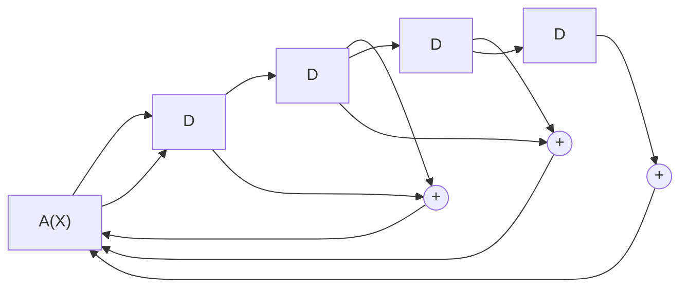
</details>

图8.6.3 $g(X) = X^4 +X^3 +X^2 +1$ 的先行进位除法电路

图 8.6.3 所示的电路，只需要 3 个时钟周期就可以完成运算。

被除式中不同幂次的项在到达最高位输出的异或运算之前，并不参加运算。计算时，每一位直接送到最高位进行除法运算，在电路中与高位的结果自动完成余式的相加运算，与对上例中介绍的各项分别进行运算的思想相似。

一般的先行进位的多项式除法电路如图 8.6.4 所示。


<details>
<summary>flowchart</summary>

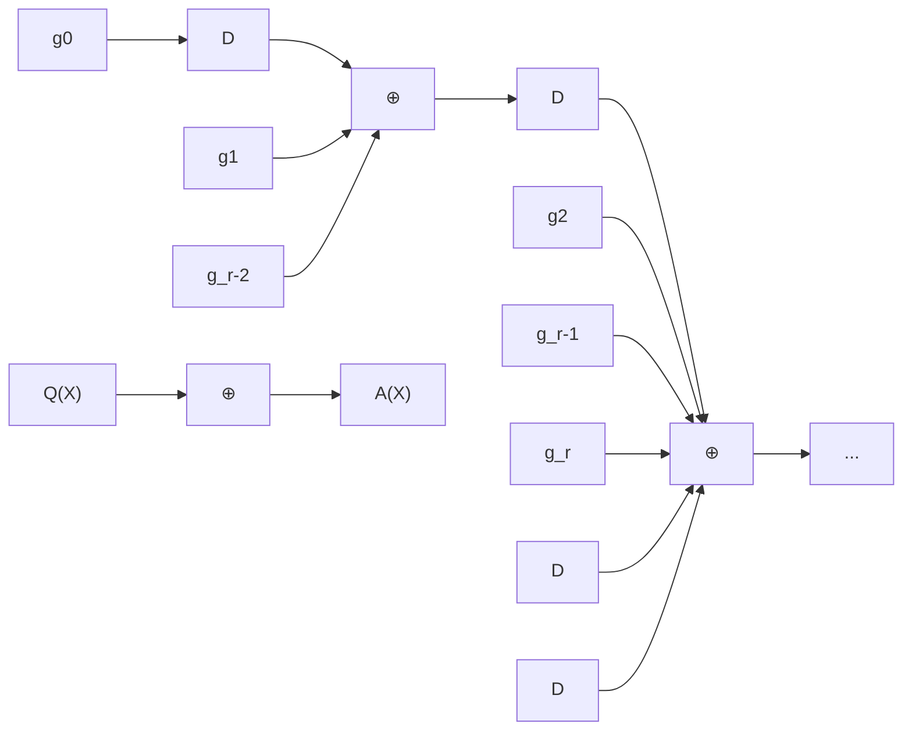
</details>

图 8.6.4 一般的先行进位除法电路

在图 8.6.4 所示电路的基础上稍做改进，就可以实现循环码编码器的功能。对于线性分组码 $(n,k)$ ，码字长度为 n，信息位长度为 k。系统码结构的循环码编码器如图 8.6.5 所示，它是在图 8.6.4 所示电路的基础上，增加了两个开关 $S_{1}$ 和 $S_{2}$ 构成的。编码器实现一个循环码码字的编码周期由 n 个时钟组成，在前 k 个时钟周期，两个开关 $S_{1}$ 和 $S_{2}$ 均合下，开关 $S_{1}$ 合下保证信息位的输出，开关 $S_{2}$ 合下保证除法器电路反馈功能的实现。k 个信息位按照其幂次由高位到低位依次送入编码器进行除法运算，信息位同时依次从输出端输出，k 个时钟周期过后，除法电路完成了对 $X^{n-k}A(X)$ 的除法运算，其余式存放在移位寄存器内。在随后的 n-k 个时钟周期，两个开关 $S_{1}$ 和 $S_{2}$ 均合上，开关 $S_{1}$ 合上使余式 $P(X)$ 顺序输出，与前面的 k 位信息位一起构成一个完整的码字，开关 $S_{2}$ 合上切断反馈回路，使余式 $P(X)$ 在输出过程中不受反馈电路的影响（注意，任何逻辑变量与“0”进行异或运算，结果等于该逻辑变量本身）。


<details>
<summary>flowchart</summary>

This diagram illustrates a signal processing or communication system architecture with multiple parallel paths (labeled g1, g2, g_r-2, g_r-1) and a feedback loop involving a counter C(X), showing data flow from input D through parallel processing and feedback to output S1.
</details>

图 8.6.5 系统码结构的循环码编码器

(2) 循环码译码器的电路实现 循环码作为一种线性分组码, 可以采用前面线性分组码检测错误和纠正错误的一般译码方法, 即对收到的码字, 用监督矩阵计算伴随式, 在其纠错能力范围内, 伴随式与错误图样有一一对应的关系, 找到错误图样后, 错误图样与原接收码字相加, 就可以获得正确的码字。对于循环码, 利用其循环的特点, 可以使译码过程更为简单。设收到的码字 $R(X)$ 对应的多项式为

$$
R (X) = C (X) + E (X) \tag {8.6.39}
$$

其中 $C(X)$ 是发送的码多项式， $E(X)$ 是错误图样对应的多项式，即若错误为 $e_{n-1}e_{n-2}\cdots e_{0}$ ，则有 $E(X)=e_{n-1}X^{n-1}+e_{n-2}X^{n-2}+\cdots+e_{1}X+e_{0}$ 。而伴随式对应的多项式为

$$
S (X) \equiv R (X) \equiv C (X) + E (X) \equiv E (X) \mod g (X) \tag {8.6.40}
$$

式中， $g(X)$ 是码的生成多项式。式（8.6.40）表明，伴随多项式 $S(X)$ 只与错误图样 $E(X)$ 和生成多项式 $g(X)$ 有关。译码的过程可以归纳如下：

（1）根据收到的码字 $R(X)$ ，通过式（8.6.40）计算相应的伴随多项式 $S(X)$ 。  
(2) 根据伴随多项式 $S(X)$ 确定错误图样 $E(X)$ 。  
（3）正确的码字由式 $C(X)=R(X)+E(X)$ 获得。

下面再来看循环码在译码过程中有什么特点可以利用。设 $S_{i}(X)$ 是码多项式 $R(X)$ 经循环移位的多项式对应的伴随式，即

$$
S _ {i} (X) \equiv X ^ {i} R (X) \mod g (X) \tag {8.6.41}
$$

因为

$$
S (X) \equiv R (X) \equiv E (X) \mod g (X) \tag {8.6.42}
$$

故有

$$
\begin{array}{l} S _ {i} (X) \equiv X ^ {i} R (X) \equiv X ^ {i} \left[ C (X) + E (X) \right] \tag {8.6.43} \\ \equiv X ^ {i} C (X) + X ^ {i} \bar {E} (X) \equiv X ^ {i} E (\bar {X}) \equiv X ^ {i} S (X) \mod g (X) \\ \end{array}
$$

最后一个恒等式成立是在式（8.6.42）两边同乘 $X^{i}$ ，恒等式仍然成立所得的结果。上式告诉我们，当某一错误图样 $E(X)$ 对应的伴随式 $S(X)$ 已知后，该错误图样循环移 $i$ 位后所得到的新的错误图样 $X^{i}E(X)$ 对应的伴随式 $S_{i}(X)$ ，可由原来的伴随式 $S(X)$ 经除法电路循环移位后获得。

【例 8.6.9】已知线性分组码(7,3)的生成多项式为 $g(X)=X^{4}+X^{3}+X^{2}+1$ ，试构建能够纠正一位误码的译码电路。

解: (1) 当误码出现在最高位时, 误码图样为 1000000, 当码字全部输入后, 在先行进位除法电路中得到的伴随式为 1110, 如表 8.6.2 中下序号 1 对应的行所示。

(2) 当误码出现在次高位时, 误码图样为 0100000, 当码字全部输入后, 在先行进位除法电路中得到的伴随式为 0111, 如表 8.6.2 中下序号 2 对应的行所示, 伴随式 0111 在除法电路中循环移动一位得到的结果为 1110, 即为前面最高位误码对应的伴随式。

(3) 当误码出现在第三位时, 误码图样为 0010000, 当码字全部输入后, 在先行进位除法电路中得到的伴随式为 1101, 如表 8.6.2 中下序号 3 对应的行所示, 伴随式 1101 在除法电路中循环移动一位得到的结果为 0111, 即为前面次高位误码对应的伴随式, 再循环右移一位, 则又得到最高位误码对应的伴随式。

(4) 以此类推, 当误码出现在第四位时, 对应的伴随式为 1000, 该伴随式循环右移三位, 得到与最高位误码相同的伴随式; 当误码出现在第五位时, 对应的伴随式为 0100, 该伴随式循环右移四位, 得到与最高位误码相同的伴随式; 当误码出现在第六位时, 对应的伴随式为 0010, 该伴随式循环右移五位, 得到与最高位误码相同的伴随式; 最后, 当误码出现在第七位时, 对应的伴随式为 0001, 该伴随式循环右移六位, 得到与最高位误码相同的伴随式。

由此，如图 8.6.6 所示，我们只需要构建一个对应最高位错误的译码电路，假定最高位出现误码，当收到的码字全部移入除法电路时，相应的伴随式作为输入加入译码电路，译码输出为 1，与缓存器输出的最高位异或运算，完成纠错功能。当其他的位错误图样出现时，其伴随式经过相应的移位，该伴随式变为与最高位误码时相同的伴随式，译码器输出为 1，此时有误码位刚好到达缓存器的输出端，经过异或运算，完成相应的纠错操作。☐

表 8.6.2 例 8.6.9 错误图样与伴随式间的关系

| 序号 | 一位误码的错误图样(高位在左) | 伴随式(高位在左) | 伴随式在电路中右移一位的结果(高位在左) |
|---|---|---|---|
| 1 | 1000000 | 1110 |  |
| 2 | 0100000 | 0111 | 1110 |
| 3 | 0010000 | 1101 | 0111 |
| 4 | 0001000 | 1000 | 1101 |
| 5 | 0000100 | 0100 | 1000 |
| 6 | 0000010 | 0010 | 0100 |
| 7 | 0000001 | 0001 | 0010 |


<details>
<summary>flowchart</summary>

This image depicts a block diagram of a digital signal processing system, showing the flow of signals from input through a central multiplexer to output via a feedback loop.
</details>

图8.6.6 例8.6.9循环码译码器

由本节的讨论可见，循环码编译码器都可以方便地由带反馈的移位寄存器来实现。随着高速数字信号处理器和高性能微处理器在现代通信系统中的广泛应用，在数字通信系统中，编译码的过程越来越多地采用软件程序来实现。

## 8.6.3 循环冗余校验码

前面式（8.6.29）给出的系统循环码的生成公式 $C_{\mathrm{S}}(X) = X^{n - k}A(X) + P(X)$ 被广泛应用于数据通信过程中报文的出错保护。这种保护方式也称循环冗余校验（Cyclic Redundancy Check，CRC）码。CRC码的特点是简单，易于实现，同时也具有较强的错误检出概率。CRC 码的长度一般没有严格的限定，整个报文中受保护的数据部分与监督位构成一个码字。CRC 码的具体编译码过程如下。

CRC 码的编码过程 将整个报文中需要进行保护的、长度为 k 的数据部分表示为一多项式 $A(X)=a_{k-1}X^{k-1}+a_{k-2}X^{k-2}+\cdots+a_{1}X+a_{0}$ ，其中 $(a_{k-1},a_{k-2},\cdots,a_{1},a_{0})$ 为相应的数据位。若选择的生成多项式 $g(X)$ 的次数为 r，通过系统循环码的编码方法得到相应的 CRC 码编码输出 $C_{\mathrm{CRC}}(X)=X^{r}A(X)+P(X)$ ，其中 $P(X)$ 为 $X^{r}A(X)/g(X)$ 的余式。

CRC 码的译码过程 若记接收到的码字为 $R(X) = C_{\mathrm{CRC}}(X) + E(X)$ , 其中 $E(X)$ 为错误图样。若 $R(X)$ 可被 $g(X)$ 整除, 则认为没有出错, 取码字中前面的 $k$ 位作为译码输出; 若 $R(X)$ 不能被 $g(X)$ 整除, 则可判断传输过程中一定出现了错误。

CRC 码的检错能力分析 在一个长度为 $n = k + r$ 的码字中, 总的错误图样数为 $2^{n} - 1 = 2^{k + r} - 1$ , 总的合法码字数为 $2^{k}$ 。当一个合法的码字出错变为另外一个合法的码字时, 这种错误不能被发现。由此可以估计不能检测出的错误的比例约为 $(2^{k} - 1) / (2^{n} - 1) \approx 1 / 2^{r}$ 。因此, 如果选用的生成多项式 $g(X)$ 的次数为 16 , 则不可检出的错误约为 $1 / 2^{16} = 1.526 \times 10^{-5}$ ；如果选用的生成多项式 $g(X)$ 的次数为 32 , 则不可检出的错误约为 $1 / 2^{32} = 2.328 \times 10^{-10}$ 。人们已经对 CRC 码的检错能力进行过细致的分析, 它能够检测出如下错误[1]:

(1) 突发长度小于 r 的突发错误。  
(2) 大部分突发长度等于 $r+1$ 的错误，其中不可检测的这类错误只占 $2^{-(r-1)}$ 。  
(3) 大部分突发长度大于 $r+1$ 的错误，其中不可检测的这类错误只占 $2^{-r}$ 。  
（4）所有与许用码组码距小于或等于 $d_{\min}+1$ 的错误。  
(5) 所有的奇数个随机错误。

常用的CRC码的生成多项式 表8.6.3给出了一些常用的CRC码的生成多项式。

表 8.6.3 常用的 CRC 码生成多项式

| 类型 | 生成多项式 | 校验位个数 |
|---|---|---|
| CRC-4 | $x^{4} + x^{3} + x^{2} + x + 1$ | 4 |
| CRC-8 | $x^{8} + x^{7} + x^{4} + x^{3} + x + 1$ | 8 |
| CRC-16 | $x^{16} + x^{15} + x^{2} + 1$ | 16 |
| CRC-32 | $x^{32} + x^{26} + x^{23} + x^{22} + x^{16} + x^{12} + x^{11} + x^{10} + x^{8} + x^{7} + x^{5} + x^{4} + x^{2} + x + 1$ | 32 |
| CRC-64 | $x^{64} + x^{4} + x^{3} + x + 1$ | 64 |

## 8.6.4 汉明循环码

我们已经知道汉明码是一种具有良好性能的线性分组码，它可以纠正码组中任意的一位误码，同时随着码字长度的增加，其编码效率 $R$ 趋近于 1。汉明循环码是汉明码中的一个子类，下面的定理提供了一种构建汉明码的一般方法：利用 $m$ 次的本原多项式作为生成多项式 $g(X)$ ，实现具有循环码特性的汉明码。

定理8.6.5 若 $f(X)$ 是 $m = n - k$ 次幂的本原多项式，则由 $f(X)$ 作为生成多项式 $g(X)$ 构建的 $n = 2^{m} - 1$ ， $k = 2^{m} - 1 - m$ ， $m \geqslant 3$ 的循环码 $(n, k)$ 是汉明码。

证明：首先证明 $f(X)$ 满足作为生成多项式 $g(X)$ 的条件：（1） $f(X)$ 是本原多项式，因此它是即约的，所以 $f(X)$ 中的常数项一定不为0；（2）因为 $f(X)$ 的幂为 $m$ ，根据本原多项式的性质，它可以整除 $X^{2^{m} - 1} + 1 = X^n + 1$ ，因此它是 $X^n + 1$ 的一个因式；（3）因为 $n - k = (2^m - 1) - (2^m - 1 - m) = m$ ，即 $f(X)$ 是一个 $n - k$ 次的多项式。

参见式（8.6.34）和式（8.6.35）取生成多项式 $g(X) = f(X)$ ，可得系统码结构的循环码的生成矩阵 $\pmb{G}$ 和监督矩阵 $\pmb{H}$ ：

$$
\boldsymbol {G} = \left[ \boldsymbol {I} _ {k} \mid \boldsymbol {P} _ {k, n - k} \right] = \left[ \begin{array}{c c c c c c c c c c} 1 & 0 & \dots & 0 & 0 & p _ {k - 1, n - k - 1} & p _ {k - 1, n - k - 2} & \dots & p _ {k - 1, 1} & p _ {k - 1, 0} \\ 0 & 1 & \dots & 0 & 0 & p _ {k - 2, n - k - 1} & p _ {k - 2, n - k - 2} & \dots & p _ {k - 2, 1} & p _ {k - 2, 0} \\ \vdots & \vdots & \ddots & \vdots & \vdots & \vdots & \vdots & \ddots & \vdots & \vdots \\ 0 & 0 & \dots & 1 & 0 & p _ {1, n - k - 1} & p _ {1, n - k - 2} & \dots & p _ {1, 1} & p _ {1, 0} \\ 0 & 0 & \dots & 0 & 1 & p _ {0, n - k - 1} & p _ {0, n - k - 2} & \dots & p _ {0, 1} & p _ {0, 0} \end{array} \right]
$$

$$
\boldsymbol {H} = \left[ \boldsymbol {P} _ {k, n - k} ^ {\mathrm{T}} \mid \boldsymbol {I} _ {n - k} \right] = \left[ \begin{array}{c c c c c c c c c c} p _ {k - 1, n - k - 1} & p _ {k - 2, n - k - 1} & \dots & p _ {1, n - k - 1} & p _ {0, n - k - 1} & 1 & 0 & \dots & 0 & 0 \\ p _ {k - 1, n - k - 2} & p _ {k - 2, n - k - 2} & \dots & p _ {1, n - k - 2} & p _ {0, n - k - 2} & 0 & 1 & \dots & 0 & 0 \\ \vdots & \vdots & \ddots & \vdots & \vdots & \vdots & \vdots & \ddots & \vdots & \vdots \\ p _ {k - 1, 1} & p _ {k - 2, 1} & \dots & p _ {1, 1} & p _ {0, 1} & 0 & 0 & \dots & 1 & 0 \\ p _ {k - 1, 0} & p _ {k - 2, 0} & \dots & p _ {1, 0} & p _ {0, 0} & 0 & 0 & \dots & 0 & 1 \end{array} \right]
$$

监督矩阵 $P_{k,n-k}^{T}$ 子矩阵中的第 i 列的元素 $p_{i,j}$ 是多项式 $P_{i}(X)$ 的系数。参见式（8.6.31）和式（8.6.32）， $P_{i}(X)$ 由下式确定：

$$
X ^ {n - k} X ^ {i} = X ^ {n - k + i} = Q _ {i} (X) g (X) + P _ {i} (X), \quad i = k - 1. k - 2, \dots , 1, 0 \tag {8.6.44}
$$

当 $g(X)$ 是本原多项式时, $g(X)$ 不可再分解且常数项为 1 , $X^{n-k+i}$ 与 $g(X)$ 一定互质, 因此 $P_{i}(X)$ 不可能为 0 。即在监督矩阵 $\pmb{H}$ 中, 不会出现全 “0” 的列向量。另外 $P_{i}(X)$ 中至少包含两项, 否则, 如果存在只包含一项的 $P_{i}(X)$ , 则有

$$
P _ {i} (X) = x ^ {j}, \quad 0 \leqslant j \leqslant k - 1 = (2 ^ {m} - 1 - m) - 1 = 2 ^ {m} - 2 - m \tag {8.6.45}
$$

由式（8.6.44）得

$$
X ^ {n - k} X ^ {i} = Q _ {i} (X) g (X) + X ^ {j} \rightarrow X ^ {j} (X ^ {n - k + i - j} + 1) = Q _ {i} (X) g (X)
$$

因为 $0 \leqslant i, j \leqslant k-1$ ，有 $n-k+i-j \leqslant n-1=2^{m}-2<2^{m}-1$ ，所以 $X^{n-k+i-j}+1$ 不能被本原多项式 $g(X)$ 整除，这说明式（8.6.45）不能成立，即 $P_{i}(X)$ 中至少包含两项。

对于监督矩阵 $P^{T}$ 子矩阵中的任意不同 i 和 j 两列向量， $i \neq j$ ，不妨设 j > i，由式（8.6.44）得

$$
X ^ {n - k} X ^ {i} + X ^ {n - k} X ^ {j} = Q _ {i} (X) g (X) + P _ {i} (X) + Q _ {j} (X) g (X) + P _ {j} (X) \tag {8.6.46}
$$

整理得

$$
X ^ {n - k + i} (X ^ {j - i} + 1) = \left(Q _ {i} (X) + Q _ {j} (X)\right) g (X) + \left(P _ {i} (X) + P _ {j} (X)\right) \tag {8.6.47}
$$

已知 $X^{n - k + i}$ 与 $g(X)$ 互质。又因 $j - i \leqslant k - 1 = 2^m - 1 - m < 2^m - 1$ ，所以 $X^{j - i} + 1$ 一定不能被 $g(X)$ 整除，因此 $P_i(X) + P_j(X)$ 一定不等于0，所以 $\pmb{H}$ 中任意的列向量都不相同。

综上, 监督矩阵 $H = (P_{k,n-k}^{\mathrm{T}} \mid I_{n-k})$ 共有 $n = 2^{m} - 1$ 列, 其中没有全 “0” 的列向量, 且任意的两列都不相同。因此每一列可用作码字中 1 位误码的伴随式。所以由 $m = n - k$ 次幂的本原多项式 $f(X)$ 生成的 $(2^{m} - 1, 2^{m} - 1 - m)$ 循环码是汉明码。证毕。 $\square$

定理 8.6.5 提供了一种可以通过本原多项式构造具有循环码特性的汉明码的一般方法。而本原多项式可以通过计算机遍历搜索的方法得到，表 8.6.4 给出了不同长度的汉明码的生成多项式 $g(X)$ ，其中生成多项式的参数采用八进制数字表示。通过该表，很容易构建不同长度的汉明码。

【例 8.6.10】试构建一参数位(15,11)的汉明码，求其系统码结构的生成矩阵和监督矩阵，并计算其码率。

解：根据表8.6.4，由 $n = 15$ ， $k = 11$ 的编码参数要求，可选择对应的生成多项式的参数

$$
(2 3) _ {\mathrm{八进制}} = (0 1 0 0 1 1) \leftrightarrow g (X) = X ^ {4} + X + 1
$$

表 8.6.4 利用本原多项式构造的汉明循环码参数表

| n | k | g(X)(八进制数字) | n | k | g(X)(八进制数字) |
|---|---|---|---|---|---|
| 7 | 4 | 13 | 255 | 247 | 435 |
| 15 | 11 | 23 | 511 | 502 | 1021 |
| 31 | 26 | 45 | 1023 | 1013 | 2011 |
| 63 | 57 | 103 | 2047 | 2036 | 4005 |
| 127 | 120 | 211 | 4095 | 4083 | 10123 |

作为该汉明循环码的生成多项式。由式（8.6.33），得其系统码结构的生成矩阵

$$
\mathbf {G} (X) = \left[ \begin{array}{c} {X ^ {1 4} + P _ {1 0} (X)} \\ {X ^ {1 3} + P _ {9} (X)} \\ {\vdots} \\ {X ^ {5} + P _ {1} (X)} \\ {X ^ {4} + P _ {0} (X)} \end{array} \right], \text {其中} P _ {i} (X) \equiv X ^ {4 + i} \mod g (X), i = 1 0, 9, \dots , 1, 0
$$

计算出式中的各 $P_{i}(X)$ 后，由矩阵中各多项式的系数，可得生成矩阵的另一种表示形式：

$$
\boldsymbol {G} = \left[ \begin{array}{c c c c c c c c c c c c c} 1 & 0 & & & & & & & & 1 & 0 & 0 & 1 \\ 0 & 1 & 0 & & & & & & & 1 & 1 & 0 & 1 \\ & 0 & 1 & 0 & & & & & & 1 & 1 & 1 & 1 \\ & & 0 & 1 & 0 & & & 0 & & 1 & 1 & 1 & 0 \\ & & & 0 & 1 & 0 & & & & 0 & 1 & 1 & 1 \\ & & & & 0 & 1 & 0 & & & & 1 & 0 & 1 & 0 \\ & & & & & 0 & 1 & 0 & & & 0 & 1 & 0 & 1 \\ & & & & & & 0 & 1 & 0 & & 1 & 0 & 1 & 1 \\ & & & & & & & 0 & 1 & 0 & & 1 & 1 & 0 & 0 \\ & & & & & & & & 0 & 1 & 0 & 0 & 1 & 1 & 0 \\ & & & & & & & & & 0 & 1 & 0 & 0 & 1 & 1 \end{array} \right] = \left[ \boldsymbol {I} _ {k} \mid \boldsymbol {P} _ {k, n - k} \right]
$$

由生成矩阵和监督矩阵之间的关系式，可得

$$
\boldsymbol {H} = \left[ \boldsymbol {P} _ {k, n - k} ^ {\mathrm{T}} \mid \boldsymbol {I} _ {n - k} \right] = \left[ \begin{array}{c c c c c c c c c c c c c c c} 1 & 1 & 1 & 1 & 0 & 1 & 0 & 1 & 1 & 0 & 0 & 1 & 0 & 0 & 0 \\ 0 & 1 & 1 & 1 & 1 & 0 & 1 & 0 & 1 & 1 & 0 & 0 & 1 & 0 & 0 \\ 0 & 0 & 1 & 1 & 1 & 1 & 0 & 1 & 0 & 1 & 1 & 0 & 0 & 1 & 0 \\ 1 & 1 & 1 & 0 & 1 & 0 & 1 & 1 & 0 & 0 & 1 & 0 & 0 & 0 & 1 \end{array} \right]
$$

该循环汉明码的码率为 $R=\frac{k}{n}=\frac{11}{15}$ 。☐

## 8.6.5 BCH 码\*

根据上一节有关循环汉明码的讨论我们知道, 对于不同长度的、能纠正一位错误的分组码, 已经有一般的构建方法。对于更为一般的能纠正任意 $t$ 个和 $t$ 个以下错误的线性分组码, 已由 Bose 和 Chaudhuri 两人合作及 Hochquenghem 分别独立提出了一种编码, 这种编码以他们三人名字的第一个字母命名, 称为 BCH 码。BCH 码是人们已经研究得十分透彻的一类循环码, 采用 BCH 码编码方法, 若码长 $n = 2^{m} - 1$ , 可构造出校验位长度 $r = n - k \leqslant m t$ 、码字间的最小距离 $d_{\min} \geqslant 2 t + 1$ 的纠错码。

下面首先介绍几个保证 BCH 码存在，以及实现其构建方法的几个重要定义和定理。

定理 8.6.6 线性分组码 $(n,k)$ 最小距离等于 $d_{\min}$ 的充要条件，是其监督矩阵 H 中任意的 $d_{\min}-1$ 列线性无关。

证明：先证明必要性。假定线性分组码 $(n,k)$ 的最小距离为 $d_{\min}$ ，需要证明H中任意的 $d_{\min}-1$ 列线性无关。用反证法：若H中某 $d_{\min}-1$ 列线性相关，则有

$$
c _ {i 1} \boldsymbol {h} _ {i 1} + c _ {i 2} \boldsymbol {h} _ {i 2} + \dots + c _ {i d _ {\min - 1}} \boldsymbol {h} _ {i d _ {\min - 1}} = \boldsymbol {0} \tag {8.6.48}
$$

其中 $c_{ij} \in \mathrm{GF}(2)$ ， $h_{ij}$ 是 H 中的列向量。现构建一个 n 维向量 C，使其在 $i_{1}, i_{2}, \cdots, i_{d_{\min}-1}$ 位置的取值分别为 $c_{i1}, c_{i2}, \cdots, c_{id_{\min}-1}$ ，即 $\boldsymbol{C} = (0, \cdots, c_{i1}, 0, \cdots, c_{i2}, 0, \cdots, c_{id_{\min}-1}, 0, \cdots, 0)$ ，而在其他位置的取值为 0，因为

$$
\boldsymbol {H} \cdot \boldsymbol {C} ^ {\mathrm{T}} = c _ {i 1} \boldsymbol {h} _ {i 1} + c _ {i 2} \boldsymbol {h} _ {i 2} + \dots + c _ {i (d _ {\min} - 1)} \boldsymbol {h} _ {i (d _ {\min} - 1)} = \boldsymbol {0} \tag {8.6.49}
$$

故 $C$ 应该是一个许用码字, 而 $C$ 的非 0 分量个数, 即其码重, 最多只有 $d_{\min} - 1$ , 这与码有最小距离 $d_{\min}$ 矛盾, 因此 $H$ 中的任意 $d_{\min} - 1$ 列必定线性无关。

再证明充分性。假定 $H$ 中任意 $d_{\min} - 1$ 列线性无关, 则 $H$ 中至少 $d_{\min}$ 列才能线性相关。若将能够使 $H$ 中那些 $d_{\min}$ 列线性相关的系数, 作为码字中相应的非 0 分量, 而码字中的其余分量均为 0 , 则该码字至少有 $d_{\min}$ 个非 0 分量, 故该码的最小距离为 $d_{\min}$ 。证毕。 $\square$

根据定理 8.6.6，不难理解，交换 H 中的各列，并不会影响其所对应的码的最小距离。因此，所有列向量相同但排列方式不同的 H 所对应的分组码，其码的性能完全相同。

BCH 码是一种循环码，下面给出其定义和有关其最小距离的定理。

定义 8.6.3 给定有限域 GF(2) 及其扩展域 GF( $2^{m}$ )，对于码元取自 GF(2) 的一循环码，若其生成多项式 $g(x)$ 的根的集合 R 中含有 $d_{\min} - 1$ 个连续根：

$$
\Re \supseteq \left(\alpha^ {m _ {0}}, \alpha^ {m _ {0} + 1}, \dots , \alpha^ {m _ {0} + d _ {\min} - 2}\right) \tag {8.6.50}
$$

式中 $\alpha \in \mathrm{GF}(2^{m})$ 是域中的 $n$ 阶元素， $n \geqslant d_{\min} - 1$ ， $m_{0}$ 是任意整数， $\alpha^{m_{0} + i} \in \mathrm{GF}(2^{m})$ ， $0 \leqslant i \leqslant d_{\min} - 2$ ，则将由 $g(x)$ 生成的码长度为 $n$ 的循环码定义为 BCH 码。

假定 $m_{i}(x)$ 是元素 $\alpha^{m_{0}+i}, i=0,1,2,\cdots,d_{\min}-2$ 的最小多项式， $J_{i}$ 是元素 $\alpha^{m_{0}+i}$ 的阶数。只有 $g(x)$ 能够被 $m_{i}(x), i=0,1,2,\cdots,d_{\min}-2$ 同时除尽时， $g(x)$ 才能够以元素 $\alpha^{m_{0}+i}, i=0,1,2,\cdots,d_{\min}-2$ 为根，因此必须有

$$
g (x) = \mathrm{LCM} (m _ {0} (x), m _ {1} (x), \dots , m _ {d _ {\min} - 2} (x)) \tag {8.6.51}
$$

式中符号 LCM （Least Common Multiple）表示最小公倍式。

假定由 $g(x)$ 生成的循环码的码长为 $n$ ，则 $g(x)$ 可以整除 $x^n - 1$ ，元素 $\alpha^{m_0 + i}, i = 0, 1, 2, \cdots, d_{\min} - 2$ 必定是 $x^n - 1$ 的根。根据定理 8.4.3，元素 $(\alpha^{m_0 + i})^{2^j}$ 也是 $x^n - 1$ 的根，其中 $i = 0, 1, 2, \cdots, d_{\min} - 2$ ， $j = 0, 1, 2, \cdots, J_i - 1$ ， $J_i$ 是 $\alpha^{m_0 + i}$ 的阶数。所以每个 $J_i$ 必须能够整除 $n$ ，因此相应的循环码的码长 $n$ 为

$$
n = \mathrm{LCM} (J _ {0}, J _ {1}, \dots , J _ {d _ {\min} - 1}) \tag {8.6.52}
$$

这里 $J_{i}$ 既是 $\alpha^{m_0 + i}$ 的阶数，也是其极小多项式 $m_{i}(x)$ 的次数。

定理 8.6.7 BCH 码的最小距离至少为 $d_{min}$ 。

证明: 假定 $C(x) = m(x)g(x)$ 是 BCH 码的一个码字, 根据 BCH 码的定义, $\mathrm{GF}(2^{m})$ 中 $d_{\min} - 1$ 个连续元素 $\alpha^{m_0}, \alpha^{m_0 + 1}, \dots, \alpha^{m_0 + d_{\min} - 2}$ 一定是该码字的根。若该码字表示为

$$
C (x) = c _ {n - 1} x ^ {n - 1} + c _ {n - 2} x ^ {n - 2} + \dots + c _ {1} x + c _ {0} \tag {8.6.53}
$$

则有

$$
C (\alpha^ {i}) = c _ {n - 1} (\alpha^ {i}) ^ {n - 1} + c _ {n - 2} (\alpha^ {i}) ^ {n - 2} + \dots + c _ {1} (\alpha^ {i}) + c _ {0} = 0 \tag {8.6.54}
$$

其中 $i=m_{0}, m_{0}+1,\cdots,m_{0}+d_{\min}-2$ 。假定按照如下的方式构建 BCH 码的校验矩阵 H：

$$
\boldsymbol {H} = \left[ \begin{array}{c c c c c} (\alpha^ {m _ {0}}) ^ {n - 1} & (\alpha^ {m _ {0}}) ^ {n - 2} & \dots & (\alpha^ {m _ {0}}) ^ {1} & (\alpha^ {m _ {0}}) ^ {0} \\ (\alpha^ {m _ {0} + 1}) ^ {n - 1} & (\alpha^ {m _ {0} + 1}) ^ {n - 2} & \dots & (\alpha^ {m _ {0} + 1}) ^ {1} & (\alpha^ {m _ {0} + 1}) ^ {0} \\ \vdots & \vdots & \ddots & \vdots & \vdots \\ (\alpha^ {m _ {0} + d _ {\min} - 2}) ^ {n - 1} & (\alpha^ {m _ {0} + d _ {\min} - 2}) ^ {n - 2} & \dots & (\alpha^ {m _ {0} + d _ {\min} - 2}) ^ {1} & (\alpha^ {m _ {0} + d _ {\min} - 2}) ^ {0} \end{array} \right] \tag {8.6.55}
$$

矩阵 H 共有 $d_{\min}-1$ 行，任取其中的 $d_{\min}-1$ 列可以组成一方阵，该方阵的行列式 D 为

$$
\begin{array}{l} D = \left| \begin{array}{c c c c} (\alpha^ {m _ {0}}) ^ {j _ {1}} & (\alpha^ {m _ {0}}) ^ {j _ {2}} & \dots & (\alpha^ {m _ {0}}) ^ {j _ {d _ {\mathrm{mim}} - 1}} \\ (\alpha^ {m _ {0} + 1}) ^ {j _ {1}} & (\alpha^ {m _ {0} + 1}) ^ {j _ {2}} & \dots & (\alpha^ {m _ {0} + 1}) ^ {j _ {d _ {\mathrm{mim}} - 1}} \\ \vdots & \vdots & \ddots & \vdots \\ (\alpha^ {m _ {0} + d _ {\mathrm{min}} - 2}) ^ {j _ {1}} & (\alpha^ {m _ {0} + d _ {\mathrm{min}} - 2}) ^ {j _ {1}} & \dots & (\alpha^ {m _ {0} + d _ {\mathrm{min}} - 2}) ^ {j _ {d _ {\mathrm{mim}} - 1}} \end{array} \right| \\ \begin{array}{l} = \alpha^ {m _ {0} \left(j _ {1} + j _ {2} + \dots + j _ {d _ {\mathrm{mim}} - 1}\right)} \left| \begin{array}{c c c c} 1 & 1 & \dots & 1 \\ \left(\alpha^ {j _ {1}}\right) ^ {1} & \left(\alpha^ {j _ {2}}\right) ^ {1} & \dots & \left(\alpha^ {j _ {d _ {\mathrm{mim}} - 1}}\right) ^ {1} \\ \vdots & \vdots & \ddots & \vdots \\ \left(\alpha^ {j _ {1}}\right) ^ {d _ {\min} - 2} & \left(\alpha^ {j _ {2}}\right) ^ {d _ {\min} - 2} & \dots & \left(\alpha^ {j _ {d _ {\min} - 1}}\right) ^ {d _ {\min} - 2} \end{array} \right| \\ = \alpha^ {m _ {0} \left(j _ {1} + j _ {2} + \dots + j _ {d _ {\mathrm{mim}} - 1}\right)} \prod_ {j _ {1} \leqslant j _ {v} <   j _ {u} \leqslant j _ {d _ {\mathrm{mim}} - 1}} \left(\alpha^ {j _ {u}} - \alpha^ {j _ {v}}\right) \end{array} \tag {8.6.56} \\ \end{array}
$$

上式中的最后一个等式的获得是根据线性代数理论中的范德蒙行列式求解的结果。由于生成多项式没有重根， $\alpha \in \mathrm{GF}(2^{m})$ 是域中的 $n'$ 阶元素，对任何 $j_{u} \neq j_{v}$ ， $\alpha^{j_{u}} \neq \alpha^{j_{v}}$ 。因此行列式 $D \neq 0$ ，由此可知监督矩阵 $\pmb{H}$ 的任意 $d_{\min} - 1$ 列线性无关，由此根据定理8.6.9可知，该码的最小距离为 $d_{\min}$ 。证毕。□

BCH 码的循环特性 下面说明由上述构建方法获得的分组码具有循环码特性。假定某码字 $C=\left[c_{n-1}c_{n-2}\cdots c_{1}c_{0}\right]$ ，由 $C\cdot H^{T}=0$ 可得

$$
C (\alpha^ {i}) = c _ {n - 1} (\alpha^ {i}) ^ {n - 1} + c _ {n - 2} (\alpha^ {i}) ^ {n - 2} + \dots + c _ {1} (\alpha^ {i}) + c _ {0} = 0 \tag {8.6.57}
$$

其中 $i=m_{0}, m_{0}+1, \cdots, m_{0}+d_{\min}-2$ 。记该码字循环移位一位后得到的向量为 $\boldsymbol{C}^{(1)}=[c_{n-2}\cdots c_{1}c_{0}c_{n-1}]$ 。由 $\boldsymbol{C}^{(1)}\cdot\boldsymbol{H}^{\mathrm{T}}$ ，考虑到 $\alpha\in\mathrm{GF}(2^{m})$ 是域中的 n 阶元素， $\alpha^{n}=1$ ：

$$
\begin{array}{l} C ^ {(1)} (\alpha^ {i}) = c _ {n - 2} (\alpha^ {i}) ^ {n - 1} + c _ {n - 3} (\alpha^ {i}) ^ {n - 2} + \dots + c _ {1} (\alpha^ {i}) ^ {2} + c _ {0} (\alpha^ {i}) + c _ {n - 1} \\ = c _ {n - 2} \left(\alpha^ {i}\right) ^ {n - 1} + c _ {n - 3} \left(\alpha^ {i}\right) ^ {n - 2} + \dots + c _ {1} \left(\alpha^ {i}\right) ^ {2} + c _ {0} \left(\alpha^ {i}\right) + c _ {n - 1} \left(\alpha^ {i}\right) ^ {n} \tag {8.6.58} \\ = \alpha^ {i} \left[ c _ {n - 1} (\alpha^ {i}) ^ {n - 1} + c _ {n - 2} (\alpha^ {i}) ^ {n - 2} + \dots + c _ {1} (\alpha^ {i}) + c _ {0} \right] = 0 \\ \end{array}
$$

可见 $C^{(1)}=[c_{n-2}\cdots c_{1}c_{0}c_{n-1}]$ 也是一个码字集中的一个码字，用归纳法原理不难证明循环移位任意的位时，结论仍然成立，因此 BCH 码是一种循环码。

BCH 码的构造方法 为便于在有限域 GF(2) 及其扩展域 GF(2 $^{m}$ ) 上构造 BCH 码，通常取码长 n=2 $^{m}$ -1，选择 GF(2 $^{m}$ ) 中的本原元作为 α，α $^{n}$ =α $^{2^{m}-1}$ =1，这样构造的 BCH 码称为本原 BCH 码。表 8.6.5 列出了人们通过计算机搜索方法获得的 m≤7、相应码长为 n=2 $^{m}$ -1≤127 时的各种不同纠错能力的本原 BCH 码。更多的本原 BCH 码可见参考文献[4]。

下面通过示例说明如何根据式（8.6.51）得到生成多项式 $g(x)$ 。有了 $g(x)$ 之后，就可以根据循环码的一般规则构造相应的 BCH 码。

【例 8.6.11】求 $GF(2^{4})$ 上可构造的各种本原 BCH 码。

解：设 $\alpha$ 是 $\mathrm{GF}(2^4)$ 上的本原元，则 $\mathrm{GF}(2^4)$ 中的所有元素可以表示为

$$
\{0, \alpha^ {0}, \alpha^ {1}, \alpha^ {2}, \alpha^ {3}, \dots , \alpha^ {2 ^ {4} - 3}, \alpha^ {2 ^ {4} - 2} \} = \{0, \alpha^ {0}, \alpha^ {1}, \alpha^ {2}, \alpha^ {3}, \dots , \alpha^ {1 3}, \alpha^ {1 4} \}, \quad \alpha^ {i} \in \mathrm{GF} (2 ^ {4})
$$

表 8.6.5 $m \leqslant 7, n = 2^{m} - 1 \leqslant 127$ 的本原 BCH 码

| 码长n | 信息位k | 纠错能力t | 码长n | 信息位k | 纠错能力t |
|---|---|---|---|---|---|
| 7 | 4 | 1 | 127 | 120 | 1 |
| 15 | 11 | 1 | 127 | 113 | 2 |
| 15 | 7 | 2 | 127 | 106 | 3 |
| 15 | 5 | 3 | 127 | 99 | 4 |
| 31 | 26 | 1 | 127 | 92 | 5 |
| 31 | 21 | 2 | 127 | 85 | 6 |
| 31 | 16 | 3 | 127 | 78 | 7 |
| 31 | 11 | 5 | 127 | 71 | 9 |
| 31 | 6 | 7 | 127 | 64 | 10 |
| 63 | 57 | 1 | 127 | 57 | 11 |
| 63 | 51 | 2 | 127 | 50 | 13 |
| 63 | 45 | 3 | 127 | 43 | 14 |
| 63 | 39 | 4 | 127 | 36 | 15 |
| 63 | 36 | 5 | 127 | 29 | 21 |
| 63 | 30 | 6 | 127 | 22 | 23 |
| 63 | 24 | 7 | 127 | 15 | 27 |
| 63 | 18 | 10 | 127 | 8 | 31 |
| 63 | 16 | 11 |  |  |  |
| 63 | 10 | 13 |  |  |  |
| 63 | 7 | 15 |  |  |  |

首先分析除了 0 和 1 的元素，通过求各个元素的极小多项式，观察有多少种可能的极小多项式。根据极小多项式的构建方法：

(1) 元素 $\alpha$ ：元素 $\alpha$ 的极小多项式的所有根为 $(\alpha)^{2^l}, l = 0,1,2,\cdots$ 。根据表 8.4.5 给出的 $\mathrm{GF}(2^4)$ 的元素表，可得 $(\alpha)^{2^0} = \alpha, (\alpha)^{2^1} = \alpha^2, (\alpha)^{2^2} = \alpha^4, (\alpha)^{2^3} = \alpha^8, (\alpha)^{2^4} = \alpha^{15}\alpha = \alpha, (\alpha)^{2^5} = \alpha^{32} = \alpha^{2 \times 15}\alpha^2 = \alpha^2, \cdots$ 。不难发现，其中只有 4 个根 $\alpha, \alpha^2, \alpha^4$ 和 $\alpha^8$ 是不同的。相应地，元素 $\alpha$ 的极小多项式为

$$
m _ {1} (x) = (x + \alpha) (x + \alpha^ {2}) (x + \alpha^ {4}) (x + \alpha^ {8})
$$

展开上式得

$$
\begin{array}{l} m _ {1} (x) = (x ^ {2} + \alpha x + \alpha^ {2} x + \alpha^ {3}) (x ^ {2} + \alpha^ {4} x + \alpha^ {8} x + \alpha^ {1 2}) \\ = x ^ {4} + (\alpha^ {8} + \alpha^ {4} + \alpha^ {2} + \alpha) x ^ {3} + (\alpha^ {1 2} + \alpha^ {1 0} + \alpha^ {9} + \alpha^ {6} + \alpha^ {5} + \alpha^ {3}) x ^ {2} + (\alpha^ {1 4} + \alpha^ {1 3} + \alpha^ {1 1} + \alpha^ {7}) x + \alpha^ {1 5} \\ \end{array}
$$

利用表 8.4.5 整理合并有关的项，得

$$
\begin{array}{l} m _ {1} (x) = x ^ {4} + \left((X ^ {2} + 1) + (X + 1) + X ^ {2} + X\right) x ^ {3} + \\ \left((X ^ {3} + X ^ {2} + X + 1) + (X ^ {2} + X + 1) + (X ^ {3} + X) + (X ^ {3} + X ^ {2}) + (X ^ {2} + X) + X ^ {3}\right) x ^ {2} + \\ \left((X ^ {3} + 1) + (X ^ {3} + X ^ {2} + 1) + (X ^ {3} + X ^ {2} + X) + (X ^ {3} + X + 1)\right) x + 1 \\ = x ^ {4} + x + 1 \\ \end{array}
$$

（2）元素 $\alpha^{2}$ ：元素 $\alpha^{2}$ 的极小多项式的所有根为 $(\alpha^{2})^{2^{l}}, l=0,1,2,\cdots$ 。同样可得 $(\alpha^{2})^{2^{0}}=\alpha^{2}$

$(\alpha^{2})^{2^{1}}=\alpha^{4},(\alpha^{2})^{2^{2}}=\alpha^{8},(\alpha^{2})^{2^{3}}=\alpha^{15}\alpha=\alpha,(\alpha^{2})^{2^{4}}=\alpha^{30}\alpha^{2}=\alpha^{2},\cdots$ 。同样可以发现，所有不同的根为 $\alpha$ ， $\alpha^{2}$ ， $\alpha^{4}$ 和 $\alpha^{8}$ 。因此，元素 $\alpha^{2}$ 与元素 $\alpha$ 的极小多项式是一样的。

（3）元素 $\alpha^{3}$ ：元素 $\alpha^{3}$ 的极小多项式的所有根为 $(\alpha^{3})^{2^{l}}, l=0,1,2,\cdots$ 。由此可得

$(\alpha^{3})^{2^{0}}=\alpha^{3},(\alpha^{3})^{2^{1}}=\alpha^{6},(\alpha^{3})^{2^{2}}=\alpha^{12},(\alpha^{3})^{2^{3}}=\alpha^{15}\alpha^{9}=\alpha^{9},(\alpha^{3})^{2^{4}}=\alpha^{3\times15}\alpha^{3}=\alpha^{3},\cdots$ ，所有不同的根为 $\alpha^{3}$ ， $\alpha^{6}$ ， $\alpha^{9}$ 和 $\alpha^{12}$ 。相应地，元素 $\alpha^{3}$ 的极小多项式为

$$
m _ {3} (x) = (x + \alpha^ {3}) (x + \alpha^ {6}) (x + \alpha^ {9}) (x + \alpha^ {1 2})
$$

同样，利用表 8.4.5 简化整理得

$$
m _ {3} (x) = x ^ {4} + x ^ {3} + x ^ {2} + x + 1
$$

(4) 元素 $\alpha^{4}$ ：元素 $\alpha^{4}$ 的极小多项式的所有根为 $(\alpha^{4})^{2^{l}}, l=0,1,2,\cdots$ 。做类似前面的分析可得，所有不同的根为 $\alpha, \alpha^{2}, \alpha^{4}$ 和 $\alpha^{8}$ 。因此，元素 $\alpha^{4}$ 与元素 $\alpha$ 的极小多项式是一样的。

（5）元素 $\alpha^{5}$ ：元素 $\alpha^{5}$ 的极小多项式的所有根为 $(\alpha^{5})^{2^{l}}, l=0,1,2,\cdots$ 。由此可得

$(\alpha^{5})^{2^{0}} = \alpha^{5}, (\alpha^{5})^{2^{1}} = \alpha^{10}, (\alpha^{5})^{2^{2}} = \alpha^{15}\alpha^{5} = \alpha^{5}, \cdots$ 。所有不同的根为 $\alpha^{5}$ 和 $\alpha^{10}$ 。元素 $\alpha^{5}$ 的极小多项式为

$$
m _ {5} (x) = (x + \alpha^ {5}) (x + \alpha^ {1 0}) = x ^ {2} + x + 1
$$

(6) 元素 $\alpha^{6}$ ：元素 $\alpha^{6}$ 的极小多项式的所有根为 $(\alpha^{6})^{2^{l}}, l=0,1,2,\cdots$ 。做类似前面的分析可得，所有不同的根为 $\alpha^{3}, \alpha^{6}, \alpha^{9}$ 和 $\alpha^{12}$ 。因此，元素 $\alpha^{6}$ 与元素 $\alpha^{3}$ 的极小多项式是一样的。

(7) 元素 $\alpha^{7}$ ：元素 $\alpha^{7}$ 的极小多项式的所有根为 $(\alpha^{7})^{2^{l}}, l=0,1,2,\cdots$ 。做类似前面的分析可得，所有不同的根为 $\alpha^{7}, \alpha^{11}, \alpha^{13}$ 和 $\alpha^{14}$ ，元素 $\alpha^{7}$ 的极小多项式为

$$
m _ {7} (x) = (x + \alpha^ {7}) (x + \alpha^ {1 1}) (x + \alpha^ {1 3}) (x + \alpha^ {1 4}) = x ^ {4} + x ^ {3} + 1
$$

同样，通过对 $\alpha^{8}, \alpha^{9}, \cdots, \alpha^{14}$ 的分析可知，所对应极小多项式的根均是 $\alpha$ ，或 $\alpha^{3}$ ，或 $\alpha^{5}$ ，或 $\alpha^{7}$ 的极小多项式的根的重复。

从上面的分析得到4个互素的多项式： $m_{1}(x)$ , $m_{3}(x)$ , $m_{5}(x)$ 和 $m_{7}(x)$ 。

(1) 对于纠正 $t = 1$ 个错误的 BCH 码, 要求 $d_{\min} = 2t + 1 = 3$ , 要在 $\mathrm{GF}(2^4)$ 中找到以 $d_{\min} - 1 = 2$ 个幂次连续元素为根构建的生成多项式 $g(x)$ , 且 $g(x)$ 与这些元素的极小多项式必须满足式 (8.6.50) 的对应关系。只有元素 $\alpha$ 的极小多项式 $m_{1}(x)$ 方能满足, 它包含了 $4 (>d_{\min} - 1 = 2)$ 个幂次连续元素为根 $\alpha, \alpha^{2}, \alpha^{4}$ 和 $\alpha^{8}$ 。因此可取

$$
g (x) = m _ {1} (x) = x ^ {4} + x + 1
$$

因为 $g(x)$ 的次数为 n-k=4，已知本原 BCH 码的码长 $n=2^{4}-1=15$ ，可得 k=11。作为生成多项式，构成表 8.6.5 中第二行所列的参数为 n=15, k=11 和 t=1 的本原 BCH 码。

(2) 对于纠正 $t = 2$ 个错误的 BCH 码, 要求 $d_{\min} = 2t + 1 = 5$ , 要在 $\mathrm{GF}(2^4)$ 中找到以 $d_{\min} - 1 = 4$ 个幂次连续元素为根构建的生成多项式 $g(x)$ , 显然可由且只能由 $m_1(x)$ 和 $m_3(x)$ 的最小公因式构造, $m_1(x)$ 的根 $\alpha, \alpha^2$ , $\alpha^4, \alpha^8$ 和 $m_3(x)$ 的根 $\alpha^3, \alpha^6, \alpha^9$ 和 $\alpha^{12}$ 集中起来可以构成 $d_{\min} - 1 = 4$ 个幂次连续元素 $\alpha, \alpha^2, \alpha^3, \alpha^4$ , 由此可得

$$
\begin{array}{l} g (x) = \mathrm{LCM} \big (m _ {1} (x), m _ {3} (x) \big) = m _ {1} (x) m _ {3} (x) = (x ^ {4} + x + 1) (x ^ {4} + x ^ {3} + x ^ {2} + x + 1) \\ = x ^ {8} + x ^ {7} + x ^ {6} + x ^ {4} + 1 \\ \end{array}
$$

因为 $g(x)$ 的次数为 n-k=8，可得 k=7。作为生成多项式，构成表 8.6.5 中第三行所列的参数为 n=15，k=7 和 t=2 的本原 BCH 码。

(3) 对于纠正 $t = 3$ 个错误的 BCH 码, 要求 $d_{\min} = 2t + 1 = 7$ , 要在 $\mathrm{GF}(2^4)$ 中找到以 $d_{\min} - 1 = 6$ 个幂次连续元素为根构建的生成多项式 $g(x)$ , 显然可由且只能由 $m_1(x), m_3(x)$ 和 $m_5(x)$ 的最小公因式构造。 $m_1(x)$ 的根 $\alpha, \alpha^2, \alpha^4$ 和 $\alpha^8$ , $m_3(x)$ 的根 $\alpha^3, \alpha^6, \alpha^9$ 和 $\alpha^{12}$ , 以及 $m_5(x)$ 的根 $\alpha^5$ 和 $\alpha^{10}$ 集中起来可以构成 $d_{\min} - 1 = 6$ 个幂次连续元素 $\alpha, \alpha^2, \alpha^3, \alpha^4, \alpha^5$ 和 $\alpha^6$ , 其生成多项式

$$
\begin{array}{l} g (x) = \mathrm{LCM} \big (m _ {1} (x), m _ {3} (x), m _ {5} (x) \big) = m _ {1} (x) m _ {3} (x) m _ {5} (x) \\ = (x ^ {4} + x + 1) (x ^ {4} + x ^ {3} + x ^ {2} + x + 1) (x ^ {2} + x + 1) = x ^ {1 0} + x ^ {8} + x ^ {5} + x ^ {4} + x ^ {2} + x + 1 \\ \end{array}
$$

$$
\begin{array}{l} g (x) = \mathrm{LCM} \big (m _ {1} (x), m _ {3} (x), m _ {5} (x) \big) = m _ {1} (x) m _ {3} (x) m _ {5} (x) \\ = (x ^ {4} + x + 1) (x ^ {4} + x ^ {3} + x ^ {2} + x + 1) (x ^ {2} + x + 1) = x ^ {1 0} + x ^ {8} + x ^ {5} + x ^ {4} + x ^ {2} + x + 1 \\ \end{array}
$$

因为 $g(x)$ 的次数为 n-k=10，可得 k=5。作为生成多项式，构成表 8.6.5 中第四行所列的参数为 n=15，k=5 和 t=3 的本原 BCH 码。

(4) 最后分析能否构造纠正 $t = 4$ 个错误的 BCH 码, 此时要求 $d_{\min} = 2t + 1 = 9$ , 要在 $\mathrm{GF}(2^4)$ 中找到以 $d_{\min} - 1 = 8$ 个幂次连续元素为根构建的生成多项式 $g(x)$ , 似乎可由 $m_1(x), m_3(x), m_5(x)$ 和 $m_7(x)$ 的最小公因式构造。 $m_1(x)$ 的根 $\alpha, \alpha^2, \alpha^4$ 和 $\alpha^8$ , $m_3(x)$ 的根 $\alpha^3, \alpha^6, \alpha^9$ 和 $\alpha^{12}$ , $m_5(x)$ 的根 $\alpha^5$ 和 $\alpha^{10}$ , 以及 $m_7(x)$ 的根 $\alpha^7$ ,$\alpha^{11}, \alpha^{13}$ 和 $\alpha^{14}$ ，集中起来可以构成所需的大于 $d_{\min} - 1 = 8$ 个幂次连续元素 $\alpha, \alpha^{2}, \alpha^{3}, \cdots, \alpha^{13}$ 和 $\alpha^{14}$ 。相应地，其生成多项式

$$
\begin{array}{l} g (x) = \operatorname{LCM} \left(m _ {1} (x), m _ {3} (x), m _ {5} (x), m _ {7} (x)\right) = m _ {1} (x) m _ {3} (x) m _ {5} (x) m _ {7} (x) \\ = (x ^ {4} + x + 1) (x ^ {4} + x ^ {3} + x ^ {2} + x + 1) (x ^ {2} + x + 1) (x ^ {4} + x ^ {3} + 1) \\ = x ^ {1 4} + x ^ {1 3} + x ^ {1 2} + x ^ {1 1} + x ^ {1 0} + x ^ {9} + x ^ {8} + x ^ {7} + x ^ {6} + x ^ {5} + x ^ {4} + x ^ {3} + x ^ {2} + x + 1 \\ \end{array}
$$

的次数为 $n - k = 14$ ，可得 $k = 1$ ，可见这时相应的BCH码已经退化成只能携带一位信息位的重复码。发信息“0”时，输出000000000000000；发信息“1”时，输出“111111111111111”。显然此时的最小码距为15，纠错能力可以超过4位，达到7位，但此时的编码效率仅为 $R = k / n = 1 / 15$ 。□

BCH 码的译码方法 BCH 码作为一种理论体系完备、性能良好的纠错编码，其译码方法的研究也受到了人们极大的关注，并提出了许多优化的实现方案。本节只介绍 BCH 码译码的基本原理，更多的具体方法可参考有关的参考文献[2]。

从前面的分析可知，要使 $\mathrm{GF}(2^{m})$ 域上 BCH 码的最小码距为 $d_{\min}$ ，必须至少获得 $d_{\min}-1$ 个幂次连续元素的根 $\alpha^{m_{0}}, \alpha^{m_{0}+1}, \cdots, \alpha^{m_{0}+d_{\min}-2}$ ，以构建其监督矩阵 H 和相应的生成多项式 $g(x)$ ，要能够纠正 t 个错误，要求 $d_{\min} \geqslant 2t+1$ 。一般地，发送码字 C、接收码字 R 和错误图样 E 所对应的多项式可以分别表示为

$$
C (x) = c _ {n - 1} x ^ {n - 1} + c _ {n - 2} x ^ {n - 2} + \dots + c _ {1} x + c _ {0} \tag {8.6.59}
$$

$$
R (x) = r _ {n - 1} x ^ {n - 1} + r _ {n - 2} x ^ {n - 2} + \dots + r _ {1} x + r _ {0} \tag {8.6.60}
$$

$$
E (x) = e _ {n - 1} x ^ {n - 1} + e _ {n - 2} x ^ {n - 2} + \dots + e _ {1} x + e _ {0} \tag {8.6.61}
$$

它们之间满足如下的关系：

$$
R (x) = C (x) + E (x) \tag {8.6.62}
$$

在可纠错的范围内，出错的 t 个位置可以用 t 个 x 的幂 $x^{l_{1}}, x^{l_{2}}, \cdots, x^{l_{t}}$ 来表示，因此 $E(x)$ 又可以表示为

$$
E (x) = Y _ {t} x ^ {l _ {t}} + Y _ {t - 1} x ^ {l _ {t - 1}} + \dots + Y _ {2} x ^ {l _ {2}} + Y _ {1} x ^ {l _ {1}}, \quad Y _ {1}, Y _ {2}, \dots , Y _ {t} \in \{0, 1 \} \tag {8.6.63}
$$

即对于可以纠正的错误图样，上式中非零的项最多只有t项。

对于能够纠正 t 个错误的 BCH 码，有 $d_{\min} = 2t + 1$ 。由式（8.6.55）可知，其监督矩阵 H 为

$$
\boldsymbol {H} = \left[ \begin{array}{c c c c c} \left(\alpha^ {m _ {0}}\right) ^ {n - 1} & \left(\alpha^ {m _ {0}}\right) ^ {n - 2} & \dots & \left(\alpha^ {m _ {0}}\right) ^ {1} & 1 \\ \left(\alpha^ {m _ {0} + 1}\right) ^ {n - 1} & \left. \alpha^ {m _ {0} + 1}\right) ^ {n - 2} & \dots & \left. \alpha^ {m _ {0} + 1}\right) ^ {1} & 1 \\ \vdots & \vdots & \ddots & \vdots & \vdots \\ \left(\alpha^ {m _ {0} + 2 t - 1}\right) ^ {n - 1} & \left(\alpha^ {m _ {0} + 2 t - 1}\right) ^ {n - 2} & \dots & \left(\alpha^ {m _ {0} + 2 t - 1}\right) ^ {1} & 1 \end{array} \right] \tag {8.6.64}
$$

对于接收码字 $R=\left[r_{n-1}r_{n-2}\ldots r_{0}\right]$ ，相应的伴随式为

$$
\begin{array}{l} \boldsymbol {S} ^ {\mathrm{T}} = \left[ \begin{array}{c} S _ {m _ {0}} \\ S _ {m _ {0} + 1} \\ \vdots \\ S _ {m _ {0} + 2 t - 1} \end{array} \right] = \boldsymbol {H} \cdot \boldsymbol {R} ^ {\mathrm{T}} = \left[ \begin{array}{c c c c c} \left(\alpha^ {m _ {0}}\right) ^ {n - 1} & \left(\alpha^ {m _ {0}}\right) ^ {n - 2} & \dots & \left(\alpha^ {m _ {0}}\right) ^ {1} & 1 \\ \left(\alpha^ {m _ {0} + 1}\right) ^ {n - 1} & \left(\alpha^ {m _ {0} + 1}\right) ^ {n - 2} & \dots & \left(\alpha^ {m _ {0} + 1}\right) ^ {1} & 1 \\ \vdots & \vdots & \ddots & \vdots & \vdots \\ \left(\alpha^ {m _ {0} + 2 t - 1}\right) ^ {n - 1} & \left(\alpha^ {m _ {0} + 2 t - 1}\right) ^ {n - 2} & \dots & \left(\alpha^ {m _ {0} + 2 t - 1}\right) ^ {1} & 1 \end{array} \right] \left[ \begin{array}{c} r _ {n - 1} \\ r _ {n - 2} \\ \vdots \\ r _ {1} \\ r _ {0} \end{array} \right] \tag {8.6.65} \\ = \left[ \begin{array}{c} r _ {n - 1} \left(\alpha^ {m _ {0}}\right) ^ {n - 1} + r _ {n - 2} \left(\alpha^ {m _ {0}}\right) ^ {n - 2} + \dots + r _ {1} \left(\alpha^ {m _ {0}}\right) ^ {1} + r _ {0} \\ r _ {n - 1} \left(\alpha^ {m _ {0} + 1}\right) ^ {n - 1} + r _ {n - 2} \left(\alpha^ {m _ {0} + 1}\right) ^ {n - 2} + \dots + r _ {1} \left(\alpha^ {m _ {0} + 1}\right) ^ {1} + r _ {0} \\ \vdots \\ r _ {n - 1} \left(\alpha^ {m _ {0} + 2 t - 1}\right) ^ {n - 1} + r _ {n - 2} \left(\alpha^ {m _ {0} + 2 t - 1}\right) ^ {n - 2} + \dots + r _ {1} \left(\alpha^ {m _ {0} + 2 t - 1}\right) ^ {1} + r _ {0} \end{array} \right] \\ \end{array}
$$

因为 $S^{T}=H\cdot R^{T}=H\cdot(C+E)^{T}=H\cdot E^{T}$ ，由式（8.6.63）即可得

$$
s _ {j} = Y _ {t} (\alpha^ {j}) ^ {l _ {t}} + Y _ {t - 1} (\alpha^ {j}) ^ {l _ {t - 1}} + \dots + Y _ {2} (\alpha^ {j}) ^ {l _ {2}} + Y _ {1} (\alpha^ {j}) ^ {l _ {1}} = \sum_ {i = 1} ^ {t} Y _ {i} (\alpha^ {j}) ^ {l _ {i}} \tag {8.6.66}
$$

$$
j = m _ {0}, m _ {0} + 1, \dots , m _ {0} + 2 t - 1
$$

若记 $\alpha^{l_i} = x_i$ ，则有 $(\alpha^j)^{l_i} = (\alpha^{l_i})^j = (x_i)^j = x_i^j$ ，上式成为

$$
s _ {j} = \sum_ {i = 1} ^ {t} Y _ {i} x _ {i} ^ {j}, \qquad j = m _ {0}, m _ {0} + 1, \dots , m _ {0} + 2 t - 1 \tag {8.6.67}
$$

其中的 $s_j$ 可以根据接收码字 $\pmb{R}$ ，通过式（8.6.65）获得。现在需要求解 $Y_i \neq 0$ 处的 $x_i$ ，以确定错误的位置 $l_i$ 。定义错误位置多项式

$$
\sigma (x) = (1 - x _ {1} x) (1 - x _ {2} x) \dots (1 - x _ {t} x) \tag {8.6.68}
$$

若求得错误位置多项式的根 $x_{i}^{-1}, i=1,2,\cdots,t$ ，由 $x_{i}=\alpha^{l_{i}}$ ，就可确定各个误码的位置 $l_{i}, i=1,2,\cdots,t$ 。将上式展开可得

$$
\begin{array}{l} \sigma (x) = (1 - x _ {1} x) (1 - x _ {2} x) \dots (1 - x _ {t} x) \tag {8.6.69} \\ = 1 - (x _ {1} + x _ {2} + \dots + x _ {t}) x + (x _ {1} x _ {2} + x _ {1} x _ {3} + \dots + x _ {t - 1} x _ {t}) x ^ {2} - \dots + (- 1) ^ {t} (x _ {1} x _ {2} \dots x _ {t - 1} x _ {t}) x ^ {t} \\ \end{array}
$$

记

$$
\sigma_ {1} = (- 1) ^ {1} (x _ {1} + x _ {2} + \dots + x _ {t})
$$

$$
\sigma_ {2} = (- 1) ^ {2} (x _ {1} x _ {2} + x _ {1} x _ {3} + \dots + x _ {t - 1} x _ {t}) \tag {8.6.70}
$$

$$
\sigma_ {t} = (- 1) ^ {t} (x _ {1} x _ {2} \dots x _ {t - 1} x _ {t})
$$

上式成为

$$
\sigma (x) = \prod_ {i = 1} ^ {t} \left(1 - x _ {i} x\right) = \sigma_ {t} x ^ {t} + \sigma_ {t - 1} x ^ {t - 1} + \dots + \sigma_ {1} x + 1 \tag {8.6.71}
$$

显然有

$$
\sigma (x _ {k} ^ {- 1}) = \prod_ {i = 1} ^ {t} \left(1 - x _ {i} x _ {k} ^ {- 1}\right) = \sigma_ {t} x _ {k} ^ {- t} + \sigma_ {t - 1} x _ {k} ^ {- (t - 1)} + \dots + \sigma_ {1} x _ {k} ^ {- 1} + 1 = 0, k = 1, 2, \dots , t - 1, t \tag {8.6.72}
$$

两边乘以 $Y_{k}x_{k}^{j + t}, j = m_{0}, m_{0} + 1, \dots, m_{0} + t - 1$ ，得

$$
Y _ {k} x _ {k} ^ {j + t} + \sigma_ {1} Y _ {k} x _ {k} ^ {j + (t - 1)} + \dots + \sigma_ {t - 1} Y _ {k} x _ {k} ^ {j + 1} + \sigma_ {t} Y _ {k} x _ {k} ^ {j} = 0 \tag {8.6.73}
$$

$$
k = 1, 2, \dots , t - 1, t, \quad j = m _ {0}, m _ {0} + 1, \dots , m _ {0} + t - 1
$$

对上式关于 $k$ 求和可得

$$
\sum_ {k = 1} ^ {t} Y _ {k} x _ {k} ^ {j + t} + \sigma_ {1} \sum_ {k = 1} ^ {t} Y _ {k} x _ {k} ^ {j + (t - 1)} + \dots + \sigma_ {t - 1} \sum_ {k = 1} ^ {t} Y _ {k} x _ {k} ^ {j + 1} + \sigma_ {t} \sum_ {k = 1} ^ {t} Y _ {k} x _ {k} ^ {j} = 0 \tag {8.6.74}
$$

$$
j = m _ {0}, m _ {0} + 1, \dots , m _ {0} + t - 1
$$

比较式（8.6.66），上式成为

$$
s _ {j + t} + \sigma_ {1} s _ {j + t} + \dots + \sigma_ {t - 1} s _ {j + 1} + \sigma_ {t} s _ {j} = 0, \quad j = m _ {0}, m _ {0} + 1, \dots , m _ {0} + t - 1 \tag {8.6.75}
$$

将 $j$ 的不同取值代入，可得方程组

$$
\left\{ \begin{array}{c} S _ {m _ {0} + t} + \sigma_ {1} S _ {m _ {0} + t - 1} + \dots + \sigma_ {t - 1} S _ {m _ {0} + 1} + \sigma_ {t} S _ {m _ {0}} = 0 \\ S _ {m _ {0} + 1 + t} + \sigma_ {1} S _ {m _ {0} + t} + \dots + \sigma_ {t - 1} S _ {m _ {0} + 2} + \sigma_ {t} S _ {m _ {0} + 1} = 0 \\ \vdots \\ S _ {m _ {0} + 2 t - 1} + \sigma_ {1} S _ {m _ {0} + 2 t - 2} + \dots + \sigma_ {t - 1} S _ {m _ {0} + t} + \sigma_ {t} S _ {m _ {0} + t - 1} = 0 \end{array} \right. \tag {8.6.76}
$$

整理后得

$$
\left[ \begin{array}{c c c c} S _ {m _ {0} + t - 1} & S _ {m _ {0} + t - 2} & \dots & S _ {m _ {0}} \\ S _ {m _ {0} + t} & S _ {m _ {0} + t - 1} & \dots & S _ {m _ {0} + 1} \\ \vdots & \vdots & \ddots & \vdots \\ S _ {m _ {0} + 2 t - 2} & S _ {m _ {0} + 2 t - 3} & \dots & S _ {m _ {0} + t - 1} \end{array} \right] \left[ \begin{array}{c} \sigma_ {1} \\ \sigma_ {2} \\ \vdots \\ \sigma_ {t} \end{array} \right] = - \left[ \begin{array}{c} S _ {m _ {0} + t} \\ S _ {m _ {0} + t + 1} \\ \vdots \\ S _ {m _ {0} + 2 t - 1} \end{array} \right] \tag {8.6.77}
$$

未知数 $\sigma_{1},\sigma_{2},\cdots,\sigma_{t-1},\sigma_{t}$ 有唯一解的充要条件是上面的 $t\times t$ 矩阵满秩。求出 $\sigma_{1},\sigma_{2},\cdots,\sigma_{t-1},\sigma_{t}$ 后，可求解方程组（8.6.69），得到 $x_{i}$ $i=1,2,\cdots,t$ 。由 $\alpha^{l_{i}}=x_{i}$ ， $i=1,2,\cdots,t$ 可进一步求得 $l_{i}$ ， $i=1,2,\cdots,t$ ，从而确定误码的位置。

下面的定理保证了如果确实发生了t个错误，那么矩阵一定满秩。

定理 8.6.8 如果矩阵 M 中的元素 $s_{j}, j = m_{0}, m_{0} + 1, \cdots, m_{0} + t - 1$ 由 t 个非零的数对 $(x_{i}, Y_{i})$ 组成，则矩阵

$$
\boldsymbol {M} = \left[ \begin{array}{c c c c} S _ {m _ {0} + t - 1} & S _ {m _ {0} + t - 2} & \dots & S _ {m _ {0}} \\ S _ {m _ {0} + t} & S _ {m _ {0} + t - 1} & \dots & S _ {m _ {0} + 1} \\ \vdots & \vdots & \ddots & \vdots \\ S _ {m _ {0} + 2 t - 2} & S _ {m _ {0} + 2 t - 3} & \dots & S _ {m _ {0} + t - 1} \end{array} \right] \tag {8.6.78}
$$

满秩，否则为非满秩。

证明：因为

$$
\begin{array}{l} \left[ \begin{array}{c c c c} S _ {m _ {0} + t - 1} & S _ {m _ {0} + t - 2} & \dots & S _ {m _ {0}} \\ S _ {m _ {0} + t} & S _ {m _ {0} + t - 1} & \dots & S _ {m _ {0} + 1} \\ \vdots & \vdots & \ddots & \vdots \\ S _ {m _ {0} + 2 t - 2} & S _ {m _ {0} + 2 t - 3} & \dots & S _ {m _ {0} + t - 1} \end{array} \right] = \left[ \begin{array}{c c c c} \sum_ {k = 1} ^ {t} Y _ {k} x _ {k} ^ {m _ {0} + t - 1} & \sum_ {k = 1} ^ {t} Y _ {k} x _ {k} ^ {m _ {0} + t - 2} & \dots & \sum_ {k = 1} ^ {t} Y _ {k} x _ {k} ^ {m _ {0}} \\ \sum_ {k = 1} ^ {t} Y _ {k} x _ {k} ^ {m _ {0} + t} & \sum_ {k = 1} ^ {t} Y _ {k} x _ {k} ^ {m _ {0} + t - 1} & \dots & \sum_ {k = 1} ^ {t} Y _ {k} x _ {k} ^ {m _ {0} + 1} \\ \vdots & \vdots & \ddots & \vdots \\ \sum_ {k = 1} ^ {t} Y _ {k} x _ {k} ^ {m _ {0} + 2 t - 2} & \sum_ {k = 1} ^ {t} Y _ {k} x _ {k} ^ {m _ {0} + 2 t - 3} & \dots & \sum_ {k = 1} ^ {t} Y _ {k} x _ {k} ^ {m _ {0} + t - 1} \end{array} \right] \tag {8.6.79} \\ = \left[ \begin{array}{c c c c} 1 & 1 & \dots & 1 \\ x _ {1} & x _ {2} & \dots & x _ {t} \\ \vdots & \vdots & \ddots & \vdots \\ x _ {1} ^ {t - 1} & x _ {2} ^ {t - 1} & \dots & x _ {t} ^ {t - 1} \end{array} \right] \left[ \begin{array}{c c c c} Y _ {1} x _ {1} ^ {m _ {0}} & 0 & \dots & 0 \\ 0 & Y _ {2} x _ {2} ^ {m _ {0}} & \dots & 0 \\ \vdots & \vdots & \ddots & \vdots \\ 0 & 0 & \dots & Y _ {t} x _ {t} ^ {m _ {0}} \end{array} \right] \left[ \begin{array}{c c c c} 1 & x _ {1} & \dots & x _ {1} ^ {t - 1} \\ 1 & x _ {2} & \dots & x _ {2} ^ {t - 1} \\ \vdots & \vdots & \ddots & \vdots \\ 1 & x _ {t} & \dots & x _ {t} ^ {t - 1} \end{array} \right] \\ \end{array}
$$

在上式中，左右两个矩阵的行列式为范德蒙行列式，只要其中的每个元素不为0且不相同，则其行列式不为0。中间的矩阵为一对角矩阵，只要对角线上的每一项不为0，则其行列式不为0。当发生t个错误时，有t个不同的非零的数对 $(x_{i},Y_{i})$ ，因此上面的三个行列式均不为0，因而此时矩阵满秩。反之，若错误数小于t个时，相应地存在等于零的 $Y_{i}$ ，显然矩阵不满秩。证毕。☐

在接收的码字 R 中，如果错误数 $\gamma < t$ ，相应地，其错误位置多项式变为

$$
\sigma (x) = \left(1 - x _ {1} x\right) \left(1 - x _ {2} x\right) \dots \left(1 - x _ {\gamma} x\right) \tag {8.6.80}
$$

上式展开后为

$$
\sigma (x) = \prod_ {i = 1} ^ {\gamma} \left(1 - x _ {i} x\right) = \sigma_ {\gamma} x ^ {\gamma} + \sigma_ {\gamma - 1} x ^ {\gamma - 1} + \dots + \sigma_ {1} x + 1 \tag {8.6.81}
$$

显然有

$$
\sigma \left(x _ {k} ^ {- 1}\right) = \prod_ {i = 1} ^ {\gamma} \left(1 - x _ {i} x _ {k} ^ {- 1}\right) = \sigma_ {\gamma} x _ {k} ^ {- \gamma} + \sigma_ {\gamma - 1} x _ {k} ^ {- (\gamma - 1)} + \dots + \sigma_ {1} x _ {k} ^ {- 1} + 1 = 0, k = 1, 2, \dots , \gamma \tag {8.6.82}
$$

两边乘以 $Y_{k}x_{k}^{j+t}$ ， $j=m_{0},m_{0}+1,\cdots,m_{0}+\gamma-1$ ，得

$$
Y _ {k} x _ {k} ^ {j + t} + \sigma_ {1} Y _ {k} x _ {k} ^ {j + (t - 1)} + \dots + \sigma_ {\gamma - 1} Y _ {k} x _ {k} ^ {j + t - (\gamma - 1)} + \sigma_ {\gamma} Y _ {k} x _ {k} ^ {j + t - \gamma} = 0 \tag {8.6.83}
$$

$$
k = 1, 2, \dots , t - 1, \gamma , \quad j = m _ {0}, m _ {0} + 1, \dots , m _ {0} + \gamma - 1
$$

对上式关于 $k$ 求和可得

$$
\begin{array}{l} \sum_ {k = 1} ^ {\gamma} Y _ {k} x _ {k} ^ {j + t} + \sigma_ {1} \sum_ {k = 1} ^ {\gamma} Y _ {k} x _ {k} ^ {j + (t - 1)} + \dots + \sigma_ {\gamma - 1} \sum_ {k = 1} ^ {\gamma} Y _ {k} x _ {k} ^ {j + t + (\gamma - 1)} + \sigma_ {\gamma} \sum_ {k = 1} ^ {\gamma} Y _ {k} x _ {k} ^ {j + t - \gamma} = 0 \\ j = m _ {0}, m _ {0} + 1, \dots , m _ {0} + \gamma - 1 \end{array} \tag {8.6.84}
$$

比较式（8.6.67），因为错误的个数为 $\gamma$ ， $Y_{\gamma+1}=Y_{\gamma}=\cdots=Y_{t}=0$ ，所以有 $s_{j}=\sum_{i=1}^{\gamma}Y_{i}x_{i}^{j}=\sum_{i=1}^{t}Y_{i}x_{i}^{j}$ ，上式成为

$$
s _ {j + t} + \sigma_ {1} s _ {j + t - 1} + \dots + \sigma_ {\gamma - 1} s _ {j + 1} + \sigma_ {\gamma} s _ {j} = 0, \quad j = m _ {0}, m _ {0} + 1, \dots , m _ {0} + \gamma - 1 \tag {8.6.85}
$$

将 j 的不同取值代入，可得方程组

$$
\left\{ \begin{array}{c} S _ {m _ {0} + t - 1} + \sigma_ {1} S _ {m _ {0} + t - 2} + \dots + \sigma_ {\gamma - 1} S _ {m _ {0} + t - (\gamma - 1)} + \sigma_ {\gamma} S _ {m _ {0} + t - \gamma} = 0 \\ S _ {m _ {0} + t} + \sigma_ {1} S _ {m _ {0} + t - 1} + \dots + \sigma_ {\gamma - 1} S _ {m _ {0} + t - (\gamma - 2)} + \sigma_ {\gamma} S _ {m _ {0} + t - (\gamma - 1)} = 0 \\ \vdots \\ S _ {m _ {0} + t + \gamma - 1} + \sigma_ {1} S _ {m _ {0} + t + \gamma - 2} + \dots + \sigma_ {\gamma - 1} S _ {m _ {0} + t + 1} + \sigma_ {\gamma} S _ {m _ {0} + t - 1} = 0 \end{array} \right. \tag {8.6.86}
$$

整理后得

$$
\left[ \begin{array}{c c c c} S _ {m _ {0} + t - 1} & S _ {m _ {0} + t - 2} & \dots & S _ {m _ {0} + t - \gamma - 1} \\ S _ {m _ {0} + t} & S _ {m _ {0} + t - 1} & \dots & S _ {m _ {0} + t - \gamma} \\ \vdots & \vdots & \ddots & \vdots \\ S _ {m _ {0} + t + \gamma - 1} & S _ {m _ {0} + t + \gamma - 2} & \dots & S _ {m _ {0} + t - 1} \end{array} \right] \left[ \begin{array}{c} \sigma_ {1} \\ \sigma_ {2} \\ \vdots \\ \sigma_ {\gamma} \end{array} \right] = - \left[ \begin{array}{c} S _ {m _ {0} + t} \\ S _ {m _ {0} + t + 1} \\ \vdots \\ S _ {m _ {0} + t + \gamma} \end{array} \right] \tag {8.6.87}
$$

未知数 $\sigma_{1},\sigma_{2},\dots ,\sigma_{\gamma}$ 有唯一解的充要条件是上面的 $\gamma \times \gamma$ 矩阵满秩，同理可以证明其行列式

$$
\begin{array}{l} \left| \begin{array}{c c c c} S _ {m _ {0} + t - 1} & S _ {m _ {0} + t - 2} & \dots & S _ {m _ {0} + t - \gamma - 1} \\ S _ {m _ {0} + t} & S _ {m _ {0} + t - 1} & \dots & S _ {m _ {0} + t - \gamma} \\ \vdots & \vdots & \ddots & \vdots \\ S _ {m _ {0} + t + \gamma - 1} & S _ {m _ {0} + t + \gamma - 2} & \dots & S _ {m _ {0} + t - 1} \end{array} \right| \\ = \left| \begin{array}{c c c c} 1 & 1 & \dots & 1 \\ x _ {1} & x _ {2} & \dots & x _ {\gamma} \\ \vdots & \vdots & \ddots & \vdots \\ x _ {1} ^ {\gamma - 1} & x _ {2} ^ {\gamma - 1} & \dots & x _ {t} ^ {\gamma - 1} \end{array} \right| \left| \begin{array}{c c c c} Y _ {1} x _ {1} ^ {m _ {0}} & 0 & \dots & 0 \\ 0 & Y _ {2} x _ {2} ^ {m _ {0}} & \dots & 0 \\ \vdots & \vdots & \ddots & \vdots \\ 0 & 0 & \dots & Y _ {\gamma} x _ {\gamma} ^ {m _ {0}} \end{array} \right| \left| \begin{array}{c c c c} 1 & x _ {1} & \dots & x _ {1} ^ {\gamma - 1} \\ 1 & x _ {2} & \dots & x _ {2} ^ {\gamma - 1} \\ \vdots & \vdots & \ddots & \vdots \\ 1 & x _ {t} & \dots & x _ {t} ^ {\gamma - 1} \end{array} \right| \neq 0 \\ \end{array}
$$

因此方程组有唯一解。

下面通过一个例子来说明 BCH 码译码的过程。

【例 8.6.12】对于能够纠三个错误的参数为(15,5)的 BCH 码，已知接收的码多项式为 $R(x)=x^{10}+x^{3}$ ，求发送的码字 $C(x)$ 。

解：已知 $n = 15$ ， $t = 3$ ，由前面的例8.6.11可知，对采用 $m_0 = 1$ 的本原元构成的监督矩阵

$$
\boldsymbol {H} = \left[ \begin{array}{c c c c c} (\alpha^ {m _ {0}}) ^ {n - 1} & (\alpha^ {m _ {0}}) ^ {n - 2} & \dots & (\alpha^ {m _ {0}}) ^ {1} & 1 \\ (\alpha^ {m _ {0} + 1}) ^ {n - 1} & (\alpha^ {m _ {0} + 1}) ^ {n - 2} & \dots & (\alpha^ {m _ {0} + 1}) ^ {1} & 1 \\ \vdots & \vdots & \ddots & \vdots & \vdots \\ (\alpha^ {m _ {0} + 2 t - 1}) ^ {n - 1} & (\alpha^ {m _ {0} + 2 t - 1}) ^ {n - 2} & \dots & (\alpha^ {m _ {0} + 2 t - 1}) ^ {1} & 1 \end{array} \right] = \left[ \begin{array}{c c c c c} \alpha^ {1 4} & \alpha^ {1 3} & \dots & \alpha^ {1} & 1 \\ (\alpha^ {2}) ^ {1 4} & (\alpha^ {2}) ^ {1 3} & \dots & \alpha^ {2} & 1 \\ \vdots & \vdots & \ddots & \vdots & \vdots \\ (\alpha^ {6}) ^ {1 4} & (\alpha^ {6}) ^ {1 3} & \dots & \alpha^ {6} & 1 \end{array} \right]
$$

以 $R=\left[r_{14}\quad r_{13}\quad\cdots\quad r_{0}\right]=\left[000010000001000\right]$ 代入 $S^{T}=H\cdot R^{T}$ 得

$$
s _ {1} = \alpha^ {1 4} + \alpha^ {3}, \quad s _ {2} = (\alpha^ {2}) ^ {1 0} + (\alpha^ {2}) ^ {3}, \quad s _ {3} = (\alpha^ {3}) ^ {1 0} + (\alpha^ {3}) ^ {3},
$$

$$
s _ {4} = (\alpha^ {4}) ^ {1 0} + (\alpha^ {4}) ^ {3}, \quad s _ {5} = (\alpha^ {5}) ^ {1 0} + (\alpha^ {5}) ^ {3}, \quad s _ {6} = (\alpha^ {6}) ^ {1 0} + (\alpha^ {6}) ^ {3}
$$

根据表 8.4.5，简化可得

$$
s _ {1} = \alpha^ {1 2}, \quad s _ {2} = \alpha^ {9}, \quad s _ {3} = \alpha^ {7}, \quad s _ {4} = \alpha^ {3}, \quad s _ {5} = \alpha^ {1 0}, \quad s _ {6} = \alpha^ {1 4}
$$

参数为(15,5)的BCH码的最大纠错能力为 $t = 3$ ，假定错误数小于或等于3（当错误数大于3时，则超过该码的纠错能力)，首先判断是否出现3个错误，验证式（8.6.78）对应的 $t \times t = 3 \times 3$ 矩阵 $M$ 是否满秩：

$$
\begin{array}{l} \left| \boldsymbol {M} \right| = \left| \begin{array}{c c c c} S _ {m _ {0} + t - 1} & S _ {m _ {0} + t - 2} & \dots & S _ {m _ {0}} \\ S _ {m _ {0} + t} & S _ {m _ {0} + t - 1} & \dots & S _ {m _ {0} + 1} \\ \vdots & \vdots & \ddots & \vdots \\ S _ {m _ {0} + 2 t - 2} & S _ {m _ {0} + 2 t - 3} & \dots & S _ {m _ {0} + t - 1} \end{array} \right| = \left| \begin{array}{c c c} S _ {3} & S _ {2} & S _ {1} \\ S _ {4} & S _ {3} & S _ {2} \\ S _ {5} & S _ {4} & S _ {3} \end{array} \right| \\ = S _ {3} S _ {3} S _ {3} + S _ {1} S _ {4} S _ {4} + S _ {2} S _ {2} S _ {5} - S _ {1} S _ {3} S _ {5} - S _ {2} S _ {3} S _ {4} - S _ {2} S _ {3} S _ {4} \\ = \alpha^ {1 2} \alpha^ {1 2} \alpha^ {1 2} + \alpha^ {1 2} \alpha^ {3} \alpha^ {3} + \alpha^ {9} \alpha^ {9} \alpha^ {1 0} + \alpha^ {1 2} \alpha^ {7} \alpha^ {1 0} + \alpha^ {9} \alpha^ {7} \alpha^ {3} + \alpha^ {9} \alpha^ {7} \alpha^ {3} \\ = \alpha^ {6} + \alpha^ {3} + \alpha^ {1 3} + \alpha^ {1 4} + \alpha^ {1 9} + \alpha^ {1 9} = \alpha^ {6} + \alpha^ {3} + \alpha^ {1 3} + \alpha^ {1 4} \\ = (\alpha^ {3} + \alpha^ {2}) + \alpha^ {3} + (\alpha^ {3} + \alpha^ {2} + 1) + (\alpha^ {3} + 1) = 0 \\ \end{array}
$$

行列式为 0 说明实际的错误个数小于 3。将矩阵降至 $2 \times 2$ 阶，再判断其行列式：

$$
\left| \begin{array}{c c} S _ {3} & S _ {2} \\ S _ {4} & S _ {3} \end{array} \right| = S _ {3} S _ {3} - S _ {4} S _ {2} = \alpha^ {1 2} \alpha^ {1 2} - \alpha^ {2} \alpha^ {9} = \alpha^ {9} + \alpha^ {1 1} \neq 0
$$

说明有 2 个错误。由式（8.6.77），得

$$
\left[ \begin{array}{l l} S _ {3} & S _ {2} \\ S _ {4} & S _ {3} \end{array} \right] \left[ \begin{array}{l} \sigma_ {1} \\ \sigma_ {2} \end{array} \right] = - \left[ \begin{array}{l} S _ {4} \\ S _ {5} \end{array} \right], \quad \left[ \begin{array}{l} \sigma_ {1} \\ \sigma_ {2} \end{array} \right] = - \left[ \begin{array}{l l} S _ {3} & S _ {2} \\ S _ {4} & S _ {3} \end{array} \right] ^ {- 1} \left[ \begin{array}{l} S _ {4} \\ S _ {5} \end{array} \right] = \left[ \begin{array}{l l} S _ {3} & S _ {2} \\ S _ {4} & S _ {3} \end{array} \right] ^ {- 1} \left[ \begin{array}{l} S _ {4} \\ S _ {5} \end{array} \right]
$$

解方程得

$$
\begin{array}{l} \sigma_ {1} = \frac {s _ {3} s _ {2} - s _ {1} s _ {4}}{s _ {2} ^ {2} - s _ {1} s _ {3}} = \frac {\alpha^ {7} \alpha^ {9} - \alpha^ {1 2} \alpha^ {3}}{(\alpha^ {9}) ^ {2} - \alpha^ {1 2} \alpha^ {7}} = \frac {\alpha^ {1 5} (\alpha + 1)}{\alpha^ {1 8} (\alpha + 1)} = \alpha^ {- 1 8} = \alpha^ {2 \times 1 5} \alpha^ {- 1 8} = \alpha^ {1 2} \\ \sigma_ {2} = \frac {s _ {4} s _ {2} - s _ {3} ^ {2}}{s _ {2} ^ {2} - s _ {1} s _ {3}} = \frac {\alpha^ {3} \alpha^ {9} - (\alpha^ {7}) ^ {2}}{(\alpha^ {9}) ^ {2} - \alpha^ {1 2} \alpha^ {7}} = \frac {\alpha^ {1 2} (\alpha^ {2} + 1)}{\alpha^ {1 8} (\alpha + 1)} = \frac {\alpha^ {1 2} \alpha^ {8}}{\alpha^ {1 8} \alpha^ {4}} = \alpha^ {- 2} = \alpha^ {1 5} \alpha^ {- 2} = \alpha^ {1 3} \\ \end{array}
$$

因此，由 $\sigma(x)=\prod_{i=1}^{\gamma}(1-x_{i}x)=\sigma_{\gamma}x^{\gamma}+\sigma_{\gamma-1}x^{\gamma-1}+\cdots+\sigma_{1}x+1$ ，以 $\gamma=2$ 代入得

$$
\sigma (x) = \sigma_ {2} x ^ {2} + \sigma_ {1} x + 1 = \alpha^ {1 3} x ^ {2} + \alpha^ {1 2} x + 1
$$

求得 $\sigma_{1}$ 和 $\sigma_{2}$ 后, 可通过式 (8.6.69) 求 $x_{1}$ 和 $x_{2}$ 。 $x_{1}$ 和 $x_{2}$ 也可通过试探法来求解。令 $\sigma(x)=0$ , 用试探法可解得, 当取 $x_{1}^{-1}=\alpha^{-3}, x_{2}^{-1}=\alpha^{-10}$ 作为方程的两个根时,

$$
\begin{array}{l} \sigma (x _ {1} ^ {- 1}) = \alpha^ {1 3} (x _ {1} ^ {- 1}) ^ {2} + \alpha^ {1 2} (x _ {1} ^ {- 1}) + 1 = \alpha^ {1 3} (\alpha^ {- 3}) ^ {2} + \alpha^ {1 2} (\alpha^ {- 3}) + 1 \\ = \alpha^ {7} + \alpha^ {9} + 1 = (\alpha^ {3} + \alpha + 1) + (\alpha^ {3} + \alpha) + 1 = 0 \\ \sigma (x _ {2} ^ {- 1}) = \alpha^ {1 3} (x _ {2} ^ {- 1}) ^ {2} + \alpha^ {1 2} (x _ {2} ^ {- 1}) + 1 = \alpha^ {1 3} (\alpha^ {- 1 0}) ^ {2} + \alpha^ {1 2} (\alpha^ {- 1 0}) + 1 \\ = \alpha^ {- 7} + \alpha^ {2} + 1 = \alpha^ {8} + \alpha^ {2} + 1 = (\alpha^ {2} + 1) + \alpha^ {2} + 1 = 0 \\ \end{array}
$$

由 $x_{1} = \alpha^{3}$ 和 $x_{2} = \alpha^{10}$ 的幂次可得对应误码的位置 $l_{1} = 3$ 和 $l_{2} = 10$ ，相应地，错误的多项式 $E(x) = x^{10} + x^3$ ，已知接收码多项式为 $R(x) = x^{10} + x^3$ ，发送码多项式应为

$$
C (x) = R (x) + E (x) = (x ^ {1 0} + x ^ {3}) + (x ^ {1 0} + x ^ {3}) = 0
$$

因此得发送码字应为 $C = (0000000000000000)$ 。☐

本小节介绍了 BCH 码的译码原理，可见 BCH 码的译码仍相当复杂。高效率的译码方法是纠错码获得实际应用的关键之一，为此人们对 BCH 码的快速译码算法进行了大量研究，提出了包括迭代译码算法、频域译码算法等更为高效的方法，有兴趣的读者可进一步参考有关的参考文献[2]。

前面学习的汉明码、BCH 码等, 都是一种二元的 $(n, k)$ 循环码, 码元只有 0 和 1 两种元素。循环码可进一步推广到 $q$ 元的情况, 其中 $q$ 是任一素数 $p$ 的幂, $q = p^{m}$ 。当把 BCH 码推广到 $q$ 元, $q = 2^{m}$ ,其码长 $n = 2^{m} - 1$ , 码元是 $\mathrm{GF}(2^{m})$ 的元素时, 所产生的 BCH 码就是所谓的里德所罗门 (Reed-Solomon) 码, 也称 RS 码。RS 码具有很强的纠突发错误的能力, 是一种获得广泛应用的纠错码, 有关 RS 码编译码的方法可参见参考文献[2]。

## 8.7 卷积码

前面讨论的各种差错控制编码都是分组码，分组码的特点是给定一组信息位，通过一定的关联关系，产生一组包含信息位与监督位的码字，该码字仅与输入的这组信息位以及编码的算法有关，而与这组信息位前后的信息位均无关。分组码编码时，输入的信息序列首先被划分为如下信息码组：

$$
\dots ; \quad a _ {i 0} a _ {i 1} \dots a _ {i (k - 2)} a _ {i (k - 1)}; \quad a _ {(i + 1) 0} a _ {(i + 1) 1} \dots a _ {(i + 1) (k - 2)} a _ {(i + 1) (k - 1)}; \quad \dots
$$

编码时对每输入 $k$ 位信息位，产生 $n$ 位的差错控制码组，编码后生成的序列为

$$
\dots ; \quad \mathcal {C} _ {i 0} \mathcal {C} _ {i 1} \dots \mathcal {C} _ {i (n - 2)} \mathcal {C} _ {i (n - 1)}; \quad \mathcal {C} _ {(i + 1) 0} \mathcal {C} _ {(i + 1) 1} \dots \mathcal {C} _ {(i + 1) (n - 2)} \mathcal {C} _ {(i + 1) (n - 1)}; \quad \dots
$$

其中 $c_{i0}c_{i1}\cdots c_{i(n-2)}c_{i(n-1)}$ 仅与 $a_{i0}a_{i1}\cdots a_{i(k-2)}a_{i(k-1)}$ 有关。 $a_{i0}a_{i1}\cdots a_{i(k-2)}a_{i(k-1)}$ 不会影响该码字以后的编码输出，因此是一种无记忆性的编码。

本节将介绍纠错编码中的另外一个重要的类别：卷积码。卷积码同样是将输入的信息序列按照等长的码组进行划分，每 $k$ 位作为一个输入信息码组，编码后输出一个 $n$ 位的差错控制码组。但此时 $n$ 位的编码输出不仅与当前输入的 $k$ 位信息有关，而且与该 $k$ 位信息位之前的信息位有关，这种特点称为具有记忆性，卷积码与分组码的区别在于在其编码过程中存在记忆性。较之分组码仅与当前的信息码组有关，卷积码不仅与当前信息码组有关，还与前面的若干信息码组有关，有更复杂的约束关系。因此有理由认为，在同样的码率（ $k / n$ ）条件下，卷积码有可能获得比分组码更好的性能。理论和实践均已表明，卷积码的性能不比分组码差，而且更容易实现最佳或准最佳的译码性能[2]。

在讨论卷积码时，需要注意的是卷积码中的有些术语与分组码中术语的差别。在分组码中，一个由若干码元构成的码组就是一个码字，码组和码字可以混用。而在卷积码中，码组通常由很少的几个码元组成，若干码组构成一个相对独立的序列，一个序列对应一个码字，因此在这里码组与码字有不同的含义。

## 8.7.1 卷积码编码器的构造和表示方法

卷积码编码器的组成一般可由图 8.7.1 所示的形式表示，L 个 k 位的寄存器构成一个移位寄存器组，每一位的寄存器的输出连接到 n 个线性逻辑单元；每个线性逻辑单元完成某种特定逻辑关系的模 2 和运算，产生一位的编码输出。编码器每输入一组 k 位的信息码组 $a_{0}a_{1}\cdots a_{k-2}a_{k-1}$ ，获得一组 n 位的编码码组输出 $c_{0}c_{1}\cdots c_{n-2}c_{n-1}$ 。

由卷积码编码器的结构图可见, 每个 $k$ 位的信息码组, 会影响到 $L$ 个编码输出码组, $L$ 的取值称为卷积码的约束长度。卷积码主要由三个参数描述, 分别为信息码组长度 $k$ 、编码输出码组长度 $n$ 和约束长度 $L$ , 记为 $(n, k, L)$ 。

图 8.7.2 给出了一个 k=1，n=3 和 L=3 的 $(3,1,3)$ 卷积码编码器示例，编码输出与信息位间的约束关系为

$$
\begin{array}{l} \begin{array}{l} c _ {i, 0} = a _ {i} \\ c _ {i, 1} = a _ {i} \oplus a _ {i - 1} \end{array} \tag {8.7.1} \\ c _ {i, 2} = a _ {i} \oplus a _ {i - 2} \\ \end{array}
$$


<details>
<summary>flowchart</summary>

This diagram illustrates a linear programming architecture for generating a linear logic function, showing data flow from input through stages 1, 2, and L to output outputs.
</details>

图 8.7.1 卷积码编码器的一般结构


<details>
<summary>flowchart</summary>

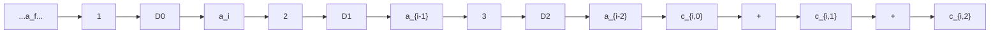
</details>

图 8.7.2 (3,1,3) 卷积码编码器

每输入 k=1 位信息位，产生一个 n=3 的编码输出码组，若输入序列 $a_{0}a_{1}a_{2}a_{3}\cdots=1011\cdots$ ，由上式可得表 8.7.1 所示的编码后输出的结果，编码后按码组排列的输出为

$$
c _ {0, 0} c _ {0, 1} c _ {0, 2}; c _ {1, 0} c _ {1, 1} c _ {1, 2}; c _ {2, 0} c _ {2, 1} c _ {2, 2}; c _ {3, 0} c _ {3, 1} c _ {3, 2} \dots = 1 1 1; 0 1 0; 1 1 0; 1 0 1; \dots \tag {8.7.2}
$$

表 8.7.1 (3,1,3)编码器状态与编码输出

| 序号 | 输入信息位 $a_i$ | 状态 $D_0D_1D_2$ ( $a_i a_{i-1} a_{i-2}$ ) | $c_{i,0}$ | $c_{i,1}$ | $c_{i,2}$ |
|---|---|---|---|---|---|
| 0 | --- | 000 | --- | --- | --- |
| 1 | 1 | 100 | 1 | 1 | 1 |
| 2 | 0 | 010 | 0 | 1 | 0 |
| 3 | 1 | 101 | 1 | 1 | 0 |
| 4 | 1 | 110 | 1 | 0 | 1 |
| ... | ... | ... | ... | ... | ... |

在这个例子中，L=3，约束长度为3。任一输入的信息位只会影响到3个输出码组，例如输入的信息位 $a_{0}$ 只会影响到当前的和后续的2个码字，一共3个输出码字： $c_{0,0}c_{0,1}c_{0,2};c_{1,0}c_{1,1}c_{1,2};c_{2,0}c_{2,1}c_{2,2}$ 。相对分组码，卷积码k与n的取值一般都比较小。在这个例子中，每输入1位信息位，被编码成3位的一个输出码组，编码效率为k/n=1/3。

## 8.7.2 卷积码的卷积关系、生成矩阵与生成多项式

卷积关系式 由图 8.7.1 所示的卷积码编码器的输入与输出间的关系, 易见每一位的编码输出类似于一个模 2 运算的线性滤波器的输出。因此, 如果获得了该滤波器的单位脉冲响应, 则卷积码组中每一位的输出与输入的关系, 可以用一卷积运算来表示。

仍然以图 8.7.2 所示的 $(3,1,3)$ 卷积码编码器为例，设编码器中各寄存器的初始状态为 0，输入单位脉冲函数对应输入的信息序列 $M_{\delta}=100\cdots$ ，由式 $(8.7.1)$ ，每个输出的第 0 位到第 2 位的单位脉冲响应序列依次为

$$
g _ {0, 0} g _ {1, 0} g _ {2, 0} g _ {3, 0} \dots g _ {i, 0} \dots = 1 0 0 0 0 \dots 0 \dots
$$

$$
g _ {0, 1} g _ {1, 1} g _ {2, 1} g _ {3, 1} \dots g _ {i, 1} \dots = 1 1 0 0 0 \dots 0 \dots \tag {8.7.3}
$$

$$
g _ {0, 2} g _ {1, 2} g _ {2, 2} g _ {3, 2} \dots g _ {i, 2} \dots = 1 0 1 0 0 \dots 0 \dots
$$

式中， $g_{i,j}$ 表示第 i 个码组第 j 位的取值，每列表示一个输出码组。因为编码器的记忆长度为 3，所以对于编码输出码组中每一位的序列，最多只有前 3 位的取值不为 0，即有 $g_{i,j}=0, i \geqslant 3$ 。不妨假定信息序列从 t=0 时刻开始输入，之前的初始状态为 $a_{-2}=a_{-1}=0$ 。卷积码的编码输出，可以用输入序列与编码器的单位脉冲响应的卷积关系来表示：

$$
c _ {0. 0} c _ {1. 0} c _ {2. 0} \dots c _ {i, 0} \dots = (a _ {0} a _ {1} a _ {2} \dots a _ {i} \dots) * (g _ {0, 0} g _ {1, 0} g _ {2, 0}) = (a _ {0} a _ {1} a _ {2} \dots a _ {i} \dots) * (1 0 0)
$$

$$
= a _ {0} a _ {1} a _ {2} \dots a _ {i} \dots
$$

$$
\begin{array}{r l} c _ {0. 1} c _ {1. 1} c _ {2. 1} \dots c _ {i. 1} \dots & = (a _ {0} a _ {1} a _ {2} \dots a _ {i} \dots) * (g _ {0, 1} g _ {1, 1} g _ {2, 1}) = (a _ {0} a _ {1} a _ {2} \dots a _ {i} \dots) * (1 1 0) \\ & = a _ {0} \oplus a _ {- 1} a _ {1} \oplus a _ {0} a _ {2} \oplus a _ {1}... a _ {i} \oplus a _ {i - 1} \dots \end{array} \tag {8.7.4}
$$

$$
c _ {0. 2} c _ {1. 2} c _ {2. 2} \dots c _ {i. 2} \dots = (a _ {0} a _ {1} a _ {2} \dots a _ {i} \dots) * (g _ {0, 2} g _ {1, 2} g _ {2, 2}) = (a _ {0} a _ {1} a _ {2} \dots a _ {i} \dots) * (1 0 1)
$$

$$
= a _ {0} \oplus a _ {- 2} a _ {1} \oplus a _ {- 1} a _ {2} \oplus a _ {0} \dots a _ {i} \oplus a _ {i - 2} \dots
$$

可见卷积码编码器每一位的输出与信息位之间的约束关系，与式（8.7.1）所表示的相同。

生成矩阵 与分组码类似，卷积码编码器输入/输出间的关系同样可用生成矩阵来表示。仍然以图 8.7.1 中的卷积码编码器为例，将式（8.7.3）中的每一位组成的码组重新排列后，编码器总的单位脉冲响应为

$$
C _ {\delta} = g _ {0, 0} g _ {0, 1} g _ {0, 2}; g _ {1, 0} g _ {1, 1} g _ {1, 2}; g _ {2, 0} g _ {2, 1} g _ {2, 2}; 0 0 0; \dots = 1 1 1; 0 1 0; 0 0 1; 0 0 0; \dots \tag {8.7.5}
$$

从编码器对应的滤波器的结构特性可见, 卷积码编码器本质上是一个线性系统, 编码器的输出, 可以视为对不同时延的输入脉冲响应叠加的结果。例如, 输入信息序列 $a_0a_1a_2a_3\cdots = 1011\cdots$ 可以视为如下多个冲激序列的按位的累加和:

$$
\begin{array}{l} 1 0 0 0 \dots \\ 0 0 0 0 \dots \\ 0 0 1 0 \dots \\ 0 0 0 1 \dots \\ \end{array}
$$

对上述的每个输入序列，编码器的输出相应地依次为

$$
\begin{array}{l} 1 0 0 0 \dots \rightarrow 1 1 1; 0 1 0; 0 0 1; 0 0 0; 0 0 0; 0 0 0; \dots \\ 0 0 0 0 \dots \quad \rightarrow \quad 0 0 0; 0 0 0; 0 0 0; 0 0 0; 0 0 0; 0 0 0; \dots \\ 0 0 1 0 \dots \rightarrow 0 0 0; 0 0 0; 1 1 1; 0 1 0; 0 0 1; 0 0 0; \dots \\ 0 0 0 1 \dots \rightarrow 0 0 0; 0 0 0; 0 0 0; 1 1 1; 0 1 0; 0 0 1; \dots \\ \end{array}
$$

按位模 2 累加（输出序列按列模 2 和）后的结果为

$$
1 1 1; 0 1 0; 1 1 0; 1 0 1; \dots
$$

比较式（8.7.2）获得的结果，两者完全一致。因为该编码器以1位信息位输入，编码产生3位码组输出，所以每个脉冲响应较之前面的一个脉冲响应顺延3位。根据上述方法，如果把输入视为一个半无限长的向量序列 $M = a_{0}a_{1}a_{2}a_{3}\cdots$ ，编码器的输出C实际上是该向量序列与如下矩阵相乘的结果：

$$
\begin{array}{l} C = M G \\ = \left[ a _ {0} a _ {1} a _ {2} a _ {3} \dots \right] \left[ \begin{array}{c c c c c c} g _ {0, 0} g _ {0, 1} g _ {0, 2} & g _ {1, 0} g _ {1, 1} g _ {1, 2} & g _ {2, 0} g _ {2, 1} g _ {2, 2} & 0 0 0 & 0 0 0 & \dots \\ 0 0 0 & g _ {0, 0} g _ {0, 1} g _ {0, 2} & g _ {1, 0} g _ {1, 1} g _ {1, 2} & g _ {2, 0} g _ {2, 1} g _ {2, 2} & 0 0 0 & \dots \\ 0 0 0 & 0 0 0 & g _ {0, 0} g _ {0, 1} g _ {0, 2} & g _ {1, 0} g _ {1, 1} g _ {1, 2} & g _ {2, 0} g _ {2, 1} g _ {2, 2} & \dots \\ \dots & \dots & \dots & \dots & \dots & \dots \end{array} \right] \tag {8.7.6} \\ = \left[ a _ {0} a _ {1} a _ {2} a _ {3} \dots \right] \left[ \begin{array}{c c c c c c} 1 1 1 & 0 1 0 & 0 0 1 & 0 0 0 & 0 0 0 & \dots \\ 0 0 0 & 1 1 1 & 0 1 0 & 0 0 1 & 0 0 0 & \dots \\ 0 0 0 & 0 0 0 & 1 1 1 & 0 1 0 & 0 0 1 & \dots \\ \dots & \dots & \dots & \dots & \dots & \dots \end{array} \right] \\ \end{array}
$$

其中矩阵 G 称为这个卷积码的生成矩阵。从第二行开始，矩阵 G 的每行由上一行依次右移一个码组长度 n （在本例中码组长度 n = 3 ），前面补 0 的编码器脉冲响应输出顺序排列构成。

若引入如下的子矩阵符号：

$$
\begin{array}{l} \begin{array}{l} G _ {0} = g _ {0, 0} g _ {0, 1} g _ {0, 2} \\ G _ {1} = g _ {1, 0} g _ {1, 1} g _ {1, 2} \end{array} \tag {8.7.7} \\ G _ {2} = g _ {2, 0} g _ {2, 1} g _ {2, 2} \\ \end{array}
$$

一般的， $G_{i}$ 是一个 $k \times n$ 的矩阵，子矩阵的个数由记忆长度 L 决定。在本例中， $k \times n = 1 \times 3$ ，记忆长度 L = 3，生成矩阵可以表示为

$$
\boldsymbol {G} = \left[ \begin{array}{c c c c c c} \boldsymbol {G} _ {0} & \boldsymbol {G} _ {1} & \boldsymbol {G} _ {2} & 0 & 0 & \dots \\ 0 & \boldsymbol {G} _ {0} & \boldsymbol {G} _ {1} & \boldsymbol {G} _ {2} & 0 & \dots \\ 0 & 0 & \boldsymbol {G} _ {0} & \boldsymbol {G} _ {1} & \boldsymbol {G} _ {2} & \dots \\ \dots & \dots & \dots & \dots & \dots & \dots \end{array} \right] \tag {8.7.8}
$$

如果把输入的信息序列 $a_{0}a_{1}a_{2}a_{3}\cdots$ 视为一个半无限长的序列, 生成矩阵则是一个非零子矩阵在右下方不断延伸的无限大矩阵。

生成多项式 与线性分组码中的循环码类似，在卷积码中也可以定义相应的生成多项式。由式（8.7.4）可见，卷积码编码器的输出，完全由编码器每一位相应的单位脉冲响应决定。在该例中因为编码器的记忆长度为3，单位脉冲响应最多只有3位的非0输出，利用式（8.7.4），可以建立每一

位输出的生成多项式:

$$
\begin{array}{l} (g _ {0, 0} g _ {1, 0} g _ {2, 0}) = (1 0 0) \longrightarrow g _ {0} (X) = g _ {0, 0} + g _ {1, 0} X + g _ {2, 0} X ^ {2} = 1 \\ (g _ {0, 1} g _ {1, 1} g _ {2, 1}) = (1 1 0) \longrightarrow g _ {1} (X) = g _ {0, 1} + g _ {1, 1} X + g _ {2, 1} X ^ {2} = 1 + X \tag {8.7.9} \\ (g _ {0, 2} g _ {1, 2} g _ {2, 2}) = (1 0 1) \longrightarrow g _ {2} (X) = g _ {0, 2} + g _ {1, 2} X + g _ {2, 2} X ^ {2} = 1 + X ^ {2} \\ \end{array}
$$

若将信息序列 M 以多项式的形式表示:

$$
a _ {0} a _ {1} a _ {2} a _ {3} \dots \longrightarrow M (X) = a _ {0} + a _ {1} X + a _ {2} X ^ {2} + a _ {3} X ^ {3} + \dots \tag {8.7.10}
$$

编码器用如下的生成多项式矩阵 $G(X)$ 表示:

$$
\boldsymbol {G} (X) = \left[ \begin{array}{l l l} g _ {0} (X) & g _ {1} (X) & g _ {2} (X) \end{array} \right] = \left[ \begin{array}{l l l} 1 & 1 + X & 1 + X ^ {2} \end{array} \right] \tag {8.7.11}
$$

一般地，生成多项式矩阵 $G(X)$ 是一个 $k \times n$ 的矩阵，此处 $k \times n = 1 \times 3$ 。若记码多项式矩阵为 $C(X)$ ，则有

$$
\boldsymbol {C} (X) = \boldsymbol {M} (X) \boldsymbol {G} (X) = \boldsymbol {M} (X) \left[ g _ {0} (X), g _ {1} (X), g _ {2} (X) \right] = \left[ c _ {0} (X), c _ {1} (X), c _ {2} (X) \right] \tag {8.7.12}
$$

编码输出码组中每一位码元对应的多项式为

$$
\begin{array}{l} c _ {0} (X) = g _ {0} (X) \boldsymbol {M} (X) = 1 \cdot \boldsymbol {M} (X) = a _ {0} + a _ {1} X + a _ {2} X ^ {2} + a _ {3} X ^ {3} + \dots + a _ {i} X ^ {i} + \dots \\ c _ {1} (X) = g _ {1} (X) \boldsymbol {M} (X) = (1 + X) \boldsymbol {M} (X) = (1 + X) \left(a _ {0} + a _ {1} X + a _ {2} X ^ {2} + a _ {3} X ^ {3} + \dots\right) \\ = \left(a _ {0} \oplus a _ {- 1}\right) + \left(a _ {1} \oplus a _ {0}\right) X + \left(a _ {2} \oplus a _ {1}\right) X ^ {2} + \left(a _ {3} \oplus a _ {2}\right) X ^ {3} + \dots + \left(a _ {i} \oplus a _ {i - 1}\right) X ^ {i} + \dots \tag {8.7.13} \\ c _ {2} (X) = g _ {2} (X) M (X) = \left(1 + X ^ {2}\right) M (X) = \left(1 + X ^ {2}\right) \left(a _ {0} + a _ {1} X + a _ {2} X ^ {2} + a _ {3} X ^ {3} + \dots\right) \\ = (a _ {0} \oplus a _ {- 2}) + (a _ {1} \oplus a _ {- 1}) X + (a _ {2} \oplus a _ {0}) X ^ {2} + (a _ {3} \oplus a _ {1}) X ^ {3} + \dots + (a _ {i} \oplus a _ {i - 2}) X ^ {i} + \dots \\ \end{array}
$$

式中 $a_{-2} = a_{-1} = 0$ 是为了使表达式更为整齐而引入的。由上式，相应的卷积码编码的第 $i$ 个码组每个码元的取值，可由幂为 $i$ 的项 $X^{i}$ 的系数决定：

$$
(c _ {i, 0} c _ {i, 1} c _ {i, 2}) = (a _ {i} a _ {i} \oplus a _ {i - 1} a _ {i} \oplus a _ {i - 2}) \tag {8.7.14}
$$

显然这与式（8.7.1）完全一致。

前面通过一个简单的例子讨论了卷积码编码器的卷积关系、生成矩阵和生成多项式。下面通过另外一个 $k = 2$ ， $n = 3$ 和 $L = 3$ 的(3,2,3)卷积码编码器的例子，来进一步说明卷积码的有关性质。卷积码编码器的结构如图8.7.3所示。该卷积码编码器编码时每次输入2个信息码元 $a_{i,0}a_{i,1}$ ，在移位寄存器中的数据相应地右移两位，经过编码运算，输出3位的编码输出码组 $c_{i,0}c_{i,1}c_{i,2}$ ：

$$
a _ {0, 0} a _ {0, 1} a _ {1, 0} a _ {1, 1} \dots a _ {i, 0} a _ {i, 1} \dots \xrightarrow {(3 , 2 , 3)} c _ {0, 0} c _ {0, 1} c _ {0, 2} c _ {1, 0} c _ {1, 1} c _ {1, 2} \dots c _ {i, 0} c _ {i, 1} c _ {i, 2} \dots \tag {8.7.15}
$$


<details>
<summary>flowchart</summary>

This diagram illustrates a multi-stage signal processing or control system architecture with three main stages (1, 2, 3) and associated control signals (c_i,0, c_i,1, c_i,2) connected by directional arrows.
</details>

图 8.7.3 (3,2,3) 卷积码编码器

编码输出码组与输入信息码元间的约束关系为

$$
\begin{array}{l} \begin{array}{l} c _ {i, 0} = a _ {i, 0} \\ c _ {i, 1} = a _ {i, 1} \end{array} \tag {8.7.16} \\ c _ {i, 2} = a _ {i, 0} \oplus a _ {i, 1} \oplus a _ {i - 1, 1} \oplus a _ {i - 2, 0} \\ \end{array}
$$

若将输入分解为

$$
a _ {0, 0} a _ {0, 1} a _ {1, 0} a _ {1, 1} \dots a _ {i, 0} a _ {i, 1} \dots = (a _ {0, 0} 0 a _ {1, 0} 0 \dots a _ {i, 0} 0 \dots) + (0 a _ {0, 1} 0 a _ {1, 1} \dots 0 a _ {i, 1} \dots) \tag {8.7.17}
$$

对输入分别进行编码可得

$$
a _ {0, 0} 0 a _ {1, 0} 0 \dots a _ {i, 0} 0 \dots \xrightarrow {(3 , 2 , 3)} c _ {0, 0} ^ {(1)} c _ {0, 1} ^ {(1)} c _ {0, 2} ^ {(1)} c _ {1, 0} ^ {(1)} c _ {1, 1} ^ {(1)} c _ {1, 2} ^ {(1)} \dots c _ {i, 0} ^ {(1)} c _ {i, 1} ^ {(1)} c _ {i, 2} ^ {(1)} \dots \tag {8.7.18}
$$

$$
0 a _ {0, 1} 0 a _ {1, 1} \dots 0 a _ {i, 1} \dots \xrightarrow {(3 , 2 , 3)} c _ {0, 0} ^ {(2)} c _ {0, 1} ^ {(2)} c _ {0, 2} ^ {(2)} c _ {1, 0} ^ {(2)} c _ {1, 1} ^ {(2)} c _ {1, 2} ^ {(2)} \dots c _ {i, 0} ^ {(2)} c _ {i, 1} ^ {(2)} c _ {i, 2} ^ {(2)} \dots \tag {8.7.19}
$$

由线性编码的叠加原理，输出序列是上面的两个序列按位相加，即有

$$
\begin{array}{l} c _ {0, 0} c _ {0, 1} c _ {0, 2} c _ {1, 0} c _ {1, 1} c _ {1, 2} \dots c _ {i, 0} c _ {i, 1} c _ {i, 2} \dots \\ = \left(c _ {0, 0} ^ {(1)} c _ {0, 1} ^ {(1)} c _ {0, 2} ^ {(1)} c _ {1, 0} ^ {(1)} c _ {1, 1} ^ {(1)} c _ {1, 2} ^ {(1)} \dots c _ {i, 0} ^ {(1)} c _ {i, 1} ^ {(1)} c _ {i, 2} ^ {(1)} \dots\right) + \left(c _ {0, 0} ^ {(2)} c _ {0, 1} ^ {(2)} c _ {0, 2} ^ {(2)} c _ {1, 0} ^ {(2)} c _ {1, 1} ^ {(2)} c _ {1, 2} ^ {(2)} \dots c _ {i, 0} ^ {(2)} c _ {i, 1} ^ {(2)} c _ {i, 2} ^ {(2)} \dots\right) \end{array} \tag {8.7.20}
$$

与前面的分析类似，首先考虑信息序列为单位脉冲函数

$$
M _ {\delta} ^ {(1)} = 1 0, 0 0, 0 0, \dots \tag {8.7.21}
$$

输入时编码器的输出，此时为突出编码输出是对单位脉冲函数的响应，将关于输入 $M_{\delta}^{(1)}$ 的编码输出由 $c_{i,j}^{(1)}$ 改记为 $g_{i,j}^{(1)}$ ，由式（8.7.16）确定的编码输出码元与输入信息码元间的约束关系如下：

（1）移位寄存器的初始值全为0，输入 $a_{0,0}a_{0,1}=10$ ，寄存器右移两位，得

$$
\begin{array}{l} \begin{array}{l} g _ {0, 0} ^ {(1)} = a _ {0, 0} = 1 \\ g _ {0, 1} ^ {(1)} = a _ {0, 1} = 0 \end{array} \tag {8.7.22} \\ g _ {0, 2} ^ {(1)} = a _ {0, 0} \oplus a _ {0, 1} \oplus a _ {- 1, 1} \oplus a _ {- 2, 0} = 1 \oplus 0 \oplus 0 \oplus 0 = 1 \\ \end{array}
$$

（2）输入 $a_{1,0}a_{1,1} = 00$ ，寄存器右移两位，得

$$
\begin{array}{l} \begin{array}{l} g _ {1, 0} ^ {(1)} = a _ {1, 0} = 0 \\ g _ {1, 1} ^ {(1)} = a _ {1, 1} = 0 \end{array} \tag {8.7.23} \\ g _ {1, 2} ^ {(1)} = a _ {1, 0} \oplus a _ {1, 1} \oplus a _ {0, 1} \oplus a _ {- 1, 0} = 0 \oplus 0 \oplus 0 \oplus 0 = 0 \\ \end{array}
$$

（3）输入 $a_{2,0}a_{2,1} = 00$ ，寄存器右移两位，得

$$
\begin{array}{l} \begin{array}{l} g _ {2, 0} ^ {(1)} = a _ {2, 0} = 0 \\ g _ {2, 1} ^ {(1)} = a _ {2, 1} = 0 \end{array} \tag {8.7.24} \\ g _ {2, 2} ^ {(1)} = a _ {2, 0} \oplus a _ {2, 1} \oplus a _ {1, 1} \oplus a _ {0, 0} = 0 \oplus 0 \oplus 0 \oplus 1 = 1 \\ \end{array}
$$

（4）经3个编码码组输出后，随着 $a_{0,0} = 1$ 右移出编码器的移位寄存器组，之后的编码输出恒为0，例如对于下一组输入 $a_{3,0}a_{3,1} = 00$ ，寄存器右移两位，得

$$
\begin{array}{l} \begin{array}{l} g _ {3, 0} ^ {(1)} = a _ {3, 0} = 0 \\ g _ {3, 1} ^ {(1)} = a _ {3, 1} = 0 \end{array} \tag {8.7.25} \\ g _ {3, 2} ^ {(1)} = a _ {3, 0} \oplus a _ {3, 1} \oplus a _ {2, 1} \oplus a _ {1, 0} = 0 \oplus 0 \oplus 0 \oplus 0 = 0 \\ \end{array}
$$

所以有

$$
C _ {\delta} ^ {(1)} = g _ {0, 0} ^ {(1)} g _ {0, 1} ^ {(1)} g _ {0, 2} ^ {(1)}, g _ {1, 0} ^ {(1)} g _ {1, 1} ^ {(1)} g _ {1, 2} ^ {(1)}, g _ {2, 0} ^ {(1)} g _ {2, 1} ^ {(1)} g _ {2, 2} ^ {(1)}, \dots = 1 0 1, 0 0 0, 0 0 1, 0 0 0, 0 0 0, \dots \tag {8.7.26}
$$

接着考虑另一位单位脉冲函数

$$
M _ {\delta} ^ {(2)} = 0 1, 0 0, 0 0, \dots \tag {8.7.27}
$$

输入时编码器的输出如下:

（1）移位寄存器的初始值全为0，输入 $a_{0,0}a_{0,1}=01$ ，寄存器右移两位，得

$$
g _ {0. 0} ^ {(2)} = a _ {0. 0} = 0
$$

$$
g _ {0, 1} ^ {(2)} = a _ {0, 1} = 1 \tag {8.7.28}
$$

$$
g _ {0, 2} ^ {(2)} = a _ {0, 0} \oplus a _ {0, 1} \oplus a _ {- 1, 1} \oplus a _ {- 2, 0} = 0 \oplus 1 \oplus 0 \oplus 0 = 1
$$

(2) 输入 $a_{1,0}a_{1,1}=00$ ，寄存器右移两位，得

$$
g _ {1, 0} ^ {(2)} = a _ {1, 0} = 0
$$

$$
g _ {1, 1} ^ {(2)} = a _ {1, 1} = 0 \tag {8.7.29}
$$

$$
g _ {1, 2} ^ {(2)} = a _ {1, 0} \oplus a _ {1, 1} \oplus a _ {0, 1} \oplus a _ {- 1, 0} = 0 \oplus 0 \oplus 1 \oplus 0 = 1
$$

（3）输入 $a_{2,0}a_{2,1}=00$ ，寄存器右移两位，得

$$
g _ {2, 0} ^ {(2)} = a _ {2, 0} = 0
$$

$$
g _ {2, 1} ^ {(2)} = a _ {2, 1} = 0 \tag {8.7.30}
$$

$$
g _ {2, 2} ^ {(2)} = a _ {2, 0} \oplus a _ {2, 1} \oplus a _ {1, 1} \oplus a _ {0, 0} = 0 \oplus 0 \oplus 0 \oplus 0 = 0
$$

(4) 同样, 经 3 组编码输出后, 随着 $a_{0,1} = 1$ 右移出编码器的移位寄存器组, 之后的编码输出恒为 0 ,如对于下一组输入 $a_{3,0}a_{3,1} = 00$ , 寄存器右移两位, 得

$$
\begin{array}{l} g _ {3, 0} ^ {(2)} = a _ {3, 0} = 0 \\ g _ {3, 1} ^ {(2)} = a _ {3, 1} = 0 \end{array} \tag {8.7.31}
$$

$$
g _ {3, 2} ^ {(2)} = a _ {3, 0} \oplus a _ {3, 1} \oplus a _ {2, 1} \oplus a _ {1, 0} = 0 \oplus 0 \oplus 0 \oplus 0 = 0
$$

所以有

$$
C _ {\delta} ^ {(2)} = g _ {0, 0} ^ {(2)} g _ {0, 1} ^ {(2)} g _ {0, 2} ^ {(2)}, \quad g _ {1, 0} ^ {(2)} g _ {1, 1} ^ {(2)} g _ {1, 2} ^ {(2)}, \quad g _ {2, 0} ^ {(2)} g _ {2, 1} ^ {(2)} g _ {2, 2} ^ {(2)}, \dots = 0 1 1, 0 0 1, 0 0 0, 0 0 0, 0 0 0, \dots \tag {8.7.32}
$$

获得 $C_{\delta}^{(1)}$ 和 $C_{\delta}^{(2)}$ 后，根据线性叠加原理，对应输入信息序列 $M = a_{0,0}a_{0,1}a_{1,0}a_{1,1}\cdots a_{i,0}a_{i,1}\cdots = M_{\delta}^{(1)} + M_{\delta}^{(2)}$ ，可得相应的生成矩阵为

$$
\begin{array}{l} \boldsymbol {G} = \left[ \begin{array}{c c c c c c} g _ {0, 0} ^ {(1)} g _ {0, 1} ^ {(1)} g _ {0, 2} ^ {(1)} & g _ {1, 0} ^ {(1)} g _ {1, 1} ^ {(1)} g _ {1, 2} ^ {(1)} & g _ {2, 0} ^ {(1)} g _ {2, 1} ^ {(1)} g _ {2, 2} ^ {(1)} & 0 0 0 & 0 0 0 & \dots \\ g _ {0, 0} ^ {(2)} g _ {0, 1} ^ {(2)} g _ {0, 2} ^ {(2)} & g _ {1, 0} ^ {(2)} g _ {1, 1} ^ {(2)} g _ {1, 2} ^ {(2)} & g _ {2, 0} ^ {(2)} g _ {2, 1} ^ {(2)} g _ {2, 2} ^ {(2)} & 0 0 0 & 0 0 0 & \dots \\ 0 0 0 & g _ {0, 0} ^ {(1)} g _ {0, 1} ^ {(1)} g _ {0, 2} ^ {(1)} & g _ {1, 0} ^ {(1)} g _ {1, 1} ^ {(1)} g _ {1, 2} ^ {(1)} & g _ {2, 0} ^ {(1)} g _ {2, 1} ^ {(1)} g_{2, 2} ^ {(1)} & 0 0 0 & \dots \\ 0 0 0 & g _ {0, 0} ^ {(2)} g _ {0, 1} ^ {(2)} g _ {0, 2} ^ {(2)} & g _ {1, 0} ^ {(2)} g _ {1, 1} ^ {(2)} g _ {1, 2} ^ {(2)} & g _ {2, 0} ^ {(2)} g _ {2, 1} ^ {(2)} g_{2, 2} ^ {(2)} & 0 0 0 & \dots \\ 0 0 0 & 0 0 0 & g _ {0, 0} ^ {(1)} g _ {0, 1} ^ {(1)} g _ {0, 2} ^ {(1)} & g _ {1, 0} ^ {(1)} g _ {1, 1} ^ {(1)} g _ {1, 2} ^ {(1)} & g _ {2, 0} ^ {(1)} g _ {2, 2} ^ {(1)} g _ {2, 2} ^ {(1)} & \dots \\ 0 0 0 & 0 0 0 & g _ {0, 0} ^ {(2)} g _ {0, 1} ^ {(2)} g _ {0, 2} ^ {(2)} & g _ {1, 0} ^ {(2)} g _ {1, 1} ^ {(2)} g _ {1, 2} ^ {(2)} & g _ {2, 0} ^ {(2)} g _ {2, 2} ^ {(2)} g _ {2, 2} ^ {(2)} & \dots \\ \dots & \dots & \dots & \dots & \dots & \dots \end{array} \right] \\ = \left[ \begin{array}{c c c c c c} 1 0 1 & 0 0 0 & 0 0 1 & 0 0 0 & 0 0 0 & \dots \\ 0 1 1 & 0 0 1 & 0 0 0 & 0 0 0 & 0 0 0 & \dots \\ 0 0 0 & 1 0 1 & 0 0 0 & 0 0 1 & 0 0 0 & \dots \\ 0 0 0 & 0 1 1 & 0 0 1 & 0 0 0 & 0 0 0 & \dots \\ 0 0 0 & 0 0 0 & 1 0 1 & 0 0 0 & 0 0 1 & \dots \\ 0 0 0 & 0 0 0 & 0 1 1 & 0 0 1 & 0 0 0 & \dots \\ \dots & \dots & \dots & \dots & \dots & \dots \end{array} \right] \tag {8.7.33} \\ \end{array}
$$

若引入记号

$$
\begin{array}{l} \boldsymbol {G} _ {0} = \left[ \begin{array}{l l l} g _ {0, 0} ^ {(1)} & g _ {0, 1} ^ {(1)} & g _ {0, 2} ^ {(1)} \\ g _ {0, 0} ^ {(2)} & g _ {0, 1} ^ {(2)} & g _ {0, 2} ^ {(2)} \end{array} \right] = \left[ \begin{array}{l l l} 1 & 0 & 1 \\ 0 & 1 & 1 \end{array} \right], \quad \boldsymbol {G} _ {1} = \left[ \begin{array}{l l l} g _ {1, 0} ^ {(1)} & g _ {1, 1} ^ {(1)} & g _ {1, 2} ^ {(1)} \\ g _ {1, 0} ^ {(2)} & g _ {1, 1} ^ {(2)} & g _ {1, 2} ^ {(2)} \end{array} \right] = \left[ \begin{array}{l l l} 0 & 0 & 0 \\ 0 & 0 & 1 \end{array} \right] \tag {8.7.34} \\ \boldsymbol {G} _ {2} = \left[ \begin{array}{c c c} g _ {2, 0} ^ {(1)} & g _ {2, 1} ^ {(1)} & g _ {2, 2} ^ {(1)} \\ g _ {2, 0} ^ {(2)} & g _ {2, 1} ^ {(2)} & g _ {2, 2} ^ {(2)} \end{array} \right] = \left[ \begin{array}{c c c} 0 & 0 & 1 \\ 0 & 0 & 0 \end{array} \right] \\ \end{array}
$$

该编码器的生成矩阵可以表示为

$$
\boldsymbol {G} = \left[ \begin{array}{c c c c c c} \boldsymbol {G} _ {0} & \boldsymbol {G} _ {1} & \boldsymbol {G} _ {2} & 0 & 0 & \dots \\ 0 & \boldsymbol {G} _ {0} & \boldsymbol {G} _ {1} & \boldsymbol {G} _ {2} & 0 & \dots \\ 0 & 0 & \boldsymbol {G} _ {0} & \boldsymbol {G} _ {1} & \boldsymbol {G} _ {2} & \dots \\ \dots & \dots & \dots & \dots & \dots & \dots \end{array} \right] \tag {8.7.35}
$$

生成矩阵与式（8.7.8）有相同的形式，此时 $G_{i}$ 是一个 $k \times n = 2 \times 3$ 的子矩阵， $i = 0, 1, \cdots, L - 1$ ，L = 3 是编码器的记忆长度。

由编码器的单位脉冲响应函数式（8.7.26），

$$
C _ {\delta} ^ {(1)} = g _ {0, 0} ^ {(1)} g _ {0, 1} ^ {(1)} g _ {0, 2} ^ {(1)}, g _ {1, 0} ^ {(1)} g _ {1, 1} ^ {(1)} g _ {1, 2} ^ {(1)}, g _ {2, 0} ^ {(1)} g _ {2, 1} ^ {(1)} g _ {2, 2} ^ {(1)}, \dots = 1 0 1, 0 0 0, 0 0 1, 0 0 0, 0 0 0, \dots
$$

可得与输入信息位码组第一个信息码元对应的编码输出码组中，每一位的生成多项式

$$
\begin{array}{l} g _ {0, 0} ^ {(1)} g _ {1, 0} ^ {(1)} g _ {2, 0} ^ {(1)} = 1 0 0 \longrightarrow g _ {0} ^ {(1)} (X) = g _ {0, 0} ^ {(1)} + g _ {1, 0} ^ {(1)} X + g _ {2, 0} ^ {(1)} X ^ {2} = 1 \\ g _ {0, 1} ^ {(1)} g _ {1, 1} ^ {(1)} g _ {2, 1} ^ {(1)} = 0 0 0 \longrightarrow g _ {1} ^ {(1)} (X) = g _ {0, 1} ^ {(1)} + g _ {1, 1} ^ {(1)} X + g _ {2, 1} ^ {(1)} X ^ {2} = 0 \tag {8.7.36} \\ g _ {0, 2} ^ {(1)} g _ {1, 2} ^ {(1)} g _ {2, 2} ^ {(1)} = 1 0 1 \longrightarrow g _ {2} ^ {(1)} (X) = g _ {0, 2} ^ {(1)} + g _ {1, 2} ^ {(1)} X + g _ {2, 2} ^ {(1)} X ^ {2} = 1 + X ^ {2} \\ \end{array}
$$

同理，由编码器的单位脉冲响应函数式（8.7.32），

$$
C _ {\delta} ^ {(2)} = g _ {0, 0} ^ {(2)} g _ {0, 1} ^ {(2)} g _ {0, 2} ^ {(2)}, g _ {1, 0} ^ {(2)} g _ {1, 1} ^ {(2)} g _ {1, 2} ^ {(2)}, g _ {2, 0} ^ {(2)} g _ {2, 1} ^ {(2)} g _ {2, 2} ^ {(2)}, \dots = 0 1 1, 0 0 1, 0 0 0, 0 0 0, 0 0 0, \dots
$$

可得与输入信息位码组中第二个信息码元对应的编码输出每一位的生成多项式

$$
\begin{array}{l} g _ {0, 0} ^ {(2)} g _ {1, 0} ^ {(2)} g _ {2, 0} ^ {(2)} = 0 0 0 \longrightarrow g _ {0} ^ {(2)} (X) = g _ {0, 0} ^ {(2)} + g _ {1, 0} ^ {(2)} X + g _ {2, 0} ^ {(2)} X ^ {2} = 0 \\ g _ {0, 1} ^ {(2)} g _ {1, 1} ^ {(2)} g _ {2, 1} ^ {(2)} = 1 0 0 \longrightarrow g _ {1} ^ {(2)} (X) = g _ {0, 1} ^ {(2)} + g _ {1, 1} ^ {(2)} X + g _ {2, 1} ^ {(2)} X ^ {2} = 1 \tag {8.7.37} \\ g _ {0, 2} ^ {(2)} g _ {1, 2} ^ {(2)} g _ {2, 2} ^ {(2)} = 1 1 0 \longrightarrow g _ {2} ^ {(2)} (X) = g _ {0, 2} ^ {(2)} + g _ {1, 2} ^ {(2)} X + g _ {2, 2} ^ {(2)} X ^ {2} = 1 + X \\ \end{array}
$$

相应的生成多项式矩阵 $G(X)$ 为

$$
\boldsymbol {G} (X) = \left[ \begin{array}{l l l} g _ {0} ^ {(1)} (X) & g _ {1} ^ {(1)} (X) & g _ {2} ^ {(1)} (X) \\ g _ {0} ^ {(2)} (X) & g _ {1} ^ {(2)} (X) & g _ {2} ^ {(2)} (X) \end{array} \right] = \left[ \begin{array}{l l l} 1 & 0 & 1 + X ^ {2} \\ 0 & 1 & 1 + X \end{array} \right] \tag {8.7.38}
$$

而码多项式矩阵 $C(X)$ 可以表示为

$$
\begin{array}{l} \boldsymbol {C} (X) = \boldsymbol {M} (X) \boldsymbol {G} (X) = \left[ \begin{array}{l l} M ^ {(1)} (X) & M ^ {(2)} (X) \end{array} \right] \left[ \begin{array}{l l l} g _ {0} ^ {(1)} (X) & g _ {1} ^ {(1)} (X) & g _ {2} ^ {(1)} (X) \\ g _ {0} ^ {(2)} (X) & g _ {1} ^ {(2)} (X) & g _ {2} ^ {(2)} (X) \end{array} \right] \tag {8.7.39} \\ = \left[ \begin{array}{l l l} c _ {0} (X) & c _ {1} (X) & c _ {2} (X) \end{array} \right] \\ \end{array}
$$

其中，

$$
\begin{array}{l} c _ {0} (X) = M ^ {(1)} (X) g _ {0} ^ {(1)} (X) + M ^ {(2)} (X) g _ {0} ^ {(2)} (X) \\ c _ {1} (X) = M ^ {(1)} (X) g _ {1} ^ {(1)} (X) + M ^ {(2)} (X) g _ {1} ^ {(2)} (X) \\ c _ {2} (X) = M ^ {(1)} (X) g _ {2} ^ {(1)} (X) + M ^ {(2)} (X) g _ {2} ^ {(2)} (X) \\ \end{array}
$$

由

$$
M (X) = \left[ \begin{array}{l l} M ^ {(1)} (X) & M ^ {(2)} (X) \end{array} \right] = \left[ \left(a _ {0, 0} + a _ {1, 0} X + a _ {2, 0} X ^ {2} + \dots\right) \left(a _ {0, 1} + a _ {1, 1} X + a _ {2, 1} X ^ {2} + \dots\right) \right] \tag {8.7.40}
$$

代入式（8.7.39）可得

$$
\begin{array}{l} c _ {0} (X) = (a _ {0, 0} + a _ {1, 0} X + a _ {2, 0} X ^ {2} + \dots) \cdot 1 + (a _ {0, 1} + a _ {1, 1} X + a _ {2, 1} X ^ {2} + \dots) \cdot 0 = a _ {0, 0} + a _ {1, 0} X + a _ {2, 0} X ^ {2} + \dots \\ c _ {1} (X) = (a _ {0, 0} + a _ {1, 0} X + a _ {2, 0} X ^ {2} + \dots) \cdot 0 + (a _ {0, 1} + a _ {1, 1} X + a _ {2, 1} X ^ {2} + \dots) \cdot 1 = a _ {0, 1} + a _ {1, 1} X + a _ {2, 1} X ^ {2} + \dots \tag {8.7.41} \\ c _ {2} (X) = (a _ {0, 0} + a _ {1, 0} X + a _ {2, 0} X ^ {2} + \dots) (1 + X ^ {2}) + (a _ {0, 1} + a _ {1, 1} X + a _ {2, 1} X ^ {2} + \dots) (1 + X) \\ = (a _ {0, 0} \oplus a _ {0, 1} \oplus a _ {- 1, 1} \oplus a _ {- 2, 0}) + (a _ {1, 0} \oplus a _ {1, 1} \oplus a _ {0, 1} \oplus a _ {- 1, 0}) X + \dots + (a _ {i, 0} \oplus a _ {i, 1} \oplus a _ {i - 1, 1} \oplus a _ {i - 2, 0}) X ^ {i} + \dots \\ \end{array}
$$

$$
\begin{array}{l} c _ {2} (X) = (a _ {0, 0} + a _ {1, 0} X + a _ {2, 0} X ^ {2} + \dots) (1 + X ^ {2}) + (a _ {0, 1} + a _ {1, 1} X + a _ {2, 1} X ^ {2} + \dots) (1 + X) \\ = (a _ {0, 0} \oplus a _ {0, 1} \oplus a _ {- 1, 1} \oplus a _ {- 2, 0}) + (a _ {1, 0} \oplus a _ {1, 1} \oplus a _ {0, 1} \oplus a _ {- 1, 0}) X + \dots + (a _ {i, 0} \oplus a _ {i, 1} \oplus a _ {i - 1, 1} \oplus a _ {i - 2, 0}) X ^ {i} + \dots \\ \end{array}
$$

式中 $a_{-1,1} = a_{-2,0} = a_{-1,0} = 0$ 是为了使表达式整齐而引入的符号。由上式可得编码器输出第 $i$ 个码组的一般表达式为

$$
(c _ {i, 0} c _ {i, 1} c _ {i, 2}) = (a _ {i, 0} a _ {i, 1} a _ {i, 0} \oplus a _ {i, 1} \oplus a _ {i - 1, 1} \oplus a _ {i - 2, 0})
$$

上式显然与式（8.7.16）完全一致。

上面我们通过两个示例详细分析了卷积码编码器输入信息位与编码输出的卷积关系，以及如何构建卷积码的生成矩阵和生成多项式。在这两个不同形式的关系式中，我们只要知道其中的一个，就可以导出另外一个。

系统码结构的卷积码 对于系统码结构的分组码，输出的码组有如下的结构特性，在编码输出码组 $c_{0}c_{1}c\cdots c_{k - 1}c_{k}\dots c_{n - 1}$ 中， $c_{0}c_{1}c_{2}\dots c_{k - 1} = a_{0}a_{1}a_{2}\dots a_{k - 1}$ 是 $k$ 位输入的信息位， $c_{k}c_{k + 1}\dots c_{n - 1}$ 是 $n - k$ 位的监督位。同样，对于卷积码，如果输出的码组具有上述的结构，我们称这样的卷积码为系统码结构的卷积码。在前面介绍的两个卷积码的示例中，对于 $k = 1, n = 3$ 的卷积码(3,1,3)，由式（8.7.1），对任意的第 $i$ 个码组

$$
c _ {i, 0}, c _ {i, 1}, c _ {i, 2} = a _ {i}, a _ {i} \oplus a _ {i - 1}, a _ {i} \oplus a _ {i - 2}
$$

其中第一位是信息位，第二位和第三位是监督位，这是一种系统码结构的卷积码。对于 $k = 2, n = 3$ 的卷积码(3,2,3)，由式（8.7.16），其第 $i$ 个码组

$$
c _ {i, 0}, c _ {i, 1}, c _ {i, 2} = a _ {i, 0}, a _ {i, 1}, a _ {i, 0} \oplus a _ {i, 1} \oplus a _ {i - 1, 1} \oplus a _ {i - 2, 0}
$$

其中第一位和第二位是信息位，第三位是监督位，这也是一种系统码结构的卷积码。

对于系统码结构的卷积码，其生成矩阵还可以进一步表示为如下的规则形式：

$$
\boldsymbol {G} = \left[ \begin{array}{c c c c c c} \boldsymbol {G} _ {0} & \boldsymbol {G} _ {1} & \dots & \boldsymbol {G} _ {L - 1} & & \dots \\ & \boldsymbol {G} _ {0} & \dots & \boldsymbol {G} _ {L - 2} & \boldsymbol {G} _ {L - 1} & \dots \\ & & \dots & \boldsymbol {G} _ {L - 3} & \boldsymbol {G} _ {L - 2} & \dots \\ \dots & \dots & \dots & \dots & \dots & \dots \end{array} \right] = \left[ \begin{array}{c c c c c c} \boldsymbol {I} _ {k} \boldsymbol {P} _ {0} & \boldsymbol {O} _ {k} \boldsymbol {P} _ {1} & \dots & \boldsymbol {O} _ {k} \boldsymbol {P} _ {L - 1} & & \dots \\ & \boldsymbol {I} _ {k} \boldsymbol {P} _ {0} & \dots & \boldsymbol {O} _ {k} \boldsymbol {P} _ {L - 2} & \boldsymbol {O} _ {k} \boldsymbol {P} _ {L - 1} & \dots \\ & & \dots & \boldsymbol {O} _ {k} \boldsymbol {P} _ {L - 3} & \boldsymbol {O} _ {k} \boldsymbol {P} _ {L - 2} & \dots \\ \dots & \dots & \dots & \dots & \dots & \dots \end{array} \right] \tag {8.7.42}
$$

其中 $I_{k}$ 是一个 $k \times k$ 的单位矩阵, $O_{k}$ 是一个的全0的 $k \times k$ 矩阵, $P_{i}$ 是一个 $k \times (n - k)$ 的矩阵。例如前面讨论过的第一个参数为(3,1,3)的卷积码示例, 生成矩阵由式 (8.7.6) 给出,

$$
\boldsymbol {G} = \left[ \begin{array}{c c c c c c} 1 1 1 & 0 1 0 & 0 0 1 & 0 0 0 & 0 0 0 & \dots \\ 0 0 0 & 1 1 1 & 0 1 0 & 0 0 1 & 0 0 0 & \dots \\ 0 0 0 & 0 0 0 & 1 1 1 & 0 1 0 & 0 0 1 & \dots \\ \dots & \dots & \dots & \dots & \dots & \dots \end{array} \right]
$$

其中 $k = 1, n = 3$ ， $I_1 = [1]$ ， $O_1 = [0]$ ， $P_0 = [11]$ ， $P_1 = [10]$ ， $P_2 = [01]$ 。对于第二个参数为(3,2,3)的卷积码示例，生成矩阵由式（8.7.33）给出，

$$
\boldsymbol {G} = \left[ \begin{array}{c c c c c c} 1 0 1 & 0 0 0 & 0 0 1 & 0 0 0 & 0 0 0 & \dots \\ 0 1 1 & 0 0 1 & 0 0 0 & 0 0 0 & 0 0 0 & \dots \\ 0 0 0 & 1 0 1 & 0 0 0 & 0 0 1 & 0 0 0 & \dots \\ 0 0 0 & 0 1 1 & 0 0 1 & 0 0 0 & 0 0 0 & \dots \\ 0 0 0 & 0 0 0 & 1 0 1 & 0 0 0 & 0 0 1 & \dots \\ 0 0 0 & 0 0 0 & 0 1 1 & 0 0 1 & 0 0 0 & \dots \\ \dots & \dots & \dots & \dots & \dots & \dots \end{array} \right]
$$

其中 $k = 2, n = 3$ ， $\pmb{I}_2 = \begin{bmatrix} 1 & 0 \\ 0 & 1 \end{bmatrix}$ ， $\pmb{O}_2 = \begin{bmatrix} 0 & 0 \\ 0 & 0 \end{bmatrix}$ ， $\pmb{P}_0 = \begin{bmatrix} 1 \\ 1 \end{bmatrix}$ ， $\pmb{P}_1 = \begin{bmatrix} 0 \\ 1 \end{bmatrix}$ ， $\pmb{P}_2 = \begin{bmatrix} 1 \\ 0 \end{bmatrix}$ 。

对于系统码卷积码的生成多项式矩阵也具有其规范形式

$$
\boldsymbol {G} (X) = \left[ \begin{array}{l l} \boldsymbol {I} _ {k} & \boldsymbol {P} (X) \end{array} \right] \tag {8.7.43}
$$

其中 $I_{k}$ 是一个 $k \times k$ 的单位矩阵， $P(X)$ 是一个 $k \times (n - k)$ 的多项式矩阵。对于前面参数为(3,1,3)的卷积码示例一，由式（8.7.11）有 $G(X) = \left[1 \quad 1 + X \quad 1 + X^{2}\right]$ ，其中 $I_{1} = [1]$ ， $P(X) = \left[1 + X \quad 1 + X^{2}\right]$ 。对于参数为(3,2,3)的卷积码示例二，由式（8.7.38）有 $G(X)=\begin{bmatrix}1&0&1+X^{2}\\ 0&1&1+X\end{bmatrix}$ ，其中 $I_{2}=\begin{bmatrix}1&0\\ 0&1\end{bmatrix}$ ， $P(X)=\begin{bmatrix}1+X^{2}\\ 1+X\end{bmatrix}$ 。

## 8.7.3 卷积码的监督矩阵与监督多项式矩阵

监督矩阵 卷积码也是一种线性码，根据卷积码的生成矩阵，同样可以定义卷积码的监督矩阵，监督矩阵也称校验矩阵。卷积码的生成矩阵 G 与其监督矩阵 H 之间同样满足关系式

$$
\boldsymbol {G} \cdot \boldsymbol {H} ^ {\mathrm{T}} = \boldsymbol {O} \tag {8.7.44}
$$

其中 O 是一个各元素均为 0 的矩阵。卷积码的监督矩阵一般具有如下形式：

$$
\boldsymbol {H} = \left[ \begin{array}{c c c c c c} \boldsymbol {H} _ {0} & & & \dots & & \\ \boldsymbol {H} _ {1} & \boldsymbol {H} _ {0} & & \dots & & \\ \boldsymbol {H} _ {2} & \boldsymbol {H} _ {1} & \boldsymbol {H} _ {0} & \dots & & \\ \vdots & \vdots & \vdots & \ddots & & \vdots \\ \boldsymbol {H} _ {L - 1} & \boldsymbol {H} _ {L - 2} & \boldsymbol {H} _ {L - 3} & \dots & \boldsymbol {H} _ {0} & \dots \\ & \boldsymbol {H} _ {L - 1} & \boldsymbol {H} _ {L - 2} & \dots & \boldsymbol {H} _ {1} & \dots \\ & & \boldsymbol {H} _ {L - 1} & \dots & \boldsymbol {H} _ {2} & \dots \\ \dots & \dots & \dots & \dots & \dots & \dots \end{array} \right] \tag {8.7.45}
$$

其中的每个 $H_{i}$ 都是一个 $(n-k)\times n$ 子矩阵。H的左下角和右上角空白处的元素位置均为0。如果已知生成矩阵G，根据 $G\cdot H^{T}=O$ ，可以求出各个 $H_{i}$ 。

与分组码类似，对于系统码结构的卷积码，其监督矩阵也有特殊的结构，可以直接由生成矩阵获得。已知对于系统码的生成矩阵具有形式

$$
\boldsymbol {G} = \left[ \begin{array}{c c c c c c} \boldsymbol {I} _ {k} \boldsymbol {P} _ {0} & \boldsymbol {O} _ {k} \boldsymbol {P} _ {1} & \dots & \boldsymbol {O} _ {k} \boldsymbol {P} _ {L - 1} & & \dots \\ & \boldsymbol {I} _ {k} \boldsymbol {P} _ {0} & \dots & \boldsymbol {O} _ {k} \boldsymbol {P} _ {L - 2} & \boldsymbol {O} _ {k} \boldsymbol {P} _ {L - 1} & \dots \\ & & \dots & \boldsymbol {O} _ {k} \boldsymbol {P} _ {L - 3} & \boldsymbol {O} _ {k} \boldsymbol {P} _ {L - 2} & \dots \\ \dots & \dots & \dots & \dots & \dots & \dots \end{array} \right]
$$

相应地，其监督矩阵为

$$
\boldsymbol {H} = \left[ \begin{array}{c c c c c} \boldsymbol {P} _ {0} ^ {\mathrm{T}} \boldsymbol {I} _ {n - k} & & \dots & & \dots \\ \boldsymbol {P} _ {1} ^ {\mathrm{T}} \boldsymbol {O} _ {n - k} & \boldsymbol {P} _ {0} ^ {\mathrm{T}} \boldsymbol {I} _ {n - k} & \dots & & \dots \\ \vdots & \vdots & \ddots & & \dots \\ \boldsymbol {P} _ {L - 1} ^ {\mathrm{T}} \boldsymbol {O} _ {n - k} & \boldsymbol {P} _ {L - 2} ^ {\mathrm{T}} \boldsymbol {O} _ {n - k} & \dots & \boldsymbol {P} _ {0} ^ {\mathrm{T}} \boldsymbol {I} _ {n - k} & \dots \\ & \boldsymbol {P} _ {L - 1} ^ {\mathrm{T}} \boldsymbol {O} _ {n - k} & \dots & \boldsymbol {P} _ {1} ^ {\mathrm{T}} \boldsymbol {O} _ {n - k} & \dots \\ \dots & \dots & \dots & \dots & \dots \end{array} \right] \tag {8.7.46}
$$

式中， $P_{i}^{T}$ 是生成矩阵中 $P_{i}$ 的转置矩阵， $I_{n-k}$ 是 $(n-k)\times(n-k)$ 的单位矩阵， $O_{n-k}$ 是 $(n-k)\times(n-k)$ 的全 0 矩阵。容易验证，上式满足 $G\cdot H^{T}=O$ 。例如，对 $G\cdot H^{T}$ 左上角的矩阵子块，有

$$
\left[ \boldsymbol {I} _ {k} \boldsymbol {P} _ {0} \right] \left[ \boldsymbol {P} _ {0} ^ {\mathrm{T}} \boldsymbol {I} _ {n - k} \right] ^ {\mathrm{T}} = \left[ \boldsymbol {I} _ {k} \boldsymbol {P} _ {0} \right] \left[ \begin{array}{l} \boldsymbol {P} _ {0} \\ \boldsymbol {I} _ {n - k} \end{array} \right] = \boldsymbol {I} _ {k} \boldsymbol {P} _ {0} + \boldsymbol {P} _ {0} \boldsymbol {I} _ {n - k} = \boldsymbol {P} _ {0} + \boldsymbol {P} _ {0} = \boldsymbol {O} _ {k \times (n - k)} \tag {8.7.47}
$$

式中 $O_{k \times (n - k)}$ 是一个 $k \times (n - k)$ 的、元素全为0的子矩阵。

对于由式（8.7.6）确定的系统码生成矩阵

$$
\boldsymbol {G} = \left[ \begin{array}{c c c c c c} 1 1 1 & 0 1 0 & 0 0 1 & 0 0 0 & 0 0 0 & \dots \\ 0 0 0 & 1 1 1 & 0 1 0 & 0 0 1 & 0 0 0 & \dots \\ 0 0 0 & 0 0 0 & 1 1 1 & 0 1 0 & 0 0 1 & \dots \\ \dots & \dots & \dots & \dots & \dots & \dots \end{array} \right]
$$

由前面的分析已知

$$
P _ {0} = [ 1 1 ], \quad P _ {1} = [ 1 0 ], \quad P _ {2} = [ 0 1 ]
$$

利用式（8.7.46）直接可得其监督矩阵

$$
\boldsymbol {H} = \left[ \begin{array}{c c c c c c} 1 1 0 & 0 0 0 & 0 0 0 & 0 0 0 & 0 0 0 & \dots \\ 1 0 1 & 0 0 0 & 0 0 0 & 0 0 0 & 0 0 0 & \dots \\ 1 0 0 & 1 1 0 & 0 0 0 & 0 0 0 & 0 0 0 & \dots \\ 0 0 0 & 1 0 1 & 0 0 0 & 0 0 0 & 0 0 0 & \dots \\ 0 0 0 & 1 0 0 & 1 1 0 & 0 0 0 & 0 0 0 & \dots \\ 1 0 0 & 0 0 0 & 1 0 1 & 0 0 0 & 0 0 0 & \dots \\ \dots & \dots & \dots & \dots & \dots & \dots \end{array} \right]
$$

生成多项式矩阵 卷积码生成多项式矩阵 $G(X)$ 的一般形式为

$$
\boldsymbol {G} (X) = \left[ \begin{array}{c c c c} g _ {0} ^ {(1)} (X) & g _ {1} ^ {(1)} (X) & \dots & g _ {n - 1} ^ {(1)} (X) \\ g _ {0} ^ {(2)} (X) & g _ {1} ^ {(2)} (X) & \dots & g _ {n - 1} ^ {(2)} (X) \\ \vdots & \vdots & \ddots & \vdots \\ g _ {0} ^ {(k)} (X) & g _ {1} ^ {(k)} (X) & \dots & g _ {n - 1} ^ {(k)} (X) \end{array} \right] \tag {8.7.48}
$$

这是一个 $k \times n$ 的矩阵。系统卷积码的生成多项式矩阵具有如下的特定结构：

$$
\boldsymbol {G} (X) = \left[ \boldsymbol {I} _ {k} \boldsymbol {P} (X) \right] \tag {8.7.49}
$$

式中 $I_{k}$ 是一个 $k \times k$ 的单位矩阵。 $P(X)$ 是一个 $k \times (n - k)$ 的多项式矩阵。例如式（8.7.38）给出的就是一个系统码的生成矩阵

$$
\boldsymbol {G} (X) = \left[ \begin{array}{c c c} 1 & 0 & 1 + X ^ {2} \\ 0 & 1 & 1 + X \end{array} \right]
$$

显然它具有式（8.7.47）给出的形式，其中 $I_{2} = \begin{bmatrix} 1 & 0\\ 0 & 1 \end{bmatrix},\quad P(X) = \begin{bmatrix} 1 + X^{2}\\ 1 + X \end{bmatrix}$ 。

监督多项式矩阵 监督多项式矩阵也称校验多项式矩阵。监督多项式矩阵一般具有如下形式：

$$
\boldsymbol {H} (X) = \left[ \begin{array}{c c c c} h _ {0} ^ {(1)} (X) & h _ {1} ^ {(1)} (X) & \dots & h _ {n - 1} ^ {(1)} (X) \\ h _ {0} ^ {(2)} (X) & h _ {1} ^ {(2)} (X) & \dots & h _ {n - 1} ^ {(2)} (X) \\ \vdots & \vdots & \ddots & \vdots \\ h _ {0} ^ {(n - k)} (X) & h _ {1} ^ {(n - k)} (X) & \dots & h _ {n - 1} ^ {(n - k)} (X) \end{array} \right] \tag {8.7.50}
$$

这是一个 $(n-k)\times n$ 的矩阵。生成多项式矩阵 $G(X)$ 与 $H(X)$ 满足如下关系式：

$$
\boldsymbol {G} (X) \cdot \boldsymbol {H} ^ {\mathrm{T}} (X) = \boldsymbol {O} _ {k \times (n - k)} \tag {8.7.51}
$$

式中 $O_{k \times (n-k)}$ 是一个 $k \times (n-k)$ 的、所有元素均为 0 的矩阵。一般地，已知生成多项式矩阵 $G(X)$ ，可以通过求解上式来获得监督多项式 $H(X)$ 。特别地，系统码的监督多项式 $H(X)$ 有如下形式：

$$
\boldsymbol {H} (X) = \left[ \boldsymbol {P} ^ {\mathrm{T}} (X) \boldsymbol {I} _ {n - k} \right] \tag {8.7.52}
$$

$I_{n-k}$ 是一个 $(n-k)\times(n-k)$ 的单位矩阵。 $P^{\mathrm{T}}(X)$ 是相应的系统码生成多项式矩阵中 $P(X)$ 的转置矩阵。例如，要求关于式（8.7.38）的系统码的生成矩阵

$$
\boldsymbol {G} (X) = \left[ \boldsymbol {I} _ {2} \boldsymbol {P} (X) \right] = \left[ \begin{array}{l l l} 1 & 0 & 1 + X ^ {2} \\ 0 & 1 & 1 + X \end{array} \right]
$$

的监督矩阵，根据式（8.7.52）立即可得 $P^{\mathrm{T}}(X) = \left[1 + X^{2} \quad 1 + X\right]$ ， $H(X) = \left[1 + X^{2} \quad 1 + X \quad 1\right]$ 。

## 8.7.4 卷积码的伴随式与代数译码

卷积码的伴随式 在讨论线性分组码的译码问题时，我们引入了伴随式的概念，伴随式也称校正子。在线性分组码中，每个码组是独立的，每收到一个码组，可以根据监督矩阵独立地计算其伴随式，然后根据所得的结果进行译码。对于卷积码来说，当前的码组与前面若干码组的信息位有一定的约束关系。因此，译码过程中不是每个码组单独进行译码，而是对若干码组构成的一个序列进行译码。

设发送的编码序列为 $C = c_{0,0}c_{0,1}\cdots c_{0,n-1}$ ; $c_{1,0}c_{1,1}\cdots c_{1,n-1}$ ; $\cdots$ ; $c_{i,0}c_{i,1}\cdots c_{i,n-1}$ ; $\cdots$ ，相应的接收序列 R 和错误图样序列 E 分别为

$$
\boldsymbol {R} = r _ {0, 0} r _ {0, 1} \dots r _ {0, n - 1}; r _ {1, 0} r _ {1, 1} \dots r _ {1, n - 1}; \dots ; r _ {i, 0} r _ {i, 1} \dots r _ {i, n - 1}; \dots \tag {8.7.53}
$$

$$
\boldsymbol {E} = e _ {0, 0} e _ {0, 1} \dots e _ {0, n - 1}; e _ {1, 0} e _ {1, 1} \dots e _ {1, n - 1}; \dots ; e _ {i, 0} e _ {i, 1} \dots e _ {i, n - 1}; \dots \tag {8.7.54}
$$

则它们之间满足关系

$$
\boldsymbol {R} = \boldsymbol {C} + \boldsymbol {E} \tag {8.7.55}
$$

对接收的第 $i$ 个码组中的第 $j$ 位，有

$$
r _ {i, j} = c _ {i, j} + e _ {i, j} \tag {8.7.56}
$$

若已知卷积码的监督矩阵 $H$ ，其中的第 $i$ 个子矩阵 $H_{i}$ 的阶数为 $(n - k)\times n$ ，则由此可得

$$
\begin{array}{l} \boldsymbol {S} = \boldsymbol {R} \cdot \boldsymbol {H} ^ {\mathrm{T}} = (\boldsymbol {C} + \boldsymbol {E}) \cdot \boldsymbol {H} ^ {\mathrm{T}} = \boldsymbol {C} \cdot \boldsymbol {H} ^ {\mathrm{T}} + \boldsymbol {E} \cdot \boldsymbol {H} ^ {\mathrm{T}} = \boldsymbol {E} \cdot \boldsymbol {H} ^ {\mathrm{T}} \\ = \left[ e _ {0, 0} e _ {0, 1} \dots e _ {0, n - 1}; \dots ; e _ {i, 0} e _ {i, 1} \dots e _ {i, n - 1}; \dots \right] \left[ \begin{array}{c c c c c c c} \boldsymbol {H} _ {0} ^ {\mathrm{T}} & \boldsymbol {H} _ {1} ^ {\mathrm{T}} & \boldsymbol {H} _ {2} ^ {\mathrm{T}} & & \boldsymbol {H} _ {L - 1} ^ {\mathrm{T}} & & \dots \\ & \boldsymbol {H} _ {0} ^ {\mathrm{T}} & \boldsymbol {H} _ {1} ^ {\mathrm{T}} & & \boldsymbol {H} _ {L - 2} ^ {\mathrm{T}} & \boldsymbol {H} _ {L - 1} ^ {\mathrm{T}} & \dots \\ & & \boldsymbol {H} _ {0} ^ {\mathrm{T}} & & \boldsymbol {H} _ {L - 3} ^ {\mathrm{T}} & \boldsymbol {H} _ {L - 2} ^ {\mathrm{T}} & \boldsymbol {H} _ {L - 1} ^ {\mathrm{T}} \\ \dots & \dots & \dots & \dots & \dots & \dots & \dots \\ & & & & & \boldsymbol {H} _ {0} ^ {\mathrm{T}} & \boldsymbol {H} _ {1} ^ {\mathrm{T}} \\ \dots & \dots & \dots & \dots & \dots & \dots & \dots \end{array} \right] \\ = \left[ S _ {0, 0} S _ {0, 1} \dots S _ {0, n - k}; S _ {1, 0} S _ {1, 1} \dots S _ {1, n - k}; \dots ; S _ {i, 0} S _ {i, 1} \dots S _ {i, n - k}; \dots \right] \tag {8.7.57} \\ \end{array}
$$

伴随式的序列也呈现出某种分组的特点，与第i个接收码组 $r_{i,0}r_{i,1}\cdots r_{i,n-1}$ 对应的伴随式分组为 $S_{i,0}S_{i,1}\cdots S_{i,n-k}$ 。与分组码不同的是，该伴随式分组不仅与当前输入的接收码组有关，而且与之前的L-1个接收码组也有关，这里为L卷积码的约束长度。如果没有误码 $e_{i,j}=0,i,j\in0,1,2,\cdots$ ，则S为全0的序列；反之，如S为非全0的序列，则可判断发送的序列在传输过程中有误码出现。尽管从形式上看，接收序列R和错误图样序列E都是半无限长的序列，监督矩阵H是半无限大的矩阵，但从监督矩阵的转置矩阵 $H^{T}$ 结构可以看出，其每一个子矩阵列中最多只有L个非0的子矩阵， $H_{0}^{T},H_{1}^{T},\cdots,H_{L-1}^{T}$ ，其中每个子矩阵的阶数均为 $n\times(n-k)$ ，伴随式序列S中的每个元素 $s_{i,j}$ 最多是 $n\times L$ 个连续的接收序列元素的模2代数和。

【例 8.7.1】若输入信息序列为 $M = a_{0}a_{1}a_{2}\cdots = 101\cdots$ 。分析图 8.7.1 给出的 (3,1,3) 卷积码在传输没有出错和传输时出现 $c_{1,0} \rightarrow \overline{c}_{1,0}$ 错误时的伴随式序列。

解：从述讨论已知，图8.7.1给出的卷积码编码器的生成矩阵 $\pmb{G}$ 、监督矩阵 $\pmb{H}$ 及其转置矩阵 $\pmb{H}^{\mathrm{T}}$ 分别为

$$
\boldsymbol {G} = \left[ \begin{array}{c c c c c c} 1 1 1 & 0 1 0 & 0 0 1 & 0 0 0 & 0 0 0 & \dots \\ 0 0 0 & 1 1 1 & 0 1 0 & 0 0 1 & 0 0 0 & \dots \\ 0 0 0 & 0 0 0 & 1 1 1 & 0 1 0 & 0 0 1 & \dots \\ \dots & \dots & \dots & \dots & \dots & \dots \end{array} \right]
$$

$$
\boldsymbol {H} = \left[ \begin{array}{c c c c c} 1 1 0 & & & & \dots \\ 1 0 1 & & & & \dots \\ 1 0 0 & 1 1 0 & & & \dots \\ 0 0 0 & 1 0 1 & & & \dots \\ 0 0 0 & 1 0 0 & 1 1 0 & & \dots \\ 1 0 0 & 0 0 0 & 1 0 1 & 1 1 0 & \dots \\ & 0 0 0 & 1 0 0 & 1 0 1 & \dots \\ & 1 0 0 & 0 0 0 & 1 0 0 & \dots \\ & & 0 0 0 & 0 0 0 & \dots \\ \dots & \dots & \dots & \dots & \dots \end{array} \right], \quad \boldsymbol {H} ^ {\mathrm{T}} = \left[ \begin{array}{c c c c c c} 1 1 & 1 0 & 0 1 & & & \dots \\ 1 0 & 0 0 & 0 0 & & & \dots \\ 0 1 & 0 0 & 0 0 & & & \dots \\ & 1 1 & 1 0 & 0 1 & & \dots \\ & 1 0 & 0 0 & 0 0 & & \dots \\ & 0 1 & 0 0 & 0 0 & & \dots \\ & & 1 1 & 1 0 & 0 1 & \dots \\ & & 1 0 & 0 0 & 0 0 & \dots \\ & & 0 1 & 0 0 & 0 0 & \dots \\ & & & 1 1 & 1 0 & 0 1 & \dots \\ \dots & \dots & \dots & \dots & \dots & \dots \end{array} \right]
$$

若输入的信息序列 $M$ 为

$$
M = a _ {0} a _ {1} a _ {2} \dots = 1 0 1 \dots
$$

由生成矩阵 $G$ 可得编码输出

$$
\boldsymbol {C} = \boldsymbol {M} \cdot \boldsymbol {G} = c _ {0, 0} c _ {0, 1} c _ {0, 2}; c _ {1, 0} c _ {1, 1} c _ {1, 2}; c _ {2, 0} c _ {2, 1} c _ {2, 2} \dots = 1 1 1; 0 1 0; 1 1 0; \dots
$$

（1）假如在传输过程中没有错，则接收序列 R 为

$$
R = r _ {0, 0} r _ {0, 1} r _ {0, 2}; r _ {1, 0} r _ {1, 1} r _ {1, 2}; r _ {2, 0} r _ {2, 1} r _ {2, 2} \dots = 1 1 1; 0 1 0; 1 1 0; \dots
$$

容易验证

$$
\boldsymbol {S} = \boldsymbol {R} \cdot \boldsymbol {H} ^ {\mathrm{T}} = s _ {0, 0} s _ {0, 1}; s _ {1, 0} s _ {1, 1}; s _ {2, 0} s _ {2, 1}; \dots = 0 0; 0 0; 0 0; \dots
$$

S 为全 0 的序列。

（2）假如在传输过程中出现误码，其中 $c_{1,0}\rightarrow\overline{c}_{1,0}$ 时接收序列变为 $R'$ ，

$$
\begin{array}{l} R ^ {\prime} = r _ {0, 0} r _ {0, 1} r _ {0, 2}; \overline {{r}} _ {1, 0} r _ {1, 1} r _ {1, 2}; r _ {2, 0} r _ {2, 1} r _ {2, 2} \dots = 1 1 1; 1 1 0; 1 1 0; \dots \\ \boldsymbol {S} = \boldsymbol {R} ^ {\prime} \cdot \boldsymbol {H} ^ {\mathrm{T}} = s _ {0, 0} s _ {0, 1}; s _ {1, 0} s _ {1, 1}; s _ {2, 0} s _ {2, 1}; \dots = 0 0; 1 1; 1 0; \dots \\ \end{array}
$$

此时 S 成为一个非 0 的序列，由此可以判断传输过程中出现了错误。另外还可以注意到，此时的误码不仅影响到与出错的码组 $\overline{r}_{1,0}r_{1,1}r_{1,2}$ 对应的伴随式分组 $s_{1,0}s_{1,1}=11$ ，而且还影响到下一个没有出错码组 $r_{2,0}r_{2,1}r_{2,2}$ 的伴随式分组 $s_{2,0}s_{2,1}=10$ 。☐

卷积码的代数译码 卷积码的代数译码与分组码的译码的原理类似，对于具有无限长序列结构的卷积码，可以采用所谓的反馈译码的方法来进行分段译码。监督矩阵的转置矩阵的一般表达式为

$$
\boldsymbol {H} ^ {\mathrm{T}} = \left[ \begin{array}{c c c c c c c c} \boldsymbol {H} _ {0} ^ {\mathrm{T}} & \boldsymbol {H} _ {1} ^ {\mathrm{T}} & \boldsymbol {H} _ {2} ^ {\mathrm{T}} & & \boldsymbol {H} _ {L - 1} ^ {\mathrm{T}} & & & \dots \\ & \boldsymbol {H} _ {0} ^ {\mathrm{T}} & \boldsymbol {H} _ {1} ^ {\mathrm{T}} & & \boldsymbol {H} _ {L - 2} ^ {\mathrm{T}} & \boldsymbol {H} _ {L - 1} ^ {\mathrm{T}} & & \dots \\ & & \boldsymbol {H} _ {0} ^ {\mathrm{T}} & & \boldsymbol {H} _ {L - 3} ^ {\mathrm{T}} & \boldsymbol {H} _ {L - 2} ^ {\mathrm{T}} & \boldsymbol {H} _ {L - 1} ^ {\mathrm{T}} & \dots \\ \dots & \dots & \dots & \dots & \dots & \dots & \dots & \dots \\ & & & & & \boldsymbol {H} _ {0} ^ {\mathrm{T}} & \boldsymbol {H} _ {1} ^ {\mathrm{T}} & \dots \\ \dots & \dots & \dots & \dots & \dots & \dots & \dots & \dots \end{array} \right] \tag {8.7.58}
$$

从第 $L$ 列子矩阵开始, 随着列的增加, 除每列下移一个 $n \times (n - k)$ 的子矩阵块之外, 每一列子矩阵都有相同的非零子矩阵集, 排列的顺序均由上至下依次为 $\boldsymbol{H}_{L-1}^{\mathrm{T}}, \boldsymbol{H}_{L-2}^{\mathrm{T}}, \cdots, \boldsymbol{H}_{0}^{\mathrm{T}}$ 。如果将接收的序列记为

$$
\boldsymbol {R} = R _ {0}; R _ {1}; R _ {2}; \dots ; R _ {i}; \dots \tag {8.7.59}
$$

其中 $R_{i} = r_{i,0}r_{i,1}\dots r_{i,n - 1}$ 表示接收端收到的第 $i$ 个编码输出码组，将接收序列按照如的规律进行移位分段处理：

$$
\begin{array}{c c c c c c} \boldsymbol {0} _ {1 \times n} & \boldsymbol {0} _ {1 \times n} & \boldsymbol {0} _ {1 \times n} & \dots & \boldsymbol {0} _ {1 \times n} & R _ {0} \\ \boldsymbol {0} _ {1 \times n} & \boldsymbol {0} _ {1 \times n} & \boldsymbol {0} _ {1 \times n} & \dots & R _ {0} & R _ {1} \\ \boldsymbol {0} _ {1 \times n} & \boldsymbol {0} _ {1 \times n} & \boldsymbol {0} _ {1 \times n} & \dots & R _ {1} & R _ {2} \\ \vdots & \vdots & \vdots & \ddots & \vdots & \vdots \\ R _ {0} & R _ {1} & R _ {2} & \dots & R _ {L - 2} & R _ {L - 1} \\ R _ {1} & R _ {2} & R _ {3} & \dots & R _ {L - 1} & R _ {L} \\ \vdots & \vdots & \vdots & \ddots & \vdots & \vdots \\ R _ {i} & R _ {i + 1} & R _ {i + 2} & \dots & R _ {i + L - 2} & R _ {i + L - 1} \\ \dots & \dots & \dots & \dots & \dots & \dots \end{array} \tag {8.7.60}
$$

式中 $0_{1 \times n}$ 表示一个 $1 \times n$ 的向量。计算伴随式序列 $S = R \cdot H^{T}$ 的过程，等效于上面每行的一个长为 $n \times L$ 的向量与下面的 $nL \times (n - k)$ 的矩阵 $H'$ 相乘的过程：

$$
\boldsymbol {H} ^ {\mathrm{T}} = \left[ \begin{array}{c} \boldsymbol {H} _ {L - 1} ^ {\mathrm{T}} \\ \boldsymbol {H} _ {L - 2} ^ {\mathrm{T}} \\ \vdots \\ \boldsymbol {H} _ {0} ^ {\mathrm{T}} \end{array} \right] \tag {8.7.61}
$$

在上面分析的基础上，可得如图 8.7.4 所示的一种卷积码代数译码器的基本结构原理图。


<details>
<summary>flowchart</summary>

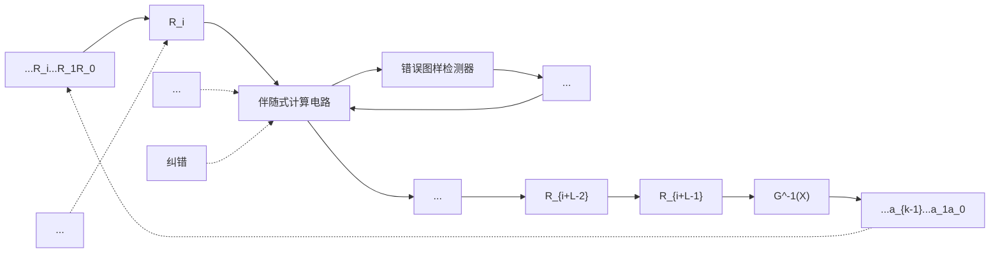
</details>

图 8.7.4 卷积码代数译码器的基本结构

译码器工作的基本步骤可以归纳如下：

(1) 将接收序列 $R$ 按式 (8.7.60) 的形式 “划分” 成长度为 $L$ 个码组组成的译码序列单元 $R'$ , 每次译码结束后移出一个旧的码组, 移进一个新的码组:

$$
\boldsymbol {R} ^ {\prime} = \left[ R _ {i} \quad R _ {i + 1} \quad R _ {i + 2} \quad \dots \quad R _ {i + L - 2} \quad R _ {i + L - 1} \right] \tag {8.7.62}
$$

（2）对当前的译码序列单元 $R'$ 计算其相应的伴随式序列 $S'$ ：

$$
\boldsymbol {S} ^ {\prime} = \boldsymbol {R} ^ {\prime} \cdot \boldsymbol {H} ^ {\prime \mathrm{T}} = \left[ \begin{array}{l l l l} R _ {i} & R _ {i + 1} & R _ {i + 2} & \dots R _ {i + L - 2} R _ {i + L - 1} \end{array} \right] \left[ \begin{array}{c} \boldsymbol {H} _ {L - 1} ^ {\mathrm{T}} \\ \boldsymbol {H} _ {L - 2} ^ {\mathrm{T}} \\ \vdots \\ \boldsymbol {H} _ {0} ^ {\mathrm{T}} \end{array} \right] \tag {8.7.63}
$$

(3) 根据伴随式序列 $S'$ 与错误图样的 $E'$ 的对应关系, 确定误码的位置并进行误码纠正。 $S'$ 与错误图样 $E'$ 的对应关系可以事先以表格形式或其他特定的代数关系式确定。

(4) 将纠错后的接收码组 ( $R_{i+L-1}$ ) 反馈到译码序列 $R'$ , 替代原来有误码的码组。同时将完成纠错后的码组 $R_{i+L-1}$ 进行编码的逆运算, 即可获得原来编码前的信息码组。对于系统码结构的卷积码, 这种逆运算可直接由经过纠错后码组的前面 $k$ 位获得。一般地, 对于非系统码结构的卷积码, 可通过查表或下面介绍的多项式矩阵 “求逆” 的方法来实现。

（5）回到（1），进行下一码组的译码过程。

生成多项式矩阵的逆矩阵 所谓生成多项式矩阵的“逆矩阵” $G^{-1}(X)$ ，是指满足条件

$$
\boldsymbol {G} (X) \boldsymbol {G} ^ {- 1} (X) = \boldsymbol {I} _ {k} \tag {8.7.64}
$$

的多项式矩阵，式中 $I_{k}$ 是 $k\times k$ 单位矩阵。若已知 $G^{-1}(X)$ 和收到的 $C'(X)$ ，则可由

$$
\boldsymbol {C} ^ {\prime} (X) \boldsymbol {G} ^ {- 1} (X) = \left[ \boldsymbol {M} ^ {\prime} (X) \boldsymbol {G} (X) \right] \boldsymbol {G} ^ {- 1} (X) = \boldsymbol {M} ^ {\prime} (X) \tag {8.7.65}
$$

完成编码的逆运算。如果在纠错过程中能够正确地纠正误码（误码的图样在可纠正的范围内），则应有 $M'(X)=M(X)$ 。

下面简要介绍由生成多项式矩阵 $G(X)$ 求解 $G^{-1}(X)$ 的方法。从前面的分析已知多项式矩阵 $G(X)$ 是一个 $k \times n$ 的矩阵。因为其并不是一个满秩的方阵, 所以不能用经典的矩阵求逆方法来获得 $G^{-1}(X)$ , 也不一定有唯一解。通常可通过一种待定系数的方法来尝试求解, 在简单的场合, 也可用观察和遍历搜索的方法来求解。

【例 8.7.2】已知一个参数为(3,1,3)的卷积码的生成矩阵 $G(X)=\left[1\quad1+X\quad1+X^{2}\right]$ [见式（8.7.11）]，试求其逆矩阵。

解：记该逆矩阵的一般表达式为

$$
\boldsymbol {G} ^ {- 1} (X) = \left[ \begin{array}{l} a _ {0} + a _ {1} X + a _ {2} X ^ {2} \\ b _ {0} + b _ {1} X + b _ {2} X ^ {2} \\ c _ {0} + c _ {1} X + c _ {2} X ^ {2} \end{array} \right]
$$

由

$$
\boldsymbol {G} (X) \boldsymbol {G} ^ {- 1} (X) = I _ {k} = 1 \rightarrow \left[\begin{array}{l l l}1&1 + X&1 + X ^ {2}\end{array}\right]\left[\begin{array}{l}a _ {0} + a _ {1} X + a _ {2} X ^ {2}\\b _ {0} + b _ {1} X + b _ {2} X ^ {2}\\c _ {0} + c _ {1} X + c _ {2} X ^ {2}\end{array}\right] = 1
$$

可得

$$
a _ {0} \oplus b _ {0} \oplus c _ {0} = 1
$$

$$
a _ {1} \oplus b _ {1} \oplus b _ {0} \oplus c _ {1} = 0
$$

$$
a _ {2} \oplus b _ {2} \oplus b _ {1} \oplus c _ {2} \oplus c _ {0} = 0
$$

$$
b _ {2} \oplus c _ {1} = 0
$$

$$
c _ {2} = 0
$$

观察上式，若取 $a_0 = 1, a_1 = a_2 = b_0 = b_1 = b_2 = c_0 = c_1 = c_2 = 0$ ，可得方程组的一个解。因此有

$$
\boldsymbol {G} ^ {- 1} (X) = \left[ \begin{array}{l} 1 \\ 0 \\ 0 \end{array} \right]
$$

根据式（8.7.14）可知

$$
\begin{array}{l} \boldsymbol {C} (X) = \boldsymbol {M} (X) \cdot \boldsymbol {G} (X) = \left[ c _ {0} (X), c _ {1} (X), c _ {2} (X) \right] \\ = \left[ \left(c _ {0, 0}, c _ {0, 1}, a _ {0, 2}\right) X ^ {0} + \dots + \left(c _ {i, 0}, c _ {i, 1}, a _ {i, 2}\right) X ^ {i} + \dots \right] \\ = \left[ \left(a _ {0}, a _ {0} \oplus a _ {- 1}, a _ {0} \oplus a _ {- 2}\right) X ^ {0} + \dots + \left(a _ {i}, a _ {i} \oplus a _ {i - 1}, a _ {i} \oplus a _ {i - 2}\right) X ^ {i} + \dots \right] \\ \end{array}
$$

由此可得

$$
\begin{array}{l} \boldsymbol {C} (X) \boldsymbol {G} ^ {- 1} (X) = \left[ c _ {0} X ^ {0} + c _ {1} X + \dots + c _ {i} X ^ {i} + \dots \right] \left[ \begin{array}{l} 1 \\ 0 \\ 0 \end{array} \right] \\ = \left[ \left(a _ {0}, a _ {0} \oplus a _ {- 1}, a _ {0} \oplus a _ {- 2}\right) X ^ {0} + \dots + \left(a _ {i}, a _ {i} \oplus a _ {i - 1}, a _ {i} \oplus a _ {i - 2}\right) X ^ {i} + \dots \right] \left[ \begin{array}{l} 1 \\ 0 \\ 0 \end{array} \right] \\ = a _ {0} + a _ {1} X + \dots + a _ {i} X ^ {i} + \dots = M (X) \\ \end{array}
$$


【例8.7.3】已知 $G(X) = \left[1 + X + X^2 \quad 1 + X^2\right]$ 是某非系统卷积码(2,1,3)的生成多项式的生成矩阵，求其逆矩阵。

解：该逆矩阵的一般表达式为

$$
\boldsymbol {G} ^ {- 1} (X) = \left[ \begin{array}{l} a _ {0} + a _ {1} X + a _ {2} X ^ {2} \\ b _ {0} + b _ {1} X + b _ {2} X ^ {2} \end{array} \right]
$$

式中有6个未知数，每个未知数只有“0”或“1”两种可能的取值，经 $2^{6} = 64$ 次尝试，可遍历所有的可能性，得其逆矩阵为

$$
\boldsymbol {G} ^ {- 1} (X) = \left[ \begin{array}{c} X \\ 1 + X \end{array} \right]
$$

显然有

$$
\begin{array}{l} \boldsymbol {G} (X) \boldsymbol {G} ^ {- 1} (X) = \left[ \begin{array}{c c} 1 + X + X ^ {2} & 1 + X ^ {2} \end{array} \right] \cdot \left[ \begin{array}{c} X \\ 1 + X \end{array} \right] \\ = (X + X ^ {2} + X ^ {3}) + (1 + X + X ^ {2} + X ^ {3}) = 1 \\ \end{array}
$$

对于具有更多未知系数的“逆”矩阵的复杂情况，“逆”矩阵求解亦可借助计算机遍历搜索方法来实现。□

【例 8.7.4】 分析关于图 8.7.1 给出的 $(3,1,3)$ 卷积码的分段反馈译码过程。

解：由例8.7.1中的监督矩阵 $\pmb{H}$ ，可得该卷积码的 $H^{\prime}$ 矩阵的转置矩阵 $H^{\mathrm{T}}$ 为

$$
\boldsymbol {H} ^ {\prime \mathrm{T}} = \left[ \begin{array}{l} \boldsymbol {H} _ {2} ^ {\mathrm{T}} \\ \boldsymbol {H} _ {1} ^ {\mathrm{T}} \\ \boldsymbol {H} _ {0} ^ {\mathrm{T}} \end{array} \right] = \left[ \begin{array}{l l l l l l l l l} 0 & 0 & 0 & 1 & 0 & 0 & 1 & 1 & 0 \\ 1 & 0 & 0 & 0 & 0 & 0 & 1 & 0 & 1 \end{array} \right] ^ {\mathrm{T}}
$$

假定 $M = a_{0}a_{1}a_{2}\cdots = 1010011101\cdots$ ，由生成矩阵式（8.7.1）或编码约束关系式（8.7.6），易得编码输出为

$$
C = c _ {0, 0} c _ {0, 1} c _ {0, 2}; \dots ; c _ {i, 0} c _ {i, 1} c _ {i, 2} \dots = 1 1 1; 0 1 0; 1 1 0; 0 1 0; 0 0 1; 1 1 1; 1 0 1; 1 0 0; 0 1 1; 1 1 0; \dots
$$

已知约束长度为 L=3 ，根据式（8.7.60）进行排列得


<details>
<summary>flowchart</summary>

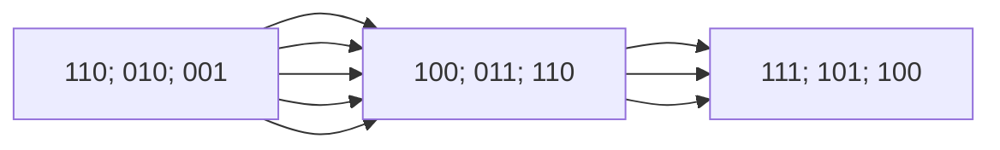
</details>

当没有误码时，对每段接收的编码分别计算其伴随式，容易验证可以获得如图 8.7.5(a) 的取值对应关系，即相应的伴随式序列为

$$
S = s _ {0, 0} s _ {0, 1}; \dots ; s _ {i, 0} s _ {i, 1} \dots = 0 0; 0 0; 0 0; 0 0; 0 0; 0 0; 0 0; 0 0; 0 0; 0 0; \dots
$$

假定接收过程中出现错误，接收序列变为

$$
R = r _ {0, 0} r _ {0, 1} r _ {0, 2}; \dots ; r _ {i, 0} r _ {i, 1} r _ {i, 2} \dots = 1 1 1; \underline {{1 1 0}}; 1 1 0; 0 1 \underline {{1}}; 0 0 1; 1 1 1; 1 0 1; 1 0 0; 0 1 1; 1 1 0; \dots
$$

其中出现的错误为 $c_{1,0} \rightarrow \overline{c}_{1,0}$ 和 $c_{3,2} \rightarrow \overline{c}_{3,2}$ ，对应上式中有下划线的位置。此时可获得如图8.7.4(b)所对应的关系，即相应的伴随式序列为

$$
S = s _ {0, 0} s _ {0, 1}; \dots ; s _ {i, 0} s _ {i, 1} \dots = 0 0; 1 1; 0 0; 0 1; 0 0; 0 0; 0 0; 0 0; 0 0; 0 0; \dots
$$

我们可以预先建立码组中有 1 位误码时码组中误码位置与相应伴随式取值的对应关系，这种关系通过简单的计算即可得到。例如，在图 8.7.5(a) 的每个判决序列中，最后 3 位是一个待判决的码组，前面两个 3 位的码组假定是已经经过纠错的无误的码组，任取一个序列，如第 3 个序列，无误码的序列应为 111;010;110，第一位、第二位和第三位分别出现错误时的情况为 111;010;010, 111;010;100 和 111;010;111。利用 $H'$ 可计算出相应的伴随式分别为 11, 10 和 01。由此可以建立只有一位误码时错误图样与伴随式的关系，如表 8.7.2 所示。

$$
\begin{array}{l} 0 0 0; 0 0 0; 1 1 1 \xrightarrow {\boldsymbol {H} ^ {\prime \mathrm{T}}} 0 0 \\ 0 0 0; 1 1 1; 0 1 0 \xrightarrow {\boldsymbol {H} ^ {\prime \mathrm{T}}} 0 0 \\ 1 1 1; 0 1 0; 1 1 0 \xrightarrow {\boldsymbol {H} ^ {\prime \mathrm{T}}} 0 0 \\ 0 1 0; 1 1 0; 0 1 0 \xrightarrow {\boldsymbol {H} ^ {\prime \mathrm{T}}} 0 0 \\ 1 1 0; 0 1 0; 0 0 1 \xrightarrow {\boldsymbol {H} ^ {\prime \mathrm{T}}} 0 0 \\ 0 1 0; 0 0 1; 1 1 1 \xrightarrow {\boldsymbol {H} ^ {\prime \mathrm{T}}} 0 0 \\ 0 0 1; 1 1 1; 1 0 1 \xrightarrow {\boldsymbol {H} ^ {\prime \mathrm{T}}} 0 0 \\ 1 1 1; 1 0 1; 1 0 0 \xrightarrow {\boldsymbol {H} ^ {\prime \mathrm{T}}} 0 0 \\ 1 0 1; 1 0 0; 0 1 1 \xrightarrow {\boldsymbol {H} ^ {\prime \mathrm{T}}} 0 0 \\ 1 0 0; 0 1 1; 1 1 0 \xrightarrow {\boldsymbol {H} ^ {\prime \mathrm{T}}} 0 0 \end{array}
$$

(a) 无误码时的情形

$$
\begin{array}{l} 0 0 0; 0 0 0; 1 1 1 \xrightarrow {\boldsymbol {H} ^ {\prime \mathrm{T}}} 0 0 \\ 0 0 0; 1 1 1; \not 1 1 0 \xrightarrow {\boldsymbol {H} ^ {\prime \mathrm{T}}} 1 1 \\ 1 1 1; 0 1 0; 1 1 0 \xrightarrow {\boldsymbol {H} ^ {\prime \mathrm{T}}} 0 0 \\ 0 1 0; 1 1 0; 0 1 \not 1 \xrightarrow {\boldsymbol {H} ^ {\prime \mathrm{T}}} 0 1 \\ 1 1 0; 0 1 0; 0 0 1 \xrightarrow {\boldsymbol {H} ^ {\prime \mathrm{T}}} 0 0 \\ 0 1 0; 0 0 1; 1 1 1 \xrightarrow {\boldsymbol {H} ^ {\prime \mathrm{T}}} 0 0 \\ 0 0 1; 1 1 1; 1 0 1 \xrightarrow {\boldsymbol {H} ^ {\prime \mathrm{T}}} 0 0 \\ 1 1 1; 1 0 1; 1 0 0 \xrightarrow {\boldsymbol {H} ^ {\prime \mathrm{T}}} 0 0 \\ 1 0 1; 1 0 0; 0 1 1 \xrightarrow {\boldsymbol {H} ^ {\prime \mathrm{T}}} 0 0 \\ 1 0 0; 0 1 1; 1 1 0 \xrightarrow {\boldsymbol {H} ^ {\prime \mathrm{T}}} 0 0 \end{array}
$$

(b) 有误码时的情形

图 8.7.5 卷积码分段反馈译码过程的伴随式变化

具体的译码过程可以归纳如下：

(1) 对输入分段码组中的第 1 行进行计算, 得其伴随式取值为 00 , 由此判断该码组没有误码, 因为该码为系统码, 直接有第 0 位的码组的信息位 1 。  
(2) 对输入分段码组中的第 2 行进行计算, 得其伴随式取值为 11 , 根据对照表, 确定误码位置在码组的第 0 位, 将第 1 个码组的第 0 位由 “1” 改正为 “0”, 得相应的信息位 0 。  
(3) 对输入分段码组中的第 3 行进行计算, 得其伴随式取值为 00 。得相应的信息位 1 。注意此时第 1 个码组中的第 0 位的误码已经通过 “反馈” 加以纠正, 所以前面码组中的误码不会影响到后续的译码过程。  
(4) 对输入分段码组中的第 4 行进行计算, 得其伴随式取值为 01, 根据对照表, 确定误码位置在码组的第 2 位, 将该码组的第 2 位由 “1” 改正为 “0”, 并得相应的信息位 0。

如此循环往复，就可以实现卷积码的连续代数译码。□

## 8.7.5 卷积码的状态图、树图与网格图描述

本节讨论在实际的卷积码编码和译码过程中有重要作用的状态图、树图与网格图。虽然分析是通


<details>
<summary>flowchart</summary>

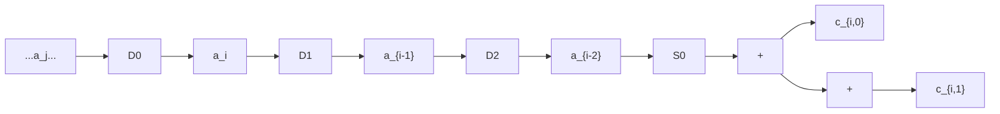
</details>

图 8.7.6 (2,1,3) 非系统码编码器结构图

过图 8.7.6 给出的一个编码效率为 1/2、约束长度为 3 的 (2,1,3) 非系统卷积码示例来加以说明的，但所描述的方法具有一般性。

卷积码的状态图 图 8.7.6 所示的编码器有 3 位寄存器，寄存器 $D_{0}$ 输出的是当前的输入信息位，寄存器 $D_{1}$ 和 $D_{2}$ 的输出可以视为系统当前的状态 $S_{0}S_{1}$ ，编码输出由当前的输入和编码器的状态共同决定。两位的状态寄存器 $D_{1}D_{2}$ 只可能有 4 种不同状态，所有可能的状态取值

$S_{0}S_{1}\in(00,01,10,11)$ 。我们可以用一个包含有4个状态的状态图来描述编码器的状态变化。如图8.7.7所示，图中的每个框图表示一种状态，状态的变化用带箭头的线段来表示，每根线旁有一用斜杠“/”划分的两组数据，左侧的数据表示当前的输入信息位，右侧的数据表示相应的编码输出。利用编码器的状态图，可以描述编码器的所有可能变化行为。

下面结合图 8.7.6 和图 8.7.7，分析卷积码的编码器状态变化的情况。假定输入的信息序列为 $M = a_{0}a_{1}a_{2}\cdots = 101100101\cdots$ ，寄存器的初始状态为 0。由编码器的结构图，可以得到表 8.7.3 列出的在

表 8.7.2 错误图样与伴随式取值的对照表

| 误码位置 | $s_{i,0}s_{i,1}$ | 误码位置 | $s_{i,0}s_{i,1}$ |
|---|---|---|---|
| 无误码 | 00 | $c_{i,1}$ | 10 |
| $c_{i,0}$ | 11 | $c_{i,2}$ | 01 |

每个编码周期内，寄存器内容、编码器状态、编码器输出等变化的情况，具体过程如下：

（1）第一个编码的时钟周期达到时，由编码器的结构图， $a_0 = 1$ 进入寄存器 $D_{0}$ ，寄存器组右移1位， $D_{1}D_{2} = 00$ （此时 $S_0S_1 = D_1D_2 = 00$ ），输入 $a_0$ 与 $D_{1}D_{2}$ 共同决定了编码输出 $c_{0,0}c_{0,1} = 11$ 。再来看状态转换图，已知 $a_0 = 1$ ， $S_0S_1 = 00$ ，同样可得输出


<details>
<summary>flowchart</summary>

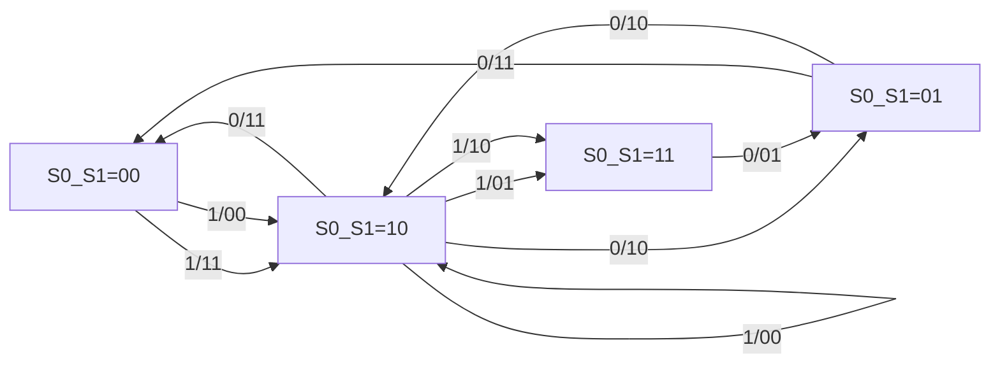
</details>

图 8.7.7 (2,1,3) 卷积码状态转换图

$c_{0,0}c_{0,1} = 11$ ，同时转入下一状态 $S_0S_1 = 10$ 。这里需要注意的是，编码器的状态，是指当一个新的编码的信息位进入 $D_{0}$ ，寄存器组右移一位后， $D_{1}D_{2}$ 中的状态取值。所以此时 $D_{1}D_{2}$ 的取值与状态转换图中的状态不同。

(2) 第二个编码的时钟周期达到时, $a_{1} = 0$ 进入寄存器 $D_{0}$ , 寄存器组右移 1 位, $D_{1}D_{2} = 10$ (此时 $S_{0}S_{1} = D_{1}D_{2} = 10$ ), 编码器输出 $c_{1,0}c_{1,1} = 10$ 。由状态转换图, 已知 $a_{1} = 0$ , $S_{0}S_{1} = 10$ , 得输出 $c_{1,0}c_{1,1} = 10$ , 同时转入下一状态 $S_{0}S_{1} = 01$ 。

(3) 第三个编码的时钟周期达到时, $a_{2} = 1$ 进入寄存器 $D_{0}$ , 寄存器组右移 1 位, $D_{1}D_{2} = 01$ (此时 $S_{0}S_{1} = D_{1}D_{2} = 01$ ), 编码器输出 $c_{2,0}c_{2,1} = 00$ 。由状态转换图, 已知 $a_{2} = 1$ , $S_{0}S_{1} = 01$ , 得输出 $c_{2,0}c_{2,1} = 00$ , 同时转入下一状态 $S_{0}S_{1} = 10$ 。

表 8.7.3 (2,1,3) 卷积码状态及输出随输入信息变化情况

| 序号 | 输入信息位 $a_i$ | 寄存器内容 $D_0D_1D_2$ | 编码器状态 $S_0S_1$ | 编码器输出 $c_{i,0}c_{i,1}$ |
|---|---|---|---|---|
| 0 | — | 000 | 00 | —— |
| 1 | 1 | 100 | 10 | 11 |
| 2 | 0 | 010 | 01 | 10 |
| 3 | 1 | 101 | 10 | 00 |
| 4 | 1 | 110 | 11 | 01 |
| 5 | 0 | 011 | 01 | 01 |
| 6 | 0 | 001 | 00 | 11 |
| 7 | 1 | 100 | 10 | 11 |
| 8 | 0 | 010 | 01 | 10 |
| 9 | 1 | 101 | 10 | 00 |
| ... | ... | ... | ... | ... |

对于后续的信息输入序列，编码输出和状态变化可以做同样的分析。由此可见，如果已知输入信息序列，根据图 8.7.7 给出的编码器的状态转换图，我们很容易就可确定编码器的输出结果。

一般地, 对于一个参数为 $(n, k, L)$ 的卷积码, 状态图中共有 $2^{k(L-1)}$ 种不同的状态, 从每个状态发出和到达的状态转移曲线各有 $2^{k}$ 条。对于本节讨论的示例来说, 共有 $2^{1 \times (3-1)} = 2^{2} = 4$ 种不同的状态, 从每个状态发出和到达的状态转移曲线各有 $2^{k} = 2^{1} = 2$ 条, 注意这些发出和到达的曲线包括了自环的曲线。编码器的状态图包含了编码器的全部特征, 与结构图完全等价, 是编码器的另一种描述形式。

卷积码的树图 卷积码的状态图是一种简洁的卷积码描述方式。但状态图也有一个缺点，就是不能够直观地看出随着输入信息位和时序的变化，编码器的输出和状态变化的整体情况，而卷积码的树图则可以解决这一问题。还是采用前面讨论的示例，(2,1,3)编码器的结构图仍由图8.7.6所示，将所有可能的输入信息和编码器状态变化随编码时钟周期的变化一起画在一幅图上，如图8.7.8所示。

对应图中的每个编码周期 T，当输入的信息序列为 $M = a_{0}a_{1}a_{2}a_{3}\cdots = 1011\cdots$ 时，沿着图中加粗的实线，描述了整个编码过程经过的路径。从线段上方的编码输出取值，立刻可得相应的编码输出


<details>
<summary>flowchart</summary>

This image displays a state transition diagram (a type of flowchart) representing a system state transition between states 0 and 1 over time t, with transitions labeled by binary codes.
</details>

图 8.7.8 (2,1,3) 卷积码的树图

$$
\boldsymbol {C} = c _ {0, 0} c _ {0, 1}; c _ {1, 0} c _ {1, 1}; c _ {2, 0} c _ {2, 1}; c _ {3, 0} c _ {3, 1}; \dots = 1 1; 1 0; 0 0; 0 1; \dots
$$

从线段下方编码器状态的取值，可得相应的状态变化情况：

$$
S _ {0} S _ {1}: 0 0 \to 1 0 \to 0 1 \to 1 0 \to 1 1 \to \dots
$$

从图 8.7.8 可以看到，卷积码的树图形似一个树根在起点横放的树，这就是树图名字的由来。

一般地，对于一个参数为 $(n,k,L)$ 的卷积码，从每个节点发出的分支有 $2^{k}$ 条，每个分支上都有一个相应的n位的编码输出，树图上共有 $2^{k(L-1)}$ 种不同的状态。树图的结构具有一定的规律，对于约束长度为L的卷积码，其树图经过L次分支之后，开始重复自身的结构。对于上面讨论的图8.7.8所示的 $(2,1,3)$ 卷积码示例，每个节点发出的分支有 $2^{1}=2$ 条，共有 $2^{k(L-1)}=2^{1\times(3-1)}=2^{2}=4$ 种不同的状态，经过L=3次分支之后，树图开始重复自身的结构。同样，编码器的树图包含了编码器的全部特征，与其结构图或状态图完全等价，也是编码器的一种描述形式。

卷积码的网格图 从前面有关卷积码的状态图和树图的讨论，可以了解到卷积码的这两种描述方法各有不同的特点，卷积码的状态图简洁明了，但不能直观反映编码过程所经历的路径。卷积码的树图可以较好地反映了编码过程所经历的路径，但随着编码周期数的增加，树图结构的大小按照指数增加，同样会给编码过程的完整描述带来不便。如果将卷积码状态图的简单性和树

图能够反映编码时序与路径的特点加以结合，可以获得一种称为网格图的卷积码描述方式，网格图在许多书籍中也称篱笆图。

观察图 8.7.7, 若将卷积码的所有可能状态列出, 总共有 $2^{k(L-1)}$ 种。对应不同的输入信息位, 每个状态都有 $2^{k}$ 种不同的到达和离去的分支; 观察图 8.7.8 所示的树图, 每个状态到达和离去的变化呈现一种规则的重复自身结构的特性。如果将时序与状态转换图关联起来, 可以得到如图 8.7.9 所示的反映时序变化的卷积码时序状态图。


<details>
<summary>flowchart</summary>

This diagram illustrates a state transition or state transition system with multiple states (S0S1=00, 10, 01, 11) and transitions labeled with binary values (0/00, 1/11, 0/10, 1/10) along a time axis.
</details>

图 8.7.9 (2,1,3) 卷积码的时序状态图

每根线旁具有用斜杠“/”划分的两组数据的含义与图8.7.7中的一样，左侧的数据表示当前的输入信息位，右侧的数据表示相应的编码输出。对图做进一步的观察不难发现，从每个状态出发，可能转移到两个状态，当输入信息位为“0”时，总是沿着当前状态出发的上面的一根线转移到下一状态；当输入信息位为 “1” 时，则总是沿着当前状态出发的下面的一根线转移到下一状态。知道这一规律后，对于每个码组中只有 1 位信息码元的卷积码，表示输入信息位取值的符号实际上可以省略。图中 $2^{k(L-1)} = 2^{1 \times (3-1)} = 2^{2} = 4$ 种不同的状态是按照顺序由上往下规则地排列的，其位置可以在图的左侧统一加以表示，这样图中的状态就可以用实心圆点 “ $\bullet$ ” 简化地表示。考虑到编码器的初始状态为 $S_{0}S_{1} = 00$ 。从初始状态出发，我们可以得到卷积码的网格图的完整表示，如图 8.7.10 所示。


<details>
<summary>wireframe</summary>

| Time (t) | S0S1=00 | S0S1=10 | S0S1=01 | S0S1=11 |
| --- | --- | --- | --- | --- |
| 0T | 00 | 00 | 00 | 00 |
| 1T | 00 | 10 | 01 | 01 |
| 2T | 00 | 01 | 10 | 01 |
| 3T | 00 | 10 | 01 | 10 |
| 4T | 00 | 01 | 10 | 01 |
| 5T | 00 | 10 | 01 | 10 |
| 6T | 00 | 01 | 10 | 01 |
| 7T | 00 | 10 | 01 | 10 |
| 8T | 00 | 01 | 10 | 01 |
| 9T | 00 | 10 | 01 | 10 |
</details>

图 8.7.10 (2,1,3) 卷积码的网格图（篱笆图）

当输入的信息序列为 $M = a_{0}a_{1}a_{2}\cdots=101100101\cdots$ 时，由编码器的网格图，立刻可得编码器的编码路径，如图 8.7.11 所示，图中的加粗线段标识了行进路径。同时，由线旁的编码输出码组取值，可得相应的编码码组输出序列为

$$
\begin{array}{l} C = c _ {0, 0} c _ {0, 1}; c _ {1, 0} c _ {1, 1}; c _ {2, 0} c _ {2, 1}; c _ {3, 0} c _ {3, 1}; c _ {4, 0} c _ {4, 1}; c _ {5, 0} c _ {5, 1}; c _ {6, 0} c _ {6, 1}; c _ {7, 0} c _ {7, 1}; c _ {8, 0} c _ {8, 1}; c _ {9, 0} c _ {9, 1}; \dots \\ = 1 1; 1 0; 0 0; 0 1; 0 1; 1 1; 1 1; 1 0; 0 0 \dots \\ \end{array}
$$


<details>
<summary>wireframe</summary>

| Time (t) | S0S1=00 | S0S1=10 | S0S1=01 | S0S1=11 |
| --- | --- | --- | --- | --- |
| 0T | 00 | 00 | 00 | 00 |
| 1T | 00 | 10 | 01 | 01 |
| 2T | 00 | 01 | 10 | 01 |
| 3T | 00 | 10 | 01 | 10 |
| 4T | 00 | 01 | 10 | 01 |
| 5T | 00 | 10 | 01 | 10 |
| 6T | 00 | 10 | 01 | 10 |
| 7T | 00 | 10 | 01 | 10 |
| 8T | 00 | 10 | 01 | 10 |
| 9T | 00 | 11 | 01 | 10 |
</details>

图 8.7.11 (2,1,3) 卷积码的网格图的一条编码行进路线

比较表 8.7.3, 两者的结果显然完全一致。网格图形似篱笆, 这是卷积码篱笆图名称的来历。同样, 编码器的网格图包含了编码器的全部特征, 与其结构图、状态图和树图完全等价, 同样是编码器的一种描述形式。

## 8.7.6 卷积码的距离特性与转移函数

自由距离 卷积码的纠错性能同样是由其距离特性来确定的。其中的所谓距离，仍然指汉明距离。对于输入的一个信息序列，可以获得一个编码输出序列，对于卷积码来说，一个输出序列通常包含了前后具有一定关联性的多个编码输出分组。例如对某一参数为 $(n,k,L)$ 的卷积码来说，若输入是长度为 $L_{M}\cdot k$ 的一个信息序列，则编码输出为一个长度为 $L_{M}\cdot n$ 的序列。对于不同的信息序列，将获得不同的编码输出序列，

这样的一个输出序列可以视为一个码字。与线性分组码一样，两个码字间按位两两比较取值不同的位数，称为这两个码字的汉明距离。在码字集中两两码字间最小的汉明距离，称为该卷积码的自由距离（free distance），记为 $d_{\mathrm{free}}$ 。卷积码也是一种线性码，线性码中最小的码字距离等于码字集中非零码字的最小重量，这一特性对于卷积码来说仍然成立。因此，寻找卷积码码字集的自由距离，相当于寻找码字集中具有最小码重的非全“0”码字，其最小码重，实际上就是该码字与全“0”码字间的汉明（自由）距离。

在实际编码过程中, 通常在向编码器输入信息位之前, 编码器处于全零状态, 编码器每次输入 $k$ 位信息位, 产生 $n$ 位的编码输出。一般地, 在最后一组 $k$ 位信息位完成编码之后, 若再输入 $k \cdot (L - 1)$ 位 0 ,可使编码器回到全零状态。对于前面讨论的 (2,1,3) 卷积码示例, 参见图 8.7.12 ,无论编码器处于 4 种状态中的哪种状态, 从任意的第 $iT$ 时刻开始, 只要连续输入 $k \cdot (L - 1) = 1 \times (3 - 1) = 2$ 个 0 ,在第 $(i + 2)T$ 时刻, 编码器都会回到图中箭头所示的全零状态。

根据卷积码网格图的性质我们知道，在图 8.7.12 所示的网格图中，从第 0T 时刻的全零状态开始，到第 $(i+2)T$ 时刻返回全零状态的每条路径，都是该卷积码的一个合法的编码输出序列，或称为一个合法的码字。在所有这些合法输出序列中，含 “1” 的个数最少的序列，就是重量最小的码字，相应的重量就是该卷积码的自由距离。


<details>
<summary>wireframe</summary>

| Time Point | S0S1=00 | S0S1=10 | S0S1=01 | S0S1=11 |
| --- | --- | --- | --- | --- |
| 0T | 00 | 00 | 00 | 00 |
| 1T | 00 | 10 | 01 | 01 |
| 2T | 00 | 10 | 01 | 10 |
| 3T | 00 | 10 | 01 | 10 |
| 4T | 00 | 10 | 01 | 10 |
| (i-1)T | 00 | 10 | 01 | 10 |
| iT | 00 | 10 | 01 | 10 |
| (i+1)T | 00 | 10 | 01 | 10 |
| (i+2)T | 00 | 10 | 01 | 10 |
| (i+3)T | 00 | 10 | 01 | 10 |
</details>

图8.7.12 (2,1,3)卷积码返回全零状态的各种路径

观察卷积码的网格图，如图 8.7.12 所示，容易发现，在所有从全零状态出发并到达编码结束的全零状态的所有路径中，除了全 “0” 码字对应的序列，重量最小的码字序列一定出现在第一次返回全零状态后，沿着全零状态一直行进，到达编码结束的全零状态的序列中。因为假如有一编码路径从全零状态出发，途中回到全零状态后，又离开全零状态，再回到全零状态的任何路径，每段输出的编码码组的重量，均大于或等于零，所有这些路径对应的编码输出序列的码重，一定大于或等于离开一次全零状态，返回全零状态后不再离开全零状态的编码路径。图 8.7.13 给出了一个示例，路径 1 只有一次离开全零状态，输出的编码序列为 $C_1$ ：11 10 11 00 00 00 00 00 00；路径 2 两次离开全零状态，输出的编码序列为 $C_2$ ：11 10 11 11 01 01 11 00 00，显然有 $W(C_2)=11 \geqslant W(C_1)=5$ ，其中 $W(C_i)$ 是码字 $C_i$ 的码重。因此，从寻找最小码重的角度，我们关心的是从全零状态开始到第一次回到全零状态间的所有路径的特性。下面讨论的转移函数，给出了这些特性的有关描述。

转移函数 卷积码是一种有记忆的编码，卷积码编码器的特性可以由其状态转换图来描述，为便于说明编码器从全零状态出发到返回全零状态的过程，我们将图8.7.7用一种新的表达形式描述，将其改画成图8.7.14的形式，其中图的左侧表示起始的全零状态，图的右侧表示第一次返回的全零状态。如图所示，引入虚拟状态变量 $Z_{0}, Z_{1}, Z_{2}, Z_{3}$ 和 $Z_{e}$ ，用于表示编码器的不同状态。特别地， $Z_{e}$ 表示第一次回到全零状态。同时引入分支增益的概念，分支增益记为 $D^{i}$ ，其中 $i$ 用于表示卷积码编码器 $(n, k, L)$ 每次输入 $k$ 位信息位，编码输出的 $n$ 位编码码组的重量。例如，在图中，当状态由 $Z_{0}$ 转变到 $Z_{1}$ 时，编码输出为“11”，其码重为2，相应的分支增益为 $D^{2}$ 。转移函数，有些书上也称生成函数，定义为

$$
T (D) = \frac {Z _ {e}}{Z _ {0}} \tag {8.7.66}
$$


<details>
<summary>wireframe</summary>

| Time (t) | S0S1=00 | S0S1=10 | S0S1=01 | S0S1=11 |
| --- | --- | --- | --- | --- |
| 0T | 00 | 00 | 01 | 01 |
| 1T | 00 | 10 | 01 | 01 |
| 2T | 00 | 10 | 01 | 10 |
| 3T | 00 | 10 | 01 | 10 |
| 4T | 00 | 10 | 01 | 10 |
| 5T | 00 | 10 | 01 | 10 |
| 6T | 00 | 10 | 01 | 10 |
| 7T | 00 | 10 | 01 | 10 |
| 8T | 00 | 10 | 01 | 10 |
| 9T | 00 | 10 | 01 | 10 |
</details>

图 8.7.13 两种不同的编码输出路径的码重比较


<details>
<summary>flowchart</summary>

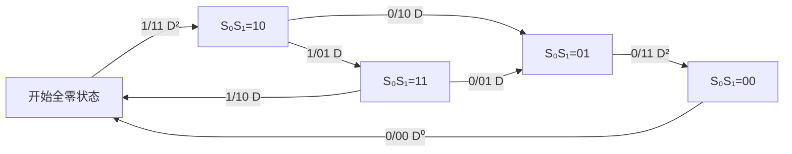
</details>

图 8.7.14 从起始的全零状态返回到全零状态的状态转换图

由图 8.7.14 可见，虚拟状态变量 $Z_{1}$ 可由虚拟状态变量 $Z_{0}$ 经过分支增益为 $D^{2}$ 的路径获得，也可由虚拟状态变量 $Z_{2}$ 经分支增益为 $D^{0}$ 的路径获得，由此可得其相互之间的关系式为

$$
Z _ {1} = D ^ {2} Z _ {0} + D ^ {0} Z _ {2} \tag {8.7.67}
$$

通过对状态转换图中每个状态做类似的分析，可以得到如下状态变量之间的关系式：

$$
\begin{array}{l} Z _ {e} = D ^ {0} Z _ {0} \\ Z _ {1} = D ^ {2} Z _ {0} + D ^ {0} Z _ {2} \\ Z _ {2} = D Z _ {1} + D Z _ {3} \tag {8.7.68} \\ Z _ {3} = D Z _ {1} + D Z _ {3} \\ Z _ {e} = D ^ {2} Z _ {2} \\ \end{array}
$$

由于我们现在关心的是始于全零状态，经过非全零状态，第一次返回全零状态的路径的码组重量的分布，去掉上面方程组中由初始全零状态到全零状态的方程式，得到方程组

$$
\begin{array}{l} Z _ {1} = D ^ {2} Z _ {0} + D ^ {0} Z _ {2} \\ Z _ {2} = D Z _ {1} + D Z _ {3} \tag {8.7.69} \\ Z _ {3} = D Z _ {1} + D Z _ {3} \\ Z _ {e} = D ^ {2} Z _ {2} \\ \end{array}
$$

由上述方程组中的第二、第三式可得 $Z_{3} = Z_{2}$ ；由方程组的第三式和上式可得 $Z_{1} = (1 - D)Z_{3} / D = (1 - D)Z_{2} / D$ 。代入方程组中的第一式，可得 $Z_{2} = D^{3}Z_{0} / (1 - 2D)$ 。将该结果代入方程组中的最后一式，即可得相应的转移函数

$$
\begin{array}{l} T (D) = \frac {Z _ {e}}{Z _ {0}} = \frac {D ^ {5}}{1 - 2 D} = D ^ {5} \left(1 + 2 D + 4 D ^ {2} + \dots + 2 ^ {m} D ^ {m} + \dots\right) \tag {8.7.70} \\ = D ^ {5} + 2 D ^ {6} + 4 D ^ {7} + \dots + 2 ^ {m} D ^ {m + 5} + \dots = \sum_ {m = 0} ^ {\infty} 2 ^ {m} D ^ {m + 5} \\ \end{array}
$$

上式说明, 对于我们讨论的这个(2,1,3)卷积码来说, 所有从全零状态开始, 最后返回到全零状态, 中间不经过全零状态的所有非零输出序列, 即编码输出码字中, 重量为 5 的码字有 1 个, 相应地有一条路径; 重量为 6 的码字有两个, 相应地有两条路径; 一般地, 重量为 $m + 5$ 的码字有 $2^{m}$ 个。因此, 该卷积码的最小距离即自由距离为 5 。

一般地，转移函数具有如下形式：

$$
T (D) = \sum_ {d = d _ {\mathrm{free}}} ^ {\infty} A (d) D ^ {f (d)} \tag {8.7.71}
$$

式中 $A(d)$ 是码字集中具有重量为 $d$ 的码字的个数， $f(d)$ 是字中含“1”的信息位的个数。

采用转移函数法可以得到有关卷积码码字的最小码重的解析解，但随着编码器约束长度的增加，分析计算转移函数的复杂性将随着约束长度增加呈指数级增加。

在状态转换图的每个分支中, 除了包含反映编码输出中含 “1” 的个数的分支增益, 还可以进一步引入在每 $k$ 位信息位输入分组中, 反映其中含 “1” 的个数的附加因子 $N$ , $N^i$ 的指数 $i$ 表示信息位中有 $i$ 个 “1”; 同时引入反映路径分支数的附加因子 $J$ , $J^l$ 的指数 $l$ 表示该路径所包含的分支数。引入新的两个附加因子后, 相应的状态转换图如图 8.7.14 所示, 该图称为增扩状态图。根据定义, 不难理解每个分支上的各因子的含义。例如, 当状态由 $Z_0$ 转变为 $Z_1$ 时, 编码输出为 “11”, 其码重为 2, 相应的分支增益为 $D^2$ ; 输入的信息码组中含 “1” 的信息位有一个, 所以有因子 $N^1$ ; 只有一条分支路径, 所以有因子 $J^1$ ; 三个因子组合后, 得到图中所示的 “ $NJD^2$ ”。

撒旦发阿斯顿、
阿斯顿撒sdsd啊实打实上的
萨达撒
啊实打实
阿大是大非ada
啊  SD阿松大D啊S
撒


在图 8.7.15 所示的包含多因子的增扩状态图中，我们同样不考虑虚线对应的由全零到全零状态的虚线所示的分支，由图可以获得一组新的反映虚拟状态变量间关系的方程组：

$$
\begin{array}{l l} Z _ {1} = N J D ^ {2} Z _ {0} + N J D ^ {0} Z _ {2} & Z _ {1} = N J D ^ {2} Z _ {0} + N J Z _ {2} \\ Z _ {2} = N ^ {0} J D Z _ {1} + N ^ {0} J D Z _ {3} & Z _ {2} = J D Z _ {1} + J D Z _ {3} \\ Z _ {3} = N J D Z _ {1} + N J D Z _ {3} & Z _ {3} = N J D Z _ {1} + N J D Z _ {3} \\ Z _ {e} = N ^ {0} J D ^ {2} Z _ {2} & Z _ {e} = J D ^ {2} Z _ {2} \end{array} \tag {8.7.72}
$$


<details>
<summary>flowchart</summary>

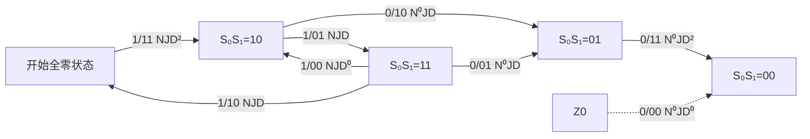
</details>

图 8.7.15 从起始的全零状态返回到全零状态的增扩转换图

解方程组可得相应的增扩的转移函数

$$
\begin{array}{l} T (D, J, N) = \frac {Z _ {e}}{Z _ {0}} = \frac {D ^ {5} J ^ {3} N}{1 - D J N (1 + J)} \\ = D ^ {5} J ^ {3} N + D ^ {6} J ^ {4} (1 + J) N ^ {2} + \dots + D ^ {m + 5} J ^ {m + 3} (1 + J) ^ {m} N ^ {m + 1} + \dots \tag {8.7.73} \\ = \sum_ {m = 0} ^ {\infty} D ^ {m + 5} J ^ {m + 3} (1 + J) ^ {m} N ^ {m + 1} \\ \end{array}
$$

经过增扩的转移函数提供了更多有关路径的信息。如对上式中的第一项 $D^{5}J^{3}N$ ，根据该项中各个因子的指数可知，有一条自由距离为5的路径，相应的码字重量为5，该路径与全零路径不同的分支的长度为3，与全“0”路径输入序列只有1位的差别，即输入的信息序列中包含了一个“1”的信息位。上式中的第二项 $D^{6}J^{4}(1 + J)N^{2}$ 可以分拆成如下两项：

$$
D ^ {6} J ^ {4} (1 + J) N ^ {2} = D ^ {6} J ^ {4} N ^ {2} + D ^ {6} J ^ {5} N ^ {2}
$$

同样根据各个因子的指数, 表示有两条自由距离为 6 的路径, 相应地有两个码字重量为 6 的码字, $N^{2}$ 表示这两条路径与全 “0” 路径输入序列只有 2 位的差别, 第一项中 $J^{4}$ 表示有一条路径与全零路径不同的分支的长度为 4 , 而第二项中 $J^{5}$ 表示另一条路径与全零路径不同的分支的长度为 5 。对式 (8.7.73) 中其他的项可做同样的分析。由此可见, 增扩的状态图和其转移函数提供了更多有关路径的信息。

卷积码的误码灾难性传播问题 卷积码的误码灾难性传播是指传输过程中有限数量的码元错误可能会导致后续译码输出无限量出错的现象。下面分析一个误码灾难性传播图的例子。图 8.7.16 给出了一个(2,1,3)卷积码编码器的示意图，其生成多项式矩阵为

$$
G (X) = \left[ g _ {0} (X) \quad g _ {1} (X) \right] = \left[ 1 + X \quad 1 + X ^ {2} \right] \tag {8.7.74}
$$

  
图 8.7.16 一种会引起误码灾难性传播的编码器

编码输出与输入信息位间的约束关系为

$$
\begin{array}{l} c _ {i, 0} = a _ {i} \oplus a _ {i - 1} \\ c _ {i, 1} = a _ {i} \oplus a _ {i - 2} \end{array} \tag {8.7.75}
$$

若输入的信息序列为 $a_0a_1a_2a_3c_4\cdots a_M 00 = 1111\cdots 100$ ，最后加入的两个“0”是为了使编码结束时回到全“0”状态。由式（8.7.75），很容易计算出相应的编码输出为

$$
c _ {0, 0} c _ {0, 1}; c _ {1, 0} c _ {1, 1}; c _ {2, 0} c _ {2, 1}; c _ {3, 0} c _ {3, 1}; c _ {4, 0} c _ {4, 1}; \dots ; c _ {M, 0} c _ {M, 1}; c _ {M + 1, 0} c _ {M + 1}; c _ {M + 2, 0} c _ {M + 2, 1} = 1 1; 0 1; 0 0; 0 0; 0 0; \dots ; 0 0; 0 1; 1 1
$$

假定在传输过程中前面的3个“1”因出现错误变为“0”，通过其状态图容易验证，在接收端译码输出的信息将成为 $a_{0}^{\prime}a_{1}^{\prime}a_{2}^{\prime}a_{3}^{\prime}c_{4}^{\prime}\cdots a_{M}^{\prime};\cdots=0000\cdots0;\cdots$ ，全部出错，这就是所谓的误码灾难性传播现象。可能导致误码灾难性传播的卷积码编码器也称恶性码。显然，恶性码不能用于实际的系统中。

Massy 和 Sain 给出了判断参数为 $(n,1,L)$ 卷积码是否为恶性码的条件 $^{[8]}$ 。

定理 8.7.1 $(n,1,L)$ 卷积码为非恶性码的充要条件是存在某个 $l \geqslant 0$ ，使编码生成多项式的最大公因式（Greatest Common Divisor，GCD）满足如下关系式：

$$
\mathrm{GCD} \big [ g _ {0} (X), g _ {1} (X), \dots , g _ {n - 1} (X) \big ] = X ^ {l} \tag {8.7.76}
$$

对于系统码结构的卷积码 $(n,1,L)$ ，因为 $g_{0}(X)=1$ ，其生成多项式的GCD=1，所以一定是非恶性码。更一般的情况通常只能通过计算机遍历搜索的方法来检验。

卷积码编码器的构建参数 卷积码的性能主要由其自由距离确定，人们通过计算机搜索的方法，获得了不同的码率和约束长度条件下, 不会产生误码灾难性传播的卷积码的生成多项式。表 8.7.4 和表 8.7.5 给出了码率为 $1 / 2$ 和 $1 / 3$ 时具有最大自由距离的 $(n,1,L)$ 卷积码[5], 根据表中提供的参数, 很容易构建相应的编码器, 更多的不同码率, 如 $1 / 4, 1 / 5, 1 / 6, 1 / 7, 1 / 8, 2 / 3, k / 5$ 和 $k / 7$ 等的卷积码的构建参数表, 可参见参考文献[5]。

表 8.7.4 码率为 1/2 的最大距离卷积码

| 约束长度L | 生成多项式(八进制表示) | 自由距离 $d_{\text{free}}$ | $d_{\text{free}}$ 上边界 |  |
|---|---|---|---|---|
| 3 | 5 | 7 | 5 | 5 |
| 4 | 15 | 17 | 6 | 6 |
| 5 | 23 | 35 | 7 | 8 |
| 6 | 53 | 75 | 8 | 8 |
| 7 | 133 | 171 | 10 | 10 |
| 8 | 247 | 271 | 10 | 11 |
| 9 | 561 | 753 | 12 | 12 |
| 10 | 1167 | 1545 | 12 | 13 |
| 11 | 2335 | 3661 | 14 | 14 |
| 12 | 4335 | 5723 | 15 | 15 |
| 13 | 10533 | 17661 | 16 | 16 |
| 14 | 21675 | 27123 | 16 | 17 |

表 8.7.5 码率为 1/3 的最大距离卷积码

| 约束长度L | 生成多项式(八进制表示) | 自由距离 $d_{\text{free}}$ | $d_{\text{free}}$ 上边界 |  |  |
|---|---|---|---|---|---|
| 3 | 5 | 7 | 7 | 8 | 8 |
| 4 | 13 | 15 | 17 | 10 | 10 |
| 5 | 25 | 33 | 37 | 12 | 12 |
| 6 | 47 | 53 | 75 | 13 | 13 |
| 7 | 133 | 145 | 175 | 15 | 15 |
| 8 | 225 | 331 | 367 | 16 | 16 |
| 9 | 557 | 663 | 711 | 18 | 18 |
| 10 | 1117 | 1365 | 1633 | 20 | 20 |
| 11 | 2335 | 2671 | 3175 | 22 | 22 |
| 12 | 4767 | 5723 | 6265 | 24 | 24 |
| 13 | 10533 | 10675 | 17661 | 24 | 24 |
| 14 | 21645 | 35661 | 37133 | 26 | 26 |

【例 8.7.5】试构建一约束长度为 4、码率为 1/3、最小自由距离为 10 的 $(3,1,4)$ 卷积码编码器。

解：由表 8.7.5，可选择八进制编码参数为 $(13,15,17)_{\text{八进制}}$ 的卷积码构建相应的编码器，因为对应的生成多项式为

$$
(1 3, 1 5, 1 7) _ {\text {八进制}} = (0 0 1 0 1 1, 0 0 1 1 0 1, 0 0 1 1 1 1) _ {\text {二进制}}
$$

↑

$$
(X ^ {3} + X + 1, X ^ {3} + X ^ {2} + 1, X ^ {3} + X ^ {2} + X + 1)
$$

相应的编码器结构如图 8.7.17 所示。☐


<details>
<summary>flowchart</summary>

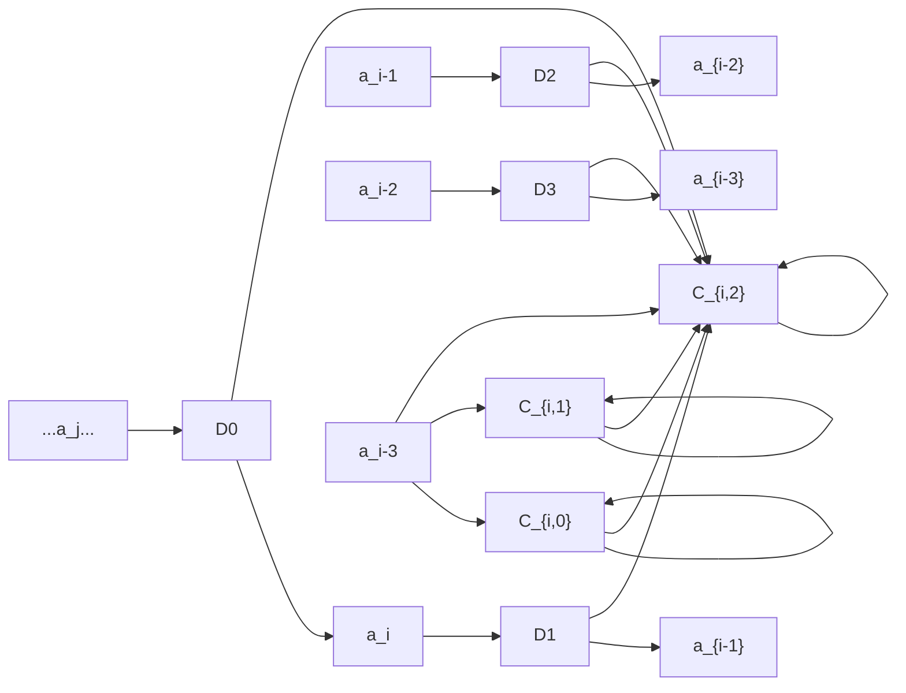
</details>

图 8.7.17 例 8.7.5 对应的卷积码编码器

## 8.7.7 卷积码的概率译码原理

本节首先介绍最大似然译码、硬判决译码和软判决译码的基本概念，然后讨论卷积码的概率译码。卷积码的译码方法主要有代数译码和概率译码两种，代数译码仅基于卷积码的代数结构，而概率译码除了利用码的代数结构的性质，还可以进一步利用信道的统计特性，可更好地发挥卷积码的特点，从而获得更好的译码性能。卷积码的概率译码的方法主要有序列译码 $^{[2]}$ 和维特比（Viterbi）译码，后者是一种最大似然译码方法。维特比译码不仅性能好、效率高，而且译码器实现简单，因此获得了广泛应用，是目前数字通信系统中应用最广泛的卷积码译码方法。

最大似然译码 纠错编码中的最大似然译码与基带和通带信号中的最大似然判决中的概念完全一样，是在概率意义上，从所有可能的译码码字中选出最可能正确的码字作为译码输出的一种方法。

对于具有 $k_{0}$ 位信息位的一个码字集 $\{C\} = \{C_{i}, i = 1, 2, \dots, 2^{k_{0}}\}$ , 假定发送端发出的码字为 $C_{i}$ , 接收到的序列为 $R_{j}$ 。根据 $R_{j}$ , 译码器输出的码字为 $C_{l}$ , 如果 $l = i$ , 译码正确; 如果 $l \neq i$ , 则产生了译码错误。用 $P(C_{i})$ 表示发送码字 $C_{i}$ 的先验概率, 用 $P(R_{j})$ 表示收到的序列为 $R_{j}$ 的概率。 $P(C_{i} \mid R_{j})$ 表示接收到序列为 $R_{j}$ 、发送的是码字 $C_{i}$ 的条件概率, 也称后验概率; $P(R_{j} \mid C_{i})$ 表示发送的是码字 $C_{i}$ 、接收到的序列是 $R_{j}$ 时的条件概率, 也称转移概率。由贝叶斯公式

$$
P (C _ {i} \mid R _ {j}) = \frac {P (R _ {j} \mid C _ {i}) P (C _ {i})}{P (R _ {j})} \tag {8.7.77}
$$

参见本书信息论基础一章，在通信系统中，为保证一个码字集能表示的信息量最大，由最大熵原理，通常使得码字的先验概率相同，此时上式中的 $P(C_{i})$ 为常数。另外，如果信道转移概率矩阵中各行各列分别具有相同集合的元素，即信道是离散无记忆对称信道（Discrete Memoryless Channel，DMC）时， $P(R_{j})$ 也是等概的常数。此时有

$$
\max _ {C _ {i} \in \{C \}} P (C _ {i} \mid R _ {j}) = \max _ {C _ {i} \in \{C \}} \frac {P (R _ {j} \mid C _ {i}) P (C _ {i})}{P (R _ {j})} \leftrightarrow \max _ {C _ {i} \in \{C \}} P (R _ {j} \mid C _ {i}) \tag {8.7.78}
$$

式中，符号“ $\leftrightarrow$ ”表示等价。由此，判断 $\max_{C_i \in \{C\}} P(C_i | R_j)$ 运算转变为较为容易实现的判断 $\max_{C_i \in \{C\}} P(R_j | C_i)$ 的运算。 $P(R_j | C_i)$ 又称 $C_i$ 似然函数，所以这种方法称为最大似然译码。最大似然译码输出的码字 $C_l$ 可以表示为

$$
C _ {l} = \arg \max _ {C _ {i} \in \{C \}} P (R _ {j} \mid C _ {i}) \tag {8.7.79}
$$

上式表示收到序列 $R_{j}$ 后，分别比较关于 $R_{j}$ 的各个 $C_i$ 似然函数的取值，其中的似然函数取得最大值者，相应的 $C_i$ 作为译码输出。在前面信息论一章的讨论中我们已经知道，对于离散无记忆对称信道，最大似然译码是一种最佳译码方法。一个码字通常是由多位或多个分组构成的，即 $C_i = (c_{i,M}c_{i,M - 1}\dots c_{i,1})$ ， $R_{j} = (r_{j,M}r_{j,M - 1}\dots r_{j,1})$ 。在离散无记忆信道的条件下，各个位或各个分组是统计独立的，因此其似然函数又可以表示为

$$
P (R _ {j} \mid C _ {i}) = \prod_ {m = 1} ^ {M} P (r _ {j, m} \mid c _ {i, m}) \tag {8.7.80}
$$

式中，M 是码字的位数或分组码元数。因为对于变量 x，当 x > 0 时，其对数函数 $\log x$ 是一单调增函数，因此 $\max(x) \leftrightarrow \max(\log x)$ 。由此对式（8.7.80）取对数，可使相乘的关系变成相对简单的相加关系，使最大似然判决的关系式变为

$$
C _ {l} = \arg \max _ {C _ {i} \in \{C \}} \log P (R _ {j} \mid C _ {i}) = \arg \max _ {C _ {i} \in \{C \}} \log \prod_ {m = 1} ^ {M} P (r _ {j, m} \mid c _ {i, m}) = \arg \max _ {C _ {i} \in \{C \}} \sum_ {m = 1} ^ {M} \log P (r _ {j, m} \mid c _ {i, m}) \tag {8.7.81}
$$


<details>
<summary>flowchart</summary>

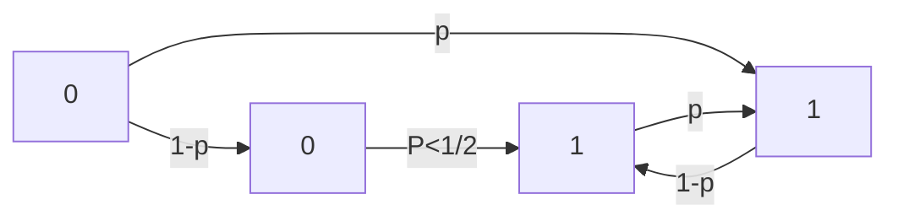
</details>

图 8.7.18 二元对称信道

硬判决译码 在运用最大似然判决的方法时, 根据信道的特点, 又可以分为硬判决译码和软判决译码。首先讨论硬判决译码。如果信道是一种如图 8.7.18 所示的二元对称信道 (Binary Symmetrical Channel, BSC), 此时送到译码器输入端的接收序列是二元序列, 是接收端在译码前对信号进行硬判决处理后得到的结果。对于一个长度为 $M$ 位的接收序列 $R_{j}$ , 将 $R_{j}$ 与码字集 $\{R\} (= \{C\})$ 中的每个码字进行逐位比较。例如, 当与码字集中的码字 $C_{i}$ 逐位相比时, 如果有 $d_{i}$ 位不同, 相应地就有 $M - d_{i}$ 位相

同。此时有

$$
P (R _ {j} \left| C _ {i}\right) = \prod_ {m = 1} ^ {M} P (r _ {j, m} \left| c _ {i, m}\right) = p ^ {d _ {i}} (1 - p) ^ {M - d _ {i}} \tag {8.7.82}
$$

一般地，有 $p < 1 / 2$ 。对上式取对数后得

$$
\begin{array}{l} \log P (R _ {j} \mid C _ {i}) = \log \prod_ {m = 1} ^ {M} P (r _ {j, m} \mid c _ {i, m}) = \sum_ {m = 1} ^ {M} \log P (r _ {j, m} \mid c _ {i, m}) \tag {8.7.83} \\ = d _ {i} \log \frac {p}{1 - p} + M \log (1 - p) = \alpha d _ {i} + \beta \\ \end{array}
$$

$p$ 给定后, $\alpha$ 和 $\beta$ 均为常数。特别地, 因为 $p < 1 / 2$ , 所以 $\alpha$ 是一个负的常数。当与所有的码字比较后, 似然函数取最大值的码字的相应 $d_{i}$ 取值最小。这里的 $d_{i}$ 实际上就是接收序列 $R_{j}$ 与码字 $C_{i}$ 的汉明距离。硬判决译码实际上就是一种搜索码字集中与接收序列 $R_{j}$ 具有最小汉明距离的码字, 将该码字作为译码输出的过程。

每个码字的似然函数的对数取值 $\log P(R_{j}|C_{i})=\alpha d_{i}+\beta$ 是判决时的一个度量值，最大似然判决的结果为

$$
C _ {l} = \arg \max _ {C _ {i} \in \{C \}} \sum_ {m = 1} ^ {M} \log P (r _ {j, m} \mid c _ {i, m}) \leftrightarrow C _ {l} = \arg \min _ {C _ {i} \in \{C \}} \sum_ {m = 1} ^ {M} r _ {j, m} \oplus c _ {i, m} \tag {8.7.84}
$$

软判决译码 前面讨论的硬判决是对输入的二元序列与码字集中的每个码字进行比较，以汉明距离最小的码字作为译码输出的过程。译码前的二元序列 $R_{j}$ 实际上是接收端先进行了“0”或“1”判决后的输出结果。该序列丢失了某些反映信道特性的有用信息。例如，在传输信道是加性高斯白噪声干扰信道（AWGN）的场合，在一个比特周期内，接收的信号如下式所示：

$$
r = \left\{ \begin{array}{l l} s _ {0} + n = - A + n, & \text {发“0”} \\ s _ {1} + n = + A + n, & \text {发“1”} \end{array} \right. \tag {8.7.85}
$$

式中，A 是常数，n 是零均值的高斯随机变量。发 “0” 和发 “1” 时的条件概率密度函数如图 8.7.19 所示。图中，当接收端收到信号 $r'$ 和 $r''$ 时，因为两者距离 “-A” 的位置均比距离 “+A” 的位置来得更大，或者根据该连续随机变量似然函数的取值大小

$$
\begin{array}{l} p (r ^ {\prime} / s _ {0}) <   p (r ^ {\prime} / s _ {1}) \tag {8.7.86} \\ p (r ^ {\prime \prime} / s _ {0}) <   p (r ^ {\prime \prime} / s _ {1}) \\ \end{array}
$$

此时都可以做出将收到的 $r'$ 和 $r''$ 判定为发 “1” 的判决。虽然如此，两者还是有区别的，因为收到信


<details>
<summary>contour</summary>

| Point | r | \(p(r/s_{0})\) | \(p(r/s_{1})\) |
| --- | --- | --- | --- |
| -A | -A | Peak | — |
| O | O | — | — |
| r'' | r'' | — | — |
| r' | r' | — | Peak |
| +A | +A | — | Peak |
</details>

图 8.7.19 AWGN 信道条件下的二元信号分布特性

号 $r'$ 时，其距离 “+A” 点的欧氏距离来得更小，相应地其似然函数取值的大小也有不同：

$$
p (r ^ {\prime} / s _ {1}) > p (r ^ {\prime \prime} / s _ {1}) \tag {8.7.87}
$$

因此，相对 $r''$ 来说， $r'$ 更像 “+A”。所以，将包含了更多信道特性的模拟接收信号 r 用于译码，

可以获得比硬译码判决更好的效果，这就是所谓的软译码判决。

上述软译码判决的概念可以推广到有 $M$ 个二元码元构成的码元序列的场景, $S_{i} = (s_{i,1}s_{i,2}s_{i,3}\cdots s_{i,M})$ , $s_{i,m} \in \{s_0, s_1\}$ , $S_{i} \in \{S\}$ 。对于 AWGN 信道, 假定码元序列中的各码元是相互独立的, 最大似然判决的似然函数由如下的条件概率密度函数构成:

$$
p (R _ {j} \mid S _ {i}) = \prod_ {m = 0} ^ {M - 1} p (r _ {j, m} \mid s _ {i, m}) = \prod_ {m = 1} ^ {M} \frac {1}{\sqrt {2 \pi} \sigma_ {n}} \exp \left[ - \frac {(r _ {j , m} - s _ {i , m}) ^ {2}}{2 \sigma_ {n} ^ {2}} \right] \tag {8.7.88}
$$

式中， $\sigma_{n}^{2}$ 是信道零均值高斯白噪声 $N(0, \sigma_{n}^{2})$ 的方差， $r_{j,m}$ 是接收序列 $R_{j}$ 的第 $m$ 个样值， $s_{i,m}$ 是第 $m$ 个码元的标准值，可能的取值只有 $s_{0}$ 和 $s_{1}$ 两种。似然函数的对数值为

$$
\begin{array}{l} \log p \left(R _ {j} \mid S _ {i}\right) = \log \prod_ {m = 1} ^ {M} \frac {1}{\sqrt {2 \pi} \sigma_ {n}} \exp \left[ - \frac {\left(r _ {j , m} - s _ {i , m}\right) ^ {2}}{2 \sigma_ {n} ^ {2}} \right] \\ = - \frac {1}{2 \sigma_ {n} ^ {2}} \log \mathrm{e} \sum_ {m = 1} ^ {M} \left(r _ {j, m} - s _ {i, m}\right) ^ {2} + M \log \frac {1}{\sqrt {2 \pi} \sigma_ {n}} \tag {8.7.89} \\ = - K _ {1} \sum_ {m = 1} ^ {M} \left(r _ {j, m} - s _ {i, m}\right) ^ {2} + K _ {2} = - K _ {1} \sum_ {m = 1} ^ {M} d _ {i j, m} ^ {\frac {n}{2}} + K _ {2} \\ \end{array}
$$

$\sigma_{n}^{2}$ 给定后，上式中的 $K_{1}$ 是一个正的常数， $K_{2}$ 是一个常数，因为译码过程实际上是一个相对比较运算的过程，这两个常数的取值不会影响判决结果。

软判决译码的具体过程可以这样进行：由输入的接收序列 $R_{j} = (r_{j,1}r_{j,2}r_{j,3}\dots r_{j,M})$ 和式（8.7.89），求与码字集中的每个码字 $C_i$ 所对应的信号序列 $S_{i} = (S_{i,1}S_{i,2}S_{i,3}\dots S_{i,M})$ 的似然函数。显然，与接收序列 $R_{j}$ 具有最小欧氏距离，即 $\sum_{m=1}^{M}d_{ij,m}^{2} = \sum_{m=1}^{M}(r_{j,m} - s_{i,m})^{2}$ 取值最小的码字，其似然函数的对数取值最大，该码字即作为软判决译码的输出。判决的度量值可表示为 $\log p(R_j|S_i) = -K_1\sum_{m=1}^{M}d_{ij,m}^{2} + K_2$ 。此时最大似然判决的结果为

$$
S _ {l} = \arg \max _ {S _ {i} \in \{S \}} \sum_ {m = 1} ^ {M} \log P (r _ {j, m} \mid s _ {i, m}) \leftrightarrow S _ {l} = \arg \min _ {S _ {i} \in \{S \}} \sum_ {m = 1} ^ {M} d _ {i j, m} ^ {2} \tag {8.7.90}
$$

由 $S_{l}$ 即可得到发送的码字 $C_{l}$ 。

## 8.7.8 卷积码的维特比译码

最大似然译码是一种最佳的译码方法，将这一方法用于卷积码译码时，也应可以获得最佳的译码效果。我们先来看采用式（8.7.84）或式（8.7.90）这两种简单比较的方法来译码时，会有什么问题。对于一参数为 $(n,k,L)$ 的卷积码，若输入是长度 $L_{M}\cdot k$ 的一个信息序列，则编码输出是一个长度为 $L_{M}\cdot n$ 的序列，每个序列即为一个码字，码字集中码字的个数为 $2^{L_{M}\cdot k}$ 。下面分析一个实际接收系统中可能需要的译码计算量。假定k=1，n=2， $L_{M}=50$ ，则码字集中包含的码字个数为 $2^{L_{M}\cdot k}=2^{50}$ 。对于一个信源信息速率为10Mbps的无线通信系统，k=1，n=2，对应的编码效率为1/2，系统每秒产生 $2\times10^{5}$ 个长度为 $L_{M}\cdot n=50\times2=100$ 的码字。而在接收端译码时，码字集的大小为 $2^{L_{M}\cdot k}=2^{50}$ ，因此译码器每秒要做 $2\times10^{5}\times2^{50}>2\times10^{20}$ 次似然函数的比较运算，这显然不是目前普通计算机或处理器能够完成的。而本节将要讨论的维特比译码算法正是有效解决这一巨大运算量译码问题的一种最佳方法。

对于参数为 $(n,k,L)$ 的卷积码，每个码字包含 $k\cdot L_{M}$ 位信息位，假如我们希望编码器输出每个码字的编码路径总是从全零的状态出发，最后又回到全零状态，则可以通过送完 $L_{M}$ 段信息位后，再向编码器输入 $(L-1)$ 个k位的全零字段，使编码器回到全零状态。这样的码字称为结尾卷积码序列。每个结尾卷积码序列包含 $k\cdot L_{M}$ 比特信息，长度为 $(L_{M}+L-1)\cdot n$ 位，所产生的 $2^{L_{M}\cdot k}$ 个码字的码字集对应于网格（篱笆）图上 $2^{L_{M}\cdot k}$ 条不同的编码路径。

维特比译码算法既可以用于硬判决译码，也可以用于软判决译码。在译码时，它不是将整个接收码字序列接收完毕后，才与码字集中的每个码字逐个进行比较，或者说它不是将接收码字序列与网格图上所有可能的路径进行比较，而是接收一段，比较一段。比较完一段后，选择最可能正确的码段进行后续的比较，舍弃不必要的码段，从而达到既获得最大似然译码的效果，又极大减少运算量的目的。具体的算法步骤归纳如下：

(1) 译码过程从全零的状态开始, 每次输入卷积码的一个 $n$ 位的编码分组, 其中最前面的 $L - 2$ 步保留所有可能的路径。从时刻 $t = L - 1$ , 即第 $L - 1$ 步开始, 计算各部分路径的度量值。对网格图中的每一状态, 只保留一条具有最大部分路径度量值的这一部分路径, 称此部分路径为幸存路径或留选路径。如果到达某一状态的路径的度量值相同, 则随意地选择其中一条作为留选路径。  
(2) $t$ 增加 1, 输入一个新的 $n$ 位的编码分组, 把有关该码组的度量值与幸存路径的度量值相加, 得到此时刻进入新的时刻每一状态的具有最大部分路径度量值的幸存路径, 删除所有可以舍弃的路径, 使所有的幸存路径延长一个字段。  
(3) 假定卷积的码字采用结尾卷积码序列的形式, 若 $t < L_{M} + L - 1$ , 说明一个码字对应的序列长度还未结束, 回到步骤 (2)。直到 $t = L_{M} + L - 1$ , 此时即可得到一条具有最大路径度量值的幸存路径, 该路径所对应的码字就是译码器的译码输出码字。

卷积码的维特比硬译码 当采用维特比硬译码时, 采用汉明距离作为每个状态的选留路径度量值, 即保留与接收的输入序列有较小汉明距离的到达路径作为选留路径。下面通过一个具体的实例来详细地加以说明。

【例 8.7.6】 参数为(2,1,3)的卷积码的结构仍然如图8.7.6所示，设输入的信息序列为 $M=(101100100)$ ，其中最后的两位斜体“00”是为使编码路径回到全零状态，即实现所谓结尾卷积码序列而加入的。相应的编码器输出为 $C=(11\ 10\ 00\ 01\ 01\ 11\ 11\ 10\ 11)$ 。假定经信道传输后，出现了两位误码，接收到的码字为 $R=(10\ 10\ 00\ 01\ 01\ 11\ 10\ 10\ 11)$ ，其中带有下划线的“0”处表示出现误码的位置。求维特比译码的输出码字和相应的信息序列。

解：维特比译码的过程的路径留选过程如图 8.7.20 所示，在每个网格图的右侧，列有一个到达各状态的幸存路径和这些路径与输入序列的码距，以及相应的输出信息。

(1) 在 $t = 1$ 时刻, 如图 8.7.20(a) 所示, 输入接收到的码组 $r_1 = 10$ 。从全零状态出发, 只有两个可达的状态: 如到达状态 $S_0 S_1 = 00$ , 相应地输出码组 $c_1 = 00$ , 与输入码组的汉明距离 $d = 1$ , 产生信息位 $M = 0$ ; 如到达状态 $S_0 S_1 = 10$ , 相应地输出码组 $c_1 = 11$ , 与输入码组的汉明距离 $d = 1$ , 产生信息位 $M = 1$ 。信息位取 0 或取 1 可根据从每个状态的上输出边或下输出边来决定。对于上输出边, 对应的信息位为 0; 对于下输出边, 对应的信息位为 1。

（2）在 t=2 时刻，如图 8.7.20(b) 所示，输入接收到的码组 $r_{2}=10$ 。

若从状态 $S_{0}S_{1} = 00$ 出发, 到达状态 $S_{0}S_{1} = 00$ , 相应的输出码组 $c_{2} = 00$ 。 $c_{1}c_{2} = 0000$ 与输入序列 $r_{1}r_{2} = 1010$ 比较, 2 输出码组累加的汉明距离为 $d = 2$ , 产生信息序列 $M = 00$ ; 若从状态 $S_{0}S_{1} = 00$ 出发, 到达状态 $S_{0}S_{1} = 10$ , 相应的输出码组 $c_{2} = 11$ , $c_{1}c_{2} = 0011$ 与输入序列 $r_{1}r_{2} = 1010$ 比较, 2 输出码组累加的汉明距离为 $d = 2$ , 产生信息序列 $M = 01$ 。

若从状态 $S_{0}S_{1} = 10$ 出发, 到达状态 $S_{0}S_{1} = 01$ , 相应的输出码组 $c_{2} = 10$ 。 $c_{1}c_{2} = 1110$ 与输入序列 $r_{1}r_{2} = 1010$ 比较, 2 输出码组累加的汉明距离为 $d = 1$ , 产生信息序列 $M = 10$ ; 若从状态 $S_{0}S_{1} = 10$ 出发, 到达状态 $S_{0}S_{1} = 11$ , 相应的输出码组 $c_{2} = 01$ , $c_{1}c_{2} = 1101$ 与输入序列 $r_{1}r_{2} = 1010$ 比较, 2 输出码组累加的汉明距离为 $d = 3$ , 产生信息序列 $M = 11$ 。

（3）在 t=3 时刻，如图 8.7.20(c) 图 8.7.20( $c'$ ) 所示，输入接收到的码组 $r_{3}=00$ 。

若从状态 $S_{0}S_{1} = 00$ 出发，到达状态 $S_{0}S_{1} = 00$ ，相应的输出码组 $c_{3} = 00$ 。 $c_{1}c_{2}c_{3} = 000000$ 与输入序列 $r_1r_2r_3 = 101000$ 比较，3个输出码组累加的汉明距离为 $d = 2$ ，产生信息序列 $M = 000$ ；从状态 $S_{0}S_{1} = 00$ 出发，到达状态 $S_0S_1 = 10$ ，相应的输出码组 $c_{3} = 11$ 。 $c_{1}c_{2}c_{3} = 000011$ 与输入序列 $r_1r_2r_3 = 101000$ 比较，3个输出码组累加的汉明距离为 $d = 4$ ，产生信息序列 $M = 001$ 。

再看从状态 $S_{0}S_{1} = 10$ 出发的情况。若到达状态 $S_{0}S_{1} = 01$ ，相应的输出码组 $c_{3} = 10$ 。 $c_{1}c_{2}c_{3} = 001110$ 与输入序列 $r_1r_2r_3 = 101000$ 比较，3个输出码组累加的汉明距离为 $d = 3$ ，产生信息序列 $M = 010$ ；若到达状态 $S_{0}S_{1} = 11$ ，相应的输出码组 $c_{3} = 01$ 。 $c_{1}c_{2}c_{3} = 001101$ 与输入序列 $r_1r_2r_3 = 101000$ 比较，3个输出码组累加的汉明距离为 $d = 3$ ，产生信息序列 $M = 011$ 。

下面看从状态 $S_{0}S_{1} = 01$ 出发的情况。若到达状态 $S_{0}S_{1} = 00$ ，相应的输出码组 $c_{3} = 11$ 。 $c_{1}c_{2}c_{3} = 111011$ 与输入序列 $r_1r_2r_3 = 101000$ 比较，3个输出码组累加的汉明距离为 $d = 3$ ，产生信息序列 $M = 100$ ；若到达状态 $S_{0}S_{1} = 10$ ，相应的输出码组 $c_{3} = 00$ 。 $c_{1}c_{2}c_{3} = 111000$ 与输入序列 $r_1r_2r_3 = 101000$ 比较，3个输出码组累加的汉明距离为 $d = 1$ ，产生信息序列 $M = 101$ 。

最后看从状态 $S_{0}S_{1} = 11$ 出发的情况。若到达状态 $S_{0}S_{1} = 01$ ，相应的输出码组 $c_{3} = 01$ 。 $c_{1}c_{2}c_{3} = 110101$ 与输入序列 $r_1r_2r_3 = 101000$ 比较，3个输出码组累加的汉明距离为 $d = 4$ ，产生信息序列 $M = 110$ ；若到达状态 $S_{0}S_{1} = 11$ ，相应的输出码组 $c_{3} = 10$ 。 $c_{1}c_{2}c_{3} = 110110$ 与输入序列 $r_1r_2r_3 = 101000$ 比较，3个输出码组累加的汉明距离为 $d = 4$ ，产生信息序列 $M = 111$ 。

由图 8.7.20(c') 中的 t = 3 时刻可见，到达每个新的状态都有两条路径，在这两条路径中，我们只保留与当前输入序列距离最小的一条到达路径。例如，对于到达状态 $S_{0}S_{1} = 00$ ，一条路径为 $c_{1}c_{2}c_{3} = 00$ 00 00，与输入序列 $r_{1}r_{2}r_{3} = 10\ 10\ 00$ 相比，汉明距离为 d = 2；另外一条路径为 $c_{1}c_{2}c_{3} = 11\ 10\ 11$ ，与输入序列 $r_{1}r_{2}r_{3} = 10\ 10\ 00$ 相比，汉明距离为 d = 3。因此，对于状态 $S_{0}S_{1} = 00$ ，只保留距离较小的路径 $c_{1}c_{2}c_{3} = 00\ 00\ 00$ 作为幸存路径。对另外的三种状态做同样的处理，最后得到图 8.7.20(c) 中所示的 4 条幸存路径。

（4）在 $t = 4$ 时刻，如图8.7.20(d')所示，输入接收到的码组 $r_4 = 01$ 。

到达状态 $S_{0}S_{1}=00$ 的两条路径分别为 00 00 00 00 和 00 11 10 11，与输入 $r_{1}r_{2}r_{3}r_{4}=10\ 10\ 00\ 01$ 相比，汉明距离分别为 d=3 和 d=4，删除距离较大的路径 00 11 10 11，幸存路径为 00 00 00 00。

同理，到达 $S_{0}S_{1}=10$ 的两条路径分别为 00 00 00 11 和 00 11 10 00，与 $r_{1}r_{2}r_{3}r_{4}=10\ 10\ 00\ 01$ 相比，汉明距离分别为 d=3 和 d=4，删除距离较大的路径 00 11 10 00，幸存路径为 00 00 00 11。

到达 $S_{0}S_{1} = 01$ 的两条路径分别为11100010和00110101，与 $r_1r_2r_3r_4 = 10100001$ 相比，汉明距离分别为 $d = 3$ 和 $d = 3$ ，两条路径与输入序列的距离相等，随意选择一条作为幸存路径，如选11100010。

最后，到达 $S_0S_1 = 11$ 的两条路径分别为00110110和11100001，与 $r_1r_2r_3r_4 = 10100001$ 相比，汉明距离分别为 $d = 5$ 和 $d = 1$ ，删除距离较大的00110110，幸存路径为11100001。

（5）在 $t = 5$ 时刻，如图8.7.20（e'）所示，输入接收到的码组 $r_5 = 01$ 。

到达状态 $S_{0}S_{1}=00$ 的两条路径分别为 00 00 00 00 00 和 11 10 00 10 11，与输入序列 $r_{1}r_{2}r_{3}r_{4}r_{5}=10\ 10\ 00\ 01\ 01$ 相比，两路径的汉明距离相等，为 d=4，随意选择一条作为幸存路径，如选 00 00 00 00 00。

到达状态 $S_{0}S_{1}=10$ 的两条路径分别为 00 00 00 00 11 和 11 10 00 10 00，与输入序列 $r_{1}r_{2}r_{3}r_{4}r_{5}=10\ 10\ 00\ 01\ 01$ 相比，汉明距离相等，为 d=4，随意选择一条作为幸存路径，如选 00 00 00 00 11。

到达状态 $S_{0}S_{1}=01$ 的两条路径分别为 00 00 00 11 10 和 11 10 00 01 01，与输入序列 $r_{1}r_{2}r_{3}r_{4}r_{5}=10\ 10\ 00\ 01\ 01$ 相比，汉明距离分别为 d=5 和 d=1，选择 11 10 00 01 01 作为幸存路径。

到达状态 $S_{0}S_{1}=11$ 的两条路径分别为 00 00 00 11 01 和 11 10 00 01 10，与输入序列 $r_{1}r_{2}r_{3}r_{4}r_{5}=10\ 10\ 00\ 01\ 01$ 相比，汉明距离相等，为 d=3，随意选择一条作为幸存路径，如选 00 00 00 11 01。

(6) 在 $t = 6$ 时刻, 输入接收到的码组 $r_6 = 11$ , 仿上做同样的分析, 得到如图 8.7.19(f) 所示的对应 4 种状态的 4 条幸存路径。

  
图 8.7.20 例 8.7.6 卷积码维特比译码示意图

  
图 8.7.20 例 8.7.6 卷积码维特比译码示意图（续）

  
图 8.7.20 例 8.7.6 卷积码维特比译码示意图（续）


<details>
<summary>flowchart</summary>

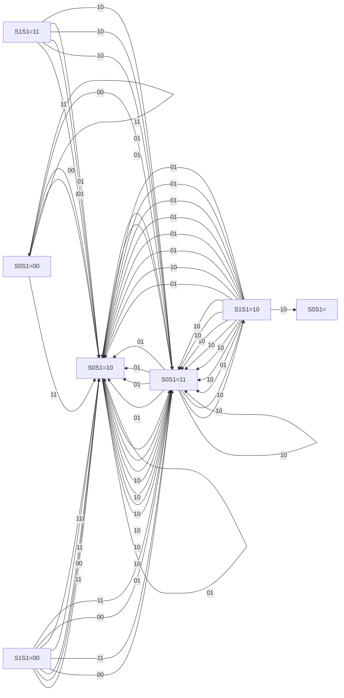
</details>

图 8.7.20 例 8.7.6 卷积码维特比译码示意图（续）

（7）在 t=7 时刻，输入接收到的码组 $r_{7}=10$ ，得到如图 8.7.20(g) 所示的对应 4 种状态的 4 条幸存路径。  
(8) 在 $t = 8$ 时刻, 输入接收到的码组 $r_{8} = 10$ , 作为结尾卷积码序列结构的码字, 所有码字对应的路径最后一定会返回全零状态, 由图 8.7.20(h) 所示, 此时能够返回全零状态的路径只能有 2 种可能的到达状态, 对应 2 条幸存路径。  
(9) 在 $t = 9$ 时刻, 输入接收到的码组 $r_{9} = 11$ , 返回全零状态, 得到如图 8.7.20(i) 所示 2 条幸存路径。最后选择其中与输入序列 $r_{1} r_{2} r_{3} r_{4} r_{5} r_{6} r_{7} = 10 10 00 01 01 11 10 10 11$ 汉明距离最小的一条译码路径。

得到最大似然的译码路径后，还需要从该序列中求信息序列。具体方法如下：该路径经过网格图中的每个状态节点时，若从上输出边输出，则相应的该码组的译码输出为“0”；若从下输出边输出，相应的该码组的译码输出为“1”。最后得到总的译码输出的信息序列为 101100100。显然，与原来的编码前的信息序列一致，在传输过程中引入的两位误码在译码后已被自动纠正。☐

卷积码的维特比软译码 维特比译码同样适用于软译码，软译码与硬译码的区别是，软译码是通过欧氏距离来做判断的。若发送端输出的二进制信号 $s_{i,m}$ 的取值是“-A”和“+A”，式（8.7.90）所示的软译码的计算公式可进一步简化，因为

$$
\begin{array}{l} S _ {l} = \arg \min _ {S _ {i} \in \{S \}} \sum_ {m = 1} ^ {M} d _ {i j, m} ^ {2} = \arg \min _ {S _ {i} \in \{S \}} \sum_ {m = 1} ^ {M} \left(r _ {j, m} - s _ {i, m}\right) ^ {2} \tag {8.7.91} \\ = \arg \min _ {S _ {i} \in \{S \}} \sum_ {m = 1} ^ {M} \left(r _ {j, m} ^ {2} - 2 r _ {j, m} s _ {i, m} + s _ {i, m} ^ {2}\right) \\ \end{array}
$$

上式括号中，无论是 $s_{i,m} = -A$ 对应“0”还是 $s_{i,m} = +A$ 对应“1”，均有 $s_{i,m}^{2} = A^{2}$ ，因此第一项和第三项是在分支度量比较过程中同等拥有的项，可以不予考虑。因此，译码算法可简化为

$$
S _ {l} = \arg \min _ {S _ {i} \in \{S \}} \sum_ {m = 1} ^ {M} d _ {i j, m} ^ {2} \leftrightarrow \arg \max _ {S _ {i} \in \{S \}} \sum_ {m = 1} ^ {M} r _ {j, m} S _ {i, m} \tag {8.7.92}
$$

下面我们通过一个例子来说明软译码的过程。首先，参见图8.7.20，在没有噪声的情况下“0”对应“-A”，“1”对应“+A”，接收时先不对输入的信号r做硬判决，而是做如下处理：若r小于-A，这时信源发送-A的可能性远大于发送+A的可能性，令其等于-A；同理，若r大于+A，令其等于+A。将r在-A到+A的闭区间的取值用4位的二进制数来表示，其中一位表示符号，另外三位表示信号的幅度大小。假设输入信号经量化后，所有可能取值为-7,-6,-5,-4,-3,-2,-1,0,+1,+2,+3,+4,+5,+6,+7。

【例 8.7.7】设卷积码(2,1,3)的编码器结构与例 8.7.1 一样，其编码器的网格图如图 8.7.11 所示。仍设输入的信息序列为 $M=(101100100)$ ，同样其中最后的两位斜体 “00” 是为使编码路径最终回到零，使其具有结尾卷积码的特性而加入的。相应的编码输出为 $C=(11\ 10\ 00\ 01\ 01\ 11\ 11\ 10\ 11)$ 。发送信号的取值为

$$
\begin{array}{l} S _ {1, 1} S _ {1, 2} S _ {2, 1} S _ {2, 2} S _ {3, 1} S _ {3, 2} S _ {4, 1} S _ {4, 2} S _ {5, 1} S _ {5, 2} S _ {6, 1} S _ {6, 2} S _ {7, 1} S _ {7, 2} S _ {8, 1} S _ {8, 2} S _ {9, 1} S _ {9, 2} = \\ + 7 + 7; + 7 - 7; - 7 - 7; - 7 + 7; - 7 + 7; + 7 + 7; + 7 + 7; + 7 - 7; + 7 + 7 \\ \end{array}
$$

假定信号在传输过程中受到噪声的干扰，实际接收到的信号 R 取值变为

$$
r _ {1, 1} r _ {1, 2} r _ {2, 1} r _ {2, 2} r _ {3, 1} r _ {3, 2} r _ {4, 1} r _ {4, 2} r _ {5, 1} r _ {5, 2} r _ {6, 1} r _ {6, 2} r _ {7, 1} r _ {7, 2} r _ {8, 1} r _ {8, 2} r _ {9, 1} r _ {9, 2} =
$$

$$
+ 6 \underline {{- 1}}; + 5 - 6; - 7 - 5; - 3 + 5; - 7 + 6; + 7 + 5; + 6 \underline {{- 2}}; + 4 - 5; + 7 + 6
$$

其中有多位出现了不同程度的偏差，其中第二位的“-1”和第十四位的“-2”是会导致错误判决的偏差。试采用软译码方式进行译码。

解: 根据卷积码编码器的网格图及式 (8.7.85) 进行译码, 网格图中的输出 “0” 对应的理想取值为 “-7”, “1” 对应的理想取值为 “+7”。整个译码过程如图 8.7.21 所示。

（1）在 t=1 时刻，输入接收第 1 个码组信号 $r_{1,1}r_{1,2}$ 为 +6,-1。

从全零状态 $S_{0}S_{1}=00$ 出发，若到达下一状态 $S_{0}S_{1}=00,\quad s_{1,1}s_{1,2}$ 应为 -7,-7。因此有 $\sum_{m=1}^{2}r_{j,m}s_{i,m}=6\times(-7)+(-1)\times(-7)=-35$ ；若到达下一状态 $S_{0}S_{1}=10,\quad s_{1,1}s_{1,2}$ 应为 +7,+7，因此有 $\sum_{m=1}^{2}r_{j,m}s_{i,m}=6\times7+(-1)\times7=35$ 。

（2）在 t=2 时刻，输入接收码组信号 $r_{2,1}r_{2,2}$ 为 +5, -6。

从状态 $S_0S_1 = 00$ 出发，若到达下一状态 $S_0S_1 = 00$ ， $s_{2,1}s_{2,2}$ 应为-7，-7，因此有 $\sum_{m=1}^{4} r_{j,m}s_{i,m} = -35 + 5 \times (-7) + (-6) \times (-7) = -28$ ；若到达下一状态 $S_0S_1 = 10$ ， $s_{2,1}s_{2,2}$ 应为+7，+7，因此有 $\sum_{m=1}^{4} r_{j,m}s_{i,m} = -35 + 5 \times 7 + (-6) \times 7 = -42$ 。

从状态 $S_0S_1 = 10$ 出发，若到达下一状态 $S_0S_1 = 01$ ， $s_{2,1}s_{2,2}$ 应为 $+7, -7$ ，因此有 $\sum_{m=1}^{4} r_{j,m}s_{i,m} = 35 + 5 \times 7 + (-6) \times (-7) = 112$ ；若到达下一状态 $S_0S_1 = 11$ ， $s_{2,1}s_{2,2}$ 应为 $-7, +7$ ，因此有 $\sum_{m=1}^{4} r_{j,m}s_{i,m} = 35 + 5 \times (-7) + (-6) \times 7 = -42$ 。

（3）在 t=3 时刻，输入接收码组信号 $r_{3,1}r_{3,2}$ 为 -7,-5。

从状态 $S_0S_1 = 00$ 出发，若到达下一状态 $S_0S_1 = 00$ ， $s_{3,1}s_{3,2}$ 应为-7,-7，因此有

$\sum_{m=1}^{6} r_{j,m} s_{i,m} = -28 + (-7) \times (-7) + (-5) \times (-7) = 56$ ；若到达下一状态 $S_0 S_1 = 10$ ， $s_{3,1} s_{3,2}$ 应为 $+7, +7$ ，因此有 $\sum_{m=1}^{6} r_{j,m} s_{i,m} = -28 + (-7) \times 7 + (-5) \times 7 = -112$ 。

从状态 $S_0S_1 = 10$ 出发，若到达下一状态 $S_0S_1 = 01$ ， $s_{3,1}s_{3,2}$ 应为 $+7, - 7$ ，因此有

$\sum_{m=1}^{6} r_{j,m} s_{i,m} = -42 + (-7) \times 7 + (-5) \times (-7) = -56$ ；若到达下一状态 $S_0 S_1 = 11$ ， $s_{3,1} s_{3,2}$ 应为 $-7, +7$ ，因此有 $\sum_{m=1}^{6} r_{j,m} s_{i,m} = -42 + (-7) \times (-7) + (-5) \times 7 = -28$ 。

从状态 $S_{0}S_{1}=01$ 出发，若到达下一状态 $S_{0}S_{1}=00,\quad s_{3,1}s_{3,2}$ 应为 -7,+7，因此有

$\sum_{m=1}^{6} r_{j,m} s_{i,m} = 112 + (-7) \times (-7) + (-5) \times 7 = 126$ ；若到达下一状态 $S_0 S_1 = 10$ ， $s_{3,1} s_{3,2}$ 应为 -7, -7，因此有 $\sum_{m=1}^{6} r_{j,m} s_{i,m} = 112 + (-7) \times (-7) + (-5) \times (-7) = 196$ 。

从状态 $S_{0}S_{1}=11$ 出发，若到达下一状态 $S_{0}S_{1}=01$ ， $s_{3,1}s_{3,2}$ 应为 -7,+7，因此有

$\sum_{m=1}^{6} r_{j,m} s_{i,m} = -42 + (-7) \times (-7) + (-5) \times 7 = -28$ ；若到达下一状态 $S_0 S_1 = 11$ ， $s_{3,1} s_{3,2}$ 应为 $+7, -7$ ，因此有 $\sum_{m=1}^{6} r_{j,m} s_{i,m} = -42 + (-7) \times 7 + (-5) \times (-7) = -56$ 。

比较进入每个状态的两条路径，删除度量值较小的那一条路径，保留度量值较大的那一条路径。对所有的4种状态 $S_{0}S_{1}=00,10,01,11$ ，如图8.7.21所示，保留路径的度量值分别为126,196,-28,-28。

在后续的译码过程中，对每一对输入信号值 $r_{i,1}r_{i,2}$ ，不断地重复上述操作，对每个状态只保留一条度量值较大的路径。

（4）在 t=4 时刻，输入接收码组信号 $r_{4,1}r_{4,2}$ 为 -3,+5。对状态 $S_{0}S_{1}=00,10,01,11$ ，各保留路径的度量值分别为 112,182,140,252。

输入： $R=+6-1;+5-6;-7-5;-3+5;-7+6;+7+5;+6-2;+4-5;+7+6$

  
图 8.7.21 例 8.7.7 卷积码维特比软译码示意图

  
图 8.7.21 例 8.7.7 卷积码维特比软译码示意图（续）

（5）在 t=5 时刻，输入接收码组信号 $r_{5,1}r_{5,2}$ 为 -7,+6。对状态 $S_{0}S_{1}=00,10,01,11$ ，各保留路径的度量值分别为 231,147,343,273。  
(6) 在 t=6 时刻，输入接收码组信号 $r_{6,1}r_{6,2}$ 为 +7, +5。对状态 $S_{0}S_{1}=00,10,01,11$ ，各保留路径的度量值分别为 329, 315, 259, 287。  
(7) 在 t=7 时刻，输入接收码组信号 $r_{7,1}r_{7,2}$ 为 +6, -2。对状态 $S_{0}S_{1}=00,10,01,11$ ，保留路径的度量值分别为 301, 357, 371, 343。  
（8）在 t=8 时刻，输入接收码组信号 $r_{8,1}r_{8,2}$ 为 +4,-5。因为只有从状态 $S_{0}S_{1}=00,01$ 出发的路径才能回到 $S_{0}S_{1}=00$ ，所以只需考虑到达这两个状态的路径，其保留路径的度量值分别为 309,420。  
(9) 在 $t = 9$ 时刻, 输入接收码组信号 $r_{9,1} r_{9,2}$ 为 $+7, +6$ 。从状态 $S_0 S_1 = 00, 01$ 出发回到 $S_0 S_1 = 00$ 两条路径的度量值分别为 218 和 413, 选择度量值较大的 413 路径。最后得到度量值最大的一条译码路径 11 10 00 01 01 11 11 10 11, 相应的译码输出根据每次从一个状态节点出发时是行进上输出边或下输出边确定相应的“0”或“1”的译码值, 最后得到译码输出值 101100100。

输入样值中会导致出错判决的第二位和第十四位的偏差在译码过程中被自动纠正。□


<details>
<summary>line</summary>

| Position | Path a (Solid Line) | Path b (Dashed Line) |
| --- | --- | --- |
| 1 | S0 | S0 |
| 2 | S0 | S0 |
| 3 | S0 | S0 |
| 4 | S0 | S0 |
| 5 | S0 | S0 |
| 6 | S0 | S0 |
| 7 | S0 | S0 |
| 8 | S0 | S0 |
| 9 | S0 | S0 |
| 10 | S0 | S0 |
| 11 | S0 | S0 |
| 12 | S0 | S0 |
| 13 | S0 | S0 |
| 14 | S0 | S0 |
| 15 | S0 | S0 |
| 16 | S0 | S0 |
| 17 | S0 | S0 |
| 18 | S0 | S0 |
| 19 | S0 | S0 |
| 20 | S0 | S0 |
| 21 | S0 | S0 |
| 22 | S0 | S0 |
| 23 | S0 | S0 |
| 24 | S0 | S0 |
| 25 | S0 | S0 |
| 26 | S0 | S0 |
| 27 | S0 | S0 |
| 28 | S0 | S0 |
| 29 | S0 | S0 |
| 30 | S0 | S0 |
| 31 | S0 | S0 |
| 32 | S0 | S0 |
| 33 | S0 | S0 |
| 34 | S0 | S0 |
| 35 | S0 | S0 |
| 36 | S0 | S0 |
| 37 | S0 | S0 |
| 38 | S0 | S0 |
| 39 | S0 | S0 |
| 40 | S0 | S0 |
| 41 | S0 | S0 |
| 42 | S0 | S0 |
| 43 | S0 | S0 |
| 44 | S0 | S0 |
| 45 | S0 | S0 |
| 46 | S0 | S0 |
| 47 | S0 | S0 |
| 48 | S0 | S0 |
| 49 | S0 | S0 |
| 50 | S0 | S0 |
| 51 | S0 | S0 |
| 52 | S0 | S0 |
| 53 | S0 | S0 |
| 54 | S0 | S0 |
| 55 | S0 | S0 |
| 56 | S0 | S0 |
| 57 | S0 | S0 |
| 58 | S0 | S0 |
| 59 | S0 | S0 |
| 60 | S0 | S0 |
| 61 | S0 | S0 |
| 62 | S0 | S0 |
| 63 | S0 | S0 |
| 64 | S0 | S0 |
| 65 | S0 | S0 |
| 66 | S0 | S0 |
| 67 | S0 | S0 |
| 68 | S0 | S0 |
| 69 | S0 | S0 |
| 70 | S0 | S0 |
| 71 | S0 | S0 |
| 72 | S0 | S0 |
| 73 | S0 | S0 |
| 74 | S0 | S0 |
| 75 | S0 | S0 |
| 76 | S0 | S0 |
| 77 | S0 | S0 |
| 78 | S0 | S0 |
| 79 | S0 | S0 |
| 80 | S0 | S0 |
| 81 | S0 | S0 |
| 82 | S0 | S0 |
| 83 | S0 | S0 |
| 84 | S0 | S0 |
| 85 | S0 | S0 |
| 86 | S0 | S0 |
| 87 | S0 | S0 |
| 88 | S0 | S0 |
| 89 | S0 | S0 |
| 90 | S0 | S0 |
| 91 | S0 | S0 |
| 92 | S0 | S0 |
| 93 | S0 | S0 |
| 94 | S0 | S0 |
| 95 | S0 | S0 |
| 96 | S0 | S0 |
| 97 | S0 | S0 |
| 98 | S0 | S0 |
| 99 | S0 | S0 |
| 100 | S0 | S0 |
</details>

图 8.7.22 维特比译码是一种最大似然译码

下面的定理保证了维特比译码是一种最优的译码方法。

定理 8.7.2 维特比译码算法获得的幸存路径是具有最大似然函数的路径。

证明：采用反证法证明 $^{[2]}$ 。如图 8.7.22 所示，设有最大似然函数的路径 a，在某一时刻 k，进入状态 $S_{m}$ 时被删除了，则一定有另一幸

存路径 b 的度量值超过了路径 a 的度量值，即有到状态 $S_{m}$ 时最大似然函数的路径 a 与输入序列的汉明距离（或对软译码来说其欧氏距离），大于另一路径 b 与输入序列的汉明（欧氏）距离。则最大似然函数的路径 a 的剩余部分（从时刻 k 到路径结束的部分），与路径 b 的度量值相加，得到的总度量值超过最大似然路径的总度量值，这与最大似然路径有最大度量值的定义相矛盾，因而是不可能的。所以在维特比译码算法中，最大似然路径不会被删除掉，根据该算法得到的一定是最大似然路径。证毕。☐

## 8.7.9 维特比译码器的性能分析\*

严格的维特比译码器的性能分析一般比较困难，但我们可导出其差错概率的上限，从而对其性能进行一个基本的判断。由8.7.5节的分析可知，卷积码作为一种线性码，最小的码字间距离等于码字集中非零码字的最小重量的关系仍然成立。而当码字错误图样中“1”的个数大于卷积码的自由距离 $d_{free}$ 时，就可能会发生将有错误码的接收码字判决为码字集中另外一合法码字的情况，此时不能检测出错误。

分析卷积码的性能时, 要判断错误图样中 “1” 的个数是否大于卷积码的自由距离 $d_{\mathrm{free}}$ , 分析该错误图样与全 “0” 码字间的距离即可。特别地, 对于维特比译码方法, 可以通过观察错误图样对应的译码路径与全 “0” 码字对应的译码路径间的关系, 来分析其性能。

如图 8.7.23 所示，假定发送的是一个全“0”的序列对应的码字，正确的译码路径是网格图中最上方的直线。若在传输过程中出现了错误，使得在 t=l 时刻选择了图中的路径 a 作为幸存路径，由维特比译码的原理，不管后续的译码过程如何，包括可能经历更多的错误或不再出现新的其他错误，该路径对应的码字都是一个错误译码。也就是说，


<details>
<summary>text_image</summary>

正确路径
S₀
S₁
路径a
t=1
路径b
Sn
</details>

图 8.7.23 维特比译码器性能分析示意图

如果我们考虑的是所谓的结尾卷积码序列，所有的错误译码路径一定包含至少一条离开全“0”路径后又返回全“0”路径的子路径。因此，从仅做判断是否出现码字译码错误的角度，我们只需要找出所有离开全“0”路径后第一次返回全“0”的路径即可。

回顾前面讨论过的增扩的转移函数 $T(D,J,N)$ , 其中的参数 $D, J$ 和 $N$ 的指数分别描述了始于全 “0” 状态, 经过非全 “0” 状态第一次返回全 “0” 状态后, 沿着全 “0” 的路径行进到终点的码字重量、所包含的分支数和信息位中 “1” 的个数的参数的取值。假定不考虑分支数, 增扩的转移函数变为一个只有两个参数的函数 $T(D,N)$ , 它具有如下的一般形式:

$$
T (D, N) = \sum_ {d = d _ {\mathrm{free}}} ^ {\infty} A (d) D ^ {d} N ^ {f (d)} \tag {8.7.93}
$$

式中 $d$ 是这些码字的重量， $A(d)$ 是具有重量为 $d$ 的码字的数量， $f(d)$ 是码字中包含“1”的信息位的数量。

如果码字中出现 $d$ 位错误的概率为 $P_{d}$ , 对于发送全 “0” 的正确码字来说, 所有具有非零重量的码字均为错误的码字, 而 $A(d)$ 是具有重量为 $d$ 的码字的数量, 因此译码错误概率的上限为

$$
P _ {\mathrm{E}} \leqslant \sum_ {d = d _ {\mathrm{free}}} ^ {\infty} A (d) P _ {d} \tag {8.7.94}
$$

式中下标从 $d_{\mathrm{free}}$ 开始是因为当错误的位数小于自由距离时，不会出现判决错误。求和上限取无穷大是因为考虑了对同样结构的卷积码编码器，可生成各种码字长度的情况。

硬判决译码的差错概率 当采用硬译码判决时，假设经过离散无记忆对称信道，接收序列每位出现误码的概率为 $p$ 。在 $t = l$ 时刻某一比较路径 $a$ 与全“0”路径会合后需进行幸存路径的判决时，需要比较其中哪一条路径与接收序列更为相似。假定比较路径 $a$ 与全“0”路径的汉明距离为 $d$ ，有两种可

能的情况。

(1) $d$ 为奇数时, 如果接收序列的误码的位数小于 $(d + 1) / 2$ 。记接收序列、全“0”序列和比较序列 $a$ 分别为 $(r_1, r_2, \dots, r_l), (c_1^{(0)}, c_2^{(0)}, \dots, c_l^{(0)})$ 和 $\left(c_1^{(a)}, c_2^{(a)}, \dots, c_l^{(a)}\right)$ , 其中 $c_i^{(0)} = 0, r_i, c_i^{(a)} \in (0,1)$ , 若

$$
\sum_ {i = 1} ^ {l} c _ {i} ^ {(0)} \oplus c _ {i} ^ {(a)} = d \tag {8.7.95}
$$

因为 $(c_{1}^{(0)},c_{2}^{(0)},\cdots,c_{l}^{(0)})$ 是全“0”序列，所以 $(c_{1}^{(a)},c_{2}^{(a)},\cdots,c_{l}^{(a)})$ 一定有d位“1”，又若

$$
\sum_ {i = 1} ^ {l} c _ {i} ^ {(0)} \oplus r _ {i} <   \frac {d + 1}{2} \tag {8.7.96}
$$

则 $(r_{1},r_{2},\cdots,r_{l})$ 中包含“1”的位数一定小于 $(d+1)/2$ ，因为 $(c_{1}^{(a)},c_{2}^{(a)},\cdots,c_{l}^{(a)})$ 中有d位“1”，因此 $(r_{1},r_{2},\cdots,r_{l})$ 中“1”的个数少于 $(c_{1}^{(a)},c_{2}^{(a)},\cdots,c_{l}^{(a)})$ 中“1”的个数，两者差别最小的情况发生在 $(r_{1},r_{2},\cdots,r_{l})$ 中“1”出现的位置在 $(c_{1}^{(a)},c_{2}^{(a)},\cdots,c_{l}^{(a)})$ 中的相应位置也为“1”时。既便如此，因为接收序列的误码的位数小于 $(d+1)/2$ ，比较路径a与全“0”路径的汉明距离为d，仍然有

$$
\sum_ {i = 1} ^ {l} c _ {i} ^ {(a)} \oplus r _ {i} \geqslant \frac {d + 1}{2} \tag {8.7.97}
$$

式（8.7.96）和式（8.7.97）说明全“0”路径与接收序列的距离小于路径a与接收序列的距离，这时会正确地选择全“0”路径作为幸存路径；反之，如果接收序列的误码的位数大于 $(d+1)/2$ ，则会出现错误的选择。

因为出错的地方可能在不同的位置，考虑所有可能的错误图样，得其概率为

$$
P _ {d} = \sum_ {k = (d + 1) / 2} ^ {d} \binom {d} {k} p ^ {k} (1 - p) ^ {d - k} \tag {8.7.98}
$$

(2) $d$ 为偶数时, 如果接收序列的误码的位数小于 $d / 2$ 。做与 $d$ 为奇数时完全相同的分析, 这时会正确地选择全 “0” 路径作为幸存路径; 如果接收序列的误码的位数大于 $d / 2$ , 则会出现错误的选择。特别地, 当接收序列的误码的位数等于 $d / 2$ 时, 若随机地选择两条路径中的任一条, 则正确与错误的可能性各为 $1 / 2$ 。因此, 出错的概率为

$$
P _ {d} = \frac {1}{2} \binom {d} {d / 2} p ^ {d / 2} (1 - p) ^ {d / 2} + \sum_ {k = d / 2 + 1} ^ {d} \binom {d} {k} p ^ {k} (1 - p) ^ {d - k} \tag {8.7.99}
$$

因为对于任何的 $d$ ，均有如下的关系式[2][5]：

$$
P _ {d} <   2 ^ {d} p ^ {d / 2} (1 - p) ^ {d / 2} \tag {8.7.100}
$$

由式（8.7.94）， $P_{\mathrm{E}} \leqslant \sum_{d = d_{\mathrm{free}}}^{\infty} A(d) P_{d}$ ，译码错误概率 $P_{\mathrm{E}}$ 的估算公式可以简化为

$$
P _ {\mathrm{E}} <   \sum_ {d = d _ {\text {free}}} ^ {\infty} A (d) 2 ^ {d} p ^ {d / 2} (1 - p) ^ {d / 2} \tag {8.7.101}
$$

比较式（8.7.94），进一步可得

$$
\begin{array}{l} P _ {\mathrm{E}} <   \sum_ {d = d _ {\text {free}}} ^ {\infty} A (d) 2 ^ {d} p ^ {d / 2} (1 - p) ^ {d / 2} \tag {8.7.102} \\ = \sum_ {d = d _ {\text {free}}} ^ {\infty} A (d) D ^ {d} N ^ {f (d)} \left| _ {N = 1, D = \sqrt {4 p (1 - p)}} = T (D, N) \right| _ {N = 1, D = \sqrt {4 p (1 - p)}} \\ \end{array}
$$

软判决译码的差错概率 当采用软译码判决时，与硬判决译码时的分析类似，参见图8.7.23，需要在t=l时刻对某一比较路径a与全“0”路径的会合点进行幸存路径的选择判决，以确定哪一条路径与接收序列更为相似。记接收序列、全“0”序列和比较序列a分别为 $(r_{1},r_{2},\cdots,r_{l}),(s_{1}^{(0)},s_{2}^{(0)},\cdots,s_{l}^{(0)})$ 和 $(s_{1}^{(a)},s_{2}^{(a)},\cdots,s_{l}^{(a)})$ ，参见图8.7.19，此时应有 $s_{i}^{(0)}=-A,\quad s_{i}^{(a)}\in(-A,A)$ ，因为假定发送的是全“0”序列，信道为加性白高斯噪声信道（AWGN），所以 $r_i = -A + n_i$ ，其中 $n_i$ 服从均值为0、方差为 $N_0 / 2$ 的高斯分布，即 $n_i \sim N(\mu = 0, \sigma^2 = N_0 / 2)$ 。根据式（8.7.92），软判决出现幸存路径错误的条件为

$$
\sum_ {i = 1} ^ {l} r _ {i} s _ {i} ^ {(a)} \geqslant \sum_ {i = 1} ^ {l} r _ {i} s _ {i} ^ {(0)} \Rightarrow \sum_ {i = 1} ^ {l} r _ {i} \left(s _ {i} ^ {(a)} - s _ {i} ^ {(0)}\right) \geqslant 0 \tag {8.7.103}
$$

假定全“0”路径 $(s_{1}^{(0)},s_{2}^{(0)},\cdots,s_{l}^{(0)})$ 和比较路径a即 $(s_{1}^{(a)},s_{2}^{(a)},\cdots,s_{l}^{(a)})$ 两者之间有d位的不同，则上式变为

$$
\sum_ {i, s _ {i} ^ {(a)} \neq s _ {i} ^ {(0)}} r _ {i} [ A - (- A) ] = 2 A \sum_ {i, s _ {i} ^ {(a)} \neq s _ {i} ^ {(0)}} r _ {i} = 2 A \sum_ {i, s _ {i} ^ {(a)} \neq s _ {i} ^ {(0)}} (- A + n _ {i}) \geqslant 0 \tag {8.7.104}
$$

整理并将其重新编号得

$$
- d A + \sum_ {i ^ {\prime}} ^ {d} n _ {i ^ {\prime}} \geqslant 0 \tag {8.7.105}
$$

因为 $\sum_{i'}^{d} n_{i'}$ 为 $d$ 个独立的高斯随机变量之和，上式左侧是均值为 $-dA$ 、方差为 $dN_0 / 2$ 的高斯随机变量。若将该随机变量记为 $\xi$ ， $\xi \sim N(\mu = -dA, \sigma^2 = dN_0 / 2)$ ，则出现错误的概率为

$$
P _ {d} = P (\xi \geqslant 0) = \int_ {0} ^ {+ \infty} \frac {1}{\sqrt {2 \pi \cdot d N _ {0} / 2}} \mathrm{e} ^ {- \left(\frac {x + d A}{\sqrt {d N _ {0}}}\right) ^ {2}} \mathrm{d} x = Q \left[ \sqrt {\frac {(d A) ^ {2}}{d N _ {0} / 2}} \right] = Q \left[ \sqrt {\frac {2 d A ^ {2}}{N _ {0}}} \right] = Q \left[ \sqrt {2 \gamma_ {\mathrm{b}} R _ {\mathrm{b}} d} \right] \tag {8.7.106}
$$

其中 $\gamma_{b}=A^{2}T_{b}/N_{0}$ 为比特能量与噪声功能密度谱的比值， $R_{b}=1/T_{b}$ 为比特率。

一般来说，软译码器比硬译码器有更好的性能。既便对于硬译码器，也仅当 $d \geqslant d_{free}$ 时才可能发生判决错误，因此只需考虑 $d \geqslant d_{free}$ 时的情形。根据本节前面的分析，考虑所有离开全“0”路径后第一次返回全“0”路径，并将式（8.7.106）的结果代入式（8.7.94），可得

$$
P _ {\mathrm{E}} <   \sum_ {d = d _ {\mathrm{free}}} ^ {\infty} A (d) P _ {d} = \sum_ {d = d _ {\mathrm{free}}} ^ {\infty} A (d) Q \left[ \sqrt {2 \gamma_ {\mathrm{b}} R _ {\mathrm{b}} d} \right] \tag {8.7.107}
$$

式中 $A(d)$ 依然是具有重量为 $d$ 的、离开全“0”路径后第一次与全“0”路径汇合，沿全“0”路径行进到终端的码字的数量。

根据 $Q$ 函数的性质，一般地有

$$
Q \left[ \sqrt {2 \gamma_ {\mathrm{b}} R _ {\mathrm{b}} d} \right] \leqslant \mathrm{e} ^ {- \gamma_ {\mathrm{b}} R _ {\mathrm{b}} d} = D ^ {d} \mid_ {D = \mathrm{e} ^ {- \gamma_ {\mathrm{b}} R _ {\mathrm{b}}}} \tag {8.7.108}
$$

由上式再结合式（8.7.94）所示的关系式，可得

$$
P _ {\mathrm{E}} \leqslant \sum_ {d = d _ {\text {free}}} ^ {\infty} A (d) D ^ {d} N ^ {f (d)} \left| _ {N = 1, D = \mathrm{e} ^ {- \gamma_ {\mathrm{b}} R _ {\mathrm{b}}}} = T (D, N) \right| _ {N = 1, D = \mathrm{e} ^ {- \gamma_ {\mathrm{b}} R _ {\mathrm{b}}}} \tag {8.7.109}
$$

卷积码的误比特率估算 通过前面的分析, 我们获得了维特比硬译码和软译码的错误概率限, 在评价一个通信系统的性能时, 通常需要分析其误比特率。如果将维特比译码时产生的错误概率, 乘以该错误出现时相应的错误比特个数, 就可以估计其误比特率。注意到转移函数的一般表达式 $T(D, N) = \sum_{d = d_{\text {free}}}^{\infty} A(d) D^d N^{f(d)}$ 中, $f(d)$ 表示序列中包含 “1” 的信息位的数量。而对于发送全 “0” 的码字而言, 在反映译码错误概率限的式 (8.7.102) 和式 (8.7.109) 中, $f(d)$ 表示的就是每种译码错误中, 错误比特的个数。因此, 求误比特率的上限, 可在错误概率的求和表达式即式 (8.7.102) 和式 (8.7.109) 中, 让每项乘以相应的错误的比特个数来获得, 相当于对其中的每项进行关于 $f(d)$ 加权的运算, 而这一操作, 可以通过对转移函数的求导来实现。对于硬译码器, 其误比特率限为

$$
\begin{array}{l} P _ {\mathrm{b}} \leqslant \frac {\mathrm{d} T (D , N)}{\mathrm{d} N} \mid_ {N = 1, D = \sqrt {4 p (1 - p)}} = \sum_ {d = d _ {\text {free}}} ^ {\infty} A (d) D ^ {d} \frac {\mathrm{d} \left(N ^ {f (d)}\right)}{\mathrm{d} N} \mid_ {N = 1, D = \sqrt {4 p (1 - p)}} \\ = \sum_ {d = d _ {\mathrm{free}}} ^ {\infty} A (d) D ^ {d} f (d) N ^ {f (d) - 1} \mid_ {N = 1, D = \sqrt {4 p (1 - p)}} \tag {8.7.110} \\ = \sum_ {d = d _ {\text {free}}} ^ {\infty} A (d) (4 p (1 - p)) ^ {d / 2} f (d) \\ \end{array}
$$

而对于软译码器，其误比特率限为

$$
\begin{array}{l} P _ {\mathrm{b}} \leqslant \frac {\mathrm{d} T (D , N)}{\mathrm{d} N} \mid_ {N = 1, D = \mathrm{e} ^ {- \gamma_ {\mathrm{b}} R _ {\mathrm{b}}}} = \sum_ {d = d _ {\mathrm{free}}} ^ {\infty} A (d) D ^ {d} \frac {\mathrm{d} (N ^ {f (d)})}{\mathrm{d} N} \mid_ {N = 1, D = \mathrm{e} ^ {- \gamma_ {\mathrm{b}} R _ {\mathrm{b}}}} \\ = \sum_ {d = d _ {\mathrm{free}}} ^ {\infty} A (d) D ^ {d} f (d) N ^ {f (d) - 1} \mid_ {N = 1, D = \mathrm{e} ^ {- \gamma_ {\mathrm{b}} R _ {\mathrm{b}}}} \tag {8.7.111} \\ = \sum_ {d = d _ {\mathrm{free}}} ^ {\infty} A (d) \mathrm{e} ^ {- \gamma_ {\mathrm{b}} R _ {\mathrm{b}} d} f (d) \\ \end{array}
$$

图 8.7.24 给出了一个(3,1,3)卷积码，译码分别采用硬判决和软判决时，根据式（8.7.110）和式（8.7.111）计算得到的卷积码不同译码方式的性能比较 $^{[5]}$ 。由图可见，在包括 $10^{-2} \leqslant P_{b} \leqslant 10^{-6}$ 在内的很大区域范围内，两者在此范围的上下界间均相差约2.5dB，即如果采用硬判决，要达到软判决的误码性能，信噪比 $\gamma_{b}$ 要提高约2.5dB。可见虽然软译码的运算较为复杂，但采用软译码能够有效地提高纠错编译码系统的性能。随着通信系统中编译码模块计算能力的提高，软译码方式将获得越来越多的应用。

## 8.7.10 卷积码的码率变换操作——凿孔卷积码\*

卷积码在应用中的问题 （1）卷积码因为利用码组间的相关性，可以获得比分组码更好的性能，但也因为译码时需考虑这种相关性，复杂性大大增加。对于参数为 $(n,k,L)$ 的卷积码，每输入k位信息，产生一个n位


<details>
<summary>line</summary>

| \(\gamma b\)dB | 软译码 (Pb) | 硬译码 (Pb) |
| --- | --- | --- |
| 3 | 10^-2 | — |
| 4 | 10^-3 | — |
| 5 | 10^-4 | 10^-2 |
| 6 | 10^-5 | 10^-3 |
| 7 | 10^-6 | 10^-4 |
| 8 | — | 10^-5 |
| 9 | — | 10^-6 |
| 10 | — | 10^-6 |
</details>

图 8.7.24 卷积码(3,1,3)硬译码与软译码性能比较

的编码输出码组。在维特比译码的网格图中，共有 $2^{k(L-1)}$ 种状态 $S_0, S_1, \cdots, S_{2^{L-1}}$ 。一般地，每个状态有 $2^k$ 个分支进入，也有 $2^k$ 个分支发出。例如，对于图8.7.9所示的(2,1,3)卷积码，共有 $2^{3-1} = 4$ 个状态，每个状态有 $2^1 = 2$ 个分支进入和 $2^1 = 2$ 个分支发出。可以想象，当 $k$ 和 $L$ 的取值较大时，译码过程将变得非常复杂。因此通常采用 $k = 1$ 的取值，相应的码率仅为 $R = k / n = 1 / n$ 。(2) 在现代无线通信系统中，为提高频谱的利用率，一般采用自适应的编码和调制技术，在信道条件较好时，可以采用冗余度较小的高效编码方式；而在信道条件较差时，则采用冗余度较大、效率较低但具有较强检错和纠错能力的编码方式。卷积码要在这样的条件下应用，需要其具有码率可调节的能力。

本节介绍的凿孔卷积码，可通过某种删除或称凿孔（Punctured）的变换操作，使卷积码更为适合在传输速率可变的通信环境中应用；也可以通过这种变换，对不同重要性的信息采用不同的码率编码，实现所谓的不等保护功能。

凿孔卷积码 一般将原来的码率 R 为 1/n 的卷积码称为母卷积码。所谓 “凿孔”，是指在母卷积码输出的码字中，按照某种规则，删除（凿去）一些特定的位，所形成的码字就称为凿孔卷积码，凿孔卷积码在有些书上也称增信删余码 $^{[2]}$ 。例如，对于图 8.7.6 所示的 $(2,1,3)$ 编码器，当输入的信息序列为 M = (101100100) 时，编码输出的码字 $C = (111000010111111011)$ ，若对码字的每 4 位输出删除 1 位，如删除下式中 “×” 位置处的码元，就得到一个新的码字：

$$
\boldsymbol {C} = 1 1 1 0 0 0 0 1 0 1 1 1 1 1 1 0 1 1 \rightarrow \boldsymbol {C} ^ {\prime} = 1 1 1 0 0 0 0 1 1 1 1 1 1 \tag {8.7.112}
$$

该码字就是一种凿孔卷积码。在本例所示的凿孔卷积码操作中，将原来的每输入1位信息位，产生2位编码输出，变换为每输入2比特信息位，产生3比特的输出，码率由 $R = 1 / 2$ 变为 $R = 2 / 3$ 。

凿孔卷积码的编码过程可以在普通卷积码编码的基础上通过删除特定的位来实现。普通参数为 $(n,k,L)$ 的卷积码每输入k位信息位产生n位的编码码组输出。若删除的规律以每隔T个n位的码组进行一次删除操作，则称T为其凿孔周期。凿孔规律可以一个 $n\times T$ 的凿孔矩阵 $A(a_{ij})_{n\times T}$ 来描述

$$
A (a _ {i j}) _ {n \times T} = \left[ \begin{array}{c c c c} a _ {1 1} & a _ {1 2} & \dots & a _ {1 T} \\ a _ {2 1} & a _ {2 2} & \dots & a _ {2 T} \\ \vdots & \vdots & \ddots & \vdots \\ a _ {n 1} & a _ {n 2} & \dots & a _ {n T} \end{array} \right], \quad a _ {i j} \in \{0, 1 \} \tag {8.7.113}
$$

其中若 $a_{ij} = 0$ ，则表示在周期 $T$ 内的第 $j$ 个码组中的第 $i$ 位被删除；反之 $a_{ij} = 1$ 表示相应的位被保留。对于式（8.7.112）所示的例子，其凿孔矩阵为

$$
A (a _ {i j}) _ {2 \times 2} = \left[ \begin{array}{l l} 1 & 1 \\ 1 & 0 \end{array} \right] \tag {8.7.114}
$$

该矩阵表示凿孔周期为 $T = 2$ ，在一个码字中每两个码组删除1位，即第二个码组中的第二位被删除。

兼容性问题 所谓兼容性，是指对同一母卷积码做不同的凿孔操作时，即随着码率的增大，删除的位数增加时，只会在原来较低码率的凿孔码删除的基础上做进一步删除。

因为参数为(2,1,L)的卷积码简单, 很容易构造码率按照 $R = l / (l + 1)$ 规律逐渐变化且具有兼容性的凿孔卷积码, 人们已经通过计算机遍历搜索的方法, 得到了常用的各种从(2,1,L)卷积码中可产生的最佳凿孔码的删除码元位置的布局图, 即凿孔矩阵的构造。这里所谓的最佳, 是指同样的凿孔数量, 其自由距离 $d_{\mathrm{free}}$ 最大, 且码字集中重量为 $d_{\mathrm{free}}$ 的码字数 $A(d_{\mathrm{free}})$ 最少。例如, 对于表8.7.4给出的生成多项式为 $G(X) = [X^2 + 1, X^2 + X + 1]$ 、自由距离 $d_{\mathrm{free}} = 5$ 的(2,1,3)卷积码, 可以用如下不同的凿孔矩阵获得不同码率 $R$ 的卷积码编码输出:

$$
R = \frac {2}{3}: A _ {2 \times 2} = \left[ \begin{array}{l l} 1 & 0 \\ 1 & 1 \end{array} \right]; \quad R = \frac {3}{4}: A _ {2 \times 3} = \left[ \begin{array}{l l l} 1 & 0 & 1 \\ 1 & 1 & 0 \end{array} \right]; \quad R = \frac {4}{5}: A _ {2 \times 4} = \left[ \begin{array}{l l l l} 1 & 0 & 1 & 1 \\ 1 & 1 & 0 & 0 \end{array} \right] \tag {8.7.115}
$$

$$
R = \frac {5}{6}: A _ {2 \times 5} = \left[ \begin{array}{c c c c c} 1 & 0 & 1 & 1 & 1 \\ 1 & 1 & 0 & 0 & 0 \end{array} \right]; \quad R = \frac {5}{6}: A _ {2 \times 6} = \left[ \begin{array}{c c c c c c} 1 & 0 & 1 & 1 & 1 & 1 \\ 1 & 1 & 0 & 0 & 0 & 0 \end{array} \right]
$$

注意到在上面的矩阵中，随着码率 $R$ 的增大，矩阵的列数增加，这种增加总是在上一个矩阵的基础上通过增加新的列元素形成的，这就是所谓的满足兼容性。更多有关 $(2,1,L)$ 卷积码中的最佳凿孔码的删除位置布局图，可参见参考文献[2]。

凿孔卷积码的译码 我们仍以图 8.7.6 所示的卷积码编码器为例，说明凿孔卷积码的完整译码过程。当输入的信息序列为 $M=(101100100)$ 时，根据式（8.7.114）所示的凿孔矩阵，得到的凿孔码字如式（8.7.112）所示。凿孔卷积码的译码分为如下的两步。

(1) 虚拟码元填充: 凿孔后的卷积码删除了码字中的一些码元, 这些码元未被传输, 接收端收到凿孔卷积码的码字后, 首先要在这些被凿去的码元的位置重新填充虚拟码元。下式描述了一个接收码字填充虚拟码元的过程, 假定在传输过程中出现了一位误码, 误码的位置由下划线表示:

$$
R ^ {\prime} = 1 1 1 0 0 0 0 1 1 1 1 1 0 1 \rightarrow 1 1 1 _ {\uparrow} 0 0 0 _ {\uparrow} 0 1 1 _ {\uparrow} 1 1 1 _ {\uparrow -} 0 1 \rightarrow 1 1 1 \times 0 0 0 \times 0 1 1 \times 1 1 1 \times 0 1 \tag {8.7.116}
$$

因为虚拟码元在译码过程中不参加运算，所以取值可以随意，在式子中用“×”表示插入的虚拟码元。因为采用何种类型的凿孔方式，发送和接收双方是事先约定好的，所以对于虚拟码元的插入位置是明确的。

(2) 将完成虚拟码元填充后的卷积码送到维特比译码器进行译码, 译码的过程如图 8.7.25 所示。在 $t = 1$ 时刻, 输入码组 “11”, 译码过程与普通的维特比译码过程一样, 得到图 8.7.25(a) 所示的结果; 在 $t = 2$ 时刻, 输入的码组 “ $1 \times$ ” 包含了一位填充的虚拟码元, 该码元不参与比较运算, 输入序列$r_{1}r_{2}r_{3}r_{4}=111\times$ 与到达状态 $S_{0}S_{1}=00$ 的路径0000相比，因最后一位不参加比较，该路径变为000×，所以汉明距离d=3；同理，与到达状态 $S_{0}S_{1}=10$ 的路径0011（001×）相比，d=2；与到达状态 $S_{0}S_{1}=01$ 的路径1110（111×）相比，d=0；与到达状态 $S_{0}S_{1}=11$ 的路径1101（110×）相比，d=1，因此得到图8.7.25(b)所示的结果；在t=3时刻，输入码组“00”，译码过程与普通的维特比译码过程一样，得到图8.7.25(c)所示的结果；此后的过程类似，凡是遇到虚拟码元时，该位的码元均不参加比较运算，可以得到图8.7.25(d)到(i)所示的译码路径，显然译码的结果纠正了1位的误码，正确地恢复了原来的码字。


<details>
<summary>flowchart</summary>

This diagram illustrates a state transition or data flow process for a system with input 't=1' and output 'r=11', showing transitions between states labeled S0S1=00, S0S1=10, S0S1=01, and S0S1=11.
</details>

(a)


<details>
<summary>flowchart</summary>

This diagram illustrates a state transition or data flow graph for a 2x2 matrix with input and output values, showing transitions between states labeled S0S1=00, 10, 01, and 11.
</details>

(b)  


<details>
<summary>flowchart</summary>

This diagram illustrates a state transition or state transition flow in a system with a 3-input input, showing transitions between states labeled S0S1=00 to S0S1=11.
</details>

(c')


<details>
<summary>flowchart</summary>

```mermaid
graph LR
  S0S100["S0S1=00"] -->|11| S0S110["S0S1=10"]
  S0S100 -->|00| S0S111["S0S1=11"]
  S0S110 -->|01| S0S111
  S0S110 -->|10| S0S111
  S0S101["S0S1=01"] -->|01| S0S111
  S0S101 -->|10| S0S111
  S0S111 -->|01| S0S111
  S0S111 -->|10| S0S111
  S0S100 -->|01| S0S110
  S0S100 -->|10| S0S111
  S0S100 -->|00| S0S111
  S0S100 -->|10| S0S111
  S0S100 -->|00| S0S111
  S0S100 -->|10| S0S111
  S0S100 -->|00| S0S111
  S0S100 -->|10| S11
  S0S110 -->|01| S0S111
  S0S110 -->|10| S0S111
  S0S110 -->|00| S0S111
  S0S110 -->|10| S0S111
  S0S110 -->|00| S0S111
  S0S110 -->|10| S0S111
  S0S110 -->|00| S0S111
  S0S101 -->|01| S0S111
  S0S101 -->|10| S0S111
  S0S101 -->|00| S0S111
  S0S101 -->|10| S0S111
  S0S101 -->|00| S0S111
  S0S101 -->|10| S0S111
  S0S101 -->|00| S0S111
  S0S110 -->|01| S0S111
  S0S110 -->|10| S0S111
  S0S110 -->|00| S0S111
  S0S110 -->|10| S0S111
  S0S110 -->|00| S0S111
  S0S110 -->|10| S0S111
  S0S110 -->|00| S0S111
  S0S110 -->|10| S0S111
  S0S110 -->|00| S0S111
  S0S111 -->|01| S0S111
  S0S111 -->|10| S0S111
  S0S111 -->|00| S0S111
  S0S111 -->|10| S0S111
  S0S111 -->|00| S0S111
  S0S111 -->|10| S0S111
  S0S111 -->|00| S0S111
  S0S100 -->|11| S0S111
  S0S100 -->|10| S0S111
  S0S100 -->|11| S0S111
  S0S100 -->|00| S0S111
  S0S100 -->|11| S0S111
  S0S100 -->|00| S0S111
  S0S100 -->|11| S0S111
  S0S100 -->|00| S0S111
  S0S1_11 -->|11| S0S111
  S0S1_11 -->|10| S0S111
  S0S1_11 -->|11| S0S111
  S0S1_11 -->|00| S0S111
  S0S1_11 -->|11| S0S111
  S0S1_11 -->|00| S0S111
  S0S1_11 -->|11| S0S111
  S0S1_11 -->|00| S0S111
  S0S111 -->|01| S0S111
  S0S111 -->|10| S0S111
  S0S111 -->|00| S0S111
  S0S111 -->|11| S0S111
  S0S111 -->|00| S0S111
  S0S111 -->|11| S0S111
  S0S111 -->|00| S0S111
  S0S111 -->|11| S0S111
  S0S100 -->|11| S0S111
  S0S100 -->|10| S0S111
  S0S100 -->|11| S0S111
  S0S100 -->|00| S0S111
  S0S111 -->|11| S0S111
  S0S111 -->|10| S0S111
  S0S111 -->|11| S0S111
  S0S111 -->|00| S0S111
  S0S111 -->|11| S0S111
  S0S111 -->|00| S0S111
  S0S1_11 -->|11| S0S111
  S0S1_11 -->|10| S0S111
  S0S1_11 -->|11| S0S111
  S0S1_11 -->|00| S0S111
  S11 -->|11| S0S111
  S0S1_11 -->|10| S0S111
  S0S1_11 -->|11| S0S111
  S0S1_11 -->|00| S0S111
  S0S1_11 -->|11| S0S111
3 1 2 1 2 2
```
</details>

(c)  
图 8.7.25 凿孔卷积码译码示意图

  
图 8.7.25 凿孔卷积码译码示意图（续）


<details>
<summary>flowchart</summary>

This diagram illustrates a state transition or state transition flow in a system with parameters t=9 and r=01, showing transitions between states labeled S0S1=00, 10, 01, and 11.
</details>

图 8.7.25 凿孔卷积码译码示意图（续）

一般来说，卷积码经过凿孔处理后，其自由距离将会减小，如上例所讨论的卷积码变为凿孔卷积码后，其自由距离将由原来的5变为3。凿孔卷积码的好处是与其他同样码率的普通卷积码相比，其自由距离并没有减小，在检错和纠错能力相同的情况下，译码运算更为简单。

## 8.8 调制与编码的权衡

## 8.8.1 调制方式的权衡问题

在第6章中介绍了多种调制方式，包括二进制的ASK, PSK和FSK调制，多进制的MASK, MFSK, MPSK和MQAM调制等。通常把调制的进制数称为调制阶数。不同的调制方式，有不同的特定应用场合。调制方式的选择，涉及信息速率 $R_{b}$ 、可用的频谱带宽W、信号发送功率P、信道的特性、噪声功率密度谱 $N_{0}$ 的大小，以及系统实现的复杂性等诸多因素，会受到多种综合条件和因素的制约。

例如，在可用的频谱带宽非常有限的场合，通常会考虑采用具有较高频谱效率的MPSK和MQAM等调制方式。这些具有较高阶数的调制方式，有利于提高频谱的利用效率。但从信号的星座图我们知道，在最大发射功率一定的条件下，阶数越高，符号间的距离越小，在有噪声或信道非理想的情况下，发生误码的可能性越大。虽然理论上可以通过增大发射功率来增大信号符号间的距离，但这种方法并不总是可行的。大的发射功率意味着能耗的增加对功放器件要求的提高，对于便携设备来说同时意味着所需电池重量的增加和电磁波辐射对人体影响的增大。在信号功率受到限制的条件下，人们自然会想到能否通过纠错编码的方法，来提高系统的性能。

本节主要分析在加性高斯白噪声信道（AGWN）环境下，对特定的带宽和接收信噪比的条件，为保证系统的性能，应如何选择合适的调制方式，这里所说的系统性能，主要是指通信系统最主要的两个参数：信息传输的速率 $R_{\mathrm{b}}$ 和系统的误比特率 $P_{\mathrm{b}}$ 。本节同时还分析，在需要采用纠错编码来提高系统性能时，应如何选择纠错编码的参数。稍后将看到，只有合理地选择纠错编码的参数，才能发挥其提高系统性能的作用，否则有可能产生适得其反的效果。本节讨论的内容是通信系统设计的基础。

在描述通信系统的性能时, 有两条最重要的特性曲线, 一条是反映特定调制方式下系统性能的信噪比与误比特率的特性曲线, 另外一条是反映物理系统信道容量的香农公式特性曲线。撇开具体的调制方式, 把上述这两条特性曲线加以抽象, 可以得到图 8.8.1 所示的系统特性参数权衡平面[9], 其中图 (a) 描述的是差错概率面, 图 (b) 描述的是带宽效率面。图中符号的含义如下: $C$ 表示在权衡过程中某方面需要付出的代价; $F$ 表示在权衡过程中的固定参数; $G$ 表示在权衡过程中可获得的性能提高。系统的性能指标主要有误比特率 $P_{\mathrm{b}}$ 、带宽 $W$ 、带宽效率 $R / W$ 、功率 $P$ 和比特能量与噪声功率密度谱的比值 $E_{\mathrm{b}} / N_{0}$ 。图中的箭头-参数组合表示当曲线沿着箭头所示的方向变化时, 系统可获得的性能提高和所需付出的相应代价。


<details>
<summary>text_image</summary>

Pb
G: Pb, P
C: W
F: Eb/N0
G: Pb
C: W
F: P
G: Pb
C: P
F: W
G: W
C: P
F: Pb
G: P
C: W
F: Pb
-1.6 dB
G: W
C: Pb
F: P
G: P
C: Pb
F: W
Eb/N0
P = S/N =
</details>

(a) 差错概率面


<details>
<summary>text_image</summary>

G: P, P_b
C: R/W
F: E_b/N_0
R/W
G: P_b
C: R/W
F: P
G: P_b
C: P
F: R/W
-1.6 dB
G: R/W
C: P
F: P_b
G: R/W
C: P, P_b
F: E_b/N_0
E_b/N_0
G: R/W
C: P_b
F: P
R/W
</details>

(b) 带宽效率面  
图 8.8.1 系统特性参数权衡平面 $^{[9]}$

在差错概率面上, 参数组合 $\left\langle G: P; C: W; F: P_{\mathrm{b}} \right\rangle$ 表示在保持误比特率 $P_{\mathrm{b}}$ 不变的条件下, 如果愿意付出增加带宽 $W$ 的代价, 所需的功率 $P$ 可以降低, 相应的差错概率特性曲线将向水平箭头所示方向变化。参数组合 $\left\langle G: W; C: P_{\mathrm{b}}, P; F: E_{\mathrm{b}} / N_{0} \right\rangle$ 表示在保持比特能量噪声功率密度谱比 $E_{\mathrm{b}} / N_{0}$ 不变的条件下,要减少所需的带宽 $W$ , 其代价是误比特率 $P_{\mathrm{b}}$ 的增大, 相应的差错概率特性曲线将向垂直箭头所示的方向变化。

在带宽效率面上，参数组合 $\left\langle G:R/W;C:P_{b},P;F:E_{b}/N_{0}\right\rangle$ 表示如果在固定比特能量噪声功率密度谱比 $E_{b}/N_{0}$ 的情况下，要使带宽效率R/W提高，向垂直向上的方向变化，其代价是误比特率 $P_{b}$ 的增大或所需信号功率的增大。参数组合 $\left\langle G:P_{b};C:R/W;F:P\right\rangle$ 表示若固定信号的功率，要使误比特率 $P_{b}$ 减

少，其代价是带宽效率 R/W 的降低。

图 8.8.2 给出了不同调制方式在带宽效率面中的位置，其中曲线的左上灰色区域是发送信息速率超过香农限的部分，是不可能实现无差错传输的区域；右下部分是现有通信系统中的工作区域，虽然理论上可以实现无差错的传输，但目前这还是一个有待完善的研究目标，实际的物理系统的误比特率通常仍是按照特定的应用需求来设计的。可用的信道带宽和发射功率是通信系统的两个基本的受限使用的资源，大多数的通信系统都可以分为带宽受限型或功率受限型。在功率受限而频带较宽松的场合，可选择左下角中所示的 MFSK 调制方式；而在可用的频带受限而发射功率较宽松的场合，则可选择右上角中所列的调制方式，如 MPSK 或 MQAM 等。图中的三条直线①、②和③分别描述了固定带宽效率 R/W、固定比特能量与噪声功率密度谱比 $E_{b}/N_{0}$ 和固定误


<details>
<summary>scatter</summary>

| Modulation (M) | Eb/N0 (dB) | R/W (bit/s/Hz) |
| --- | --- | --- |
| 256 | ~24 | ~8 |
| 64 | ~24 | ~6 |
| 16 | ~18 | ~4 |
| 8 | ~12 | ~3 |
| 4 | ~8 | ~2 |
| 2 | ~8 | ~1 |
| 4 | ~12 | ~1 |
| 2 | ~12 | ~1 |
| 8 | ~12 | ~0.5 |
| 16 | ~12 | ~0.2 |
</details>

图 8.8.2 带宽效率面：调制方式的选择 $^{[9]}$

比特率 $P_{\mathrm{b}}$ 时系统参数间的权衡关系，这些参数间相互制约的定性关系在图8.8.1(b)中已经做了完整的归纳。

## 8.8.2 带宽受限系统与功率受限系统

一般地, 对于一个 $M$ 进制的通信系统, 其调制阶数 $M 、$ 比特率 $R_{\mathrm{b}}$ (比特周期 $T_{\mathrm{b}} = 1 / R_{\mathrm{b}}$ )、符号速率 $R_{\mathrm{S}}$ (符号周期 $T_{\mathrm{S}} = 1 / R_{\mathrm{S}}$ ), 以及每个符号所携带的比特数 $k$ 等这些参数间有如下的基本关系:

$$
R _ {\mathrm{b}} = R _ {\mathrm{S}} \mathrm{lb} M = R _ {\mathrm{S}} \mathrm{lb} 2 ^ {k} = k R _ {\mathrm{S}} \tag {8.8.1}
$$

$$
T _ {\mathrm{b}} = \frac {1}{R _ {b}} = \frac {1}{R _ {\mathrm{S}} \mathrm{lb} M} = \frac {1}{k R _ {\mathrm{S}}} \tag {8.8.2}
$$

其符号带宽效率 $\eta_{\mathrm{s}}$ 和比特带宽效率 $\eta_{\mathrm{b}}$ 分别为

$$
\eta_ {\mathrm{S}} = \frac {R _ {\mathrm{S}}}{W} = \frac {1}{W T _ {\mathrm{S}}}, \quad \eta_ {\mathrm{b}} = \frac {R _ {\mathrm{b}}}{W} = \frac {1}{W T _ {\mathrm{b}}} \tag {8.8.3}
$$

带宽受限系统 所谓带宽受限系统, 是指可用的带宽 $W$ 相对较小, 要求具有较高比特带宽效率 $\eta_{\mathrm{b}}$ , 而允许发射的信号功率 $P$ 相对较大的系统。在 MASK, MPSK 和 MQAM 等调制方式中, 若以信号频谱的主瓣宽度即所谓的奈奎斯特最小带宽来估计系统的带宽, 则一般地有

$$
W \approx \frac {1}{T _ {\mathrm{S}}} = R _ {\mathrm{S}}, \quad \eta_ {\mathrm{S}} = \frac {R _ {\mathrm{S}}}{W} = \frac {1}{W T _ {\mathrm{S}}} \approx 1, \quad \eta_ {\mathrm{b}} = \frac {1}{W T _ {\mathrm{b}}} = \frac {k}{W T _ {\mathrm{S}}} \approx k = \mathrm{lb} M \tag {8.8.4}
$$

即系统的符号带宽效率 $\eta_{s}$ 是常数，而比特带宽效率 $\eta_{b}$ 随着调制进制数 M 的增大而提高。因此在带宽受限系统中，一般采用具有较高频谱效率的 MASK, MPSK 和 MQAM 等多进制调制方式。下面通过一个例子，说明带宽受限系统的设计和应用。

【例8.8.1】已知某一信道的可用带宽 $W_{\text{限定}}$ 为 $4000\mathrm{Hz}$ ，且在接收端可获得接收信号功率 $P_{\mathrm{r}}$ 与噪声功率谱密度 $N_{0}$ 的比 $P_{\mathrm{r}} / N_{0}$ 为 $53\mathrm{dB(Hz)}$ 。试设计一个比特率 $R_{\mathrm{b}}$ 为 $9600\mathrm{bps}$ 、误比特率 $P_{\mathrm{b}}$ 不大于 $10^{-5}$ 的调制传输系统。

解：首先分析如何选择的码元速率，以及是否满足给定带宽的限定条件。由

$$
R _ {\mathrm{S}} = \frac {1}{T _ {\mathrm{S}}} = \frac {1}{k T _ {\mathrm{b}}} = \frac {1}{T _ {\mathrm{b}} \mathrm{lb} M} = \frac {R _ {\mathrm{b}}}{\mathrm{lb} M} = \frac {9 6 0 0}{\mathrm{lb} M} \approx W \leqslant W _ {\mathrm{限定}} = 4 0 0 0 \mathrm{Hz}
$$

为获得尽可能好的抗误码性能，在满足带宽限制条件的基础上，应选择尽可能小的调制阶数，一般选择 $M = 2^{k}$ ，k 是整数。

（1）若取 k=2 ，相应地 M=4 。尝试选择 4PSK（QPSK）调制方式，相应的带宽为

$$
W \approx \frac {9 6 0 0}{\mathrm{lb} M} = \frac {9 6 0 0}{\mathrm{lb} 4} = 4 8 0 0 \mathrm{Hz} > W _ {\mathrm{限定}} = 4 0 0 0 \mathrm{Hz}
$$

不满足带限的条件。

（2）若取 k=3 ，相应地 M=8 。尝试选择 8PSK 调制方式，相应的带宽为

$$
W \approx \frac {9 6 0 0}{\mathrm{lb} M} = \frac {9 6 0 0}{\mathrm{lb} 8} = 3 2 0 0 \mathrm{Hz} \leqslant W _ {\mathrm{限定}} = 4 0 0 0 \mathrm{Hz}
$$

可满足带限的条件，进一步判断是否满足误比特率 $P_{\mathrm{b}} \leqslant 10^{-5}$ 的要求，由 $P_{\mathrm{r}} / N_{0} = (53)\mathrm{dB} = 10^{5.3} = 199526.23$ ，得

$$
\frac {E _ {\mathrm{s}}}{N _ {0}} = \frac {k E _ {\mathrm{b}}}{N _ {0}} = \frac {k}{N _ {0}} E _ {\mathrm{b}} = \frac {k}{N _ {0}} \left(\frac {P _ {\mathrm{r}}}{R _ {\mathrm{b}}}\right) = \frac {k}{R _ {\mathrm{b}}} \left(\frac {P _ {\mathrm{r}}}{N _ {0}}\right) = 3 \times \frac {1 9 9 5 2 6 . 2 3}{9 6 0 0} = 6 2. 6 7
$$

$$
P _ {\mathrm{s}} \approx 2 Q \left[ \sqrt {\frac {2 E _ {\mathrm{s}}}{N _ {0}}} \sin \left(\frac {\pi}{M}\right) \right] = 2 Q \left[ \sqrt {2 \times 6 2 . 6 7} \times \sin \left(\frac {\pi}{8}\right) \right] = 2. 2 \times 1 0 ^ {- 5}
$$

当在相邻信号星座点间采用格雷码编码时，有

$$
P _ {\mathrm{b}} \approx \frac {P _ {\mathrm{s}}}{\mathrm{lb} M} = \frac {2 . 2 \times 1 0 ^ {- 5}}{3} = 7. 3 \times 1 0 ^ {- 6} <   1 0 ^ {- 5}
$$

因此，所选择的 8PSK 调制方式能够满足系统的要求。☐

功率受限系统 所谓功率受限系统，是指允许发射的信号功率 P 相对较小，而对频带 W 取值的限定相对宽松的系统。从图 8.8.2 所示的带宽效率面可知，MFSK 调制方式的频谱效率较低，但可应用于低信噪比的环境。对于 MFSK，在满足各符号所对应的信号正交的条件下，当 $M \gg 1$ 时，所需的频带宽度为

$$
W _ {\mathrm{MFSK}} = \frac {M + 1}{T _ {\mathrm{S}}} \approx \frac {M}{T _ {\mathrm{S}}}
$$

其比特频谱效率

$$
\eta_ {\mathrm{b}} = \frac {R _ {\mathrm{b}}}{W _ {\mathrm{MFSK}}} = \frac {R _ {\mathrm{S}} \mathrm{lb} M}{W _ {\mathrm{MFSK}}} \approx \frac {R _ {\mathrm{S}} \mathrm{lb} M}{M / T _ {\mathrm{S}}} = \frac {\mathrm{lb} M}{M}
$$

在第6章有关MFSK的性能分析中，我们已经了解到，对于同样的比特能量噪声功率密度谱比 $E_{\mathrm{b}} / N_{0}$ 当 $M$ 增大时，比特频谱效率 $\eta_{\mathrm{b}}$ 降低，但系统的误比特率性能 $P_{\mathrm{b}}$ 将得到提高。下面同样通过一个例子，说明功率受限系统的设计和应用。

【例8.8.2】设可用的系统信道带宽 $W = 45\mathrm{kHz}$ ，要求获得的比特率为 $R_{\mathrm{b}} = 9600\mathrm{bps}$ ，已知可得到的接收信号功率与噪声功率谱密度比 $P_{\mathrm{r}} / N_{0} = 48\mathrm{dB(Hz)}$ ，要求误比特率 $P_{\mathrm{b}} \leqslant 10^{-5}$ 。试选择合适的系统调制方式。

解：可用带宽的取值 $W = 45000\mathrm{Hz}$ 远大于信息速率 $R_{\mathrm{b}} = 9600\mathrm{bps}$ ，不属于带宽受限系统，因此尽可能利用在较低信噪比时仍具有较好误比特率 $P_{\mathrm{b}}$ 性能的MFSK调制方式。已知

$$
\frac {P _ {\mathrm{r}}}{N _ {0}} = \frac {R _ {\mathrm{b}} E _ {\mathrm{b}}}{N _ {0}}, \quad \frac {E _ {\mathrm{b}}}{N _ {0}} = \frac {P _ {\mathrm{r}}}{N _ {0}} \cdot \frac {1}{R _ {\mathrm{b}}} = \frac {1 0 ^ {4 . 8}}{9 6 0 0} = 6. 6 1
$$

尝试采用 M=16 的 MFSK 调制方式，验证误比特率 $P_{b}$ 是否满足要求。因为

$$
\frac {E _ {\mathrm{s}}}{N _ {0}} = \frac {E _ {\mathrm{b}} \mathrm{lb} M}{N _ {0}} = 6. 6 1 \times 4 = 2 6. 4 4
$$

相应地，其误符号率 $P_{s}$ 为

$$
P _ {\mathrm{s}} = \frac {M - 1}{2} \exp \left(- \frac {E _ {\mathrm{s}}}{2 N _ {0}}\right) = \frac {1 6 - 1}{2} \exp \left(- \frac {2 6 . 4 4}{2}\right) = 1. 4 \times 1 0 ^ {- 5}
$$

由MFSK调制方式误比特率 $P_{\mathrm{b}}$ 与误符号率 $P_{\mathrm{S}}$ 间的关系

$$
P _ {\mathrm{b}} = \frac {2 ^ {k - 1}}{2 ^ {k} - 1} P _ {\mathrm{E}} = \frac {2 ^ {4 - 1}}{2 ^ {4} - 1} 1. 4 \times 1 0 ^ {- 5} = 7. 3 \times 1 0 ^ {- 6}
$$

可见能够满足要求。□

在实际系统的设计过程中，调制阶数 M 的取值通常要经过多次尝试才能获得最合理的结果。

## 8.8.3 带宽与功率均受限系统

在一些场合，有可能系统的工作条件对带宽和功率均有特定的限制。这时如果简单地根据前面所讨论的带宽受限系统或功率受限系统进行设计，则会遇到无论选择何种调制方式，均不能同时满足信道带宽限制和误比特率的要求的情况。

例如，已知某一信道的可用带宽 $W_{\text{限定}}$ 为 $4000\mathrm{Hz}$ ，且假定发射功率受限，在接收端可获得接收信号功率 $P_{\mathrm{r}}$ 与噪声功率谱密度 $N_{0}$ 的比值 $P_{\mathrm{r}} / N_{0}$ 为 $53\mathrm{dB(Hz)}$ 。要求设计一个比特率 $R_{\mathrm{b}}$ 为9600bps、误比特率 $P_{\mathrm{b}}$ 不大于 $10^{-9}$ 的调制传输系统。

（1）如果按照带宽受限系统的设计方法，假定选择MPSK调制，回顾前面有关带宽受限系统的设计的讨论，采用8PSK调制，所需带宽 $W = 3200\mathrm{Hz}$ 满足带限 $W_{\text{限定}} \leqslant 4000\mathrm{Hz}$ 的要求，但可获得的最低的误比特率为 $7.3 \times 10^{-6}$ ，远不能满足在本例中对误比特率 $P_{\mathrm{b}} \leqslant 10^{-9}$ 的要求。

(2) 如果按照功率受限系统的设计方法, 已知 $P_{\mathrm{r}} / N_{0} = 53 \mathrm{~dB}(\mathrm{Hz})$ , 考虑采用 MFSK 调制方式, 考虑满足误比特率的情况下, 所需带宽是否满足带宽限定的要求。因为

$$
\frac {E _ {\mathrm{b}}}{N _ {0}} = \frac {P _ {\mathrm{r}}}{N _ {0}} \cdot \frac {1}{R _ {\mathrm{b}}}
$$

所以

$$
\frac {E _ {\mathrm{S}}}{N _ {0}} = \frac {E _ {\mathrm{b}} \mathrm{lb} M}{N _ {0}} = \frac {P _ {\mathrm{r}}}{N _ {0}} \cdot \frac {1}{R _ {\mathrm{b}}} \mathrm{lb} M = \frac {1 0 ^ {5 . 3}}{9 6 0 0} \mathrm{lb} M
$$

又因为误符号率和误比特率分别为

$$
\begin{array}{l} P _ {\mathrm{S}} = \frac {M - 1}{2} \exp \left(- \frac {E _ {\mathrm{S}}}{2 N _ {0}}\right) \\ P _ {\mathrm{b}} = \frac {2 ^ {k - 1}}{2 ^ {k} - 1} P _ {\mathrm{S}} = \frac {2 ^ {\mathrm{lb} M - 1}}{2 ^ {\mathrm{lb} M} - 1} \frac {M - 1}{2} \exp \left(- \frac {1}{2} \cdot \frac {P _ {\mathrm{r}}}{N _ {0}} \cdot \frac {1}{R _ {\mathrm{b}}} \mathrm{lb} M\right) \\ = \frac {2 ^ {\mathrm{lb} M - 1}}{2 ^ {\mathrm{lb} M} - 1} \frac {M - 1}{2} \exp \left(- \frac {1}{2} \cdot \frac {1 0 ^ {5 . 3}}{9 6 0 0} \mathrm{lb} M\right) \leqslant 1 0 ^ {- 9} \\ \end{array}
$$

通过尝试法可以估计出，如取 $M = 2^{k}$ ，其中 $k$ 为整数，则当 $M = 4$ ，有

$$
P _ {\mathrm{b}} = \frac {2}{2 ^ {2} - 1} \frac {4 - 1}{2} \exp \left(- \frac {1}{2} \cdot \frac {1 0 ^ {5 . 3}}{9 6 0 0} \mathrm{lb} 4\right) = 2. 0 6 \times 1 0 ^ {- 9}
$$

它接近满足 $P_{\mathrm{b}} \leqslant 10^{-9}$ 的要求。但此时MFSK信号的带宽为

$$
W _ {\mathrm{MFSK}} = \frac {M + 1}{T _ {\mathrm{S}}} = (M + 1) R _ {\mathrm{S}} = (M + 1) \frac {R _ {\mathrm{b}}}{\mathrm{lb} M} = \frac {M + 1}{\mathrm{lb} M} 9 6 0 0
$$

对任何大于或等于2的整数，均有

$$
\frac {M + 1}{\mathrm{lb} M} > 1, \quad W _ {\mathrm{MFSK}} = \frac {M + 1}{\mathrm{lb} M} 9 6 0 0 > 4 0 0 0 (\mathrm{Hz})
$$

显然，带宽限制条件无法满足。

带宽与功率均受限系统设计 从上面的分析可见，在一些对带宽和功率均有限定的场合，简单地根据带宽受限系统或功率受限系统来进行设计，会出现无法找到解决方案的情况。这时需要考虑采用增加信道纠错编码的方法，来寻求解决问题的途径。图 8.8.3 是一个带有信道纠错编译码（简称信道编码）的调制解调发送和接收系统的示意图。对于一个参数为 $(n,k)$ 的分组码纠错编译码系统，编码时每输入 k 位信息比特，产生 n 位的信道比特。显然，信息比特率 $R_{b}$ 与信道比特率 $R_{c}$ 之间满足如下关系：

$$
R _ {\mathrm{c}} = \frac {n}{k} R _ {\mathrm{b}} \tag {8.8.5}
$$


<details>
<summary>flowchart</summary>

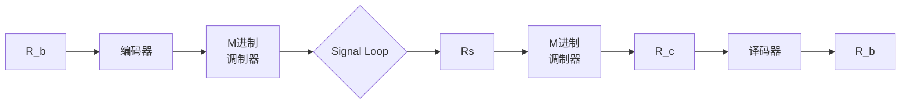
</details>

图 8.8.3 具有编码/调制和解调/译码功能的发送接送系统

此时对于调制解调器来说，要传输的是编码后的信道比特，因此符号速率 $R_{s}$ 与信道比特率 $R_{c}$ 和信息比特率 $R_{b}$ 之间的关系为

$$
R _ {\mathrm{S}} = \frac {R _ {\mathrm{c}}}{\mathrm{lb} M} = \frac {1}{\mathrm{lb} M} \left(\frac {n}{k} R _ {\mathrm{b}}\right) \tag {8.8.6}
$$

相应地，如果给定信息比特能量 $E_{\mathrm{b}}$ ，折算出相应的信道比特能量 $E_{\mathrm{c}}$ 为

$$
E _ {\mathrm{c}} = \frac {k}{n} E _ {\mathrm{b}} \tag {8.8.7}
$$

信息比特能量 $E_{\mathrm{b}}$ 、信道比特能量 $E_{\mathrm{c}}$ 和符号能量 $E_{\mathrm{S}}$ 与信噪比 $E_{\mathrm{b}} / N_{0}$ 之间的关系为

$$
\frac {E _ {\mathrm{b}}}{N _ {0}} = \frac {1}{N _ {0}} \left(\frac {n}{k} E _ {\mathrm{c}}\right), \quad \frac {E _ {\mathrm{c}}}{N _ {0}} = \frac {k}{n} \frac {E _ {\mathrm{b}}}{N _ {0}}, \quad \frac {E _ {\mathrm{S}}}{N _ {0}} = (\mathrm{lb} M) \frac {E _ {\mathrm{c}}}{N _ {0}} = (\mathrm{lb} M) \left(\frac {k}{n}\right) \frac {E _ {\mathrm{b}}}{N _ {0}} \tag {8.8.8}
$$

注意这里采用的参数符号的含义，在本章中，线性分组码的参数常用 $(n,k)$ 描述，而在M进制调制解调系统中每个符号携带的比特数也常用字母 $k\left(k=\mathrm{lb}M\right)$ 表示。这里两个“k”具有不同的含义，可根据上下文来了解在特定公式中符号“k”所代表的意义。

下面通过继续上面的例子，来说明信道编码在带宽和功率均受限系统中的作用。由前面的分析，假设 $W_{限定}=4000Hz,\quad R_{b}=9600bps,\quad P_{r}/N_{0}=53dB(Hz)$ 。下面是系统参数选择的具体步骤：

(1) 带限条件分析。尝试选择 $M = 8$ 的MPSK调制方式, 判断根据上面的条件, 是否能够同时满足带限和误比特率的要求。因为通过前面的讨论已知, 如不采用信道编码, 无法满足误比特率达到小于或等于 $10^{-9}$ 的要求。参见表8.7.4, 尝试采用参数为(63,51)、可纠正任意2个错误的BCH码。由式 (8.8.5) 有

$$
R _ {\mathrm{c}} = \frac {n}{k} R _ {\mathrm{b}} = \frac {6 3}{5 1} \times 9 6 0 0 = 1 1 8 9 5 \mathrm{bps} (\mathrm{信道比特率})
$$

$$
R _ {\mathrm{s}} = \frac {R _ {\mathrm{c}}}{\mathrm{lb} M} = \frac {1 1 8 9 5}{3} = 3 9 5 3 \mathrm{符号/s}
$$

$$
W \approx R _ {\mathrm{S}} = 3 9 5 3 \mathrm{Hz} <   4 0 0 0 \mathrm{Hz}
$$

满足带限条件。

(2) 误比特率要求判断。因为假定未编码的接收条件为

$$
\frac {P _ {\mathrm{r}}}{N _ {0}} = 5 3 \mathrm{dB(Hz)}, \quad \frac {E _ {\mathrm{b}}}{N _ {0}} = \frac {P _ {\mathrm{r}} / R _ {\mathrm{b}}}{N _ {0}} = \frac {1 0 ^ {5 . 3}}{9 6 0 0} = 2 0. 8 9
$$

由式（8.8.8）有

$$
\frac {E _ {\mathrm{S}}}{N _ {0}} = (\mathrm{lb} M) \frac {E _ {\mathrm{c}}}{N _ {0}} = (\mathrm{lb} M) \left(\frac {k}{n}\right) \frac {E _ {\mathrm{b}}}{N _ {0}} = \mathrm{lb} 8 \times \left(\frac {5 1}{6 3}\right) \times 2 0. 8 9 = 5 0. 7 3
$$

误符号率 $P_{\mathrm{S}}$ 和误信道比特率 $P_{\mathrm{c}}$ 分别为

$$
P _ {\mathrm{s}} \approx 2 Q \left[ \sqrt {\frac {2 E _ {\mathrm{s}}}{N _ {0}}} \sin \left(\frac {\pi}{M}\right) \right] = 2 Q \left[ \sqrt {2 \times 5 0 . 7 3} \times \sin \left(\frac {\pi}{8}\right) \right] = 1. 2 \times 1 0 ^ {- 4}
$$

$$
P _ {\mathrm{c}} = \frac {P _ {\mathrm{s}}}{\mathrm{lb} M} = \frac {1 . 2 \times 1 0 ^ {- 4}}{\mathrm{lb} 8} = 4 \times 1 0 ^ {- 5}
$$

经过 BCH 码的纠错译码，因为所有小于或等于 t=2 个的错误均可被纠正，所以最后获得的误比特率 $P_{b}$ 为

$$
P _ {\mathrm{b}} \approx \frac {1}{n} \sum_ {j = 3} ^ {n} j \binom {n} {j} P _ {\mathrm{c}} ^ {j} (1 - P _ {\mathrm{c}}) ^ {n - j} = \frac {1}{6 3} \sum_ {j = 3} ^ {6 3} j \binom {6 3} {j} (4 \times 1 0 ^ {- 5}) ^ {j} (1 - 4 \times 1 0 ^ {- 5}) ^ {6 3 - j} = 1. 2 \times 1 0 ^ {- 1 0}
$$

所得的结果误比特率 $P_{b}=1.2\times10^{-10}$ 满足小于或等于 $10^{-9}$ 的要求。

在一个实际系统的设计过程中，调制的进制数和编码参数的选择往往要通过多次尝试比较后才能获得最合理的结果。上面的分析说明，引入纠错编码之后，有可能解决简单地根据带宽受限系统或功率受限系统来进行设计时，均无法解决的问题。

编码参数均衡问题 在通信系统中，单纯从纠错编码的功能可能获得的好处来看，在信息的传输过程中引入信道编码后，使编码后的码字具有了一定的检错和纠错能力。随着纠错编码码率（编码效率）的减小，码字的冗余度增加，码字抵抗错误的能量增强。例如，对于参数为 $(n,k)$ 的分组码，一般有如下的变化趋势：

$$
\mathrm{码率} \frac {k}{n} \downarrow \longrightarrow \mathrm{码字的冗余度} \uparrow \longrightarrow \mathrm{码的纠错能力} \uparrow \longrightarrow \mathrm{误比特} P _ {\mathrm{b}} \downarrow \tag {8.8.9}
$$

但从另外一方面来说，随着码率的减小，码字的冗余度增加，对同样的信息比特数，需传输的信道比特数将增加。如果信号的功率保持不变，或者说每个信息比特的能量值 $E_{\mathrm{b}}$ 固定，那么由式（8.8.7），具体分配到每个信道比特上的能量 $E_{\mathrm{c}}$ 将减少，这将导致信道误比特率增大。从上面的例子我们已经看到，经过编码后，其信道误比特率已经由原来未编码时的 $P_{\mathrm{b}} = 7.3 \times 10^{-6}$ 增加到编码后的 $P_{\mathrm{c}} = 4 \times 10^{-5}$ ，呈现出如下的一种变化趋势：

$$
\mathrm{码率} \frac {k}{n} \downarrow \longrightarrow \frac {E _ {\mathrm{c}}}{N _ {0}} \downarrow \longrightarrow \mathrm{信道误比特} P _ {\mathrm{c}} \uparrow \tag {8.8.10}
$$

式（8.8.9）和式（8.8.10）对最后信息数据的误比特率 $P_{\mathrm{b}}$ 的综合影响是一种复杂的非线性关系。究竟采用纠错编码后，最终获得的误比特率 $P_{\mathrm{b}}$ 是降低还是增加，与编码参数的选择有很大的关系。如果编码参数选择不当，最后的结果可能因为采用了信道编码而使系统的误比特率性能变得更差。下面通过一个示例来说明这一问题。

【例 8.8.3】已知某系统采用 BPSK 调制，系统的频带宽度为 W = 20MHz，信息速率为 $R_{b} = 10^{6}$ bps，接收端的接收信号功率与噪声功率密度谱的比值 $P_{r}/N_{0} = 67$ dB(Hz)。试选择合适的纠错编码方式，使其满足误比特率 $P_{b} \leqslant 10^{-7}$ 的要求。

解：

(1) 尝试选择参数 $(n, k)$ 为 (127,8) 的 BCH 码, 该分组码有很强的纠错能力, 可纠正码组中任意的 31 个错误。分析系统最终获得的误比特率能否满足 $P_{\mathrm{b}} \leqslant 10^{-7}$ 的要求。因为

$$
\frac {P _ {\mathrm{r}}}{N _ {0}} = 6 7 \left(\mathrm{dB(Hz)}\right) = 1 0 ^ {6. 7} = 5 0 1 1 8 7 2. 3 4, \frac {E _ {\mathrm{b}}}{N _ {0}} = \frac {P _ {\mathrm{r}}}{N _ {0} R _ {b}} = \frac {5 0 1 1 8 7 2 . 3 4}{1 0 ^ {6}} = 5. 0 1 2
$$

对于 BPSK 调制，符号能量等于信道比特能量，即有 $E_{s}=E_{c}$ ，因此

$$
\frac {E _ {\mathrm{s}}}{N _ {0}} = \frac {E _ {\mathrm{c}}}{N _ {0}} = \frac {(k / n) E _ {\mathrm{b}}}{N _ {0}} = \left(\frac {8}{1 2 7}\right) \times 5. 0 1 2 = 0. 3 1 6
$$

信道误比特率等于误符号率

$$
P _ {\mathrm{c}} = Q \bigg (\sqrt {\frac {2 E _ {\mathrm{s}}}{N _ {0}}} \bigg) = Q (\sqrt {2 \times 0 . 3 1 6}) \approx 0. 2 1 5 6
$$

经纠错编码处理后，最终的信息误比特率

$$
P _ {\mathrm{b}} \approx \frac {1}{n} \sum_ {j = 3 2} ^ {n} j \binom {n} {j} P _ {\mathrm{c}} ^ {j} \left(1 - P _ {\mathrm{c}}\right) ^ {n - j} = \frac {1}{1 2 7} \sum_ {j = 3 2} ^ {1 2 7} j \binom {1 2 7} {j} (0. 2 1 5 6) ^ {j} (1 - 0. 2 1 5 6) ^ {1 2 7 - j} \approx 0. 0 5
$$

其中求和从 $j = 32$ 开始是因为所有小于或等于31个比特的错误均能够纠正。可见所获得的信息误比特率 $P_{\mathrm{b}} \approx 0.05$ ，距 $P_{\mathrm{b}} \leqslant 10^{-7}$ 的要求相距甚远。其主要原因是经过参数为(127,8)的纠错编码后，使需要传输的信道比特数大量增加，当信号功率为一定值时，信道的单位比特能量 $E_{\mathrm{c}}$ 很小，导致信道的误比特率 $P_{\mathrm{c}}$ 的性能严重恶化，尽管(127,8)BCH码有很强的纠错能力，最后也无法获得好的综合效果。

(2) 若选择参数 $(n, k)$ 为 (127, 64) 的 BCH 码, 该分组码可纠正码组中任意 10 个错误。仿上做同样的分析, 此时有

$$
\frac {E _ {\mathrm{s}}}{N _ {0}} = \frac {E _ {\mathrm{c}}}{N _ {0}} = \frac {(k / n) E _ {\mathrm{b}}}{N _ {0}} = \left(\frac {6 4}{1 2 7}\right) \times 5. 0 1 2 = 2. 5 2 6
$$

误信道比特率等于误符号率

$$
P _ {\mathrm{c}} = Q \left(\sqrt {\frac {2 E _ {\mathrm{s}}}{N _ {0}}}\right) = Q (\sqrt {2 \times 2 . 5 2 6}) \approx 0. 0 1 2 4
$$

经纠错编码处理后，最终的信息误比特率

$$
P _ {\mathrm{b}} \approx \frac {1}{n} \sum_ {j = 1 1} ^ {n} j \binom {n} {j} P _ {\mathrm{c}} ^ {j} (1 - P _ {\mathrm{c}}) ^ {n - j} = \frac {1}{1 2 7} \sum_ {j = 1 1} ^ {1 2 7} j \binom {1 2 7} {j} (0. 0 1 2 4) ^ {j} (1 - 0. 0 1 2 4) ^ {1 2 7 - j} \approx 5. 6 \times 1 0 ^ {- 8} \leqslant 1 0 ^ {- 7}
$$

满足系统对信息误比特率的要求。可见，虽然参数为(127,64)的BCH码的纠错能力不如参数为(127,8)的BCH码，但将其用于该特定的系统时，因其不会导致信道的单位比特能量 $E_{c}$ 下降过大，仍然能够维持较小的信道误比特率 $P_{c}$ ，最终达到所希望的效果。☐

## 8.9 本章小结

本章论述了差错控制编码的基本原理。首先介绍了检错和纠错的基本思想，给出了最简单的检错和纠错编译码示例，建立了码字间监督位和信息位间关联关系的基本概念。介绍了信道编码的基本概念和原理。本章还介绍了纠错编译码内容所涉及的近世代数的基本定义和定理。通过本章介绍的有关线性分组码构造的概念、原理和方法，特别是循环码、循环汉明码和 BCH 码的方法，使读者可以了解如何根据纠错的需求，选择相应的编码参数，完整实现编码器和译码器的设计过程。本章讨论的另外一个重点是卷积码，通过本章的学习，可以较系统掌握卷积码的工作原理和基本方法，深入理解最大似然译码及其相应的硬译码、软译码等重要概念，掌握卷积码维特比译码的方法，使读者了解如何根据纠错的要求，实现卷积码的参数选择与其编译码器的设计与构建。对凿孔卷积码进行的分析讨论，可以使读者进一步了解卷积码如何适应传输速率可变的应用场合。本章最后讨论了调制与编码的权衡问题，通过大量具体的示例，使读者可以初步了解到综合的系统设计对于保证一个通信系统性能的重要性。

## 习题

8.1 已知二进制对称信道的差错率为 $P = 10^{-2}$ 。(1) (5,1) 重复码通过此信道传输，不可纠正错误的出现概率是多少？(2) (4,3) 偶校验码通过此信道传输，不可检出错误的出现概率是多少？

8.2 某码字的集合为

| 0000000 | 1000111 | 0101011 | 0011101 |
|---|---|---|---|
| 1101100 | 1011010 | 0110110 | 1110001 |

（1）求该码字集合的最小汉明距离；（2）根据最小汉明距离确定其检错和纠错能力。

8.3 等重码是一种所有码字具有相同汉明重量的码，请分析等重码是否为线性码。

8.4 已知某线性码的监督矩阵为

$$
\boldsymbol {H} = \left[ \begin{array}{c c c c c c c} 1 & 1 & 1 & 0 & 1 & 0 & 0 \\ 1 & 1 & 0 & 1 & 0 & 1 & 0 \\ 1 & 0 & 1 & 1 & 0 & 0 & 1 \end{array} \right]
$$

求生成矩阵，并列出所有的许用码组。

8.5 已知系统线性码(7,4)的生成矩阵为

$$
\boldsymbol {G} = \left[ \begin{array}{c c c c c c c} 1 & 0 & 0 & 0 & 1 & 1 & 1 \\ 0 & 1 & 0 & 0 & 1 & 1 & 0 \\ 0 & 0 & 1 & 0 & 1 & 0 & 1 \\ 0 & 0 & 0 & 1 & 0 & 1 & 1 \end{array} \right]
$$

求所有的许用码组和监督矩阵。

8.6 已知一个系统线性码(7,4)的监督矩阵为

$$
\boldsymbol {H} = \left[ \begin{array}{c c c c c c c} 1 & 1 & 1 & 0 & 1 & 0 & 0 \\ 0 & 1 & 1 & 1 & 0 & 1 & 0 \\ 1 & 1 & 0 & 1 & 0 & 0 & 1 \end{array} \right]
$$

(1) 求生成矩阵 $G$ ; (2) 当输入信息序列 $m = 110101101010$ 时, 求输出码序列 $c$ ; (3) 若出现错误图样 0001000, 求相应的伴随式。

8.7 已知某线性分组码的生成矩阵为

$$
\boldsymbol {G} = \left[ \begin{array}{c c c c c c c} 0 & 0 & 1 & 1 & 1 & 0 & 1 \\ 0 & 1 & 0 & 0 & 1 & 1 & 1 \\ 1 & 0 & 0 & 1 & 1 & 1 & 0 \end{array} \right]
$$

(1) 求系统码生成矩阵 $G = [I, P]$ 表达式；(2) 写出典型的监督矩阵 H；(3) 若译码器输入 $y = (0011111)$ ，计算相应的校正子 S；(4) 若译码器输入 $y = (1000101)$ ，计算相应的校正子 S。

8.8 设线性分组码的生成矩阵为

$$
\boldsymbol {G} = \left[ \begin{array}{c c c c c c} 0 & 0 & 1 & 0 & 1 & 1 \\ 1 & 0 & 0 & 1 & 0 & 1 \\ 0 & 1 & 0 & 1 & 1 & 0 \end{array} \right]
$$

先将 G 转化为系统码结构的生成矩阵，然后：（1）求监督矩阵 H；（2）写出监督位的关系式；（3）确定最小码距 $d_{min}$ 。

8.9 对于一个码长为 15、可纠正 2 个随机错误的线性分组码，需要多少个不同的校正子？至少需要多少位监督码元？

8.10 一码长 $n = 15$ 的汉明码，监督位 $r$ 应为多少？编码速率为多少？

8.11 在下列表中列出了4种(3,2)码 $C_1, C_2, C_3, C_4$ ，请分析这4个码是否为线性分组码？是否为循环码？

| 信息位 | $C_1$ | $C_2$ | $C_3$ | $C_4$ |
|---|---|---|---|---|
| 00 | 000 | 000 | 001 | 011 |
| 01 | 011 | 011 | 010 | 110 |
| 10 | 110 | 111 | 100 | 001 |
| 11 | 101 | 100 | 000 | 111 |

8.12 下列多项式是系数在 GF(2) 上的多项式，计算下列各式。

(1) $(x^{4}+x^{3}+x^{2}+1)+(x^{3}+x^{2})$ ; (2) $(x^{3}+x^{2}+1)(x+1)$ ; (3) $(x^{4}+x)\bmod(x^{2}+1)$

8.13 已知一个(7,3)循环码的生成多项式为 $g(x) = x^4 + x^4 + x^2 + 1$ ，试求其生成矩阵。

8.14 （1）证明(15,5)循环码的生成多项式为 $g(x) = x^{10} + x^8 + x^5 + x^4 + x^2 + x + 1$ ；（2）求相应的监督多项式

$h(x)=?$ ；（3）若信息码多项式为 $u(x)=x^{4}+x+1$ ，求相应的系统码多项式。

8.15 已知循环码的生成多项式为 $g(x)=x^{4}+x+1$ 。（1）画出系统码结构的循环码编码电路；（2）画出校正子计算电路；（3）若错误图样对应的多项式为 $E(x)=x^{5}+x^{2}$ ，计算该错误图样对应的校正子。  
8.16 试构建一参数为(31,26)的汉明循环码，求其系统码结构的生成矩阵和监督矩阵，并计算其码率。  
8.17 已知(7,4)循环码的全部码组为

0000000, 0001011, 0011101, 0100111, 0100111, 0101100, 0110001, 0111010

1000101, 1001110, 1010011, 1011000, 1100010, 1101001, 1110100, 1111111

试写出该循环码的生成多项式 $g(x)$ 和生成矩阵 G，并将 G 化成系统码典型阵。

8.18 已知(15,11)汉明循环码的生成多项式为 $g(x) = x^4 + x^3 + 1$ ，试求其生成矩阵和监督矩阵。  
8.19 证明表 8.7.5 中所有的 n=31 本原 BCH 码均满足汉明界和普洛特金界。  
8.20 参数为(23,12)的格雷码能纠正3个随机错误，证明它是完备码。  
8.21 已知数据报文采用 CRC-8 进行保护。(1) 假定输入数据报文中需保护的数据部分为 1100000010101101111010101010010, 求编码输出; (2) 若收到报文 1100100010101101100101010101001000111101, 请判断传输过程是否出现错误?  
8.22 一卷积编码器如题图 8.22 所示，已知 k=1, n=2, L=3 。试写出生成矩阵 G 的表达式。  
8.23 已知参数为 $k = 1, n = 2, L = 4$ 的系统码结构的卷积码的单位脉冲响应为

$$
C _ {\delta} = 1 1, 0 1, 0 0, 0 1, 0 0, \dots , \dots , \dots , 0 0, \dots , \dots
$$

试求该卷积码的生成矩阵 G 和监督矩阵 H。

8.24 已知系统码结构的卷积码的参量为 $k = 1, n = 3, L = 4$ ，其单位脉冲响应为

$$
C _ {\delta} ^ {(1)} = 1 1 1, 0 0 1, 0 1 0, 0 1 1, \quad C _ {\delta} = 1 1 1, 0 0 1, 0 1 0, 0 1 1, 0 0 0, \dots , 0 0 0, \dots , \dots
$$

试求该卷积码的生成矩阵 G 和截短监督矩阵，并写出输入码为(1001...)时的输出码。

8.25 已知码率为 1/2 的卷积码的生成多项式为 $g_{0}(x)=1, g_{1}(x)=1+x$ 。（1）画出编码器的电路结构图；（2）画出卷积码的树状图、状态图、网格图；（3）当输入信息码为 110010 时，求卷积码输出。  
8.26 已知一 $(n,k,L)$ 卷积码编码器结构如题图 8.26 所示。(1) n,k,L 各是多少？(2) 求生成多项式 $g_{0}(x),g_{1}(x)$ ，并求生成矩阵 G；(3) 若输入为(10111)，求编码输出序列 c。


<details>
<summary>flowchart</summary>

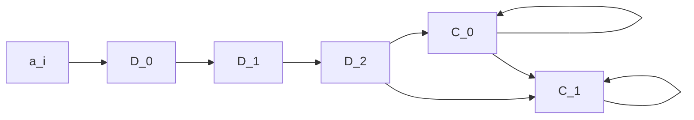
</details>

题图8.22


<details>
<summary>flowchart</summary>

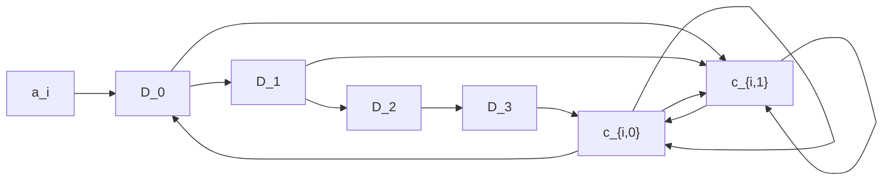
</details>

题图8.26

8.27 已知(2,1,3)卷积码的输出与输入 $\{a_{i}\}$ 的关系为 $c_{i,0}=a_{i}\oplus a_{i-1},\quad c_{i,1}=a_{i-1}\oplus a_{i-2}$ ，试确定：（1）编码器电路结构；（2）卷积码的树图、状态图及网格图。  
8.28 考虑题图 8.28(a)和(b)给出的两种(2,1,3)非系统码形式的卷积码编码器结构。分别写出两编码器的生成多项式，并判断该编码器是否存在误码的灾难性传播现象。


<details>
<summary>flowchart</summary>

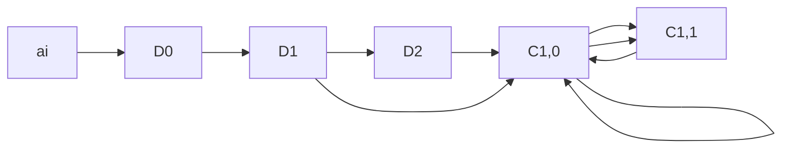
</details>

(a)


<details>
<summary>flowchart</summary>

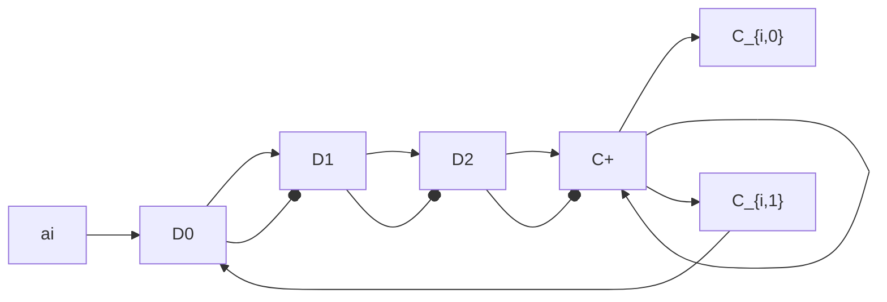
</details>

(b)  
题图8.28

8.29 已知(2,1,3)卷积码编码器的电路结构如题图8.29所示。(1) 求输入与输出的逻辑表达式; (2) 若接收到的序列为 $R = 10100001110111$ , 试用维特比译码算法判断传输是否出现错误, 并求解发送信息序列 $M$ 。

8.30 一个在 AWGN 信道上工作的通信系统，其可用带宽为 2400Hz，为其选择适当的调制和纠错编码。已知 $E_{b}/N_{0}$ 为 14dB，要求数据速率为 9600bps，误比特率为 $10^{-5}$ 。试选择合适的 MQAM 调制方式，以满足传输带宽和误比特率性能要求。

8.31 假定系统的可用带宽为 40kHz， $E_{b}/N_{0}$ 为 7.3dB，其余条件与要求与题 8.30 相同，选择符合要求的调制与编码方式。


<details>
<summary>flowchart</summary>

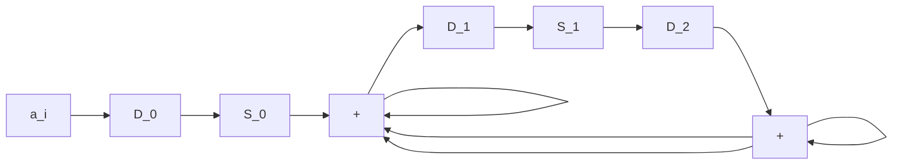
</details>

题图8.29

## 主要参考文献

[1] 曹志刚，钱亚生．现代通信原理[M]. 北京：清华大学出版社，1992.  
[2] 王新梅，肖国镇．纠错码——原理与方法[M]. 西安：西安电子科技大学出版社，1996.  
[3] 黄载禄，殷蔚华．通信原理[M]. 北京：科学出版社，2005.  
[4] 徐秉铮，常德山，等．数字通信原理[M].北京：国防工业出版社，1979.  
[5] [美]John G. Proakis. 数字通信（第四版）[M]. 北京：电子工业出版社，2001.  
[6] 姜丹．信息论与编码（第3版）[M]. 合肥：中国科技大学出版社，2009.  
[7] 万哲先．代数与编码[M]. 北京：科学出版社，1976.  
[8] J. L. Massey, M. K. Sain. Inverses of linear sequential circuits[J]. IEEE Trans. on Comput., 330-337, 1968.  
[9] [美]Bernard Sklar. 数字通信：基础与应用（第二版）[M]. 徐平平等译. 北京：电子工业出版社，2002.