## 第9章 同步原理与技术

## 9.1 引言

同步是通信系统的接收端恢复发送信息所需的关键技术之一。前面我们介绍载波调制传输信号的相关或相干解调时，接收端需要一个与发送信号载波同频同相的信号。在实际系统中，任意两个自由振荡的信号发生器不可能产生两个频率和相位完全一样的信号，因此解调用的本地载波通常不能够仅由本地振荡器自行产生，必须利用接收信号中的载波信息，将本地振荡器产生的信号，调整到与发送端的载波信号同频同相，或者与该信号只有一个固定相位差的状态。这一信号处理过程就称为载波同步。

与模拟通信不同，数字通信还有符号或码元的概念，信号的接收一般是以符号为单位逐个进行的。无论是对于载波调制传输，还是对于基带传输，当利用相关器实现匹配滤波的功能时，积分运算都从一个符号的起始时刻开始，到一个符号的末了时刻结束。如果没有准确的符号位定时，不仅不能达到匹配滤波的效果，还会引入相邻符号的干扰，严重时会导致接收错误。获取符号位置信息的过程就称为符号同步或码元同步，也就是所谓的位同步。

在数字通信系统中，接收端如果能够正确地解调发送过来的符号信息，就获得了该符号所携带的二进制码组，接收端连续接收到的码组构成了一串二进制的序列。通常发送端发出的二进制信息是以帧为单位的，接收端只有正确地区分出原来的一个个数据帧，才能确定每个信源码字的起始位置，提取其中所包含的信息。获取帧的位置信息的过程，就称为帧同步。在无线通信系统中，通常每个信号帧独立传输，信号的到达检测往往就是帧的同步过程。

本章将系统地介绍数字通信系统中的同步原理与基本技术。首先讨论锁相环的工作原理，然后依次介绍载波同步、位同步和帧同步等有关技术。随着数字信号处理方法在通信系统中的广泛应用，通过软件无线电原理实现的全数字接收机已成为构建无线通信系统的一种常见方式[6]，同步问题变为信号处理的参数估计问题。此时信号的同步，并不是非要具体的硬件电路来实现，而可由软件的算法来完成。有关同步系统中涉及的参数估计问题，也会在本章中加以讨论。

## 9.2 锁相环

## 9.2.1 锁相环的组成

锁相的基本概念 对于一个自由振荡的信号发生器来说，初始的相位通常是随机的，振荡器的频率也可能会受到各种因素（如温度或湿度变化等）的影响而发生改变。在许多应用系统中，往往会要求振荡器产生的信号的频率与相位，与某一特定外部信号的频率和相位间的关系保持恒定。当满足这样的条件时，如果用示波器同时观察这两个信号，若这两个信号的频率相同，可任意选取其中一个作为触发信号；若两信号频率不同，则应采用频率较低的信号作为观察的触发信号，此时在示波器上可以看到稳定的两个信号波形，表明这两个信号间的相位是锁定的。反之，如果这两个信号的频率与相位间没有锁定的关系，在示波器上看到的这两个信号一定是相对移动的。

锁相环的组成 锁相环（Phase Locking Loop，PLL）的基本结构如图9.2.1所示，它包含了压控振荡器（Voltage Controlled Oscillator，VCO）、鉴相器（Phase Discriminator，PD）、环路滤波器（Loop Filter，LF）和频率变换器4个主要部件，其中压控振荡器是一个频率和相位可通过改变控制电压的大小进行调整的信号发生器。鉴相器是一个用于对两输入信号进行相位比较的电路，若两个信号间存在着不同的频率差和相位差，鉴相器相应地会产生不同的输出电压。环路滤波器通常是一个具有某种特性的低通滤波器，用于滤除鉴相器输出中的脉冲信号成分，以获得平滑的反映频差和相差的控制电压。频率变换器可实现频率的 N/M 倍变换，这里 M 和 N 是整


<details>
<summary>flowchart</summary>

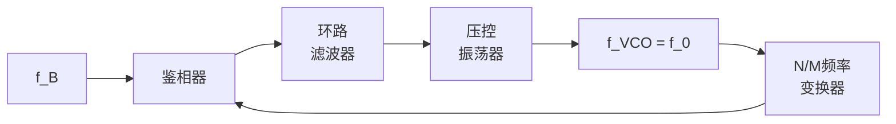
</details>

图 9.2.1 锁相环的组成

数。外部信号 $s_{\mathrm{B}}(t)$ 也称基准信号。合理地选择锁相环电路的参数，可将压控振荡器的输出信号锁定在与基准信号有固定频率和相位关系的工作状态上。此时有

$$
f _ {0} = \frac {N}{M} f _ {\mathrm{B}} \tag {9.2.1}
$$

式中， $f_{B}$ 和 $f_{0}$ 分别是基准信号和压控振荡器输出信号的频率。实际系统中有各种各样的锁相环，压控振荡器输出的信号和基准信号可以是正弦波信号，也可以是矩形波信号，为分析方便起见，在本章中如果未特别说明，假定两者都是正弦波信号。同样，为简化分析，假定 $\frac{N}{M}=1$ ，所得到的分析结果同样适用于 $\frac{N}{M}$ 取不同有理数的场合。

## 9.2.2 锁相环的工作原理

假定输入的基准信号为

$$
s _ {\mathrm{B}} (t) = A _ {\mathrm{B}} \sin \left(2 \pi f _ {\mathrm{B}} t + \phi_ {\mathrm{B}} (t)\right) \tag {9.2.2}
$$

压控振荡器的输出信号为

$$
s _ {0} (t) = A _ {0} \cos \left(2 \pi f _ {\mathrm{VCO}} (t)\right) = A _ {0} \cos \left(2 \pi f _ {\mathrm{B}} t + \phi_ {0} (t)\right) \tag {9.2.3}
$$

式中，将压控振荡器的“频率项”也表示为 $f_{B}$ ，因为在设计压控振荡器的参数时，通常使得其自由振荡时的频率尽可能接近 $f_{B}$ 。压控振荡器的输出信号与基准信号的频率差异反映在时变的相位项 $\phi_{0}(t)$ 中， $\frac{\mathrm{d}\left(2\pi f_{\mathrm{VCO}}(t)\right)}{\mathrm{d}t}=\frac{\mathrm{d}\left(2\pi f_{\mathrm{B}}t+\phi_{0}(t)\right)}{\mathrm{d}t}=2\pi f_{\mathrm{B}}+\phi_{0}^{\prime}(t)$ 。若鉴相器采用乘法器实现，则鉴相器的输出可表示为

$$
\begin{array}{l} u _ {\mathrm{PD}} (t) = K _ {\mathrm{PD}} \sin \left(2 \pi f _ {\mathrm{B}} t + \phi_ {\mathrm{B}} (t)\right) \cos \left(2 \pi f _ {\mathrm{B}} t + \phi_ {0} (t)\right) \tag {9.2.4} \\ = \frac {1}{2} K _ {\mathrm{PD}} \sin \left(\phi_ {\mathrm{B}} (t) - \phi_ {0} (t)\right) + \frac {1}{2} K _ {\mathrm{PD}} \sin \left(4 \pi f _ {\mathrm{B}} t + \phi_ {\mathrm{B}} (t) + \phi_ {0} (t)\right) \\ \end{array}
$$

式中 $K_{\mathrm{PD}}$ 为一常数。环路滤波器是一个低通滤波器， $u_{\mathrm{PD}}(t)$ 经环路滤波器后的输出

$$
u _ {\mathrm{d}} (t) = K _ {\mathrm{d}} \sin \left(\phi_ {\mathrm{B}} (t) - \phi_ {0} (t)\right) = K _ {\mathrm{d}} \sin \left(\Delta \phi (t)\right) \tag {9.2.5}
$$

可见 $u_{\mathrm{d}}(t)$ 是反映 $\Delta\phi(t)$ 变化的正弦波信号。 $u_{\mathrm{d}}(t)$ 具有如下变化特性：

$$
\frac {\mathrm{d} u _ {\mathrm{d}}}{\mathrm{d} \Delta \phi} = K _ {\mathrm{d}} \cos (\Delta \phi) \left\{ \begin{array}{l l} \geqslant 0, & 2 k \pi - \pi / 2 \leqslant \Delta \phi <   2 k \pi + \pi / 2 \\ <   0, & 2 k \pi + \pi / 2 \leqslant \Delta \phi <   2 (k + 1) \pi - \pi / 2 \end{array} \right. \tag {9.2.6}
$$

$u_{\mathrm{d}}(t)$ 的变化特性如图 9.2.2 所示。通过参数的设计，可使压控振荡器随着 $u_{\mathrm{d}}(t)$ 的变化产生如下变化特性：

$$
\begin{array}{l l l}u _ {\mathrm{d}} \uparrow&\rightarrow&f _ {\mathrm{VCO}} \uparrow\\u _ {\mathrm{d}} \downarrow&\rightarrow&f _ {\mathrm{VCO}} \downarrow\end{array}\tag {9.2.7}
$$

压控振荡器频率 $f_{\mathrm{VCO}}$ 的变化会导致相位 $\phi_0(t)$ 的变化，相应的相差 $\Delta \phi (t) = \phi_{\mathrm{B}}(t) - \phi_0(t)$ 也会发生变化，在不同的 $\Delta \phi (t)$ 取值区域内，这种变化会因为反馈产生如下不同的连锁反应，如图9.2.2所示。


<details>
<summary>text_image</summary>

u_d(Δφ)
-π
O
π
Δφ
</details>

图 9.2.2 环路滤波器输出的控制电压

（1）在 $2k\pi - \pi / 2 \leqslant \Delta \phi < 2k\pi + \pi / 2$ 区域内，

$$
\frac {\mathrm{d} u _ {\mathrm{d}} (t)}{\mathrm{d} \Delta \phi} \geqslant 0, | \Delta \phi | \uparrow \rightarrow \vec {u} _ {\mathrm{d}} \rightarrow f _ {\mathrm{XCO}} \rightarrow | \Delta \phi | \downarrow \tag {9.2.8}
$$

即在这一区域， $u_{\mathrm{d}}(t)$ 对 VCO 的调整总是促使 $\left|\Delta\phi\right|\rightarrow0$ 。

(2) 在 $2k\pi + \pi/2 \leqslant \Delta\phi < (2k + 1)\pi + \pi/2$ 区域内，

$$
\frac {\mathrm{d} u _ {\mathrm{d}} (t)}{\mathrm{d} \Delta \phi} \leqslant 0, | \Delta \phi | \uparrow \rightarrow \vec {u} _ {\mathrm{d}} \rightarrow f _ {\text {XCO}} \rightarrow | \Delta \phi | \uparrow \tag {9.2.9}
$$

即在这一区域， $u_{\mathrm{d}}(t)$ 的调整功能将促使 $\left|\Delta\phi\right|$ 进一步变大，偏离原来的相位点。

在图 9.2.2 中，对应横坐标上的 “○” 和 “●” 点都有 $u_{\mathrm{d}}(t)=0$ ，此时不会对压控振荡器的频率和相位进行调整，故称其为平衡点。对于图中 “○” 位置的点，若 $\Delta\phi$ 出现小的变化， $u_{\mathrm{d}}(t)$ 的调整作用总是力图使 $\Delta\phi$ 回到原来的位置，所以这些点又称稳定平衡点。对于图中 “●” 位置的点，若 $\Delta\phi$ 出现小的变化， $u_{\mathrm{d}}(t)$ 的调整作用会使 $\Delta\phi$ 进一步偏离原来的位置，所以这些点又称非稳定平衡点。合理的环路滤波器和压控振荡器的设计将使得锁相环最后工作在稳定的平衡点上，此时压控振荡器的输出与基准信号有相同的频率和固定的相位差，这些固定的相位差的取值就是图中平衡点上的相位值。

## 9.2.3 锁相环的基本性能分析

锁相环是一个复杂的反馈跟踪系统，有关其详细的理论分析可参考专门的著作[1]，本节仅做一些简要的讨论，使读者了解其基本性能和主要的特性参数。在式（9.2.5）中，如果 $\Delta \phi (t)$ 的取值很小，则鉴相器的输出近似地为

$$
u _ {\mathrm{PD}} (t) = \frac {1}{2} K _ {\mathrm{PD}} \sin (\Delta \phi (t)) \approx \frac {1}{2} K _ {\mathrm{PD}} \Delta \phi (t) = K _ {\mathrm{PD}} ^ {\prime} \Delta \phi (t) \tag {9.2.10}
$$

在上式中，考虑到鉴相器后面紧接具有低通特性的环路滤波器，所以略去了快速变化的倍频项 $K_{\mathrm{PD}}\sin\left(4\pi f_{\mathrm{B}}t+\phi_{\mathrm{B}}(t)+\phi_{0}(t)\right)$ 。特别地，如果采用理想的鉴相器，则一般地有

$$
u _ {\mathrm{PD}} (t) = K _ {\mathrm{PD}} ^ {\prime} \Delta \phi (t) = K _ {\mathrm{PD}} ^ {\prime} \left(\phi_ {\mathrm{B}} (t) - \phi_ {0} (t)\right) \tag {9.2.11}
$$

对于反馈控制系统，通常采用拉普拉斯变换进行分析，对式（9.2.11）等号两边取拉普拉斯变换可得

$$
U _ {\mathrm{PD}} (S) = K _ {\mathrm{PD}} ^ {\prime} \left(\Phi_ {\mathrm{B}} (S) - \Phi_ {0} (S)\right) \tag {9.2.12}
$$

环路滤波器可以采用图 9.2.3(a) 所示的无源滤波器或图 9.2.3(b) 所示的有源滤波器构建。若记 $\tau_{1}=R_{1}C$ ， $\tau_{2}=R_{2}C$ ，其中无源环路滤波器的传递函数为

$$
F (S) = \frac {U _ {\mathrm{d}} (S)}{U _ {\mathrm{PD}} (S)} = \frac {S \tau_ {2} + 1}{S (\tau_ {1} + \tau_ {2}) + 1} = \frac {\tau_ {2}}{\tau_ {1} + \tau_ {2}} \frac {S + 1 / \tau_ {2}}{S + 1 / (\tau_ {1} + \tau_ {2})} \tag {9.2.13}
$$


<details>
<summary>chemical</summary>

Electrical circuit diagram with resistors R1 and R2, capacitor C, and voltage labels UPD(t) and Ud(t)
</details>

(a)


<details>
<summary>text_image</summary>

R1
R2
C
A
UPD(t)
倒相电路
Ud(t)
</details>

(b)  
图 9.2.3 (a) 无源滤波器；(b) 有源滤波器

有源环路滤波器的传递函数为

$$
F (S) = \frac {U _ {\mathrm{d}} (S)}{U _ {\mathrm{PD}} (S)} = - \frac {A (S \tau_ {2} + 1)}{S \tau_ {2} + 1 + (1 - A) S \tau_ {1}} \approx \frac {\tau_ {2}}{\tau_ {1}} \frac {S + 1 / \tau_ {2}}{S} \tag {9.2.14}
$$

上式中最后一个约等号成立是考虑到运算放大器的开环增益 $A$ 取值很大。通常参数的选择满足 $R_{1} \gg R_{2}, \tau_{2} = R_{2}C \gg 1$ 。因此有 $\tau_{1} \gg \tau_{2}, \tau_{2} \gg 1$ 。无论是有源滤波器还是无源滤波器，均有

$$
F (S) \approx \frac {\tau_ {2}}{\tau_ {1}} \tag {9.2.15}
$$

注意上式的结果是对低频信号来说的，假定高频信号成分已被滤除。若压控振荡器的频率变化 $\Delta f$ 与控制电压 $u_{\mathrm{d}}(t)$ 的取值为一种线性关系，则有

$$
2 \pi \Delta f = K _ {0} u _ {\mathrm{d}} (t) \tag {9.2.16}
$$

相应地，压控振荡器的相位变化为

$$
\phi_ {0} (t) = \int_ {- \infty} ^ {t} 2 \pi \Delta f \mathrm{d} t = \int_ {- \infty} ^ {t} K _ {0} u _ {\mathrm{d}} (t) \mathrm{d} t \tag {9.2.17}
$$

对上式两边取拉氏变换得

$$
\Phi_ {0} (S) = \frac {K _ {0} U _ {\mathrm{d}} (S)}{S} \tag {9.2.18}
$$

锁相环的相位跟踪性能 $\Phi_{\mathrm{B}}(S)$ 反映输入相位的变化， $\Phi_0(S)$ 反映输出相位的变化，环路传递函数定义为

$$
H (S) = \frac {\varPhi_ {0} (S)}{\varPhi_ {\mathrm{B}} (S)} \tag {9.2.19}
$$

由式（9.2.12）、式（9.2.13）和式（9.2.18），可得

$$
H (S) = \frac {K _ {\mathrm{PD}} ^ {\prime} K _ {0} F (S)}{S + K _ {\mathrm{PD}} ^ {\prime} K _ {0} F (S)} = \frac {K F (S)}{S + K F (S)} \tag {9.2.20}
$$

若记输入输出的相位误差为 $\Delta \Phi (S) = \Phi_{\mathrm{B}}(S) - \Phi_0(S)$ ，则相位误差传递函数定义为

$$
H _ {\Delta \phi} (S) = \frac {\Delta \varPhi (S)}{\varPhi_ {\mathrm{B}} (S)} = \frac {\varPhi_ {\mathrm{B}} (S) - \varPhi_ {0} (S)}{\varPhi_ {\mathrm{B}} (S)} = 1 - H (S) \tag {9.2.21}
$$

因此有

$$
\Delta \Phi (S) = H _ {\Delta \phi} (S) \Phi_ {\mathrm{B}} (S) = (1 - H (S)) \Phi_ {\mathrm{B}} (S) = \frac {S}{S + K F (S)} \Phi_ {\mathrm{B}} (S) \tag {9.2.22}
$$

由式（9.2.15）， $F(0) \neq 0$ ，由拉普拉斯变换的终值定理

$$
\lim _ {t \to \infty} \Delta \phi (t) = \lim _ {S \to 0} S \Delta \varPhi (S) = \lim _ {S \to 0} \frac {S ^ {2}}{S + K F (S)} \varPhi_ {\mathrm{B}} (S) \tag {9.2.23}
$$

若输入只有某一固定幅度 $\Delta\phi$ 的相位变化，不妨设其为一阶跃变化

$$
\phi_ {\mathrm{B}} (t) = \Delta \phi u (t) \Leftrightarrow \Phi_ {\mathrm{B}} (S) = \frac {\Delta \phi}{S} \tag {9.2.24}
$$

式中 $u(t)$ 是阶跃函数。则由式（9.2.23），可得

$$
\lim _ {t \to \infty} \Delta \phi (t) = \lim _ {S \to 0} S \Delta \Phi (S) = \lim _ {S \to 0} \frac {S ^ {2}}{S + K F (S)} \frac {\Delta \phi}{S} = 0 \tag {9.2.25}
$$

可见稳态的相位误差趋于零。由式（9.2.2）和式（9.2.3）可知

$$
\left(\Delta \phi (t) = \phi_ {\mathrm{B}} (t) - \phi_ {0} (t) \rightarrow 0\right)\rightarrow \left(f _ {\mathrm{VCO}} \rightarrow f _ {\mathrm{B}}\right) \tag {9.2.26}
$$

即稳态的相位误差趋于零，这同时意味着压控振荡器的输出信号频率 $f_{VCO}$ 一定锁定在输入的基准频率 $f_{B}$ 上。在上面的分析中，假定鉴相器的输出为 $u_{\mathrm{PD}}(t)=K_{\mathrm{PD}}^{\prime}\Delta\phi(t)$ ，如果鉴相器的输出为 $u_{\mathrm{PD}}(t)=K_{\mathrm{PD}}^{\prime}\sin(\Delta\phi(t))$ ，则稳态的相位误差将可能在图 9.2.2 的不同平衡点上，此时，压控振荡器的输出与基准信号有一固定的相位差，同样意味着有 $f_{VCO}=f_{B}$ 。

锁相环的频率同步范围 锁相环的同步范围，也称同步带宽，是指当锁相环进入稳定的工作状态后，输入的基准信号的频率发生变化时，锁相环压控振荡器可能跟踪的最大范围。根据前面的分析，当锁相环处于稳定工作状态后，有 $f_{\mathrm{B}} = f_{\mathrm{VCO}}$ 。假定输入频率发生变化，不妨设其大小为 $\Delta f_{\mathrm{B}}$ 的阶跃变化，即

$$
\phi_ {\mathrm{B}} (t) = \int_ {- \infty} ^ {t} 2 \pi \Delta f _ {\mathrm{B}} t \mathrm{d} t \iff \Phi_ {\mathrm{B}} (S) = \frac {2 \pi \Delta f _ {\mathrm{B}}}{S ^ {2}} \tag {9.2.27}
$$

代入式（9.2.22）有

$$
\Delta \varPhi (S) = \frac {S}{S + K F (S)} \varPhi_ {\mathrm{B}} (S) = \frac {S}{S + K F (S)} \frac {2 \pi \Delta f _ {\mathrm{B}}}{S ^ {2}} = \frac {2 \pi \Delta f _ {\mathrm{B}}}{S \left(S + K F (S)\right)} \tag {9.2.28}
$$

再由拉普拉斯变换的终值定理有

$$
\lim _ {t \to \infty} \Delta \phi (t) = \lim _ {S \to 0} S \Delta \Phi (S) = \lim _ {S \to 0} \frac {2 \pi \Delta f _ {\mathrm{B}}}{S + K F (S)} = \frac {2 \pi \Delta f _ {\mathrm{B}}}{K F (0)} \tag {9.2.29}
$$

由此可见，当输入基准信号的频率发生变化时，要保证锁相环的频率同步，压控振荡器的输出将有一固定的相位差，其大小为 $\Delta\phi = 2\pi\Delta f_{\mathrm{B}}/KF(0)$ 。参数 $K_{\mathrm{D}} = KF(0)$ 也称直流增益，可见只要锁相环的直流增益足够大，从输入频率发生跳变到锁相环重新稳定工作，最后的固定相位差 $\Delta\phi$ 可足够小。

对于理想的鉴相器来说, 其输出 $u_{\mathrm{PD}}(t) = K_{\mathrm{PD}}^{\prime}\left(\phi_{\mathrm{B}}(t) - \phi_{0}(t)\right) = K_{\mathrm{PD}}^{\prime}\Delta \phi (t)$ , 从理论上说, 只要压控振荡器的频率调节范围足够大, 则锁相环的频率同步范围也可达到无限大。而对于实际的具有正弦变化特性的鉴相器来说, 输出电压 $u_{\mathrm{PD}}(t) = K_{\mathrm{PD}}^{\prime}\sin (\Delta \phi (t))$ , 因为条件 $\left|\sin (\Delta \phi (t))\right| \leqslant 1$ 限定了 $\left|u_{\mathrm{PD}}(t)\right| \leqslant K_{\mathrm{PD}}^{\prime}$ , 显然鉴相器的输出大小限定了锁相环的频率调节范围, 由

$$
\max \sin (\Delta \phi) = \max \sin \frac {2 \pi \Delta f _ {\mathrm{B}}}{K F (0)} = 1 \rightarrow \frac {2 \pi \Delta f _ {\mathrm{B}}}{K F (0)} = \frac {\pi}{2} \rightarrow \max \Delta f _ {\mathrm{B}} = \frac {K F (0)}{4} \tag {9.2.30}
$$

可知最大的频率同步范围为

$$
\left| \Delta f _ {\mathrm{B}} \right| \leqslant \frac {K F (0)}{4} \tag {9.2.31}
$$

由此可见，环路的直流增益 $K_{\mathrm{D}} = KF(0)$ 越大，同步的带宽相应就越大。

锁相环的捕捉时间 锁相环的捕捉时间是指环路从未锁定到锁定,或从基准信号的频率发生变化到重新锁定所需要的时间。显然,捕捉时间的长短与基准信号频率与压控振荡器频率差值的大小有关。有关的研究分析表明,在同步范围内,所需的最大捕捉时间近似地由下式决定[1]:

$$
t _ {\mathrm{p}} \approx \frac {\Delta \omega^ {2}}{2 \xi \omega_ {\mathrm{n}} ^ {3}} \tag {9.2.32}
$$

式中的 $\omega_{\mathrm{n}} = \sqrt{K / (\tau_1 + \tau_2)}\approx \sqrt{K / \tau_1}$ 称为环路的自然频率， $\xi = \omega_{\mathrm{n}}(\tau_{2} + 1 / K) / 2$ 称为环路的阻尼系数。

锁相环的同步保持时间 锁相环的同步保持时间 $t_{\mathrm{c}}$ 是指在锁相环原来与基准信号已经锁定的情况下，失去基准信号，维持压控振荡器输出信号的相位变化 $\Delta \phi_0$ 不超过某一特定值 $\varepsilon$ ，即 $\Delta \phi_0 \leqslant \varepsilon$ 的时间。

假定锁相环失去基准信号后，压控振荡器的控制电压 $u_{\mathrm{d}}(t)$ 按照指数规律衰减，

$$
u _ {\mathrm{d}} (t) = E _ {\mathrm{d}} \mathrm{e} ^ {- \alpha t} \tag {9.2.33}
$$

其中 $E_{d}$ 和 $\alpha$ 分别是初始电压和衰减指数（放电时间常数的倒数）。由式（9.2.17），可得

$$
\begin{array}{l} \Delta \phi_ {0} = \phi_ {0} (t + t _ {\mathrm{c}}) - \phi_ {0} (t) = \int_ {- \infty} ^ {t + t _ {\mathrm{c}}} K _ {0} u _ {\mathrm{d}} (t) \mathrm{d} t - \int_ {- \infty} ^ {t} K _ {0} u _ {\mathrm{d}} (t) \mathrm{d} t \tag {9.2.34} \\ = \int_ {t} ^ {t + t _ {\mathrm{c}}} K _ {0} u _ {\mathrm{d}} (t) \mathrm{d} t = \int_ {t} ^ {t + t _ {\mathrm{c}}} K _ {0} E _ {\mathrm{d}} \mathrm{e} ^ {- \alpha t} \mathrm{d} t = \frac {K _ {0} E _ {\mathrm{d}}}{\alpha} \left(\mathrm{e} ^ {- \alpha t} - \mathrm{e} ^ {- \alpha (t + t _ {\mathrm{c}})}\right) \\ \end{array}
$$

假定在 $t = 0$ 时刻失去基准信号，以 $\Delta \phi_0 = \varepsilon$ ， $t = 0$ 代入上式可解得

$$
t _ {\mathrm{c}} = \frac {1}{\alpha} \ln \left(\frac {K _ {0} E _ {\mathrm{d}}}{K _ {0} E _ {\mathrm{d}} - \alpha \varepsilon}\right) \tag {9.2.35}
$$


<details>
<summary>text_image</summary>

基准
信号
2.25μs
64μs
同步保持时间tc
压控振荡器
输出
t
t
</details>

图9.2.4 锁相环的间歇同步校正

在锁相环的系统参数选择中，增大同步保持时间 $t_{c}$ 和减少同步捕捉时间 $t_{p}$ 之间往往是有矛盾的。在实际系统中，可根据系统在不同的工作阶段自适应地调整系统的工作参数来取得较好的综合性能。

当锁相环具有较长的同步保持时间时，可以实现间歇同步。图 9.2.4 给出了一个广播电视系统中 4.43MHz 色副载波同步基准信号间歇出现的例子，在电视信号的每一行扫描的周期 $t_{H} = 64 \mu s$ 内，电视机内的色副载波振荡器被输入电视信号的色副载波

同步基准信号校正一次。如图中的阴影部分所示，在每个行扫描周期内，基准信号出现的时间长度为 $2.25\mu \mathrm{s}$ 。因此，对于色副载波的锁相环来说，同步保持时间应大于或等于 $64 - 2.25 = 61.75\mu \mathrm{s}$ 。

输入噪声对锁相环的影响 在通信的载波同步锁相环系统中，基准信号来自接收信号，其中混加有传输过程中引入的噪声，此时基准信号可以表示为

$$
s _ {\mathrm{B}} (t) = A _ {\mathrm{B}} \cos \left(2 \pi f _ {\mathrm{B}} t + \phi_ {\mathrm{B}} (t)\right) + n _ {\mathrm{C}} (t) \cos 2 \pi f _ {\mathrm{B}} t - n _ {\mathrm{S}} (t) \sin 2 \pi f _ {\mathrm{B}} t \tag {9.2.36}
$$

为分析简单起见，不妨假定 $\phi_{\mathrm{B}}(t)=0$ ，参见第2章的式（2.10.28）及有关分析，可得

$$
s _ {\mathrm{B}} (t) = R (t) \cos \left(2 \pi f _ {\mathrm{B}} t + \phi_ {\mathrm{n}} (t)\right) \tag {9.2.37}
$$

其中，

$$
\phi_ {\mathrm{n}} (t) = \arctan \frac {n _ {\mathrm{S}} (t)}{A _ {\mathrm{B}} + n _ {\mathrm{C}} (t)} \tag {9.2.38}
$$

当基准信号的信噪比 $\gamma = A_{\mathrm{B}}^{2} / 2\sigma_{\mathrm{n}}^{2}$ （ $\sigma_{\mathrm{n}}^{2}$ 是 $n_{\mathrm{C}}(t)$ 与 $n_{\mathrm{S}}(t)$ 的方差）较大时， $\phi_{\mathrm{n}}(t)$ 的概率密度函数 $p(\phi_{\mathrm{n}})$ 具有近似高斯的分布特性。给定环路滤波器 $H(S)$ ，若形式上记 $\phi_{\mathrm{n}}(t)$ 的拉普拉斯变换为 $\Phi_{\mathrm{n}}(S)$ ，忽略信号幅度 $R(t)$ 对鉴相器鉴相输出的影响，则噪声对锁相环输出相位的影响为 $\Phi_{\mathrm{n0}}(S) = H(S)\Phi_{\mathrm{n}}(S)$ ，因为 $\phi_{\mathrm{n}}(t)$ 是随机过程， $\Phi_{\mathrm{n0}}(S)$ 一般无法计算，但可见 $H(S)$ 的带宽和特性的选择对噪声的抑制有重要作用。根据 $H(S)$ 对噪声功率的影响，可定义环路噪声带宽为

$$
B _ {\mathrm{L}} = \int_ {0} ^ {\infty} \left| H (S) \right| _ {S = \mathrm{j} 2 \pi f} ^ {2} \mathrm{d} f = \int_ {0} ^ {\infty} \left| H (\mathrm{j} 2 \pi f) \right| ^ {2} \mathrm{d} f \tag {9.2.39}
$$

$B_{L}$ 越小，环路滤波器对输入噪声的抑制能力越强。对于图 9.2.3(a) 所示的无源滤波器，将环路滤波器的有关参数代入式（9.2.39）可得

$$
B _ {\mathrm{L}} = \frac {\omega_ {\mathrm{n}}}{8 \xi} \Big (\big (2 \xi - \omega_ {\mathrm{n}} / K \big) ^ {2} + 1 \Big) \tag {9.2.40}
$$

对于图 9.2.3(b) 所示的有源滤波器，将环路滤波器的有关参数代入式（9.2.39）可得

$$
B _ {\mathrm{L}} = \frac {\omega_ {\mathrm{n}}}{2} \Bigg (\xi + \frac {1}{4 \xi} \Bigg) \tag {9.2.41}
$$

通常输入相位噪声的功率分布在较宽的频带范围内，经过窄带的环路滤波器后，大部分噪声都被抑制。因此，设计良好的锁相环可以视为一个输入信号的再生系统，从这个意义上说，锁相环可视为一个较为理想的窄带滤波器。通信系统中通过锁相环恢复载波信号，正是利用了锁相环的这一特点。值得注意的是，环路噪声带宽 $B_{L}$ 对系统参数的选择要求与捕捉时间 $t_{p}$ 对系统参数的选择要求也是有矛盾的，前者希望参数 $\omega_{n}$ 越小越好，而后者希望 $\omega_{n}$ 越大越好，环路参数设计时需要兼顾两者的要求。

## 9.3 载波同步

## 9.3.1 直接提取法

直接提取法就是利用锁相环电路，从接收信号中提取载波同步信号的方法。在很多情况下，载波调制信号中并没有直接包含载波信号，此时需要从已调的载波信号中提取载波信息。本节将通过平方环法、科斯塔环法和 M 次方环法，介绍如何从已调的载波信号获取载波信息，得到同步的本地载波信号。

平方环法 平方环法是一种从 2PSK 信号中提取载波信号的方法。2PSK 信号可以表示为

$$
s (t) = x (t) \cos \omega_ {\mathrm{c}} t = \sum_ {n = - \infty} ^ {\infty} a _ {n} g _ {T} (t - n T _ {\mathrm{S}}) \cos \omega_ {\mathrm{c}} t \tag {9.3.1}
$$

式中 $a_{n} \in \{-a, a\}$ , $g_{T}(t)$ 为持续一个码元周期 $T_{\mathrm{S}}$ 的波形函数。为分析简单起见, 假定 $g_{T}(t)$ 为门函数, 即幅度取值为 1、持续时间为一个 $T_{\mathrm{S}}$ 的矩形脉冲, 同时假定载波的初始相位为零。平方环法载波恢复的原理电路如图 9.3.1 所示, 其中的带通滤波器是中心频率设定在 $2\omega_{\mathrm{c}}$ 的窄带滤波器。


<details>
<summary>flowchart</summary>

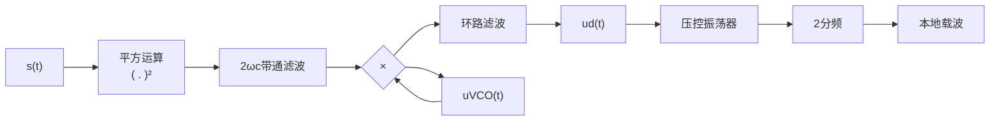
</details>

图 9.3.1 平方环的工作原理图

输入信号 $s(t)$ 经平方运算单元后，得到的输出为

$$
\begin{array}{l} s ^ {2} (t) = \left(\sum_ {n = - \infty} ^ {\infty} a _ {n} g _ {T} (t - n T _ {\mathrm{S}}) \cos \omega_ {\mathrm{c}} t\right) ^ {2} = \sum_ {n = - \infty} ^ {\infty} \left(a _ {n} g _ {T} (t - n T _ {\mathrm{S}}) \cos \omega_ {\mathrm{c}} t\right) ^ {2} \tag {9.3.2} \\ = \sum_ {n = - \infty} ^ {\infty} a ^ {2} g _ {T} ^ {2} (t - n T _ {\mathrm{S}}) \frac {1}{2} \left(1 + \cos 2 \omega_ {\mathrm{c}} t\right) = \frac {1}{2} a ^ {2} + \frac {1}{2} a ^ {2} \cos 2 \omega_ {\mathrm{c}} t \\ \end{array}
$$

其中第二个等号成立是因为每个符号脉冲 $a_{n}g_{T}(t - nT_{\mathrm{S}})\cos \omega_{\mathrm{c}}t$ 时间上都是不重叠的，第三个等号成立是因为 $a_{n}\in \{-a,a\}$ ，第四个等号成立是因为 $g_{T}^{2}(t - nT_{\mathrm{S}}) = 1$ ， $nT_{\mathrm{S}}\leqslant t < (n + 1)T_{\mathrm{S}}$ ， $-\infty < n < +\infty$ 。

平方运算输出的信号 $s^{2}(t)$ 经过中心频率为 $2\omega_{c}$ 的带通滤波器后，输出为

$$
s _ {2 \omega_ {\mathrm{c}}} (t) = \frac {1}{2} a ^ {2} \cos 2 \omega_ {\mathrm{c}} t \tag {9.3.3}
$$

从形式上看，此时已获得了发送信号载波的两倍频信号，该信号是直接从接收信号中获得的，自然是一个与载波信号频率与相位均锁定的信号。但在接收信号中，混夹有噪声等杂波成分，因此经平方运算和带通滤波后，实际得到的是如下含有噪声与信号交调成分的信号 $s_{2\omega_{c}}^{\prime}(t)=\frac{1}{2}a^{2}\cos2\omega_{c}t+n(t)$ ，它需要经过锁相环这一等效的较为理想的窄带滤波器，才能再生出较为纯净的载波信号。在下面的讨论中，假定锁相环能够有效地抑制环路噪声，因此在讨论中不考虑噪声干扰项 $n(t)$ 。

假定压控振荡器的输出为

$$
u _ {\mathrm{VCO}} (t) = A \sin \left(2 \omega_ {\mathrm{c}} t + 2 \Delta \phi (t)\right) \tag {9.3.4}
$$

$u_{\mathrm{VCO}}(t)$ 与 $s_{2\omega_{\mathrm{c}}}(t)$ 的频率与相位差异综合反映在时变的 $2\Delta \phi (t)$ 项中。经乘法器后得到

$$
\begin{array}{l} u _ {\mathrm{PD}} (t) = s _ {2 \omega_ {\mathrm{c}}} (t) u _ {\mathrm{VCO}} (t) = \frac {1}{2} a ^ {2} \cos 2 \omega_ {\mathrm{c}} t \cdot A \sin \left(2 \omega_ {\mathrm{c}} t + 2 \Delta \phi (t)\right) \tag {9.3.5} \\ = K _ {\mathrm{PD}} \left(\sin (2 \Delta \phi (t)) + \sin \left(4 \omega_ {\mathrm{c}} t + 2 \Delta \phi (t)\right)\right) \\ \end{array}
$$

在分析过程中，将所有的常数项归结为 $K_{PD}$ 。经具有低通特性的环路滤波器后，4次载波项被滤除，得到

$$
u _ {\mathrm{d}} (t) = K _ {\mathrm{d}} \sin (2 \Delta \phi (t)) \tag {9.3.6}
$$

$\Delta\phi(t)$ 与环路滤波器输出的控制电压 $u_{\mathrm{d}}(t)$ 间的关系相应地如图 9.3.2 所示。根据 9.2.2 节的分析可知，平方环的稳定平衡点将出现在 $\Delta\phi = k\pi$ ， $k = 0, \pm1, \pm2, \pm3, \cdots$ 的位置上，此时除非输入的频率或相位有大的变化，否则 $\Delta\phi$ 的值保持为常数。

因为压控振荡器的输出为 $u_{\mathrm{VCO}}(t) = A\cos \left(2\omega_{\mathrm{c}}t + 2\Delta \phi (t)\right)$ , 经二分频电路后, 成为与输入载波信号锁定的本地的载波信号

$$
u _ {\mathrm{L}} (t) = A _ {\mathrm{L}} \cos (\omega_ {\mathrm{c}} t + \Delta \phi) \tag {9.3.7}
$$

比较式（9.3.1）与式（9.3.7），若锁相环工作稳定后 $\Delta\phi$ 落在 k 取 0 或偶数的稳定平衡点上，本地载波信号与输入载波信号同频同相；若锁相环工作稳定后 $\Delta\phi$ 落在 k 取奇数的稳定平衡点上，本地载波信号与输入载波信号频率相同，但相位相差 $180^{\circ}$ 。因为无法判断本地载波信号最终停留在与输入载波的相位差是 $0^{\circ}$ 还是 $180^{\circ}$ 的位置，人们把这种现象称为载波恢复时的相位模糊问题。相位模糊会导致解调得到的二进制基带码元出现 “0” 与 “1” 的相位倒换，相位倒换问题可通过差分编码的方法加以解决。

科斯塔环法 另一种常用的 2PSK 信号的载波恢复方法是所谓的科斯塔环法。科斯塔环的工作原理框图如图 9.3.3 所示。输入的接收信号仍如式（9.3.1）所示，即 $s(t)=x(t)\cos\omega_{c}t=\sum_{n=-\infty}^{\infty}a_{n}g_{T}(t-nT_{S})\cos\omega_{c}t$ ，压控振荡器的输出信号及其 $-90^{\circ}$ 相移的信号可分别表示为

$$
u _ {1} (t) = \cos \left(\omega_ {\mathrm{c}} t + \Delta \phi (t)\right) \tag {9.3.8}
$$

$$
u _ {2} (t) = \sin \left(\omega_ {\mathrm{c}} t + \Delta \phi (t)\right) \tag {9.3.9}
$$


<details>
<summary>text_image</summary>

u_d(Δφ)
-π
O
π
Δφ
</details>

图 9.3.2 平方环的 $u_{\mathrm{d}}(\Delta\phi)$ 变化特性


<details>
<summary>flowchart</summary>

This is a block diagram of a control system for a low-pass filter, showing signal flow from input s(t) through various filters and a pressure control oscillator to output s(t).
</details>

图 9.3.3 科斯塔环的工作原理图

$\Delta\phi(t)$ 是压控振荡器输出与接收信号载波的相差。这两个信号与输入的接收信号分别相乘后，得到

$$
u _ {3} (t) = x (t) \cos \omega_ {\mathrm{c}} t \cos (\omega_ {\mathrm{c}} t + \Delta \phi (t)) = \frac {1}{2} x (t) \left(\cos \Delta \phi (t) + \cos (2 \omega_ {\mathrm{c}} t + \Delta \phi (t))\right) \tag {9.3.10}
$$

$$
u _ {4} (t) = x (t) \cos \omega_ {\mathrm{c}} t \sin (\omega_ {\mathrm{c}} t + \Delta \phi (t)) = \frac {1}{2} x (t) \big (\sin \Delta \phi (t) + \sin (2 \omega_ {\mathrm{c}} t + \Delta \phi (t)) \big) \tag {9.3.11}
$$

两信号分别经过低通滤波器后，得到

$$
u _ {5} (t) = \frac {1}{2} x (t) \cos \Delta \phi (t) \tag {9.3.12}
$$

$$
u _ {6} (t) = \frac {1}{2} x (t) \sin \Delta \phi (t) \tag {9.3.13}
$$

$u_{5}(t)$ 和 $u_{6}(t)$ 相乘后得到

$$
u _ {7} (t) = \frac {1}{2} x (t) \cos \Delta \phi (t) \cdot \frac {1}{2} x (t) \sin \Delta \phi (t) = \frac {1}{8} x ^ {2} (t) \sin 2 \Delta \phi (t) \tag {9.3.14}
$$

假定 $g_{T}(t)$ 是一个门函数, 参见式 (9.3.2) 的分析可知, 有 $x^{2}(t) = a^{2}$ 。显然环路滤波器的输出 $u_{\mathrm{d}}(t)$ 与前面的式 (9.3.6) 有完全相同的形式。因此, 后续的相位锁定工作过程也完全相同。与平方环法一样,科斯塔环法恢复的载波信号也存在相位模糊问题。不难推测, 无论采用何种从 2PSK 信号中提取载波的方法, 都会有相位模糊的问题, 因为 2PSK 信号本身是一种抑制载波的 2ASK 信号, 其中并没有携带确定的载波相位信息。

M 次方环法 平方环法和科斯塔环法解决了 2PSK 信号的载波恢复问题, 这两种方法都利用了其中对基带信号的求平方的运算 $x^{2}(t)$ , 以消除 2PSK 信号中两种不同符号对应的载波相位 $180^{\circ}$ 的跳变。一般地, 要从 MPSK 信号中提取同步的载波信号, 需要消除 MPSK 信号中 $M$ 种不同符号间的相位跳变, 这需要 $M$ 次方环法来实现。 $M$ 次方环的锁相原理如图 9.3.4 所示, 其结构与平方环法完全相同, 所不同的是, 平方运算换成了 $M$ 次方运算, 带通滤波器的中心频率变为了 $M \omega_{\mathrm{c}}$ , 压控振荡器经二分频输出变成了 $M$ 分频输出。一般地, MPSK 信号可以表示为

$$
s _ {\mathrm{MPSK}} (t) = A \cos \left(\omega_ {\mathrm{c}} t + (m - 1) \frac {2 \pi}{M} + \phi_ {0}\right), m = 1, 2, \dots , M \tag {9.3.15}
$$


<details>
<summary>flowchart</summary>

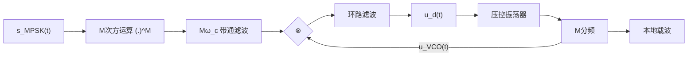
</details>

图 9.3.4 M 次方环的工作原理图

由三角函数中基本关系式

$$
2 \cos \alpha \cos \beta = \cos (\alpha + \beta) + \cos (\alpha - \beta) \tag {9.3.16}
$$

可以推断, 将余弦函数 $\cos\varphi$ 的 M 次方 $(\cos\varphi)^{M}$ 展开后, 一定包含有 $\cos(M\varphi)$ 项。因此, 输入信号 $s_{\mathrm{MPSK}}(t)$ 经 M 次方运算单元后, 得到

$$
s _ {\mathrm{MPSK}} ^ {M} (t) = K _ {M} \cos \left(M \left(\omega_ {\mathrm{c}} t + (m - 1) \frac {2 \pi}{M} + \phi_ {0}\right)\right) + \mathrm{其他项} \tag {9.3.17}
$$

经中心频率为 $M\omega_{c}$ 的窄带滤波器后，滤除了上式中的其他项，得到锁相环基准输入信号

$$
\begin{array}{l} s _ {\mathrm{B}} (t) = K _ {M} \cos \left(M (\omega_ {\mathrm{c}} t + (m - 1) \frac {2 \pi}{M} + \phi_ {0})\right) \tag {9.3.18} \\ = K _ {M} \cos \left(M \omega_ {\mathrm{c}} t + (m - 1) 2 \pi + M \phi_ {0}\right) = K _ {M} \cos (M \omega_ {\mathrm{c}} t + M \phi_ {0}) \\ \end{array}
$$

注意到此时在 $s_{\mathrm{B}}(t)$ 中消去了原来 $s_{\mathrm{MPSK}}(t)$ 信号中的相位随机（随携带信息）变化部分 $(m-1)2\pi/M$ 。选择合理的压控振荡器的电路参数，使其振荡在 $M\omega_{c}t$ 附近，可得压控振荡器的输出为

$$
s _ {\mathrm{VCO}} (t) = K _ {0} \sin \left(M \omega_ {\mathrm{c}} t + M \phi_ {0} + M \Delta \phi (t)\right) \tag {9.3.19}
$$

其中 $s_{\mathrm{VCO}}(t)$ 与 $s_{\mathrm{B}}(t)$ 的相位差部分全部归入 $M\Delta \phi (t)$ 。由此可得乘法器的输出为

$$
u _ {\mathrm{PD}} (t) = K _ {\mathrm{PD}} \left(\sin (M \Delta \phi (t)) + \sin (2 M \omega_ {\mathrm{c}} t + 2 M \phi_ {0} + M \Delta \phi (t))\right) \tag {9.3.20}
$$

经具有低通特性的环路滤波器，得到

$$
u _ {\mathrm{d}} (t) = K _ {\mathrm{d}} \sin (M \Delta \phi (t)) \tag {9.3.21}
$$

$u_{\mathrm{d}}(t)$ 随相位的变化特性如图 9.3.5 所示。根据前面有关稳定平衡点的分析可知，M 次方环的稳定平衡


<details>
<summary>line</summary>

| Point | \(\Delta\phi\) | \(ud(\Delta\phi)\) |
| --- | --- | --- |
| 1 | 0 | 0 |
| 2 | 0 | 0 |
| 3 | 0 | 0 |
| 4 | 0 | 0 |
| 5 | 0 | 0 |
| 6 | 0 | 0 |
| 7 | 0 | 0 |
| 8 | 0 | 0 |
| 9 | 0 | 0 |
| 10 | 0 | 0 |
| 11 | 0 | 0 |
| 12 | 0 | 0 |
| 13 | 0 | 0 |
| 14 | 0 | 0 |
| 15 | 0 | 0 |
| 16 | 0 | 0 |
| 17 | 0 | 0 |
| 18 | 0 | 0 |
| 19 | 0 | 0 |
| 20 | 0 | 0 |
| 21 | 0 | 0 |
| 22 | 0 | 0 |
| 23 | 0 | 0 |
| 24 | 0 | 0 |
| 25 | 0 | 0 |
| 26 | 0 | 0 |
| 27 | 0 | 0 |
| 28 | 0 | 0 |
| 29 | 0 | 0 |
| 30 | 0 | 0 |
| 31 | 0 | 0 |
| 32 | 0 | 0 |
| 33 | 0 | 0 |
| 34 | 0 | 0 |
| 35 | 0 | 0 |
| 36 | 0 | 0 |
| 37 | 0 | 0 |
| 38 | 0 | 0 |
| 39 | 0 | 0 |
| 40 | 0 | 0 |
| 41 | 0 | 0 |
| 42 | 0 | 0 |
| 43 | 0 | 0 |
| 44 | 0 | 0 |
| 45 | 0 | 0 |
| 46 | 0 | 0 |
| 47 | 0 | 0 |
| 48 | 0 | 0 |
| 49 | 0 | 0 |
| 50 | 0 | 0 |
</details>

图 9.3.5 M 次方环的 $u_{\mathrm{d}}(\Delta\phi)$ 变化特性

点将落在 $\Delta\phi=0,\pm2\pi/M,\pm2\times2\pi/M,\cdots,\pm k\times2\pi/M,\cdots$ ，考虑到正弦函数 $\sin(\cdot)$ 的周期性，在这些平衡点中，独立的稳定平衡点总共有 M 个：

$$
\Delta \phi = 0, \frac {2 \pi}{M}, 2 \frac {2 \pi}{M}, \dots , k \frac {2 \pi}{M}, \dots , (M - 1) \frac {2 \pi}{M} \tag {9.3.22}
$$

因为M次方环压控振荡器最终锁定在具体哪个平衡点上实际上无法确定，M次方环压控振荡器的输出经分频后得到的本地载波信号 $u_{\mathrm{L}}(t)=A_{\mathrm{L}}\cos(\omega_{\mathrm{c}}t+\Delta\phi)$ 存在M重的相位模糊问题。

采用具有相位模糊的本地载波信号对MPSK信号进行相关或相干解调时，会导致星座图的旋转，使符号的判决发生错误。若

原来发送的MPSK信号由式（9.3.15）表示，为分析简单起见，不妨假定 $\phi_0 = 0$ ，即有

$$
s _ {\mathrm{MPSK}} (t) = A \cos (\omega_ {\mathrm{c}} t + \phi_ {m}), \phi_ {m} = (m - 1) \frac {2 \pi}{M}, m = 1, 2, \dots , M \tag {9.3.23}
$$

若恢复的本地载波信号为 $u_{\mathrm{L}}(t) = A_{\mathrm{L}}\cos (\omega_{\mathrm{c}}t + \Delta \phi)$ ， $u_{\mathrm{L}}(t)$ 移相 $90^{\circ}$ 后的信号为 $\hat{u}_{\mathrm{L}}(t) = A_{\mathrm{L}}\sin (\omega_{\mathrm{c}}t + \Delta \phi)$ 不妨设 $A_{\mathrm{L}} = 1$ ，则

$$
\begin{array}{l} s _ {\mathrm{MPSK}} (t) u _ {\mathrm{L}} (t) = A \cos (\omega_ {\mathrm{c}} t + \phi_ {m}) \cdot \cos (\omega_ {\mathrm{c}} t + \Delta \phi) \\ = A \left(\cos \phi_ {m} \cos \omega_ {\mathrm{c}} t - \sin \phi_ {m} \sin \omega_ {\mathrm{c}} t\right) \left(\cos \Delta \phi \cos \omega_ {\mathrm{c}} t - \sin \Delta \phi \sin \omega_ {\mathrm{c}} t\right) \\ = A \Big (\cos \phi_ {m} \cos \Delta \phi \cos^ {2} \omega_ {\mathrm{c}} t - \cos \phi_ {m} \sin \Delta \phi \cos \omega_ {\mathrm{c}} t \sin \omega_ {\mathrm{c}} t - \sin \phi_ {m} \cos \Delta \phi \sin \omega_ {\mathrm{c}} t \cos \omega_ {\mathrm{c}} t + \sin \phi_ {m} \sin \Delta \phi \sin^ {2} \omega_ {\mathrm{c}} t \Big) \tag {9.3.24} \\ \begin{array}{l} = A \Big (\cos \phi_ {m} \cos \Delta \phi \cdot \frac {1}{2} (1 + \cos 2 \omega_ {\mathrm{c}} t) - \cos \phi_ {m} \sin \Delta \phi \cdot \frac {1}{2} \sin 2 \omega_ {\mathrm{c}} t - \\ \sin \phi_ {m} \cos \Delta \phi \cdot \frac {1}{2} \sin 2 \omega_ {\mathrm{c}} t + \sin \phi_ {m} \sin \Delta \phi \cdot \frac {1}{2} (1 - \cos 2 \omega_ {\mathrm{c}} t) \Big) \end{array} \\ \end{array}
$$

经低通滤波器后，2次谐波项被滤除，得到 $\frac{A}{2}\left(\cos\phi_{m}\cos\Delta\phi+\sin\phi_{m}\sin\Delta\phi\right)$ ，同理有

$$
s _ {\mathrm{MPSK}} (t) \hat {u} _ {\mathrm{L}} (t) = A \cos (\omega_ {\mathrm{c}} t + \phi_ {m}) \cdot (- 1) \sin (\omega_ {\mathrm{c}} t + \Delta \phi) \tag {9.3.25}
$$

经低通滤波器后，2次谐波项被滤除，得到 $-\frac{A}{2}(\cos\phi_{m}\sin\Delta\phi-\sin\phi_{m}\cos\Delta\phi)$ 。

(1) 若 $\Delta\phi=0$ ，则有

$$
I = \frac {A}{2} \cos \phi_ {m}, \quad Q = \frac {A}{2} \sin \phi_ {m} \tag {9.3.26}
$$

此时可以正确地恢复由 $\phi_{m}$ 确定的相位星座点，并正确地解调。

(2) 若 $\Delta\phi \neq 0$ ，则有

$$
\hat {I} = \frac {A}{2} (\cos \phi_ {m} \cos \Delta \phi + \sin \phi_ {m} \sin \Delta \phi), \quad \hat {Q} = \frac {A}{2} (- \cos \phi_ {m} \sin \Delta \phi + \sin \phi_ {m} \cos \Delta \phi) \tag {9.3.27}
$$

即由于 $\Delta\phi \neq 0$ 的影响，整个星座图旋转了角度 $\Delta\phi$ 。相位模糊意味着我们并不知道确切的 $\Delta\phi$ 取值，如果按照原来的角度判决区域进行判决的话，显然会造成判决的错误。图 9.3.6 描述了相位旋转 $\Delta\phi = 45^{\circ}$ 的情形，此时 8PSK 信号的每个符号都旋转了 $45^{\circ}$ 。如果根据原来的相位判决区域进行判决，原来发送的符号 $S_{1}$ 就会被误判为 $S_{2}$ 。

  
图9.3.6 $\Delta \phi = 0^{\circ}$ 与 $\Delta \phi = 45^{\circ}$ 的解调星座图

为避免相位模糊对判决造成影响，在调制载波生成 MPSK 信号时，也需要进行差分编码。在采用差分编码后，可根据前后两个符号的相位差来判定传输的信息码组，这样，尽管本地恢复的载波有相位模糊问题，但也不会影响符号的最终判决结果。

类似地，对应MPSK信号，也有所谓的 $M$ 相科斯塔环，采用科斯塔环法的特点是系统只需要采用低通滤波器，不需要采用带通滤波器，但这种结构的锁相环通常需要较多的乘法器和移项电路，具体结构可参考有关的文献[3]。

QAM 信号的载波恢复方法 前面讨论的多进制移相键控（MPSK）信号，其星座点均匀地分布在相幅平面的圆周上，因此可以采用 M 次方电路和窄带滤波器消除调制信息对载波信号提取的影响。但对于正交调幅键控（QAM）信号的不同星座点，除了可能有相位变化，还可能有幅度变化，通常需要采用结合数字基带信号处理的方法来实现载波恢复。下面以 16QAM 信号为例，定性地讨论 QAM 信号的载波恢复方法。

(1) 向量点扣除法 16QAM 的星座图如图 9.3.7(a) 所示，在这些星座点中包含两大类，其中一类满足条件 $\left|I_{k}\right|=\left|Q_{k}\right|$ ；另一类则有 $\left|I_{k}\right|\neq\left|Q_{k}\right|$ 。满足条件 $\left|I_{k}\right|=\left|Q_{k}\right|$ 的星座点对应 4 个均匀分布的相位，这是环路希望跟踪锁定的相位，如果能够分离出这一类符号，就可以综合利用 9.2.2 节中提及的间歇校正的思想，结合前面讨论过的 MPSK（此时 M=4）信号载波提取的方法，获得输入信号的载波。


<details>
<summary>text_image</summary>

Q
|I_k|≠|Q_k|
|I_k|=|Q_k|
I
O
</details>

(a)


<details>
<summary>flowchart</summary>

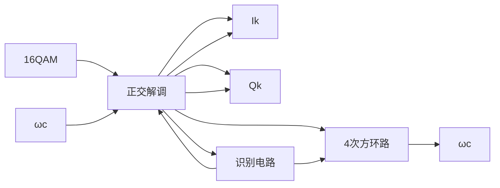
</details>

(b)  
图9.3.7 (a)16QAM的星座图；(b)向量扣除法原理图

图 9.3.7(b) 给出了一个向量扣除法的 QAM 信号载波恢复法的原理图, 它包含了识别电路、扣除电路和 4 次方环路等主要功能模块。其中识别电路用于判断当前的码元符号 $\left|I_{k}\right|$ , $\left|Q_{k}\right|$ 取值差异的大小, 如果相差较大, 判定不属于 $\left|I_{k}\right|=\left|Q_{k}\right|$ 类别的码元, 识别电路发出扣除命令, 不允许该符号进入鉴相环路; 如果 $\left|I_{k}\right|\approx\left|Q_{k}\right|$ , 则让该码元进入锁相环路, 提取其中的相位信息。4 次方环路会有四重的相位模糊问题, 这可以通过定期发送训练序列等方法来加以校正。

(2) 通用载波恢复环 仔细观察图 9.3.7(a) 所示的 16QAM 的星座图, 可以发现如果发送每个码元符号等概, 在相幅平面的每个象限上相位的统计平均值均应指向该象限的对角线位置。即从统计上说, 16QAM 信号有 $45^{\circ}, 135^{\circ}, 225^{\circ}$ 和 $315^{\circ}$ 四个相位。通用载波恢复环法根据统计的原理, 可以利用每个符号携带的载波的统计相位信息, 获得比向量点扣除法更好的载波跟踪效果, 有关通用载波恢复环法工作原理的详细分析, 可参见参考文献[4]。

## 9.3.2 插入导频法

顾名思义，所谓插入导频法，是指在发送携带信息的已调信号时，在信号中加入信号的载波信息，具体实现过程如图9.3.8(a)所示，相应的发送信号的频谱特性则如图9.3.8(b)所示。接收端可通过窄带滤波器，从接收信号中分离出导频信号，经过放大和移项等处理后，成为本地的载波信号，用于对接收信号进行相干或相关解调，其过程如图9.3.8(c)所示。


<details>
<summary>flowchart</summary>

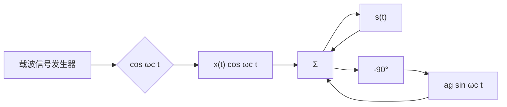
</details>

(a) 导频插入


<details>
<summary>text_image</summary>

S(ω)
导频信号
ωc
O
</details>

(b) 信号频谱


<details>
<summary>flowchart</summary>

This diagram illustrates a signal processing system involving a narrowband filter and a low-pass filter, showing the signal flow from input s(t) through various processing stages including frequency conversion and phase shift.
</details>

(c) 载波获取与相干解调  
图 9.3.8 插入导频法

假如已调信号记为 $x(t)\cos\omega_{c}t$ ，其中 $x(t)$ 是调制载波的基带信号，在插入导频后的发送信号可记为

$$
s (t) = x (t) \cos \omega_ {\mathrm{c}} t + g (t) = x (t) \cos \omega_ {\mathrm{c}} t - a _ {g} \sin \omega_ {\mathrm{c}} t \tag {9.3.28}
$$

其中的导频信号 $g(t) = -a_{g} \sin \omega_{c} t$ 与载波信号频率相同，且与载波信号 $\cos \omega_{c} t$ 有 $90^{\circ}$ 的固定相位差。之所以要采用与载波 $\cos \omega_{c} t$ 有 $90^{\circ}$ 相位差的导频信号，是因为在接收端利用移项后的导频信号对信号进行解调时，有

$$
s (t) \cos \omega_ {\mathrm{c}} t = (x (t) \cos \omega_ {\mathrm{c}} t - a _ {g} \sin \omega_ {\mathrm{c}} t) \cos \omega_ {\mathrm{c}} t = \frac {1}{2} x (t) + \frac {1}{2} \cos 2 \omega_ {\mathrm{c}} t - \frac {a _ {g}}{2} \sin 2 \omega_ {\mathrm{c}} t \tag {9.3.29}
$$

其中生成的二次谐波项很容易通过低通滤波器滤除。而如果导频信号与载波 $\cos\omega_{c}t$ 完全相同，如 $g(t)=a_{g}\cos\omega_{c}t$ ，则对信号进行解调时，有

$$
s (t) \cos \omega_ {\mathrm{c}} t = (x (t) \cos \omega_ {\mathrm{c}} t - a _ {\mathrm{g}} \cos \omega_ {\mathrm{c}} t) \cos \omega_ {\mathrm{c}} t = \frac {1}{2} x (t) + \frac {1}{2} \cos 2 \omega_ {\mathrm{c}} t - \frac {a _ {\mathrm{g}}}{2} - \frac {a _ {\mathrm{g}}}{2} \cos 2 \omega_ {\mathrm{c}} t \tag {9.3.30}
$$

即会产生附加的常数项 $a_{g}/2$ ，该常数项无法与二次谐波项同时滤除。

为使导频信号不受调制信号 $x(t)\cos\omega_{c}t$ 的影响，易于通过窄带滤波器提取，通常要合理地选择调制载波的基带信号的脉冲波形，使其在 0 频附近的分量很小，以便于导频信号的提取。另外，通过 9.2 节中有关锁相环的讨论可知，锁相环本身可视为一个理想的窄带滤波器，从包含有插入导频的接收信号中，提取出混合有噪声和部分信号干扰的导频信号后，送入锁相环路，可以获得具有较高质量的本地载波信号。导频信号中未包含调制的信息，因此再生的本地载波信号一般没有相位模糊问题。

由于导频信号本身不携带用户信息，如果总的发送信号功率值一定，那么导频法会使携带信息信号的功率受到一定的削弱，信噪比会有一定的下降。导频信号的幅度相位是恒定的，因此接收端提取的导频信号不仅可用于同步，也常用于信道估计与均衡。一个通信系统采用导频信号方式是否有利，往往要视具体情况而定。

## 9.3.3 载波相位的似然估计法\*

载波相位的最大似然估计 随着计算机和数字信号处理器在通信系统中的广泛应用，在越来越多的场合，信号的接收不再是由一个个特定功能的硬件模块组成的系统来实现，而是由采样获得的样值，通过软件的算法来完成。随着运算速度的提高，接收信号处理从基带延伸到中频，甚至射频。本节讨论在含有噪声的环境下，如何用计算的方法来估计载波的相位及跟踪其变化。

若调制载波的基带信号引入复基带信号表示方式, 则有 $x(t) = x_{I}(t) + \mathrm{j}x_{Q}(t)$ , 调制载波的输出信号可以表示为 $s(t) = \mathrm{Re}\left(x(t)\mathrm{e}^{\mathrm{j}\omega_{\mathrm{c}}t}\right)$ 。对于接收端来说, 除了发收双方约定的载波的标称值, 发送信号准确的载波和相位值实际上是未知的。若将本地载波和相位与接收信号载波和相位的差异归结到一个时变的相位项 $\phi_{\mathrm{c}}(t)$ 中, 同时考虑到接收信号中加性噪声的影响, 则接收信号可表示为

$$
r (t) = \mathrm{Re} \left(x (t) \mathrm{e} ^ {\mathrm{j} \phi_ {\mathrm{c}} (t)} \mathrm{e} ^ {\mathrm{j} \omega_ {\mathrm{c}} t}\right) + n (t) = s \left(t, \phi_ {\mathrm{c}} (t)\right) + n (t) \tag {9.3.31}
$$

假定 $\left\{\Psi_{k}(t),k=1,2,\cdots,N\right\}$ 是信号空间的一组标准的正交基函数，由第2章的分析可知 $r(t)$ 可以表示为

$$
r (t) = \sum_ {k = 1} ^ {N} r _ {k} \Psi_ {k} (t), \quad r _ {k} = \int_ {0} ^ {T} \Psi_ {k} (t) r (t) \mathrm{d} t \tag {9.3.32}
$$

$$
s \left(t, \phi_ {\mathrm{c}} (t)\right) = \sum_ {k = 1} ^ {N} s _ {k} \left(\phi_ {\mathrm{c}}\right) \Psi_ {k} (t), \quad s _ {k} \left(\phi_ {\mathrm{c}}\right) = \int_ {0} ^ {T} \Psi_ {k} (t) s \left(t, \phi_ {\mathrm{c}} (t)\right) \mathrm{d} t \tag {9.3.33}
$$

式中 $k=1,2,\cdots,N$ 。给定标准的正交基函数后， $r(t)$ 完全由向量 $\boldsymbol{r}=\left(r_{1},r_{2},\cdots,r_{N}\right)$ 确定。其中分量 $r_{k}$ 与 $s_{k}(\phi_{\mathrm{c}})$ 之间有如下关系：

$$
r _ {k} = \int_ {0} ^ {T} \Psi_ {k} (t) r (t) \mathrm{d} t = \int_ {0} ^ {T} \Psi_ {k} (t) s (t, \phi_ {\mathrm{c}} (t)) \mathrm{d} t + \int_ {0} ^ {T} \Psi_ {k} (t) n (t) \mathrm{d} t = s _ {k} (\phi_ {\mathrm{c}}) + n _ {k} \tag {9.3.34}
$$

式中 $n_{k}$ 是噪声干扰项。若 $n(t)$ 是高斯白噪声，则 $n_{k}, k=1,2,\cdots,N$ 是独立的高斯随机变量。由式(9.3.34)，信号载波相位 $\phi_{c}$ 的似然函数可以表示为

$$
p (\boldsymbol {r} \mid \phi_ {\mathrm{c}}) = \left(\frac {1}{\sqrt {2 \pi} \sigma_ {\mathrm{n}}}\right) ^ {N} \exp \left(- \frac {1}{2 \sigma_ {\mathrm{n}} ^ {2}} \sum_ {k = 1} ^ {N} \left(r _ {k} - s _ {k} \left(\phi_ {\mathrm{c}}\right)\right) ^ {2}\right) \tag {9.3.35}
$$

若根据最大似然法来估计载波的相位，上式中的常系数项可以忽略，即有

$$
\max p \left(\boldsymbol {r} \mid \phi_ {\mathrm{c}}\right) \leftrightarrow \max \exp \left(- \frac {1}{2 \sigma_ {\mathrm{n}} ^ {2}} \sum_ {k = 1} ^ {N} \left(r _ {k} - s _ {k} \left(\phi_ {\mathrm{c}}\right)\right) ^ {2}\right) \tag {9.3.36}
$$

以 $r(t) = \sum_{k=1}^{N} r_k \Psi_k(t)$ ， $s(t, \phi_c(t)) = \sum_{k=1}^{N} s_k(\phi_c) \Psi_k(t)$ 代入下式中的左式，可得

$$
\int_ {0} ^ {T} (r (t) - s (t, \phi_ {\mathrm{c}} (t))) ^ {2} \mathrm{d} t = \sum_ {k = 1} ^ {N} \left(r _ {k} - s _ {k} \left(\phi_ {\mathrm{c}}\right)\right) ^ {2} \tag {9.3.37}
$$

另外，式（9.3.36）中的 $\sigma_{n}^{2}$ 是噪声分量 $n_{k}=r_{k}-s_{k}(\phi_{c})=\int_{0}^{T}\Psi_{k}(t)n(t)dt$ 的方差，参见第6章中式（6.2.44）的分析，对于标准正交基函数，在一个符号周期 T 内， $\Psi_{k}(t)$ 的能量 $E_{\psi_{i}}=1$ ，因此 $\sigma_{n}^{2}=E_{\psi_{i}}N_{0}/2=N_{0}/2$ 。
因此又有

$$
\max p \left(\boldsymbol {r} \mid \phi_ {\mathrm{c}}\right) \leftrightarrow \max \exp \left(- \frac {1}{N _ {0}} \int_ {0} ^ {T} (r (t) - s (t, \phi_ {\mathrm{c}} (t))) ^ {2} \mathrm{d} t\right) \leftrightarrow \min \int_ {0} ^ {T} (r (t) - s (t, \phi_ {\mathrm{c}} (t))) ^ {2} \mathrm{d} t \tag {9.3.38}
$$

将式（9.3.38）中的 $\int_0^T (r(t) - s(t,\phi_c(t)))^2\mathrm{d}t$ 展开得

$$
\int_ {0} ^ {T} (r (t) - s (t, \phi_ {\mathrm{c}} (t))) ^ {2} \mathrm{d} t = \int_ {0} ^ {T} r ^ {2} (t) \mathrm{d} t - 2 \int_ {0} ^ {T} r (t) s (t, \phi_ {\mathrm{c}} (t)) \mathrm{d} t + \int_ {0} ^ {T} s ^ {2} (t, \phi_ {\mathrm{c}} (t)) \mathrm{d} t \tag {9.3.39}
$$

由式（9.3.31），可知上式的第一项

$$
\begin{array}{l} \int_ {0} ^ {T} r ^ {2} (t) \mathrm{d} t = \int_ {0} ^ {T} \left(s \left(t, \phi_ {\mathrm{c}} (t)\right) + n (t)\right) ^ {2} \mathrm{d} t \tag {9.3.40} \\ = \int_ {0} ^ {T} s ^ {2} (t, \phi_ {\mathrm{c}} (t)) \mathrm{d} t + 2 \int_ {0} ^ {T} s (t, \phi_ {\mathrm{c}} (t)) n (t) \mathrm{d} t + \int_ {0} ^ {T} n ^ {2} (t) \mathrm{d} t \\ \end{array}
$$

上式中的 $\int_{0}^{T} s^{2}(t, \phi_{\mathrm{c}}(t)) \mathrm{d}t$ 与式（9.3.39）中的第三项一样，是一个码元的能量，其值与 $\phi_{\mathrm{c}}$ 的取值无关；信号与噪声不相关，因此式中的第二项 $\int_{0}^{T} s(t, \phi_{\mathrm{c}}(t)) n(t) \mathrm{d}t = 0$ ；第三项 $\int_{0}^{T} n^{2}(t) \mathrm{d}t$ 是噪声在观测时间 $T$ 内的能量，显然与 $\phi_{\mathrm{c}}$ 的取值无关。由此可见在式（9.3.39）中，只有第二项 $2 \int_{0}^{T} r(t) s(t, \phi_{\mathrm{c}}(t)) \mathrm{d}t$ 与 $\phi_{\mathrm{c}}$ 的取值有关。去除式（9.3.38）中与 $\phi_{\mathrm{c}}$ 无关的项， $\phi_{\mathrm{c}}$ 的最大似然估计归结为

$$
\max p (\boldsymbol {r} \mid \phi_ {\mathrm{c}}) \leftrightarrow \max \int_ {0} ^ {T} r (t) s (t, \phi_ {\mathrm{c}} (t)) \mathrm{d} t \tag {9.3.41}
$$

在某个小的时间段内进行载波相位 $\phi_{\mathrm{c}}(t)$ 的估计时，通常可将 $\phi_{\mathrm{c}}(t)$ 近似地视为与时间无关的变量 $\phi_{c}$ 。下面通过一个例子来说明如何求解 $\phi_{c}$ 的最大似然值 $\phi_{ML}$ 。

【例 9.3.1】某通信系统在传输信息前，先行发送一段未经调制的载波 $s_{T}(t)=A\cos(\omega_{\mathrm{c}}t+\phi_{\mathrm{c}})$ 作为接收端用于相位估计的训练信号。接收端收到的信号为 $r(t)=A\cos(\omega_{\mathrm{c}}t+\phi_{\mathrm{c}})+n(t)$ ，求关于相位 $\phi_{c}$ 的最大似然估计 $\phi_{ML}$ 。

解：由式（9.3.41），记 $\Lambda(\phi_{\mathrm{c}})=\int_{0}^{T}r(t)s(t,\phi_{\mathrm{c}})\mathrm{d}t=\int_{0}^{T}r(t)A\cos(\omega_{\mathrm{c}}t+\phi_{\mathrm{c}})\mathrm{d}t$ 。根据 $\Lambda(\phi_{\mathrm{c}})$ 取最大值的必要条件，令

$$
\frac {\partial \Lambda (\phi_ {\mathrm{c}})}{\partial \phi_ {\mathrm{c}}} = \frac {\partial}{\partial \phi_ {\mathrm{c}}} \int_ {0} ^ {T} r (t) A \cos (\omega_ {\mathrm{c}} t + \phi_ {\mathrm{c}}) \mathrm{d} t = - \int_ {0} ^ {T} r (t) A \sin (\omega_ {\mathrm{c}} t + \phi_ {\mathrm{c}}) \mathrm{d} t = 0
$$

由 $\int_{0}^{T}r(t)A\sin(\omega_{\mathrm{c}}t+\phi_{\mathrm{c}})\mathrm{d}t=A\int_{0}^{T}r(t)(\sin\omega_{\mathrm{c}}t\cos\phi_{\mathrm{c}}+\cos\omega_{\mathrm{c}}t\sin\phi_{\mathrm{c}})\mathrm{d}t=0$ ，得 $\frac{\sin\phi_{c}}{\cos\phi_{c}}=-\frac{\int_{0}^{T}r(t)\sin\omega_{c}t\mathrm{d}t}{\int_{0}^{T}r(t)\cos\omega_{c}t\mathrm{d}t}$ ，由此可得最大似然估计 $\phi_{ML}$ 为

$$
\phi_ {\mathrm{ML}} = \phi_ {\mathrm{c}} = \arctan \left(\frac {\sin \phi_ {\mathrm{c}}}{\cos \phi_ {\mathrm{c}}}\right) = - \arctan \left(\frac {\int_ {0} ^ {T} r (t) \sin \omega_ {\mathrm{c}} t \mathrm{d} t}{\int_ {0} ^ {T} r (t) \cos \omega_ {\mathrm{c}} t \mathrm{d} t}\right) \square
$$

在许多情况下，最大似然值 $\phi_{ML}$ 可能没有显式的表达形式。但求最大值的运算总可以用数值计算的方法实现。例如，可设估计精度 $\left|\phi_{c}-\phi_{ML}\right|\leqslant\phi_{\delta}$ ，在 $-\pi\leqslant\phi_{c}\leqslant\pi$ 范围内，以 $\phi_{\delta}$ 为步长，令 $\phi_{c}^{\prime}=\pm k\phi_{\delta}$ ， $k=0,1,2,\cdots,\left\lfloor\pi/\phi_{\delta}\right\rfloor$ ， $\left\lfloor\cdot\right\rfloor$ 表示取整数。通过遍历的方法，搜索 $\int_{0}^{T}r(t)s(t,\phi_{c})dt$ 的最大值，达到最大值时对应的 $\phi_{c}^{\prime}$ 就是其最大似然解 $\phi_{ML}$ 。

面向判决环的最大似然估计 式（9.3.41）给出的最大似然估计，适合 $s(t,\phi_{c})$ 表达形式确知、只有相位 $\phi_{c}$ 未知时的情形。在数字通信系统中，通常信息的传输是以帧为单位的，在每一帧的开头，会发送一串训练序列，训练序列是在通信协议中约定的，因此发收双方都已知该序列符号值。假定发收双方约定的 M 位训练序列为 $\left\{a_{k}\right\}_{k=1}^{M}$ 。则接收到的由训练序列调制的信号为

$$
r (t) = s (t, \phi_ {\mathrm{c}}) + n (t) = \sum_ {k = 1} ^ {M} a _ {k} g _ {T} (t - k T) \cos (\omega_ {\mathrm{c}} t + \phi_ {\mathrm{c}}) + n (t) \tag {9.3.42}
$$

式中 $\phi_{c}$ 是接收端未知的载波相位， $n(t)$ 是高斯白噪声。代入式（9.3.41），得相应的似然函数为

$$
\Lambda (\phi_ {\mathrm{c}}) = \int_ {0} ^ {T} r (t) s (t, \phi_ {\mathrm{c}} (t)) \mathrm{d} t = \int_ {0} ^ {T} r (t) \left(\sum_ {k = 1} ^ {M} a _ {k} g _ {T} (t - k T) \cos (\omega_ {\mathrm{c}} t + \phi_ {\mathrm{c}})\right) \mathrm{d} t \tag {9.3.43}
$$

参见例9.3.1的分析，令 $\frac{\partial\Lambda(\phi_c)}{\partial\phi_c} = 0$ ，可得相位的最大似然估计值为

$$
\phi_ {\mathrm{ML}} = - \arctan \left(\frac {\int_ {0} ^ {T} r (t) \sum_ {k = 1} ^ {M} a _ {k} g _ {T} (t - k T) \sin \omega_ {\mathrm{c}} t \mathrm{d} t}{\int_ {0} ^ {T} r (t) \sum_ {k = 1} ^ {M} a _ {k} g _ {T} (t - k T) \cos \omega_ {\mathrm{c}} t \mathrm{d} t}\right) \tag {9.3.44}
$$

在上式中，若载波的频率 $\omega_{c}$ 很高，在计算机或处理器中做积分的数值运算时计算会较为复杂。似然估计也可以在基带中进行，即先根据解调后从基带信号提取的有关载波相位的信息，对本地的载波相位进行调整。接收信号的等效基带信号可以表示为

$$
r _ {\mathrm{L}} (t) = \sum_ {k = 1} ^ {M} a _ {k} g _ {T} (t - k T) \mathrm{e} ^ {- \mathrm{j} \phi_ {\mathrm{c}}} + n _ {\mathrm{L}} (t) = s _ {\mathrm{L}} (t) \mathrm{e} ^ {- \mathrm{j} \phi_ {\mathrm{c}}} + n _ {\mathrm{L}} (t) \tag {9.3.45}
$$

$\phi_{c}$ 是接收端未知的载波相位， $n_{L}(t)$ 是高斯白噪声。 $r_{L}(t)$ 实际上就是解调后的基带信号。相应的似然函数为

$$
\begin{array}{l} \Lambda_ {\mathrm{L}} \left(\phi_ {\mathrm{c}}\right) = \operatorname{Re} \left(\int_ {0} ^ {T} r _ {\mathrm{L}} (t) \left(s _ {\mathrm{L}} (t) \mathrm{e} ^ {- \mathrm{j} \phi_ {\mathrm{c}}}\right) ^ {*} \mathrm{d} t\right) = \operatorname{Re} \left(\int_ {0} ^ {T} r _ {\mathrm{L}} (t) s _ {\mathrm{L}} ^ {*} (t) \mathrm{e} ^ {\mathrm{j} \phi_ {\mathrm{c}}} \mathrm{d} t\right) \\ = \operatorname{Re} \left(\int_ {0} ^ {T} r _ {\mathrm{L}} (t) \sum_ {k = 1} ^ {M} a _ {k} ^ {*} g _ {T} ^ {*} (t - k T) \mathrm{e} ^ {\mathrm{j} \phi_ {\mathrm{c}}} \mathrm{d} t\right) \tag {9.3.46} \\ = \operatorname{Re} \left(\mathrm{e} ^ {\mathrm{j} \phi_ {\mathrm{c}}} \sum_ {k = 1} ^ {M} a _ {k} ^ {*} \int_ {0} ^ {T} r _ {\mathrm{L}} (t) g _ {T} ^ {*} (t - k T) \mathrm{d} t\right) = \operatorname{Re} \left(\mathrm{e} ^ {\mathrm{j} \phi_ {\mathrm{c}}} \sum_ {k = 1} ^ {M} a _ {k} ^ {*} y _ {k}\right) \\ = \cos \phi_ {\mathrm{c}} \operatorname{Re} \left(\sum_ {k = 1} ^ {M} a _ {k} ^ {*} y _ {k}\right) + \sin \phi_ {\mathrm{c}} \operatorname{Im} \left(\sum_ {k = 1} ^ {M} a _ {k} ^ {*} y _ {k}\right) \\ \end{array}
$$

式中 $y_{k} = \int_{0}^{T}r_{\mathrm{L}}(t)g_{T}^{*}(t - kT)\mathrm{d}t$ ， $y_{k}$ 是匹配滤波器对训练序列中第 $k$ 个码元的滤波输出。

令

$$
\frac {\partial \Lambda_ {\mathrm{L}} \left(\phi_ {\mathrm{c}}\right)}{\partial \phi_ {\mathrm{c}}} = - \sin \phi_ {\mathrm{c}} \operatorname{Re} \left(\sum_ {k = 1} ^ {M} a _ {k} ^ {*} y _ {k}\right) + \cos \phi_ {\mathrm{c}} \operatorname{Im} \left(\sum_ {k = 1} ^ {M} a _ {k} ^ {*} y _ {k}\right) = 0 \tag {9.3.47}
$$

得最大似然估计的相位值 $\phi_{\mathrm{ML}}$ 为

$$
\phi_ {\mathrm{ML}} = \arctan \left(\frac {\sin \phi_ {\mathrm{c}}}{\cos \phi_ {\mathrm{c}}}\right) = \arctan \frac {\operatorname{Im} \left(\sum_ {k = 1} ^ {M} a _ {k} ^ {*} y _ {k}\right)}{\operatorname{Re} \left(\sum_ {k = 1} ^ {M} a _ {k} ^ {*} y _ {k}\right)} \tag {9.3.48}
$$

上述基于训练序列的估计方法就是所谓的面向判决环的最大似然估计。

非面向判决环的最大似然估计 通过未调制的载波信号或调制的训练序列来进行载波相位的估计，适合间歇进行本地载波调整的工作方式。在一些需要对本地载波相位进行连续调整的场合，需要从包括携带信息的已调信号中获得载波的相位信息，这就是所谓的非面向判决环的最大似然估计。非面向判决环的最大似然估计，需要解决如何消除调制载波的信息对载波相位估计的影响的问题。与QAM信号的载波恢复方法中通用载波恢复环采样的思路类似，此时需要采样统计的方法来获取载波的相位信息。下面通过一个2PSK调制传输系统来加以说明。

接收端收到的 2PSK 信号仍然可由式（9.3.42）表示，此时 $a_{k} \in \{a, -a\}$ 。假定符号序列 $\{a_{k}\}$ 先验等概，即有 $P(a_{k} = a) = 1/2$ ， $P(a_{k} = -a) = 1/2$ ，则在每个符号周期 T 内，似然函数

$$
\Lambda \left(\phi_ {\mathrm{c}}\right) = \exp \left(\frac {1}{N _ {0}} \int_ {0} ^ {T} r (t) s \left(t, \phi_ {\mathrm{c}} (t)\right) \mathrm{d} t\right) = \exp \left(\frac {1}{N _ {0}} \int_ {0} ^ {T} r (t) \left(a _ {k} g _ {T} (t) \cos \left(\omega_ {\mathrm{c}} t + \phi_ {\mathrm{c}}\right)\right) \mathrm{d} t\right) \tag {9.3.49}
$$

其相应的统计平均值为

$$
\begin{array}{l} E \left[ \Lambda \left(\phi_ {\mathrm{c}}\right) \right] = P \left(a _ {k} = a\right) \exp \left(\frac {1}{N _ {0}} \int_ {0} ^ {T} r (t) \left(a g _ {T} (t) \cos \left(\omega_ {\mathrm{c}} t + \phi_ {\mathrm{c}}\right)\right) \mathrm{d} t\right) + \\ P \left(a _ {k} = a\right) \exp \left(\frac {1}{N _ {0}} \int_ {0} ^ {T} r (t) \left(- a g _ {T} (t) \cos \left(\omega_ {\mathrm{c}} t + \phi_ {\mathrm{c}}\right)\right) \mathrm{d} t\right) \\ = \frac {1}{2} \exp \left(\frac {1}{N _ {0}} \int_ {0} ^ {T} r (t) \left(a g _ {T} (t) \cos \left(\omega_ {\mathrm{c}} t + \phi_ {\mathrm{c}}\right)\right) \mathrm{d} t\right) + \tag {9.3.50} \\ \frac {1}{2} \exp \left(\frac {1}{N _ {0}} \int_ {0} ^ {T} r (t) \left(- a g _ {T} (t) \cos \left(\omega_ {\mathrm{c}} t + \phi_ {\mathrm{c}}\right)\right) \mathrm{d} t\right) \\ = \cosh \left(\frac {1}{N _ {0}} \int_ {0} ^ {T} r (t) \left(a g _ {T} (t) \cos \left(\omega_ {\mathrm{c}} t + \phi_ {\mathrm{c}}\right)\right) \mathrm{d} t\right) \\ \end{array}
$$

理论上，可以通过求 $E\left[\Lambda(\phi_{\mathrm{c}})\right]$ 关于 $\phi_{c}$ 的偏导数 $\partial E\left[\Lambda(\phi_{\mathrm{c}})\right]/\partial\phi_{\mathrm{c}}$ 并令其等于零，来求解 $\phi_{ML}$ ，也可以通过遍历搜索的计算方法来获得有关 $\phi_{ML}$ 的数值解。

## 9.4 符号同步

在数字通信系统中，信息是以符号为单元逐个传输的。在接收端，信息的获取也必须以符号为单元逐个地进行。例如在进行相关解调（匹配滤波）时，需要确定起始时刻和周期的大小。这就要求在接收机中要有与接收符号序列同步的时钟信号，与前面讨论的载波频率与相位一样，与发送符号序列同步的时钟信号不能由本地自行产生，必须从接收到的符号序列中提取，这一信号的处理过程就称为符号同步，符号同步也称符号定时、符号同步或位同步等。与载波同步的原理类似，根据发送的符号序列的特征和提取同步的方法的不同，可将其分为直接提取法、插入导频法等，下面分别予以介绍。

## 9.4.1 直接提取法

通常，接收到的符号序列中都没有直接携带符号同步的信息，所谓直接提取法，就是先对符号序列进行某种非线性变换或处理，然后从中提出符号同步信息的方法。在直接提取法中，最典型的方法有线谱法和早迟门法。


<details>
<summary>flowchart</summary>

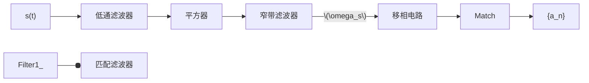
</details>

图 9.4.1 线谱法符号同步原理

线谱法 线谱法的基本原理如图9.4.1所示。设接收的符号序列记为

$$
s (t) = \sum_ {n = - \infty} ^ {\infty} a _ {n} g _ {T} (t - n T) \tag {9.4.1}
$$

式中 $g_{T}(t)$ 是符号的波形函数，T 是符号周期。
为分析简单起见，设符号序列 $\left\{a_{n}\right\}_{n=-\infty}^{\infty}$ 是均值为

零的独立随机序列，即有

$$
E \left[ a _ {n} \right] = 0,   E \left[ a _ {n} a _ {m} \right] = \left\{ \begin{array}{l l} \sigma_ {a} ^ {2}, & n = m \\ 0, & n \neq m \end{array} \right. \tag {9.4.2}
$$

由图 9.4.1，图中平方器处理单元的输出为

$$
\begin{array}{l} s ^ {2} (t) = \left(\sum_ {n = - \infty} ^ {\infty} a _ {n} g _ {T} (t - n T)\right) \left(\sum_ {m = - \infty} ^ {\infty} a _ {m} g _ {T} (t - m T)\right) \tag {9.4.3} \\ = \sum_ {n = - \infty} ^ {\infty} \sum_ {m = - \infty} ^ {\infty} a _ {n} a _ {m} g _ {T} (t - m T) g _ {T} (t - n T) \\ \end{array}
$$

再由式（9.4.2），可得

$$
E \Big [ s ^ {2} (t) \Big ] = \sigma_ {a} ^ {2} \sum_ {n = - \infty} ^ {\infty} g _ {T} ^ {2} (t - n T) \tag {9.4.4}
$$

显然 $s^{2}(t)$ 的统计平均值是周期为 $T_{S}$ 、以波形 $\sigma_{a}^{2}g_{T}^{2}(t)$ 周期性延拓得到的周期函数。因此可将其用傅里叶级数展开得

$$
E \Big [ s ^ {2} (t) \Big ] = \sigma_ {a} ^ {2} \sum_ {n = - \infty} ^ {\infty} g _ {T} ^ {2} (t - n T) = \sum_ {n = - \infty} ^ {\infty} c _ {m} \mathrm{e} ^ {\frac {\mathrm{j} 2 \pi m t}{T}} \tag {9.4.5}
$$

式中的系数 $c_{m}$ 为

$$
\begin{array}{l} c _ {m} = \frac {1}{T _ {\mathrm{S}}} \int_ {0} ^ {T} \sigma_ {a} ^ {2} \sum_ {n = - \infty} ^ {\infty} g _ {T} ^ {2} (t - n T) \mathrm{e} ^ {- \mathrm{j} 2 \pi \frac {m}{T} t} \mathrm{d} t = \frac {\sigma_ {a} ^ {2}}{T} \int_ {0} ^ {T} g _ {T} ^ {2} (t) \mathrm{e} ^ {- \mathrm{j} 2 \pi \frac {m}{T} t} \mathrm{d} t \\ = \frac {\sigma_ {a} ^ {2}}{T} \int_ {0} ^ {T} \left(\int_ {- \infty} ^ {\infty} G (f) \mathrm{e} ^ {\mathrm{j} 2 \pi f t} \mathrm{d} f\right) g _ {T} (t) \mathrm{e} ^ {- \mathrm{j} 2 \pi \frac {m}{T} t} \mathrm{d} t = \frac {\sigma_ {a} ^ {2}}{T} \int_ {- \infty} ^ {\infty} G (f) \int_ {0} ^ {T} g _ {T} (t) \mathrm{e} ^ {- \mathrm{j} 2 \pi (m / T - f) t} \mathrm{d} t \mathrm{d} f \tag {9.4.6} \\ = \frac {\sigma_ {a} ^ {2}}{T} \int_ {- \infty} ^ {\infty} G (f) \int_ {- \infty} ^ {\infty} g _ {T} (t) \mathrm{e} ^ {- \mathrm{j} 2 \pi (m / T - f) t} \mathrm{d} t \mathrm{d} f = \frac {\sigma_ {a} ^ {2}}{T} \int_ {- \infty} ^ {\infty} G (f) G (m / T - f) \mathrm{d} f \\ \end{array}
$$

式中的 $G(f)$ 是 $g_{T}(t)$ 的傅里叶变换。也就是说，从统计的角度，在平方器输出的信号 $s^2 (t)$ 中，只要满足 $\int_{-\infty}^{\infty}G(f)G(m / T - f)\mathrm{d}f\neq 0$ 的条件，就一定包含 $c_{m}\neq 0$ 的频率成分。由此可见，如果希望式（9.4.6）包含基波，即符号的同步信号，则应保证

$$
c _ {1} = \frac {\sigma_ {a} ^ {2}}{T} \int_ {- \infty} ^ {\infty} G (f) G (1 / T - f) \mathrm{d} f \neq 0 \tag {9.4.7}
$$

也就是说，在设计基带信号的波形函数 $g_{T}(t)$ 时，应保证其傅里叶变换 $G(f)$ 与傅里叶变换的折叠平移函数 $G(1 / T - f)$ 有尽可能多的重叠成分，以保证 $c_{1}$ 有足够大的信号幅度。

通常平方器的输出中混杂有噪声成分，如果希望窄带滤波器有理想的窄带滤波特性，该窄带滤波器可用锁相环来替代。图 9.4.1 的移相电路用于获得合适的符号同步定时相位。

早迟门法 早迟门法是另外一种经典的符号同步获取方法，其基本原理如图9.4.2所示。早迟门符号同步电路是由早门、迟门、取绝对值运算、减法器、环路滤波器和压控振荡器等功能模块组成的闭环系统，其中的早门和迟门分别是两个在一个码元周期 $T$ 内，积分区间分别取 $(0, T - d)$ 和 $(d, T)$ 的积分器。

图 9.4.3 以二元的符号为例，分别描述了早迟门控制脉冲波形的两种不同工作情形。


<details>
<summary>flowchart</summary>

```mermaid
graph LR
  s(t) --> DelayGate["迟门"]
  DelayGate --> SumT["∫T_d dt"]
  DelayGate --> DelayGate2["早门"]
  DelayGate2 --> SumT
  SumT --> y2["y2"]
  y2 -->|·| ["|·|"]
  |·| -->|y2| (("+"))
  y2 --> LoopFilter["环路滤波器"]
  LoopFilter --> SumT
  SumT --> SumT2["压控振荡器"]
  SumT2 --> SumT2
  SumT2 --> SumT22["∫T-d_d dt"]
  SumT22 --> y1["y1"]
  y1 -->|·| ["|·|"]
  |·| -->|y1| (("+"))
  |y1| --> LoopFilter
  LoopFilter --> e["e"]
  e --> LoopFilter
  LoopFilter --> SumT2(("+"))
  SumT2 --> SumT22(("+"))
  SumT2 --> SumT222(("+"))
  SumT22 --> LoopFilter
```
</details>

图 9.4.2 早迟门法符号同步原理


<details>
<summary>text_image</summary>

数据符号
+A
-A
T
时钟
早门
d
d
迟门
</details>

(a)


<details>
<summary>text_image</summary>

数据符号
Δ
早门
d
迟门
</details>

(b)  
图 9.4.3 早迟门控制脉冲

(1) 在图 9.4.3(a) 中, 本地时钟与发送时钟同步, 时钟周期与符号周期对齐。图中阴影部分所示的早门脉冲控制早门从 0 到 $T - d$ 对符号脉冲进行积分, 阴影部分的迟门脉冲控制迟门从 $d$ 到 $T$ 对符号脉冲进行积分。显然, 在图示的时钟周期结束时刻, 两积分器中的积分电压值相同, 即有

$$
y _ {1} = \int_ {0} ^ {T - d} A \mathrm{d} t = y _ {2} = \int_ {d} ^ {T} A \mathrm{d} t = (T - d) A \tag {9.4.8}
$$

$y_{1}$ 和 $y_{2}$ 分别取绝对值并经减法器后，差值电压

$$
e = \left| y _ {1} \right| - \left| y _ {2} \right| = 0 \tag {9.4.9}
$$

此时压控振荡器的频率和相位不做任何调整，时钟保持不变。

(2) 在图 9.4.3 (b) 中, 本地时钟超前于发送时钟, 不妨假定 $\Delta < d$ 。因为控制早门和迟门积分的时间是以本地时钟为基准的, 在图示的时钟周期结束时刻, 两积分器中的积分电压值分别为

$$
y _ {1} = \int_ {0} ^ {\Delta} (- A) \mathrm{d} t + \int_ {\Delta} ^ {T - d} A \mathrm{d} t = (T - d - 2 \Delta) A, y _ {2} = \int_ {d} ^ {T} A \mathrm{d} t = (T - d) A \tag {9.4.10}
$$

取绝对值并经减法器后，差值电压

$$
e = \left| y _ {1} \right| - \left| y _ {2} \right| = - 2 \Delta A \tag {9.4.11}
$$

差值电压 e 经环路滤波器后，调整压控振荡器相位。合理的参数选择，可使得早迟门电路经过若干符号周期的调整后，最终达到与输入符号同步的状态。

因为早门和迟门的积分输出后分别先取绝对值，然后才进行差值计算，所以差值电压e的取值只与本地时钟与输入符号的相对位置有关，与输入符号脉冲的极性无关。值得注意的是，当输入出现长串的相同符号时，此时输入符号的幅度只有一种取值，早门和迟门积分输出幅度没有差异。在这种情况下，出现符号失步将无法检出。因此，在进行系统设计时，应设法保证发送的符号序列不会出现长串符号相同的情况。

## 9.4.2 插入导频法

符号同步信号的直接插入法 符号同步也有与载波同步类似的插入导频法。发送端在基带信号中，可以插入导频信号。另外，某些基带信号本身可能就包含符号时钟频率成分或时钟频率的倍频信号，图 9.4.4(a)和(b)分别给出包含时钟同步信号和时钟同步的倍频信号的频谱图。在接收端中可通过一个窄带滤波器，将时钟同步信号或时钟同步的倍频信号提取出来，经过整形或分频加整形等处理过程后，获得符号同步信号。


<details>
<summary>contour</summary>

| \(\omega\) | \(S(\omega)\) |
| --- | --- |
| 0 | High |
| \(2\pi/\)Ts | 0 |
| >\(2\pi/\)Ts | Low |
</details>

(a)


<details>
<summary>spectrogram</summary>

| \(\omega\) | \(S(\omega)\) |
| --- | --- |
| 0 | 0 |
| \(4\pi/Ts\) | 0 |
</details>

(b)  
图 9.4.4 插入导频的符号序列频谱图

符号同步信号的包络携带法 符号同步插入导频法的另外一种实现方案是，将符号同步信号调制到移相键控信号（PSK）的包络上。在这种方法中，数据信息通过载波的相位携带，而同步的信息则通过信号的包络携带。在接收端，用幅度调制（AM）解调的方法，获得符号同步信号。设 PSK 信号表示为

$$
s _ {\mathrm{PSK}} (t) = A _ {1} \cos (\omega_ {\mathrm{c}} t + \phi (t)) \tag {9.4.12}
$$

为避免同步信息对 $s_{\mathrm{PSK}}(t)$ 信号相位的影响，调幅的符号同步信号采用升余弦的形式：

$$
s _ {\mathrm{syn}} (t) = A _ {2} (1 + \alpha \cos \omega_ {\mathrm{s}} t) \tag {9.4.13}
$$

式中 $\omega_{s}=2\pi/T$ ，T 是符号周期， $0<\alpha\leqslant1$ 。含数据信息和同步信息的发送信号为

$$
\begin{array}{l} s (t) = s _ {\mathrm{syn}} (t) \cdot s _ {\mathrm{PSK}} (t) = A _ {1} \cos \left(\omega_ {\mathrm{c}} t + \varphi (t)\right) A _ {2} (1 + \alpha \cos \omega_ {\mathrm{s}} t) \tag {9.4.14} \\ = A \cos (\omega_ {\mathrm{c}} t + \varphi (t)) (1 + \alpha \cos \omega_ {\mathrm{s}} t) \\ \end{array}
$$

其中 $A = A_{1} A_{2}$ 。 $s(t)$ 的波形如图 9.4.5 所示。

接收端对信号进行包络检波，就可以得到包含同步信息的包络信号 $A_{3}(1+\alpha\cos\omega_{s}t)$ ，去除其中的直流成分后，就可以获得符号同步的信息，经过整形等处理后，就可得到符号同步信号。而对于携带信息的相位调制部分 $s_{\mathrm{PSK}}(t)$ ，可对 $s(t)$ 进行放大、限幅和滤波等处理后得到。符号同步获取和解调的原理如图 9.4.6 所示。


<details>
<summary>line</summary>

| Time (t) | Signal 1 (Solid) | Signal 2 (Dashed) |
| --- | --- | --- |
| 0 | 0 | 0 |
| T_S | T_S | T_S |
</details>

图 9.4.5 符号同步调制信号包络


<details>
<summary>flowchart</summary>

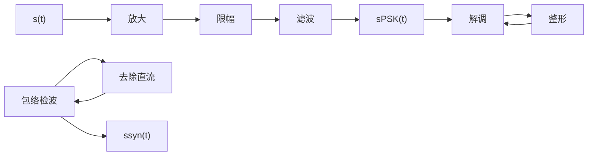
</details>

图 9.4.6 符号同步获取和解调的原理

## 9.4.3 符号同步的似然估计法\*

符号同步同样可以采用信号参数的最大似然估计法来实现。一般地，接收的符号序列可以表示为

$$
r (t) = s (t, \tau) + n (t) = \sum_ {n = - \infty} ^ {\infty} a _ {n} g _ {T} (t - n T - \tau) + n (t) \tag {9.4.15}
$$

其中 $\tau$ 是待估计符号序列的位置参数， $n(t)$ 是高斯白噪声。符号同步的参数估计法也分为面向判决的最大似然估计和非面向判决的最大似然估计两类。下面分别进行讨论。

面向判决的最大似然估计 对式（9.4.15）做类似从式（9.3.31）到式（9.3.40）完全一样的分析，可知关于参数 $\tau$ 的最大似然估计有如下等效关系式：

$$
\max p (\boldsymbol {r} \mid \tau) \leftrightarrow \max \int_ {0} ^ {T} r (t) s (t, \tau) \mathrm{d} t \tag {9.4.16}
$$

即使上式达到最大时的参数 $\tau$ 值，就是所要寻找的符号同步的位置。对于面向判决的似然估计，在每一帧信号中，可发送一组 M 个发收双方约定的已知序列 $\left\{a_{n}\right\}_{n=1}^{M}$ 用于符号同步，记 $\Lambda_{M}(\tau)=\int_{0}^{T_{M}}r(t)$ $s(t,\tau)\mathrm{d}t$ ， $T_{M}=M\cdot T$ ，则有

$$
\begin{array}{l} \Lambda_ {M} (\tau) = \int_ {0} ^ {T _ {M}} r (t) s (t, \tau) \mathrm{d} t = \int_ {0} ^ {T _ {M}} r (t) \left(\sum_ {n = 1} ^ {M} a _ {n} g _ {T} (t - n T - \tau)\right) \mathrm{d} t \tag {9.4.17} \\ = \sum_ {n = 1} ^ {M} a _ {n} \int_ {0} ^ {T _ {M}} r (t) g _ {T} (t - n T - \tau) \mathrm{d} t = \sum_ {n = 1} ^ {M} a _ {n} y _ {n} (\tau) \\ \end{array}
$$

式中 $y_{n}(\tau) = \int_{0}^{T_{M}}r(t)g_{T}(t - nT - \tau)\mathrm{d}t$ 。从理论上说，可根据 $\varLambda_{M}(\tau)$ 取最大值的必要条件，令

$$
\frac {\mathrm{d} \varLambda_ {M} (\tau)}{\mathrm{d} \tau} = \sum_ {n = 1} ^ {M} a _ {n} \frac {\mathrm{d} y _ {n} (\tau)}{\mathrm{d} \tau} = 0 \tag {9.4.18}
$$

解方程得到满足上述条件的最大似然值 $\tau_{ML}$ 。在实际系统中， $y_{n}(\tau)$ 未必可以求导，或即使 $y_{n}(\tau)$ 可以求导，也未必能够得到求解最大似然值 $\tau_{ML}$ 的解析表达式。但一般地，在一定的精度条件下，总是可以通过搜索计算的方法，由式（9.4.17）得到 $\tau_{ML} = \arg \max \Lambda_{M}(\tau)$ 的数值解。

非面向判决的最大似然估计 若发送的序列 $\left\{a_{n}\right\}_{n=1}^{M}$ 本身是接收端未知的, 则只能采用所谓的非面向判决的最大似然估计方法。首先计算式 (9.4.17) 即 $\Lambda_{M}(\tau)$ 关于 $\left\{a_{n}\right\}_{n=1}^{M}$ 的统计平均值:

$$
E \left[ \Lambda_ {M} (\tau) \right] = \sum_ {a _ {1} a _ {2} \dots a _ {M}} P \left(a _ {1} a _ {2} \dots a _ {M}\right) \int_ {0} ^ {T _ {M}} r (t) \left(\sum_ {n = 1} ^ {M} a _ {n} g _ {T} (t - n T - \tau)\right) \mathrm{d} t \tag {9.4.19}
$$

然后令

$$
\frac {\mathrm{d} E \left[ \varLambda_ {M} (\tau) \right]}{\mathrm{d} \tau} = 0 \tag {9.4.20}
$$

进而求 $\tau$ 的最大似然值 $\tau_{\mathrm{ML}}$ 。在导数不存在或无法得到解析解的情况下，一般地，总是可以通过搜索计算的方法，由式（9.4.19）得到 $\tau_{\mathrm{ML}} = \arg \max_{\tau} E\left[\Lambda_M(\tau)\right]$ 的数值解。

## 9.4.4 载波相位和符号同步的联合估计\*

前面分别介绍了作为信号参数的载波相位 $\phi_{\mathrm{c}}$ 和符号定时位置 $\tau$ 的最大似然估计法。也可以对这两个参数进行联合估计，联合估计可以避免对这两个参数先后进行估计时，一个参数的估计误差对另外一个参数估计的影响。因此，联合估计通常有更好的效果。一般地，无论是MASK、MPSK还是MQAM信号，都可以表示为

$$
\begin{array}{l} s (t) = \sum_ {n = - \infty} ^ {\infty} a _ {n} g _ {T} (t - n T) \cos \omega_ {\mathrm{c}} t - \sum_ {n = - \infty} ^ {\infty} b _ {n} g _ {T} (t - n T) \sin \omega_ {\mathrm{c}} t \tag {9.4.21} \\ = \operatorname{Re} \left(\sum_ {n = - \infty} ^ {\infty} \left(a _ {n} g _ {T} (t - n T) + \mathrm{j} b _ {n} g _ {T} (t - n T)\right) \mathrm{e} ^ {\mathrm{j} \omega_ {\mathrm{c}} t}\right) \\ \end{array}
$$

其中对于 MASK 信号， $b_{n}=0$ 。

对于接收端来说，信号 $s(t)$ 含有未知的载波相位 $\phi_{c}$ 和符号定时位置 $\tau_{r}$ ，加上有加性高斯白噪声的干扰，接收信号一般可以表示为

$$
\begin{array}{l} r (t) = \operatorname{Re} \left(s \left(t; \phi_ {\mathrm{c}}, \tau_ {\mathrm{r}}\right)\right) + n (t) \\ = \operatorname{Re} \left(\sum_ {n = - \infty} ^ {\infty} \left(a _ {n} g _ {T} (t - n T - \tau_ {\mathrm{r}}) + \mathrm{j} b _ {n} g _ {T} (t - n T - \tau_ {\mathrm{r}})\right) \mathrm{e} ^ {\mathrm{j} \phi_ {\mathrm{c}}} \mathrm{e} ^ {\mathrm{j} \omega_ {\mathrm{c}} t}\right) + n (t) \tag {9.4.22} \\ = \sum_ {n = - \infty} ^ {\infty} a _ {n} g _ {T} (t - n T - \tau_ {\mathrm{r}}) \cos \left(\omega_ {\mathrm{c}} t + \phi_ {\mathrm{c}}\right) - \sum_ {n = - \infty} ^ {\infty} b _ {n} g _ {T} (t - n T - \tau_ {\mathrm{r}}) \sin \left(\omega_ {\mathrm{c}} t + \phi_ {\mathrm{c}}\right) + n (t) \\ \end{array}
$$

定义 $s(t;\phi_{\mathrm{c}},\tau)$ 的等效低通信号为

$$
s _ {\mathrm{L}} \left(t; \phi_ {\mathrm{c}}, \tau_ {\mathrm{r}}\right) = \mathrm{e} ^ {\mathrm{j} \phi_ {\mathrm{c}}} \sum_ {n = - \infty} ^ {\infty} \left(a _ {n} g _ {T} \left(t - n T - \tau_ {\mathrm{r}}\right) + \mathrm{j} b _ {n} g _ {T} \left(t - n T - \tau_ {\mathrm{r}}\right)\right) \tag {9.4.23}
$$

由此，接收信号 $r(t)$ 等效的低通信号为

$$
r _ {\mathrm{L}} (t) = s _ {\mathrm{L}} \left(t; \phi_ {\mathrm{c}}, \tau_ {\mathrm{r}}\right) + n _ {\mathrm{L}} (t) \tag {9.4.24}
$$

$n_{L}(t)$ 是复高斯白噪声。同理，可做类似于从式（9.3.31）到式（9.3.40）的分析，得到关于参数 $\phi_{c}$ 和 $\tau$ 的等效似然函数

$$
\Lambda_ {\mathrm{L}} (\phi , \tau) = \operatorname{Re} \left(\int_ {T ^ {\prime}} r _ {\mathrm{L}} (t) s _ {\mathrm{L}} ^ {*} (t; \phi , \tau) \mathrm{d} t\right) \tag {9.4.25}
$$

式中 $T'$ 是进行信号分析时考虑的时间区域。例如, 它可以是训练序列的时间长度, 如果训练序列 $\left\{a_{n}\right\}_{n=1}^{M}$ 和 $\left\{b_{n}\right\}_{n=1}^{M}$ 的长度为 $M$ 个符号周期, 则有 $T' = M \cdot T$ 。根据最大似然估计的原理, 能够使式 (9.4.25) 达到最大值的参数 $\phi$ 和 $\tau$ , 就是参数 $\phi_{\mathrm{c}}$ 和 $\tau_{\mathrm{r}}$ 的最大似然估计值 $\phi_{\mathrm{ML}}$ 和 $\tau_{\mathrm{ML}}$ 。若记

$$
y _ {n} (\tau) = \int_ {T ^ {\prime}} r _ {\mathrm{L}} (t) g _ {T} ^ {*} (t - n T - \tau) \mathrm{d} t \tag {9.4.26}
$$

则有

$$
\Lambda_ {\mathrm{L}} (\phi , \tau) = \operatorname{Re} \left(\int_ {T ^ {\prime}} r _ {\mathrm{L}} (t) s _ {\mathrm{L}} ^ {*} (t; \phi , \tau) \mathrm{d} t\right) = \operatorname{Re} \left(\mathrm{e} ^ {\mathrm{j} \phi_ {\mathrm{c}}} \sum_ {n = 1} ^ {M} \left(a _ {n} + \mathrm{j} b _ {n}\right) y _ {n} (\tau)\right) \tag {9.4.27}
$$

若进一步地，记

$$
\sum_ {n = 1} ^ {M} (a _ {n} + \mathrm{j} b _ {n}) y _ {n} (\tau) = \sum_ {n = 1} ^ {M} a _ {n} y _ {n} (\tau) + \mathrm{j} \sum_ {n = 1} ^ {M} b _ {n} y _ {n} (\tau) = A (\tau) + \mathrm{j} B (\tau) \tag {9.4.28}
$$

则有

$$
\Lambda_ {\mathrm{L}} (\phi , \tau) = \operatorname{Re} \left(\mathrm{e} ^ {\mathrm{j} \phi} (A (\tau) + \mathrm{j} B (\tau))\right) = A (\tau) \cos \phi - B (\tau) \sin \phi \tag {9.4.29}
$$

求变量 $\phi$ 和 $\tau$ ，使得 $\Lambda_{\mathrm{L}}(\phi,\tau)$ 达到最大值的必要条件是

$$
\frac {\partial \Lambda_ {\mathrm{L}} (\phi , \tau)}{\partial \phi} = - A (\tau) \sin \phi - B (\tau) \cos \phi = 0 \tag {9.4.30}
$$

$$
\frac {\partial \Lambda_ {\mathrm{L}} (\phi , \tau)}{\partial \tau} = \frac {\partial A (\tau)}{\partial \tau} \cos \phi - \frac {\partial B (\tau)}{\partial \tau} \sin \phi = 0 \tag {9.4.31}
$$

由式（9.4.30）可得

$$
\phi = - \arctan \frac {B (\tau)}{A (\tau)} \tag {9.4.32}
$$

由式（9.4.31）和式（9.4.32），可得

$$
\frac {\partial A (\tau)}{\partial \tau} \cos \phi - \frac {\partial B (\tau)}{\partial \tau} \sin \phi = \frac {\partial A (\tau)}{\partial \tau} \frac {A (\tau)}{\sqrt {A ^ {2} (\tau) + B ^ {2} (\tau)}} - \frac {\partial B (\tau)}{\partial \tau} \frac {B (\tau)}{\sqrt {A ^ {2} (\tau) + B ^ {2} (\tau)}} = 0 \tag {9.4.33}
$$

整理后可得

$$
\frac {\partial A (\tau)}{\partial \tau} A (\tau) - \frac {\partial B (\tau)}{\partial \tau} B (\tau) = 0 \tag {9.4.34}
$$

由上式求解得到 $\tau_{r}$ 的联合最大似然估计值 $\tau_{ML}$ ，再将该值代入式（9.4.32）可进一步得到 $\phi_{c}$ 的最大似然估计值 $\phi_{ML}$ 。

## 9.5 帧同步

帧同步的概念 在通信系统接收端解调得到的通常是一串符号流, 其中每个 $M$ 进制的符号可携带 lb $M$ 比特信息, 因此由符号流可以得到相应的比特流。从第 3 章有关模拟信号的数字编码内容可知, 当传输话音信号时, 每个抽样值经过 $A$ 律或 $\mu$ 律编码后, 变成一个 8 比特的数组。发送时通常一个个这样的数组是连续排列的, 显然在接收端, 必须能够确定每个数组的起止位置, 才可能从比特流中还原出每个抽样值。同样, 在传输一个文本文件时, 每个信息字符被编码成一个特定长度的二进制数组, 在接收到比特流后, 需要确定每个二进制码组的起止位置, 才能恢复原来的各个字符。在大多数通信系统的协议中, 每个数组的长度为 8 比特, 若干 8 比特的数组构成一个数据帧, 每个数据帧均包含一个帧头, 帧头都有特定的标识。因此, 只要能在比特流中确定每个帧头的位置, 以数组长度为单位就可以在比特流中划分出原来的每个数组, 进而可提取出每个样值或信息字符。所谓帧同步, 通常指的就是从比特流中确定帧头位置的操作。

数据帧的传输方式 在通信系统中，有两种主要的以帧为单位承载数据的方式。一种是非周期方式，每个数据帧的发送都是独立的，两帧间的时间间隔不固定。比如在以太网的链路层中，每个数据帧独立发送，长短不一。在每个数据帧中，通常在帧头的位置，有记录帧长度的域，根据该域中标识的长度，可以知道在一个帧中包含了多少个以8比特为单位的数组。另外一种是周期性插入方式，每帧的长度（所包含比特数）一样。在通信过程中，数据一帧接一帧地连续传输，帧头间有固定的时间间隔。对这两种不同的传输方式，帧同步的搜索方法有一定的区别，下面分别进行介绍。

## 9.5.1 帧同步标识符的周期性插入法

帧同步的周期性同步标识符插入法的基本思想是，在制定通信规程时，约定在某些帧的特定位置插入特定的帧同步标识符，这些标识符在比特流中按照一定的规律出现。在接收端，通过搜索这些标识符，就可以确定帧的起始位置，实现帧同步。帧的标识符，通常是一位或若干位特定组合的二进制码组。通常在一帧数据中，码组的组合包括了各种可能性，因此不能完全避免在帧内的数据部分没有这种帧同步组合图样（伪同步标识符）的出现。但同步标识符除了具有特定的组合图样，在比特流中还会有规律地不断重复出现，而在一帧数据部分中偶尔出现的伪同步标识符不可能有这样的规律。利用这个特点，就可避免系统同步在伪同步标识符所在的位置。图9.5.1描述了帧同步标识符的周期性出现的规律。

帧同步标识的周期性集中插入法 利用帧同步标识周期性出现的特点，可设计出相应的帧同步位置的搜索和同步维护的算法。现有的帧同步方法，如图9.5.2所示，基本上可归纳为3个步骤，分别用图中的同步搜索、预同步和同步三个阶段或状态来描述。


<details>
<summary>text_image</summary>

TF
TF
帧同步
标识
伪帧同步
标识
帧同步
标识
其他
数组
帧同步
标识
...
</details>

图 9.5.1 帧同步标识符的设置

(1) 帧同步搜索阶段 在获得比特同步（位同步）之后，就可以开始进行帧同步搜索。帧同步搜索逐比特移动进行，不妨设帧同步标识符是一个长为 $H$ 的特定码组，例如在我国程控交换系统的E1基群信号中，规定在每个偶数帧的起始位置包含一个帧同步标识。帧同步标识符是图样“0011011”， $H = 7$ 。在逐比特的搜索过程中，检测连续出现的 $H$ 个比特的组合是否是同步标识图样，如果当前的 $H$ 个比特的组合不是标识图样，则顺序移动一位，丢弃 $H$ 比特数据中最旧的1位，加入新的1位，重新进行检测。如此循序渐进，只要比特流中有同步标识图样的比特组合，那么就一定可以通过这样的搜索得到。


<details>
<summary>flowchart</summary>

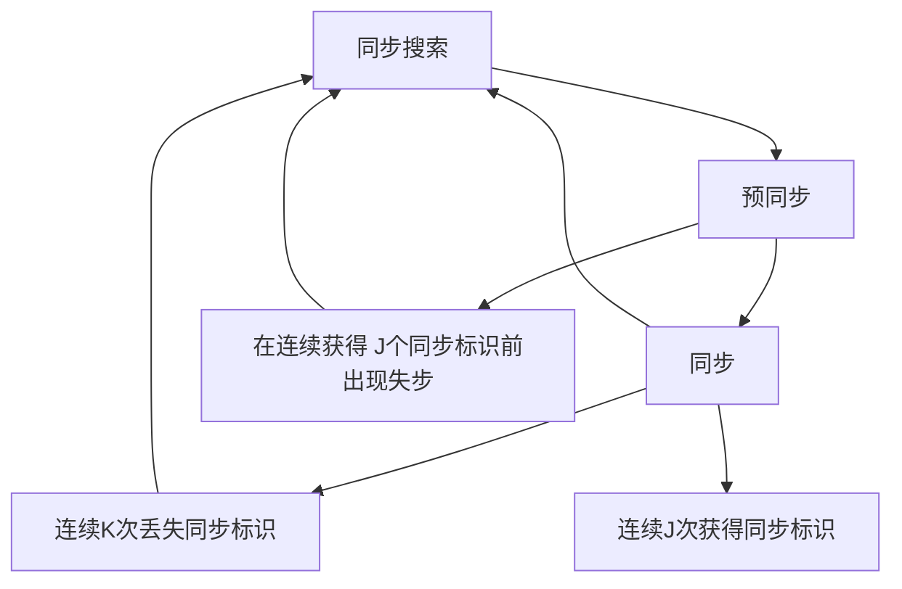
</details>

图 9.5.2 帧同步搜索与维护

(2) 预同步阶段 一旦在同步搜索阶段得到帧同步的标识, 帧同步的过程就进入预同步阶段。设在每两个包含有帧同步标识的同步帧之间, 连同帧同步标识在内共包含有 $F$ 比特的二进制码元, 则首先从搜索到的第一个帧同步标识开始, 跨越 $F$ 比特, 检测从该处开始的 $H$ 个比特是否是一个同步标识符, 如果不是一个同步标识符, 则返回帧同步搜索阶段; 如果这 $H$ 个比特又是一个帧同步标识符, 记录搜索到 2 个帧同步标识符, 又跨越 $F$ 比特, 检测下一 $H$ 个比特是否还是一个同步标识符, 如此循环往复, 直到达到预先设定的帧同步判定门限: 连续获得 $J$ 个帧同步符号。此时预同步阶段结束, 进入同步阶段。如果在获得 $J$ 个连续的帧同步符号之前, 出现了非帧同步比特组合, 则认为之前的同步均进入了一种伪同步状态, 此时返回到帧同步搜索阶段, 重新进行逐比特的搜索。

(3) 同步阶段 当系统进入同步阶段后, 依然保持在每个帧周期, 检测在帧的开始时刻, 是否有一个帧同步标识符出现。如果帧同步标识符如期而至, 表明帧同步没有问题。如果在一帧的开头未找到帧同步标识, 则记录出现了一次帧的失步, 偶尔的失步可能是由误码改变了帧同步标识符的比特图样所致, 并非真正的失步, 继续逐帧检测同步标识符, 如果连续 $K$ 帧均未找到同步标识符, 这里的数值 $K$ 是一个预先设定的失步判定门限, 则认为系统确实发生了帧同步的失步, 此时将返回到帧同步搜索阶段, 重新开始逐比特的搜索。

帧同步判定门限值 $J$ 和 $K$ 可根据不同的系统和性能要求设定。另外，在具体的应用系统中，帧同步标识符既可以逐帧插入，也可以只在偶数帧中插入。例如，在我国采用的 E1 基群速率标准中，帧同步标识符就是在偶数帧中的起始位置中插入的，此时帧同步的方法与逐帧插入时采用的方法基本一样，只是进入预同步和同步阶段后，帧同步的检测周期由逐帧检测时跨越一个帧的长度改为跨越两个帧的长度。 搜索到一个

【例 9.5.1】假定某帧同步系统采用基于周期性同步标识插入的帧同步方法，其中帧同步判定门限值 J 和 K 均等于 3，试画出相应的帧同步搜索与维护的状态转换图。

解: 将图 9.5.2 中的预同步状态细分为预同步 1 和预同步 2, 将同步状态细分为同步 1、同步 2 和同步 3, 则帧同步搜索与维护的状态转换图可由图 9.5.3 描述。从同步搜索状态到预同步状态是通过逐位搜索实现的, 而其他状态的转换则是通过逐帧检测实现的。其中的箭头表示状态转换的方向，箭头旁边的字表示转换的条件，有误表示未在预定的位置检测到同步标识，无误表示检测到同步标识。□


<details>
<summary>flowchart</summary>

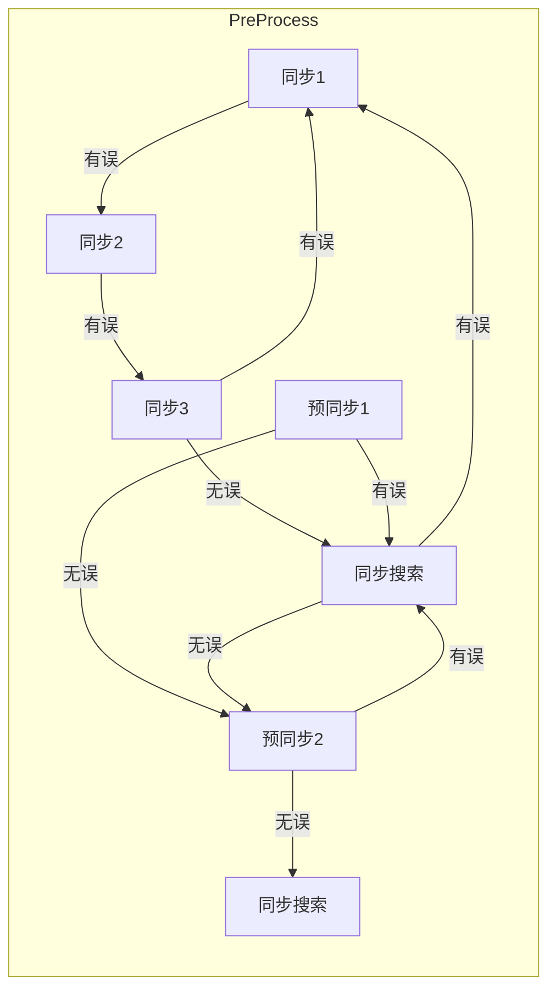
</details>

图 9.5.3 帧同步搜索与维护（J = K = 3）

辅助帧同步法 基于周期性同步标识插入的帧同步方法在各种不同的通信协议中获得了广泛应用。有些方法的形式虽然有区别，但基本思想无变化。例如在国际电联制定的宽带综合业务数字网的协议标准中，采用了基于信元的异步转移模式（ATM）技术。每个信元总长53个字节（每字节8比特），携带传输控制信息的信元头占5个字节。每个信元在传输过程中首尾相接，就像图9.5.1所示的一帧连接一帧的形式一样。例如，为了区分每个信元的起始位置加入相应的信元同步（或称信息定界）标识符，将使传输信息的效率降低。在ATM技术的信元同步技术中，采用了如下的辅助帧同步法。

在 ATM 信元头的 5 个字节中, 包含有一个检测信元头是否出错的校验字节, 其中存放的是对信元头部的前 4 个字节的校验位 (或称监督位), 校验位采用循环冗余校验 (CRC) 算法生成, 这样校验位的值与信元头部的前 4 个字节的值就有确定的关系。例如, 系统约定某一校验最高幂次为 7 的校验多项式 $g(X)$ , 将信元头部的前 4 个字节视为幂次为 31 的多项式, 该多项式被校验多项式相除所得的余式为校验字节, 作为信元头的第 5 个字节。在 ATM 交换机或终端需要对信元同步或定界时, 以字节为移位单位进行搜索, 每 5 个字节为一组, 检查第 5 个字节是否为前面 4 个字节的校验位。若不是校验位, 则顺序移动一个字节, 继续做同样的搜索操作; 若是校验位, 则进入预同步状态; 整个过程与图 9.5.2 描述的完全一样。经过 $J$ 次连续的正确校验后进入同步状态, 否则返回搜索状态。同样, 进入同步状态后继续维持对信元校验位的检测, 如果出现 $K$ 次连续的校验出错, 则返回搜索状态。显然, 采用辅助帧同步法可以使信元头的差错校验和信元同步一举两得, 比专门设定同步标识符有更高的传输效率。

同步标识周期性分散插入法 前面讨论的帧同步标识周期性集中插入法在每帧或偶数帧的起始位置设置一个完整的帧同步标识。在实际的系统中，还有一种将帧同步标识的图样分散地插入各帧的起始位置的帧同步方式。下面以 $\Delta M$ 调制传输系统的帧结构为例，介绍这一方法。

$\Delta M$ 调制传输的一个数据帧由 32 比特组成, 数据位中的每一比特表示 $\Delta M$ 调制的一个抽样编码值。在每个偶数帧的第一个比特中, 插入 1 比特的帧同步标识。该 1 比特的帧同步标识按照特定图样周期性地重复, 常用的特定图样包括 “...0...1...0...1...”, 或 “...1...1...1...0...1...1...1...0...”, 或 “0...0...0...1...1...1...0...0...1...1...0...0...1...0...1...” 等, 这里 “...” 表示 63 比特的用户数据或其他控制信息。这种特定图样是有规律地周期性重复的, 而用户数据没有这样的特性, 因此据此可实现帧同步和定界。图 9.5.4 描述了特定图样为 “...0...1...0...1...” 时帧的结构, 1 比特的帧同步信息每两帧出现一次。奇数帧的起始比特用 “X” 标识, 表示其他的信息。


<details>
<summary>text_image</summary>

T_F
T_F
T_F
T_F
...
1
X
0
X
1
...
</details>

图 9.5.4 $\Delta M$ 调制传输的帧同步信息结构

同步标识符的周期性插入法性能分析 对于帧同步系统来说，最重要的参数就是实现帧同步所需的时间，因为帧同步搜索的起始位置是随机的，通常只能得到帧同步时间的统计平均值。本节以较为简单的 $\Delta M$ 调制传输系统的帧结构为例，分析如何计算帧同步所需的最大时间。

假定两相邻的帧同步位的间隔为 $N_{\mathrm{syn}}$ ，码元周期为 $T$ 。因为对于 $\Delta \mathrm{M}$ 调制的帧结构，每两帧中有1比特的同步位，所以 $N_{\mathrm{syn}} = 2 \times 32 = 64$ 。首先假定所有的同步标识均为“0”，即特定的图样为“...0...0...0...0...”。帧同步的搜索过程从某一帧的第 $i$ 位开始，该位与帧同步图样“0”不同的概率为 $1 - P$ ，称为事件 $X$ ；则该位与帧同步图样“0”相同的概率为 $P$ ，称为事件 $Y$ 。

(1) 当前比特与帧同步图样应出现的比特不同时, 出现事件 $X$ , 马上顺延 1 位, 此时移动 1 位的

时间为一个码元周期 T。

(2) 当前比特与帧同步图样应出现的比特位相同时, 出现事件 $Y$ , 则等待两相邻的帧同步位的时间间隔 $N_{\mathrm{syn}} T$ , 然后检测该位与帧同步图样应出现的第 2 个比特位 “0” 是否相同, 如不同, 即出现事件 $X$ , 则顺延 1 位, 此时移动 1 位的时间为 $N_{\mathrm{syn}} T$ 再加上一个码元周期 $T$ , 即 $N_{\mathrm{syn}} T + T$ 。  
(3) 以此类推, 若前面的 $k$ 次搜索均得到正确的帧同步图样, 即均出现事件 $Y$ , 但在第 $k + 1$ 次检测时出现不相符的情况, 即出现事件 $X$ , 则移动 1 位的时间为 $k N_{\mathrm{syn}} T + T$ 。

综上,搜索过程中出现不同事件,导致从一帧中的第i位移动到本帧或后续帧中的第 $i+1$ 位的时间,有如下的相互关系。

| 事件 | 概率 | 在帧中移动1位所需要的时间 |
|---|---|---|
| X | 1-P | T |
| YX | P(1-P) | $N_{\text{syn}}T + T$ |
| YYX | $P^{2}(1-P)$ | $2N_{\text{syn}}T + T$ |
| ... | ... | ... |
| $Y^{k}X$ | $P^{k}(1-P)$ | $kN_{\text{syn}}T + T$ |
| ... | ... | ... |

由此可得移动 1 位的统计平均值为

$$
\begin{array}{l} \bar {T} _ {1} = (1 - P) T + P (1 - P) (N _ {\mathrm{syn}} T + T) + \dots + P ^ {K} (1 - P) (K N _ {\mathrm{syn}} T + T) + \dots \tag {9.5.1} \\ = (1 - P) T \sum_ {K = 0} ^ {\infty} P ^ {K} + (1 - P) N _ {\mathrm{syn}} T \sum_ {K = 0} ^ {\infty} K P ^ {K} = T + \frac {\dot {N} _ {\mathrm{syn}} P}{1 - P} T \\ \end{array}
$$

前面已经提到，捕获帧同步所需的时间与搜索的起始位置有关，其中最不利的情况出现在搜索的起始位置刚好处在帧同步标识位之后的第1个码元上，此时需要移动 $N_{syn}-1$ 位，才能到达下一个帧同步标识位，移动1位所需的平均时间为 $\bar{T}_{1}$ ，因此捕获帧同步所需的最大搜索时间为

$$
T _ {\mathrm{syn,Max}} = (N _ {\mathrm{syn}} - 1) \overline {{T}} _ {1} = (N _ {\mathrm{syn}} - 1) \left(T + \frac {N _ {\mathrm{syn}} P}{1 - P} T\right) \tag {9.5.2}
$$

所需的平均搜索时间为

$$
T _ {\mathrm{syn,Ave}} = \frac {1}{2} T _ {\mathrm{syn,Max}} = \frac {1}{2} (N _ {\mathrm{syn}} - 1) \overline {{T _ {1}}} = \frac {1}{2} (N _ {\mathrm{syn}} - 1) \left(T + \frac {N _ {\mathrm{syn}} P}{1 - P} T\right) \tag {9.5.3}
$$

上面仅分析了帧同步图样为“…0…0…0…0…”时的情形。若帧同步图样为“…0…1…0…1…”，则搜索到的图样必须满足“0”和“1”交错的特性。如果搜索设定是获得“0”，搜索的起始位置刚好错过了当前的同步标识“0”，因为下一个同步标识为“1”，移动到达该标识后仍然不能满足搜索的条件，所以还要移动 $N_{syn}$ 位，因此，对于“0”和“1”交错的同步标识，最大搜索时间变为

$$
T _ {\mathrm{syn,Max}} = (2 N _ {\mathrm{syn}} - 1) \left(T + \frac {N _ {\mathrm{syn}} P}{1 - P} T\right) \tag {9.5.4}
$$

其他方式的周期性插入法的最大搜索时间的计算，也可以采用类似的方法进行分析。

## 9.5.2 帧同步标识符的相关搜索法

在许多通信系统中，一帧数据的传输具有突发性，各帧之间的时间间隔不一定有确定的时间关系，每一帧都可视为一个独立的传输过程。一个典型的独立数据帧结构如图9.5.5所示，数据帧由前导序列、控制域和数据域组成。前导序列通常由一个或若干用于帧同步的特殊序列组成；控制域根据不同的控制需要，可包括地址、帧长、应答和差错控制等信息，数据域中加入的则是用户的数据。本节主要讨论前导序列，控制域的内容和功能可参见介绍数据通信和计算机网络等内容的书籍[8]。


<details>
<summary>text_image</summary>

T_F
前导序列	控制域	数据
</details>

图 9.5.5 典型数据帧结构

前导序列与其自相关特性 前导序列是发收双方约定的特殊序列，通常选择具有类似白噪声特性的伪随机序列构成。在第2章中我们知道，白噪声的自相关函数 $R(\tau)$ 是 $\delta (\tau)$ 函数，该函数在 $\tau = 0$ 的位置有无限大的取值，而在其他位置则等于0。在实际系统中，不可能采用真正的白噪声序列，一方面是因为前导序列不可能无限长，另一方面是若发送的序列是随机序列，则序列的选择、接收端检测帧同步的相关运算等都会变得非常复杂。因此帧同步是通过一个具有类似白噪声特性的伪随机序列前导来实现的。收到前导后，接收端可用同样的序列与其进行相关运算，当两组序列在时间上对齐时 $(\tau = 0)$ ， $R(\tau)$ 就会出现一个很大的峰值，由此即可确定帧的起始位置。目前具有较好同步性能的已知伪随机序列有巴克序列和威拉德序列等。长度为 $1\sim 13$ 的巴克序列和威拉德序列如表9.5.1所示。

表 9.5.1 巴克序列和威拉德序列

| 长度N | 巴克序列 | 威拉德序列 |
|---|---|---|
| 1 | +1 | +1 |
| 2 | +1+1或+1-1 | +1-1 |
| 3 | +1+1-1 | +1+1-1 |
| 4 | +1+1+1-1或+1+1-1+1 | +1+1-1-1 |
| 5 | +1+1+1-1+1 | +1+1-1+1-1 |
| 7 | +1+1+1-1-1+1-1 | +1+1+1-1+1-1-1 |
| 11 | +1+1+1-1-1-1+1-1-1+1-1 | +1+1+1-1+1-1+1-1-1-1 |
| 13 | +1+1+1+1+1-1-1+1+1-1+1-1+1 | +1+1+1+1+1-1-1+1-1+1-1-1-1 |

若将前导序列记为 $\left\{x_{1},x_{2},x_{3},\cdots,x_{N}\right\}$ ，则自相关函数可表示为

$$
R (j) = \sum_ {i = 1} ^ {N - j} x _ {i} x _ {i + j} \tag {9.5.5}
$$

若以长度 N=7 的巴克序列代入，则可达到如下的运算结果：

$$
\begin{array}{l l l l l l l l l l l l l l} j: & & - 6 & - 5 & - 4 & - 3 & - 2 & - 1 & 0 & 1 & 2 & 3 & 4 & 5 & 6 \\ R (j): & & - 1 & 0 & - 1 & 0 & - 1 & 0 & 7 & 0 & - 1 & 0 & - 1 & 0 & - 1 \end{array}
$$

可见有 $R(0) \gg R(j), j \neq 0$ ，即该序列的相关函数有类似白噪声自相关函数的特性。

前导序列的相关搜索方法 对每个独立帧起始位置的判定，实际上就是搜索前导序列的位置。下面讨论实际系统中两种不同的典型方法。

(1) 接收前导序列与本地前导序列的互相关法 假定接收序列为 $\{r_n\}$ , 其中包含了位于帧起始位置的发送前导序列, 但该前导序列的具体位置未知。得到接收序列后, 如图 9.5.6 所示, 可以以本地前导序列 $\{x_{n'}\}$ 作为基准, 从某个略为超前或滞后的位置开始向后搜索或向前搜索。向后搜索的具体计算为

$$
R _ {r x} (j) = \sum_ {i = 1} ^ {N} r _ {i - j} \cdot x _ {i} \tag {9.5.6}
$$

向前搜索的具体计算为

$$
R _ {r x} (j) = \sum_ {i = 1} ^ {N} r _ {i + j} \cdot x _ {i} \tag {9.5.7}
$$


<details>
<summary>flowchart</summary>


</details>

图 9.5.6 采用互相关法的帧同步搜索

因为接收序列 $\{r_n\}$ 中包含了前导 $\{x_{n'}\}$ 序列，当移动到 $j = 0$ 的位置时，因为前导序列此刻的强相关性，曲线 $R_{rx}(j)$ 将出现明显的峰值，该位置对应的就是前导的起始位置，也就是帧的起始位置。

(2) 接收前导序列的自相关法 采用这种方法的帧结构中, 如图 9.5.7 所示, 前导序列中包含有两个完全相同的子序列 $\left\{x_{n'}\right\}_{n'=1}^{N}$ 和 $\left\{x_{n'+N}\right\}_{n'=1}^{N}$ , 其中 $x_{n'+N} = x_{n'}$ 。接收到序列 $\left\{r_n\right\}$ 后, 从略为超前的位置开始, 做序列 $\left\{r_n\right\}_{n=i}^{N+i}$ 与序列 $\left\{r_n\right\}_{n=N+i+1}^{2N+i}$ 的相关运算:

$$
R _ {r} ^ {(i)} (N) = \sum_ {n = i} ^ {N + i} r _ {n} \cdot r _ {n + N} \tag {9.5.8}
$$

显然当 $i$ 处于帧起始的位置时，曲线 $R_{r}^{(i)}(N)$ 将出现明显的峰值，由此即可确定帧的起始位置。


<details>
<summary>text_image</summary>

前后相关
运算区域
T_{Sub-Pre}
T_{Sub-Pre}
前导序列1
前导序列2
控制域
数据
T_{Sub-Pre}
T_{Sub-Pre}
滑动搜索
</details>

图 9.5.7 采用自相关法的帧同步搜索

接收信号中通常加有噪声，导致接收的序列可能存在误码，通常只要保证用于帧同步的前导序列足够长，就可使得帧同步定位方法有足够的强壮性。

另外，前面在讨论帧同步时，假定已经得到解调后的符号序列。在实际系统中，帧同步的搜索可以利用由抽样值构成的序列直接进行相关计算。对信号的抽样，可以在基带信号中进行，也可以对已调制的信号直接进行抽样。具有类似白噪声特性的前导序列对载波信号进行调制后，已调制信号仍然保持其类似白噪声特性的性质。

下面给出一个利用短波信道进行数字通信时帧同步的示例。为适应短波信道的复杂衰落变化特性和低信噪比的应用环境，用于帧同步的前导符号的数目可达400～600多个。假定采用8PSK调制，记前导伪随机符号序列为 $m(k)=v,v\in\{0,1,2,3,4,5,6,7\}$ 。假定采用8PSK调制，则调制输出为

$$
s _ {\mathrm{Pre}} (t) = A \cos \left(\omega_ {\mathrm{c}} t + 2 \pi m (k) / 8\right), k T \leqslant t <   (k + 1) T \tag {9.5.9}
$$

在接收端接收到的已调前导信号可表示为

$$
r (t) = s _ {\mathrm{Pre}} (t) + n (t) \tag {9.5.10}
$$

通常以全数字接收机的方法解调信号，采样速率应是符号速率的4倍以上。假定以8倍符号速率对 $r(t)$ 采样，得到的样值序列为 $r(i)$ 。理想的前导信号样值序列可在接收端本地生成，可记为 $s_{\mathrm{Pre}}(k)$ 。假定 $n(t)=0$ ，由式（9.5.4）即 $R(j)=\sum_{i=1}^{N-j}r(i)s_{\mathrm{Pre}}(i+j)$ ，可得图9.5.8(a)所示的结果， $R(j)$ 在j=0时刻有一个明显的峰值出现，可见已调信号依然有很好的便于搜索帧同步的相关特性；图9.5.8(b)是包含完整的一帧数据的已调信号的抽样值序列与本地的前导抽样序列 $s_{\mathrm{Pre}}(k)$ 的相关函数值，可见相关函数的最大值只会在帧同步的位置出现；图9.5.8(c)是其在j=0位置附近的时域扩展图。


<details>
<summary>spectrogram</summary>

| j | R(j) |
| --- | --- |
| ~0 | 0 |
| ~100 | ~100 |
| ~200 | ~200 |
| ~300 | ~100 |
| ~400 | ~0 |
| ~500 | ~0 |
</details>

(a)


<details>
<summary>spectrogram</summary>

| Parameter | Description |
| --- | --- |
| R(j) | Signal R(j) |
| j | Index j |
| R(0) | Vertical reference line |
| T_F | Duration between T_F and T_F |
| 前导长度 | Duration between T_F and T_F |
| 控制与数据域长度 | Duration between T_F and T_F |
</details>

(b)


<details>
<summary>spectrogram</summary>

| j | R(j) |
| --- | --- |
| 0 | 700 |
| ~0.1 | ~-300 |
| ~0.2 | ~100 |
| ~0.3 | ~100 |
| ~0.4 | ~100 |
| ~0.5 | ~100 |
| ~0.6 | ~100 |
| ~0.7 | ~100 |
| ~0.8 | ~100 |
| ~0.9 | ~100 |
| ~1.0 | ~100 |
</details>

(c)  
图 9.5.8 已调载波的前导信号抽样相关值

## 9.6 本章小结

本章分析了锁相环的基本原理，并在此基础上介绍了载波同步、符号同步的工作原理和有关算法。除了讨论基于电路实现的同步方法，还研究了基于最大似然法的载波同步、符号同步，已调载波和符号联合同步的原理等，这些方法易于用软件实现，在基于软件无线电的全数字接收机中获得了实际的应用。本章还讨论了帧同步的工作原理，帧同步主要通过帧标识符来完成。对于数据帧连续传输的系统，帧标识符在发送信号时周期性地插入、在接收时利用其具有周期性的规律进行检测而实现同步。对独立帧的起始位置检测，主要利用相关运算的方法来实现，同步提取可以在基带信号中实现，也可以在已调载波信号的抽样序列中实现。

## 习题

9.1 某一具有正弦鉴相特性的锁相环，假定环路的直流增益为100。（1）求该锁相环的频率跟踪范围；（2）若锁相环的输入频率有20Hz的变化，请问该锁相环能否跟踪其变化，为什么？（3）若锁相环的输入频率有10Hz的变化，请问该锁相环稳定后会存在多少相位差？  
9.2 已知锁相环路输入噪声信号的带宽为 $W_{n}$ ，环路的带宽为 $W_{L}$ ，输入噪声相位均值为 0，方差为 $E\left[\theta_{n_{i}}^{2}\right]=1/(2r_{i})$ ，试证明环路的输出相位方差 $E\left[\theta_{n_{0}}^{2}\right]$ 与环路信噪比 $r_{L}$ 之间有关系 $E\left[\theta_{n_{0}}^{2}\right]=1/(2r_{L})$ 。  
9.3 正交双边带调制的原理方框图如题图9.3所示，试讨论本地恢复的载波相位存在误差 $\varphi$ 对该系统有什么影响。


<details>
<summary>flowchart</summary>

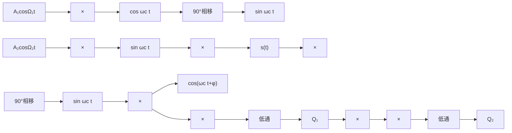
</details>

题图9.3

9.4 单边带信号的相干解调方框图如题图 9.4 所示，其中 $\hat{m}(t)$ 为 $m(t)$ 的希尔伯特变换。设载波同步器提取的相干载波与发送端载波的相位误差为 $\varphi$ 。（1）求解调器输出信号 $m_{0}(t)$ 的数学表达式和功率；（2）求解调器输出噪声 $n_{0}(t)$ 的数学表达式和功率。


<details>
<summary>flowchart</summary>

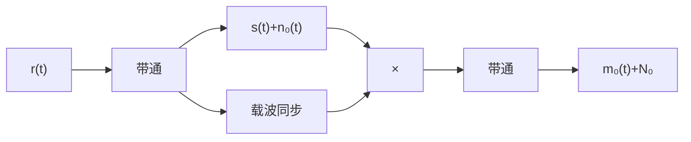
</details>

题图9.4

9.5 在双边带系统中，发送端方框图采用如题图9.5所示的插入导频法，即载波 $A\sin \omega_{\mathrm{c}}t$ 不经过 $-90^{\circ}$ 相移，直接与已调信号相加后输出。试证明接收端用相干接收法解调双边带信号时，解调器输出中含有直流成分。


<details>
<summary>flowchart</summary>

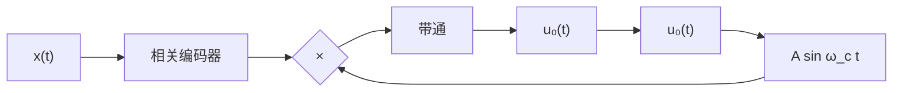
</details>

题图9.5

9.6 已知单边带信号为 $x_{\mathrm{SSB}}(t)=x(t)\cos\omega_{\mathrm{c}}t+\hat{x}(t)\sin\omega_{\mathrm{c}}t$ ，其中 $\hat{x}(t)$ 为 $x(t)$ 的希尔伯特变换。试证明不能用平方环法提取载波同步信号。  
9.7 已知双边带信号为 $x_{\mathrm{DSB}}(t)=x(t)\cos\omega_{\mathrm{c}}t$ ，接收端采用相干解调法，载波为 $\cos(\omega_{\mathrm{c}}t+\Delta\varphi)$ ，试分析推导解调器的输出表达式。  
9.8 在题图 9.8 中，假定 BPSK 信号在相干解调过程中，本地恢复的载波与发送端的载波信号有固定的相位偏差 $\theta$ ，求相应的误比特率。


<details>
<summary>flowchart</summary>

```mermaid
graph LR
  A["带通滤波"] -->|rt| B(( ))
  B --> C["低通滤波"]
  C --> D["抽样判决"]
  D -->|输出| E[""]
  F["cos 2πfc t"] --> B
```
</details>

题图 9.8

9.9 设有题图 9.9(a) 所示的基带信号，它经过图(b)所示的一系列信号处理过程可提取出位同步信号，请大致画出图中 B, C, D, E 和 F 各点的波形。  
9.10 假定在连续的数据流传输系统中，每一数据帧包含一个8位的同步标识符。典型的帧同步如题图9.10所示，其中包括了同步搜索、预同步和同步三种工作状态。请说明在哪些状态下同步的操作是逐位进行的，在哪些状态下同步操作是逐帧进行的，为什么？  
9.11 若 7 位巴克码组的前后全为 “1” 序列加于题图 9.11 所示的 7 位巴克码识别器的输入端，且各移存器的初始状态均为 0。若输入 “111111100101111111”，试画出识别器的输出波形。


<details>
<summary>flowchart</summary>

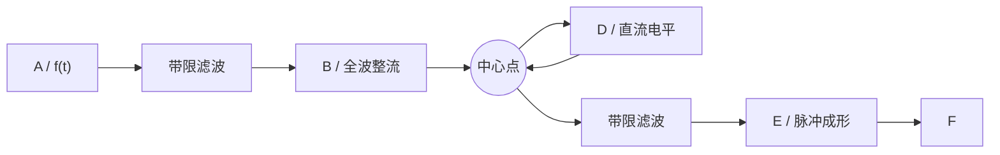
</details>

题图 9.9


<details>
<summary>flowchart</summary>

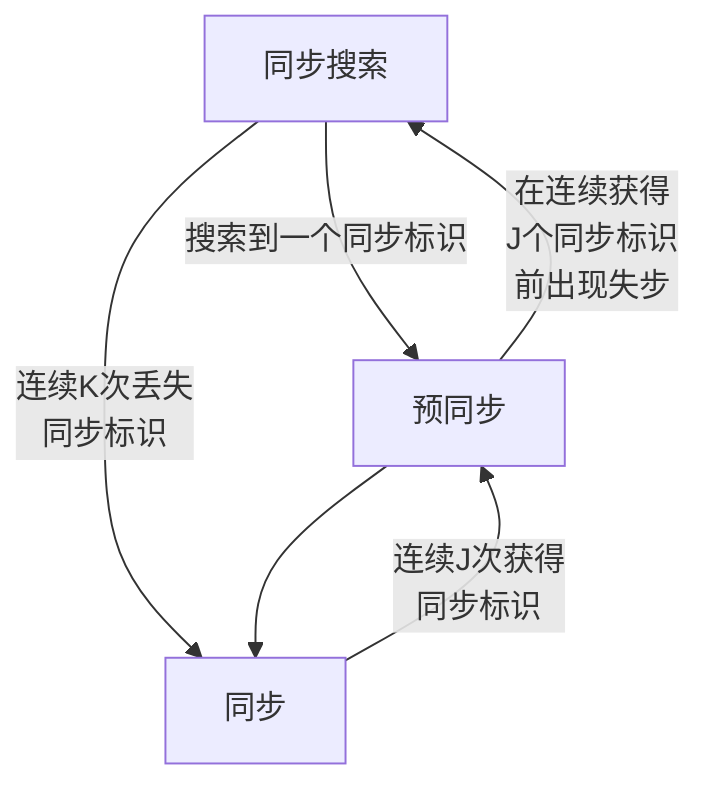
</details>

题图9.10


<details>
<summary>flowchart</summary>

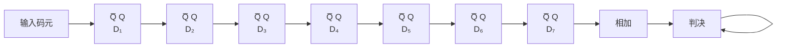
</details>

题图9.11

9.12 设某有噪声干扰的数字无线传输系统的帧同步采用了13位长的威拉德序列 $+1 + 1 + 1 + 1 + 1 - 1 - 1 + 1 - 1 + 1 - 1 - 1$ 作为前导序列，用作帧起始的标识，假定采样获得的接收序列为 $+0.3, -0.5, -0.4, +0.6, -1.2, +1.3, +0.3, +0.7, +1.1, -0.2, -1.0, -0.8, +1.3, -0.6, +0.8, -1.0, -0.9, -1.2, +1.0, -1.2, -0.7, -0.9, +1.1, -0.9, \cdots$ 。请用滑动相关搜索的方法，描绘相关器输出的波形，并判断接收的数据帧从第几个样值开始。

## 主要参考文献

[1] 郑继禹，万心平，张厥盛．锁相环路原理与应用[M]. 北京：人民邮电出版社，1976.  
[2] 南京工学院无线电工程系．电子线路（四）[M]．北京：人民教育出版社，1979.  
[3] 樊昌信，徐炳祥，吴成柯，詹道庸．通信原理[M]. 北京：国防工业出版社，1980.  
[4] 姚彦，梅顺良，等．数字微波中继通信工程[M]. 北京：人民邮电出版社，1990.  
[5] [美]John. G. Proakis. 数字通信（第三版）[M]. 张力军等译. 北京：电子工业出版社，2001.  
[6] 张公礼．全数字接收机理论与技术[M]. 北京：科学出版社，2005.  
[7] 曹志刚，钱亚生．现代通信原理[M]. 北京：清华大学出版社，1992.  
[8] [美] Andrew S. Tanenbaum. 计算机网络（第3版）[M]. 北京：清华大学出版社，1997.
