## 第 10 章 扩展频谱通信技术

## 10.1 引言

扩展频谱（Spread-Spectrum，SS）通信技术是数字通信的重要发展方向之一。扩展频谱通信简称扩频通信，扩频通信最初应用于军事通信中，因其具有抗干扰能力强和低检测概率等优点，可实现战场抗干扰和保密通信的目的。随着技术的发展，扩频技术已广泛应用于军事通信和民用通信中，如地面战术移动通信系统、民用移动通信系统、全球定位系统（Global Positioning System，GPS）、无线局域网（Wireless Local Area Network，WLAN）、测距与测速系统等。本节将介绍扩频系统的基本原理和特点、扩频系统的分类、实现扩频通信的基本方法和有关应用等。

## 10.2 扩频系统的基本概念

## 10.2.1 扩频系统的基本原理

扩频系统通常具有以下三个特点：

（1）信号占用的带宽远远大于发送信息所需的最小带宽。  
(2) 在发送端进行扩频时通常采用伪随机序列，该序列与所发送信息本身无关。  
（3）在接收端需要利用与发送端同步的扩频码进行解扩，以恢复原始信号。

根据以上特点可以看出，前面章节介绍的调制方式，如脉冲编码调制、频率调制等，虽然也扩展了原始信号的频谱，但它们并不完全符合以上特点，因此并不能称为扩频系统。

扩频系统的基本原理框图如图 10.2.1 所示，系统的基本组成与工作原理如下。


<details>
<summary>flowchart</summary>

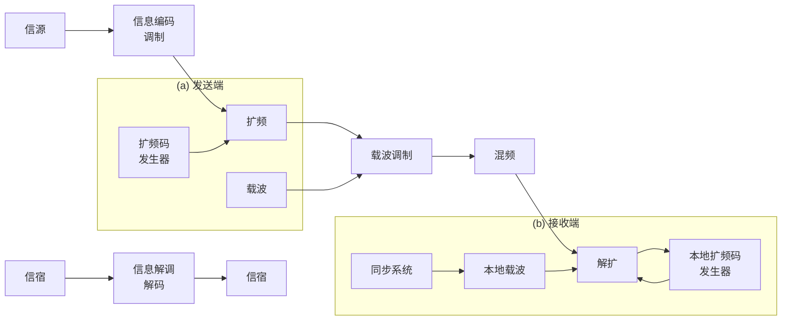
</details>

图10.2.1 扩频系统原理框图

发送端 信源发出的数据首先经过信息编码调制模块，完成信源编码、信道编码、数字调制等操作；然后由扩频模块进行扩频处理，扩频处理主要通过扩频码发生器产生的伪随机序列来实现，扩频后信号带宽远远大于发送信息所需要的最小带宽；扩频信号最后对射频载波进行调制后通过天线发射出去。

接收端 天线接收到的信号经过混频后，由解扩模块进行解扩处理，解扩处理需要本地扩频码发生器产生与发送端同步的扩频码，解扩后信号带宽恢复到经数字调制后的带宽值；解扩后的信号由信息解调译码模块进行数字解调、信道译码、信源译码等操作后恢复为原始信号，最后送给信宿。

与传统的数字通信系统相比，扩频系统中主要多了扩频、解扩、扩频码发生器等模块，其中扩频处理模块主要完成信号的扩频处理，不同的扩频系统进行扩频处理的方法有较大区别，常见的扩频系统包括直接序列扩频、跳频、跳时及混合扩频等。解扩处理是扩频处理的逆过程，其主要功能是将扩频信号恢复为原来的窄带信号，不同的扩频系统中，解扩处理的方法也有较大区别。扩频系统中有两个特殊的模块。

(1) 扩频码发生器 扩频码发生器是扩频系统中的核心模块之一, 其主要功能是产生用于扩频处理的扩频码。扩频码是一个伪随机序列, 一般应有易于产生、具有伪随机性、周期尽可能长及良好的自相关和互相关特性等性质。  
(2) 扩频码同步模块 其主要功能是保证本地扩频码发生器产生的扩频码与发送端的扩频码同步。扩频码的同步主要分为两个阶段: 一是捕获 (也称粗同步), 其主要功能是从接收信号中获得扩频码的起始位置; 二是跟踪 (也称精同步), 其主要功能是使接收端码元能跟踪发送端码元的变化。

扩频系统发送端发送的扩频信号的带宽远远大于发送信息所需要的最小带宽，这似乎与传统数字通信系统中通常以尽量窄的带宽来发送信息以获得较高的频谱效率是相矛盾的。但扩频系统可以通过增加带宽来获得信噪比（S/N）的改善，其依据的理论基础依然是在第4章中讨论过的香农公式：

$$
C = W \mathrm{lb} (1 + S / N) \tag {10.2.1}
$$

香农公式确定了信道容量 C 与信道带宽 W 及信道中的信噪比 S/N 之间的关系。当信道容量一定时，增加信道带宽，可以降低对信道中信噪比的要求。也就是说，在扩频系统中，由于信号带宽增大了，可以在信道信噪比非常低的情况下实现通信，这也是扩频系统可以实现保密通信的基本原因。此外，利用扩频码的良好互相关特性，不同扩频码之间正交或接近正交，还可以实现码分多址（Code Division Multiple Access，CDMA）通信，即多个不同用户利用不同的扩频码来区分，同时在相同的频带中通信。世界上目前正在广泛应用的第三代移动通信（The 3rd Generation Telecommunication，3G）系统，包括 WCDMA（Wideband Code Division Multiple Access）、CDMA2000 及 TD-SCDMA（Time Division-Synchronization Code Division Multiple Access），其基本技术就是利用码分多址的方法。

## 10.2.2 扩频系统的分类

扩频系统的主要类型包括直接序列扩频（Direct Sequence Spread Spectrum，DSSS）、跳频系统（Frequency Hopping，FH）、跳时系统（Time Hopping，TH）和混合扩频等。

直接序列扩频（DSSS） 直接序列扩频系统中，发送端的数据经过编码后，直接利用扩频码序列进行扩频处理，将信号扩展到一个较宽的频带内，然后调制到射频载波上发射出去。在接收端，天线接收到的信号经混频后，利用本地产生的与发送端同步的扩频码进行解扩，使信号恢复成窄带信号，然后进行解调译码处理，恢复成原始数据。直接序列扩频系统简称直扩系统，其扩频的原理如图10.2.2所示，其中 $d(t)$ 和 $F_{d}(f)$ 分别是数据基带信号和其傅里叶变换， $c(t)$ 和 $F_{c}(f)$ 分别是伪随机扩频序列信号和其傅里叶变换；假定扩频操作在载波调制前进行，扩频后的信号和其傅里叶变换分别为 $c(t)\cdot d(t)$ 和 $F_{d}(f)*F_{c}(f)$ 。若扩频序列的码片周期 $T_{c}$ 是符号周期 $T_{s}$ 的1/15，则扩频后信号的频谱宽度相应地被扩大为原来的15倍。

  
图 10.2.2 DSSS 信号频谱展宽示意图

DSSS 特别有利于在噪声背景下隐藏发送信号, 经扩频的信号的功率密度可以比噪声功率密度水平更低, 使得信号难以被敌人侦测; 同时也有利用对抗大功率的窄带干扰信号。图 10.2.3 为信号受到强的窄带信号干扰时的情形, 信号在解扩过程中, 通过相关运算使扩频信号 $F_{d}(f - f_{c})^{*}F_{c}(f - f_{c})$ 在频域上重新聚敛为 $F_{d}(f - f_{c})$ , 解调后恢复为原来的信号 $F_{d}(f)$ , 而窄带强干扰信号 $J(f)$ 的频普功率则在此过程中被扩散, 解调后落到基带信号带宽范围内的成分 $J_{\mathrm{B}}(f)$ 被大幅度降低。

  
图 10.2.3 DSSS 系统抑制窄带干扰信号的示意图

直接序列扩频系统主要用于通信抗干扰、卫星通信、导航、保密通信、测距和定位等方面，是目前应用最多也最典型的一种扩频系统。

跳频扩频（FH） 在跳频系统中，发送端不是用伪随机码直接对发送信号进行频率扩展，而是用伪随机码控制载波频率“随机”跳变。跳频系统的原理框图如图 10.2.4 所示。在发送端，信源产生的信号通过信息编码调制模块后，调制由频率合成器产生的载频，得到射频信号并通过天线发送出去。而频率合成器产生的载频频率则受伪随机码发生器产生的伪随机序列的控制，按一定速率在 K 个载频上随机跳变。虽然在某一时刻，发送信号占据的带宽为普通数字调制信号的带宽，但从一段时间来看，因为发送的信号会在 K 个载频上随机跳变，相当于将原来的信号带宽扩展到了主要由最大跳频间隔确定的区域上。图 10.2.5 给出了 FH 信号在时频域上变化的示意图，其中 $T_{h}$ 为每一跳的驻留时间。该示意图也称跳频图案，对跳频图案的基本要求如下：


<details>
<summary>flowchart</summary>

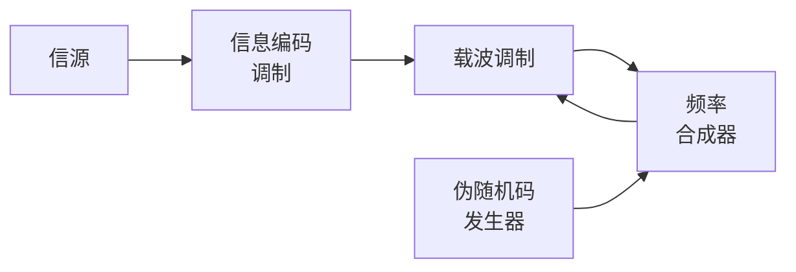
</details>

(a) 发送端


<details>
<summary>flowchart</summary>


</details>

(b) 接收端  
图 10.2.4 跳频系统原理框图

（1）频率跳变范围大 跳频图案跳变的频率应分布在足够宽的频带范围上。

(2) 伪随机性好 由伪随机码控制的频率合成器产生的频率跳变周期应足够大, 且各个频率出现的概率是均等的。

在保密要求较高的应用场合，除了应用伪随机码来控制跳频图案，还可采用其他一些措施来进一步提高跳频图案的保密性。

在接收端，天线接收到的信号首先经过混频变换到某个固定中频，然后通过信息解调译码恢复为原始数据信息。特别之处在于，进行混频时本地载波信号不再是固定频率，而是一个频率跳变信号，其变化规律与发送端的载波变化规律相同，这需要由同步系统来保证，发送端与接收端的载波频率并不相同，而是有一个固定频差，其差值正好是接收机的中频。

FH 通过 “随机” 的载波频率变化可有效规避窄带信号的干扰，图 10.2.6 所示为 FH 系统对抗强窄带干扰信号的示意图，仅当跳频信号与干扰信号的频谱重叠时，信号才会受到影响。此外，多个不同跳频规律的信号可在一个频域范围内实现多个用户随机分布式控制的频分复用。FH 早期主要用于军事通信，如战术跳频电台。目前 FH 也应用到了民用通信领域的多址接入过程，如基于蓝牙技术的无线个域网（Wireless Personal Area Network，WPAN）等。


<details>
<summary>bar</summary>

| 时间 (t) | 频谱区域 |
| --- | --- |
| Th | 跳频 |
| 2Th | 跳频 |
| 3Th | 跳频 |
| 4Th | 跳频 |
| 5Th | 跳频 |
| 6Th | 跳频 |
| 7Th | 跳频 |
</details>

图 10.2.5 FH 系统在时频域变化示意图


<details>
<summary>text_image</summary>

窄带强干扰信号
J(f)
O
f
</details>

图 10.2.6 FH 系统对抗窄带干扰信号

跳时扩频（TH） 跳时系统中，采用伪随机码去控制信号发送的时刻及发送时间的长短。在时间跳变中，将一个信号分为若干时隙，由伪随机码序列控制在哪个时隙发送信息，时隙的选择及持续时间的长短均由伪随机码控制。因此，信号在发送的很短时隙中，以较高的峰值功率传输，可以视为某种随机脉位调制（PPM）和脉宽调制（PWM），TH信号对原始符号在时间上的压缩导致变换后的信号在频域上扩展。跳时系统的原理框图如图10.2.7所示。


<details>
<summary>flowchart</summary>

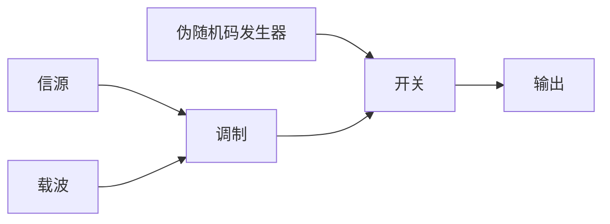
</details>

(a) 发送端


<details>
<summary>flowchart</summary>

```mermaid
graph LR
  A["本地伪随机码发生器"] --> B["门1"]
  A --> C["门2"]
  B --> D["检测"]
  C --> E["检测"]
  D --> F["判决"]
  E --> F
  G["同步系统"] --> F
  F -->|输出| H[""]
```
</details>

(b) 接收端  
图 10.2.7 跳时系统原理框图

在发送端，经过载波调制后的信号送到一个开关电路，该开关的启闭受伪随机码控制，以脉冲的形式发送出去。在接收端，本地伪随机码发生器在同步系统的控制下产生与发送端同步的伪随机码序列，控制两个选通门，使传号和空号分别由两个门选通后经检波进行判决，从而恢复出发送的信息。

TH 系统抑制瞬时强随机干扰和全时段干扰的原理如图 10.2.8(a) 所示, 每个码元在时间上由 $T_{\mathrm{s}}$ 压缩为 $T_{\mathrm{c}}$ , 时间压缩频谱展宽后的信号 $f_{\mathrm{c}}(t)$ 的每个码元出现的时间在 $T_{\mathrm{s}}$ 内 “随机” 跳变, 很容易规避强的随机干扰 $j_{1}(t)$ ; 对于全时段出现的连续干扰 $j_{2}(t)$ 或噪声, 因为每个压缩后码元的能量在时间上很集中, 可形成很强的接收信噪比, 从而达到抑制这些干扰影响的目的。除 TH 信号的发送时刻可变外, 如图 10.2.8(b) 所示, 在每个 “时隙” 中发送信号持续时间的长短也可通过伪随机码进行控制。

混合扩频 在前面介绍的几种扩频系统中，由于它们扩频的方式不同，抗干扰的机理也不同。虽然它们均有较强的抗干扰性能，但也有它们各自的不足之处。在实际应用中，有时单一的扩频方式很难满足实际需要，因此可以将两种或多种扩频方式结合起来，以获得单一扩频方式难以达到的指标。常见的混合扩频方式有跳频与直扩结合的方式（FH/DSSS）、跳时与直扩结合的方式（TH/DSSS）、跳频与跳时结合的方式（FH/TH）等。下面简单介绍 FH/DSSS 混合扩频方式，其他几种混合扩频方式的介绍可参见参考文献。

  
图 10.2.8 跳时系统抑制干扰示意图：(a)等宽时隙跳时信号；(b)时隙宽度可变的跳时信号

FH/DSSS 混合扩频系统原理框图如图 10.2.9 所示。在发送端，信号经过编码调制后，首先被伪随机码发生器 1 产生的伪随机序列扩频，然后去调制由伪随机码发生器 2 产生的伪随机序列控制的频率合成器，产生载波频率跳变的射频信号通过天线发送出去。在接收端，首先进行解跳，恢复原来的非跳频信号，得到固定中频的直扩信号，然后进行解扩，最后经解调译码后恢复出原始信息。从图 10.2.9 中可以看出，FH/DSSS 混合扩频系统中需要两个伪随机序列，其中一个用于直接序列扩频，另一个用于跳频，通常用于直接序列扩频的伪随机序列的速率要高于用于跳频控制的伪随机序列的速率。


<details>
<summary>flowchart</summary>

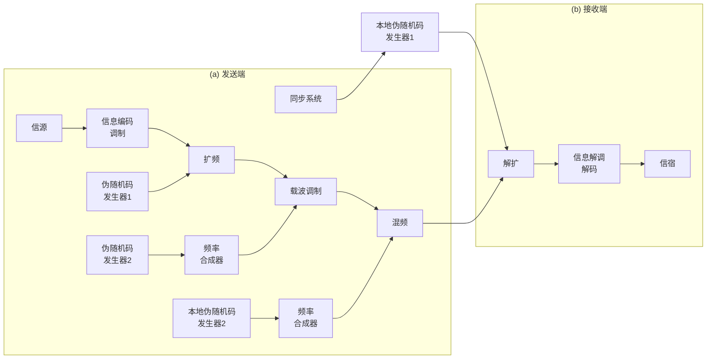
</details>

图 10.2.9 FH/DSSS 混合扩频系统原理框图

## 10.2.3 扩频系统的主要技术指标

对于扩频系统，衡量其性能的技术指标主要有处理增益、干扰容限、频带效率、跳频速率等，其中最主要的是处理增益和干扰容限。

处理增益 扩频系统的处理增益定义为解扩器输出端的信噪比 $(S/N)_{0}$ 与输入端的信噪比 $(S/N)_{i}$ 之比，即

$$
G _ {\mathrm{p}} = \frac {(S / N) _ {\mathrm{o}}}{(S / N) _ {\mathrm{i}}} \tag {10.2.2}
$$

其物理意义是扩频系统对于信噪比的改善程度。解扩处理前后信号的功率没有改变，主要是对干扰进行了抑制，因此处理增益也可理解为对干扰的抑制程度。对于不同类别的系统，有如下结果。

(1) DSSS 系统处理增益 对于 DSSS 系统, 若 $W_{1}$ 表示扩频前的信号带宽, $W_{2}$ 表示扩频后的信号带宽, $T_{1}$ 表示信息数据脉宽, $R_{1} = 1 / T_{1}$ 表示信息速率, $T_{2}$ 表示扩频码的码元宽度, $R_{2} (= 1 / T_{2})$ 表示码片速率, 噪声功率密度谱记为 $N_{0}$ , 则有

$$
G _ {\mathrm{p}} = \frac {(S / N) _ {\mathrm{o}}}{(S / N) _ {\mathrm{i}}} = \frac {(S / (W _ {1} N _ {0}))}{(S / (W _ {2} N _ {0}))} = \frac {W _ {2}}{W _ {1}} \approx \frac {R _ {2}}{R _ {1}} = \frac {T _ {1}}{T _ {2}} \tag {10.2.3}
$$

即处理增益也可表示为频谱扩展后与频谱扩展前的信号带宽之比。扩频前的带宽 $W_{1}$ ，通常也称信息带宽 $W_{d}$ 。处理增益的大小若用分贝（dB）表示，则有

$$
G _ {\mathrm{p}} (\mathrm{dB}) = 1 0 \lg \frac {(S / N) _ {\mathrm{o}}}{(S / N) _ {\mathrm{i}}} (\mathrm{dB}) \tag {10.2.4}
$$

(2) FH 系统处理增益 对于用于对抗窄带干扰的 FH 系统, 如果信息带宽为 $W_{\mathrm{d}}$ , 频率跳变的范围为 $W_{\mathrm{R}}$ , 若窄带干扰信号的带宽亦为 $W_{\mathrm{d}}$ , 当信号在 $W_{\mathrm{R}}$ 范围内均匀地“随机”跳变时, 窄带干扰的影响降低为原来的 $(W_{\mathrm{R}} / W_{\mathrm{d}})$ 分之一。因此, 跳频系统的处理增益定义为跳频带宽 $W_{\mathrm{R}}$ 与基带信息带宽 $W_{\mathrm{d}}$ 之比, 即

$$
G _ {\mathrm{p}} = \frac {W _ {\mathrm{R}}}{W _ {\mathrm{d}}} \tag {10.2.5}
$$

(3) TH 系统处理增益 跳时系统对抗干扰的基本思想是, 在存在干扰的一个码元周期内, 将一个码元信号的能量集中在一个小的时间片内发送, 在该短时间片内获得很高的信噪比, 由此可对抗干扰的影响。因此, 跳时系统的处理增益定义为占空比 $D$ 的倒数, 即

$$
G _ {\mathrm{p}} = \frac {1}{D} \tag {10.2.6}
$$

干扰容限 干扰容限是指在保证系统正常工作的条件下，接收机能承受的干扰信号的最大值。干扰容限一般用分贝数表示。若记干扰容限为 $M_{j}$ ，则有

$$
M _ {j} (\mathrm{dB}) = G _ {\mathrm{p}} - \left[ L _ {\mathrm{s}} + (S / N) _ {\text {out}} \right] (\mathrm{dB}) \tag {10.2.7}
$$

式中， $G_{p}$ 为系统的处理增益， $L_{s}$ 为系统的损耗， $(S/N)_{\mathrm{out}}$ 为解扩器后面处理单元对信噪比的最低要求。干扰容限的物理意义是，要保证扩频系统正常工作，解扩器的输入端可以承受的干扰功率上限。

## 10.2.4 扩频系统的特点

扩频系统的优点 扩频系统之所以能获得广泛的应用和发展，成为现代数字通信发展的一个重要方向，主要是因为其具有以下优点。

(1) 抗干扰能力强 抗干扰能力强是扩频系统最突出的优点, 不管是直接序列扩频还是跳频, 均具有较强的抗干扰能力。对于直接序列扩频系统, 接收端解扩前有用信号能量分布在较宽的频带内,而通常干扰则分布在较窄的带宽内 (比如敌方干扰电台发出的干扰信号), 解扩后, 有用信号恢复成窄带信号, 而干扰信号则被扩展到较宽的频带内, 通过窄带滤波器选出有用信号时, 可以滤除大部分干扰信号, 使得信噪比显著改善, 提高了抗干扰能力。对于跳频系统, 发射机的载频在一个较宽的频带内随机跳变, 而干扰电台发射的干扰信号一般很难在很宽的频域范围实现大功率的覆盖, 通常只在一个较窄的频带内产生较大的影响, 因此可以有效抵抗干扰电台的干扰。反映抗干扰能力的重要指标就是处理增益 $G_{\mathrm{p}}$ , 处理增益越高, 抗干扰能力越强。

(2) 抗截获、抗检测能力强 对于直接序列扩频系统, 扩频后有用信号能量分布在较宽的频带内, 且信号的功率谱密度很小, 通常都隐藏在噪声功率谱密度之下, 因此一般不容易被检测出。对于跳频系统, 发射机的载频会不断跳变, 因此很难被发现, 即使被发现, 如果不知道其跳变规律 (由伪随机序列确定)，也无法正确接收。所以说扩频系统具有较低的检测和截获概率。

(3) 具有多址能力 对于直接序列扩频系统, 由于采用的扩频码具有良好的自相关和互相关特性, 如果不同用户在发送端采用不同的扩频码进行扩频, 在接收端通过相关接收进行解扩时, 只有本地扩频码与目标用户的扩频码一致时, 才能正常解调, 而对于其他用户的信号, 不同扩频码之间的互相关值较低, 通过相关接收机解扩后其他用户信号的影响相当于较小的噪声, 因此不同用户可以采用不同的扩频码进行区分, 同时在相同的频道中进行通信。目前的 CDMA 系统即利用了扩频系统的多址能力。对于跳频系统, 如果不同用户的发射机载频按照不同的规律跳变, 在接收端, 只有当本地载波的频率跳变规律与目标用户载频跳变规律一致时, 接收信号通过混频后才能落在固定的中频范围内, 从而实现正常解调。而对于其他用户信号, 因为其射频信号载频跳变规律与本地载波的频率跳变规律不一致, 其信号通过混频后一般不能落在固定的中频范围内, 所以不会对目标用户造成干扰。因此, 不同的用户只要采用不同的频率跳变规律, 就可以在同一个频带内同时进行通信。如目前在 WLAN 和 WPAN 等系统中, 都有利用跳频实现多址功能的示例。

(4) 抗衰落和抗多径能力强 由于扩频系统的带宽很宽, 当遇到频率选择性衰落时, 它只影响扩频信号的一小部分, 而对整个信号的频谱影响不大。扩频后, 扩频码周期远小于信息码元周期, 对于多径信号, 只要多径延时超过一个码片的时间, 则对于相关接收机来说, 就可以把多径信号当成噪声处理, 不会造成很大的影响。而未采用扩频处理时, 信息码元周期较长, 多径延时信号可能落在一个码元周期内, 因此会产生码间干扰。扩频系统中如果采用 RAKE 接收技术, 可将多径信号分离出来,通过合并多径信号, 还可以有效提高接收性能。

扩频系统的缺点 扩频系统也有一些缺点，例如采用扩频技术的通信系统要实现解扩，往往需要较为复杂的同步系统。另外，要使得扩频系统具有较强的抗干扰、抗截获和抗检测的能力，通常要以牺牲频谱效率为代价。例如，对于 DSSS 系统，要使得信号隐藏在噪声内，扩频后的信号功率密度谱必须足够小，由香农定理可知，信道容量必定会受到较大的限定；对于 FH 系统，要达到良好的抗截获和抗检测效果，跳频的范围应尽可能大，而在每一跳中的信号频谱则应尽量窄，这显然也会降低频谱的利用效率。

## 10.3 伪随机序列

伪随机序列在扩频系统中起着非常重要的作用。比如，在直扩系统中，发送端需要采用伪随机序列对传输的信息进行频谱扩展，接收端也需要用相同的伪随机序列对接收的信号进行频谱压缩；在跳频系统中，发送端和接收端均需要利用伪随机序列控制频率合成器以产生随机跳变的载波频率。伪随机序列性能的好坏直接关系到扩频系统性能的好坏。

伪随机序列的性能 通常可以从以下几个方面衡量伪随机序列的性能。

(1) 易于产生。  
(2) 周期尽可能长, 使干扰者难以从截获的小段序列中重建整个伪随机序列, 从而提高系统的安全性。  
(3) 具有良好的自相关和互相关特性。这些特性有利于接收端对伪随机序列的捕获和跟踪，而良好的互相关特性则有利于其在多用户系统中应用。  
(4) 可用的伪随机序列数要尽可能多。由于在多用户系统中, 不同用户需要采用不同的伪随机序列, 只有系统中可用的伪随机序列足够多, 才能提高扩频系统的容量。

伪随机序列的特性 伪随机序列的特性主要由其相关函数来描述，主要包括自相关特性和互相关特性。

（1）自相关函数 设有两个长度为 $N$ 的序列 $\{a\}$ 和 $\{b\}$ ，序列中的元素分别为 $a_{i}$ 和 $b_{i}$ ，

$i=0,1,2,\cdots,N-1$ ，则序列的自相关函数 $R_{a}(j)$ 定义为

$$
R _ {\mathrm{a}} (j) = \sum_ {i = 0} ^ {N - 1} a _ {i} a _ {i + j} \tag {10.3.1}
$$

相应的自相关系数 $\rho_{\mathrm{a}}(j)$ 定义为

$$
\rho_ {\mathrm{a}} (j) = \frac {1}{N} \sum_ {i = 0} ^ {N - 1} a _ {i} a _ {i + j} \tag {10.3.2}
$$

(2) 互相关函数 序列 $\{a\}$ 和 $\{b\}$ 的互相关函数 $R_{ab}(j)$ 定义为

$$
R _ {a b} (j) = \sum_ {i = 0} ^ {N - 1} a _ {i} b _ {i + j} \tag {10.3.3}
$$

相应的互相关系数 $\rho_{ab}(j)$ 定义为

$$
\rho_ {a b} (j) = \frac {1}{N} \sum_ {i = 0} ^ {N - 1} a _ {i} b _ {i + j} \tag {10.3.4}
$$

若 $\rho_{ab}(j)=0$ ，则称序列 $\{a\}$ 和序列 $\{b\}$ 正交。

对于应用在扩频通信系统中的伪随机序列来说，一般希望其尽可能有类似白噪声的特性，即自相关系数的取值越大越好，而互相关系数的取值则应尽可能小。

伪随机序列的类型 根据以上自相关系数及互相关系数的含义，可进一步定义不同类型的伪随机序列。

(1) 狭义伪随机序列 自相关系数具有如下形式的序列, 称为狭义伪随机序列:

$$
\rho_ {\mathrm{a}} (j) = \left\{ \begin{array}{l l} \frac {1}{N} \sum_ {i = 0} ^ {N - 1} a _ {i} ^ {2} = 1, & j = 0 \\ \frac {1}{N} \sum_ {i = 0} ^ {N - 1} a _ {i} a _ {i + j} = - \frac {1}{N}, & j \neq 0 \end{array} \right. \tag {10.3.5}
$$

(2) 第一类广义伪随机序列 自相关系数具有如下形式的序列, 称为第一类广义伪随机序列:

$$
\rho_ {\mathrm{a}} (j) = \left\{ \begin{array}{l l} \frac {1}{N} \sum_ {i = 0} ^ {N - 1} a _ {i} ^ {2} = 1, & j = 0 \\ \frac {1}{N} \sum_ {i = 0} ^ {N - 1} a _ {i} a _ {i + j} = c <   1, & j \neq 0 \end{array} \right. \tag {10.3.6}
$$

(3) 第二类广义伪随机序列 互相关系数具有如下形式的序列, 称为第二类广义伪随机序列:

$$
\rho_ {a b} (j) \approx 0 \tag {10.3.7}
$$

相关函数满足式（10.3.5）、式（10.3.6）、式（10.3.7）三者之一的序列，统称为伪随机序列。

需要注意的是，在进行上述自相关或互相关函数和系数的运算时，通常把这些序列视为周期是 N 的循环序列，此时有 $a_{i}=a_{i+k\cdot N}$ ， $b_{i}=b_{i+k\cdot N}$ 。

目前，应用比较广泛的伪随机序列主要有 m 序列、Gold 序列、M 序列、R-S 序列等。本章主要介绍 m 序列和 Gold 序列，其他伪随机序列可以参考相关书籍。

## 10.3.1 m 序列

m 序列的概念 m 序列又称最大长度移位寄存器序列，它是伪随机序列中最重要的序列之一，也是最早应用于扩频通信的序列。m 序列可以通过线性反馈移位寄存器来产生，主要由移位寄存器的级数、反馈支路的结构（反馈逻辑）和寄存器的初始值决定。由 n 级线性反馈移位寄存器产生的 m 序列的最基本特征是，序列周期为 $2^{n}-1$ ，这是 n 级线性反馈移位寄存器可能产生的周期最长的序列。

反馈移位寄存器 m 序列可以用图 10.3.1 所示的线性反馈移位寄存器来产生，图中共有 n 级移位寄存器，每级移位寄存器的状态用 $a_{i}$ 表示， $a_{i} \in \{0,1\}$ ， $i = 0,1,2,\cdots,n-1$ 。反馈线的连接状态用 $c_{i}$ 表示， $c_{i} = 1$ 表示该反馈存在， $c_{i} = 0$ 则表示该反馈不存在，其中 $c_{0}$ 和 $c_{n}$ 不能为 0，因为 $c_{0} = 0$ 表示无反馈， $c_{n} = 0$ 表示最多只有 n-1 级寄存器参与反馈。图中的符号 “ $\oplus$ ” 表示模 2 加。


<details>
<summary>flowchart</summary>

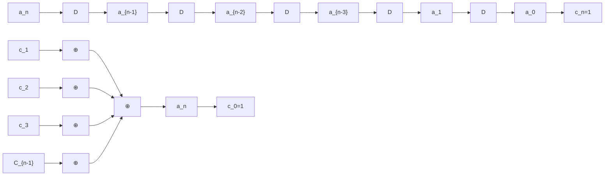
</details>

图 10.3.1 线性反馈移位寄存器

由图 10.3.1 中的反馈逻辑可以看出，移位寄存器第 n 时刻输出的值，满足以下递推关系：

$$
a _ {n} = c _ {1} a _ {n - 1} \oplus c _ {2} a _ {n - 2} \oplus \dots \oplus c _ {n - 2} a _ {2} \oplus c _ {n - 1} a _ {1} \oplus c _ {n} a _ {0} = \sum_ {i = 1} ^ {n} c _ {i} a _ {n - i} \tag {10.3.8}
$$

这说明，移位寄存器第 n 时刻输出的值，由此前的第 $n-1, n-2, \cdots, 2, 1, 0$ 时刻的值共同决定。线性反馈移位寄存器产生的序列主要由移位寄存器的级数、反馈逻辑及各级寄存器的初始状态共同决定。因为长度为 n 的移位寄存器可能的不同状态数最多为 $2^{n}$ ，所以由线性反馈移位寄存器产生的序列的周期不可能大于 $2^{n}$ 。又因为移位寄存器不能出现全 0 的状态，否则输出将恒定为 0，减去这一状态对应的输出，由线性反馈移位寄存器产生的序列的周期不会大于 $2^{n}-1$ 。寄存器的反馈逻辑直接决定了所产生的序列的最长周期，以及所产生序列是否为 m 序列，对于可产生 m 序列的线性反馈移位寄存器来说，非全 0 的寄存器的初始状态主要影响所产生序列的初始相位，对周期不会有影响。

特征多项式 为了对线性反馈寄存器进行理论分析，通常将反馈系数表示成一个多项式的系数，对于反馈系数为 $c_{i}, i = 0,1,2,\dots,n$ 的移位寄存器，可将其特征多项式定义为

$$
f (x) = c _ {0} + c _ {1} x + c _ {2} x ^ {2} + \dots + c _ {n} x ^ {n} = \sum_ {i = 0} ^ {n} c _ {i} x ^ {i} \tag {10.3.9}
$$

式中， $x^{i}$ 仅指明其系数代表 $c_{i}$ 的值（1或0），而 $x$ 本身的取值无实际意义，也不需要去计算 $x$ 的值。比如，若特征多项式表示为 $f(x) = 1 + x + x^4 = \sum_{i=0}^{4} c_{i} x^{i}$ ，则其代表的含义是 $c_{0}, c_{1}, c_{4}$ 的值为1，而 $c_{2}, c_{3}$ 的值为0。

为保证 $n$ 级线性反馈移位寄存器产生的序列为 $\mathrm{m}$ 序列，代表反馈系数的特征多项式 $f(x)$ 必须满足以下条件：

(1) $f(x)$ 为既约的，即 $f(x)$ 是不能分解因子的多项式。  
(2) $f(x)$ 可整除 $1 + x^{p}$ ， $p = 2^{n} - 1$ 。  
(3) $f(x)$ 除不尽 $1 + x^{q}$ ，q < p。

通常将满足以上条件的多项式 $f(x)$ 称为本原多项式, 每个本原多项式对应一个 $\mathrm{m}$ 序列。由此可知, 只要找到了本原多项式, 就可以据此构成 $\mathrm{m}$ 序列产生器。本原多项式可以通过用计算机搜索的方法来获取。现已将常用本原多项式列成表备查, 表 10.3.1 中列出了部分本原多项式。

生成多项式 与用特征多项式描述反馈系数的形式类似，我们也可用一个多项式来描述反馈移位寄存器的输出序列 $\{a_{j}\}$ 。设给定一个反馈移位寄存器的输出序列为 $\{a_{j}\}=a_{0},a_{1},a_{2},\cdots$ ，则以 $a_{j}$ 为系数的多项式可以表示为

$$
G (x) = a _ {0} + a _ {1} x + a _ {2} x ^ {2} + \dots = \sum_ {j = 0} ^ {\infty} a _ {j} x ^ {j} \tag {10.3.10}
$$

表 10.3.1 常用本原多项式

| n | 本原多项式 | 八进制数 | n | 本原多项式 | 八进制数 |
|---|---|---|---|---|---|
| 2 | $1 + x + x^{2}$ | 7 | 8 | $1 + x^{2} + x^{3} + x^{4} + x^{8}$ | 435 |
| 3 | $1 + x + x^{3}$ | 13 | 9 | $1 + x^{4} + x^{9}$ | 1021 |
| 4 | $1 + x + x^{4}$ | 23 | 10 | $1 + x^{3} + x^{10}$ | 2011 |
| 5 | $1 + x^{2} + x^{5}$ | 45 | 11 | $1 + x^{2} + x^{11}$ | 4005 |
| 6 | $1 + x + x^{6}$ | 103 | 12 | $1 + x + x^{4} + x^{6} + x^{12}$ | 10123 |
| 7 | $1 + x^{3} + x^{7}$ | 211 |  |  |  |

称 $G(x)$ 为序列 $\{a_{j}\}$ 的生成多项式。可以证明，序列生成多项式 $G(x)$ 与特征多项式 $f(x)$ 之间的关系为

$$
G (x) = \frac {h (x)}{f (x)} \tag {10.3.11}
$$

式中， $h(x)$ 为次数低于 $f(x)$ 的次数的多项式，当反馈逻辑确定时， $h(x)$ 仅决定于寄存器的初始状态。 $h(x)$ 可表示为

$$
h (x) = \sum_ {i = 1} ^ {n} c _ {i} x ^ {i} (a _ {- i} x ^ {- i} + a _ {- (i - 1)} x ^ {- (i - 1)} + a _ {- (i - 2)} x ^ {- (i - 2)} + \dots + a _ {- 1} x ^ {- 1}) \tag {10.3.12}
$$

式中， $\{a_{-n},a_{-(n-1)},a_{-(n-2)},\cdots,a_{-1}\}$ 为寄存器初始状态。

由以上描述可以看出，如果给出了 $n$ 级反馈移位寄存器的反馈逻辑［即特征多项式 $f(x)$ ］及初始状态，我们可以通过两种方法来获得所产生的 $\mathrm{m}$ 序列：方法一是通过递推公式［见式（10.3.8)]，方法

二是利用生成多项式与特征多项式的关系式（10.3.11）通过长除运算产生。

【例 10.3.1】已知特征多项式为 $f(x)=1+x+x^{3}$ ，初始状态 $\{a_{-3},a_{-2},a_{-1}\}=\{1,0,0\}$ ，求利用 3 级反馈移位寄存器产生的序列。

解：由 $f(x)=1+x+x^{3}$ 可知反馈系数 $c_{0}, c_{1}$ 和 $c_{3}$ 为 1， $c_{2}$ 为 0，可得对应的反馈移位寄存器如图 10.3.2 所示。

方法一：利用递推公式，据图 10.3.2，由式（10.3.8）可得递推公式 $a_{n}=a_{n-1}\oplus a_{n-3}$ ，由此可得


<details>
<summary>flowchart</summary>

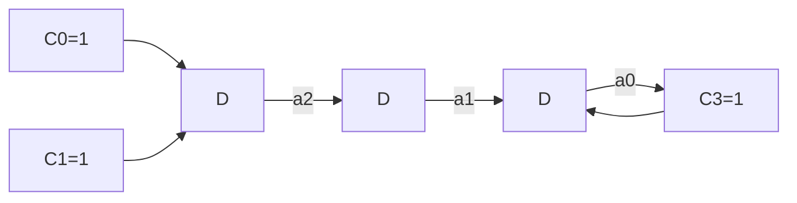
</details>

图10.3.2 特征多项式 $f(x) = 1 + x + x^3$ 构成的3级反馈移位寄存器

$$
a _ {0} = a _ {- 1} \oplus a _ {- 3} = 1, a _ {1} = a _ {0} \oplus a _ {- 2} = 1, a _ {2} = a _ {1} \oplus a _ {- 1} = 1, \dots
$$

最后可得所产生的 m 序列为 $\{a_{j}\}=\{a_{0},a_{1},a_{2},\cdots,a_{6}\}=\{1,1,1,0,1,0,0\}$ 。

方法二：通过长除运算获得生成多项式，从而获得所生成的序列。根据特征多项式 $f(x)=1+x+x^{3}$ 及初始状态 $\{a_{-3},a_{-2},a_{-1}\}=\{1,0,0\}$ ，由式（10.3.12）可得 $h(x)=1$ ，故生成多项式 $G(x)=1/f(x)$ ，长除的运算过程如下：

$$
\begin{array}{l} 1 + x + x ^ {3} \sqrt {\frac {1 + x + x ^ {2} + x ^ {4} + \cdots}{\frac {1 + x + x ^ {3}}{x + x ^ {3}}}} \\ \begin{array}{c} \frac {x + x ^ {2} + x ^ {4}}{x ^ {2} + x ^ {3} + x ^ {4}} \\ \frac {x ^ {2} + x ^ {3} + x ^ {5}}{x ^ {4} + x ^ {5}} \end{array} \\ \frac {x ^ {4} + x ^ {5} + x ^ {7}}{x ^ {7}} \\ \end{array}
$$

3级反馈寄存器产生的m序列周期为7，所以长除运算进行到余式为 $x^{7}$ 为止，因为继续做长除运算会周期性重复。由以上的长除过程可得生成多项式为

$$
G (x) = 1 + x + x ^ {2} + x ^ {4} + \dots
$$

由此可得生成的 m 序列为 $\{a_{j}\}=\{a_{0},a_{1},a_{2},\cdots,a_{6}\}=\{1,1,1,0,1,0,0\}$ 。☐

本原特征多项式数目 利用算术的因式分解理论，可求出 $n$ 阶移位寄存器的本原特征多项式的数目为[7]

$$
N _ {\mathrm{f}} (n) = \frac {\phi \left(2 ^ {n} - 1\right)}{n} \tag {10.3.13}
$$

式中，欧拉函数 $\phi (k)$ 表示不超过 $k$ 且与 $k$ 互素的正整数个数。一般来说

$$
\phi (k) = k \prod_ {i = 1} ^ {p} \frac {v _ {i} - 1}{v _ {i}} \leqslant k - 1 \tag {10.3.14}
$$

式中 $v_{i}, i=1,2,\cdots,p$ 是能够整除 k 的素数。表 10.3.2 给出了 n 级反馈移位寄存器不同的 m 序列本原特征多项式数目 $N_{f}$ 及最大长度周期 N。

表 10.3.2 m 序列的序列数

| n | $N = 2^n - 1$ | $N_f$ | n | $N = 2^n - 1$ | $N_f$ |
|---|---|---|---|---|---|
| 1 | 1 | 1 | 11 | 2047 | 176 |
| 2 | 3 | 1 | 12 | 4095 | 144 |
| 3 | 7 | 2 | 13 | 8191 | 630 |
| 4 | 15 | 2 | 14 | 16383 | 756 |
| 5 | 31 | 6 | 15 | 32767 | 1800 |
| 6 | 63 | 6 | 16 | 65535 | 2048 |
| 7 | 127 | 18 | 17 | 131077 | 7710 |
| 8 | 255 | 16 | 18 | 262143 | 7776 |
| 9 | 511 | 48 | 19 | 524287 | 27594 |
| 10 | 1023 | 60 | 20 | 1048575 | 24000 |

从表 10.3.2 中可以看出，即使移位寄存器的级数为 20 时，本原特征多项式数目也仅有 2 万多条，也即最多可生成 2 万多个不同的 m 序列，在多用户扩频系统中，面对几百甚至上千万用户的需求，其数目相对来说是比较少的。此后提出的 Gold 序列则较好地解决了这个问题，在移位寄存器级数相同的条件下，Gold 序列大大增加了可以产生的序列的条数。

m 序列的性质 m 序列是一种同样级数的线性反馈移位寄存器中能产生周期最大的序列，因而具有较好的伪随机特性。下面讨论反映 m 序列伪随机特性的主要性能指标，包括均衡性、游程分布、周期性和自相关特性等。

(1) 均衡性 所谓均衡性, 是指在 $\mathrm{m}$ 序列的一个周期内, 序列中 “1” 和 “0” 的数目基本相等,准确地说, “1” 的个数比 “0” 的个数多 1 个。比如, 例 10.3.1 中由 3 级反馈移位寄存器生成的 $\mathrm{m}$ 序列 $\{a_{j}\} = \{1,1,1,0,1,0,0\}$ , 其中 “0” 的个数为 3 个, “1” 的个数为 4 个, 比 “0” 的个数多 1 个。  
(2) 游程分布 所谓游程, 是指一个序列中取值相同的连续元素的合称。在一个游程中码元的个数称为游程长度。一般来说, 在 $n$ 级移位寄存器产生的 $\mathrm{m}$ 序列中, 游程个数为 $2^{n-1}$ , 其中长度为 1 的游程数占游程总数的 $1/2$ , 长度为 2 的游程数占游程总数的 $1/4$ , 长度为 3 的占 $1/8 \dots$ 以此类推, 长度为 $k$ 的游程数占游程总数的 $2^{-k}$ , $1 \leqslant k \leqslant n-2$ 。而且, 在长度为 $k$ 的游程中, 连 “1” 和连 “0” 的游程各占一半。比如, 例 10.3.1 的 $\mathrm{m}$ 序列中, 共有 4 个游程, 即 “111” “0” “1” 和 “00”, 其中长度为 1 的游程 2 个, 长度为 2 的游程 1 个, 长度为 3 的游程 1 个。  
(3) 移位相加性 所谓移位相加性, 是指一个 $\mathrm{m}$ 序列与其经任意次延迟移位产生的另一不同序列进行模 2 相加, 得到的仍是该 $\mathrm{m}$ 序列的某次延迟移位序列。比如, 例 10.3.1 中的 $\mathrm{m}$ 序列 1110100, 该序列左 (循环) 移 1 位后变成 1101001, 两序列进行模 2 加产生的一个新序列 0011101, 该序列可视为原序列右 (循环) 移 2 位后生成的结果。  
（4）周期性 m 序列的周期 $N=2^{n}-1$ ，其中 n 为反馈移位寄存器的级数。  
（5）自相关特性 根据式（10.3.2）计算自相关系数的公式，当序列的码元取值为“1”和“0”时，

其自相关系数可以表示为

$$
\rho_ {\mathrm{a}} (j) = \frac {1}{N} \sum_ {i = 0} ^ {N - 1} a _ {i} a _ {i + j} = \frac {A - D}{N} \tag {10.3.15}
$$

式中，A 为序列 $\{a_{n}\}$ 与移位序列 $\{a_{n+j}\}$ 在一个周期内对应元素相同的数目，D 为序列 $\{a_{n}\}$ 与移位序列 $\{a_{n+j}\}$ 在一个周期内对应元素不同的数目，N 为序列 $\{a_{n}\}$ 的周期。

序列 $\{a_{n}\}$ 与移位序列 $\{a_{n+j}\}$ 在一个周期内对应元素相同的数目，相当于序列 $\{a_{n}\}$ 与移位序列 $\{a_{n+j}\}$ 进行模2加时为“0”的元素个数，而序列 $\{a_{n}\}$ 与移位序列 $\{a_{n+j}\}$ 在一个周期内对应元素不同的数目，相当于序列 $\{a_{n}\}$ 与移位序列 $\{a_{n+j}\}$ 进行模2加时为“1”的元素个数，根据m序列的移位相加特性，序列 $\{a_{n}\}$ 与移位序列 $\{a_{n+j}\}$ 进行模2加产生的序列仍为序列 $\{a_{n}\}$ 的某个移位序列，因此该序列中“0”的个数比“1”的个数少1。因此，当 $j \neq 0$ 时， $A - D = -1$ ；也即，当 $j = 0$ 时， $D = 0$ ， $A - D = N$ 。由此可得m序列的自相关系数为

$$
\rho_ {\mathrm{a}} (j) = \left\{ \begin{array}{l l} \frac {A - D}{N} = 1, & j = 0 \\ \frac {A - D}{N} = - \frac {1}{N}, & j \neq 0 \end{array} \right. \tag {10.3.16}
$$

由上可知，m 序列的自相关系数只有 1 和 -1/N 两种取值，如图 10.3.3 所示，这种性质非常有利于扩频码的捕获。


<details>
<summary>spectrogram</summary>

| Interval | Amplitude |
| --- | --- |
| -2N to -N | 1 |
| -N to O | 1 |
| O to N | 1 |
| N to 2N | 1 |
</details>

图 10.3.3 m 序列的自相关系数特性

## 10.3.2 Gold 序列

虽然 m 序列容易产生，且其具有良好的双值自相关特性，系统的同步比较容易实现，但由于一定级数的线性移位寄存器所能产生的 m 序列的个数比较少 [只有 $\varphi(2^{n}-1)/n$ 个]，这样在多用户系统中可供选择的地址码数量少。为此，R. Gold 于 1967 年提出了利用 m 序列优选对构造的组合序列——Gold 序列。

m 序列优选对 所谓 m 序列优选对, 是指在 m 序列集中, 其互相关函数的最大绝对值 $\left|R_{ab}(j)\right|_{\max}$ 小于某个值的两个 m 序列。

设序列 $\{a\}$ 是对应于 $r$ 阶本原多项式 $f(x)$ 产生的 $\mathrm{m}$ 序列, 序列 $\{b\}$ 是对应于 $n$ 阶本原多项式 $g(x)$ 产生的 $\mathrm{m}$ 序列。R. Gold 证明了当它们的互相关函数值 $R_{ab}(j)$ 满足

$$
\left| R _ {a b} (j) \right| \leqslant \left\{ \begin{array}{l l} 2 ^ {\frac {n + 1}{2}} + 1, & n \text {为奇数} \\ 2 ^ {\frac {n + 2}{2}} + 1, & n \text {为偶数，但不被4整除} \end{array} \right. \tag {10.3.17}
$$

时， $f(x)$ 和 $g(x)$ 生成的 m 序列 $\{a\}$ 和 $\{b\}$ 构成一对优选对。

Gold 序列的产生方法 Gold 序列是 m 序列的组合序列，由两个长度相同、速率相同但码字不同的 m 序列优选对通过模 2 加后得到，具有良好的自相关和互相关特性，且生成的序列数远大于 m 序列。一对由 n 级移位寄存器产生的 m 序列优选对可以产生 $2^{n} + 1$ 个 Gold 序列。这是因为只要 m 序列优选对中两个序列的相对相位不同（比如以其中一个序列为参考，对另一个序列进行循环移位），就可以生成一个新的 Gold 序列。n 级移位寄存器产生的 m 序列的周期为 $2^{n}-1$ ，因此一共可以产生 $2^{n}-1$ 个新的 Gold 序列，再加上 m 序列优选对，一共有 $2^{n}+1$ 个序列。这 $2^{n}+1$ 个序列称为一个 Gold 序列族（或称


<details>
<summary>flowchart</summary>

```mermaid
graph LR
  A["m序列1 发生器"] --> C((""))
  B["m序列2 发生器"] --> C
  C --> D["Gold 序列"]
  D --> E["注：序列1与序列2是能构成优选对的两不同的m序列"]
```
</details>

图 10.3.4 Gold 序列生成器

为 Gold 码族）。

由 m 序列优选对生成 Gold 序列时，只需将两个 m 序列的输出进行模 2 加即可，如图 10.3.4 所示。只要给生成 m 序列的 n 级寄存器赋予不同的初始值，就可产生不同的 Gold 序列。

Gold 序列的相关特性 Gold 序列虽然是由 m 序列优选对组合构造而成的，但它已不是 m 序列，并不具有 m 序列的均衡性、游程特性及二值相关特性。但 Gold 序列仍然具有较好的自相关和互相关特性，Gold 序列族内各序列的自相关和互相关特性呈现为三值相关特性。Gold 序列的互相关特性如表 10.3.3 所示。

表 10.3.3 Gold 序列互相关特性

| 寄存器长度 | 码长 | 归一化互相关函数值 | 出现概率 |
|---|---|---|---|
| n为奇数 | $N = 2^n - 1$ | -1/N $-\left(2^{(n+1)/2} + 1\right)/N$ $\left(2^{(n+1)/2} + 1\right)/N$ | 0.500.250.25 |
| n为偶数,但不被4整除 | $N = 2^n - 1$ | -1/N $-\left(2^{(n+2)/2} + 1\right)/N$ $\left(2^{(n+2)/2} + 1\right)/N$ | 0.750.1250.125 |

Gold 序列的自相关函数特性与互相关函数一样，都是三值函数，只是不同函数值出现的概率不同。Gold 序列族之间的互相关函数目前尚无理论结果，其互相关值已不再是三值，而是多值，且大大超过了优选对的互相关函数值。

正是由于 Gold 序列在数量上远远超过 m 序列，且具有良好的相关特性，在实际工程中获得了广泛应用，比如 3G 系统中的 WCDMA 就采用了 Gold 序列作为地址码。

## 10.4 直接序列扩频技术

在 10.2 节已经介绍，所谓直接序列扩频，是指基带数字信息经过数字调制（如 BPSK、QPSK 等）后，直接利用扩频序列（如 m 序列、Gold 序列等）进行扩频处理；在接收端，则需要利用与发送端同步的扩频序列进行解扩处理，以恢复原始数字信号。直接序列扩频系统也简称为直扩系统。本节主要介绍采用 BPSK 进行数字调制时的扩频处理和解扩处理的工作原理。

BPSK 直接序列扩频是直接序列扩频中最简单的形式。假设待发送的数字信号 $d(t)$ 为二进制双极性脉冲信号，取值为 “+1” 和 “-1”，载波功率为 P，角频率为 $\omega_{0}$ ，并假设载波初始相位为零，则载波信号 $s(t)$ 可以表示为

$$
s (t) = \sqrt {2 P} \cos \omega_ {0} t \tag {10.4.1}
$$

扩频操作可以在调制前进行,也可在调制后进行,两种方法所得的结果相同,实现方法分别如图10.4.1(a)和(b)所示。

假定扩频操作在调制后进行，经过 BPSK 调制后的信号可以表示为


<details>
<summary>flowchart</summary>

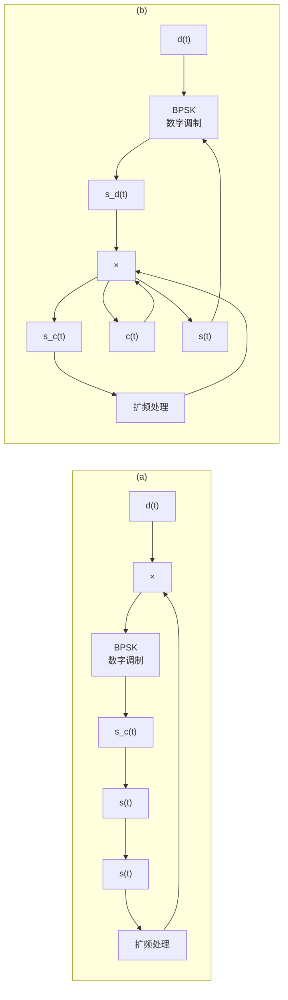
</details>

图 10.4.1 BPSK 直接序列扩频原理框图

$$
s _ {\mathrm{d}} (t) = \sqrt {2 P} d (t) \cos \omega_ {0} t \tag {10.4.2}
$$

扩频信号 $c(t)$ 一般为二进制双极性脉冲信号, 不妨假定其取值为 “+1” 和 “-1”。利用扩频信号 $c(t)$ 对已调的 BPSK 信号 $s_{\mathrm{d}}(t)$ 进行扩频处理, 相当于用 $c(t)$ 与 $s_{\mathrm{d}}(t)$ 直接相乘, 由此扩频后的信号 $s_{\mathrm{c}}(t)$ 可以表示为

$$
s _ {\mathrm{c}} (t) = \sqrt {2 P} d (t) c (t) \cos \omega_ {0} t \tag {10.4.3}
$$

在接收端, 接收机接收的信号 $r(t)$ 中除了包含有期望的目标信号 $s'(t)$ , 还包含有高斯白噪声 $n(t)$ 及可能的窄带强干扰信号 $J(t)$ 。若信道特性比较理想, 则期望的目标信号 $s'(t)$ 是发送信号 $s_c(t)$ 的延时, 可以表示为 $A \cdot s_c(t - T_d)$ , 其中常数 $A$ 是系统增益系数, $T_d$ 是发送端与接收端之间的传播延时。因此, 接收的信号 $r(t)$ 可以表示为

$$
\begin{array}{l} r (t) = A \cdot s _ {\mathrm{c}} (t - T _ {\mathrm{d}}) + J (t) + n (t) \\ = A \sqrt {2 P} d (t - T _ {\mathrm{d}}) c (t - T _ {\mathrm{d}}) \cos [ \omega_ {0} (t - T _ {\mathrm{d}}) ] + J (t) + n (t) \tag {10.4.4} \\ \end{array}
$$

接收端的解扩处理可视为利用与发送端同步的扩频序列对接收信号进行再调制的过程，如图 10.4.2 所示。

假设接收端的扩频信号表示为 $c(t-\hat{T}_{\mathrm{d}})$ ，其中 $\hat{T}_{\mathrm{d}}$ 为接收端对传播延时的估计值，则解扩输出的信号可以表示为


<details>
<summary>flowchart</summary>

```mermaid
graph LR
  Input["Input Signal"] --> r(t)["r(t)"]
  r --> Sum(("+"))
  Sum --> Filter["带通\n滤波器"]
  Filter --> BPSK["BPSK\n数字解调"]
  BPSK --> d̂(t)["d̂(t)"]
  subgraph Amplification
  Amplification["解扩处理"] --> Sum
  c(t-T̂d)["c(t-T̂d)"] --> Sum
  end
```
</details>

图 10.4.2 BPSK 直接序列扩频的解扩处理

$$
r _ {\mathrm{d}} (t) = A \sqrt {2 P} d (t - T _ {\mathrm{d}}) c (t - T _ {\mathrm{d}}) c (t - \hat {T} _ {\mathrm{d}}) \cos [ \omega_ {0} (t - T _ {\mathrm{d}}) ] + J (t) c (t - \hat {T} _ {\mathrm{d}}) + n (t) c (t - \hat {T} _ {\mathrm{d}}) \tag {10.4.5}
$$

若接收端扩频信号与发送端扩频信号同步, 即 $c(t - \hat{T}_{\mathrm{d}}) = c(t - T_{\mathrm{d}})$ , 此时有 $c(t - \hat{T}_{\mathrm{d}}) \cdot c(t - T_{\mathrm{d}}) = 1$ , 则通过带通滤波器, 可以取出期望的目标信号。而对于窄带强干扰信号 $J(t)$ , 参见前面给出的图 10.2.3, 基带数字信号通过扩频处理后, 频带被展宽, 信号能量被扩散到较宽的频带上; 而通过解扩后, 信号能量重新聚集, 恢复为窄带信号。而对于窄带强干扰信号, 通过解扩处理模块后, 却相当于进行了扩频, 其频带被展宽, 在整个频带内的能量显著下降, 而且通过带通滤波器后, 仅落在带通范围内的干扰成分能进入后级解调电路中, 这样就有效地抑制了窄带强干扰的影响。

## 10.5 跳频技术

跳频系统虽然和直扩系统一样，是利用比信息实际带宽大得多的带宽来传输信息的，但它们的工作原理有本质区别。直扩系统中利用扩频序列直接对信息进行扩频处理，从而扩展信息带宽；而跳频系统则利用扩频序列控制频率合成器，使得发送信息的载波频率按一定速率在某个频率集上随机跳变。虽然从某个时刻来看，传输信息的带宽等于信息的实际带宽，但从一段时间来看，传输的信息会分布在整个频率集所在的带宽内，所以传输的带宽远大于信息的实际带宽。本节将介绍跳频系统的基本工作原理及跳频系统的核心部件——跳频器的工作原理。

## 10.5.1 跳频系统工作原理

跳频系统原理框图如图 10.5.1 所示，其基本工作原理简述如下。


<details>
<summary>flowchart</summary>

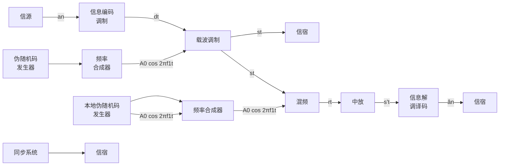
</details>

图 10.5.1 跳频系统原理框图

在发送端，信源产生的信息序列 $\{a_{n}\}$ 经过编码调制后成为数字信号 $d(t)$ ，然后通过载波调制变成射频信号 $s(t)$ 经过天线发送出去。从图10.5.1可以看出，与传统通信系统不同的是，跳频系统发送端的载波频率由频率合成器产生。这里的频率合成器是一个频率可调的振荡器，受伪随机序列控制，频率合成器输出信号的频率会在 $N$ 个频率之间“随机”跳变，使得发送信号 $s(t)$ 的载频不固定，从而可以有效躲避干扰。

在接收端，接收信号 $r(t)$ 通过与本地载波混频后，通过中放电路产生中频信号 $s'(t)$ ，然后通过解调译码后恢复为信息序列 $\{\hat{a}_n\}$ 。为了能顺利解调出接收信号，本地载波的频率同样需要在不同频率之间跳变，且跳变规律必须与发送端载波的跳变规律一致，这需要由特定的同步系统来保证。

假设信源产生的信息序列为 $\{a_{n}\}, a_{n} \in \{0,1\}$ ，经编码调制后的数字信号 $d(t)$ 可以表示为

$$
d (t) = \sum_ {n = 0} ^ {\infty} a _ {n} g (t - n T _ {\mathrm{S}}) \tag {10.5.1}
$$

式中， $g(t)$ 为符号脉冲的信号波形， $T_{S}$ 为信息码元宽度。

假设频率合成器产生的频率为 $f_{i}, f_{i} \in \{f_{1}, f_{2}, f_{3}, \cdots, f_{N}\}$ ，即 $f_{i}$ 在 $(k-1)T_{h} \leqslant t < kT_{h}$ 时间范围内取值为频率集 $\{f_{1}, f_{2}, f_{3}, \cdots, f_{N}\}$ 中的一个频率，具体取值则由伪随机序列值确定， $T_{h}$ 为每一频率的驻留时间。

用数字信号 $d(t)$ 去调制频率合成器产生的频率为 $f_{i}$ 的载波，可得射频信号为

$$
s (t) = d (t) \cos 2 \pi f _ {i} t \tag {10.5.2}
$$

在接收端，天线收到的信号 $r(t)$ 包括有用信号、干扰信号、噪声及其他跳频网络的信号，可以表示为

$$
r (t) = s (t) + j (t) + s _ {\mathrm{J}} (t) + n (t) \tag {10.5.3}
$$

式中， $s(t)$ 为希望接收的有用信号； $j(t)$ 为干扰； $s_{\mathrm{J}}(t)$ 为其他跳频信号，如果 $s_{\mathrm{J}}(t)$ 在同一时刻采用的载波频率与 $s(t)$ 的载波频率一致，则相互间会产生干扰； $n(t)$ 为噪声分量。

在混频器中，接收信号与本地载波相乘实现混频，混频后的信号可以表示为

$$
\begin{array}{l} r ^ {\prime} (t) = r (t) \cos 2 \pi f _ {j} t = [ s (t) + j (t) + s _ {\mathrm{J}} (t) + n (t) ] \cos 2 \pi f _ {j} t \tag {10.5.4} \\ = s (t) \cos 2 \pi f _ {j} t + j (t) \cos 2 \pi f _ {j} t + s _ {\mathrm{J}} (t) \cos 2 \pi f _ {j} t + n (t) \cos 2 \pi f _ {j} t \\ \end{array}
$$

接收端本地载波的频率 $f_{j}$ 同样由受伪随机序列控制的频率合成器产生，其中频率 $f_{j}$ 为频率集 $\{f_{1} + f_{IF}, f_{2} + f_{IF}, f_{3} + f_{IF}, \cdots, f_{N} + f_{IF}\}$ 中的一个， $f_{IF}$ 为中频频率。当本地伪随机码与发送端伪随机码取得同步时，本地载波频率的变化规律与发送端载波的变化规律一致，此时接收端本地载波的频率 $f_{j}$ 与发送端载波频率 $f_{i}$ 只相差一个固定的中频频率 $f_{\mathrm{IF}}$ ，即 $f_{j} = f_{i} + f_{\mathrm{IF}}$ 。此时，有用信号分量经过混频后可以表示为

$$
\begin{array}{r l} s (t) \cos 2 \pi f _ {j} t & = d (t) \cos 2 \pi f _ {i} t \cos 2 \pi f _ {j} t \\ & = \frac {1}{2} d (t) \cos 2 \pi (f _ {j} + f _ {i}) t + \frac {1}{2} d (t) \cos 2 \pi (f _ {j} - f _ {i}) t \end{array} \tag {10.5.5}
$$

中放的工作频率为 $f_{\mathrm{IF}}$ ，因此只有差频信号分量 $\frac{1}{2} d(t)\cos 2\pi (f_j - f_i)t$ 可以通过，即

$$
s ^ {\prime} (t) = \frac {1}{2} d (t) \cos 2 \pi \left(f _ {j} - f _ {i}\right) t = \frac {1}{2} d (t) \cos 2 \pi f _ {\mathrm{IF}} t \tag {10.5.6}
$$

该中频信号通过解调译码后，可恢复发送的信息序列 $\{\hat{a}_n\}$ 。

而对于干扰分量 $j(t)$ 及其他跳频网络信号分量 $s_{\mathrm{J}}(t)$ ，经过混频后，其发送端的频率变化规律与接收端的频率变化规律不一致，因此这些信号被搬移到中频频带以外，不能进入中放及后续的解调器和译码器，对有用信号形成不了干扰，从而达到抗干扰的目的。

对于噪声分量 $n(t)$ ，由于其通常为高斯白噪声，经混频后，噪声分量与一般的非跳频系统一样，没有变化，也即跳频系统对白噪声无处理增益。

从以上分析中可以看出，跳频系统的抗干扰原理与直扩系统的抗干扰原理有很大的不同。

在跳频系统中，发送端的载频受伪随机序列的控制，不断“随机”改变，以躲避干扰。在接收端，本地伪随机码与发送端伪随机码同步后，本地载波的频率与发送端载波的频率变化规律一致，这样有用信号分量通过混频后能顺利进入中频频带内，从而能实现正常解调译码；而对于干扰分量，其不知道跳频系统的载频的变化规律，在接收端经过混频后不能进入中频频带内，因此不能形成干扰，这样跳频系统达到了抗干扰的目的。

而在直扩系统中，接收端通过解扩处理，把干扰功率分散到更宽的频带中，从而降低了干扰信号的功率，提高了解调器的输入信干比，达到了抗干扰的目的。

一般的跳频系统可根据跳频速率分为快速跳频、中速跳频和慢速跳频。而划分的方式通常有两种：第一种是将跳频速率 $R_{\mathrm{h}} (= 1 / T_{\mathrm{h}})$ 与信息速率 $R_{\mathrm{S}} (= 1 / T_{\mathrm{S}})$ 相比较来划分，若跳频速率 $R_{\mathrm{h}}$ 大于信息速率 $R_{\mathrm{S}}$ 则称为快速跳频；反之，称为慢速跳频。另一种则直接以跳频速率的大小来划分：慢速跳频，指跳频速率为 $10 \sim 100$ 跳/秒（h/s）；中速跳频，指跳频速率为 $100 \sim 500 \mathrm{~h} / \mathrm{s}$ ；快速跳频，指跳频速率超过 $500 \mathrm{~h} / \mathrm{s}$ 。跳频速率的不同，其抗干扰性能也不同，实现的复杂程度和成本也不同。一般来说，跳频速率越高，其抗干扰的性能越好，但实现的复杂程度和成本也越高。

## 10.5.2 跳频器

跳频器组成及有关要求 跳频器是跳频通信系统中的核心部件。跳频系统的发送端和接收端均需要通过跳频器来产生一个受伪随机序列控制的随机跳变的载波频率。跳频器主要由能产生多种频率的频率合成器和控制频率跳变的伪随机码发生器组成。其中，伪随机码的每一种状态对应于频率合成器的一个频率，因此，伪随机码在一个周期中的状态越多，能输出的频率数就越多。对跳频器的主要要求如下：

（1）输出信号的频谱要纯，输出频率有很好的稳定度和准确度。  
(2) 跳频图案要多, 频率跳变的随机性要强。  
（3）频率转换速度要快，输出频率数要多。

对于跳频器来说，跳频数和跳频速率是决定整个跳频系统性能的关键参数。

频率合成器 跳频器的关键部件是频率合成器。所谓频率合成器，是指能以一个或少量的标准频率为频率标准，导出多个或大量的输出频率，其频率稳定度和准确度与标准频率源一样。频率合成器产生的频率主要是通过对这几个标准频率的加、减、乘、除等运算来完成的，在电路上则可用混频、倍频和分频电路实现。常见的频率合成器有如下几种。

(1) 直接式频率合成器 直接式频率合成器直接把主频率经分频、倍频和混频后, 得到不同的频率, 因而输出频率的准确性和稳定性与主频率相同。构成直接式频率合成器的一种基本单元是 “和频-分频” 电路, 如图 10.5.2 所示。直接式频率合成器可由多个 “和频-分频” 电路级联而成, 如图 10.5.3 所示。


<details>
<summary>flowchart</summary>

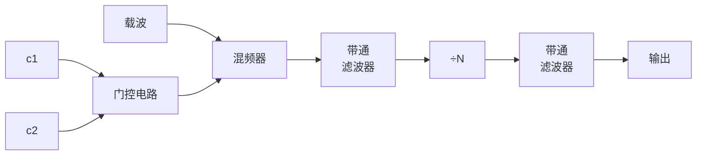
</details>

图 10.5.2 和频-分频电路原理框图


<details>
<summary>flowchart</summary>

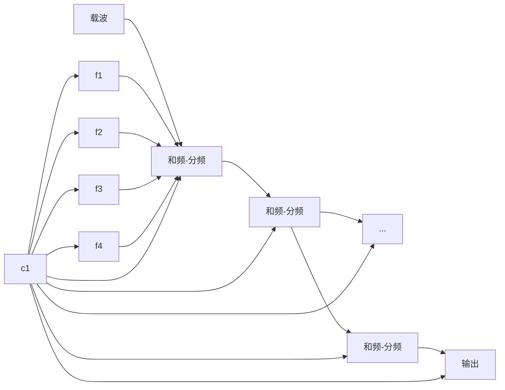
</details>

图 10.5.3 直接式频率合成器组成框图

在图 10.5.2 所示的和频-分频电路中，考虑的是有 4 个基准频率 $(f_{1}, f_{2}, f_{3}, f_{4})$ 的情形，需要两位控制码 $(c_{1}, c_{2})$ ，由这两位控制码控制门控电路选择其中的一个频率进入混频器，与载波进行混频，由带通滤波器选出混频后的和频信号，然后通过分频器进行分频。其中的带通滤波器可以抑制组合频率，提高输出频率的纯度，但会产生一定的延迟，而多个级联的带通滤波器的总延时会影响跳频的速率，直接式频率合成器的转换时间一般在毫秒级。在图 10.5.3 所示的频率合成器中，假设基准频率的个数为 K，级联的“和频-分频”基本单位数为 M，则其可以合成的频率总数为 $K^{M}$ 。


<details>
<summary>flowchart</summary>

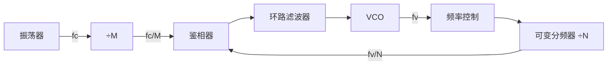
</details>

图 10.5.4 间接式频率合成器

（2）间接式频率合成器 间接式频率合成器通过锁相环路控制的一个可变振荡器，得到不同的输出频率，如图 10.5.4 所示。根据锁相环路原理可知，锁相环锁定时，VCO 输出频率 $f_{o}$ 与振荡器输出基准频率 $f_{c}$ 之间的关系是

$$
f _ {\mathrm{o}} = \frac {N}{M} f _ {\mathrm{c}} \tag {10.5.7}
$$

通常，分频后的基准频率 $f_{c}/M$ 是固定的，它是跳频通信的频道间隔。由式（10.5.7）可知，环路输出频率 $f_{0}$ 是随 N 变化的一组以 $\Delta f = f_{c}/M$ 为频率间隔的不连续频率。间接式频率合成器的转换时间为毫秒级，适合中、慢速跳频；它产生的频率稳定度取决于参考频率的稳定度，一般具有较高的稳定度。

(3) 直接数字式频率合成器 直接式数字频率合成器 (Direct Digital Synthesis, DDS) 是近年来发展非常迅速的一种器件, 它采用全数字技术, 具有分辨率高、频率转换时间快、相位噪声低等特点。DDS 的工作原理如图 10.5.5 所示, 包含相位累加器、波形存储器、数/模转换器和低通滤波器等四部分。其中由相位累加器和波形存储器构成数控振荡器。DDS 的基本工作原理是: 在波形存储器中预先存放

输出信号波形在一个周期内的相位与幅度关系，其中信号波形可以是正弦波、方波、三角波等。在参考时钟的驱动下，每个时钟脉冲到来时，相位累加器对频率控制字累加一次，然后根据得到的相位值在波形存储器中查表，输出对应信号幅度的量化值，通过数/模转换器生成阶梯波形，最后通过低通滤波器获得所需频率的连续波形。


<details>
<summary>flowchart</summary>


</details>

图 10.5.5 DDS 原理框图

需要说明的是，频率控制字设定的是相位累加器累加相位的步长，只要改变频率控制字，就可以改变累加器加到溢出时的累加次数（即输出信号的一个周期需要累加相位的次数），从而可以改变输出信号的频率。比如，假设相位累加器的长度为 $N$ ，则总共可以表示 $2^{N}$ 个不同的状态，这样可以表示信号在一个周期内的 $2^{N}$ 个不同相位，因此波形存储器中可以预先存储这 $2^{N}$ 个不同相位对应的幅度值。如果频率控制字为 1，相当于需要累加 $2^{N}$ 次才能输出信号的一个周期，也即输出信号的周期为参考时钟周期 $T_{\mathrm{c}} = 1 / f_{\mathrm{c}}$ 的 $2^{N}$ 倍，所以输出信号的频率为 $f_{\mathrm{c}} / 2^{N}$ ，这是当累加器长度 $N$ 及参考时钟频率 $f_{\mathrm{c}}$ 一定时可以输出的最低频率。如果频率控制字为 $M$ ，则只需累加 $2^{N} / M$ 次就可以输出信号的一个周期，因此输出信号的频率为 $M \cdot f_{\mathrm{c}} / 2^{N}$ 。波形存储器中预先存储的 $2^{N}$ 个不同相位对应的幅度值，相当于输出信号一个周期内的 $2^{N}$ 个采样值，根据抽样定理可知，至少要输出一个周期内的两个抽样值才能恢复该信号，即要求相位累加器在信号的一个周期内至少累加两次（相位累加器每累加一次，即输出一个采样值），频率控制字应满足 $M \leqslant 2^{N - 1}$ ，因此可以输出的信号频率 $f_{\mathrm{o}}$ 最高为 $f_{\mathrm{c}} / 2$ 。

DDS 的主要特点如下。

(1) 频率分辨率高 理论上, 只要相位累加器的长度 $N$ 足够大, 就可以获得足够高的频率分辨率。当频率控制字 $M = 1$ 时, DDS 产生信号的频率最低, 为 $f_{\mathrm{c}} / 2^{N}$ , 称为频率分辨率。  
(2) 输出频率的相对带宽很宽 DDS 可以产生的信号最高频率为 $f_{\mathrm{c}} / 2$ ，但由于受到低通滤波器对过渡特性及高端信号频谱恶化的限制，实际工程中可实现的最高频率一般为 $0.4 f_{\mathrm{c}}$ 。另外，当频率控制字为 0 时，可以输出直流信号。因此，DDS 的输出频率范围一般是 $0 \sim 0.4 f_{\mathrm{c}}$ ，这样的相对带宽是传统频率合成技术无法实现的。  
(3) 具有任意波形输出能力 只要改变波形存储器中存储的数据, 即可产生方波、三角波、锯齿波等任意波形的周期信号。  
(4) 频率转换时间短 DDS 的频率转换时间主要由频率控制字的传输时间和低通滤波器的频率响应时间等构成, 对于高速 DDS 系统, 其频率转换时间极短, 可以达到纳秒数量级。

## 10.6 扩频系统的同步

一般数字通信系统中的同步，通常包括位同步（码元同步）、帧同步、载波同步等。而扩频系统的同步，除了有以上的同步要求，还需要一种特殊的同步，即扩频码同步。前面几节的讨论中，在对接收端信号进行解扩（或解跳）处理分析时，均假定接收端本地能产生一个与发送端变化规律完全一致的伪随机码，这里的变化规律一致是指扩频码已经同步。本节讨论接收端实现扩频码同步的方法，包括扩频码的捕获与跟踪，这是保证扩频系统能正常工作的重点和难点问题。

扩频码的捕获与跟踪是扩频码同步过程中的两个步骤，如图 10.6.1 所示。接收端首先对接收到的信号进行搜索，估计出发送端扩频码的初始相位，并调整本地扩频码的相位，当收发两端扩频码的相位差小于一个扩频码的码元（扩频码的码元也称码片，有些文献称其为切普，来自英文单词 Chip 的谐音）时，表示捕获成功，此时停止搜索，转入跟踪状态。在跟踪状态，主要利用延迟锁定环路来进一步减小收发两端扩频码的相对延迟差异，使之满足系统解调的需要。在系统的工作过程中，会保持对同步信号不断地进行检测，一旦发现同步信号丢失，马上转入同步捕获阶段，进行新的同步过程。


<details>
<summary>flowchart</summary>

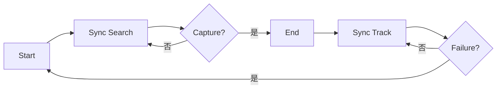
</details>

图 10.6.1 同步过程示意图

扩频系统中，对同步的基本要求是同步时间短、同步概率大、虚警概率低等，同时还要求同步电路易于实现、体积小、成本低等。因为直扩系统和跳频系统的工作原理及对信号的处理方式有所不同，所以采用的同步方式也有所不同。本节在对扩频码的捕获和跟踪进行阐述时，将分别介绍直扩系统和跳频系统的同步。

## 10.6.1 扩频码的捕获

扩频码的捕获的主要任务是，接收端在未知发送端信号扩频码相位的前提下，利用接收信号本身或某些辅助信号，估计出发送端信号扩频码的初始相位，并调整本地扩频码的相位，使收发两端的扩频码的相位差小于扩频码的一个码片。扩频码的捕获方法主要可以分为两大类。

一类是利用辅助信号的同步捕获方法，如发送参考信号法、发射公共时钟基准法、同步头法、突发同步法等，类似于第9章锁相环一节中介绍过的间歇同步。这些方法由于需要发送端发送一些特殊的辅助信号，在具体应用时会受到一定的限制。

另一类是利用接收信号本身的同步捕获方法，也称自同步法，这是本节主要介绍的方法。这种方法主要利用了扩频码的自相关特性，即在码序列同步时，相关函数值最大，而不同步时，相关函数值很小，这是自同步法的基本依据。利用自同步法进行同步捕获一般有以下几个步骤[6]：（1）确定要搜索的扩频码相位的区域；（2）调整本地参考扩频码的相位；（3）求解扩频码的相关函数值；（4）对所求相关值进行判决。

根据区域的搜索方法，扩频码的同步捕获可以分为序列相位顺序搜索法、序列相位概率分布搜索法；根据改变本地参考扩频码相位的方法，又可以分为序列相位步进捕获法、序列滑动相关捕获法等；根据同步捕获的判决方法不同，可以分为单积分判决和多积分判决同步捕获；根据使用相关器件的不同，可分为相关器同步捕获、匹配滤波器同步捕获等。虽然分类方法各有不同，但它们的基本思路是相同的：通过调整本地参考扩频码的相位，求解扩频码的相关函数值，利用相关函数值的峰值估计出发送端扩频码的相位。而各种不同的同步方法只是采用了不同的技术手段来改善同步捕获的性能，比如，通过改进搜索策略来缩短同步捕获的时间，通过多积分判决等措施来提高同步概率，降低虚警概率等。

下面主要介绍经典的滑动相关捕获法，它是基于序列相位搜索法建立起来的。所谓滑动相关，是指当本地参考扩频码产生器的时钟频率与接收扩频码的时钟频率有一定的偏差时，通过改变本地参考扩频码产生器的时钟频率来达到改变码序列的相位的目的，在此过程中，两个码序列从相位上看，好像在相对滑动。当收发两端的扩频码相位一致时，相关器输出一个比较大的相关峰值，此时说明捕获成功，停止滑动，转入跟踪状态。滑动相关捕获在实现上有两种不同的基本结构，即串行捕获和并行捕获，后来还提出了一种改进的串/并混合捕获。

串行捕获法 下面分别介绍 DSSS 系统的串行捕获和 FH 系统的串行捕获方法。

(1) DSSS 系统的串行捕获法 DSSS 系统串行捕获的原理框图如图 10.6.2 所示, 接收端接收到的直扩信号首先与本地载波进行混频, 输出中频信号后再与本地扩频信号进行相乘实现相关运算, 经过带通滤波器滤除带外噪声后, 由平方律检波器完成包络检波, 然后通过积分器进行一段时间的积分, 最后送入门限比较器进行判决。若积分器输出的值大于某个门限值, 则说明收发两端扩频码的相位差小于一个码片, 已经取得初始同步, 因此可以停止搜索, 转入同步跟踪回路以进一步缩小收发两端扩频码的相位差。若积分器输出的值小于门限值, 说明收发两端扩频码的相位差大于一个码片, 此时输出一个信号给时钟控制电路以调整时钟频率, 改变的时钟频率会使扩频码发生器产生的扩频码序列的相位产生 1/2 个码片的相对滑动, 然后开始新一轮的判决过程, 包括前面的相关、平方律检波、积分、判决等, 直到积分器输出的值大于门限值为止, 停止搜索, 转入跟踪回路。

需要说明的是, 滑动相关过程中没有载波同步, 因此不能进行相干检测, 只能采用非相干检测,比如平方律包络检波。另外, 积分器的积分时间应尽可能长一些, 比如接近信息码元宽度 (或者 $N$ 倍的扩频码片宽度, $N$ 为扩频系数, 即伪随机码的周期)。


<details>
<summary>flowchart</summary>

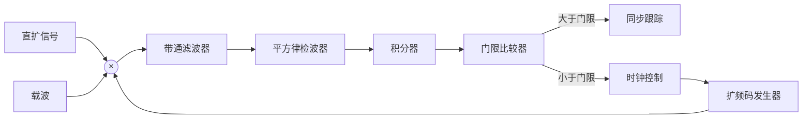
</details>

图 10.6.2 直扩系统串行捕获原理框图

(2) FH 系统的串行捕获法 FH 系统串行捕获的原理框图如图 10.6.3 所示, 其工作原理与直扩系统的非常类似, 主要包括相关、平方律检波、积分、判决、调整时钟频率等过程, 这里不再赘述。主要有两点区别: 一是跳频系统中积分器的积分时间是一跳的驻留时间 (即每一跳频率保持不变的持续时间), 也相当于是扩频码的码片时间。而直扩系统中的积分时间是信息码元的时间, 通常接近扩频码码片时间的 $N$ 倍。通常情况下, 跳频系统中扩频码的码片时间比直扩系统的码片时间大得多, 因此两种系统中的积分时间在数量级上应该相差不太大。二是门限比较器之后需要一个计数器, 记录大于门限的次数。这是由于门限比较器每次判决的仅是一个频点上是否出现相关峰值, 为了提高检测概率,通常需要检测多个频点的相关峰值, 只有当多个频点的相关峰值均大于门限值时, 才认为捕获成功。


<details>
<summary>flowchart</summary>

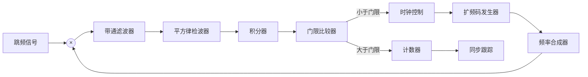
</details>

图 10.6.3 跳频系统串行捕获原理框图

从以上串行捕获原理框图中可以看出, 串行捕获的最大优点是结构简单, 只需要一个相关器。但其不足之处是平均捕获时间比较长。从串行捕获的工作原理可以看出, 每次积分判决小于门限时, 扩频码相位仅相对滑动 1/2 个码片时间, 因此, 当收发两端扩频码初始相位相差比较大时, 比如相差 $M$ 个码片, 则共需要 $2M$ 次积分判决才能完成捕获。完成一次判决需要的时间主要由积分器的时间决定, 因此捕获时间约为积分器积分时间的 $2M$ 倍。由此可见, 当系统对捕获时间有较高要求时, 串行捕获可能不能满足要求。一种减小捕获时间的方法是并行捕获法。

并行捕获法 下面分别介绍 DSSS 系统的并行捕获和 FH 系统的并行捕获方法。

(1) DSSS 系统的并行捕获法 DSSS 系统并行捕获的原理框图如图 10.6.4 所示。并行捕获的基本思想是, 同时产生所有不同相位的扩频信号, 其中肯定有一路扩频信号与发送端扩频信号的相位比较接近。只要将它们分别与接收信号做相关运算, 则出现最大相关峰值的这路扩频信号与发送端扩频信号的相位最接近。比如, 假设扩频码的周期为 $N$ , 表示共有 $N$ 个不同的相位, 则扩频信号发生器同时输出 $N$ 路信号, 每路扩频信号间隔一个码片时间。这 $N$ 路扩频信号分别与接收信号做相关运算, 并经过平方律检波和积分后, 由最大值选择电路选出其中的最大值, 则该路信号对应的扩频码的相位与接收信号的扩频码的相位最接近。由此可见, 只需要一个判决周期即可实现捕获, 捕获时间约等于积分器的积分时间。但是, 当扩频码周期比较长, $N$ 比较大时, 则需要的相关电路很多, 造成电路非常复杂, 这也是并行捕获的不足之处。  
(2) 跳频系统的并行捕获法 FH 系统并行捕获的原理框图如图 10.6.5 所示, 其工作原理与直扩系统的并行捕获有较大区别。其中, 采用了一组不同中心频率的带通滤波器, 分别对应跳频系统的不同频点, 通过带通滤波器的信号经过平方检波电路后, 进入由跳频图案控制的开关。开关闭合后, 将某路信号送入积分器, 积分器的积分时间为一个码片的时间 (即一跳的驻留时间)。积分后的信号进入延

迟时间为一个码片的延时器，共有 N-1 级延迟器（N 为扩频码周期）。经过延迟的 N 路信号同时送入加法器，然后送入门限比较器进行判决。当加法器输出的值大于门限值时，说明受本地跳频图案控制的开关的变化规律与发送端跳频图案的变化规律一致，此时捕获成功；当加法器输出的值小于门限时，则通过时钟控制电路改变扩频码发生器产生的扩频信号的相位，从而改变开关的变化规律，继续进行同步捕获。


<details>
<summary>flowchart</summary>

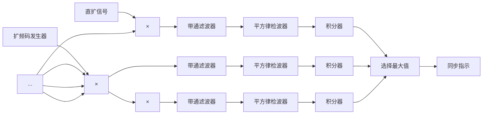
</details>

图 10.6.4 直扩系统并行捕获原理框图  


<details>
<summary>flowchart</summary>

```mermaid
graph LR
  A["跳频信号"] --> B["滤波器 f1"]
  A --> C["滤波器 f2"]
  A --> D["滤波器 fN"]
  B --> E["平方律检波器"]
  C --> F["平方律检波器"]
  D --> G["平方律检波器"]
  E_--o_H["积分器"]
  F --o H
  G --o H
  HS["H -- S"] --> H
  H --> I["延迟 Tc"]
  I --> J["延迟 Tc"]
  I --> K["加法器"]
  K --> L["门限比较器"]
  L --> M["时钟控制"]
  M --> N["扩频码发生器"]
  N --> O["指令译码器"]
  O --x H
  J --> K
  J --> K
  K --> P["同步跟踪"]
```
</details>

图 10.6.5 跳频系统并行捕获原理框图

从前面的分析可以看出，对于 DSSS 系统，并行捕获显著减小了捕获时间，提高了捕获速度。对于跳频系统，并行捕获反而比串行捕获的捕获时间长。这是因为在并行捕获中，做一次加法的时间为 $NT_{c}$ （其中 N 为扩频码周期， $T_{c}$ 为码片时间），这也是做一次判决的时间，也就是说，对于不同步的相位，需要经过一个周期才能确定。而在串行捕获中，做一次判决的时间为一个码片时间，因此，对于不同步的相位能迅速剔除，从而减小了平均捕获时间。

## 10.6.2 扩频码的跟踪

扩频码的跟踪 接收端完成扩频码的捕获之后，收发两端的扩频码之间仍可能存在一个码片的相位差，此时还不能满足解扩的要求，需要通过跟踪来进一步减小收发两端扩频码之间的相位差。

扩频码的跟踪通常采用延时锁定环路（Delay Locked Loop，DLL）来实现。延时锁定环路在原理上与相位锁定环路非常相似，也是通过一种非线性的反馈环路来实现输出信号对输入信号的跟踪的。在延时锁定环路中，利用延迟锁定鉴别器来产生延时误差信号，而该误差信号是接收信号与本地参考信号的两个不同相位（超前和滞后）之间的相关值的差值。

扩频码的跟踪环路通常可以分成两大类：一类是相干同步跟踪环路，另一类是非相干同步跟踪环路，其中前者需要利用接收信号的相位信息，而后者不需要。但在扩频系统中，扩频信号通常淹没在噪声之中，在解扩之前要提取信号的相位信息非常困难，因此在扩频系统中，通常采用非相干同步跟踪环路。下面将主要介绍两种非相干同步跟踪环路：包络相关跟踪环路和 $\tau$ -抖动跟踪环路。

包络相关跟踪环路 包络相关跟踪环路主要由延迟锁定鉴别器、环路滤波器、压控振荡器、扩频码发生器等组成，如图10.6.6所示，其中延迟锁定鉴别器由两路包络相关电路构成。其工作过程如下：接收信号 $r(t)$ 与本地载波混频变换到中频后，分成两路，其中一路与相位超前 $T_{\mathrm{c}} / 2$ 的扩频信号 $c(t - \hat{T}_{\mathrm{d}} + T_{\mathrm{c}} / 2)$ 相乘（其中 $T_{\mathrm{c}}$ 为码片时间， $\hat{T}_{\mathrm{d}}$ 为本地对发送端扩频信号延迟值的估计值），通过带通滤波器、平方电路及低通滤波器实现包络相关，另一路与相位滞后 $T_{\mathrm{c}} / 2$ 的扩频信号 $c(t - \hat{T}_{\mathrm{d}} - T_{\mathrm{c}} / 2)$ 相乘，通过带通滤波器、平方电路及低通滤波器实现包络相关，这两路信号相减形成环路误差信号 $e(t)$ ，误差信号经环路滤波器后，控制压控振荡器的输出，从而调整本地扩频码发生器的相位，使收发两端扩频信号的延迟差减少到足够小。

延迟锁定环路的跟踪原理 假设本地扩频信号与发送端扩频信号经捕获后的延迟误差为 $\tau$ ，由前面对扩频码的捕获的分析可知， $\tau$ 小于或等于一个码片时间，即 $\tau \leqslant T_{c}$ 。而延迟锁定鉴别器中两个相关器的输出经包络检波后的相关函数波形如图 10.6.7(a) 和 (b) 所示。只要延迟锁定鉴别器中的两路包络相关电路参数一致，则输出的相关函数就是完全相同的，只不过是出现峰值的时刻不同，这是由用于相关的本地参考扩频信号的相位不同造成的。由图 10.6.7(a) 和 (b) 可知，参与相关的两路扩频信号相位相差一个码片 $T_{c}$ （其中一路超前 $T_{c}/2$ ，一路滞后 $T_{c}/2$ ），因此两个包络相关器输出的波形的相关峰值之间有一个码片的相对延迟。输出的误差信号为两路包络相关信号的差值，因此误差信号的波形可以表示为如图 10.6.7(c) 所示，这也是延迟锁定环路的鉴相特性。从图 10.6.7(c) 可以看出，延迟锁定鉴别器的工作范围（即鉴相特性曲线的负斜率部分）是 $-T_{c}/2 \sim +T_{c}/2$ 。在这个范围内，当本地扩频信号超前时，输出的误差信号大于零，通过控制压控振荡器改变扩频信号发生器输出扩频信号的相位，使之滞后；当本地扩频信号滞后时，输出的误差信号小于零，通过控制压控振荡器改变扩频信号发生器输出扩频信号的相位，使之超前，从而实现对扩频码的跟踪。


<details>
<summary>flowchart</summary>

```mermaid
graph LR
  A["r(t)"] --> B["本地载波"]
  B --> C["×"]
  C --> D["×"]
  D --> E["带通滤波器"]
  E --> F["平方电路"]
  F --> G["低通滤波器"]
  G --> H["+"]
  H --> I["e(t)"]
  I --> J["环路滤波器"]
  J --> K["压控振荡器"]
  K --> L["扩频码发生器"]
  L --> M["×"]
  M --> N["带通滤波器"]
  N --> O["平方电路"]
  O --> P["低通滤波器"]
  P --> Q["延迟锁定鉴别器"]
  Q --> R["c(t-Td+1/2Tc)"]
  R --> C
  S["c(t-Td-1/2Tc)"] --> T["×"]
  T --> U["×"]
  U --> V["去解扩"]
  V --> A
```
</details>

图 10.6.6 包络相关跟踪环路原理框图


<details>
<summary>text_image</summary>

(a)
Tc
(b)
e(τ)
(c)
O
τ
</details>

图 10.6.7 延迟锁定环路的相关波形

$\tau$ -抖动跟踪环路 对于包络相关跟踪环路，有一个比较苛刻的条件是，要求延迟锁定鉴别器中的两路包络相关电路参数必须一致，否则，通过相减合成的鉴相特性曲线会产生偏移，导致跟踪点的改变。为此提出了 $\tau$ -抖动跟踪环路。

$\tau$ -抖动跟踪环路的工作原理与包络相关跟踪环路的工作原理类似, 主要区别是在延迟锁定鉴别器中只有一路包络相关电路, 而通过开关在一路超前和一路滞后的扩频信号之间进行选择, 如图 10.6.8 所示。其中 $q(t)$ 为开关信号, 取值为 $+1$ 或 $-1$ 。当 $q(t) = +1$ 时, 开关接入超前 $T_{\mathrm{c}} / 2$ 的扩频信号进入相关器; 当 $q(t) = -1$ 时, 开关接入滞后 $T_{\mathrm{c}} / 2$ 的扩频信号进入相关器。


<details>
<summary>flowchart</summary>

```mermaid
graph LR
  A["r(t)"] --> B["本地载波"]
  B --> C["带通滤波器"]
  C --> D["平方电路"]
  D --> E["低通滤波器"]
  E --> F["e(t)"]
  F --> G["延迟锁定鉴别器"]
  G --> H["环路滤波器"]
  H --> I["压控振荡器"]
  I --> J["扩频码发生器"]
  J --> K["去解扩"]
  K --> L["c(t-Td)"]
  L --> M["c(t-Td+1/2Tc)"]
  J --> N["c(t-Td-1/2Tc)"]
```
</details>

图10.6.8 $\tau$ -抖动跟踪环路原理框图

跳频系统的跟踪环路 前面分析的跟踪环路主要是针对直扩系统的，跳频系统的跟踪环路与直扩系统的跟踪环路非常相似，主要是跟踪环路中增加了频率合成器，如图10.6.9所示。其中，延迟锁定鉴相器中所需的超前和滞后本地参考信号，由受扩频信号控制的频率合成器通过延迟线延迟产生。这种结构的优点是，只需要一个频率合成器，实现比较简单。但由于需要采用模拟延迟线来产生半个码片的延迟，当跳频系统工作带宽比较宽时，要保证延迟线的延迟为固定值非常困难。一种改进的方法是在基带对扩频信号进行延时，由相位超前和滞后的扩频信号分别控制一个频率合成器。另外，在跳频系统的跟踪环路也可采用 $\tau-$ 抖动跟踪环路的形式，在延迟锁定鉴别器中只采用一路包络相关电路，具体内容本节不再赘述，可参阅相关参考文献[6]。


<details>
<summary>flowchart</summary>

```mermaid
graph LR
  Input["r(t)"] --> Sum1((×))
  Sum1 --> Filter1["带通滤波器"]
  Sum1 --> Filter2["带通滤波器"]
  Sum1 --> Filter3["低通滤波器"]
  
  subgraph DelayLockers
    direction TB
  Delay1["延迟 Tc/2"] --> Sum1
  Delay2["延迟 Tc/2"] --> Sum1
  Delay3["低通滤波器"] --> Sum3((+))
  Sum3 --> e(t)
  e(t) --> Sum3
  end
  
  subgraph Feedback
    subgraph FeedbackLoop
      direction TB
      Sum1
      Sum2((+))
      Sum3
      e(t)
    end
  
    subgraph Process
      Sum1
      Sum2
      Sum3
      Sum4["压控振荡器"]
      Sum5["扩频码发生器"]
      Sum6["频率合成器"]
      Sum7["环路滤波器"]
    end
  
  Process --> Sum6
  Sum6 --> Sum7
  Sum7 --> Sum8["压控振荡器"]
  Sum8 --> Sum9["扩频码发生器"]
  Sum9 --> Sum10["频率合成器"]
  Sum10 --> Sum11["延迟锁定鉴别器"]
  end
```
</details>

图 10.6.9 跳频系统的跟踪环路原理框图

## 10.7 扩频技术的应用

由前面各节的介绍已知，扩频技术包括了直接序列扩频、跳频扩频、跳时及混合扩频等，与一般的通信技术相比，其主要的优点是抗干扰能力强、抗截获抗检测能力强、抗衰落和多径能力强及具有多址能力等。正是由于具有这些特点，扩频技术在军事和民用通信中都获得了广泛应用，主要应用领域包括通信、导航、雷达、定位、测距、跟踪、遥控、航天、电子对抗、移动通信和医疗电子等。下面简要介绍扩频技术在军事通信、民用移动通信、定位与测距测速等方面的应用。

## 10.7.1 扩频技术在军事通信中的应用

扩频技术最初是在军事抗干扰通信中发展起来的。现代战争的一个重要组成部分就是电子战，而通信对抗则是电子战的一个极其重要的分支，是指挥、控制、通信和情报系统的核心。由于扩频技术具有抗干扰能力强，以及保密性能、抗侦破和抗衰落性能好等特点，特别适合用于电子对抗环境下的通信，国外早在20世纪60年代就已开始了扩频通信新体制的理论和技术研究。到20世纪70年代，美国、英国、德国及以色列等国家就相继成功推出了实用的扩频、跳频无线电台。目前，扩频体制已经在军用通信中获得了广泛应用。

在陆地战术移动通信中，主要采用了跳频技术。这主要是考虑到地形对传播的影响，为了提高传输距离，采用了甚高频（VHF）的低频范围，典型地为30～90MHz，这个范围由于带宽较窄，而用户又非常多，采用直扩方式抗干扰能力不够强，因此，主要采用了跳频方式，或直扩与跳频的混合扩频方式。战术通信所用的电台大多为短波或超短波跳频电台，其主要形式是车载、机载、背负和手持等，一般要求其体积小、重量轻、功能多、抗干扰能力强、组网能力强。跳频电台中的主要技术指标如下。

(1) 跳频速率 因为跳频电台的抗干扰能力与跳频速率有密切关系, 跳频速率越高, 其抗干扰能力越强, 但实现的技术难度也越大。要实现快速跳频, 既要求有大量的频率源, 也要求具有快速频率转换的频率合成器。而如何减小频率合成器的频率转换时间是实现快速跳频电台的关键所在, 跳频的速率目前已达每秒若干千跳, 甚至每秒上万跳的水平[3]。

(2) 跳频图案 跳频图案是跳频系统的核心, 对跳频图案的主要要求是保密性和随机性。保密性是指网外其他人不能从已经工作的频率图案中得到未来的频率图案, 从而敌方不能进行有效截获和跟踪干扰。目前, 跳频图案采用了顺序产生的方式, 为了提高保密性, 在产生跳频图案的码发生器中还可加入预置的密钥码并采用非线性码发生器。跳频图案的随机性是指各个跳频频率出现的概率近似相等, 服从均匀分布, 这也由产生跳频图案的码发生器来保证。

(3) 跳频电台的同步 跳频电台通常传送的是数字话音, 除了存在一般数字通信系统中的同步问题 (如帧同步、位同步等), 还存在一种特有的同步问题: 跳频频率的时间同步。网络中各电台虽然跳频图案已知, 但若不能保持准确的频率和时间关系, 电台无法入网工作。目前, 跳频电台跳频频率的时间同步主要采用精确时钟和传送同步信息相结合的同步方法。

(4) 跳频电台的组网 跳频电台的频率与跳频图案和组网方式有关, 跳频的频率数越多, 跳频图案越多, 则跳频组网的数目也越多, 组网时选择的灵活性越大, 碰撞的概率越小。而跳频组网的方式主要可以分为正交和非正交组网。所谓正交组网, 也称同步组网, 是指各网在同一时钟全同步的情况下, 各网的跳频是等角跳变的, 也即多个跳频电台所采用的跳频图案在时频矩阵上相互不发生重叠。正交组网理论上的组网数等于跳频频率数, 但实际受频率稳定度和同步不稳定的影响, 组网数小于频率数。所谓非正交组网, 也称异步组网, 各网之间互不同步, 因此网间频率会相互干扰, 从而降低通信质量。为了减小网间干扰, 需要在组网前精心选择跳频图案, 使跳频图案达到准正交。异步组网不需要全网的定时同步, 在技术上易于实现, 因此也有广泛的应用。

扩频技术在军事通信中的一个典型应用是美军使用的“联合战术信息分发系统”（Joint Tactical Information Distribution System, JTIDS）。由于该系统在战场环境使用，在设计时对抗干扰和保密方面采取了很多的有效措施，其中在抗干扰方面，就综合采用了跳频、直扩和跳时等多种扩频方式。对于JTIDS系统的详细介绍请参阅参考文献[3]。

## 10.7.2 扩频技术在民用通信中的应用

目前扩频技术在民用通信中获得了非常广泛的应用，比如在 CDMA、无线局域网（WLAN）、蓝牙等系统中都采用了扩频技术。在这些系统中，主要利用扩频技术提高频谱利用率和实现码分多址。

扩频技术在 CDMA 系统中的应用 CDMA 是码分多址的英文（Code Division Multiple Access）缩写，它是在扩频技术上发展起来的一种多址技术，是目前 3G 移动通信系统的核心技术之一。有分析认为[9]，与基于频分多址（FDMA）和时分多址（TDMA）的通信系统相比，基于CDMA的通信系统具有容量大、通话质量好等优点。能获得这些优点的一个重要原因就是采用了扩频技术。

在 FDMA 系统中，不同的用户工作于不同的载波；在 TDMA 系统中，不同的用户工作于不同的时隙；而在 CDMA 系统中，不同的用户可以同时工作于相同的载波，只是通过给不同用户分配不同的扩频码来区分用户，这样可以消除各个子信道相互间的干扰、FDMA 系统所需的频带隔离开销或 TDMA 系统中的时间隔离开销，从而可提高系统的容量。

在 CDMA 系统中，采用的是直接序列扩频技术，扩频/解扩的基本过程如下：在发送端，不同用户的信号利用不同的扩频码进行扩频处理后，同时在相同的载波上进行发送。在接收端，通常用相关方法来解调目标用户信号，即利用与目标用户发送端相同的扩频码进行解扩，要求扩频码具有较高的自相关值。但由于接收信号中同时包含有其他用户的信号，该扩频码与其他用户信号做相关运算后的信号对目标用户来说是干扰（即多址干扰），为了减小这种干扰，要求用于区分不同用户的扩频码之间的互相关值较低。

CDMA 系统是利用不同的扩频码来区分用户的，系统中可用的扩频码越多，因此可容纳的用户也越多。因此，在 CDMA 系统中，对扩频码的基本要求是，具有很好的自相关和互相关特性，而且数量足够多。比如，在 10.3 节介绍的 Gold 码就是目前 3G 系统中广泛应用的一种扩频码。在 CDMA 系统中，扩频码代表着信道的资源，CDMA 系统中的一项重要技术就是对扩频码进行有效的分配和管理。

扩频技术在无线局域网中的应用 无线局域网（Wireless Local Area Networks，WLAN）是指采用无线技术的计算机局域网，是目前应用最广泛的无线接入技术之一。典型的 WLAN 包括无线接入点（Access Point，AP）和无线网卡。由 AP 为众多用户提供接入服务，用户通过无线网卡与 AP 进行通信，并经过 AP 接入互联网。由于 WLAN 具有安装灵活、较好的伸缩性、较好的移动性、较低的成本等优点，目前在室内外都取得了广泛应用，比如大型办公室、会议室、超级市场、医院、机场、校园等。接入 WLAN 的功能现在已成为各种智能便携终端的标准配置。WLAN 的标准主要有 IEEE 802.11 系列和 HiperLAN 系列，目前应用最广泛的则是 IEEE 802.11 系列，包括 802.11/a/b/g/n 等协议。各种无线局域网标准虽然在细节上有所不同，但采用到标准中的有直接序列扩频和跳频两种方式。无线局域网采用扩频技术带来的主要优点是：（1）具有较高的噪声容限和保密性；（2）具有较强的抗干扰能力；（3）易于实现多址通信，频谱利用率高等。

扩频技术在蓝牙系统中的应用 蓝牙（Bluetooth）技术是一种短距离无线电技术，其通信距离通常为几米到十几米，它使得一些轻易携带的移动通信设备和计算机设备不必通过有线电缆互连。目前蓝牙技术的应用范围已扩展到各种智能家电产品、消费电子产品和汽车等信息家电。蓝牙工作在2.4GHz免授权ISM频段，而该频段是对所有无线电系统都开放的频段，因此存在很多不可预测的干扰源。为了减少干扰，蓝牙系统中采用了跳频技术。蓝牙系统中与跳频相关的参数为：跳频频率数为79个频点，每个频点的带宽为1MHz，跳频的速率为1600跳/秒。

扩频技术在测距测速中的应用 雷达测距、测速的基本原理是，由雷达发射某一频率 $f_{0}$ 的无线电波，然后测量由目标反射回来的信号相对于发射信号的时延 $\tau$ 和多普勒频移 $f_{\mathrm{d}}$ ，从而可得雷达距目标的距离 $d$ 及目标的径向运动速度 $V_{\mathrm{r}}$ 。它们之间的关系如下：

$$
d = \frac {1}{2} c \cdot \tau \tag {10.7.1}
$$

$$
f _ {\mathrm{d}} = f _ {0} \frac {V _ {\mathrm{r}}}{c} \tag {10.7.2}
$$

式中，c 为无线电波的传播速度（等于光速 $3 \times 10^{8} \, m/s$ ）。由上面的两个公式可知，测距就是测时延 $\tau$ ，而测速就是测多普勒频移 $f_{d}$ 。

对于测距，由于测量距离越远，反射回来的信号越弱，接收就越困难。为了加大测量距离，可以提高雷达发射机的功率，但发射机的功率不能无限增大。增加测量距离的另一条途径是，加大信号脉冲的宽度 T，但信号脉冲宽度 T 的增加又会降低距离的分辨率（时延 $\tau$ 的最小值应大于脉冲宽度 T，因此距离的分辨率为 $d_{\min} = c \cdot T / 2$ 。因此，常规雷达测距中测量距离和距离分辨率之间是一对矛盾。通过引入扩频技术，可以有效解决这个矛盾。

扩频雷达测距的基本思想是：先对测距信号进行直接序列扩频后，再通过发射机发送出去，接收端利用与发送端相同的扩频码对反射信号进行相关运算，扩频码具有很好的自相关特性，很容易获得接收信号与发送信号之间的时延 $\tau$ ，该参数可以用码片周期 $T_{c}$ 表示。若扩频码周期为 N，则码片周期 $T_{c}$ 与测距信号周期 T 之间的关系是 $T_{c} = T / N$ 。此时距离的分辨率为 $d_{\min} = c \cdot T_{c} / 2$ ，可以看出，距离的分辨率提高了 N 倍。另外，采用扩频技术后，接收端信噪比可以获得 N 倍的扩频增益，因此，测量的距离也大大增加了。

雷达测速主要是测量多普勒频移 $f_{\mathrm{d}}$ ，该参数反映的是发送信号频率与接收信号频率之间的差距。多普勒频移的测量方法有很多[8]，详细的分析超出了本书的范围。

扩频技术在定位系统中的应用 扩频技术在定位系统中的典型应用是美国国防部研究出的全球定位系统（Global Positioning System，GPS）。该系统由空间卫星系统、地面控制系统和用户设备组成，其中空间卫星系统由24颗导航卫星组成，这些卫星分布在6个轨道平面内，每个轨道上有4颗卫星，从而可以保证地球上的任何地点、任何时刻都至少可以同时观测到4颗卫星，因此可以实现全球覆盖和三维导航能力。地面控制系统则通过分布在全球的5个地面站，对卫星进行监测、监控、跟踪和信息注入，以保证卫星的质量。

用户设备则主要接收 GPS 卫星发射的信号，以获得必要的导航和定位信息及观测量，并经数据处理而完成导航和定位操作。用户设备与 GPS 卫星之间的距离非常遥远，为了提高抗干扰能力，GPS 卫星发射的信号通常为直接序列扩频信号。GPS 系统采用了两种扩频码，即 C/A 码（Clear/Acquisition）和 P 码（Precise），其中 C/A 码码长较短、码元较宽，易于捕获，但精度较低，因此也称粗测码。而 P 码周期较长、码元宽度较小，测距的精度较高，也称精测码。

GPS 定位的基本原理是: 用户利用 GPS 接收机同时接收到至少 4 颗卫星的信号, 并解调出 4 颗卫星的信号, 获得 4 颗卫星的空间坐标 $X_{i}, Y_{i}$ 和 $Z_{i}, i = 1, 2, 3, 4$ 。设用户位置坐标为 $X_{u}, Y_{u}$ 和 $Z_{u}$ , 则利用下面 4 个方程可以求得用户坐标和距离误差:

$$
\left\{ \begin{array}{l} (X _ {1} - X _ {\mathrm{u}}) ^ {2} + (Y _ {1} - Y _ {\mathrm{u}}) ^ {2} + (Z _ {1} - Z _ {\mathrm{u}}) ^ {2} = (R _ {1} - B) ^ {2} \\ (X _ {2} - X _ {\mathrm{u}}) ^ {2} + (Y _ {2} - Y _ {\mathrm{u}}) ^ {2} + (Z _ {2} - Z _ {\mathrm{u}}) ^ {2} = (R _ {2} - B) ^ {2} \\ (X _ {3} - X _ {\mathrm{u}}) ^ {2} + (Y _ {3} - Y _ {\mathrm{u}}) ^ {2} + (Z _ {3} - Z _ {\mathrm{u}}) ^ {2} = (R _ {3} - B) ^ {2} \\ (X _ {4} - X _ {\mathrm{u}}) ^ {2} + (Y _ {4} - Y _ {\mathrm{u}}) ^ {2} + (Z _ {4} - Z _ {\mathrm{u}}) ^ {2} = (R _ {4} - B) ^ {2} \end{array} \right. \tag {10.7.3}
$$

式中， $R_{i}, i=1,2,3,4$ 为伪距，是用户 GPS 接收机测得的到各颗卫星的距离， $R_{i}=c\cdot\tau_{i}$ ，c 为光速； $\tau_{i}$ 为第 i 颗卫星的信号到用户 GPS 接收机所需的时间；B 为距离误差， $B=c\cdot\Delta$ ， $\Delta$ 为用户 GPS 接收机时钟相对于卫星时钟的偏差量。

除了美国的 GPS 定位系统，目前还有其他几个重要的定位系统，包括我国的北斗星定位系统、俄罗斯的 GLONASS 定位系统及欧盟的伽利略定位系统，虽然这些定位系统的定位方法的细节可能有所不同，但都采用了扩频技术来发送卫星定位信号。

## 10.8 本章小结

本章主要介绍了扩展频谱通信技术，包括扩频系统中的基本概念、扩频码序列、直接序列扩频技术、跳频技术、扩频系统的同步及扩频系统的应用等内容。首先介绍了扩频系统的基本原理，并简单介绍了几种典型的扩频系统，包括直接序列扩频系统、跳频系统、跳时系统及混合扩频系统。在此基础上分别对直接序列扩频系统和跳频系统做了详细分析。扩频系统中主要利用了伪随机序列（也称扩频码）对信息进行频谱扩展，而且在接收端还要利用相同的伪随机序列对信息进行解扩，因此引入和讨论了两种常用的伪随机序列，即 m 序列和 Gold 序列。为了能对接收信号进行正确的解扩，扩频系统的接收端须能产生与发送端变化规律完全一致的伪随机序列，为此本章还讨论了扩频码的同步技术，包括同步捕获和同步跟踪技术。本章最后简单介绍了扩频系统的应用。

## 习题

10.1 扩频系统可以分为哪几类？它们的主要区别是什么？  
10.2 试简述扩频系统的优点。  
10.3 试从频域分析直扩系统对强窄带干扰的抑制作用。  
10.4 试比较直扩和跳频系统抗干扰能力的差异。  
10.5 要求系统能在干扰信号为有用信号 250 倍的情况下工作，系统输出信噪比为 10dB，系统内部损耗为 2dB，则要求系统的处理增益至少为何值？  
10.6 一个4级线性移位寄存器的特征多项式 $f(x) = x^4 + x + 1$ ，试画出该移位寄存器的原理结构图。当初始状态为1001时，求该寄存器的输出序列。  
10.7 上题中输出序列的周期是多少？序列中 0 和 1 的个数分别为多少？序列的游程分布特征怎样？求出该序列的自相关函数。  
10.8 若 m 序列优选对的两个本原多项式分别为 $f_{1}(x)=x^{3}+x+1$ 和 $f_{2}(x)=x^{3}+x^{2}+1$ ，试画出由它们构成的 Gold 序列产生器的原理方框图。试问，这个 m 序列优选对能产生几个 Gold 序列？试写出这些 Gold 序列。  
10.9 跳频系统中的频率合成器有哪几种主要类型？各有何优缺点？  
10.10 扩频码的同步有几个步骤？同步捕获的作用是什么？  
10.11 试画出串行捕获法的原理框图，并简述串行捕获的过程。  
10.12 试简述延迟锁定跟踪环的跟踪原理。  
10.13 m 序列有什么特性？在实际中有哪些应用？  
10.14 直接序列扩频系统在多径传输的情况下，若间接路径的传输距离超过直接路径 100m 以上，求抗多径干扰所需的最小码片速率。  
10.15 一个跳频的 MFSK 系统，设伪随机序列为 20 级线性反馈移位寄存器产生的最大长度序列。寄存器的每一状态对应于一个跳频的中心频率。已知中心频率的最小间隔（跳频间隔）为 200Hz，寄存器时钟频率为 2kHz，数据速率为 1.2kbps，采用 8FSK 调制。（1）求跳频带宽；（2）求码片速率；（3）每个数据码元对应于多少个码片？（4）求处理增益。  
10.16 采用 m 序列测距，已知时钟频率等于 1MHz，最远目标距离为 3000km，求 m 序列的长度（一周期的码片数）。  
10.17 扩频技术能够有效地克服干扰信号的影响，但在加性高斯白噪声环境下却不能带来性能的改善，试解释其中的原因。

## 主要参考文献

[1] [美]Sklar B. 数字通信：基础与应用（第二版）[M]. 徐平平等译. 北京：电子工业出版社，2002.  
[2] [美]Peterson R. L. 扩频通信导论[M]. 沈丽丽等译. 北京: 电子工业出版社, 2006.  
[3] 曾兴雯，刘乃安，孙献璞．扩展频谱通信及其多址技术[M].西安：西安电子科技大学出版社，2004.  
[4] 曾一凡，李晖．扩频通信原理[M]. 北京：机械工业出版社，2005.  
[5] 何世彪，谭晓衡．扩频技术及其实现[M]. 北京：电子工业出版社，2007.  
[6] 田日才. 扩频通信[M]. 北京：清华大学出版社，2007.  
[7] [美]Don Torrieri. 扩展频谱通信系统原理（第2版）[M]. 牛英滔等译. 北京：国防工业出版社，2014.  
[8] [美]Clive Alabaster. 脉冲多普勒雷达：原理、技术与应用[M]. 张伟等译. 北京：电子工业出版社，2016.  
[9] 冯建和. CDMA2000 网络技术与应用[M]. 北京：人民邮电出版社，2010.
