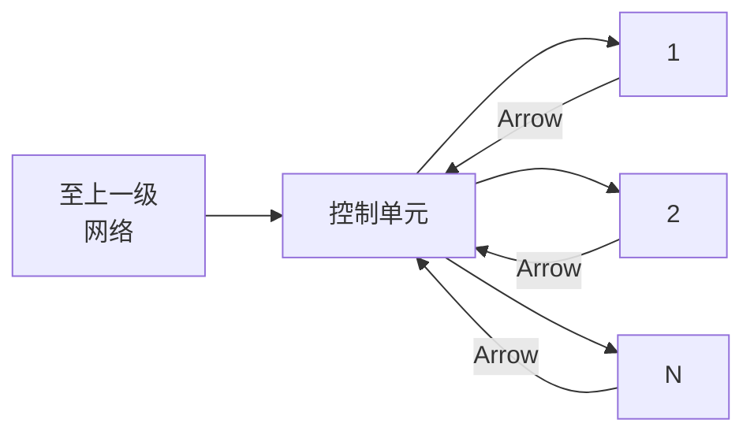
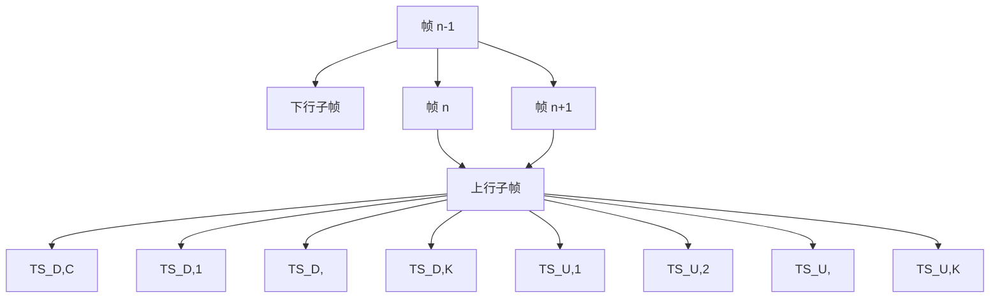
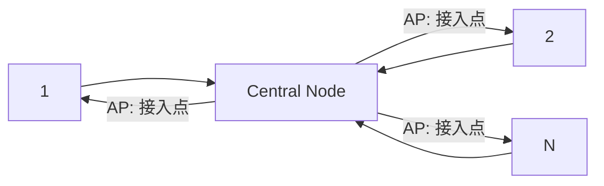

## 第11章 信道复用与多址技术

## 11.1 引言

在通信系统中，通常不止一个用户有传输信息的需求。比如，在计算机网络的某个小区域内，会有多个用户同时需要发送或接收数据；在一个移动通信系统接入网的某个基站管理的小区内，也可能会有多个用户同时有通信的要求；这些都是多个用户需要共享通信资源的示例。对一个通信系统的传输信道来说，最基本的资源是频谱，频谱资源通常可用频带宽度来描述。无论是有线通信系统还是无线通信系统，一般来说，给定信道的特性，如频带宽度 $W$ 和信噪比 $S / N$ 等，信道传输信息的能力，即信道容量 $C$ 就被完全确定。

在上述的多用户场合，需要把系统可用的资源划分给不同的用户同时使用，这种实现共享信道的方法就是所谓的信道复用技术。为实现多用户的信道复用，通常要对按照某种方式划分后的信道资源和用户分别进行编号，使特定的信道资源与使用该资源的用户建立起对应关系，这就是所谓的多址技术。用户根据所分配得到的资源接入系统的过程又称多址接入。

研究信道复用和多址技术，就是要避免在多用户共享系统的资源时，出现多个用户同时争夺传输资源的无序情况。例如，某一无线通信系统中有两个用户——用户1和用户2，希望分别发送信息给另外两个用户——用户3和用户4，如果用户间没有某种协商的机制对资源进行分配，用户1和用户2就有可能在同样的时刻使用同样的频带，用户3和用户4收到的将会是有严重相互干扰的信号，导致最终均无法正确地接收到信息。因此，在实现信道的资源划分和多址接入时，必须保证用户在工作过程中不会出现相互间的干扰，或者可以将这些干扰减低到可容忍的程度。

本章将讨论如何进行信道或资源的划分，以及如何实现多址接入。在多用户系统中，资源划分的方法有很多种。对于一个传输信道，无论是有线的还是无线的，传输资源的划分方法都可以归结为频分、时分和码分这三种基本方式。相应地，可以把传输的资源用图11.1.1所示的“三维”坐标形式来表示。如果在进行资源划分时，能使其中的每个资源块都不相交，可以保证这些资源块在分配给不同的用户使用时，相互间不会产生干扰，此时称这些资源块是正交的。需要注意的是，一旦信道的带宽和信噪比给定，信道容量的大小就完全由香

text_image

c (码)
f (频率)
O
t (时间)
资源块

图11.1.1 传输信道的资源块的概念

农定理确定，无论信道如何划分，划分后各子信道容量之和与划分前的容量相比，只可能减少而不会增大。在实际系统中，不同的划分方法可能会导致对资源的利用效率大小不同的变化。由上述三种基本方法引申出来的各种信道复用与多址技术，主要包括频分复用与频分多址、时分复用与时分多址、码分复用与码分多址、空分复用与空分多址、统计复用与综合复用等。不同的划分方法，对于不同的应用场景，在实现的便利性、资源的利用效率等方面，会有不同的差异。本章将逐一对上述方法进行扼要的分析和讨论，使读者建立起有关信道复用和多址技术的基本概念。

## 11.2 频分复用与频分多址

频分复用 频分复用是最早获得应用的信道复用方法。早期的频分复用将可用的频谱资源在频率域上划分为若干段互不重叠的频带，每段频带构成一子信道。频分复用可用图11.2.1描述，可用的频谱宽度 $W$ 被划分 $K$ 个互不重叠的子信道。在实际系统中，为保证在不同的子信道间不产生相互间的干扰，在相邻频带之间还会设置一定宽度的保护带，以更好地将各个子信道加以隔离，以避免由于各子信道中带通滤波器的非理想截止特性，使得原来应控制在子信道内的信号成分泄漏到相邻的子信道上。图11.2.2描述了设置保护带的情形，图中 $\omega_{\mathrm{g}}$ 是相邻子信道间的保护带的大小。显然保护带的引入会降低频谱资源的利用率。

text_image

c/码
信道K
信道3
信道2
信道1
f/频率
W
t/时间
O

图 11.2.1 信道的频分复用图

text_image

ωg
Bk(ω)
ωck

图 11.2.2 保护带与带通滤波器

频分多址 所谓频分多址，是指利用频分复用技术，可将总的信道带宽按照需要划分成若干子信道，将不同子信道分配给不同的用户，使不同用户可以同时接入系统，实现信道资源的共享。频分多址是一种目前仍在广泛应用的技术，如语音广播、电视广播等采用频分多址技术划分不同的广播电台和不同的电视台频道。在程控电话交换机和IP网络电话兴起之前，广泛采用的载波电话技术，就是将多路3kHz带宽的话音信号调制在不同的载波频率上，使得一对电缆可以同时承载多路话音信号，从而提高电缆的传输效率。

图 11.2.3 给出了利用频分多址实现多路载波电话传输的一个示例，K 路待传输的信号先经低通滤波，滤除信号中不太重要的高频成分，以避免信号泄漏到其他信道，然后以不同的载波频率将各路信号调制到不同的子信道上，再经过中心频率位于各自载波上的带通滤波器滤除带外的信号成分，最后合成后发送到信道上。接收端则进行相反的处理过程，恢复出原来发送的各路信号。

flowchart

This diagram illustrates a signal processing system architecture, showing the flow of frequency components (low and high) through modulation, transmission, summation, and reception to produce final output signals.

图 11.2.3 频分多址系统

频分复用和频分多址技术对于模拟通信系统来说，几乎是实现多用户信道共享的唯一方法。频分复用系统的特点是进行信道划分时不需要精确的同步技术。但传统的频分复用方法需要加保护带，降低了信道频谱资源的利用率，同时实现频分复用需要大量不同参数的带通滤波器，从这一角度来说，电路实现相对复杂。

对于传统的频分复用系统，如果系统带宽为W，假定每个子信道连同子信道间的隔离带在内，所

需的带宽为 $\Delta W$ ，则频分多址系统可容纳的信道数为

$$
K = \left\lfloor \frac {W}{\Delta W} \right\rfloor \tag {11.2.1}
$$

## 11.3 时分复用与时分多址

时分复用 时分复用是伴随着数字电子技术的发展而获得广泛应用的一种信道复用技术。时分复用的基本思想是，把传输的时间划分成帧周期为 $T_{\mathrm{F}}$ 的一个个数据帧，在每个帧周期内再进一步划分出

时隙（Time Slot, TS），每个信道就是每个帧周期内的一个时隙。时分复用的原理可由图 11.3.1 描述，通过帧周期和时隙的划分实现信道的复用。在一个时隙内，获得该时隙的用户使用信道的全部带宽资源。虽然每个用户都是间歇地使用信道的资源，但只要合理选择帧周期和时隙的大小，就可使每个用户感觉就像在连续地使用一个属于自己的信道。

例如，我国程控交换系统中的基群信号（也称 E1 信号），传输的比特率是 2.048Mbps，每帧中包含 32 个 8 比特的时隙，帧周期是 $T_{\mathrm{F}} = 1 / (8 \times 10^{3}) = 125 \mu \mathrm{s}$ ，每个时隙可携带一路 64kbps 的数字话音信号，即基群信号可视为由 32 个 64kbps 的信号复接而成。

text_image

c/码
信道1
信道2
信道3
信道4
信道K
...
...
...
...
...
...
...
...
...
...
...
...
...
...
...
...
...
...
...
...
...
...
...
...
...
...
...
...
...
...
...
...
...
...
...
...
...
...
...
...
...
...
...
...
...
...
...
...
...
...
...
...
...
...
...
...
...
...
...
...
...
...
...
...
...
...
...
...
...
...
...
...
...
...
...
...
...
...
...
...
...
...
...
...
...
...
...
...
...
...
...
...
...
...
...
...
...
...
...
...
...

图 11.3.1 信道的时分复用

对于更高速的传输信道，可进一步将基群信号复接为更高群路等级的信号，图 11.3.2 描述了信号两次复接的过程。随着复接等级的提高，每个用户所占的时隙随之变小，时间被“压缩”，但在一个帧周期 $T_{F}$ 内每个用户可传输的比特位数不变。

text_image

TF
TF
TF/4
TF/4
TF/4
TF/4
TF/16
TF/16
TF/16
TF/16
→复接
←分接

图 11.3.2 时分复用系统的信号两次复接/分接过程

时分多址 利用时分复用的方法，通过将每一帧中的不同时隙分配给不同的用户实现信道的共享多用户接入的方法就称为时分多址。

现代电话程控交换系统就是利用时分复用技术实现的。图 11.3.3 给出了一个时分多址话音通信系统的示例，图中的 K 路模拟话音信号 $f_{\mathrm{L1}}(t)$ , $f_{\mathrm{L2}}(t)$ , $\cdots$ , $f_{\mathrm{LK}}(t)$ 首先通过各自的低通滤波器，滤除可能发生频谱混叠效应的信号的高频成分，然后用模数转换器将模拟信号的每个采样值转变为一组数字的 PCM 信号，复接电路将转换后的每组数字信号嵌入预定的时隙上发送到信道，完成信号的复接过程。复接后的信号在信道中传输的时间关系如图 11.3.4 所示。在接收端，复接信号则做相反的变换：首先通过分接电路提取出属于不同时隙（对应不同用户）的 PCM 码组信号，通过数模转换器将 PCM 信号恢复为相应的模拟信号，经低通滤波器滤对信号进行平滑处理，滤除量化噪声后输出。图 11.3.2 中的箭头符号 “→” 与 “←” 标示了复接与分接处理的过程。

flowchart

This diagram illustrates a signal processing system architecture, showing the flow of signals from low-to-high frequency sources through ADCs, a central channel, and subsequent DACs to produce low-to-high and low-to-low frequency outputs.

图 11.3.3 时分多址的话音通信系统  

text_image

第0帧
R₁
第1帧
第2帧
...
TSₖ
TS₁
TS₂
TS₃
...
TSₖ
TS₁
...
UEₖ
UE₁
UE₂
UE₃
UEₖ
UE₁
t

图 11.3.4 时分复用信号的传输过程

一般来说，时分复用和时分多址技术只能应用于数字通信系统。时分复用和时分多址技术的特点是，无需多种类型的带通滤波器，容易用数字集成电路的方法实现。实现时分复用和时分多址的关键之一是，系统必须保证有良好的码元同步和帧同步，否则无法实现信号的复接与分接。

对于有线传输系统, 如果信道的总传输速率为 $R$ , 其中每个用户 (子信道) 的速率为 $\Delta R$ , 则可容纳的子信道的总数为

$$
K = \left\lfloor \frac {R}{\Delta R} \right\rfloor \tag {11.3.1}
$$

在大多数传统有线传输的时分复用系统的应用中，通常不同用户的时隙之间不需要保护间隔，较之每个频分多址系统中子信道间需要保护带，应有较高的信道利用率。但时分复用系统通常要在每帧数据间插入帧同步等控制信号，也会使有效的信道利用率降低。另外，在无线通信的时分复用场合，各用户往往不在同一位置，一般难以保证在分配的时隙间实现精确的切换。此时在分配给不同用户的时隙间必须保留一定的切换保护时间，以防止在各时分的子信道间发生信号的重叠，此时信道的利用率较之有线时的情形相应地会进一步降低。

## 11.4 码分复用与码分多址

正交编码的概念 首先介绍正交编码的概念。设 $\{C\}$ 是一个 M 维的码字集，其中 $C_{k}=\left(c_{k,M},c_{k,M-1},\cdots,c_{k,1}\right)\in\{C\}$ ，若 $\{C\}$ 中的码字满足条件

$$
C _ {j} \cdot C _ {k} = \sum_ {i = 1} ^ {M} c _ {j i} c _ {k i} = \left\{ \begin{array}{l l} 0, & j \neq k \\ M, & j = k \end{array} \right. \tag {11.4.1}
$$

式中的符号“.”表示两个码字的点乘，则称 $\{C\}$ 是一组正交编码。特别地，如果进一步地有

$$
C _ {j} \cdot C _ {k} = \sum_ {i = 1} ^ {M} c _ {j i} c _ {k i} = \left\{ \begin{array}{l l} 0, & j \neq k \\ 1, & j = k \end{array} \right. \tag {11.4.2}
$$

则称 $\{C_{k}\}$ 是一组归一化的正交编码。

一个长度为 $2^{n}$ 、具有 $2^{n}$ 个元素的正交编码的码字集，可通过哈达马矩阵（Hadamard matrix）产生。 $n = 1$ 的哈达马矩阵定义为

$$
\boldsymbol {H} _ {1} = \left[ \begin{array}{c c} 1 & 1 \\ 1 & - 1 \end{array} \right] \tag {11.4.3}
$$

容易验证矩阵 $H_{1}$ 中的行可构成一个有 $2^{1} = 2$ 个码字的正交码字集。 $n = 2$ 的哈达马矩阵定义为

$$
\boldsymbol {H} _ {2} = \left[ \begin{array}{l l} \boldsymbol {H} _ {1} & \boldsymbol {H} _ {1} \\ \boldsymbol {H} _ {1} & \boldsymbol {H} _ {1} \end{array} \right] = \left[ \begin{array}{c c c c} 1 & 1 & 1 & 1 \\ 1 & - 1 & 1 & - 1 \\ 1 & 1 & - 1 & - 1 \\ 1 & - 1 & - 1 & 1 \end{array} \right] \tag {11.4.4}
$$

同理矩阵 $H_{2}$ 中的行可构成一个具有 $2^{2} = 4$ 个码字的正交码字集。一般地， $n = i$ （ $i$ 为任意正整数）的哈达马矩阵定义为

$$
\boldsymbol {H} _ {i} = \left[ \begin{array}{l l} \boldsymbol {H} _ {i - 1} & \boldsymbol {H} _ {i - 1} \\ \boldsymbol {H} _ {i - 1} & \boldsymbol {H} _ {i - 1} \end{array} \right] \tag {11.4.5}
$$

矩阵 $H_{i}$ 中的行可构成一个有 $2^{i}$ 个码字的正交码码字集。

沃尔什（Walsh）函数 一般地，称具有如下性质的函数集合 $\left\{W_{k}(t); t \in (0, T), k = 0, 1, 2, \cdots, K-1\right\}$ 为 K 阶的沃尔什函数：

（1）除了在一些跳跃点上取值0， $W_{k}(t)$ 仅在-1和+1中取值。  
(2) 对任意 k， $W_{k}(0)=1$ 。  
（3）在 $[0,T)$ 内， $W_{k}(t)$ 有k次穿越零点的符号变化。  
（4）关于 $[0,T)$ 的中点， $W_{k}(t)$ 不是奇函数就是偶函数。  
(5) $\int_{0}^{T}W_{j}(t)W_{k}(t)\mathrm{d}t=\left\{\begin{aligned}0,&j\neq k\\ K,&j=k\end{aligned}\right.$ (11.4.6)

沃尔什函数的性质（5）表明，沃尔什函数是一个正交的函数集。

沃尔什函数可以用多种不同的方法生成。例如，可以利用前面介绍的哈达马矩阵产生。图 11.4.1 给出了一个利用哈达马矩阵 $H_{2}$ 的行向量构建的 4 阶沃尔什函数，容易验证，该函数满足上面给出的沃尔什函数的各项性质。图中 $T_{c}$ 的时间大小通常称为一个码片。

  
图11.4.1 4阶沃尔什函数

码分复用 利用沃尔什函数的正交性，可以实现在时域与频域均重叠的信号的分离，从而实现信道的码分复用。假定要把信道划分为 $K$ 个不同的子信道，在第 $k$ 个子信道上传输的数据序列记为 $\{D_{kj}\}$ ，其中 $D_{kj}$ 表示第 $k$ 个子信道上第 $j$ 个码元周期 $(j - 1)T \leqslant t \leqslant jT$ 传输的数据符号。在发送端，采用 $K$ 阶的沃尔什函数集中 K 个沃尔什函数，分别对不同信道中的数据 $\{D_{kj}\}, k=0,1,\cdots,K-1$ 进行调制，得到

$$
s _ {k j} (t) = D _ {k j} \cdot W _ {k} (t), (j - 1) T \leqslant t \leqslant j T, k = 0, 1, \dots , K - 1 \tag {11.4.7}
$$

在第 j 个码元周期，信道上同时传输的 K 路信号可以表示为

$$
s (t) = \sum_ {k = 1} ^ {K} s _ {k j} (t) = D _ {k j} \cdot W _ {k} (t), (j - 1) T \leqslant t \leqslant j T \tag {11.4.8}
$$

其中各个子信道上的信号 $s_{kj}(t), k=1,2,\cdots,K$ 在时域和频域上都是重叠的。图 11.4.2 形象地描述了码分复用系统共享信道资源的情况。

在接收端需要恢复原来的任意一路信号，如第i路信号时，都可利用沃尔什函数的正交特性，通过相关运算来实现：

$$
\begin{array}{l} \int_ {(j - 1) T} ^ {j T} W _ {i} (t) s (t) \mathrm{d} t = \int_ {(j - 1) T} ^ {j T} W _ {i} (t) \sum_ {k = 1} ^ {K} s _ {k j} (t) \mathrm{d} t = \int_ {(j - 1) T} ^ {j T} W _ {i} (t) \sum_ {k = 1} ^ {K} D _ {k j} \cdot W _ {k} (t) \mathrm{d} t \tag {11.4.9} \\ = \sum_ {k = 1} ^ {K} D _ {k j} \int_ {(j - 1) T} ^ {j T} W _ {i} (t) W _ {k} (t) \mathrm{d} t = K \cdot D _ {i j} \\ \end{array}
$$

text_image

f/频率
c/码
信道K
...
信道3
信道2
信道1
O
t/时间

图 11.4.2 信道的码分复用

式中 K 是常数，不会影响信号的正确分离与恢复。

码分多址 利用码分复用技术，将沃尔什函数集中不同的函数（码字）分配给不同的用户，用户在发送数据时利用该函数对符号进行调制，然后才发送到信道上，此时虽然各个用户的数据占据相同的频带，同时时域上的信号又重叠在一起，但沃尔什函数的正交性保证了接收端可以正确地恢复原来的数据。图 11.4.3 给出了一个码分多址系统的示意图。显然，只要不同的用户分配了沃尔什函数集中的不同函数，在接收端就可以通过相关器将特定的用户信号分离出来。

显然，码分多址系统中能够容纳的子信道数取决于沃尔什函数集中函数的个数。而函数集中的函数的个数又与沃尔什函数的阶数

有关。若采用哈达马矩阵 $H_{n}$ 生成沃尔什函数，则该码分多址系统可容纳的子信道数为

$$
K = 2 ^ {n} \tag {11.4.10}
$$

flowchart

This diagram illustrates a signal processing system architecture, showing the signal flow from multiple destination blocks (D_ij to D_Kj) through summation and filtering to produce a channel, with associated time-domain integrations.

图 11.4.3 码分多址系统

由图 11.4.3 不难理解，每个子信道上的符号速率 R 确定后，相应地，其符号周期 T 也确定。随着阶数的增加，其可容纳的子信道数相应增加，同时码片 $T_{c}$ 的取值变小，系统所需的带宽相应地增大。系统的带宽 W （信号主瓣的频谱宽度）可由下式估计：

$$
W \approx 1 / T _ {\mathrm{c}} \tag {11.4.11}
$$

## 11.5 空分复用与空分多址

空分复用 前面讨论的频分复用、时分复用和码分复用，都是对一个信道内的资源的划分方法。给定信道的带宽和信噪比，信道的容量由香农定理所确定。不同的复用方式，仅仅是利用资源的形式不同，并没有增加系统的资源。而空分复用则是一种将天线上发出的某路电磁波信号，限定在某个局部区域范围内，而使得在原来的区域范围内，可以容纳更多路电磁波信号的一种信道复用方式。在每个互不重叠的空间局部范围内，信道的容量与未进行空分复用之前一样大，因此对于整个系统来说，通过空分复用后，总的信道资源有倍增的效果。

图 11.5.1 给出了一个小区内的空分复用的示意图，在小区的平面上按照一定的信号辐射角度将空间划分为 K 个不同的区域。假定这 K 个不同的区域互不重叠。因此，不同区域上的信号可以有效地分离，实现空间的信号分隔和频谱资源的重复使用。

图 11.5.2 给出了一个小区间的空分复用示意图，平面空间被划分为一个个互不重叠的六边形区域，其中基站 $BS_{k}$ 负责第 k 个子区域的信号覆盖。如果能够将六边形中心发出信号的覆盖范围控制该六边形的区域内，则在不同区域内，频率可以重复使用。在实际的系统中，通常不可能划分出这样的理想区域，各个基站发出的信号一般也会有一定的重叠，因此，如果均使用同一个频率，信号间可能会产生互扰。为克服小区间信号的互扰，通常在系统中采用空分和频分相结合的工作方式，如在相邻小区使用不同的工作频率，图 11.5.2 中所示的是系统中使用三个不同工作频率的情况。不同工作频率互不重叠，这样即使有不同的基站间发射相同频率的信号，只要这些信号到达使用相同频率的另外一个小区时有足够大的衰减，就不会影响频率的重复使用。现代移动通信系统均基于这种思想来构建频率可以复用的蜂窝结构系统。

flowchart

图11.5.1 小区内的空分复用图

text_image

f2
BS2
f3
BS3
f3
BS1
f1
BS0
f2
BS4
f2
BS6
f3
BS5

图11.5.2 小区间的空分/频分复用

空分多址 利用空分复用技术，将不同的区域划分给不同用户，就可以实现空分多址。空分多址与频分多址、时分多址和码分多址相比，一个显著不同的特点是系统的资源可以实现大幅度提升，每个用户或每个小区子系统可以全时地使用全部频带资源。在每个空间区域内可以进一步进行频分多址、时分多址和码分多址的资源划分，进而可以更灵活地使用系统的资源。

空分多址能够划分出的子信道数，取决于对电磁波波束空间辐射角度或信号覆盖区域大小的控制能力。好的天线波束赋形技术或好的功率控制技术，能够提高系统的空分复用度。

## 11.6 统计复用与随机多址

在前面介绍的各种信道复用技术中，通常某个信道一旦分配给某个用户后，该信道将被这个用户单独使用，无论该用户是否有数据要发送，其他用户都不能使用这个信道。如果用户传输的是比特速率恒定的数据流，如固定抽样速率的话音信号或视频信号，那么这种固定分配信道资源的方式有很高的传输效率。但随着互联网数据传输业务的不断增加，这种固定分配信道资源的方式对许多业务不再适用。例如，当用户在上网浏览网页时，单击下载某一消息，此时该用户希望尽快地完成这则消息的传输，一旦该消息传输到用户的终端，用户就需花一段时间来阅读消息的内容，在阅读阶段，用户对传输资源没有要求，此时如果分配给该用户的是固定的传输速率，则在用户阅读消息的时间内，传输资源得不到利用而被浪费。人们自然会设想是否可动态地分配资源，一旦用户有需求，可立刻分配相应的信道，完成该传输的需求后，系统迅速收回信道资源，以供其他用户使用。不同人上网的习惯不同，加上业务的类别多种多样，对资源需求具有很大的随机性和突发性，因此很难通过集中控制的方式来分配传输的资源。因此，在计算机网络等数据通信系统中，大多采用所谓的统计复用和随机接入（随机多址）工作方式。

统计复用 统计复用是一种为适应数据业务传输需求具有随机性和突发性而提出来的共享信道资源的工作方式。统计复用主要包括集中控制和随机分布式控制两种方式。

(1) 集中控制方式 顾名思义，在采用集中式控制方式的系统中，包含一个中心控制单元，它负责信道资源的分配调度管理。轮询是集中控制的一种基本方式，图 11.6.1 给出了一个轮询系统的网络结构，图中的控制单元可以是一台服务器，负责轮询每一台终端，检查哪一台终端需要访问服务器或进行终端间的转发服务；控制单元也可以是一台网络的转接器，负责轮询每一台终端是否需要接入上一级网络，提供数据的中转传输服务。系统中的每个终端，只有接到询问命令，得到使用信道的授权后，方可发送数据，其他时间则处于等待状态。虽然图 11.6.1 给出的是一个有线形式的轮询系统，但其工作机制也可以应用到无线轮询传输的工作环境。

flowchart

图 11.6.1 集中控制方式

集中控制方式被大量地应用在各种具有接入调度控制的无线通信系统中。在一个以基站为中心，提供多个用户终端接入网络的点（基站）到多点（终端）的无线通信系统，通常把数据从网络传向终端的过程称为下行，而把数据从终端传向网络的过程称为上

行。在基于时分统计复用的无线通信系统中，一般会在时间轴上划分出称为数据帧等长的时间片，如图 11.6.2 所示，对于双向的传输系统，一个数据帧又分为下行子帧和上行子帧。对于一个多用户的系统，每个子帧又被进一步划分出给不同用户使用的时隙，时隙的划分可以是等长的，也可以是不等长的。图中的 $TS_{D,i}$ 和 $TS_{U,i}$ 分别表示一帧中的第 i 个下行时隙和第 i 个上行时隙。统计复用的资源调度控制可以这样进行：在每个数据帧的下行子帧中，设置专门的控制时隙 $TS_{D,C}$ ， $TS_{D,C}$ 中携带的控制信息指定了下行子帧中的每个特定时隙包含的数据是发给哪个特定用户的，以及上行子帧中的哪个时隙归哪个用户使用。这样，每个用户收到控制信息后，就可以知道应该在哪个下行的时隙中接收发给自己的数据，同时也知道可在上行的哪个时隙中发送数据。这样，多个用户共享信道的统计复用过程就得以有序地进行。

flowchart

图 11.6.2 一种统计复用系统中的数据帧

集中控制方式也经常应用在网络中的交换机或路由器的输出端口上，其工作方式可用图 11.6.3 描述，其中图 11.6.3(a)所示的是一种最简单的不分等级的方式，用户希望通过链路 L 传输的数据报文首先送到链路 L 输出缓冲器的队列上，在缓冲器内排队后依次输出。当轮到用户 k 的发送报文时，该用户占有全部信道资源，当报文发送完毕后，自动释放信道资源，如果队列中还有其他用户的数据，则信道开始传输另一用户的数据报文。显然，链路 L 的传输资源并未被刻意地划分，每个进入缓冲器的报文按序等待发送，每个用户的报文都有同等的优先级。另外一种可按照业务类型划分等级的方式如图 11.6.3(b)所示，输出端可以设置多个不同等级的缓冲队列，用户不同业务类型的数据报文可按照其类别进入不同的队列，输出端口上的调度器根据特定的算法或规则，选择某个队列中的报文发送到输出的链路上。图 11.6.3(c)形象地给出了不同用户的数据报文在信道中传输的情况，信道中时隙的分配使用可以是不规则的。

  
图 11.6.3 信道的统计复用

采用统计复用方式，可较好地避免出现某些用户得到了信道的传输资源，因没有数据传输需要而使得信道资源被闲置，而另外一些用户有数据需要传输而得不到信道传输资源的情况。统计复用特别适合间歇出现的数据传输服务需求，如对于互联网上大量具有突发性的传输业务，统计复用的方式通常比固定地分配信道资源的方式具有更高的效率。采用统计复用时，虽然某个时刻的信道资源并未明确地划分给具体的用户，但只要用户遵循相同的规则接入系统，从统计上说，同一种类型的业务得到传输资源的机会就是一样的。

(2) 随机分布式控制方式 在分布式控制的系统中, 系统中没有集中的控制单元。各个终端间按照某种规则, 有协调或没有协调地使用信道的资源。所谓随机分布式控制方式, 是指一种没有协调的、各个用户竞争使用信道的工作方式, 该方式因为简单且易于实现, 是目前在计算机终端接入网络过程中最常用的一种方式。在随机分布式控制系统中, 因为各个终端发送报文时具有随机性, 冲突一般难以避免, 图 11.6.4 给出了用户 1 与用户 $K$ 发送报文在时间上有重叠的情形, 此时两个用户都发送失败。但在随机分布式控制系统中, 通常用户间的竞争不会是恶性的, 各个终端中包含了当其探测到发生冲突时的解决机制。

flowchart

This diagram illustrates a signal processing workflow where multiple User Equipment (UE) packets are processed through a central block to generate a signal, with a feedback loop triggered by a collision event.

图 11.6.4 随机分布式系统中的突出现象

随机分布式控制方式通常应用在多个用户竞争信道接入网络的过程中。图 11.6.5 描述了用户通过有线或无线方式接入网络的结构形式，其中图 11.6.5(a)给出的是早期的计算机终端通过总线接入局域网的方式，总线由电缆同轴、T形接头和线端的阻抗匹配电阻等部件构成，是一种无源的网络；图 11.6.5(b)给出的是计算机终端通过集线器接入局域网的方式，简单的集线器可视为将总线结构的局域网缩小集中到一个设备中的形式。集线器中的每个端口通常是有源的，具有一定的驱动能力。上述两种有线局域网虽然结构形式不同，但工作原理完全一样，网络中均没有负责资源分配的控制器，每个终端完全平等，都是通过竞争总线使用权的统计复用方式接入网络的。

text_image

计算机
...
N
匹配电阻
同轴电缆
T形连接器

(a)

text_image

集线器
计算机
1
2
...
N

(b)

图 11.6.5 总线结构的分布式系统  

flowchart

图 11.6.6 无线局域网系统

图 11.6.6 给出了一个无线局域网的系统结构图，图中的接入点（Access Point，AP）是无线终端进入网络的节点。在目前广泛应用的无线局域网系统中，采用的基本上都是随机分布式控制方式。

在采用随机分布式控制的通信系统中，传输的资源既没有进行固定的划分，也没有集中的控制器协调各个用户的工作，所以这种系统也称随机接入或随机多址系统。随机多址系统因为

不需要集中控制器，因此简单且很容易构建；另外，随机的多址系统没有集中控制器，系统不会因为某个特殊单元的失效而导致其不能工作，因此随机多址系统有很好的强壮性。

统计复用系统的性能分析\* 有关采用统计复用的通信系统的资源管理和调度策略, 是一个专门的研究领域, 已经有大量的研究成果。这里只简要讨论其基本概念和原理, 建立对统计复用系统性能的初步认识。

(1) 集中控制的轮询系统的性能分析 集中控制的轮询接入系统的结构仍如图 11.6.1 所示。一般地, 由控制单元发往终端的下行数据报文完全由控制单元控制, 只要在报文中携带上各个终端的地址, 报文在总线上广播出去之后, 相应的终端就可接收到发给自己的报文, 而接收到不属于自己报文的终端, 将收到的报文丢弃即可。因此有关轮询系统的性能分析, 主要集中在对由终端到主机的上行数据报文的传输过程中。假定信道的传输速率为 $R_{\mathrm{b}}$ ; 为简单起见设每个用户发送的数据报文等长, 其长度为 $1 / \mu$ 比特 (采用这样的记号主要是与通信网络性能分析的主要工具, 排队论中使用符号的习惯一致); 在信道中传输一个数据报文的时间相应地为 $1 / (\mu R_{\mathrm{b}})$ 。每个终端中待发送的数据报文数通常是随机的, 单位时间内一个终端生成的平均报文数称为该终端的到达率。终端 $i$ 的到达率记为 $\lambda_{i}$ (报文/秒), 终端 $i$ 在一次轮询过程所需要的发送报文的时间记为 $t_{i}$ 。

每次控制单元轮询完终端 $i - 1$ ，即让其发送完数据后，开始轮询终端 $i$ ，从此时刻开始至终端 $i$ 识别到轮询命令，开始发送数据的这段时间，称为从终端 $i - 1$ 到终端 $i$ 的巡回时间，记为 $w_{i}$ 。控制单元将所有的终端轮询一遍的时间称为循环时间，记为 $t_{\mathrm{c}}$ 。显然，若系统中有 $N$ 个终端，则有

$$
t _ {\mathrm{c}} = \sum_ {i = 1} ^ {N} t _ {i} + \sum_ {i = 1} ^ {N} w _ {i} \tag {11.6.1}
$$

式中， $t_{i}, w_{i}$ 和 $t_{c}$ 通常都是随机变量。若 $t_{i}, w_{i}$ 和 $t_{c}$ 的统计平均值分别记为 $T_{i}, W_{i}$ 和 $T_{c}$ ，则由式（11.6.1）可得

$$
\begin{array}{l} T _ {\mathrm{c}} = E \left[ t _ {\mathrm{c}} \right] = E \left[ \sum_ {i = 1} ^ {N} t _ {i} + \sum_ {i = 1} ^ {N} w _ {i} \right] = E \left[ \sum_ {i = 1} ^ {N} t _ {i} \right] + E \left[ \sum_ {i = 1} ^ {N} w _ {i} \right] \tag {11.6.2} \\ = \sum_ {i = 1} ^ {N} E \left[ t _ {i} \right] + \sum_ {i = 1} ^ {N} E \left[ w _ {i} \right] = \sum_ {i = 1} ^ {N} T _ {i} + \sum_ {i = 1} ^ {N} W _ {i} \\ \end{array}
$$

若记整个系统的平均巡回时间为 $L$ ，即 $L = \sum_{i=1}^{N} W_i$ ，则式（11.6.2）又可表示为

$$
T _ {\mathrm{c}} = L + \sum_ {i = 1} ^ {N} T _ {i} \tag {11.6.3}
$$

因为 $T_{i}$ 是终端 $i$ 在一次循环时间 $T_{\mathrm{c}}$ 内的平均发送时间，而在 $T_{\mathrm{c}}$ 时间段内终端 $i$ 积累的数据量为 $\lambda_{i} \cdot 1 / \mu \cdot T_{\mathrm{c}}$ ，有

$$
T _ {i} = \frac {\lambda_ {i} \cdot 1 / \mu \cdot T _ {\mathrm{c}}}{R _ {\mathrm{b}}} = \frac {\lambda_ {i}}{\mu R _ {\mathrm{b}}} T _ {\mathrm{c}} = \rho_ {i} T _ {\mathrm{c}} \tag {11.6.4}
$$

式中， $\rho_{i}=\lambda_{i}/(\mu R_{b})$ 称为终端的通信量强度。将上式的结果代入式（11.6.3）得

$$
T _ {\mathrm{c}} = L + \sum_ {i = 1} ^ {N} T _ {i} = L + \sum_ {i = 1} ^ {N} \rho_ {i} T _ {\mathrm{c}} = L + T _ {\mathrm{c}} \sum_ {i = 1} ^ {N} \rho_ {i} = L + T _ {\mathrm{c}} \rho \tag {11.6.5}
$$

式中， $\rho = \sum_{i = 1}^{N}\rho_{i}$ 称为整个系统的通信量强度。由此可得

$$
T _ {\mathrm{c}} = \frac {L}{1 - \rho} \tag {11.6.6}
$$

上式表明，要使得系统的循环时间有限，即各个终端的报文在有限的时间内可以上传到控制单元，需要使 $\rho < 1$ 。当 $\rho \rightarrow 1$ 时， $T_{c} \rightarrow \infty$ ，此时系统的传输功能趋于瘫痪，我们称这种状态的系统是不稳定的。系统的通信量强度有时也称系统的吞吐量：

$$
S = \rho = \frac {\sum_ {i = 1} ^ {N} \lambda_ {i} / \mu}{R _ {\mathrm{b}}} \tag {11.6.7}
$$

吞吐量 S 反映了信道的利用率。由此，式（11.6.6）又可以表示为

$$
T _ {\mathrm{c}} = \frac {L}{1 - S} \tag {11.6.8}
$$

系统的平均巡回时间 L 主要与系统中终端的数目 N 以及终端接收到轮询后完成发送数据的准备工作所需的时间有关。当 N 确定后，L 基本上是一个常数，因此循环时间 $T_{c}$ 主要由吞吐量决定。对于一个数据报文来说，最大时延的情况出现在该报文到达时刻恰好在其所在的终端刚刚被轮询完之后，其最大延时的平均值等于循环时间 $T_{c}$ 。因此，当吞吐量 $S \rightarrow 1$ 时，其最大的延时 $T_{c} \rightarrow \infty$ 。

(2) 随机接入控制的 ALOHA 算法及性能分析 ALOHA 是美国夏威夷大学 Norman Abramson 等人研制的一个无线电网络的名称。在该网络中采用了一种共享信道的算法, 这一算法及由其衍生出来的改进算法已成为以以太网技术为核心的有线与无线局域网的基础。  
(a) 纯 ALOHA 算法 设 $N$ 个工作站共享一个传输信道资源, 传输信道可以是有线的, 如图 11.6.5 所示的总线结构的系统; 传输信道也可以是无线的, 此时信道的资源就是所使用的一段频率。当某个工作站有数据报文要发送时, 可以自由地向信道发送, 在整个报文的发送期间, 如果没有其他的工作站发送, 则该报文发送成功。如果在该报文发送期间, 有其他的工作站在同时发送, 则两个工作站发送的信号在时间上发生重叠, 其结果是两个工作站发送的报文都不能被正确地接收, 此时称系统发生了冲突。发生冲突之后, 如果两个工作站立刻重新发送报文, 显然冲突将持续, 最终导致系统不能正常工作。在纯 ALOHA 算法中提出了一种解决冲突的机制: 当冲突发送后, 两个工作站并不是立刻重新发送, 而是各自选择一个随机的退避时间, 等到该退避时间结束之后, 再重新发送。退避时间是随机数, 两个工作站选择的退避时间相同的概率很小, 因此这两个工作站重新发送报文时再次冲突的概率就大大降低, 从而实现了一种分布式的自动协调。

为分析简单起见, 假定每个工作站发送的报文的大小和速率都是一样的, 则发送一个报文的时间为常数, 记为 $T_{0}$ 。显然在 $T_{0}$ 内成功发送的平均报文数就是吞吐量 $S$ 。若定义网络负载 $G$ 为在 $T_{0}$ 内发送到信道的平均报文数 (包括发送成功与发送失败的所有报文), 若记报文发送成功的概率为 $P_{\mathrm{suc}}$ , 则应有

$$
S = G \cdot P _ {\mathrm{suc}} \tag {11.6.9}
$$

在电话系统中，通常认为呼叫到达的概率服从泊松分布。为分析简单起见，在数据通信中常常也认为报文达到的概率服从泊松分布。根据泊松过程的定义，在时间间隔 $T$ 内到达 $k$ 个报文的概率为

$$
P _ {T} (k) = \frac {(\lambda T) ^ {k}}{k !} \mathrm{e} ^ {- \lambda T}, k = 0, 1, 2, \dots \tag {11.6.10}
$$

式中， $\lambda$ 为单位时间内到达报文数的均值。由此可得两个报文时间间隔取值为 $\Delta t$ 的概率密度函数为[4]

$$
p _ {a} (\Delta t) = \lambda \mathrm{e} ^ {- \lambda \Delta t} \tag {11.6.11}
$$

在一个报文的发送时间间隔 $T_{0}$ 内, 要使得报文发送成功, 应使得连续两个报文的到达时间间隔大于 $T_{0}$ 。如图11.6.7所示, 要使得报文 $n$ 发送成功, 除应保证报文 $n - 1$ 与报文 $n$ 的时间间隔大于 $T_{0}$ 外, 还应保证报文 $n$ 与报文 $n + 1$ 的时间间隔大于 $T_{0}$ , 即连续的第 $n$ 个报文和第 $n + 1$ 个报文的时间间隔均大于 $T_{0}$ , 因此有

$$
P _ {\mathrm{suc}} = P (\mathrm{连续两个} \Delta t > T _ {0}) = P (\Delta t > T _ {0}) P (\Delta t > T _ {0}) = P ^ {2} (\Delta t > T _ {0}) \tag {11.6.12}
$$

网络负载 G 是在 $T_{0}$ 内发送到信道的平均报文数，因此报文到达率为

$$
\lambda = G / T _ {0} \tag {11.6.13}
$$

由式（11.6.11）和式（11.6.13），可得

$$
P (\Delta t > T _ {0}) = \int_ {T _ {0}} ^ {\infty} p _ {a} (\Delta t) \mathrm{d} \Delta t = \int_ {T _ {0}} ^ {\infty} \lambda \mathrm{e} ^ {- \lambda \Delta t} \mathrm{d} \Delta t = \int_ {T _ {0}} ^ {\infty} \frac {G}{T _ {0}} \mathrm{e} ^ {- \frac {G}{T _ {0}} \Delta t} \mathrm{d} \Delta t = \mathrm{e} ^ {- G} \tag {11.6.14}
$$

将式（11.6.14）的结果代入式（11.6.12），可得报文发送成功的概率为

$$
P _ {\mathrm{suc}} = \mathrm{e} ^ {- 2 G} \tag {11.6.15}
$$

将上式的结果代入式（11.6.9），得到纯 ALOHA 系统吞吐量 S 与负载 G 间的关系式

$$
S = G \cdot P _ {\mathrm{suc}} = G \mathrm{e} ^ {- 2 G} \tag {11.6.16}
$$

吞吐量 $S$ 与负载 $G$ 间的关系特性曲线如图11.6.8所示, 开始时吞吐量 $S$ 随着负载 $G$ 的增加而增大; 当 $G = 0.5$ 时吞吐量 $S$ 达到最大值 $S_{\max} = 0.184$ ; 随着负载 $G$ 继续增大, 吞吐量 $S$ 开始降低, 因为随着负载 $G$ 的继续增大冲突开始加剧, 而成功发送的报文将随之减少。因此, 对于纯ALOHA系统, 通常要将其负载 $G$ 控制在 $G \leqslant 0.5$ , 否则系统的性能将明显下降。

text_image

t_n - t_{n-1} > T_0
t_{n+1} - t_n > T_0
n-1
n
n+1
t_{n-1}
t_n
t_{n+1}
t

图11.6.7 报文 $n$ 成功发送的条件

line

| G | S |
| --- | --- |
| 0.50 | 0.18 |

图11.6.8 纯ALOHA系统 $S$ 与 $G$ 的关系特性

(b) 时隙 ALOHA 算法 纯 ALOHA 的吞吐量不到 0.2，效率较低。其中影响效率的原因之一是，对于纯 ALOHA 系统，工作站只要有报文到达就立刻发送，而对发送时间没有任何制约所致。时隙

ALOHA 算法是纯 ALOHA 算法的一种改进算法，它同样设报文的长度为一恒定值，每个工作站发送一个报文的时间均为 $T_{0}$ 。假定系统中有一个能够使得各个工作站同步的同步时标，该时钟标记将时间划分为长度为 $T_{0}$ 的一个个时隙。每个需要发送报文的工作站，无论报文是在哪个时刻到达的，工作站只允许在统一标记的每个时隙开始的时刻发送。这样，任何一个报文，如果错过了当前时隙的发送时刻，则只能在下一时隙开始的时刻才能发送，加上这一约束条件后，就大大减少了不同工作站发送的报文出现冲突的机会，从而使得系统的效率得到提高。

参见图 11.6.9，图中 $t_{a,n}$ 表示报文 n 的到达时刻， $t_{n}$ 表示报文 n 的发送时刻，其他符号的含义以此类推。对于时隙 ALOHA 系统，系统中报文 n 可发送成功的条件是：若该报文是在 $t_{n}$ 到达前的 $t_{n}-T_{s}$ 时刻到达的 $(T_{s}<T_{0})$ ，则报文 n-1 与报文 n 的时间间隔应大于 $T_{0}-T_{s}$ ，且报文 $n+1$ 与第 n 个报文到达的时间间隔大于 $T_{s}$ 。这样，在报文 n 到达的时隙内就不会有两个或两个以上的报文同时到达，这也就意味着在报文 n-1、报文 n 和报文 $n+1$ 的发送时刻均不会冲突。若记报文 n-1 与报文 n 到达的间隔为 $\Delta t_{(a,n);(a,n-1)}$ ，报文 n 与报文 $n+1$ 到达的间隔为 $\Delta t_{(a,n+1);(a,n)}$ ，则可得报文 n 成功发送的概率为

$$
\begin{array}{l} P _ {\mathrm{suc}} = P \left(\Delta t _ {(a, n); (a, n - 1)} > T _ {0} - T _ {\mathrm{S}}\right) P \left(\Delta t _ {(a, n + 1); (a, n)} > T _ {\mathrm{S}}\right) \\ = \int_ {T _ {0} - T _ {\mathrm{S}}} ^ {\infty} \frac {G}{T _ {0}} \mathrm{e} ^ {- \frac {G}{T _ {0}} \Delta t} \mathrm{d} \Delta t \int_ {T _ {\mathrm{S}}} ^ {\infty} \frac {G}{T _ {0}} \mathrm{e} ^ {- \frac {G}{T _ {0}} \Delta t} \mathrm{d} \Delta t = \mathrm{e} ^ {- G} \tag {11.6.17} \\ \end{array}
$$

由上式及式（11.6.9），可得时隙 ALOHA 系统的吞吐量为

$$
S = G \cdot P _ {\mathrm{suc}} = G \mathrm{e} ^ {- G} \tag {11.6.18}
$$

图 11.6.10 给出了纯 ALOHA 与时隙 ALOHA 的吞吐量性能比较，由图可见，时隙 ALOHA 的性能显著提高。在 G=1 时，吞吐量达到其最大值 $S_{\max}=0.368$ ，比纯 ALOHA 系统的性能提高一倍。当 G>1 时，系统的性能随着冲突的增加而下降。时隙 ALOHA 算法比纯 ALOHA 有更好的性能，但时隙 ALOHA 系统的运行要有一个统一的同步时标，而这要在实际系统中实现并非易事。

text_image

报文n-1到达时刻
n-1
t
报文n到达时刻
n
t
报文n+1到达时刻
n+1
t
信道中传输的报文
n
n+1
t
t_n
t_n
t_n+1
t_n
t_n+1
t_n
t_n
t_n
t_n
t_n
t_n
t_n
t_n
t_n
t_n
t_n
t_n
t_n
t_n
t_n
t_n
t_n
t_n
t_n
t_n
t_n
t_n
t_n
t_n
t_n
t_n
t_n
t_n
t_n
t_n
t_n
t_n
t_n
t_n

图 11.6.9 时隙 ALOHA 报文 n 成功发送的示例

line

| G | S (Time-Descent ALOHA) | S (Pure ALOHA) |
| --- | --- | --- |
| 0.50 | ~0.30 | ~0.19 |
| 1.00 | ~0.37 | ~0.14 |

图 11.6.10 纯 ALOHA 与时隙 ALOHA 吞吐量性能比较

ALOHA 算法提供了终端在网内没有专门的网络接入控制器进行调度的情况下，终端间自动协调、共享传输媒质的一种机制。基于 ALOHA 算法演变和改进而制定的载波监听多址接入（CSMA）协议，是目前已经获得广泛应用的有线与无线计算机局域网（LAN/WLAN）的技术标准。

通过本节的分析，我们看到对于统计复用的随机多址系统，信道不可能得到100%的利用，尤其是对于像ALOHA这类用户发送数据的时间有较大随意性的统计复用系统，信道的利用率会受到很大的制约。

## 11.7 综合复用

在前面各节中，分别讨论了频分、时分、码分、空分和统计复用等多种信道共享的方式。在现代的许多通信系统中，除了上述这些单一的信道复用方式，还可以看到不少综合利用各种复用技术的情形。通过综合的复用技术，可以为信道资源的有效利用带来更大的灵活性。

11.5 节中的图 11.5.2 给出了一种综合复用系统的形象示意图，此时平面空间被划分为一个个蜂窝状的小区域，每个区域内有一个基站，构成了区域内的一种点（基站）到多点（终端）的接入网系统。为了避免同频的干扰，在通过区域的划分实现空分复用的基础上，通过空分与频分的混合复用，在提高频率利用率的同时，使得相同频率的覆盖范围有一个小区的隔离间隔，从而大大减小了同频的干扰。

最典型的综合复用技术的应用体现在现代宽带无线通信接入系统中，参见图 11.7.1 给出的新一代无线通信系统 LTE（Long Term Evolution）技术标准时频资源结构，在每个蜂窝小区内，LTE 采用了基于 OFDM 的正交频分复用多址接入（Orthogonal Frequency Division Multiple Access，OFDMA）技术，这是一种综合了频分、时分和统计复用于一体的技术。OFDMA 利用正交频分复用技术将信道所使用的频带划分为相邻子载波间有 50% 重叠的子信道，以实现正交条件下的最大限度的频分复用。信道的一个可划分的最小资源单位称为一个资源元素（Resource Element, RE），RE 由一个子载波和一个 OFDM 符号的持续时间（OFDM 的符号周期 $T_{S}$ ）组成，每个 RE 在一个符号周期 $T_{S}$ 内可携带星座图上的一个符号信息。为不至于使系统中分配资源的信令过于复杂，通常将传输时间划分为由若干 OFDM 符号周期 $T_{S}$ 构成的最小时间分配单位 $T_{Ph}$ ，同时以 $N_{Ph}$ 个相邻的子载波构成一个最小的频谱分配单位，由 $N_{Ph} \cdot T_{Ph}$ 组成了一个称为物理资源块（Physical Resource Block，PRB）的最小信道资源分配单位。例如在我国主导制定的 TD-LTE 标准中， $T_{Ph} = 7 \cdot T_{S} = 0.5ms$ ， $N_{Ph} = 12$ 。在上述频分与时分形成的 PRB 的基础上，再进一步根据用户的传输需求进行 PRB 的分配，就可以实现灵活的信道资源的统计复用。

text_image

1无线帧 (10 ms)
f
t
12个子载波
f
资源元素 (RE)
资源块 (PRB)
0.5ms
1个子帧 (1ms)
NPh · TPh = 12 × 0.5

图11.7.1 LTE系统时频资源结构

## 11.8 本章小结

通信系统的发展已进入网络时代，如何实现信道的资源共享，几乎是每个通信系统必须考虑的问题。本章概要地分析了实现信道资源共享的信道复用与多址技术，包括频分、时分、码分和统计复用等方法和相应的多址技术，最后通过TD-LTE标准中物理层资源的复用方式，简要地介绍了综合的复用技术。

## 习题

11.1 试比较各种复用和多址技术的特点。  
11.2 在一个带宽为 5MHz 的频分复用系统中，若每个子信道的带宽均为 100kHz，子信道间设定的保护带为 20kHz，问该信道可容纳多少个独立的子信道？  
11.3 若采用哈达马矩阵构建数据率为 10Mbps 具有 16 个用户的码分多址系统，（1）列出所有的正交码字；（2）估算信道所需的带宽。  
11.4 对于有 100 个终端的轮询系统，若每个终端的平均巡回时间为 1ms，当网络的负载达到 0.8 时，请分析平均发送一个报文的时延是多少。  
11.5 在纯 ALOHA 系统中，若系统工作在负载 G=0.6 的状态，求其信道为空闲的概率。  
11.6 5000 个工作站共享一条时隙 ALOHA 信道, 每个工作站每小时平均发送 18 个报文, 时隙长度为 $100 \mu s$ 。试求信道负载的大小。  
11.7 假定在图 11.7.1 所示的 LTE 时频资源结构图中，每个子载波均采用 16QAM 调制，请问每个物理资源块可以携带多少比特的数据？

## 主要参考文献

[1] 仇佩亮，陈惠芳，谢磊．数字通信基础[M]. 北京：电子工业出版社，2007.  
[2] [美]Goldsmith. 无线通信[M]. 杨鸿文等译. 北京: 人民邮电出版社, 2007.  
[3] 乐正友，杨为理．程控数字交换机硬件软件及应用[M]. 北京：清华大学出版社，1991.  
[4] 谢希仁. 计算机网络（第二版）[M]. 北京：电子工业出版社，1999.  
[5] [美]Stefania Sesia. LTE-UMTS 长期演进理论与实践[M]. 马霓等译. 北京: 人民邮电出版社, 2009.  
[6] [美]Jhong Sam Lee. CDMA 系统工程手册[M]. 许希斌等译. 北京: 人民邮电出版社, 2001.  
[7] 冯穗力，董守斌，网络通信原理[M]. 北京：科学出版社，2017.
