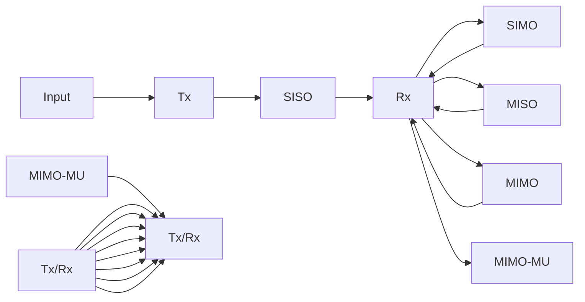
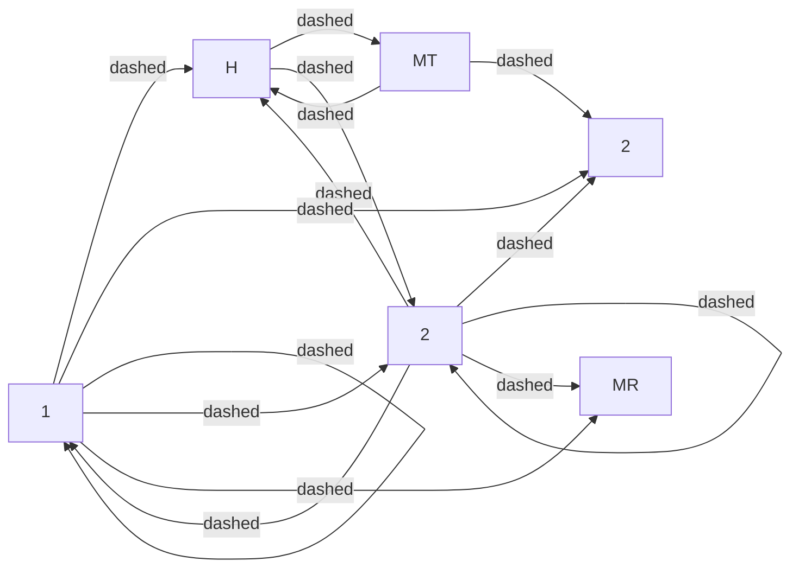
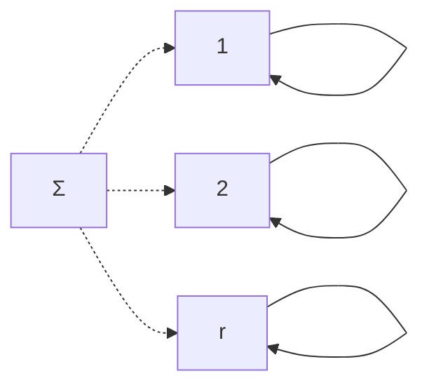
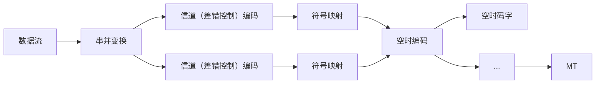
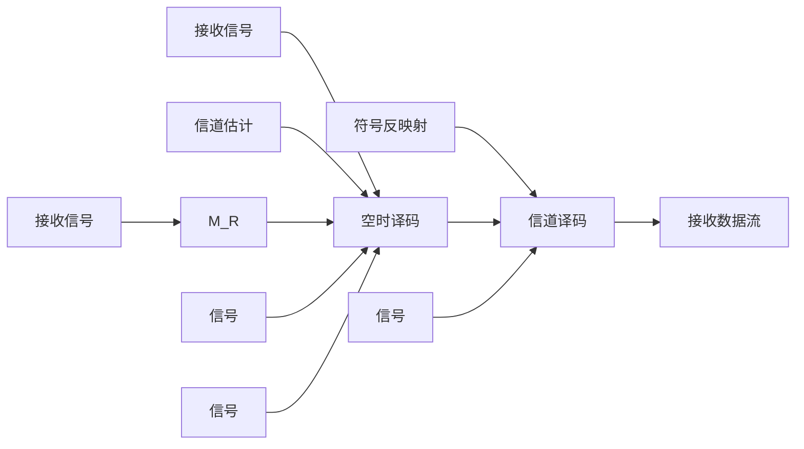
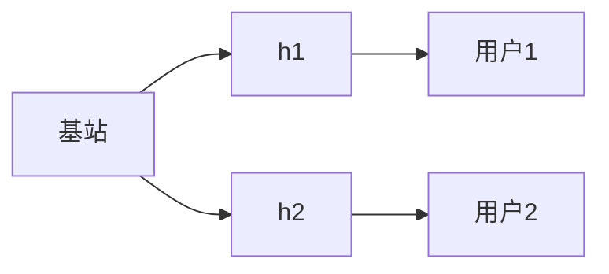
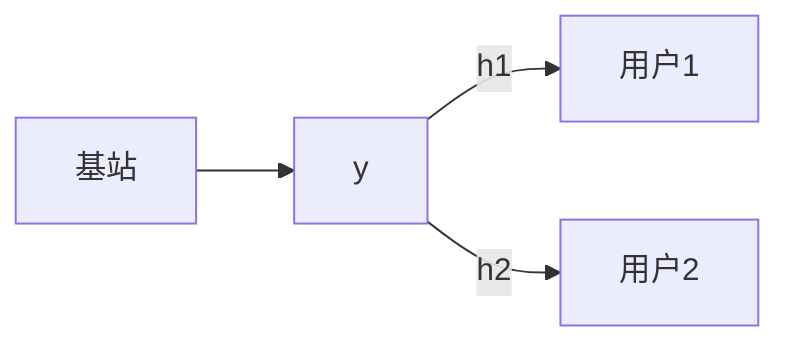

## 第 12 章 空时无线通信技术概述

## 12.1 引言

在第 2 章中，我们讨论过在通信系统分析中常用的随机过程——窄带高斯随机过程，许多接收到的无线信号，如典型移动通信系统的信号，通常就是一种窄带高斯随机过程的信号，这类信号的幅度服从瑞利分布，相位服从均匀分布。信号的窄带高斯随机特性是其在传播中经过大量反射和折射等不同传输路径到达接收端的综合结果。从某个天线端发出的信号，在空间中的不同位置，或在同一位置的不同时间片，接收到的信号强弱和相位通常是不同的；类似地，对于不同天线端发出的相同信号，在某一特定位置接收到的信号同样有很大的差异。这些信号经历的传输路径往往是不相关的。在过去很长一段时间里，人们认为这类多径效应对于无线通信来说是有害的。随着对信号传播物理机理认识的深入，也得益于信号处理能力的提高，人们逐渐发现，如果能够很好地利用这种不同传播路径信道不相关的特性，就可以有效提升接收信号的质量，或者大大增加系统的信道容量，这就是所谓的空时无线通信技术。

空时无线通信技术可以有效地解决无线通信系统中的许多问题，这些技术的应用主要包括：空间多路复用以提升系统容量，信号分集以解决其传输过程中的随机深度衰落，以及有效对抗共信道干扰等。这些方法和相应技术的实现，很大程度上基于一种称为多输入多输出（Multiple Input Multiple Output，MIMO）的模型。所谓多输入，是指多个信号通过多个天线输入空间的传播信道；所谓多输出，是指从空间信道中提取多个信号输出。单输入单输出（Single Input Single Output，SISO）、单输入多输出（Single Input Multiple Output，SIMO）和多输入单输出（Multiple Input Single Output，MISO）均可视为MIMO的某种特例。作为数字通信原理知识的拓展，本章介绍空时无线通信技术的基本概念和方法。

## 12.2 MIMO 的基本模型

MIMO 信道的基本模型如图 12.1.1 所示，包括 SISO、SIMO、MISO、MIMO、MIMO-MU 等主要类型，具体输入与输出的数量一般通过天线的数量来体现，其中 MIMO-MU（MIMO-Multiple User）是一种多用户 MIMO 的情形。

flowchart

图12.2.1 MIMO信道的基本模型

进行分析时, 通常都假设接收端已知信道。在理想化情况下, 如果已知时变信道的冲激响应, $\tau$ 时刻发送端第 $j$ 个发送天线到接收端第 $i$ 个接收天线的信道冲激响应可记为 $h_{i,j}(\tau, t)$ , 对于有 $M_{\mathrm{T}}$ 个发送天线和 $M_{\mathrm{R}}$ 个接收天线的系统来说, 其信道可用一个 $M_{\mathrm{R}} \times M_{\mathrm{T}}$ 维矩阵表示:

$$
\boldsymbol {H} (\tau , t) = \left[ \begin{array}{c c c c} h _ {1 1} (\tau , t) & h _ {1, 2} (\tau , t) & \dots & h _ {1, M _ {\mathrm{T}}} (\tau , t) \\ h _ {2 1} (\tau , t) & h _ {2, 2} (\tau , t) & \dots & h _ {2, M _ {\mathrm{T}}} (\tau , t) \\ \vdots & \vdots & \ddots & \vdots \\ h _ {M _ {\mathrm{R}}, 1} (\tau , t) & h _ {M _ {\mathrm{R}}, 2} (\tau , t) & \dots & h _ {M _ {R}, M _ {\mathrm{T}}} (\tau , t) \end{array} \right] \tag {12.2.1}
$$

如果记 $M_{\mathrm{T}}$ 个发送天线上发射的信号分别为 $s_{j}(t), j = 1,2,\dots,M_{\mathrm{T}}$ ，发送信号就可以用一个 $M_{\mathrm{T}} \times 1$ 维向量 $s(t) = \left[s_{1}(t)s_{2}(t)\dots s_{M_{\mathrm{T}}}(t)\right]^{\mathrm{T}}$ 表示。从 $\tau$ 时刻开始，第 $i$ 个接收天线上收到的信号可以表示为

$$
y _ {i} (\tau , t) = \sum_ {j = 1} ^ {M _ {\mathrm{T}}} h _ {i, j} (\tau , t) * s _ {j} (t) = \sum_ {j = 1} ^ {M _ {\mathrm{T}}} \int_ {- \infty} ^ {+ \infty} h _ {i, j} (\tau , u) s _ {j} (t - u) \mathrm{d} u, \quad i = 1, 2, \dots , M _ {\mathrm{R}} \tag {12.2.2}
$$

式中 “\*” 表示卷积运算。MIMO 系统信道输入输出间的关系也可用矩阵和向量形式表示：

$$
\mathbf {y} (\tau , t) = \boldsymbol {H} (\tau , t) * \boldsymbol {s} (t) \tag {12.2.3}
$$

式中， $y(\tau,t)=\left[y_{1}(\tau,t)y_{2}(\tau,t)\cdots y_{M_{R}}(\tau,t)\right]^{\mathrm{T}}$ 是一个 $M_{R}\times1$ 维向量。

对于 SISO 场景，式（12.2.3）简化为

$$
y (\tau , t) = h (\tau , t) * s (t) = \int_ {- \infty} ^ {+ \infty} h (\tau , u) s (t - u) \mathrm{d} u \tag {12.2.4}
$$

对于 SIMO 场景，只有一个发送天线，式（12.2.3）相应地变为

$$
\mathbf {y} (\tau , t) = \mathbf {h} (\tau , t) * s (t) \tag {12.2.5}
$$

式中， $\boldsymbol{h}(\tau,t)$ 是由矩阵 $\boldsymbol{H}(\tau,t)$ 退化的一个 $M_{R}\times1$ 维列向量， $\boldsymbol{h}(\tau,t)=\left[h_{1}(\tau,t)h_{2}(\tau,t)\cdots h_{M_{R}}(\tau,t)\right]^{\mathrm{T}}$ 。

对于 MISO 场景，矩阵 $H(\tau,t)$ 退化一个 $1 \times M_{R}$ 维行向量 $\boldsymbol{h}(\tau,t)=\left[h_{1}(\tau,t)h_{2}(\tau,t)\cdots h_{M_{T}}(\tau,t)\right]$ ，接收天线的输出为

$$
y (\tau , t) = \boldsymbol {h} (\tau , t) * \boldsymbol {s} (t) \tag {12.2.6}
$$

在实际系统中，要得到准确的信道冲激响应是不容易的。对于数字通信系统来说，在工程上往往也没有必要得到接收信号完整的波形特性。如7.6.1节分析的那样，通常接收端可以通过发送端发送测试信号来估计信道的特性。在短时间段（通常为若干毫秒）内，通常认为信道对信号s的加权影响可视为基本不变，即h是一个常数，这就是所谓的平坦衰落信道。因此，接收信号可表示为 $y=h\cdot s+n$ 。相应地，MIMO的 $M_{R}\times M_{T}$ 维信道矩阵可以表示为

$$
\boldsymbol {H} = \left[ \begin{array}{c c c c} h _ {1 1} & h _ {1, 2} & \dots & h _ {1, M _ {\mathrm{T}}} \\ h _ {2 1} & h _ {2, 2} & \dots & h _ {2, M _ {\mathrm{T}}} \\ \vdots & \vdots & \ddots & \vdots \\ h _ {M _ {\mathrm{R}}, 1} & h _ {M _ {\mathrm{R}}, 2} & \dots & h _ {M _ {\mathrm{R}}, M _ {\mathrm{T}}} \end{array} \right] \tag {12.2.7}
$$

矩阵中的每个元素 $h_{i,j}$ 是通过信道估计得到的、在某个时间段内有效的复常数。也就是说，对于一个平坦衰落信道， $\boldsymbol{H}$ 是随机的，但在每次信道估计后的一小段时间内，矩阵有确定的元素值。如果空间环境有足够的散射度，可以认为矩阵中的每个随机变量元素都服从独立同分布的零均值的复循环对称高斯分布，并称其为空间白色（spatially white），记为 $\boldsymbol{H} = \boldsymbol{H}_{w}$ 。一般地， $M_{\mathrm{T}}$ 个输入、 $M_{\mathrm{R}}$ 个输出的平坦衰落的MIMO信道可用式（12.2.7）所示的 $M_{\mathrm{R}} \times M_{\mathrm{T}}$ 矩阵 $\boldsymbol{H}$ 描述。

天线上发射的信号可用符号空间星座点（复数） $s_{j}, j=1,2,\cdots,M_{T}$ 表示，因此 $M_{T}$ 个发送信号可以表示为一个 $M_{T}\times1$ 维向量 $s=\left[s_{1}s_{2}\cdots s_{M_{T}}\right]^{T}$ 。第i个接收天线上收到的信号可表示为

$$
y _ {i} = \sum_ {j = 1} ^ {M _ {\mathrm{T}}} h _ {i, j} \cdot s _ {j} + n _ {i}, \quad i = 1, 2, \dots , M _ {\mathrm{R}} \tag {12.2.8}
$$

式（12.2.2）中的卷积运算变成了乘法运算。MIMO系统信道输入和输出间的关系也可表示为

$$
\mathbf {y} = \boldsymbol {H} \cdot \boldsymbol {s} + \boldsymbol {n} \tag {12.2.9}
$$

式中， $s=\left[s_{1}s_{2}\cdots s_{M_{T}}\right]^{T}$ 是 $M_{T}\times1$ 维发送信号向量， $y=\left[y_{1}y_{2}\cdots y_{M_{R}}\right]^{T}$ 是 $M_{R}\times1$ 维接收信号向量； $n=\left[n_{1}n_{2}\cdots n_{M_{R}}\right]^{T}$ 是 $M_{R}\times1$ 维接收信号上叠加的噪声向量，通常假设噪声类型是一种零均值循环对称复高斯白噪声。 $n=\left[n_{1}n_{2}\cdots n_{M_{R}}\right]^{T}$ 满足 $E\left[nn^{H}\right]=\sigma^{2}I_{M_{R}}$ ，其中 $E\left[n_{i}n_{i}^{*}\right]=\sigma^{2}$ ， $i=1,2,\cdots,M_{R}$ 。直流成分是不含信息量的，因此通常假设信号向量s中的符号是零均值的，进一步可假设其协方差矩阵 $R_{ss}=E\left[ss^{H}\right]$ 满足 $\mathrm{Tr}(R_{ss})=M_{T}$ ，其中 $\mathrm{Tr}(\cdot)$ 表述取矩阵的主对角线元素之和。因此，若将MIMO系统发送信号的总功率记为 $P_{t}$ ，则MIMO系统接收信号可以表示为

$$
\mathbf {y} = \sqrt {\frac {P _ {\mathrm{t}}}{M _ {\mathrm{T}}}} \mathbf {H} \mathbf {s} + \mathbf {n} \tag {12.2.10}
$$

本章后面的分析均基于以上的假设进行讨论。

## 12.3 空时信道容量

信道容量是指信道可支持的最大无差错传输的速率。4.4节中讨论了加性高斯白噪声（Additive White Gaussian Noise，AWGN）干扰环境下的信道容量，这是一种只考虑噪声干扰的信道。7.5节对信道容量进行了进一步分析，在那里讨论的都是单个传输路径下的信道容量。实际上，系统的信道容量与信号的传播环境、发送端天线和接收端天线的数量以及天线的布设方式等都有关系。空时信道容量就是指考虑了上述诸多因素后系统可获得的最大无差错传输速率，也称MIMO信道容量。考虑到本书只讨论数字通信的基本原理，本节只分析平坦衰落信道的情况。

## 12.3.1 MIMO 信道容量的基本概念

信道容量 $C$ 一般由输入信号 $\pmb{s}$ 和输出信号 $\pmb{y}$ 之间的互信息定义：

$$
C = \max _ {f (s)} I (s; y) \tag {12.3.1}
$$

上式表示遍取所有满足前述条件的可能概率分布 $f(s)$ ，使 $I(s; y)$ 达到最大时所对应的信息速率。参照4.4节的分析，利用信号 s 与噪声 n 之间的独立性，可得

$$
I (s; y) = H (y) - H (y / s) = H (y) - H (n) \tag {12.3.2}
$$

式中， $H(\cdot)$ 是熵函数。因为 $H(y)=\log\left(\det(\pi\mathrm{e}R_{yy})\right)$ ，所以 $H(n)=\log\left(\det(\pi\mathrm{e}R_{nn})\right)=\log\left(\det(\pi\mathrm{e}\sigma^{2}I_{M_{R}})\right)$ ，其中 $\det(X)$ 表示取方阵 X 的行列式。假设可获得信道 H，那么信号 s 的统计特性，如其自协方差函数 $R_{ss}$ 可认为是先验已知的。由式（12.2.10）可得接收信号的自协方差函数

$$
\boldsymbol {R} _ {y y} = E \left[ \boldsymbol {y y} ^ {\mathrm{H}} \right] = \frac {P _ {\mathrm{t}}}{M _ {\mathrm{T}}} \boldsymbol {H} \boldsymbol {R} _ {s s} \boldsymbol {H} ^ {\mathrm{H}} + \sigma^ {2} \boldsymbol {I} _ {M _ {\mathrm{R}}} \tag {12.3.3}
$$

式中， $H^{H}$ 是 H 的共轭转置矩阵。因此，MIMO 系统的信道容量为

$$
\begin{array}{l} C = \max _ {f (s)} I (s; \mathbf {y}) = \max _ {\operatorname{Tr} \left(R _ {s s}\right) = M _ {\mathrm{T}}} \log \left(\det \left(\pi \mathrm{e} R _ {y y}\right)\right) - \log \left(\det \left(\pi \mathrm{e} \sigma^ {2} I _ {M _ {\mathrm{R}}}\right)\right) \\ = \max _ {\operatorname{Tr} \left(\boldsymbol {R} _ {s s}\right) = M _ {\mathrm{T}}} \log \left(\det \left(\pi \mathrm{e} \left(\frac {P _ {\mathrm{t}}}{M _ {\mathrm{T}}} \boldsymbol {H} \boldsymbol {R} _ {s s} \boldsymbol {H} ^ {\mathrm{H}} + \sigma^ {2} \boldsymbol {I} _ {M _ {\mathrm{R}}}\right)\right)\right) - \log \left(\det \left(\pi \mathrm{e} \sigma^ {2} \boldsymbol {I} _ {M _ {\mathrm{R}}}\right)\right) \tag {12.3.4} \\ = \max _ {\operatorname{Tr} \left(\boldsymbol {R} _ {s s}\right) = M _ {\mathrm{T}}} \log \det \left(\frac {P _ {\mathrm{r}}}{M _ {\mathrm{T}} \sigma^ {2}} \boldsymbol {H} \boldsymbol {R} _ {s s} \boldsymbol {H} ^ {\mathrm{H}} + \boldsymbol {I} _ {M _ {\mathrm{R}}}\right) \\ \end{array}
$$

其中，C 是对应单位频谱的容量（比特每秒每赫兹，即 bps/Hz），如果所考虑系统的带宽为 W，则其容量相应为 WC bps。与之前讨论的香农定理一样，这里的 C 给出了 MIMO 系统理论上可以实现的最大无差错传输速率。

## 12.3.2 发送端和接收端均已知信道时的信道容量

在可实现双工通信的场合，通常容易得到有关信道的信息。前面讲过，接收端可以根据发送端发送的测试信号对接收信道进行估计。而发送端有两种方式获得信道信息：一是发送端可以根据对方的反馈得到关于发送信道的信息；二是根据接收信号，利用互易原理估计发送信道的特性。本节假设发送端和接收端均已知信道 H，由此分析发送端如何优化发送功率及接收端如何获得最佳的接收效果。

利用矩阵分析中的奇异值分解法（Singular Value Decomposition，SVD），一般有

$$
\boldsymbol {H} = \boldsymbol {U} \boldsymbol {\Sigma} \boldsymbol {V} ^ {\mathrm{H}} \tag {12.3.5}
$$

式中， $M_{\mathrm{R}} \times M_{\mathrm{R}}$ 维矩阵 $\boldsymbol{U}$ 和 $M_{\mathrm{T}} \times M_{\mathrm{T}}$ 维矩阵 $\boldsymbol{V}$ 均为酉矩阵。若记 $\boldsymbol{U}$ 和 $\boldsymbol{V}$ 的共轭转置矩阵分别为 $\boldsymbol{U}^{\mathrm{H}}$ 和 $\boldsymbol{V}^{\mathrm{H}}$ ，则有 $\boldsymbol{U}^{\mathrm{H}}\boldsymbol{U} = \boldsymbol{I}_{M_{\mathrm{R}}}$ 和 $\boldsymbol{VV}^{\mathrm{H}} = \boldsymbol{I}_{M_{\mathrm{T}}}$ 。矩阵 $\boldsymbol{\Sigma}$ 是 $M_{\mathrm{R}} \times M_{\mathrm{T}}$ 维的、由矩阵 $\boldsymbol{H}$ 的奇异值 $\{\sigma_1, \sigma_2, \cdots, \sigma_r\}$ 构成的对角阵，其中 $r$ 为矩阵 $\boldsymbol{H}$ 的秩， $\sigma_i$ 是 $\boldsymbol{H}$ 的第 $i$ 个奇异值，满足 $\sigma_i \geqslant 0, i = 1, 2, \cdots, r$ 。调整 $\boldsymbol{\Sigma}$ 中特征值的顺序不会破坏相应的 $\boldsymbol{U}$ 和 $\boldsymbol{V}$ 酉矩阵特性，因此不妨假设有 $\sigma_j \geqslant \sigma_{j+1}, j = 1, 2, \cdots, r-1$ 。当信道矩阵 $\boldsymbol{H}$ 已知时，即可求出相应的 $\boldsymbol{U}$ 和 $\boldsymbol{V}$ 。注意到 $\boldsymbol{HH}^{\mathrm{H}}$ 还是一个 $M_{\mathrm{R}} \times M_{\mathrm{R}}$ 维半正定 Hermitian 矩阵，可通过特征值分解为 $\boldsymbol{Q}\boldsymbol{\Lambda}\boldsymbol{Q}^{\mathrm{H}}$ 。 $\boldsymbol{Q}$ 是一个 $M_{\mathrm{R}} \times M_{\mathrm{R}}$ 维矩阵，且有 $\boldsymbol{Q}^{\mathrm{H}}\boldsymbol{Q} = \boldsymbol{Q}\boldsymbol{Q}^{\mathrm{H}} = \boldsymbol{I}_{M_{\mathrm{R}}}$ ， $\boldsymbol{\Lambda} = \mathrm{diag}\{\lambda_1, \lambda_2, \cdots, \lambda_{M_{\mathrm{R}}}\}$ ， $\lambda_i \geqslant 0, i = 1, 2, \cdots, M_{\mathrm{R}}$ 。若特征值还是有序的，即有 $\lambda_j \leqslant \lambda_{j+1}, j = 1, 2, \cdots, M_{\mathrm{R}}-1$ ，则

$$
\lambda_ {i} = \left\{ \begin{array}{l l} \sigma_ {i} ^ {2}, & i = 1, 2, \dots , r \\ 0, & i = r + 1, r + 2, \dots , M _ {\mathrm{R}} \end{array} \right. \tag {12.3.6}
$$

H 的 F-范数的平方有如下关系:

$$
\left\| \boldsymbol {H} \right\| _ {\mathrm{F}} ^ {2} = \operatorname{Tr} \left\langle \boldsymbol {H} \boldsymbol {H} ^ {\mathrm{H}} \right\rangle = \sum_ {i = 1} ^ {M _ {\mathrm{R}}} \sum_ {j = 1} ^ {M _ {\mathrm{T}}} \left| h _ {i, j} \right| ^ {2} = \sum_ {i = 1} ^ {M _ {\mathrm{R}}} \lambda_ {i} \tag {12.3.7}
$$

显然，当发送端和接收端都已知信道 H 时，两端都可以对其进行 SVD 分解，进而获得 U 和 V。记原信号为 $\tilde{s} = \left[\tilde{s}_{1}\tilde{s}_{2}\cdots\tilde{s}_{r}\right]^{H}$ ，若发送端在符号发送前用 V 矩阵对 $\tilde{s}$ 进行加权，则对应式（12.2.10）中的 $s = V\tilde{s}$ ；在接收端，用 U 的复共轭矩阵 $U^{H}$ 对接收信号 y 进行加权过滤，可得 $\tilde{y} = U^{H}y$ ，于是有

$$
\begin{array}{l} \tilde {\boldsymbol {y}} = \boldsymbol {U} ^ {\mathrm{H}} \boldsymbol {y} = \sqrt {\frac {P _ {\mathrm{t}}}{M _ {\mathrm{T}}}} \boldsymbol {U} ^ {\mathrm{H}} \boldsymbol {H} \boldsymbol {V} \tilde {\boldsymbol {s}} + \boldsymbol {U} ^ {\mathrm{H}} \boldsymbol {n} = \sqrt {\frac {P _ {\mathrm{t}}}{M _ {\mathrm{T}}}} \boldsymbol {U} ^ {\mathrm{H}} (\boldsymbol {U} \boldsymbol {\Sigma} \boldsymbol {V} ^ {\mathrm{H}}) \boldsymbol {V} \tilde {\boldsymbol {s}} + \boldsymbol {U} ^ {\mathrm{H}} \boldsymbol {n} \tag {12.3.8} \\ = \sqrt {\frac {P _ {\mathrm{t}}}{M _ {\mathrm{T}}}} \left(\boldsymbol {U} ^ {\mathrm{H}} \boldsymbol {U}\right) \boldsymbol {\Sigma} \left(\boldsymbol {V} ^ {\mathrm{H}} \boldsymbol {V}\right) \tilde {\boldsymbol {s}} + \boldsymbol {U} ^ {H} \boldsymbol {n} = \sqrt {\frac {P _ {\mathrm{t}}}{M _ {\mathrm{T}}}} \boldsymbol {\Sigma} \tilde {\boldsymbol {s}} + \tilde {\boldsymbol {n}} \\ \end{array}
$$

因为 n 乘以矩阵 $U^{H}$ 后不改变其噪声分布，所以 $\tilde{n}$ 与 n 是同分布的 $^{[2]}$ 。于是，当发收两侧均已知信道时，可将一个如图 13.3.1(a) 所示的复杂的 $M_{T} \times M_{R}$ MIMO 信道分解成如图 12.3.1(b) 所示的简洁的 r 条独立的并行 SISO 传输路径。可见，尽管有 $M_{T} \times M_{R}$ 个天线对和相应的传输途径 $\{h_{i,j}\}, i=1,2,\cdots,M_{R}$ ， $j=1,2,\cdots,M_{T}$ ，由传播环境决定的可构建的无相互干扰的有效传输路径只有 r 条，且有 $r \leqslant \min\{M_{T}, M_{R}\}$ ，其中的第 i 条传输路径的接收信号为

$$
y _ {i} = \sqrt {\frac {P _ {\mathrm{t}}}{M _ {\mathrm{T}}}} \sigma_ {i} \tilde {s} _ {i} + \tilde {n} _ {i} = \sqrt {\frac {P _ {\mathrm{t}}}{M _ {\mathrm{T}}}} \sqrt {\lambda_ {i}} \tilde {s} _ {i} + \tilde {n} _ {i} \tag {12.3.9}
$$

flowchart

(a)

flowchart

(b)  
图 12.3.1 两侧已知信道时传输路径的分解

相应地，MIMO 系统的信道容量为 r 个独立的并行信道容量之和：

$$
C = \sum_ {i = 1} ^ {r} \log \left(1 + \frac {P _ {\mathrm{t}} \gamma_ {i}}{M _ {\mathrm{T}} \sigma^ {2}} \lambda_ {i}\right) \tag {12.3.10}
$$

式中， $\gamma_{i}=E\left(\left|s_{i}\right|^{2}\right),i=1,2,\cdots,r$ 可视为分配给原信号 $\tilde{s}_{i}$ 在总功率 $P_{t}$ 中所占的份额。容量成为在满足 $\sum_{i=1}^{r}\gamma_{i}=M_{T}$ 条件的情况下，在每次发送信号时 $\gamma_{i},i=1,2,\cdots,r$ 如何确定的问题：

$$
C = \max _ {\sum_ {i} ^ {r} \gamma_ {i} = M _ {\mathrm{T}}} \sum_ {i = 1} ^ {r} \log \left(1 + \frac {P _ {\mathrm{t}} \gamma_ {i}}{M _ {\mathrm{T}} \sigma^ {2}} \lambda_ {i}\right) \tag {12.3.11}
$$

采用 7.5 节平坦衰落信道的容量分析中讨论的拉格朗日极值法，可得最佳分配方式为

$$
\gamma_ {i} ^ {\mathrm{opt}} = \left\{ \begin{array}{c c} \mu - M _ {\mathrm{T}} \sigma^ {2} / P _ {\mathrm{t}} \lambda_ {i} & \mu \geqslant M _ {\mathrm{T}} \sigma^ {2} / P _ {\mathrm{t}} \lambda_ {i} \\ 0, & \mu <   M _ {\mathrm{T}} \sigma^ {2} / P _ {\mathrm{t}} \lambda_ {i} \end{array} , \quad i = 1, 2, \dots , r \right. \tag {12.3.12}
$$

式中， $\mu$ 是由 $\sum_{i=1}^{r}\gamma_{i}^{opt}=M_{T}$ 确定的一个常量。 $\mu$ 和 $\gamma_{i}^{opt}, i=1,2,\cdots,r$ 具体可通过数值迭代计算方法求解，也就是所谓的注水法。

【例 12.3.1】 某 MIMO 信道的信道矩阵为

$$
\boldsymbol {H} = \left[ \begin{array}{l l l} 0. 1 & 0. 3 & 0. 7 \\ 0. 5 & 0. 4 & 0. 1 \\ 0. 2 & 0. 6 & 0. 8 \end{array} \right]
$$

设 $\rho = P_{t} / \sigma^{2} = 10 dB$ ，W = 1 Hz 。求：（1）等价的并行传输模型；（2）最优的功率分配；（3）信道容量。

解：（1）信道的奇异值分解矩阵为

$$
\boldsymbol {H} = \boldsymbol {U} \boldsymbol {\Sigma} \boldsymbol {V} ^ {\mathrm{H}} = \left[ \begin{array}{c c c} - 0. 5 5 5 0 & 0. 3 7 6 4 & - 0. 7 4 1 8 \\ - 0. 3 3 3 8 & - 0. 9 1 7 6 & - 0. 2 1 5 8 \\ - 0. 7 6 1 9 & 0. 1 2 7 8 & 0. 6 3 4 9 \end{array} \right] \left[ \begin{array}{c c c} 1. 3 3 3 3 & 0 & 0 \\ 0 & 0. 5 1 2 9 & 0 \\ 0 & 0 & 0. 0 9 6 5 \end{array} \right] \left[ \begin{array}{c c c} - 0. 2 8 1 1 & - 0. 7 7 1 3 & - 0. 5 7 1 0 \\ - 0. 5 6 7 9 & - 0. 3 4 5 9 & 0. 7 4 6 9 \\ - 0. 7 7 3 6 & 0. 5 3 4 2 & - 0. 3 4 0 8 \end{array} \right]
$$

矩阵 $\Sigma$ 有 3 个非零奇异值, $r = 3$ , 因此可分解为 3 个并行的信道, 信道的增益分别为 $\sigma_{1} = 1.3333$ 、 $\sigma_{2} = 0.5129$ 和 $\sigma_{3} = 0.0965$

（2）在式（12.3.11）中，若记分配给并行信道中信道 $i$ 的功率为 $P_{\mathrm{ti}} = \tilde{\gamma}_i P_\mathrm{t} / M_\mathrm{T}$ ，则有

$$
C = \max _ {\sum_ {i} ^ {r} \gamma_ {i} = M _ {\mathrm{T}}} \sum_ {i = 1} ^ {r} \log \left(1 + \frac {P _ {i i}}{\sigma^ {2}} \lambda_ {i}\right) = \max _ {\sum_ {i} ^ {r} \gamma_ {i} = M _ {\mathrm{T}}} \sum_ {i = 1} ^ {r} \log \left(1 + \frac {P _ {i i}}{P _ {i}} \tilde {\gamma} _ {i}\right)
$$

式中， $\tilde{\gamma}_{i}=\sigma_{i}^{2}P_{t}/\sigma^{2}$ 。由已知条件 $\rho=P_{t}/\sigma^{2}=10dB$ 有 $\tilde{\gamma}_{i}=10\sigma_{i}^{2}$ ，于是有 $\tilde{\gamma}_{1}=17.7769$ ， $\tilde{\gamma}_{2}=2.6307$ ， $\tilde{\gamma}_{3}=0.0931$ 。
利用注水算法分配功率时，应有

$$
\frac {P _ {\mathrm{t} i}}{P _ {\mathrm{t}}} = \left\{ \begin{array}{c c} 1 / \tilde {\gamma} _ {0} - 1 / \tilde {\gamma} _ {i} & \tilde {\gamma} _ {i} \geqslant \tilde {\gamma} _ {0} \\ 0 & \tilde {\gamma} _ {i} <   \tilde {\gamma} _ {0} \end{array} \right.
$$

相应地有 $\sum_{i=1}^{3}\frac{P_{1i}}{P_{1}}=\sum_{i=1}^{3}\left(\frac{1}{\tilde{\gamma}_{0}}-\frac{1}{\tilde{\gamma}_{i}}\right)=1$ ，进而有 $\frac{3}{\tilde{\gamma}_{0}}=1+\sum_{i=1}^{3}\frac{1}{\tilde{\gamma}_{i}}=12.1749$ 。

由此可得 $\tilde{\gamma}_{0} = 0.2685$ ，该结果与所要求的 $\tilde{\gamma}_{3} > \tilde{\gamma}_{0}$ 矛盾， $\sigma_{3} = 0.0965$ 的信道不应该分配功率，因此要调整上式。由 $\sum_{i=1}^{2} \frac{P_{t i}}{P_{t}} = \sum_{i=1}^{3} \left( \frac{1}{\tilde{\gamma}_{0}} - \frac{1}{\tilde{\gamma}_{i}} \right) = 1$ 得 $\frac{2}{\tilde{\gamma}_{0}} = 1 + \sum_{i=1}^{1} \frac{1}{\tilde{\gamma}_{i}} = 1.4364$ ，解得 $\tilde{\gamma}_{0} = 1.392 < \tilde{\gamma}_{2} < \tilde{\gamma}_{1}$ 。于是有 $P_{t1} = 0.662P_{t}$ ， $P_{t2} = 0.338P_{t}$ ， $P_{t3} = 0$ 。

(3) 信道容量

$$
C = \sum_ {i = 1} ^ {2} \log \left(1 + \frac {P _ {i i}}{P _ {i}} \tilde {\gamma} _ {i}\right) = \log (1 + 0. 6 6 2 \times 1 7. 7 7 6 9) + \log (1 + 0. 3 3 8 \times 2. 6 3 0 7) = 4. 5 9 \mathrm{bps/Hz} \quad \square
$$

本节分析了发送端和接收端均已知信道时，应如何分配传输信号的功率，以获得最大的传输速率。信道容量给出了可实现无差错传输速率的上限。从注水法的基本原理可见，为了获得最高的传输效率，传输功率的分配倾向于给好的“路径”配置更多的能量，其中并未考虑实际的具体传输需求，特别是在多用户的MIMO-MU场合，某些信道条件较差的用户可能得不到获取传输资源的机会。

## 12.3.3 仅接收端已知信道时的信道容量

如果发送端不知道信道 $H$ ，仅接收端均知信道 $H$ 时，则发送端无法像上一节那样根据随机信道当前的情况对发送功率进行优化分配。若空间是白色的，即 $H$ 中的每个元素都是独立同分布的、零均值的和单位方差，且满足复循环对称高斯分布，则可将发送功率平均分配到每个天线上。可以证明[2]，此时 $M_{\mathrm{R}} \times M_{\mathrm{T}}$ MIMO 系统单位频谱的互信息为

$$
I (s; y) = \log \left(\det \left(\frac {P _ {\mathrm{t}}}{M _ {\mathrm{T}} \sigma^ {2}} H H ^ {\mathrm{H}} + I _ {M _ {\mathrm{R}}}\right)\right) = \log \left(\det \left(\frac {\rho}{M _ {\mathrm{T}}} H H ^ {\mathrm{H}} + I _ {M _ {\mathrm{R}}}\right)\right) \tag {12.3.13}
$$

式中， $\rho = P_{\mathrm{t}} / \sigma^{2}$ 。若接收天线的数量 $M_{\mathrm{R}}$ 确定，而发送天线的数量 $M_{\mathrm{T}}$ 趋于无限大，根据大数定律有

$$
\lim _ {M _ {\mathrm{T}} \to \infty} \frac {1}{M _ {\mathrm{T}}} \boldsymbol {H} \boldsymbol {H} ^ {\mathrm{H}} = \boldsymbol {I} _ {M _ {\mathrm{R}}} \tag {12.3.14}
$$

结合上面两式的结果，当 $M_{T}$ 趋于无限大时，可得信道容量为

$$
C = \log \left(\det (\rho I _ {M _ {\mathrm{R}}} + I _ {M _ {\mathrm{R}}})\right) = \log (1 + \rho) ^ {M _ {\mathrm{R}}} = M _ {\mathrm{R}} \log (1 + \rho) \tag {12.3.15}
$$

此时，信道容量将随着 $M_{R}$ 的增加而线性地增大。

针对发送端和接收端均不知信道 $H$ 的 MIMO 场景, 也有人研究如何提高这类系统的性能, 此时情况比较复杂, 信道容量与收发天线数量的关系依赖于具体的信道特性和模型, 具体可参考有关的文献, 这里不做深入讨论。下节讨论在实际系统中得到应用的空时编码技术。

## 12.4 空时编码的基本方法

空时编码译码是空时无线通信技术的核心，且已有大量的相关研究成果，本节仅介绍其基本概念。空时编码包括分层空时码、空时网格码、空时分组码等。本节主要介绍最基本的分层空时码，其他编码可参阅有关的专著和文献。

## 12.4.1 分层空时码模型

分层空时码的发送模型如图 12.4.1 所示。待传输的比特流执行串并变换后，进行信道编码，信道编码主要用于差错控制，必要时还可进一步做码元交织，交织可提高差错控制编码的纠错性能，降低突发性连续错误的影响；接着对经过差错控制编码的二进制数据进行 QAM 调制的符号映射。得到映射的符号向量 $\tilde{s}$ 后，送到空时编码器编码后得到从天线上发送的空时码字 s，这里输入和输出之所以采用不同的符号标识，是因为要考虑空时编码过程中可能包含注水算法等有关的信号加权处理。

flowchart

图 12.4.1 分层空时码的发送模型

通常将一组特定长度的数据产生的 $M_{\mathrm{T}} \times T$ 个符号的空时编码输出称为一个空时码字。假设图12.4.1中符号映射后各路输出的符号流分别为 $\tilde{s}_{i,1}, i = 1,2,\dots,T, \tilde{s}_{i,2}, i = 1,2,\dots,T, \tilde{s}_{i,3}, i = 1,2,\dots,T,\dots,\tilde{s}_{i,M_T}, i = 1,2,\dots,T$ 。进入空时编码器后的输出，由编码器的类型确定。以 $M_{T} = 4$ 为例，对于水平分层编码、垂直分层编码和对角分层编码，编码后送至各天线的信号分别如下所示。

（1）对角分层编码 对于对角分层编码，其送至 $M_{\mathrm{T}}$ 个天线的一个码字信号如下所示。

$$
\begin{array}{c c c c c c c c c c c c c c c} 0 & 0 & 0 & s _ {T, 4} & \dots & s _ {9, 1} & s _ {5, 4} & s _ {5, 3} & s _ {5, 2} & s _ {5, 1} & s _ {1, 4} & s _ {1, 3} & s _ {1, 2} & s _ {1, 1} & \text {至天线} 1 \\ 0 & 0 & s _ {T, 4} & \dots & \dots & s _ {6, 4} & s _ {6, 3} & s _ {6, 2} & s _ {6, 1} & s _ {2, 4} & s _ {2, 3} & s _ {2, 2} & s _ {2, 1} & 0 & \text {至天线} 2 \\ 0 & s _ {T, 4} & \dots & \dots & \dots & s _ {7, 3} & s _ {7, 2} & s _ {7, 1} & s _ {3, 4} & s _ {3, 3} & s _ {3, 2} & s _ {3, 1} & 0 & 0 & \text {至天线} 3 \\ s _ {T, 4} & \dots & \dots & \dots & \dots & s _ {8, 2} & s _ {8, 1} & s _ {4, 4} & s _ {4, 3} & s _ {4, 2} & s _ {4, 1} & 0 & 0 & 0 & \text {至天线} 4 \end{array}
$$

(2) 垂直分层编码 对于垂直分层编码，其送至 $M_{T}$ 个天线的一个码字信号如下所示。

$$
\begin{array}{c c c c c c c c c c c c} S _ {T - 3, 4} & \dots & \dots & S _ {5, 4} & S _ {5, 3} & S _ {5, 2} & S _ {5, 1} & S _ {1, 4} & S _ {1, 3} & S _ {1, 2} & S _ {1, 1} & \text {至天线} 1 \\ S _ {T - 2, 4} & \dots & \dots & S _ {6, 4} & S _ {6, 3} & S _ {6, 2} & S _ {6, 1} & S _ {2, 4} & S _ {2, 3} & S _ {2, 2} & S _ {2, 1} & \text {至天线} 2 \\ S _ {T - 1, 4} & \dots & \dots & S _ {7, 4} & S _ {7, 3} & S _ {7, 2} & S _ {7, 1} & S _ {3, 4} & S _ {3, 3} & S _ {3, 2} & S _ {3, 1} & \text {至天线} 3 \\ S _ {T, 4} & \dots & \dots & S _ {8, 4} & S _ {8, 3} & S _ {8, 2} & S _ {8, 1} & S _ {4, 4} & S _ {4, 3} & S _ {4, 2} & S _ {4, 1} & \text {至天线} 4 \end{array}
$$

（3）水平分层编码 对于水平分层编码，其送至 $M_{\mathrm{T}}$ 个天线的一个码字信号如下所示。

$$
\begin{array}{c c c c c c c c c c c c} S _ {T, 1} & \dots & \dots & S _ {k + 2, 1} & S _ {k + 1, 1} & S _ {k, 1} & \dots & S _ {4, 1} & S _ {3, 1} & S _ {2, 1} & S _ {1, 1} & \text {至天线} & 1 \\ S _ {T, 2} & \dots & \dots & S _ {k + 2, 2} & S _ {k + 1, 2} & S _ {k, 2} & \dots & S _ {4, 2} & S _ {3, 2} & S _ {2, 2} & S _ {1, 2} & \text {至天线} & 2 \\ S _ {T, 3} & \dots & \dots & S _ {k + 2, 3} & S _ {k + 1, 3} & S _ {k, 3} & \dots & S _ {4, 3} & S _ {3, 3} & S _ {2, 3} & S _ {1, 3} & \text {至天线} & 3 \\ S _ {T, 4} & \dots & \dots & S _ {k + 2, 4} & S _ {k + 1, 4} & S _ {k, 4} & \dots & S _ {4, 4} & S _ {3, 4} & S _ {2, 4} & S _ {1, 4} & \text {至天线} & 4 \end{array}
$$

有关研究表明，对于对角分层编码，每个信道编码器的编码经由 $M_{T}$ 个天线循环发送，且在时间上错开，可以避免受某个特定天线及特定时刻传输路径上信号的深度衰落而造成的影响，因此有较好的空时特性。然而，如果空时码字较短，对角分层编码右下角和左上角的“0”位置会浪费传输资源，且译码的复杂度较高。水平分层码最简单，但信道编码输出的符号序列均由一个特定的天线发送，空时性能较差；垂直分层编码的空时性能和复杂性介于两者之间，因此应用较为广泛。

分层空时码的接收模型如图 12.4.2 所示，它可视为空时码发送的逆过程。下一节讨论分层空时码的具体译码方法，为了简单和便于理解起见，假设采用垂直分层编码，且 T=1 。一个码字对应 $M_{T}$ 个天线在一个符号周期发送的 $M_{T}$ 个信号。

flowchart

图 12.4.2 分层空时码接收模型

## 12.4.2 最大似然译码（ML）算法

由前面的讨论可知，MIMO 信道的输出一般可以表示为 $y = \sqrt{P_{t}/M_{T}} Hs + n$ 。空时信号的最大似然译码输出 $\hat{s}$ 由下式确定：

$$
\hat {\boldsymbol {s}} = \arg \min _ {s} \left\| \boldsymbol {y} - \boldsymbol {H} \boldsymbol {s} \right\| _ {\mathrm{F}} ^ {2} = \arg \min _ {s} \sum_ {i = 1} ^ {M _ {\mathrm{R}}} \left| y _ {i} - \sqrt {\frac {P _ {\mathrm{t}}}{M _ {\mathrm{T}}}} \sum_ {j = 1} ^ {M _ {\mathrm{T}}} h _ {i, j} s _ {j} \right| ^ {2} \tag {12.4.1}
$$

最大似然译码算法在整个符号空间 $\{s\}$ 中搜索能够使上式成立的信号向量 $\hat{s}$ 作为译码输出。显然，实现最大似然译码的条件要求信道H是已知的。

在已知信道 $\pmb{H}$ 的条件下，最大似然译码的误码字率即发送符号码字为 $s^{(i)}$ ，与接收码字为 $s^{(j)}, j \neq i$ 的错误概率有如下关系：

$$
P \left(\boldsymbol {s} ^ {(i)} \rightarrow \boldsymbol {s} ^ {(j)} \mid \boldsymbol {H}\right) = Q \left(\sqrt {\frac {P _ {\mathrm{t}} \left\| \boldsymbol {H} \left(\boldsymbol {s} ^ {(i)} \rightarrow \boldsymbol {s} ^ {(j)}\right)\right\| _ {\mathrm{F}} ^ {2}}{2 M _ {\mathrm{T}} \sigma^ {2}}}\right) \leqslant \mathrm{e} ^ {- \frac {\left\| \boldsymbol {H} \left(\boldsymbol {s} ^ {(i)} \rightarrow \boldsymbol {s} ^ {(j)}\right)\right\| _ {\mathrm{F}} ^ {2}}{2 M _ {\mathrm{T}}} \rho} \tag {12.4.2}
$$

式中， $\rho = P_{\mathrm{t}} / \sigma^{2}$ ， $\left\| \boldsymbol{H}(\boldsymbol{s}^{(i)} \rightarrow \boldsymbol{s}^{(j)}) \right\|_{\mathrm{F}}^{2}$ 是该向量的 Frobenius 范数（F-范数）的平方，定义为其各元素的绝对值的平方和。最大似然译码算法具有最优的误符号率性能，计算量也是最大的。

## 12.4.3 迫零（ZF）算法

7.6 节讨论过数字时域均衡器的迫零（Zero Forcing，ZF）算法，其基本思想是在接收码元的采样时刻，将邻近的码元串扰的影响降低到零。MIMO 系统的迫零接收思想与时域均衡器的迫零原理一样，也是通过某种加权的滤波处理，将空间上不同接收符号间的相互影响减小至零的。若已知信道 H，假设有 $M_{T} \leqslant M_{R}$ ，且 H 列满秩，则可计算 H 的 M-P（Moore-Penrose）伪逆为

$$
\boldsymbol {H} ^ {\dagger} = \left\{ \begin{array}{l l} \boldsymbol {H} ^ {- 1}, & M _ {\mathrm{T}} = M _ {\mathrm{R}} \\ (\boldsymbol {H} ^ {\mathrm{H}} \boldsymbol {H}) ^ {- 1} \boldsymbol {H} ^ {\mathrm{H}}, & M _ {\mathrm{T}} <   M _ {\mathrm{R}} \end{array} \right. \tag {12.4.3}
$$

利用伪逆矩阵 $H^{\dagger}$ ，可得迫零算法的译码结果。对于 $M_{T} < M_{R}$ 的情形，

$$
\begin{array}{l} \hat {\boldsymbol {s}} = \sqrt {\frac {M _ {\mathrm{T}}}{P _ {\mathrm{t}}}} \boldsymbol {H} ^ {\dagger} \left(\sqrt {\frac {P _ {\mathrm{t}}}{M _ {\mathrm{T}}}} \boldsymbol {H} \boldsymbol {s} + \boldsymbol {n}\right) = \boldsymbol {H} ^ {\dagger} \boldsymbol {H} \boldsymbol {s} + \sqrt {\frac {M _ {\mathrm{T}}}{P _ {\mathrm{t}}}} \boldsymbol {H} ^ {\dagger} \boldsymbol {n} \tag {12.4.4} \\ = (\boldsymbol {H} ^ {\mathrm{H}} \boldsymbol {H}) ^ {- 1} \boldsymbol {H} ^ {\mathrm{H}} \boldsymbol {H} \boldsymbol {s} + \sqrt {\frac {M _ {\mathrm{T}}}{P _ {\mathrm{t}}}} (\boldsymbol {H} ^ {\mathrm{H}} \boldsymbol {H}) ^ {- 1} \boldsymbol {H} ^ {\mathrm{H}} \boldsymbol {n} = \boldsymbol {s} + \sqrt {\frac {M _ {\mathrm{T}}}{P _ {\mathrm{t}}}} (\boldsymbol {H} ^ {\mathrm{H}} \boldsymbol {H}) ^ {- 1} \boldsymbol {H} ^ {\mathrm{H}} \boldsymbol {n} \\ \end{array}
$$

而对于 $M_{\mathrm{T}} = M_{\mathrm{R}}$ 的情形，直接可得

$$
\hat {\boldsymbol {s}} = \sqrt {\frac {M _ {\mathrm{T}}}{P _ {\mathrm{t}}}} \boldsymbol {H} ^ {\dagger} \left(\sqrt {\frac {P _ {\mathrm{t}}}{M _ {\mathrm{T}}}} \boldsymbol {H} \boldsymbol {s} + \boldsymbol {n}\right) = \boldsymbol {H} ^ {- 1} \boldsymbol {H} \boldsymbol {s} + \sqrt {\frac {M _ {\mathrm{T}}}{P _ {\mathrm{t}}}} \boldsymbol {H} ^ {- 1} \boldsymbol {n} = \boldsymbol {s} + \sqrt {\frac {M _ {\mathrm{T}}}{P _ {\mathrm{t}}}} \boldsymbol {H} ^ {- 1} \boldsymbol {n} \tag {12.4.5}
$$

迫零算法避免了最大似然算法需要在码字空间进行大量搜索的运算量，是一种较为简单实用算法。然而，矩阵 $\sqrt{M_{\mathrm{T}} / P_{\mathrm{t}}} H^{\dagger}$ 经噪声作用后得到 $\sqrt{M_{\mathrm{T}} / P_{\mathrm{t}}} H^{\dagger}n$ ，会使噪声功率因正比于 $M_{\mathrm{T}}$ 而得到增强，因此迫零算法是一种次优的算法。

由式（12.4.4），可得第 $j$ 个信号 $\hat{s}_j$ 的信噪比为

$$
\eta_ {j} = \frac {E _ {\mathrm{S}}}{M _ {\mathrm{T}} \sum_ {i} ^ {M _ {\mathrm{T}}} \left| h _ {i , j} ^ {(\dagger)} \right| ^ {2} \sigma^ {2}} = \frac {1}{\sum_ {i} ^ {M _ {\mathrm{T}}} \left| h _ {i , j} ^ {(\dagger)} \right| ^ {2}} \frac {\rho}{M _ {\mathrm{T}}} \tag {12.4.6}
$$

式中， $h_{i,j}^{(\dagger)}$ 是伪逆矩阵 $\pmb{H}$ 中第 $i$ 行第 $j$ 列的元素。迫零算法的平均误符号率为[1]

$$
P _ {\mathrm{S}} \leqslant \overline {{N}} _ {\mathrm{c}} \left(\frac {\rho d _ {\min} ^ {2}}{2 M _ {\mathrm{T}}}\right) ^ {- (M _ {\mathrm{R}} - M _ {\mathrm{T}} + 1)} \tag {12.4.7}
$$

式中， $d_{min}$ 是发送信号星座点间最小的欧氏距离， $\overline{N}_{c}$ 是具有最小欧氏距离的相邻星座点的数量。

## 12.4.4 最小均方误差（MMSE）算法

迫零算法根据已知信道 H 获得的伪逆矩阵 $H^{\dagger}$ ，可在接收信号过程中消除不同传输路径间的信号串扰，但因此也可能导致噪声信号增强，降低接收信号的信噪比。最小均方误差（Minimum Mean Square Error，MMSE）算法可以较好地兼顾这两方面的问题。考虑满足下式的矩阵 $W_{R}$ ，

$$
\boldsymbol {W} _ {\mathrm{RMMSE}} = \arg \min _ {\boldsymbol {W} _ {\mathrm{R}}} E \left[ \left\| \boldsymbol {W} _ {\mathrm{R}} \boldsymbol {y} - \boldsymbol {s} \right\| _ {\mathrm{F}} ^ {2} \right] \tag {12.4.8}
$$

接收信号时，用 $W_{RMMSE}$ 替代ZF算法中的伪逆矩阵 $H^{\dagger}$ 对y进行线性加权滤波运算，可使得接收信号的统计平均错误达到最小。

MMSE 算法与 ML 算法的不同之处是, ML 算法每收到一个信号 $y$ , 都需要在整个符号空间 $\{s\}$ 中进行搜索, 以寻求最佳输出。而 MMSE 算法获得满足式 (12.4.8) 所确定的统计误差最小的矩阵 $W_{\mathrm{RMMSE}}$ 后, 对后续所有接收信号只需进行与迫零算法类似的加权滤波处理, 因此运算量大大降低。虽然 MMSE 算法的性能则不如 ML 算法, 但优于 ZF 算法。

下面分析如何确定 $W_{RMMSE}$ 。通常假设发送的符号之间是相互独立的，发送的符号与噪声之间也是相互独立的，即有

$$
E \left[ s s ^ {\mathrm{H}} \right] = I \tag {12.4.9}
$$

$$
E \left[ \boldsymbol {s} \boldsymbol {n} ^ {\mathrm{H}} \right] = \boldsymbol {0} \tag {12.4.10}
$$

参照 7.6.4 小节中有关最小均方误差的分析，可知得到的 $W_{RMMSE}$ 应满足如下统计意义上的正交性：

$$
E \left[ \left(\boldsymbol {W} _ {\mathrm{RMMSE}} \boldsymbol {y} - \boldsymbol {s}\right) \boldsymbol {y} ^ {\mathrm{H}} \right] = \boldsymbol {0} _ {M _ {\mathrm{T}} \times M _ {\mathrm{R}}} \tag {12.4.11}
$$

式中， $0_{M_{T}\times M_{R}}$ 为元素全为零的 $M_{T}\times M_{R}$ 维矩阵。展开上式，并利用式（12.4.9）和式（12.4.10）可得

$$
\begin{array}{l} E \left[ \left(\boldsymbol {W} _ {\mathrm{RMMSE}} \left(\sqrt {\frac {P _ {\mathrm{t}}}{M _ {\mathrm{T}}}} \boldsymbol {H} \boldsymbol {s} + \boldsymbol {n}\right) - \boldsymbol {s}\right) \left(\sqrt {\frac {P _ {\mathrm{t}}}{M _ {\mathrm{T}}}} \boldsymbol {H} \boldsymbol {s} + \boldsymbol {n}\right) ^ {\mathrm{H}} \right] \tag {12.4.12} \\ = W _ {\mathrm{RMMSE}} \left(\frac {P _ {\mathrm{t}}}{M _ {\mathrm{T}}} H H ^ {\mathrm{H}} + \sigma^ {2} I\right) - \sqrt {\frac {P _ {\mathrm{t}}}{M _ {\mathrm{T}}}} H ^ {\mathrm{H}} = 0 _ {M _ {\mathrm{T}} \times M _ {\mathrm{R}}} \\ \end{array}
$$

于是有

$$
W _ {\mathrm{RMMSE}} \left(\frac {P _ {\mathrm{t}}}{M _ {\mathrm{T}}} \boldsymbol {H} \boldsymbol {H} ^ {\mathrm{H}} + \sigma^ {2} \boldsymbol {I}\right) = \sqrt {\frac {P _ {\mathrm{t}}}{M _ {\mathrm{T}}}} \boldsymbol {H} ^ {\mathrm{H}} \text {即} W _ {\mathrm{RMMSE}} \frac {P _ {\mathrm{t}}}{M _ {\mathrm{T}}} \left(\boldsymbol {H} \boldsymbol {H} ^ {\mathrm{H}} + \frac {M _ {\mathrm{T}}}{\rho} \boldsymbol {I}\right) = \sqrt {\frac {P _ {\mathrm{t}}}{M _ {\mathrm{T}}}} \boldsymbol {H} ^ {\mathrm{H}} \tag {12.4.13}
$$

式中， $\rho = P_{\mathrm{t}} / \sigma^{2}$ 为信噪比。记矩阵 $\left(\frac{P_{\mathrm{t}}}{M_{\mathrm{T}}}\boldsymbol{HH}^{\mathrm{H}} + \sigma^{2}\boldsymbol{I}\right)$ 的M-P伪逆为 $\left(\frac{P_{\mathrm{t}}}{M_{\mathrm{T}}}\boldsymbol{HH}^{\mathrm{H}} + \sigma^{2}\boldsymbol{I}\right)^{\dagger}$ ，则有

$$
\boldsymbol {W} _ {\mathrm{RMMSE}} = \sqrt {\frac {P _ {\mathrm{t}}}{M _ {\mathrm{T}}}} \boldsymbol {H} ^ {\mathrm{H}} \left(\boldsymbol {H} \boldsymbol {H} ^ {\mathrm{H}} + \frac {M _ {\mathrm{T}}}{\rho} \boldsymbol {I}\right) ^ {\dagger} \tag {12.4.14}
$$

若不考虑噪声 $\sigma^2$ 的影响，令 $\sigma^2 = 0$ ，则上式变为[6]

$$
\boldsymbol {W} _ {\mathrm{RMMSE}} = \sqrt {\frac {M _ {\mathrm{T}}}{P _ {\mathrm{t}}}} \boldsymbol {H} ^ {\mathrm{H}} \left(\boldsymbol {H} \boldsymbol {H} ^ {\mathrm{H}}\right) ^ {?} = \sqrt {\frac {M _ {\mathrm{T}}}{P _ {\mathrm{t}}}} \boldsymbol {H} ^ {\mathrm{H}} \left(\boldsymbol {H} ^ {\mathrm{H}}\right) ^ {?} \boldsymbol {H} ^ {\dagger} = \sqrt {\frac {M _ {\mathrm{T}}}{P _ {\mathrm{t}}}} \boldsymbol {H} ^ {\dagger} \tag {12.4.15}
$$

此时，MMSE 算法退化为 ZF 算法。

利用 $W_{\mathrm{RMMSE}}$ 对MIMO的输出进行加权滤波处理，可得

$$
\begin{array}{l} \hat {\boldsymbol {s}} = \boldsymbol {W} _ {\mathrm{RMMSE}} \left(\sqrt {\frac {P _ {\mathrm{t}}}{M _ {\mathrm{T}}}} \boldsymbol {H} \boldsymbol {s} + \boldsymbol {n}\right) = \sqrt {\frac {M _ {\mathrm{T}}}{P _ {\mathrm{t}}}} \boldsymbol {H} ^ {\mathrm{H}} \left(\boldsymbol {H} \boldsymbol {H} ^ {\mathrm{H}} + \frac {M _ {\mathrm{T}}}{\rho} \boldsymbol {I}\right) ^ {\dagger} \left(\sqrt {\frac {P _ {\mathrm{t}}}{M _ {\mathrm{T}}}} \boldsymbol {H} \boldsymbol {s} + \boldsymbol {n}\right) \tag {12.4.16} \\ = \boldsymbol {H} ^ {\mathrm{H}} \left(\boldsymbol {H} \boldsymbol {H} ^ {\mathrm{H}} + \frac {M _ {\mathrm{T}}}{\rho} \boldsymbol {I}\right) ^ {\dagger} \boldsymbol {H} \boldsymbol {s} + \sqrt {\frac {M _ {\mathrm{T}}}{P _ {t}}} \boldsymbol {H} ^ {\mathrm{H}} \left(\boldsymbol {H} \boldsymbol {H} ^ {\mathrm{H}} + \frac {M _ {\mathrm{T}}}{\rho} \boldsymbol {I}\right) ^ {\dagger} \boldsymbol {n} \\ \end{array}
$$

MMSE 译码的第 j 个信号 $\hat{s}_{j}$ 的信噪比为 $^{[1]}$

$$
\eta_ {j} = \frac {1}{\left[ \left(\frac {\rho}{M _ {\mathrm{T}}} \boldsymbol {H} \boldsymbol {H} ^ {\mathrm{H}} + \boldsymbol {I}\right) ^ {\dagger} \right] _ {j , j}} - 1 \tag {12.4.17}
$$

式中， $[\cdot]_{j,j}$ 表示取矩阵中的第 j 行第 j 列个元素。

ML、ZF 和 MMSE 三种译码算法在 $M_{\mathrm{T}} = 2, M_{\mathrm{R}} = 2$ 的 MIMO 系统中性能的比较如图 12.4.3 所示，可见 ML 的性能最好，MMSE 的次之，ZF 的相对较差。

line

| 信噪比/dB | MT=2, MR=2, ZF (PS) | MT=2, MR=2, MMSE (PS) | MT=2, MR=2, ML (PS) |
| --- | --- | --- | --- |
| 5 | ~0.3 | ~0.25 | ~0.2 |
| 10 | ~0.15 | ~0.11 | ~0.05 |
| 15 | ~0.05 | ~0.03 | ~0.007 |
| 20 | ~0.015 | ~0.009 | ~0.001 |

图 12.4.3 ML、ZF 和 MMSE 三种译码算法的性能比较

## 12.5 MIMO 分集技术

## 12.5.1 分集的基本概念

分集是在无线通信中用于对抗信号衰落的一种方法，其基本原理是通过多个不相关的信道传输同一信号，然后将这些信号通过某种方法进行整合，尽可能使得信号成分最大化。由此得到的增益就称为分集增益。这里所说的不相关的传输信道是指使用不同的频率传输、在不同的时间传输或者利用空间中的不同路径，相应的分集分别称为频率分集、时间分集和空间分集。分集之所以能够有效对抗多径衰落，是因为一般在各传输路径独立或者相关性很小的情况下，各传输路径同时经历深度衰落的概率很小，因此可以通过“此消彼长”的互补方式来保证信号的传输质量。本节主要讨论空间（MIMO）分集的基本方法。

假设发送的信号是具有单位平均能量的星座点 s 集，信号通过 M 个独立的信道 $h_{j}, j=1,2,\cdots,M$ 传输；假设发射功率平均分配到每个信道，接收端收到的 M 个路径传来的信号可以表示为

$$
y _ {j} = \sqrt {\frac {P _ {\mathrm{t}}}{M}} h _ {j} \cdot s + n _ {j}, \quad j = 1, 2, \dots , M \tag {12.5.1}
$$

式中， $P_{\mathrm{t}} / M$ 是每路发送信号的功率， $n_j$ 是噪声功率谱密度为 $N_0$ 的高斯白噪声，满足

$E[n_{i}]=0,E[n_{j}n_{j}^{*}]=\sigma^{2},E[n_{i}n_{j}^{*}]=0,i\neq j$ 。若接收端已知信道 $h_{j},j=1,2,\cdots,M$ ，则采用最大比合并（Maximum Ratio Combining，MRC）技术对信号处理可得

$$
z = \sum_ {j = 1} ^ {M _ {\mathrm{T}}} h _ {j} ^ {*} y _ {j} = \sum_ {j = 1} ^ {M _ {\mathrm{T}}} \left(\sqrt {\frac {P _ {\mathrm{t}}}{M}} h _ {j} ^ {*} h _ {j} \cdot s + h _ {j} ^ {*} n _ {j}\right) = \sum_ {j = 1} ^ {M _ {\mathrm{T}}} \left(\sqrt {\frac {P _ {\mathrm{t}}}{M}} \left| h _ {j} \right| ^ {2} \cdot s + h _ {j} ^ {*} n _ {j}\right) \tag {12.5.2}
$$

记 $\eta=\left((P_{\mathrm{t}}/\sigma^{2})/M\right)\sum_{j=1}^{M}\left|h_{j}\right|^{2}=\left(\rho/M\right)\sum_{j=1}^{M}\left|h_{j}\right|^{2}$ ，其中 $\rho=P_{t}/\sigma^{2}$ 为信噪比。当接收端采用最大似然检测时，可得误符号率 $P_{S}$ 为 $^{[1]}$

$$
P _ {\mathrm{S}} \approx \overline {{N}} _ {\mathrm{c}} Q \left(\sqrt {\frac {\eta d _ {\min} ^ {2}}{2}}\right) \leqslant \overline {{N}} _ {\mathrm{c}} \mathrm{e} ^ {- \left(\sum_ {j = 1} ^ {M} \left| h _ {j} \right| ^ {2}\right) \frac {\eta d _ {\min} ^ {2}}{4 M}} \tag {12.5.3}
$$

式中， $d_{min}$ 是发送信号星座点间最小的欧氏距离， $\overline{N}_{c}$ 是具有最小欧氏距离的相邻星座点的数量。对于散射比较充分的环境，可以认为 $h_{j}, j=1,2,\cdots,M$ 是单位方差的零均值循环对称复高斯随机变量，此时的误符号率上界可限定为

$$
P _ {\mathrm{S}} \leqslant \overline {{N}} _ {\mathrm{c}} \left(\frac {1}{1 + \rho d _ {\min} ^ {2} / 4 M}\right) ^ {M} \tag {12.5.4}
$$

当信噪比 $\rho \gg 1$ 时，上式可以简化为

$$
P _ {\mathrm{S}} \leqslant \overline {{N}} _ {\mathrm{c}} \left(\frac {\rho d _ {\min} ^ {2}}{4 M}\right) ^ {- M} \tag {12.5.5}
$$

图 12.5.1 给出了在衰落信道中采用 BPSK 调制时，不同分集重数 M 对提升误符号率性能的影响，其中给出了加性高斯白噪声（AWGN）信道的情形作为比较。当 $M \rightarrow \infty$ 时，误符号率性能将逐渐趋近于 AWGN 时的误符号率特性。

line

| 信噪比/dB | M=1 | M=4 | M=8 | AWGN |
| --- | --- | --- | --- | --- |
| 4 | ~10^-1 | ~10^-1.5 | ~10^-1.8 | ~10^-2 |
| 8 | ~10^-1.5 | ~10^-2.5 | ~10^-3.5 | ~10^-4 |
| 10 | ~10^-1.8 | ~10^-3.2 | ~10^-4.2 | ~10^-5.5 |
| 12 | ~10^-2 | ~10^-4 | ~10^-5 | ~10^-8.5 |

图 12.5.1 平坦衰落信道中不同分集重数 M 对误符号率性能的影响

传统的分集方法需要专门增加频域或时域的传输信道。通过 MIMO 实现的空间分集技术，可以利用空间的多径效应达到增加传输信道的目的。例如，在 SIMO 系统中，可以通过多个接收天线接收同一信号的多个副本；而在 MISO 系统中，可以通过接收不同天线发射的信号来使信号得到增强；更一般的 MIMO 系统则综合了 SIMO 和 MISO 两种分集的特点，可以获得更好的分集效果。下面简要讨论 MIMO 空间分集的基本方法和有关性能。

## 12.5.2 接收分集

接收分集对应的是发送端有一个天线，接收端有 $M_{\mathrm{R}}$ 个天线的（SIMO）系统。在平坦衰落的环境下，系统的信道向量可表示为 $\boldsymbol{h} = \left[h_1 h_2 \cdots h_{M_{\mathrm{R}}}\right]^{\mathrm{T}}$ ，如果考虑信道的随机衰落变化，则其统计特性满足 $E\left[\boldsymbol{h}^{\mathrm{H}} \boldsymbol{h}\right] = E\left[\left\| \boldsymbol{h} \right\|_{\mathrm{F}}^{2}\right] = M_{\mathrm{R}}$ 。假设发送符号 $s$ 来自一个具有单位平均能量的星座点集，天线的发射功率为 $P_{\mathrm{t}}$ ，则 $M_{\mathrm{R}}$ 个接收天线上接收到的 $M_{\mathrm{R}}$ 维信号向量为

$$
\mathbf {y} = \sqrt {P _ {\mathrm{t}}} \mathbf {h} s + \mathbf {n} \tag {12.5.6}
$$

式中，n 是 $E\left[nn^{H}\right]=\sigma^{2}I_{M_{R}}$ 的 $M_{R}$ 维零均值循环对称复高斯噪声向量。已知信道 $h=\left[h_{1}h_{2}\cdots h_{M_{R}}\right]^{T}$ 后，可构造其复共轭的 $1\times M_{R}$ 维转置向量 $h^{H}$ ，在接收端进行最大比合并（Maximum Ratio Combining，MRC），得到

$$
z = \sqrt {P _ {\mathrm{t}}} \boldsymbol {h} ^ {\mathrm{H}} \boldsymbol {h} s + \boldsymbol {h} ^ {\mathrm{H}} \boldsymbol {n} = \sqrt {P _ {\mathrm{t}}} \left\| \boldsymbol {h} \right\| _ {\mathrm{F}} ^ {2} s + \boldsymbol {h} ^ {\mathrm{H}} \boldsymbol {n} \tag {15.5.7}
$$

式中， $\left\| \boldsymbol{h} \right\|_{\mathrm{F}}^{2} = \sum_{i=1}^{M_{\mathrm{R}}} \left| h_{i} \right|^{2}$ 为 $\boldsymbol{h}$ 的 Frobenius 范数（F-范数）的平方。对于取定的信道， $\boldsymbol{h}$ 为一组常数，所以对噪声功率有 $E\left[ \boldsymbol{h}^{\mathrm{H}} \boldsymbol{n} \left( \boldsymbol{h}^{\mathrm{H}} \boldsymbol{n} \right)^{\mathrm{H}} \right] = E\left( \boldsymbol{h}^{\mathrm{H}} \boldsymbol{n} \boldsymbol{n}^{\mathrm{H}} \boldsymbol{h} \right) = \boldsymbol{h}^{\mathrm{H}} E\left[ \boldsymbol{n} \boldsymbol{n}^{\mathrm{H}} \right] \boldsymbol{h} = \sigma^{2} \boldsymbol{h}^{\mathrm{H}} \boldsymbol{I}_{M_{\mathrm{R}}} \boldsymbol{h} = \sigma^{2} \boldsymbol{h}^{\mathrm{H}} \boldsymbol{h} = \sigma^{2} \left\| \boldsymbol{h} \right\|_{\mathrm{F}}^{2}$ ，由此接收端的信噪比为

$$
\eta = \frac {\left(\sqrt {P _ {\mathrm{t}}} \| \boldsymbol {h} \| _ {\mathrm{F}} ^ {2}\right) ^ {2}}{\sigma^ {2} \| \boldsymbol {h} \| _ {\mathrm{F}} ^ {2}} = \left\| \boldsymbol {h} \right\| _ {\mathrm{F}} ^ {2} \frac {P _ {\mathrm{t}}}{\sigma^ {2}} = \left\| \boldsymbol {h} \right\| _ {\mathrm{F}} ^ {2} \rho \tag {12.5.8}
$$

如果进一步考虑信道的衰落变化，那么接收端的平均信噪比为

$$
\overline {{\eta}} = E [ \eta ] = E \left[ \left\| \boldsymbol {h} \right\| _ {\mathrm{F}} ^ {2} \right] \rho = M _ {\mathrm{R}} \rho \tag {12.5.9}
$$

可见, 具有 $M_{\mathrm{R}}$ 个接收天线的接收分集可带来 $M_{\mathrm{R}}$ 重的增益。当接收端天线之间的距离大于相干距离时, 一般可认为传输路径之间是不相关的, 由 12.5.1 节的分析结果可知, 信道的平均误符号率为[1]

$$
\overline {{P}} _ {\mathrm{S}} \leqslant \overline {{N}} _ {\mathrm{c}} \left(\frac {1}{1 + \rho d _ {\min} ^ {2} / 4}\right) ^ {M _ {\mathrm{R}}} \tag {12.5.10}
$$

式中， $d_{min}$ 是发送信号星座点间最小的欧氏距离， $\overline{N}_{c}$ 是具有最小欧氏距离的相邻星座点的数量。当信噪比 $\rho \gg 1$ 时，上式可以进一步简化为

$$
\overline {{P}} _ {\mathrm{S}} \leqslant \overline {{N}} _ {\mathrm{c}} \left(\frac {\rho d _ {\min} ^ {2}}{4}\right) ^ {- M _ {\mathrm{R}}} \tag {12.5.11}
$$

有关的仿真实验表明, 接收天线分集的误符号率性能与图 12.5.1 的结果类似, 且当 $M_{\mathrm{R}} \geqslant 4$ 时, 在信噪比较低的环境下, 比加性高斯白噪声 (AWGN) 的 SISO 信道有更优的误比特率性能。接收分集的一个局限是需要在接收端布设较多的天线, 这在用户众多且移动终端需要便携的应用场合显然是不太适合的。

## 12.5.3 发送分集

发送分集对应的是发送端有多个天线，接收端有一个天线的（MISO 信道）系统。发送分集又分发送端未知信道和发送端已知信道两种情况。一般来说，当发送端不知信道时，无法根据各个信道的优劣情况来调整发送功率，此时只能在各发送天线上均匀地分配功率。而当发送端已知信道时，则可根据不同路径信道的情况分配发送天线上的发射功率，使其达到最优的接收效果。本节只讨论发送端已知信道的情形。

对于一个发送端有 $M_{\mathrm{T}}$ 个天线、接收端有一个天线的平坦衰落信道系统, 信道可由 $1 \times M_{\mathrm{T}}$ 维向量 $\boldsymbol{h} = \left[h_{1} h_{2} \cdots h_{M_{\mathrm{T}}}\right]$ 描述。同一信号 $s$ 及相应的发送功率经 $M_{\mathrm{T}} \times 1$ 维向量 $\boldsymbol{w}_{\mathrm{T}} = \left[w_{1} w_{2} \cdots w_{M_{\mathrm{T}}}\right]^{\mathrm{T}}$ 加权后, 在不同的天线上发射出去, 接收信号 $y$ 可以表示为

$$
y = \sqrt {\frac {P _ {\mathrm{t}}}{M _ {\mathrm{T}}}} \boldsymbol {h} \boldsymbol {w} _ {\mathrm{T}} s + n \tag {12.5.12}
$$

式中，n 是零均值循环对称复高斯噪声。为保证发送信号的平均总功率为 $P_{t}$ ，应满足 $\left\|w_{T}\right\|_{F}^{2}=M_{T}$ 。可以证明 $^{[4]}$ ，为了使得接收端的信噪比达到最大，应取

$$
\boldsymbol {w} _ {\mathrm{T}} = \sqrt {M _ {\mathrm{T}}} \frac {\boldsymbol {h} ^ {\mathrm{H}}}{\sqrt {\left\| \boldsymbol {h} \right\| _ {\mathrm{F}} ^ {2}}} \tag {12.5.13}
$$

式中，h 的 F-范数的平方为 $\left\|h\right\|_{F}^{2}=\sum_{i=1}^{M_{T}}\left|h_{i}\right|^{2}$ 。与前面的接收最大比合并对应，这种方式称为最大比传输（Maximum Ratio Transmission，MRT）。从形式上看，这类似于注水定理中采用的方法，即增益大的信道所对应的发射天线分配更多的功率。此时，接收端的信噪比为

$$
\eta = \left\| \boldsymbol {h} \right\| _ {\mathrm{F}} ^ {2} \rho \tag {12.5.14}
$$

而平均信噪比为

$$
\overline {{\eta}} = E \left[ \left\| \boldsymbol {h} \right\| _ {\mathrm{F}} ^ {2} \right] \rho = M _ {\mathrm{T}} \rho \tag {12.5.15}
$$

可见分集可带来 $M_{\mathrm{T}}$ 重增益。在多径信道为独立同分布的瑞利衰落环境下，平均误符号率[1]

$$
\overline {{P}} _ {\mathrm{S}} \leqslant \overline {{N}} _ {\mathrm{c}} \left(\frac {\rho d _ {\min} ^ {2}}{4}\right) ^ {- M _ {\mathrm{T}}} \tag {12.5.16}
$$

式中， $d_{min}$ 是发送信号星座点间最小的欧氏距离， $\overline{N}_{c}$ 是具有最小欧氏距离的相邻星座点的数量。可见，在相同天线个数的条件下，发送最大比传输（MRT）与接收最大比合并（MRC）有相同的误符号率性能。

## 12.5.4 发送与接收分集

在发送端和接收端均有多个天线的（MIMO）场合，可以通过联合发送与接收分集来得到更好的传输性能。显然，只有当发送端已知信道时才有可能对发送的信号功率进行优化分配，通常默认接收端是已知信道的。本节只讨论这种情形下的发送与接收分集。

由式（12.3.5）和式（12.3.8）可见，当发送端和接收端都已知信道 H 时，可对其进行 SVD 分解得到 U 和 V 。在发送端用 V 矩阵对 $\tilde{s}$ 进行优化加权，在接收端用 U 的复共轭矩阵 $U^{H}$ 对接收信号 y 进行加权过滤，得到 $\tilde{y} = \sqrt{\frac{P_{1}}{M_{T}}} \Sigma \tilde{s} + \tilde{n}$ ，其中 $\Sigma = \text{diag}\left\{\sqrt{\lambda_{1}}, \sqrt{\lambda_{2}}, \cdots, \sqrt{\lambda_{r}}\right\}$ 。对于发送与接收分集，若取 $\tilde{s} = \left[\tilde{s}_{1} \tilde{s}_{2} \cdots \tilde{s}_{r}\right]^{\mathrm{H}}$ ，其中 $\tilde{s}_{1} = \tilde{s}, \tilde{s}_{i} = 0, i = 2, 3, \cdots, r$ ，即将全部发送功率都配置在增益最大的信道，则有

$$
\hat {s} = \sqrt {P _ {\mathrm{t}}} \sqrt {\lambda_ {\max}} \tilde {s} + \tilde {n} \tag {12.5.17}
$$

式中， $\sqrt{\lambda_{\max}} = \max \left\{\sqrt{\lambda_1}, \sqrt{\lambda_2}, \dots, \sqrt{\lambda_r}\right\}$ 。考虑到 $\tilde{n}$ 与 $n$ 有相同的分布特性，可得发送与接收分集时的信噪比为

$$
\eta = \lambda_ {\mathrm{max}} \frac {P _ {\mathrm{t}}}{\sigma^ {2}} = \lambda_ {\mathrm{max}} \rho \tag {12.5.18}
$$

其平均误符号率为 $^{[1]}$

$$
\overline {{P}} _ {\mathrm{S}} \leqslant \overline {{N}} _ {\mathrm{c}} \left(\frac {\rho d _ {\mathrm{min}} ^ {2}}{4 \min (M _ {\mathrm{T}} , M _ {\mathrm{R}})}\right) ^ {- M _ {\mathrm{T}} M _ {\mathrm{R}}} \tag {12.5.19}
$$

式中， $d_{min}$ 是发送信号星座点间最小的欧氏距离， $\overline{N}_{c}$ 是具有最小欧氏距离的相邻星座点的数量。

【例 12.5.1】 MIMO 信道的信道矩阵仍如例 12.3.1 所示， $\rho = E_{S} / \sigma^{2} = 10 dB$ ，频带宽度 W = 100 kHz。求发送与接收分集时的最大可能的无错传输速率。

解：最大可能的无错传输速率即为信道容量，利用例12.3.1的求解结果，即矩阵 $\Sigma$ 的3个非零奇异值为 $\sigma_{1} = 1.3333, \sigma_{2} = 0.5129$ 和 $\sigma_{3} = 0.0965$ ，得到 $\lambda_{\max} = \sigma_{1}^{2} = (1.3333)^{2} = 1.7777$ ，因此信道容量为

$$
C = W \log (1 + \lambda_ {\max} \rho) = 1 0 0 \times 1 0 ^ {3} \times \log (1 + 1. 7 7 7 7 \times 1 0) = 4 2 3. 0 8 9 \times 1 0 ^ {3} (\mathrm{bps}) \quad \square
$$

## 12.6 同道干扰抑制

无线通信系统工作在开放的空间中，在接收信号的过程中除了噪声影响，还难免受到其他信号的干扰，因此干扰抑制一直是无线通信技术研究中的重要课题。MIMO 在抑制干扰方面也能够发挥十分有效的作用。这里的干扰主要是指同频带信道的干扰，简称同道干扰（Co-Channel Interference，CCI）。本节主要通过 SIMO 系统的同道干扰抑制来说明其基本方法。

SIMO 系统共道干扰抑制场景如图 12.6.1 所示, 典型的场景是一个基站在期待接收某个用户的信号 $s_{0}$ 的同时, 受到多个同道信号 $s_{i}, i=1,2,\cdots,N$ 的干扰。此时接收信号 $y=\left[y_{1}y_{2}\cdots y_{M_{R}}\right]^{T}$ 可以表示为

$$
\boldsymbol {y} = \boldsymbol {h} _ {0} s _ {0} + \sum_ {i = 1} ^ {N} \boldsymbol {h} _ {i} s _ {i} + \boldsymbol {n} \tag {12.6.1}
$$

式中， $h_{0},h_{i},n$ 均为 $M_{R}\times1$ 维向量。在上式中， $h_{0}s_{0}$ 是期待接收的有用信号， $\sum_{i=1}^{N}h_{i}s_{i}$ 和 n 分别是叠加的干扰和噪声。

flowchart

This diagram illustrates a system architecture or communication flow involving interference, a base station antenna, and a user, with labeled components and directional arrows indicating signal flow or data flow.

图 12.6.1 SIMO 系统共道干扰抑制场景

## 12.6.1 最大似然（ML）干扰抑制接收

已知接收信号 $s_0$ 和干扰信号 $s_i, i = 1,2,\dots,N$ 的符号集 $\{s_i\}$ 和相应的各信道 $\pmb{h}_i, i = 1,2,\dots,N$ 时，可以采用最大似然接收机对抗同道干扰，接收机的译码输出可以表示为

$$
\hat {s} _ {0} = \arg \min _ {s _ {0}, s _ {i}, i = 1, \dots , N} \left\| \boldsymbol {y} - \boldsymbol {h} _ {0} s _ {0} - \sum_ {i = 1} ^ {N} \boldsymbol {h} _ {i} s _ {i} \right\| _ {\mathrm{F}} ^ {2} \tag {12.6.2}
$$

最大似然接收是对抗同道干扰性能的最佳接收方式，但采用此方法需要知道干扰信号的符号集和干扰信道 $h_{i}, i=1,2,\cdots,N$ ，除非这些信号也来自合法用户，否则一般难以进行干扰信道的估计及了解其符号集信息。此外，ML算法的复杂度也较高，因此其应用受到很大的限制。

## 12.6.2 最小均方误差（MMSE）干扰抑制接收

与前面讨论的 MMSE 译码算法的原理类似, 基于 MMSE 的干扰抑制接收加权滤波器 $w_{R}$ 可由下面的关系式确定:

$$
\boldsymbol {w} _ {\mathrm{RMMSE}} = \arg \min _ {\boldsymbol {w} _ {\mathrm{R}}} E \left[ \left\| \boldsymbol {w} _ {\mathrm{R}} \boldsymbol {y} - s _ {0} \right\| _ {\mathrm{F}} ^ {2} \right] \tag {12.6.3}
$$

式中， $w_{RMMSE}$ 是 $M_{R}$ 维向量。参照12.4节的分析可知， $w_{MMSE}$ 应满足如下正交性：

$$
E \left[ \left(\boldsymbol {w} _ {\mathrm{RMMSE}} \boldsymbol {y} - s _ {0}\right) \boldsymbol {y} ^ {\mathrm{H}} \right] = \boldsymbol {0} _ {1 \times M _ {\mathrm{R}}} \tag {12.6.4}
$$

于是有

$$
\boldsymbol {w} _ {\mathrm{RMMSE}} E \left[ \boldsymbol {y} \boldsymbol {y} ^ {\mathrm{H}} \right] - E \left[ s _ {0} \boldsymbol {y} ^ {\mathrm{H}} \right] = \boldsymbol {w} _ {\mathrm{RMMSE}} \boldsymbol {R} _ {\boldsymbol {y y}} - \boldsymbol {R} _ {s _ {0} \boldsymbol {y}} = \boldsymbol {0} _ {1 \times M _ {\mathrm{R}}} \tag {12.6.5}
$$

式中， $R_{yy}=E\left[yy^{H}\right]$ ， $R_{s_{0}y}=E\left[s_{0}y^{H}\right]$ 。由此可得

$$
\boldsymbol {w} _ {1 \mathrm{MMSE}} = \boldsymbol {R} _ {s _ {0} y} \boldsymbol {R} _ {y y} ^ {- 1} \tag {12.6.6}
$$

考虑到 $s_0$ 与 $s_i, i = 1,2,\dots,N$ 及噪声 $\pmb{n}$ 均不相关，因此有

$$
\boldsymbol {R} _ {s _ {0} \boldsymbol {y}} = E \left[ s _ {0} \boldsymbol {y} ^ {\mathrm{H}} \right] = E \left[ s _ {0} \left(\boldsymbol {h} _ {0} s _ {0} + \sum_ {i = 1} ^ {N} \boldsymbol {h} _ {i} s _ {i} + \boldsymbol {n}\right) ^ {\mathrm{H}} \right] = E \left[ s _ {0} s _ {0} ^ {*} \right] \boldsymbol {h} _ {0} ^ {\mathrm{H}} = P _ {s _ {0}} \boldsymbol {h} _ {0} ^ {\mathrm{H}} \tag {12.6.7}
$$

式中， $P_{s_0} = E\left[s_0s_0^*\right]$ 是符号 $s_0$ 的功率。最后得到实现MMSE的干扰抑制接收加权滤波器

$$
w _ {\mathrm{RMMSE}} = P _ {s _ {0}} \boldsymbol {h} _ {0} ^ {\mathrm{H}} \boldsymbol {R} _ {y y} ^ {- 1} \tag {12.6.8}
$$

此外, 还可以证明 $^{[1]}$ MMSE 干扰抑制接收的输出信号的信干噪比 (Signal to Interference plus Noise Ratio, SINR) 为

$$
\mathrm{SINR} _ {\mathrm{MMSE}} = \frac {\det (\boldsymbol {R} _ {y y})}{\det (\boldsymbol {R} _ {y y} - P _ {s _ {0}} \boldsymbol {h} _ {0} \boldsymbol {h} _ {0} ^ {\mathrm{H}})} - 1 \tag {12.6.9}
$$

对于有足够散射度的空间，即满足信道矩阵中每个随机变量元素都服从独立同分布的零均值的复循环对称高斯分布的条件，在噪声影响为主的环境下，如果采用最大比合并（MRC）接收，可得到与式（12.5.9）类似的结果：

$$
E \left[ \mathrm{SINR} _ {\mathrm{MRC}} \right] = E \left[ \left\| \boldsymbol {h} \right\| _ {\mathrm{F}} ^ {2} \right] \rho = M _ {\mathrm{R}} \rho \tag {12.6.10}
$$

可见，此时信干噪比 SINR 正比于接收天线数 $M_{R}$ 。

利用 MIMO 实现的同道干扰抑制可视为某种广义的定向接收，通过调整接收段线性加权滤波器的参数，同时抑制噪声和干扰源的影响，可使接收信号的信干噪比达到最大，因此可以有效地对抗同道干扰。

## 12.7 非正交多址接入技术的基本概念

前面介绍了 MIMO 的基本概念，MIMO 通过广义的波束赋形和定向接收，可以有效地提高系统的容量，或者提升分集增益，或者很好地对抗共道干扰。但是在某些应用场合，还会受到一些其他因素的制约。比如空间中的多个用户在信号的一条传播路径上，或者多个用户在一个波束的指向范围时，MIMO 系统中希望天线间传播路径不相关的假设可能不再成立。因此，存在一个在此类环境中如何提高传输效率的问题，以及兼顾不同用户的传输需求等问题。本节介绍近年来通信领域研究的一个热点——非正交多址接入（Non-Orthogonal Multiple Access，NOMA）技术。

在一般的移动通信场合，用户有从基站接收信息的下行传输需求和用户发送信息给基站的上行传输需求。在给多个用户分配传输资源时，传统的方法遵循正交的方式：对时频构成的传输资源，或者通过时分将不同的时间片分配给不同的用户，或者通过频分将不同的频带分配给不同的用户，保证两个用户间的信号不会相互干扰，因此一般称传统意义上的时分或频分复用是正交的。有关时分和频分的方法已在前面的章节中讨论过。下面通过 NOMA 与正交多址接入(Orthogonal Multiple Access, OMA)技术的比较说明 NOMA 技术的特点。

## 12.7.1 下行容量域对比

考虑图 12.7.1 所示的下行传输两用户工作场景，可以设想用户 1 和用户 2 同处在基站阵列天线的一个波束照射的范围内，其信道特性分别由 $h_{1}$ 和 $h_{2}$ 表示。为分析简单起见，下面的讨论均假设频带宽度为 1Hz。

flowchart

图 12.7.1 下行传输两用户工作场景

先看采用传统 OMA 工作模式的情形。在两用户的情形下，当采用频分多址（Frequency Division Multiple Access, FDMA）方式时，对给定的频带，用户 1 和用户 2 所占的频带比例可分别记为 $\beta$ 和 $1 - \beta$ ，其中 $0 \leqslant \beta \leqslant 1$ 。用户 1 和用户 2 的信道容量分别为

$$
C _ {1} ^ {(\mathrm{OMA})} = \beta \log \left(1 + \frac {\left| h _ {1} \right| ^ {2} P _ {\mathrm{t1}}}{\beta N _ {0}}\right) \tag {12.7.1}
$$

$$
C _ {2} ^ {\mathrm{(OMA)}} = (1 - \beta) \log \left(1 + \frac {\left| h _ {2} \right| ^ {2} P _ {\mathrm{t2}}}{(1 - \beta) N _ {0}}\right) \tag {12.7.2}
$$

式中， $P_{\mathrm{t1}}$ 和 $P_{\mathrm{t2}}$ 分别是分配给 $s_1$ 和 $s_2$ 的信号功率，且 $P_{\mathrm{t1}} + P_{\mathrm{t2}} = P_{\mathrm{t}}$ ， $P_{\mathrm{t}}$ 是总信号功率， $N_0$ 是噪声功率谱密度，也就是单位频带内的噪声功率。令

$$
\frac {\mathrm{d} \left(C _ {1} ^ {(\mathrm{OMA})} + C _ {2} ^ {(\mathrm{OMA})}\right)}{\mathrm{d} \beta} = \frac {\mathrm{d}}{\mathrm{d} \beta} \left(\beta \log \left(1 + \frac {\left| h _ {1} \right| ^ {2} P _ {\mathrm{t1}}}{\beta N _ {0}}\right) + (1 - \beta) \log \left(1 + \frac {\left| h _ {2} \right| ^ {2} P _ {\mathrm{t2}}}{(1 - \beta) N _ {0}}\right)\right) = 0 \tag {12.7.3}
$$

而满足上式的条件为 $(1 - \beta)N_0\left|h_1\right|^2 P_{\mathrm{t1}} = \beta N_0\left|h_2\right|^2 P_{\mathrm{t2}}$ ，由此可得

$$
\beta = \frac {\left| h _ {1} \right| ^ {2} P _ {\mathrm{t1}}}{\left| h _ {1} \right| ^ {2} P _ {\mathrm{t1}} + \left| h _ {2} \right| ^ {2} P _ {\mathrm{t2}}} \tag {12.7.4}
$$

即当按上式取分配比例 $\beta$ 时，能够使总容量 $C_{1}^{(\mathrm{OMA})} + C_{2}^{(\mathrm{OMA})}$ 达到最大。

采用 NOMA 技术时，用户 1 和用户 2 的信号在同频信道内叠加后发送，用户 1 和用户 2 接收到的信号可以表示为

$$
y _ {i} = h _ {i} \left(\sqrt {P _ {\mathrm{t1}}} s _ {1} + \sqrt {P _ {\mathrm{t2}}} s _ {2}\right) + n _ {i}, i = 1, 2 \tag {12.7.5}
$$

式中， $n_i,i = 1,2$ 是高斯白噪声，噪声功率 $\sigma^2 = E\left[n_i n_i^*\right],i = 1,2$ ，对于单位频带有 $\sigma^2 = N_0$ ； $s_1$ 和 $s_2$ 分别是发送给用户1和用户2的信号，且有 $E\left[s_{i}s_{i}^{*}\right] = E\left[\left|s_{i}\right|^{2}\right] = 1, i = 1,2$ ；同样， $P_{\mathrm{t1}}$ 和 $P_{\mathrm{t2}}$ 分别是分配给 $s_{1}$ 和 $s_{2}$ 的信号功率，满足 $P_{\mathrm{t1}} + P_{\mathrm{t2}} = P_{\mathrm{t}}$ 。不妨假设 $\left|h_{1}\right|^{2} \geqslant \left|h_{2}\right|^{2}$ ，在文献中常将信道条件较好的用户1称为好用户，将信道条件较差的用户2称为差用户。考虑传输的公平性时，通常取 $P_{\mathrm{t1}} \leqslant P_{\mathrm{t2}}$ 。

对用户 2 来说, 希望接收的是 $s_{2}$ , 此时可将 $\sqrt{P_{t1}} h_{2} s_{1}$ 视为噪声, 直接进行译码求 $s_{2}$ 。相应地, 用
户 2 的信道容量为

$$
C _ {2} ^ {(\mathrm{NOMA})} = \log \left(1 + \frac {\left| h _ {2} \right| ^ {2} P _ {\mathrm{t} 2}}{\left| h _ {2} \right| ^ {2} P _ {\mathrm{t} 1} + N _ {0}}\right) \tag {12.7.6}
$$

对用户 1 来说, 因为 $s_{2}$ 的信号更强, 显然不适合直接对 $s_{1}$ 进行译码, 此时可采用串行干扰消除 (Successive Interference Cancellation, SIC) 方法先解调出 $s_{2}$ , 假设 $h_{1}$ 和 $h_{2}$ 都是可以获知的, 因此在得到 $s_{2}$ 后, 可在接收信号中消去与 $s_{2}$ 有关的成分, 得到 $\tilde{y}_{1} = y_{1} - \sqrt{P_{t2}} h_{1}s_{2} = \sqrt{P_{t1}} h_{1}s_{1} + n_{1}$ , 再由 $\tilde{y}_{1}$ 解调 $s_{1}$ 。由此, 用户 1 的信道容量为

$$
C _ {1} ^ {(\mathrm{NOMA})} = \log \left(1 + \frac {\left| h _ {1} \right| ^ {2} P _ {\mathrm{t} 1}}{N _ {0}}\right) \tag {12.7.7}
$$

下面通过仿真比较在信道 $h_1$ 和 $h_2$ 以及总功率 $P_t$ 相同的条件下 OMA 和 NOMA 两种系统下行容量域的差异。假设 $h_1$ 和 $h_2$ 有较大的差异, $\left|h_1\right|^2$ 比 $\left|h_2\right|^2$ 大 10dB。对于 OMA, 在总功率受限的情况下, 由 0 到 1 逐步调整用户 1 与用户 2 间的功率比例, 同时根据式 (12.7.4) 调整 $\beta$ 值, 以使得系统容量尽可能大, 由此可得 OMA 系统容量域。对于 NOMA 系统, 将分配给用户 1 的功率比例由 0 逐渐增大至 1, 即可得到 NOMA 的容量域, 如图 12.7.2 所示。显然, NOMA 的容量域大于 OMA 的容量域。而当用户 1 的信道增益 $\left|h_1\right|^2$ 和用户 2 的信道增益 $\left|h_2\right|^2$ 相同时, 如图 12.7.3 所示, 两种多址方式的容量域将重叠, 此时 NOMA 没有特别的优势。

line

| 用户1速率 (bps/Hz) | OMA (bps/Hz) | NOMA (bps/Hz) |
| --- | --- | --- |
| 0 | 3.5 | 3.5 |
| 1 | ~2.95 | ~3.35 |
| 2 | ~2.45 | ~3.1 |
| 3 | ~1.9 | ~2.7 |
| 4 | ~1.4 | ~2.15 |
| 5 | ~0.85 | ~1.4 |
| 6 | ~0.35 | ~0.6 |

图12.7.2 信道增益有区别时OMA和NOMA的容量域

line

| 用户1速率 (bps/Hz) | OMA (bps/Hz) | NOMA (bps/Hz) |
| --- | --- | --- |
| 0.5 | 3.0 | 3.0 |
| 1.0 | 2.45 | 2.5 |
| 1.5 | 1.9 | 2.0 |
| 2.0 | 1.45 | 1.5 |
| 2.5 | 0.95 | 1.0 |
| 3.0 | 0.45 | 0.5 |

图12.7.3 信道增益无区别时OMA和NOMA的容量域

## 12.7.2 上行容量域对比

考虑两用户上行传输的场景，如图12.7.4所示。限定每个用户的最大发送功率，假设用户1和用户2的发送功率满足 $P_{\mathrm{t1}} \leqslant P_{\mathrm{t}}^{\prime}, P_{\mathrm{t2}} \leqslant P_{\mathrm{t}}^{\prime}$ ， $P_{\mathrm{t}}^{\prime}$ 是单个用户在单位频谱上可取的最大发送功率。

flowchart

图 12.7.4 两用户上行传输的场景

对于 OMA 系统, 采用 FDMA 工作方式时, 用户 1 和用户 2 的容量依旧如式 (12.7.1) 和式 (12.7.2) 所示。因为是在两用户信道正交的场合, 为了获得最大的传输效率, 可取 $P_{\mathrm{t1}} = P_{\mathrm{t}}^{\prime}, P_{\mathrm{t2}} = P_{\mathrm{t}}^{\prime}$ 。此时, 可通过调整带宽的分配比例 $\beta$ 来分析其容量域。

对于 NOMA 系统，两用户的信号 $s_{1}$ 和 $s_{2}$ 同时发给基站。此时，基站接收到的信号为

$$
y = \sqrt {P _ {\mathrm{t1}}} h _ {1} s _ {1} + \sqrt {P _ {\mathrm{t2}}} h _ {2} s _ {2} + n \tag {12.7.8}
$$

若基站先译码用户1的信号 $s_1$ ，此时用户2的信号 $s_2$ 将作为噪声的一部分，可得用户1的容量为

$$
C _ {1} ^ {(\mathrm{NOMA})} = \log \left(1 + \frac {\left| h _ {1} \right| ^ {2} P _ {\mathrm{t1}}}{\left| h _ {2} \right| ^ {2} P _ {\mathrm{t2}} + N _ {0}}\right) \tag {12.7.9}
$$

获得信号 $s_1$ 后，通过SIC在接收信号 $y$ 中消除与信号 $s_1$ 相关的成分后，再对用户2的信号 $s_2$ 译码，于是用户2的容量为

$$
C _ {2} ^ {(\mathrm{NOMA})} = \log \left(1 + \frac {\left| h _ {2} \right| ^ {2} P _ {\mathrm{t2}}}{N _ {0}}\right) \tag {12.7.10}
$$

容易证明，无论是先译码信号 $s_1$ 还是先译码信号 $s_2$ ，总信道容量 $C^{(\mathrm{NOMA})}$ 没有变化，都等于

$$
\begin{array}{l} C ^ {(\mathrm{NOMA})} = C _ {1} ^ {(\mathrm{NOMA})} + C _ {2} ^ {(\mathrm{NOMA})} \\ = \log \left(1 + \frac {\left| h _ {1} \right| ^ {2} P _ {\mathrm{t1}}}{\left| h _ {2} \right| ^ {2} P _ {\mathrm{t2}} + N _ {0}}\right) + \log \left(1 + \frac {\left| h _ {2} \right| ^ {2} P _ {\mathrm{t2}}}{N _ {0}}\right) \tag {12.7.11} \\ = \log \left(1 + \frac {\left| h _ {1} \right| ^ {2} P _ {t 1} + \left| h _ {2} \right| ^ {2} P _ {t 2}}{N _ {0}}\right) \\ \end{array}
$$

下面通过仿真分析已知信道 $h_1$ 和 $h_2$ 、用户最大发送功率 $P_t'$ 相同的条件下，对 OMA 和 NOMA 的系统做上行容量域的直观比较。

对于 OMA（FDMA）系统，用户 1 的传输速率 $R_{1}$ 、用户 2 的传输速率 $R_{2}$ 应满足

$$
R _ {1} \leqslant \beta \log \left(1 + \frac {\left| h _ {1} \right| ^ {2} P _ {\mathrm{t}} ^ {\prime}}{\beta N _ {0}}\right), R _ {2} \leqslant (1 - \beta) \log \left(1 + \frac {\left| h _ {2} \right| ^ {2} P _ {\mathrm{t}} ^ {\prime}}{(1 - \beta) N _ {0}}\right) \tag {12.7.12}
$$

对 NOMA 系统，用户 1 的传输速率 $R_{1}$ 、用户 2 的传输速率 $R_{2}$ 需要满足如下约束条件：

$$
R _ {1} \leqslant \log \left(1 + \frac {\left| h _ {1} \right| ^ {2} P _ {\mathrm{t}} ^ {\prime}}{N _ {0}}\right), R _ {2} \leqslant \log \left(1 + \frac {\left| h _ {2} \right| ^ {2} P _ {\mathrm{t}} ^ {\prime}}{N _ {0}}\right), R _ {1} + R _ {2} \leqslant \log \left(1 + \frac {\left| h _ {1} \right| ^ {2} P _ {\mathrm{t}} ^ {\prime} + \left| h _ {2} \right| ^ {2} P _ {\mathrm{t}} ^ {\prime}}{N _ {0}}\right) \tag {12.7.13}
$$

上式也可以表示为

$$
R _ {1} \leqslant \log \left(1 + \frac {\left| h _ {1} \right| ^ {2} P _ {\mathrm{t}} ^ {\prime}}{N _ {0}}\right), R _ {2} \leqslant \min \left(\log \left(1 + \frac {\left| h _ {2} \right| ^ {2} P _ {\mathrm{t}} ^ {\prime}}{N _ {0}}\right), \log \left(1 + \frac {\left| h _ {1} \right| ^ {2} P _ {\mathrm{t}} ^ {\prime} + \left| h _ {2} \right| ^ {2} P _ {\mathrm{t}} ^ {\prime}}{N _ {0}}\right) - R _ {1}\right) \tag {12.7.14}
$$

先看用户1和用户2信道条件不同时的情形。假设 $\left|h_{1}\right|^{2}P_{t}^{\prime}/N_{0}=20dB,\left|h_{2}\right|^{2}P_{t}^{\prime}/N_{0}=10dB$ 。在OMA的场景中， $\beta$ 的取值从0逐渐变化到1。在NOMA的场景中， $P_{t1}$ 的取值从0到 $P_{t}^{\prime}$ 。图12.7.4给出了OMA和NOMA的容量域。结合式（12.7.13）容易理解，当 $P_{t1}$ 还比较小时，用户1对用户2的影响比较小， $\log\left(1+\left|h_{2}\right|^{2}P_{t2}/N_{0}\right)\leqslant\log\left(1+\left(\left|h_{1}\right|^{2}P_{t}^{\prime}+\left|h_{2}\right|^{2}P_{t}^{\prime}\right)/N_{0}\right)-R_{1}$ ，此时用户2的容量主要受 $\log\left(1+\left|h_{2}\right|^{2}P_{t2}/N_{0}\right)=\log\left(1+\left|h_{2}\right|^{2}P_{t}^{\prime}/N_{0}\right)$ 的限制，因此在一段区域内保持为常数，随着 $P_{t1}$ 的取值逐渐增大，将出现 $\log\left(1+\left|h_{2}\right|^{2}P_{t2}/N_{0}\right)>\log\left(1+\left(\left|h_{1}\right|^{2}P_{t}^{\prime}+\left|h_{2}\right|^{2}P_{t}^{\prime}\right)/N_{0}\right)-R_{1}$ 的情形，此时用户2的取值开始下降，当 $P_{t1}$ 一直到增大至 $P_{t}$ 时，用户1的容量达到最大，此时用户2的容量则不再减少。

如果用户1和用户2信道条件相同，假设 $\left|h_{1}\right|^{2}P_{\mathrm{t}}^{\prime}/N_{0}=10\mathrm{dB}$ ， $\left|h_{2}\right|^{2}P_{\mathrm{t}}^{\prime}/N_{0}=10\mathrm{dB}$ ，显然NOMA的容量特性应出现对称的情况，其结果如图12.7.6所示。

line

| 用户1速率 (bps/Hz) | OMA (用户2速率 bps/Hz) | NOMA (用户2速率 bps/Hz) |
| --- | --- | --- |
| 0 | 3.5 | 3.5 |
| 1 | 3.25 | 3.5 |
| 2 | 2.9 | 3.5 |
| 3 | 2.55 | 3.5 |
| 4 | 2.1 | 2.8 |
| 5 | 1.5 | 1.8 |
| 6 | 0.75 | 0.8 |
| 6.7 | 0 | 0 |

图 12.7.5 信道增益有区别时 OMA 和 NOMA 的容量域

line

| 0 | 3.5 | 3.5 | 0 | 0 |
| --- | --- | --- | --- | --- |
| 0.5 | ~3.35 | ~3.5 | ~0.5 | ~0.5 |
| 1 | ~3.1 | ~3.45 | 1 | 1 |
| 1.5 | ~2.8 | ~2.9 | ~1.5 | ~1.5 |
| 2 | ~2.4 | ~2.4 | ~2.5 | ~2.5 |
| 2.5 | ~1.9 | ~1.9 | ~3 | ~3 |
| 3 | ~1.15 | ~1.4 | ~3.5 | ~3.5 |
| 3.5 | 0 | 0 | 3.5 | 3.5 |

图 12.7.6 信道增益无区别时 OMA 和 NOMA 的容量域

从上面的两种情况来看，NOMA 的容量域总会包住 OMA 的容量域，因此从容量的角度看，NOMA 有更好的性能。利用 SIC 方法，可以将 NOMA 的思想推广至多于两用户共享频谱资源的场景，从理论上说，可以得到更大的系统容量，相应的代价是信号处理的复杂度增大。

NOMA 作为较 OMA 具有更高频谱效益的一项技术，随着通信系统发收两端计算能力的增强，可望获得越来越多的应用。

## 12.8 MIMO 技术的一般性意义

前面讨论 MIMO 的有关技术时，对发送和接收天线的位置并未做特定的限定，因此可以把多个天线视为一个广义的天线阵列，对发送信号的加权处理可视为某种波束赋形，而对接收信号的加权滤波处理也可视为某种定向接收。为了减少各条路径之间的相关性，一般要求天线之间的距离大于信号载波波长 $\lambda$ 的二分之一。无论是对发送信号的加权赋形，还是对接收信号的加权滤波，本质都是调整各路径信号的幅度和相位，使得所希望接收的信号得到增强，而其他的串扰信号得到抑制。

图 12.8.1 给出了多用户 MIMO（MIMO-MU）的两种工作场景，图 12.8.1(a) 表示的是基站天线集中的情形，而图 12.8.1(b) 给出的是基站天线根据地形环境相对 “均匀” 地分布在其小区时的情况，虽然两者的结构有很大的区别，将每个用户视为 MIMO 接收端的一个天线，理论上都可运用前面讨论过的 MIMO 的工作原理进行分析，并对资源进行优化配置。

  
图 12.8.1 (a)集中式和(b)分布式天线系统的 MIMO-MU 工作场景

前面讨论了 MIMO 的基本概念，在实际应用中，人们不一定都只单独追求系统容量的最大化，还要考虑诸如用户的传输需求和用户间获取传输资源的公平性等。一般来说，在资源分配过程中，可以把具体的传输要求作为某种约束条件，用最优化计算方法建模，寻求满足约束条件的最优解。此外，MIMO 还可以同时与同频全双工等技术结合，以获得更高的系统传输效益。有关以上这些技术，已有许多相关研究 $^{[7,8,9]}$ ，有兴趣的读者可查阅有关的参考文献。

## 12.9 本章小结

本章介绍了空时无线通信技术的基本概念，通过 MIMO 方法，可以有效提升无线通信系统的容量，较好地解决无线信号在传输过程中因多径效应导致的随机深度衰落问题，以及如何对抗信号传输过程中的共道干扰。随着移动互联技术在日常工作和生活中的应用越来越广泛，空时无线通信技术将在未来的无线通信系统中扮演越来越重要的角色。

## 习题

12.1 已知 MIMO 的信道矩阵 H 可按如下的奇异值分解：

$$
\boldsymbol {H} = \left[ \begin{array}{l l l} 0. 1 & 0. 3 & 0. 4 \\ 0. 3 & 0. 2 & 0. 2 \\ 0. 1 & 0. 3 & 0. 7 \end{array} \right] = \left[ \begin{array}{l l l} - 0. 5 1 9 6 & - 0. 0 2 5 2 & - 0. 8 5 4 1 \\ - 0. 3 4 6 0 & - 0. 9 0 7 7 & 0. 2 3 7 2 \\ - 0. 7 8 1 2 & 0. 4 1 8 8 & 0. 4 6 2 9 \end{array} \right] \left[ \begin{array}{c c c} 0. 9 7 1 9 & 0 & 0 \\ 0 & 0. 2 6 1 9 & 0 \\ 0 & 0 & 0. 0 8 2 5 \end{array} \right] \left[ \begin{array}{l l l} - 0. 2 4 0 6 & - 0. 4 7 2 4 & - 0. 8 4 7 7 \\ - 0. 8 8 9 4 & - 0. 2 4 2 3 & 0. 3 8 7 6 \\ 0. 3 8 8 6 & - 0. 8 4 7 2 & 0. 3 6 2 1 \end{array} \right]
$$

（1）验证 $U\Sigma V^{H}=H$ （忽略小的计算误差）；（2）验证 U 和 V 是酉矩阵；（3）假设 $\rho=P_{t}/\sigma^{2}=10dB$ ，

计算计算最优功率分分配和相应的信道容量。

12.2 证明 $C = \log \left(\det (\rho I_{M_{\mathrm{R}}} + I_{M_{\mathrm{R}}})\right) = M_{\mathrm{R}}\log (1 + \rho)$ ，给出详细推导结果。  
12.3 已知 MIMO 最小均方误差译码要求 $W_{\mathrm{RMMSE}}$ 满足 $E\left[\left(W_{\mathrm{RMMSE}}y - s\right)y^{\mathrm{H}}\right] = 0_{M_{\mathrm{T}} \times M_{\mathrm{R}}}$ 。试由此导出 $W_{\mathrm{RMMSE}} = \sqrt{\frac{M_{\mathrm{T}}}{E_{\mathrm{S}}}} H^{\mathrm{H}}\left(HH^{\mathrm{H}} + \frac{M_{\mathrm{T}}}{\rho} I\right)^{\dagger}$ ，给出具体的推导步骤。  
12.4 已知采用传统的 OMA 工作模式，在两用户情形下，采用频分多址方式时，对给定的频带，户 1 和用户 2 所占的频带比例分别为 $\beta$ 和 $1-\beta$ 。证明当取

$$
\beta = \frac {\left| h _ {1} \right| ^ {2} P _ {\mathrm{t1}}}{\left| h _ {1} \right| ^ {2} P _ {\mathrm{t1}} + \left| h _ {2} \right| ^ {2} P _ {\mathrm{t2}}}
$$

时，两用户的容量和达到最大。

## 主要参考文献

[1] [美]A. Paulraj, R. Nabar, D. Gore. 空时无线通信导论[M]. 刘威鑫译. 北京：清华大学出版社，2007.  
[2] [美]Andrea Goldsmith. Wireless Communications[M]. 北京：人民邮电出版社，2007.  
[3] [美]Proakis. Digital Communications, 3 $^{rd}$ edition[M]. McGraw-Hill, New York, 1995.  
[4] T. Lo. Maximal ratio Transmission[J]. IEEE Transactions on Communication. 47(10), 1458-1461, October 1999.  
[5] [美]David Tse, Pramod Viswanath. 无线通信基础[M]. 李锵等译. 北京：人民邮电出版社，2007.  
[6] 黄韬，袁超伟，杨睿哲，刘鸣，MIMO相关技术与应用[M]. 北京：机械工业出版社，2007.  
[7] Yafang Zhang, Suili Feng, Weijun Tang. Performance Analysis of Hybrid Cellular and Bidirectional Device-to-Device Cooperative NOMA Communication Systems[J]. IEEE Transactions on Vehicular Technology, Vol. 70(10), Oct. 2021, 10420-10435.  
[8] Weijun Tang, Suili Feng, Yuan Liu Yuehua Ding. Hybrid Duplex Switching in Heterogeneous Networks[J]. IEEE Transactions on Wireless Communications, Vol. 15 (11), Nov. 2016, 7419-7431.  
[9] Zhan Liu, Suili Feng. Joint Subcarrier Assignment and Power Allocation for OFDMA Full-Duplex Distributed Antenna Systems[J]. IEEE Transactions on Vehicular Technology, Vol. 70(11), Nov. 2021, 11554-11564.
