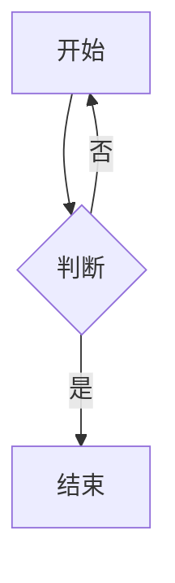

<!-- probe: 不可编辑块 —— 双击围栏代码块 / 表格 / `$$` 公式块 / mermaid 进入块编辑，改一行后按 Esc，观察 textarea 仍在文档里、内容不丢 -->

# 04 · 不可编辑块

> 说明：本文件为测 frontmatter 渲染，把 frontmatter 放在最顶部（文件首行必须是 `---`），因此这行 probe 注释位于 frontmatter 之后。

## 围栏代码块（python）

```python
def add(a, b):  # 含 # 注释与 = 赋值号
    result = a + b
    return result

# 一段含三反引号的说明：markdown 里用 ``` 表示围栏
```

## 围栏代码块（js）

```js
// js 示例，同样含 = 与 #
const sum = (a, b) => a + b;
console.log(sum(1, 2)); // 输出 3
```

## GFM 表格（左 / 中 / 右对齐）

| 左对齐 | 居中 | 右对齐 |
|:---|:---:|---:|
| alpha | beta | 100 |
| gamma | delta | 2500 |

## 公式块

$$
\int_{0}^{\infty} e^{-x^2}\,dx = \frac{\sqrt{\pi}}{2}
$$

## Mermaid


