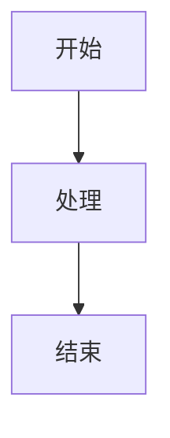

# Mermaid 分栏编辑复现

第 1 段：这是用于把 mermaid 块推到文档中部、让源码区可滚动而构造的长正文。

第 2 段：这是用于把 mermaid 块推到文档中部、让源码区可滚动而构造的长正文。

第 3 段：这是用于把 mermaid 块推到文档中部、让源码区可滚动而构造的长正文。

第 4 段：这是用于把 mermaid 块推到文档中部、让源码区可滚动而构造的长正文。

第 5 段：这是用于把 mermaid 块推到文档中部、让源码区可滚动而构造的长正文。

第 6 段：这是用于把 mermaid 块推到文档中部、让源码区可滚动而构造的长正文。

第 7 段：这是用于把 mermaid 块推到文档中部、让源码区可滚动而构造的长正文。

第 8 段：这是用于把 mermaid 块推到文档中部、让源码区可滚动而构造的长正文。

第 9 段：这是用于把 mermaid 块推到文档中部、让源码区可滚动而构造的长正文。

第 10 段：这是用于把 mermaid 块推到文档中部、让源码区可滚动而构造的长正文。

第 11 段：这是用于把 mermaid 块推到文档中部、让源码区可滚动而构造的长正文。

第 12 段：这是用于把 mermaid 块推到文档中部、让源码区可滚动而构造的长正文。

第 13 段：这是用于把 mermaid 块推到文档中部、让源码区可滚动而构造的长正文。

第 14 段：这是用于把 mermaid 块推到文档中部、让源码区可滚动而构造的长正文。

第 15 段：这是用于把 mermaid 块推到文档中部、让源码区可滚动而构造的长正文。

第 16 段：这是用于把 mermaid 块推到文档中部、让源码区可滚动而构造的长正文。

第 17 段：这是用于把 mermaid 块推到文档中部、让源码区可滚动而构造的长正文。

第 18 段：这是用于把 mermaid 块推到文档中部、让源码区可滚动而构造的长正文。

第 19 段：这是用于把 mermaid 块推到文档中部、让源码区可滚动而构造的长正文。

第 20 段：这是用于把 mermaid 块推到文档中部、让源码区可滚动而构造的长正文。

第 21 段：这是用于把 mermaid 块推到文档中部、让源码区可滚动而构造的长正文。

第 22 段：这是用于把 mermaid 块推到文档中部、让源码区可滚动而构造的长正文。

第 23 段：这是用于把 mermaid 块推到文档中部、让源码区可滚动而构造的长正文。

第 24 段：这是用于把 mermaid 块推到文档中部、让源码区可滚动而构造的长正文。

第 25 段：这是用于把 mermaid 块推到文档中部、让源码区可滚动而构造的长正文。

第 26 段：这是用于把 mermaid 块推到文档中部、让源码区可滚动而构造的长正文。

第 27 段：这是用于把 mermaid 块推到文档中部、让源码区可滚动而构造的长正文。

第 28 段：这是用于把 mermaid 块推到文档中部、让源码区可滚动而构造的长正文。

第 29 段：这是用于把 mermaid 块推到文档中部、让源码区可滚动而构造的长正文。

第 30 段：这是用于把 mermaid 块推到文档中部、让源码区可滚动而构造的长正文。

第 31 段：这是用于把 mermaid 块推到文档中部、让源码区可滚动而构造的长正文。

第 32 段：这是用于把 mermaid 块推到文档中部、让源码区可滚动而构造的长正文。

第 33 段：这是用于把 mermaid 块推到文档中部、让源码区可滚动而构造的长正文。

第 34 段：这是用于把 mermaid 块推到文档中部、让源码区可滚动而构造的长正文。

第 35 段：这是用于把 mermaid 块推到文档中部、让源码区可滚动而构造的长正文。

第 36 段：这是用于把 mermaid 块推到文档中部、让源码区可滚动而构造的长正文。

第 37 段：这是用于把 mermaid 块推到文档中部、让源码区可滚动而构造的长正文。

第 38 段：这是用于把 mermaid 块推到文档中部、让源码区可滚动而构造的长正文。

第 39 段：这是用于把 mermaid 块推到文档中部、让源码区可滚动而构造的长正文。

第 40 段：这是用于把 mermaid 块推到文档中部、让源码区可滚动而构造的长正文。

第 41 段：这是用于把 mermaid 块推到文档中部、让源码区可滚动而构造的长正文。

第 42 段：这是用于把 mermaid 块推到文档中部、让源码区可滚动而构造的长正文。

第 43 段：这是用于把 mermaid 块推到文档中部、让源码区可滚动而构造的长正文。

第 44 段：这是用于把 mermaid 块推到文档中部、让源码区可滚动而构造的长正文。

第 45 段：这是用于把 mermaid 块推到文档中部、让源码区可滚动而构造的长正文。

第 46 段：这是用于把 mermaid 块推到文档中部、让源码区可滚动而构造的长正文。

第 47 段：这是用于把 mermaid 块推到文档中部、让源码区可滚动而构造的长正文。

第 48 段：这是用于把 mermaid 块推到文档中部、让源码区可滚动而构造的长正文。

第 49 段：这是用于把 mermaid 块推到文档中部、让源码区可滚动而构造的长正文。

第 50 段：这是用于把 mermaid 块推到文档中部、让源码区可滚动而构造的长正文。

第 51 段：这是用于把 mermaid 块推到文档中部、让源码区可滚动而构造的长正文。

第 52 段：这是用于把 mermaid 块推到文档中部、让源码区可滚动而构造的长正文。

第 53 段：这是用于把 mermaid 块推到文档中部、让源码区可滚动而构造的长正文。

第 54 段：这是用于把 mermaid 块推到文档中部、让源码区可滚动而构造的长正文。

第 55 段：这是用于把 mermaid 块推到文档中部、让源码区可滚动而构造的长正文。

第 56 段：这是用于把 mermaid 块推到文档中部、让源码区可滚动而构造的长正文。

第 57 段：这是用于把 mermaid 块推到文档中部、让源码区可滚动而构造的长正文。

第 58 段：这是用于把 mermaid 块推到文档中部、让源码区可滚动而构造的长正文。

第 59 段：这是用于把 mermaid 块推到文档中部、让源码区可滚动而构造的长正文。

第 60 段：这是用于把 mermaid 块推到文档中部、让源码区可滚动而构造的长正文。

第 61 段：这是用于把 mermaid 块推到文档中部、让源码区可滚动而构造的长正文。

第 62 段：这是用于把 mermaid 块推到文档中部、让源码区可滚动而构造的长正文。

第 63 段：这是用于把 mermaid 块推到文档中部、让源码区可滚动而构造的长正文。

第 64 段：这是用于把 mermaid 块推到文档中部、让源码区可滚动而构造的长正文。

第 65 段：这是用于把 mermaid 块推到文档中部、让源码区可滚动而构造的长正文。

第 66 段：这是用于把 mermaid 块推到文档中部、让源码区可滚动而构造的长正文。

第 67 段：这是用于把 mermaid 块推到文档中部、让源码区可滚动而构造的长正文。

第 68 段：这是用于把 mermaid 块推到文档中部、让源码区可滚动而构造的长正文。

第 69 段：这是用于把 mermaid 块推到文档中部、让源码区可滚动而构造的长正文。

第 70 段：这是用于把 mermaid 块推到文档中部、让源码区可滚动而构造的长正文。

第 71 段：这是用于把 mermaid 块推到文档中部、让源码区可滚动而构造的长正文。

第 72 段：这是用于把 mermaid 块推到文档中部、让源码区可滚动而构造的长正文。

第 73 段：这是用于把 mermaid 块推到文档中部、让源码区可滚动而构造的长正文。

第 74 段：这是用于把 mermaid 块推到文档中部、让源码区可滚动而构造的长正文。

第 75 段：这是用于把 mermaid 块推到文档中部、让源码区可滚动而构造的长正文。

第 76 段：这是用于把 mermaid 块推到文档中部、让源码区可滚动而构造的长正文。

第 77 段：这是用于把 mermaid 块推到文档中部、让源码区可滚动而构造的长正文。

第 78 段：这是用于把 mermaid 块推到文档中部、让源码区可滚动而构造的长正文。

第 79 段：这是用于把 mermaid 块推到文档中部、让源码区可滚动而构造的长正文。

第 80 段：这是用于把 mermaid 块推到文档中部、让源码区可滚动而构造的长正文。

第 81 段：这是用于把 mermaid 块推到文档中部、让源码区可滚动而构造的长正文。

第 82 段：这是用于把 mermaid 块推到文档中部、让源码区可滚动而构造的长正文。

第 83 段：这是用于把 mermaid 块推到文档中部、让源码区可滚动而构造的长正文。

第 84 段：这是用于把 mermaid 块推到文档中部、让源码区可滚动而构造的长正文。

第 85 段：这是用于把 mermaid 块推到文档中部、让源码区可滚动而构造的长正文。

第 86 段：这是用于把 mermaid 块推到文档中部、让源码区可滚动而构造的长正文。

第 87 段：这是用于把 mermaid 块推到文档中部、让源码区可滚动而构造的长正文。

第 88 段：这是用于把 mermaid 块推到文档中部、让源码区可滚动而构造的长正文。

第 89 段：这是用于把 mermaid 块推到文档中部、让源码区可滚动而构造的长正文。

第 90 段：这是用于把 mermaid 块推到文档中部、让源码区可滚动而构造的长正文。

第 91 段：这是用于把 mermaid 块推到文档中部、让源码区可滚动而构造的长正文。

第 92 段：这是用于把 mermaid 块推到文档中部、让源码区可滚动而构造的长正文。

第 93 段：这是用于把 mermaid 块推到文档中部、让源码区可滚动而构造的长正文。

第 94 段：这是用于把 mermaid 块推到文档中部、让源码区可滚动而构造的长正文。

第 95 段：这是用于把 mermaid 块推到文档中部、让源码区可滚动而构造的长正文。

第 96 段：这是用于把 mermaid 块推到文档中部、让源码区可滚动而构造的长正文。

第 97 段：这是用于把 mermaid 块推到文档中部、让源码区可滚动而构造的长正文。

第 98 段：这是用于把 mermaid 块推到文档中部、让源码区可滚动而构造的长正文。

第 99 段：这是用于把 mermaid 块推到文档中部、让源码区可滚动而构造的长正文。

第 100 段：这是用于把 mermaid 块推到文档中部、让源码区可滚动而构造的长正文。

第 101 段：这是用于把 mermaid 块推到文档中部、让源码区可滚动而构造的长正文。

第 102 段：这是用于把 mermaid 块推到文档中部、让源码区可滚动而构造的长正文。

第 103 段：这是用于把 mermaid 块推到文档中部、让源码区可滚动而构造的长正文。

第 104 段：这是用于把 mermaid 块推到文档中部、让源码区可滚动而构造的长正文。

第 105 段：这是用于把 mermaid 块推到文档中部、让源码区可滚动而构造的长正文。

第 106 段：这是用于把 mermaid 块推到文档中部、让源码区可滚动而构造的长正文。

第 107 段：这是用于把 mermaid 块推到文档中部、让源码区可滚动而构造的长正文。

第 108 段：这是用于把 mermaid 块推到文档中部、让源码区可滚动而构造的长正文。

第 109 段：这是用于把 mermaid 块推到文档中部、让源码区可滚动而构造的长正文。

第 110 段：这是用于把 mermaid 块推到文档中部、让源码区可滚动而构造的长正文。

第 111 段：这是用于把 mermaid 块推到文档中部、让源码区可滚动而构造的长正文。

第 112 段：这是用于把 mermaid 块推到文档中部、让源码区可滚动而构造的长正文。

第 113 段：这是用于把 mermaid 块推到文档中部、让源码区可滚动而构造的长正文。

第 114 段：这是用于把 mermaid 块推到文档中部、让源码区可滚动而构造的长正文。

第 115 段：这是用于把 mermaid 块推到文档中部、让源码区可滚动而构造的长正文。

第 116 段：这是用于把 mermaid 块推到文档中部、让源码区可滚动而构造的长正文。

第 117 段：这是用于把 mermaid 块推到文档中部、让源码区可滚动而构造的长正文。

第 118 段：这是用于把 mermaid 块推到文档中部、让源码区可滚动而构造的长正文。

第 119 段：这是用于把 mermaid 块推到文档中部、让源码区可滚动而构造的长正文。

第 120 段：这是用于把 mermaid 块推到文档中部、让源码区可滚动而构造的长正文。

第 121 段：这是用于把 mermaid 块推到文档中部、让源码区可滚动而构造的长正文。

第 122 段：这是用于把 mermaid 块推到文档中部、让源码区可滚动而构造的长正文。

第 123 段：这是用于把 mermaid 块推到文档中部、让源码区可滚动而构造的长正文。

第 124 段：这是用于把 mermaid 块推到文档中部、让源码区可滚动而构造的长正文。

第 125 段：这是用于把 mermaid 块推到文档中部、让源码区可滚动而构造的长正文。

第 126 段：这是用于把 mermaid 块推到文档中部、让源码区可滚动而构造的长正文。

第 127 段：这是用于把 mermaid 块推到文档中部、让源码区可滚动而构造的长正文。

第 128 段：这是用于把 mermaid 块推到文档中部、让源码区可滚动而构造的长正文。

第 129 段：这是用于把 mermaid 块推到文档中部、让源码区可滚动而构造的长正文。

第 130 段：这是用于把 mermaid 块推到文档中部、让源码区可滚动而构造的长正文。

第 131 段：这是用于把 mermaid 块推到文档中部、让源码区可滚动而构造的长正文。

第 132 段：这是用于把 mermaid 块推到文档中部、让源码区可滚动而构造的长正文。

第 133 段：这是用于把 mermaid 块推到文档中部、让源码区可滚动而构造的长正文。

第 134 段：这是用于把 mermaid 块推到文档中部、让源码区可滚动而构造的长正文。

第 135 段：这是用于把 mermaid 块推到文档中部、让源码区可滚动而构造的长正文。

第 136 段：这是用于把 mermaid 块推到文档中部、让源码区可滚动而构造的长正文。

第 137 段：这是用于把 mermaid 块推到文档中部、让源码区可滚动而构造的长正文。

第 138 段：这是用于把 mermaid 块推到文档中部、让源码区可滚动而构造的长正文。

第 139 段：这是用于把 mermaid 块推到文档中部、让源码区可滚动而构造的长正文。

第 140 段：这是用于把 mermaid 块推到文档中部、让源码区可滚动而构造的长正文。

第 141 段：这是用于把 mermaid 块推到文档中部、让源码区可滚动而构造的长正文。

第 142 段：这是用于把 mermaid 块推到文档中部、让源码区可滚动而构造的长正文。

第 143 段：这是用于把 mermaid 块推到文档中部、让源码区可滚动而构造的长正文。

第 144 段：这是用于把 mermaid 块推到文档中部、让源码区可滚动而构造的长正文。

第 145 段：这是用于把 mermaid 块推到文档中部、让源码区可滚动而构造的长正文。

第 146 段：这是用于把 mermaid 块推到文档中部、让源码区可滚动而构造的长正文。

第 147 段：这是用于把 mermaid 块推到文档中部、让源码区可滚动而构造的长正文。

第 148 段：这是用于把 mermaid 块推到文档中部、让源码区可滚动而构造的长正文。

第 149 段：这是用于把 mermaid 块推到文档中部、让源码区可滚动而构造的长正文。

第 150 段：这是用于把 mermaid 块推到文档中部、让源码区可滚动而构造的长正文。

第 151 段：这是用于把 mermaid 块推到文档中部、让源码区可滚动而构造的长正文。

第 152 段：这是用于把 mermaid 块推到文档中部、让源码区可滚动而构造的长正文。

第 153 段：这是用于把 mermaid 块推到文档中部、让源码区可滚动而构造的长正文。

第 154 段：这是用于把 mermaid 块推到文档中部、让源码区可滚动而构造的长正文。

第 155 段：这是用于把 mermaid 块推到文档中部、让源码区可滚动而构造的长正文。

第 156 段：这是用于把 mermaid 块推到文档中部、让源码区可滚动而构造的长正文。

第 157 段：这是用于把 mermaid 块推到文档中部、让源码区可滚动而构造的长正文。

第 158 段：这是用于把 mermaid 块推到文档中部、让源码区可滚动而构造的长正文。

第 159 段：这是用于把 mermaid 块推到文档中部、让源码区可滚动而构造的长正文。

第 160 段：这是用于把 mermaid 块推到文档中部、让源码区可滚动而构造的长正文。

第 161 段：这是用于把 mermaid 块推到文档中部、让源码区可滚动而构造的长正文。

第 162 段：这是用于把 mermaid 块推到文档中部、让源码区可滚动而构造的长正文。

第 163 段：这是用于把 mermaid 块推到文档中部、让源码区可滚动而构造的长正文。

第 164 段：这是用于把 mermaid 块推到文档中部、让源码区可滚动而构造的长正文。

第 165 段：这是用于把 mermaid 块推到文档中部、让源码区可滚动而构造的长正文。

第 166 段：这是用于把 mermaid 块推到文档中部、让源码区可滚动而构造的长正文。

第 167 段：这是用于把 mermaid 块推到文档中部、让源码区可滚动而构造的长正文。

第 168 段：这是用于把 mermaid 块推到文档中部、让源码区可滚动而构造的长正文。

第 169 段：这是用于把 mermaid 块推到文档中部、让源码区可滚动而构造的长正文。

第 170 段：这是用于把 mermaid 块推到文档中部、让源码区可滚动而构造的长正文。

第 171 段：这是用于把 mermaid 块推到文档中部、让源码区可滚动而构造的长正文。

第 172 段：这是用于把 mermaid 块推到文档中部、让源码区可滚动而构造的长正文。

第 173 段：这是用于把 mermaid 块推到文档中部、让源码区可滚动而构造的长正文。

第 174 段：这是用于把 mermaid 块推到文档中部、让源码区可滚动而构造的长正文。

第 175 段：这是用于把 mermaid 块推到文档中部、让源码区可滚动而构造的长正文。

第 176 段：这是用于把 mermaid 块推到文档中部、让源码区可滚动而构造的长正文。

第 177 段：这是用于把 mermaid 块推到文档中部、让源码区可滚动而构造的长正文。

第 178 段：这是用于把 mermaid 块推到文档中部、让源码区可滚动而构造的长正文。

第 179 段：这是用于把 mermaid 块推到文档中部、让源码区可滚动而构造的长正文。

第 180 段：这是用于把 mermaid 块推到文档中部、让源码区可滚动而构造的长正文。

第 181 段：这是用于把 mermaid 块推到文档中部、让源码区可滚动而构造的长正文。

第 182 段：这是用于把 mermaid 块推到文档中部、让源码区可滚动而构造的长正文。

第 183 段：这是用于把 mermaid 块推到文档中部、让源码区可滚动而构造的长正文。

第 184 段：这是用于把 mermaid 块推到文档中部、让源码区可滚动而构造的长正文。

第 185 段：这是用于把 mermaid 块推到文档中部、让源码区可滚动而构造的长正文。

第 186 段：这是用于把 mermaid 块推到文档中部、让源码区可滚动而构造的长正文。

第 187 段：这是用于把 mermaid 块推到文档中部、让源码区可滚动而构造的长正文。

第 188 段：这是用于把 mermaid 块推到文档中部、让源码区可滚动而构造的长正文。

第 189 段：这是用于把 mermaid 块推到文档中部、让源码区可滚动而构造的长正文。

第 190 段：这是用于把 mermaid 块推到文档中部、让源码区可滚动而构造的长正文。

第 191 段：这是用于把 mermaid 块推到文档中部、让源码区可滚动而构造的长正文。

第 192 段：这是用于把 mermaid 块推到文档中部、让源码区可滚动而构造的长正文。

第 193 段：这是用于把 mermaid 块推到文档中部、让源码区可滚动而构造的长正文。

第 194 段：这是用于把 mermaid 块推到文档中部、让源码区可滚动而构造的长正文。

第 195 段：这是用于把 mermaid 块推到文档中部、让源码区可滚动而构造的长正文。

第 196 段：这是用于把 mermaid 块推到文档中部、让源码区可滚动而构造的长正文。

第 197 段：这是用于把 mermaid 块推到文档中部、让源码区可滚动而构造的长正文。

第 198 段：这是用于把 mermaid 块推到文档中部、让源码区可滚动而构造的长正文。

第 199 段：这是用于把 mermaid 块推到文档中部、让源码区可滚动而构造的长正文。

第 200 段：这是用于把 mermaid 块推到文档中部、让源码区可滚动而构造的长正文。

第 201 段：这是用于把 mermaid 块推到文档中部、让源码区可滚动而构造的长正文。

第 202 段：这是用于把 mermaid 块推到文档中部、让源码区可滚动而构造的长正文。

第 203 段：这是用于把 mermaid 块推到文档中部、让源码区可滚动而构造的长正文。

第 204 段：这是用于把 mermaid 块推到文档中部、让源码区可滚动而构造的长正文。

第 205 段：这是用于把 mermaid 块推到文档中部、让源码区可滚动而构造的长正文。

第 206 段：这是用于把 mermaid 块推到文档中部、让源码区可滚动而构造的长正文。

第 207 段：这是用于把 mermaid 块推到文档中部、让源码区可滚动而构造的长正文。

第 208 段：这是用于把 mermaid 块推到文档中部、让源码区可滚动而构造的长正文。

第 209 段：这是用于把 mermaid 块推到文档中部、让源码区可滚动而构造的长正文。

第 210 段：这是用于把 mermaid 块推到文档中部、让源码区可滚动而构造的长正文。

第 211 段：这是用于把 mermaid 块推到文档中部、让源码区可滚动而构造的长正文。

第 212 段：这是用于把 mermaid 块推到文档中部、让源码区可滚动而构造的长正文。

第 213 段：这是用于把 mermaid 块推到文档中部、让源码区可滚动而构造的长正文。

第 214 段：这是用于把 mermaid 块推到文档中部、让源码区可滚动而构造的长正文。

第 215 段：这是用于把 mermaid 块推到文档中部、让源码区可滚动而构造的长正文。

第 216 段：这是用于把 mermaid 块推到文档中部、让源码区可滚动而构造的长正文。

第 217 段：这是用于把 mermaid 块推到文档中部、让源码区可滚动而构造的长正文。

第 218 段：这是用于把 mermaid 块推到文档中部、让源码区可滚动而构造的长正文。

第 219 段：这是用于把 mermaid 块推到文档中部、让源码区可滚动而构造的长正文。

第 220 段：这是用于把 mermaid 块推到文档中部、让源码区可滚动而构造的长正文。

第 221 段：这是用于把 mermaid 块推到文档中部、让源码区可滚动而构造的长正文。

第 222 段：这是用于把 mermaid 块推到文档中部、让源码区可滚动而构造的长正文。

第 223 段：这是用于把 mermaid 块推到文档中部、让源码区可滚动而构造的长正文。

第 224 段：这是用于把 mermaid 块推到文档中部、让源码区可滚动而构造的长正文。

第 225 段：这是用于把 mermaid 块推到文档中部、让源码区可滚动而构造的长正文。

第 226 段：这是用于把 mermaid 块推到文档中部、让源码区可滚动而构造的长正文。

第 227 段：这是用于把 mermaid 块推到文档中部、让源码区可滚动而构造的长正文。

第 228 段：这是用于把 mermaid 块推到文档中部、让源码区可滚动而构造的长正文。

第 229 段：这是用于把 mermaid 块推到文档中部、让源码区可滚动而构造的长正文。

第 230 段：这是用于把 mermaid 块推到文档中部、让源码区可滚动而构造的长正文。

第 231 段：这是用于把 mermaid 块推到文档中部、让源码区可滚动而构造的长正文。

第 232 段：这是用于把 mermaid 块推到文档中部、让源码区可滚动而构造的长正文。

第 233 段：这是用于把 mermaid 块推到文档中部、让源码区可滚动而构造的长正文。

第 234 段：这是用于把 mermaid 块推到文档中部、让源码区可滚动而构造的长正文。

第 235 段：这是用于把 mermaid 块推到文档中部、让源码区可滚动而构造的长正文。

第 236 段：这是用于把 mermaid 块推到文档中部、让源码区可滚动而构造的长正文。

第 237 段：这是用于把 mermaid 块推到文档中部、让源码区可滚动而构造的长正文。

第 238 段：这是用于把 mermaid 块推到文档中部、让源码区可滚动而构造的长正文。

第 239 段：这是用于把 mermaid 块推到文档中部、让源码区可滚动而构造的长正文。

第 240 段：这是用于把 mermaid 块推到文档中部、让源码区可滚动而构造的长正文。

第 241 段：这是用于把 mermaid 块推到文档中部、让源码区可滚动而构造的长正文。

第 242 段：这是用于把 mermaid 块推到文档中部、让源码区可滚动而构造的长正文。

第 243 段：这是用于把 mermaid 块推到文档中部、让源码区可滚动而构造的长正文。

第 244 段：这是用于把 mermaid 块推到文档中部、让源码区可滚动而构造的长正文。

第 245 段：这是用于把 mermaid 块推到文档中部、让源码区可滚动而构造的长正文。

第 246 段：这是用于把 mermaid 块推到文档中部、让源码区可滚动而构造的长正文。

第 247 段：这是用于把 mermaid 块推到文档中部、让源码区可滚动而构造的长正文。

第 248 段：这是用于把 mermaid 块推到文档中部、让源码区可滚动而构造的长正文。

第 249 段：这是用于把 mermaid 块推到文档中部、让源码区可滚动而构造的长正文。

第 250 段：这是用于把 mermaid 块推到文档中部、让源码区可滚动而构造的长正文。

第 251 段：这是用于把 mermaid 块推到文档中部、让源码区可滚动而构造的长正文。

第 252 段：这是用于把 mermaid 块推到文档中部、让源码区可滚动而构造的长正文。

第 253 段：这是用于把 mermaid 块推到文档中部、让源码区可滚动而构造的长正文。

第 254 段：这是用于把 mermaid 块推到文档中部、让源码区可滚动而构造的长正文。

第 255 段：这是用于把 mermaid 块推到文档中部、让源码区可滚动而构造的长正文。

第 256 段：这是用于把 mermaid 块推到文档中部、让源码区可滚动而构造的长正文。

第 257 段：这是用于把 mermaid 块推到文档中部、让源码区可滚动而构造的长正文。

第 258 段：这是用于把 mermaid 块推到文档中部、让源码区可滚动而构造的长正文。

第 259 段：这是用于把 mermaid 块推到文档中部、让源码区可滚动而构造的长正文。

第 260 段：这是用于把 mermaid 块推到文档中部、让源码区可滚动而构造的长正文。

第 261 段：这是用于把 mermaid 块推到文档中部、让源码区可滚动而构造的长正文。

第 262 段：这是用于把 mermaid 块推到文档中部、让源码区可滚动而构造的长正文。

第 263 段：这是用于把 mermaid 块推到文档中部、让源码区可滚动而构造的长正文。

第 264 段：这是用于把 mermaid 块推到文档中部、让源码区可滚动而构造的长正文。

第 265 段：这是用于把 mermaid 块推到文档中部、让源码区可滚动而构造的长正文。

第 266 段：这是用于把 mermaid 块推到文档中部、让源码区可滚动而构造的长正文。

第 267 段：这是用于把 mermaid 块推到文档中部、让源码区可滚动而构造的长正文。

第 268 段：这是用于把 mermaid 块推到文档中部、让源码区可滚动而构造的长正文。

第 269 段：这是用于把 mermaid 块推到文档中部、让源码区可滚动而构造的长正文。

第 270 段：这是用于把 mermaid 块推到文档中部、让源码区可滚动而构造的长正文。

第 271 段：这是用于把 mermaid 块推到文档中部、让源码区可滚动而构造的长正文。

第 272 段：这是用于把 mermaid 块推到文档中部、让源码区可滚动而构造的长正文。

第 273 段：这是用于把 mermaid 块推到文档中部、让源码区可滚动而构造的长正文。

第 274 段：这是用于把 mermaid 块推到文档中部、让源码区可滚动而构造的长正文。

第 275 段：这是用于把 mermaid 块推到文档中部、让源码区可滚动而构造的长正文。

第 276 段：这是用于把 mermaid 块推到文档中部、让源码区可滚动而构造的长正文。

第 277 段：这是用于把 mermaid 块推到文档中部、让源码区可滚动而构造的长正文。

第 278 段：这是用于把 mermaid 块推到文档中部、让源码区可滚动而构造的长正文。

第 279 段：这是用于把 mermaid 块推到文档中部、让源码区可滚动而构造的长正文。

第 280 段：这是用于把 mermaid 块推到文档中部、让源码区可滚动而构造的长正文。

第 281 段：这是用于把 mermaid 块推到文档中部、让源码区可滚动而构造的长正文。

第 282 段：这是用于把 mermaid 块推到文档中部、让源码区可滚动而构造的长正文。

第 283 段：这是用于把 mermaid 块推到文档中部、让源码区可滚动而构造的长正文。

第 284 段：这是用于把 mermaid 块推到文档中部、让源码区可滚动而构造的长正文。

第 285 段：这是用于把 mermaid 块推到文档中部、让源码区可滚动而构造的长正文。

第 286 段：这是用于把 mermaid 块推到文档中部、让源码区可滚动而构造的长正文。

第 287 段：这是用于把 mermaid 块推到文档中部、让源码区可滚动而构造的长正文。

第 288 段：这是用于把 mermaid 块推到文档中部、让源码区可滚动而构造的长正文。

第 289 段：这是用于把 mermaid 块推到文档中部、让源码区可滚动而构造的长正文。

第 290 段：这是用于把 mermaid 块推到文档中部、让源码区可滚动而构造的长正文。

第 291 段：这是用于把 mermaid 块推到文档中部、让源码区可滚动而构造的长正文。

第 292 段：这是用于把 mermaid 块推到文档中部、让源码区可滚动而构造的长正文。

第 293 段：这是用于把 mermaid 块推到文档中部、让源码区可滚动而构造的长正文。

第 294 段：这是用于把 mermaid 块推到文档中部、让源码区可滚动而构造的长正文。

第 295 段：这是用于把 mermaid 块推到文档中部、让源码区可滚动而构造的长正文。

第 296 段：这是用于把 mermaid 块推到文档中部、让源码区可滚动而构造的长正文。

第 297 段：这是用于把 mermaid 块推到文档中部、让源码区可滚动而构造的长正文。

第 298 段：这是用于把 mermaid 块推到文档中部、让源码区可滚动而构造的长正文。

第 299 段：这是用于把 mermaid 块推到文档中部、让源码区可滚动而构造的长正文。

第 300 段：这是用于把 mermaid 块推到文档中部、让源码区可滚动而构造的长正文。

## 图形



## 代码块

```js
const a = 1;
const b = 2;
```

## 公式块

$$
x + y = z
$$

## 表格

| a | b |
|---|---|
| 1 | 2 |

第 301 段：这是用于把 mermaid 块推到文档中部、让源码区可滚动而构造的长正文。

第 302 段：这是用于把 mermaid 块推到文档中部、让源码区可滚动而构造的长正文。

第 303 段：这是用于把 mermaid 块推到文档中部、让源码区可滚动而构造的长正文。

第 304 段：这是用于把 mermaid 块推到文档中部、让源码区可滚动而构造的长正文。

第 305 段：这是用于把 mermaid 块推到文档中部、让源码区可滚动而构造的长正文。

第 306 段：这是用于把 mermaid 块推到文档中部、让源码区可滚动而构造的长正文。

第 307 段：这是用于把 mermaid 块推到文档中部、让源码区可滚动而构造的长正文。

第 308 段：这是用于把 mermaid 块推到文档中部、让源码区可滚动而构造的长正文。

第 309 段：这是用于把 mermaid 块推到文档中部、让源码区可滚动而构造的长正文。

第 310 段：这是用于把 mermaid 块推到文档中部、让源码区可滚动而构造的长正文。

第 311 段：这是用于把 mermaid 块推到文档中部、让源码区可滚动而构造的长正文。

第 312 段：这是用于把 mermaid 块推到文档中部、让源码区可滚动而构造的长正文。

第 313 段：这是用于把 mermaid 块推到文档中部、让源码区可滚动而构造的长正文。

第 314 段：这是用于把 mermaid 块推到文档中部、让源码区可滚动而构造的长正文。

第 315 段：这是用于把 mermaid 块推到文档中部、让源码区可滚动而构造的长正文。

第 316 段：这是用于把 mermaid 块推到文档中部、让源码区可滚动而构造的长正文。

第 317 段：这是用于把 mermaid 块推到文档中部、让源码区可滚动而构造的长正文。

第 318 段：这是用于把 mermaid 块推到文档中部、让源码区可滚动而构造的长正文。

第 319 段：这是用于把 mermaid 块推到文档中部、让源码区可滚动而构造的长正文。

第 320 段：这是用于把 mermaid 块推到文档中部、让源码区可滚动而构造的长正文。

第 321 段：这是用于把 mermaid 块推到文档中部、让源码区可滚动而构造的长正文。

第 322 段：这是用于把 mermaid 块推到文档中部、让源码区可滚动而构造的长正文。

第 323 段：这是用于把 mermaid 块推到文档中部、让源码区可滚动而构造的长正文。

第 324 段：这是用于把 mermaid 块推到文档中部、让源码区可滚动而构造的长正文。

第 325 段：这是用于把 mermaid 块推到文档中部、让源码区可滚动而构造的长正文。

第 326 段：这是用于把 mermaid 块推到文档中部、让源码区可滚动而构造的长正文。

第 327 段：这是用于把 mermaid 块推到文档中部、让源码区可滚动而构造的长正文。

第 328 段：这是用于把 mermaid 块推到文档中部、让源码区可滚动而构造的长正文。

第 329 段：这是用于把 mermaid 块推到文档中部、让源码区可滚动而构造的长正文。

第 330 段：这是用于把 mermaid 块推到文档中部、让源码区可滚动而构造的长正文。

第 331 段：这是用于把 mermaid 块推到文档中部、让源码区可滚动而构造的长正文。

第 332 段：这是用于把 mermaid 块推到文档中部、让源码区可滚动而构造的长正文。

第 333 段：这是用于把 mermaid 块推到文档中部、让源码区可滚动而构造的长正文。

第 334 段：这是用于把 mermaid 块推到文档中部、让源码区可滚动而构造的长正文。

第 335 段：这是用于把 mermaid 块推到文档中部、让源码区可滚动而构造的长正文。

第 336 段：这是用于把 mermaid 块推到文档中部、让源码区可滚动而构造的长正文。

第 337 段：这是用于把 mermaid 块推到文档中部、让源码区可滚动而构造的长正文。

第 338 段：这是用于把 mermaid 块推到文档中部、让源码区可滚动而构造的长正文。

第 339 段：这是用于把 mermaid 块推到文档中部、让源码区可滚动而构造的长正文。

第 340 段：这是用于把 mermaid 块推到文档中部、让源码区可滚动而构造的长正文。

第 341 段：这是用于把 mermaid 块推到文档中部、让源码区可滚动而构造的长正文。

第 342 段：这是用于把 mermaid 块推到文档中部、让源码区可滚动而构造的长正文。

第 343 段：这是用于把 mermaid 块推到文档中部、让源码区可滚动而构造的长正文。

第 344 段：这是用于把 mermaid 块推到文档中部、让源码区可滚动而构造的长正文。

第 345 段：这是用于把 mermaid 块推到文档中部、让源码区可滚动而构造的长正文。

第 346 段：这是用于把 mermaid 块推到文档中部、让源码区可滚动而构造的长正文。

第 347 段：这是用于把 mermaid 块推到文档中部、让源码区可滚动而构造的长正文。

第 348 段：这是用于把 mermaid 块推到文档中部、让源码区可滚动而构造的长正文。

第 349 段：这是用于把 mermaid 块推到文档中部、让源码区可滚动而构造的长正文。

第 350 段：这是用于把 mermaid 块推到文档中部、让源码区可滚动而构造的长正文。

第 351 段：这是用于把 mermaid 块推到文档中部、让源码区可滚动而构造的长正文。

第 352 段：这是用于把 mermaid 块推到文档中部、让源码区可滚动而构造的长正文。

第 353 段：这是用于把 mermaid 块推到文档中部、让源码区可滚动而构造的长正文。

第 354 段：这是用于把 mermaid 块推到文档中部、让源码区可滚动而构造的长正文。

第 355 段：这是用于把 mermaid 块推到文档中部、让源码区可滚动而构造的长正文。

第 356 段：这是用于把 mermaid 块推到文档中部、让源码区可滚动而构造的长正文。

第 357 段：这是用于把 mermaid 块推到文档中部、让源码区可滚动而构造的长正文。

第 358 段：这是用于把 mermaid 块推到文档中部、让源码区可滚动而构造的长正文。

第 359 段：这是用于把 mermaid 块推到文档中部、让源码区可滚动而构造的长正文。

第 360 段：这是用于把 mermaid 块推到文档中部、让源码区可滚动而构造的长正文。

第 361 段：这是用于把 mermaid 块推到文档中部、让源码区可滚动而构造的长正文。

第 362 段：这是用于把 mermaid 块推到文档中部、让源码区可滚动而构造的长正文。

第 363 段：这是用于把 mermaid 块推到文档中部、让源码区可滚动而构造的长正文。

第 364 段：这是用于把 mermaid 块推到文档中部、让源码区可滚动而构造的长正文。

第 365 段：这是用于把 mermaid 块推到文档中部、让源码区可滚动而构造的长正文。

第 366 段：这是用于把 mermaid 块推到文档中部、让源码区可滚动而构造的长正文。

第 367 段：这是用于把 mermaid 块推到文档中部、让源码区可滚动而构造的长正文。

第 368 段：这是用于把 mermaid 块推到文档中部、让源码区可滚动而构造的长正文。

第 369 段：这是用于把 mermaid 块推到文档中部、让源码区可滚动而构造的长正文。

第 370 段：这是用于把 mermaid 块推到文档中部、让源码区可滚动而构造的长正文。

第 371 段：这是用于把 mermaid 块推到文档中部、让源码区可滚动而构造的长正文。

第 372 段：这是用于把 mermaid 块推到文档中部、让源码区可滚动而构造的长正文。

第 373 段：这是用于把 mermaid 块推到文档中部、让源码区可滚动而构造的长正文。

第 374 段：这是用于把 mermaid 块推到文档中部、让源码区可滚动而构造的长正文。

第 375 段：这是用于把 mermaid 块推到文档中部、让源码区可滚动而构造的长正文。

第 376 段：这是用于把 mermaid 块推到文档中部、让源码区可滚动而构造的长正文。

第 377 段：这是用于把 mermaid 块推到文档中部、让源码区可滚动而构造的长正文。

第 378 段：这是用于把 mermaid 块推到文档中部、让源码区可滚动而构造的长正文。

第 379 段：这是用于把 mermaid 块推到文档中部、让源码区可滚动而构造的长正文。

第 380 段：这是用于把 mermaid 块推到文档中部、让源码区可滚动而构造的长正文。

第 381 段：这是用于把 mermaid 块推到文档中部、让源码区可滚动而构造的长正文。

第 382 段：这是用于把 mermaid 块推到文档中部、让源码区可滚动而构造的长正文。

第 383 段：这是用于把 mermaid 块推到文档中部、让源码区可滚动而构造的长正文。

第 384 段：这是用于把 mermaid 块推到文档中部、让源码区可滚动而构造的长正文。

第 385 段：这是用于把 mermaid 块推到文档中部、让源码区可滚动而构造的长正文。

第 386 段：这是用于把 mermaid 块推到文档中部、让源码区可滚动而构造的长正文。

第 387 段：这是用于把 mermaid 块推到文档中部、让源码区可滚动而构造的长正文。

第 388 段：这是用于把 mermaid 块推到文档中部、让源码区可滚动而构造的长正文。

第 389 段：这是用于把 mermaid 块推到文档中部、让源码区可滚动而构造的长正文。

第 390 段：这是用于把 mermaid 块推到文档中部、让源码区可滚动而构造的长正文。

第 391 段：这是用于把 mermaid 块推到文档中部、让源码区可滚动而构造的长正文。

第 392 段：这是用于把 mermaid 块推到文档中部、让源码区可滚动而构造的长正文。

第 393 段：这是用于把 mermaid 块推到文档中部、让源码区可滚动而构造的长正文。

第 394 段：这是用于把 mermaid 块推到文档中部、让源码区可滚动而构造的长正文。

第 395 段：这是用于把 mermaid 块推到文档中部、让源码区可滚动而构造的长正文。

第 396 段：这是用于把 mermaid 块推到文档中部、让源码区可滚动而构造的长正文。

第 397 段：这是用于把 mermaid 块推到文档中部、让源码区可滚动而构造的长正文。

第 398 段：这是用于把 mermaid 块推到文档中部、让源码区可滚动而构造的长正文。

第 399 段：这是用于把 mermaid 块推到文档中部、让源码区可滚动而构造的长正文。

第 400 段：这是用于把 mermaid 块推到文档中部、让源码区可滚动而构造的长正文。

第 401 段：这是用于把 mermaid 块推到文档中部、让源码区可滚动而构造的长正文。

第 402 段：这是用于把 mermaid 块推到文档中部、让源码区可滚动而构造的长正文。

第 403 段：这是用于把 mermaid 块推到文档中部、让源码区可滚动而构造的长正文。

第 404 段：这是用于把 mermaid 块推到文档中部、让源码区可滚动而构造的长正文。

第 405 段：这是用于把 mermaid 块推到文档中部、让源码区可滚动而构造的长正文。

第 406 段：这是用于把 mermaid 块推到文档中部、让源码区可滚动而构造的长正文。

第 407 段：这是用于把 mermaid 块推到文档中部、让源码区可滚动而构造的长正文。

第 408 段：这是用于把 mermaid 块推到文档中部、让源码区可滚动而构造的长正文。

第 409 段：这是用于把 mermaid 块推到文档中部、让源码区可滚动而构造的长正文。

第 410 段：这是用于把 mermaid 块推到文档中部、让源码区可滚动而构造的长正文。

第 411 段：这是用于把 mermaid 块推到文档中部、让源码区可滚动而构造的长正文。

第 412 段：这是用于把 mermaid 块推到文档中部、让源码区可滚动而构造的长正文。

第 413 段：这是用于把 mermaid 块推到文档中部、让源码区可滚动而构造的长正文。

第 414 段：这是用于把 mermaid 块推到文档中部、让源码区可滚动而构造的长正文。

第 415 段：这是用于把 mermaid 块推到文档中部、让源码区可滚动而构造的长正文。

第 416 段：这是用于把 mermaid 块推到文档中部、让源码区可滚动而构造的长正文。

第 417 段：这是用于把 mermaid 块推到文档中部、让源码区可滚动而构造的长正文。

第 418 段：这是用于把 mermaid 块推到文档中部、让源码区可滚动而构造的长正文。

第 419 段：这是用于把 mermaid 块推到文档中部、让源码区可滚动而构造的长正文。

第 420 段：这是用于把 mermaid 块推到文档中部、让源码区可滚动而构造的长正文。

第 421 段：这是用于把 mermaid 块推到文档中部、让源码区可滚动而构造的长正文。

第 422 段：这是用于把 mermaid 块推到文档中部、让源码区可滚动而构造的长正文。

第 423 段：这是用于把 mermaid 块推到文档中部、让源码区可滚动而构造的长正文。

第 424 段：这是用于把 mermaid 块推到文档中部、让源码区可滚动而构造的长正文。

第 425 段：这是用于把 mermaid 块推到文档中部、让源码区可滚动而构造的长正文。

第 426 段：这是用于把 mermaid 块推到文档中部、让源码区可滚动而构造的长正文。

第 427 段：这是用于把 mermaid 块推到文档中部、让源码区可滚动而构造的长正文。

第 428 段：这是用于把 mermaid 块推到文档中部、让源码区可滚动而构造的长正文。

第 429 段：这是用于把 mermaid 块推到文档中部、让源码区可滚动而构造的长正文。

第 430 段：这是用于把 mermaid 块推到文档中部、让源码区可滚动而构造的长正文。

第 431 段：这是用于把 mermaid 块推到文档中部、让源码区可滚动而构造的长正文。

第 432 段：这是用于把 mermaid 块推到文档中部、让源码区可滚动而构造的长正文。

第 433 段：这是用于把 mermaid 块推到文档中部、让源码区可滚动而构造的长正文。

第 434 段：这是用于把 mermaid 块推到文档中部、让源码区可滚动而构造的长正文。

第 435 段：这是用于把 mermaid 块推到文档中部、让源码区可滚动而构造的长正文。

第 436 段：这是用于把 mermaid 块推到文档中部、让源码区可滚动而构造的长正文。

第 437 段：这是用于把 mermaid 块推到文档中部、让源码区可滚动而构造的长正文。

第 438 段：这是用于把 mermaid 块推到文档中部、让源码区可滚动而构造的长正文。

第 439 段：这是用于把 mermaid 块推到文档中部、让源码区可滚动而构造的长正文。

第 440 段：这是用于把 mermaid 块推到文档中部、让源码区可滚动而构造的长正文。

第 441 段：这是用于把 mermaid 块推到文档中部、让源码区可滚动而构造的长正文。

第 442 段：这是用于把 mermaid 块推到文档中部、让源码区可滚动而构造的长正文。

第 443 段：这是用于把 mermaid 块推到文档中部、让源码区可滚动而构造的长正文。

第 444 段：这是用于把 mermaid 块推到文档中部、让源码区可滚动而构造的长正文。

第 445 段：这是用于把 mermaid 块推到文档中部、让源码区可滚动而构造的长正文。

第 446 段：这是用于把 mermaid 块推到文档中部、让源码区可滚动而构造的长正文。

第 447 段：这是用于把 mermaid 块推到文档中部、让源码区可滚动而构造的长正文。

第 448 段：这是用于把 mermaid 块推到文档中部、让源码区可滚动而构造的长正文。

第 449 段：这是用于把 mermaid 块推到文档中部、让源码区可滚动而构造的长正文。

第 450 段：这是用于把 mermaid 块推到文档中部、让源码区可滚动而构造的长正文。

## 文末

最后一行。
