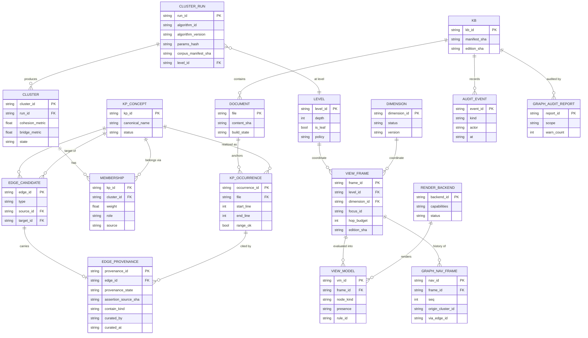
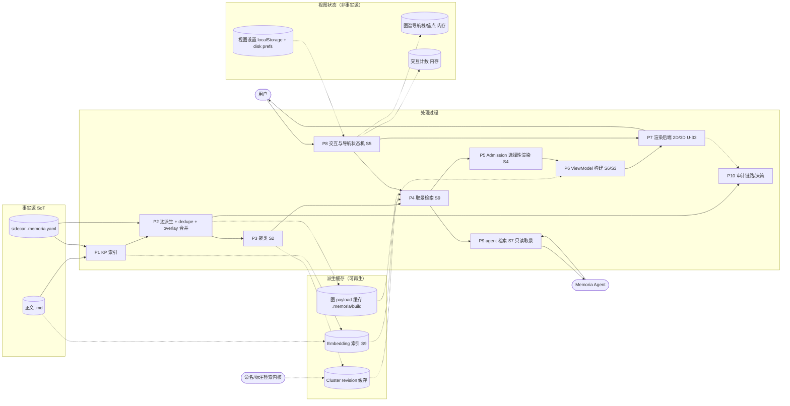
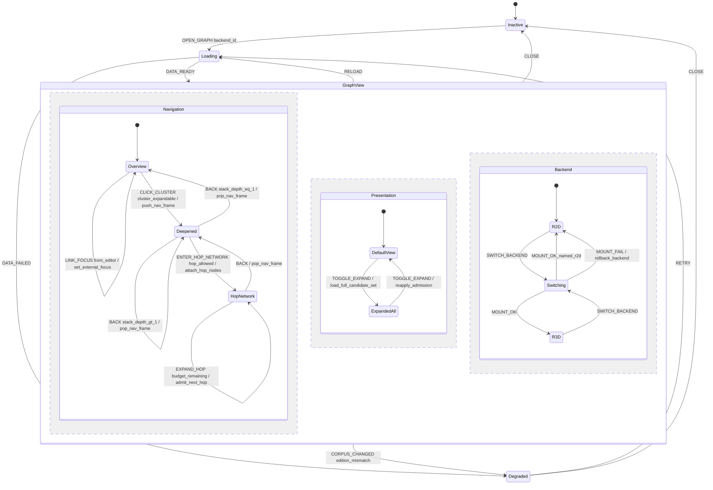

# 多层次图谱 · 工程图纸计划与 v0 草案（ER / DFD / 状态图）

> **性质**：**计划 + v0 草案**，不是冻结稿。每张图标注「草案-待 Sx 裁决」；冻结归 S5a / S6a / S9a。
> **依据（只读）**：`docs/design/multilevel-graph-vision.md`（U-1..U-35）；`multilevel-graph-seminar-agenda.md` V0.2（工程图归口 S5a/S6a/S9a，agenda:92-120）；
> `multilevel-graph/S0-charter.md`；`kg-ontology-v0.md`（v0.3）；`kg-edge-provenance.schema.json`；
> 只读实现 `src/memoria/graph/**`、`src/memoria/ui/static/app/js/graph-*.js`、`app.js`、`nav-stack.js`。
> **同批交付**：`S0-engineering-review.md`（S0-1..S0-12 可工程化校核；本文的图以那份的 E-1..E-10 为输入）。
> **作者 / 角色**：`graph-se-architect`（U-35 软件工程专家）；写域仅本文件与 `S0-engineering-review.md`。
> **日期**：2026-11-02（Asia/Shanghai）。**未写产品代码、未改契约、未 commit。**

---

## 0. 一页结论（图纸总览）

| 图纸 | 编号前缀 | 服务场次 | 冻结条件 | 当前状态 |
|---|---|---|---|---|
| ER 图（实体/关系/基数/主键/生命周期） | `ER-` | S6 → S6a | S6 数据契约文字冻结 + 本图实体与字段一致 + M-x 机检通过 | v0 草案 |
| DFD（数据流/存储/外部实体，含事实源 vs 缓存） | `DF-` | S9 → S9a（含 S6 存储段） | S9 检索/取景算法冻结 + 每个存储有 SoT/缓存标签 | v0 草案 |
| 状态图（导航状态机：状态/事件/守卫/动作/副作用） | `ST-` | S5 → S5a | S5 导航文字冻结 + 转换表 100% 覆盖 + 边界用例 | v0 草案 |

**编号与文件规则（建议 S5a/S6a/S9a 沿用）**：
- 每张图在冻结稿里有唯一 ID（如 `ER-01@v1`），**图、字段表、覆盖矩阵、决策引用四件同体**；缺一不得冻结。
- 图源 = Markdown 内嵌 Mermaid 块（mermaid 11.16.0，本仓 `src/memoria/ui/static/app/vendor/mermaid.min.js` 同版本）。图是文本 ⇒ 可评审、可 diff、可 git revert。
- 交叉引用：`DF-xx` 的存储必须是 `ER-xx` 的实体（或显式标「非持久化」）；`ST-xx` 的状态必须消费 `DF-xx` 的 ViewModel；三者由同一 `edition`/版本键对齐。

**本计划的三条硬原则**：
1. **语义不进渲染后端**（U-33）：2D/3D 只消费 ViewModel，不懂簇/跳/存无；
2. **新概念不得成为第二事实源**（`AGENTS.md` §1）：簇/层次/存无是派生投影或视图状态，事实源仍是正文 + sidecar；
3. **图与文字同步冻结、版本键驱动缓存失效**：任何图变更 ⇒ 契约版本 +1 ⇒ 相关缓存键失效；回滚 = git revert 文档 + 版本键回退（无数据迁移）。

---

## 1. ER 图 v0 草案 —— 「草案-待 S6a 裁决」

### 1.1 设计立场（先写清楚，避免 ER 被误读）

- **两层身份**（解决 E-2）：`KP_CONCEPT`（概念，id = kp_id，KB 内唯一）≠ `KP_OCCURRENCE`（出现位置：file + start_line/end_line）。
  现有实现把二者压成同一节点（`kp_index.py:37-73` 一对多；`collector.py:57-72` 只保留 preferred、`file` 单值）⇒ 多锚点/多文件 KP 会丢信息，U-21 多归属首当其冲。
- **事实 / 派生 / 视图 三分**：
  - 事实源：`DOCUMENT`、`KP_CONCEPT`、`KP_OCCURRENCE`、`EDGE_CANDIDATE`、`EDGE_PROVENANCE`（sidecar / 正文锚点）；curation overlay 也是事实（带审计）。
  - 派生缓存：`CLUSTER_RUN` / `CLUSTER` / `MEMBERSHIP`（可复算，键 = corpus manifest + algorithm + version + params）、`VIEW_MODEL`（键 = frame + edition）。
  - 视图状态（不持久化为事实）：`VIEW_FRAME`、`GRAPH_NAV_FRAME`、`RENDER_BACKEND`（注册表本身是配置，不是数据事实）。
- **边存在性不落 ER 实体**：`EDGE_CANDIDATE` 是「语义边候选」；「这条边这次渲染不渲染」属于 `VIEW_MODEL` 的字段（presence/rule_id），**不得**变成 sidecar 字段（S0-6 结论）。

### 1.2 ER 图（v0）



> 图注：Mermaid ER 的 `VIEW_MODEL` 属性行只列代表字段——`VIEW_MODEL` 在逻辑上是「一次取景的产物集合」，规范形态见 §1.4 的 `ViewModel` schema（S6a 冻结）；ER 图只表达它与 `VIEW_FRAME`/`RENDER_BACKEND` 的关系。

### 1.3 实体表（主键 / 基数 / 生命周期 / 事实源归属）

| 实体 | 主键 | 生命周期 | 归属 | 现存对应 / 差异 |
|---|---|---|---|---|
| `KB` | kb_id | 打开/关闭 KB | 事实（外部） | 现 `state.kbPath`（`app.js:1843`），无 kb_id 字段 |
| `DOCUMENT` | file（KB 相对路径） | 文件创建/删除/改名 | 事实 | `collect_md_files`；`content_sha` 为 `manifest_sha` 的组成（`kg-ontology-v0.md:162-177`） |
| `KP_CONCEPT` | kp_id | 创建/合并/改名/删除 | 事实 | `kp_index.py:18-73` 的 `by_id` 键；改名 = 全库重命名（`document.py:2090-2100`） |
| `KP_OCCURRENCE` | occurrence_id（派生：file + kp_id + range） | 随正文/range 变化重建 | 事实（锚点） | 现 `KpIndexEntry` 多值被压成单节点（`collector.py:57-72`）——**新增层** |
| `CLUSTER_RUN` | run_id | 每次聚类生成，旧 run 保留审计 | 派生缓存 | 无（现 group 现场算，无版本） |
| `CLUSTER` | cluster_id | 随 run 生成；curation 可固定 | 派生缓存 | `graph-groups.js:83-134` 的 `groups[]`（无版本/无 level） |
| `MEMBERSHIP` | (kp_id, cluster_id) 复合（**不唯一约束到单值**） | 随 run/curation | 派生 + 可选 curation 事实 | 现 `nodeToGroup` 单值（`graph-groups.js:123-126`）——**必须废弃** |
| `EDGE_CANDIDATE` | edge_id = `type|source_id|target_id`（沿用 `canonical_edge_id`，`edge_derivation.py:787-793`） | sidecar/正文变化时重建；保留 provenance | 事实 | `collector.py` 输出 `edges[]`（无 ctx） |
| `EDGE_PROVENANCE` | provenance_id | 随 edge 生命周期；`valid_from/to` 只存不用 | 事实（审计） | `kg-edge-provenance.schema.json` 字段；`curated_by/at` |
| `LEVEL` | level_id | 配置/冻结后稳定 | 视图坐标（配置） | 无 —— S1 定层级语义 |
| `DIMENSION` | dimension_id | 注册表项；`slot` 为开放槽位 | 配置（含开放槽位） | 无 —— S1；`graphStyle` 明确**不是**维度 |
| `VIEW_FRAME` | frame_id | 每次取景一个，可被历史栈引用 | 视图状态（可持久化会话） | 无（现仅有 `graphGroupId`，`app.js:141`） |
| `VIEW_MODEL` | vm_id | 每次渲染产物；按 frame+edition 缓存 | 派生缓存 | 现 `loadPayload` 载荷（`graph-engine.js:167-216`） |
| `GRAPH_NAV_FRAME` | nav_id | 下钻/返回生命周期 | 视图状态（内存） | 现 `MemoriaNavStack` 是文件栈，非图谱栈（`nav-stack.js:23-36`） |
| `RENDER_BACKEND` | backend_id | 注册/切换 | 配置 + 运行时状态 | 现 2D/3D 各自持 engine（`app.js:1643-1660`） |
| `AUDIT_EVENT` | event_id | append-only | 事实（审计） | 新；现有交互计数仅内存（`app.js:26-101`） |
| `GRAPH_AUDIT_REPORT` | report_id | 每次审计生成 | 派生 | `graph_audit`（`document.py:2124-2132`） |

### 1.4 `ViewModel` 最小字段（ER 的投影形态，S6a 冻结）

```jsonc
{
  "view":  { "frame_id": "...", "level_id": "L0", "dimension_id": "level",
             "focus_id": "...", "breadcrumb": ["c-1", "c-7"], "hop_budget": 1,
             "edition_sha": "..." },
  "nodes": [{ "node_id": "...", "kind": "kp|cluster", "role": "member|hop|bridge", "label": "...",
              "metrics": { "member_count": 12, "degree": 4 },
              "badges": ["+11"], "member_of_origin": "c-1" }],
  "edges": [{ "edge_id": "...", "presence": "present", "type": "extend",
              "rule_id": "admit.within_level", "hop": 0, "style_class": "semantic" }],
  "omitted": [{ "edge_id": "...", "presence": "suppressed|unknown", "reason": "hop_budget|cross_cluster|not_loaded" }]
}
```

### 1.5 ER 待裁决点（S6a 前必须逐项裁决）

| # | 待裁决 | 候选 | 推荐（工程视角） | 依据 |
|---|---|---|---|---|
| D-ER-01 | KP 概念/出现位置是否拆两层 | 拆 / 不拆 | **拆**；不拆则 U-21 无法表达，且跳转目标（editor）永远只有一个 occurrence | E-2；`kp_index.py:37-73`；`collector.py:57-72` |
| D-ER-02 | 簇是分区（partition）还是覆盖（cover） | 分区 / 覆盖 | **覆盖**（支持多归属 U-21/U-31）；`MEMBERSHIP` 多对多 | `graph-groups.js:123-126`（现状分区） |
| D-ER-03 | 簇结果：事实 / 派生缓存 / 带审计 overlay | 三选一 | **派生缓存 + 可选 curation overlay（事实，带审计）** | `AGENTS.md` §1；`kg-ontology-v0.md:162-177` |
| D-ER-04 | `LEVEL` 是持久实体还是配置 | 实体 / 配置 | 配置（版本化）+ `CLUSTER_RUN` 引用；避免 level 成为第二事实源 | S0-2/H-1 |
| D-ER-05 | `EDGE_PROVENANCE` 是否独立实体 | 独立 / 内联 | 独立（审计与「只存不用」字段扩展频繁） | schema 已有 11 键 |
| D-ER-06 | `VIEW_MODEL` 是否持久化 | 持久缓存 / 纯内存 | 持久缓存（键 frame+edition），但**不得**被当作事实回写 | S0-6 |
| D-ER-07 | 审计事件表是否本板块新增 | 新增 / 复用 graph_audit | 新增 append-only，**与 graph_audit 分表**（口径不同） | `app.js:26-101` 仅内存计数 |

---

### 1.6 与 S0 提案 A/B 的形式化差异（工程影响，只读核对，不合并）

> 详细差异见 `S0-engineering-review.md` §9；这里只写对 ER/DFD/ST 的施工影响。**未裁决前，本文图按「保守形态」绘制**（不预设 A 或 B）。

| 差异 | 对本文图的影响 | 未裁决时的保守处理 |
|---|---|---|
| D-1 层次是「每层划分」还是「粒度轴」 | `MEMBERSHIP` 是否对 `(level,kp)` 唯一；是否需要 `LEVEL_PARTITION` 实体 | 图 v0 用 `MEMBERSHIP` 多对多（不写唯一约束）；裁决后若采用 A，再拆 `LEVEL_PARTITION` 实体并加唯一性约束（ER-01@v2） |
| D-2 `cluster_id` 是 run-scoped 还是内容哈希 | 影响 `CLUSTER` 主键与 curation 引用 | 图 v0 用 run-scoped `cluster_id` + `CLUSTER_RUN` 版本键；内容哈希作为可选 `cluster_key` 另加 |
| D-3 membership 是否可持久化为 curation | 影响 `MEMBERSHIP.source` 与审计字段 | 图 v0 保留 `source ∈ {derived_cluster, curated_overlay}`；若裁决「不可持久化」，则删 `curated_overlay` 取值 |
| D-4 ViewModel 是否含导航/模式 | 影响 `VIEW_MODEL` vs `VIEW_FRAME` 边界 | 图 v0 采用「ViewModel 只作渲染输入，导航/模式归 VIEW_FRAME/GRAPH_NAV_FRAME」 |
| D-5 维度单值/组合 | 影响 `VIEW_FRAME.dimension_id` 基数 | 图 v0 按单值画，字段表注明「组合维度时扩展为有序列表」 |

---

## 2. DFD v0 草案 —— 「草案-待 S9a 裁决（存储段与 S6a 联签）」

### 2.1 设计立场

- **一个 KB 一个根**（S0-11 不跨库）：DFD 不出现第二个 KB 根，ER 无 `kb_id` 外键。
- **事实源 vs 缓存**：正文 `.md` 与 sidecar 是事实源；`.memoria/build/**`、cluster/embedding 是**可再生缓存**（`kg-ontology-v0.md:162-177`）；视图状态（frame/nav/设置）**不是事实源**，不得被 agent 写。
- **取景在服务端**（U-32）：`P4 取景检索` + `P5 Admission` 属于后端；渲染后端只消费 ViewModel。
- **agent 只读取景**（S0-10）：`P9` 只有读箭头回到 agent，写路径归 `P2/curation`（另一条独立写流，见 `kg-ontology-v0.md:126`）。

### 2.2 DFD 图（v0，Context + Level-1）



> 图注：实线 = 事实/主数据流；虚线 = 缓存读写或视图状态（非事实）。`P2` 的写路径（curation overlay）在 v1 细化时应单独画一条「agent/人 → curation 校验 → sidecar」的写流（本图只保留 `SC → P2`，避免把写权画进主链）。

### 2.3 外部实体表

| 外部实体 | 交互 | 边界 | 依据 |
|---|---|---|---|
| `USER` | 打开图谱、点击下钻/返回、切维度、切 2D/3D、点 KP 跳编辑器 | 只通过 UI 事件，不直连存储 | `app.js:1661-1677`（KP 点击 → `jumpToTarget`） |
| `AGENT` | 读 framing/检索结果；写 KP/语义走 curation 接口（独立写流） | **不得写视图状态/缓存** | `kg-ontology-v0.md:23-26,126`；S0-10 |
| `LABELER` | 为簇提供命名建议（现有 `suggest_group_labels`） | 只回标签，不回写成员 | `app.js:1767-1790`；`ui.py:284-288` |

### 2.4 过程表

| 过程 | 做什么 | 输入 → 输出 | 现有实现 | 冻结场次 |
|---|---|---|---|---|
| P1 | 从正文+sidecar 建 KP 索引（概念/occurrence/range） | `MD, SC → KP 集` | `kp_index.py:37-73` | S6/S10 |
| P2 | 派生 contain/link/sidecar 边 + dedupe + semantic overlay 合并 | `MD, SC, KP → EdgeCandidate[]` | `collector.py:46-99`；`edge_derivation.py:630-717,862+` | S6 |
| P3 | 聚类（算法/参数/版本/语料键） | `EdgeCandidate[], KP → CLUSTER_RUN` | 现 `graph-groups.js:83-134`（前端、无版本） | S2 |
| P4 | 取景：`(level,dimension,focus,budget) → 候选节点/簇/边` | `ctx, cache → 候选集` | 无（S9 新设计，U-32 关键） | S9 |
| P5 | Admission：逐候选判 present/suppressed/unknown + effective_type | `候选集, ctx → admitted 集 + omitted[]` | 无（现全量渲染，`graph-view-2d.js:634-663`） | S4 |
| P6 | ViewModel 构建（按 §1.4 schema） | `admitted, omitted → ViewModel` | `graph-engine.js:167-216`（旧载荷） | S6/S3 |
| P7 | 渲染后端（2D/3D 同一接口） | `ViewModel → 画面` | `graph-view-2d.js` / `graph-view-3d.js` | S3/S5a |
| P8 | 交互与导航状态机（见 §3） | `事件 → 新 ctx / 导航栈 / 编辑器跳转` | `app.js:1661-1677`；`nav-stack.js` | S5 |
| P9 | agent 检索（只读取景/链路） | `ctx → 检索结果` | 无（agent 目前不读边，`kg-ontology-v0.md:23-26`） | S7/S9 |
| P10 | 审计（链路/存无决策/簇 revision/交互） | `决策事件 → 审计记录` | `graph_audit`（`document.py:2124-2132`）；内存计数 | S8/S6 |

### 2.5 数据存储表（SoT 判定是冻结前提）

| 存储 | 内容 | 事实源？ | 失效/版本键 | 依据 |
|---|---|---|---|---|
| `正文 .md` | 用户知识原文 | ✅ 是 | `corpus_manifest_sha` | `kg-ontology-v0.md:162-177` |
| `sidecar .memoria.yaml` | KP/links/edges/curation overlay | ✅ 是 | 内容 sha + `curated_at` | `sidecar.py:75-112`；`kg-ontology-v0.md:61-131` |
| 图 payload 缓存 `.memoria/build` | collect_graph_data 产物 | ❌ 缓存 | `manifest_sha + collector_version` | `kg-ontology-v0.md:162-177`（严禁当事实源） |
| Cluster revision 缓存 | 簇/成员 | ❌ 缓存（curation 例外） | `manifest_sha + algorithm_id + version + params_hash` | S0-4；E-9 |
| Embedding 索引 | S9 近似检索 | ❌ 缓存 | `manifest_sha + embed_model + version` | H（S9 待定） |
| 视图设置 | graphStyle/节点半径/分组选择等 | ❌ 视图状态 | `-graph-*` localStorage + disk prefs | `graph-settings.js:127-138,193-212`；`app.js:141` |
| 图谱导航栈/焦点 | 下钻历史、externalFocus | ❌ 视图状态（内存） | 会话 | `nav-stack.js:23-36` |
| 交互计数 | node/edge 点击计数 | ❌ 遥测（内存） | 页面刷新清零 | `app.js:26-101`（明确不落盘/不建画像） |

### 2.6 DFD 待裁决点

| # | 待裁决 | 推荐 | 依据 |
|---|---|---|---|
| D-DF-01 | 取景/Admission 在前端还是后端 | **后端**（U-32 明确「关键在后端检索算法」；前端只渲染 ViewModel） | vision:71；agenda:115-120 |
| D-DF-02 | ViewModel 是否持久缓存 | 缓存但键含 edition（禁止回写事实） | S0-6；H-1 |
| D-DF-03 | 聚类在哪一端跑 | 后端（可复算、可被 agent 复用），前端不得自算语义簇 | E-3/E-9 |
| D-DF-04 | 全展开路径的数据源 | 与默认视图同一条 `collect_graph_data` 链路（禁止 454 路径） | `kg-ontology-v0.md:179-202` |
| D-DF-05 | 审计事件落盘位置 | append-only 审计文件（非 sidecar、非缓存） | `AGENTS.md` §1（新增事实源须登记） |

---

## 3. 状态图 v0 草案 —— 「草案-待 S5a 裁决」

### 3.1 设计立场

- **图谱导航栈与文件导航栈分离**（E-5）：`GRAPH_NAV_FRAME` 记录 `(focus, level, dimension, origin, via_edge)`；`MemoriaNavStack` 继续负责编辑器文件历史。
- **图 → 编辑器是单向**：点 KP 节点 = 现有 `jumpToTarget` 行为（U-20）；编辑器 → 图谱只允许「高亮/外部聚焦」（现有 `externalFocus`），**不得**改变图谱导航状态，以保住 U-17 的语义边界。证据：`app.js:1661-1677`；`app.js:5928-5945`；`app.js:8383-8410`。
- **返回要「从哪来回哪去」**（U-21）：进入簇时把 `origin` 写入 `GRAPH_NAV_FRAME`；多归属时回到**进入来源**，而不是「任意一个父簇」。
- **全展开是 Presentation 正交区的一个模式**，不改变 Navigation 的状态与数据源（U-26）。
- **后端切换是 Backend 正交区**：2D/3D 切换必须无损（保留 frame/焦点/缩放语义），失败回滚（复用 `view-surface-contract.md:173-214` 的双插头纪律）。

### 3.2 状态图（v0）



> 图注：`HopNetwork` 对应 U-22「进入关联网做新一跳」的候选，**状态命名与是否存在待 S5 裁决**；若 S5 决定「不做显式关联网状态」，则该状态删除，一跳仅作为 `Deepened` 内的取景参数（此时 ST 表相应行改为自转移 + 参数动作）。三块是**正交区（parallel regions）**：同一事件可被多个区独立处理（例如 `SWITCH_BACKEND` 只触发 Backend 区，`TOGGLE_EXPAND` 只触发 Presentation 区）。

### 3.3 转换表（ST 冻结时 100% 覆盖；当前 v0）

| # | From | 事件 | 守卫 | 动作 | 副作用 | To | U 依据 |
|---|---|---|---|---|---|---|---|
| ST-01 | Inactive | `OPEN_GRAPH` | `backend_registered` | 读视图设置、恢复上次 frame | 读 localStorage/disk（`graph-settings.js:127-212`） | Loading | U-26 |
| ST-02 | Loading | `DATA_READY` | `edition_sha` 匹配 | 构建首屏 frame（level=L0, dim=default） | 建 `GRAPH_NAV_FRAME#0` | GraphView.Overview | U-4/U-5 |
| ST-03 | Loading | `DATA_FAILED` | `retryable` | 显示降级提示 | 记录错误（不写事实源） | Degraded | — |
| ST-04 | GraphView | `RELOAD` | — | 重建 frame / 清空缓存引用 | 旧 frame 作废 | Loading | — |
| ST-05 | Overview | `CLICK_CLUSTER` | `cluster_expandable`（成员>0） | `push_nav_frame(origin=当前focus, via=cluster_id)`；请求子图取景 | 清 externalFocus；记审计 | Deepened | U-7/U-6 |
| ST-06 | Overview | `CLICK_KP` | `node.kind==kp ∧ node.file` | `emit_node_click` + `jump_editor(kp)` | **推文件导航栈**（`nav-stack.js:23-36`），图谱状态不变 | Overview | U-19/U-20 |
| ST-07 | Deepened | `CLICK_CLUSTER` | `depth < max_level` | `push_nav_frame`；请求下一层 | 同上 | Deepened | U-7/U-8 |
| ST-08 | Deepened | `CLICK_KP` | `node.kind==kp ∧ node.file` | `emit_node_click` + `jump_editor` | 推文件导航栈；图谱状态不变 | Deepened | U-19/U-20 |
| ST-09 | Deepened | `BACK` | `stack_depth > 1` | `pop_nav_frame()`；按 origin 恢复父聚焦 | 清 externalFocus | Deepened | U-21 |
| ST-10 | Deepened | `BACK` | `stack_depth == 1` | `pop_nav_frame()` → L0 | 清 externalFocus | Overview | U-21 |
| ST-11 | Overview/Deepened | `LINK_FOCUS` | `from_editor` | `set_external_focus(source,target)` | 只高亮已存在边（现 `app.js:8383-8410`）；**不改导航状态** | 原状态 | U-17 |
| ST-12 | Overview/Deepened | `ENTER_HOP_NETWORK` | `hop_allowed` | 取 `hop_budget=1` 挂接集；记录 underlying hops | 记审计（跳数/规则） | HopNetwork | U-15/U-18/U-22 |
| ST-13 | HopNetwork | `EXPAND_HOP` | `budget_remaining` | `hop_budget += 1`；重新 Admission | 记审计 | HopNetwork | U-11/U-22 |
| ST-14 | HopNetwork | `BACK` | — | 回到进入前的 Deepened frame | 清挂接节点 | Deepened | U-22 |
| ST-15 | DefaultView | `TOGGLE_EXPAND` | — | 关闭聚合与 Admission（保留 candidate 全集） | 持久化开关 | ExpandedAll | U-26 |
| ST-16 | ExpandedAll | `TOGGLE_EXPAND` | — | 重新 Admission（回到默认视图） | 持久化开关 | DefaultView | U-26 |
| ST-17 | R2D/R3D | `SWITCH_BACKEND` | `target_backend.available` | `flush 语义视图状态 → mount 新后端 → 恢复 frame/焦点` | 失败回滚旧后端并提示（`view-surface-contract.md:185-212`） | Switching | U-33 |
| ST-18 | GraphView | `CORPUS_CHANGED` | `edition_sha 不匹配` | 标记 stale、提示刷新 | 不自动重取景（避免打断用户） | Degraded | — |
| ST-19 | GraphView | `CLOSE` | — | 保存视图设置（不保存导航栈） | 清内存状态 | Inactive | U-26 |

### 3.4 状态图待裁决点

| # | 待裁决 | 推荐 | 依据 |
|---|---|---|---|
| D-ST-01 | 是否引入显式 `HopNetwork` 状态（U-22） | 先保留为可选状态；S5 决定后再冻结 | U-22；vision:39 |
| D-ST-02 | BACK 在「多归属进入」时回到 origin 还是父簇入口 | **origin**（记入 nav frame） | U-21；E-5 |
| D-ST-03 | 面包屑跳转是否清空中间栈 | 清空到目标层（新 frame 覆盖），保留可审计历史 | U-7 |
| D-ST-04 | 编辑器→图谱是否触发导航 | **否**，只 externalFocus | U-17；`app.js:8383-8410` |
| D-ST-05 | stale 时是否自动重取景 | 否（提示 + 手动刷新），避免打断 | S8 体验指标 |
| D-ST-06 | 全展开是否单独持久化 | 是（复用 `graph-settings` 持久化模式） | U-26；`graph-settings.js:127-212` |
| D-ST-07 | 会话恢复粒度（frame 深度/焦点） | v1 只恢复「上次 level=0」，深栈不恢复 | H（避免 stale 深栈） |

---

## 4. 三张图最关键的 5 个设计决定（摘要给 Lead）

1. **两层身份**：`KP_CONCEPT` + `KP_OCCURRENCE` 拆开（ER）。不拆则 U-21 多归属/多锚点在数据层就无法表达（`kp_index.py:37-73` 已经是 1:N，`collector.py:57-72` 压成单值 = 丢信息）。
2. **边存在性 = 视图投影，不是事实**（DFD P5 + ER 不建 sighting 实体）：`presence ∈ {present, suppressed, unknown}` + `rule_id`，且 `effective_type` 只在视图层。这样 U-27 的「存无/类型」才能既随上下文变化、又不写脏事实源。
3. **簇 = 版本化派生缓存（可选 curation overlay 为事实）**：`CLUSTER_RUN` 带 `algorithm_id/version/params_hash/corpus_manifest_sha`；`MEMBERSHIP` 多对多、单值 `nodeToGroup` 废弃。没有版本键 ⇒ 缓存永远无法判 stale（E-9）。
4. **单一 ViewModel → 2D/3D 双实现**（DFD P6/P7 + ER `VIEW_MODEL`/`RENDER_BACKEND`）：渲染后端不懂语义；复用 `view-surface-contract.md` 双插头 capabilities/switchTo/回滚先例。这正是 U-33 的工程落法。
5. **图谱导航栈与文件导航栈分离、图→编辑器单向**（状态图）：`GRAPH_NAV_FRAME` 记录 origin/via；KP 点击仍走 `jumpToTarget`（U-20）；编辑器→图谱只 externalFocus（U-17）。全展开是 Presentation 正交区开关，与 Navigation 解耦（U-26）。

---

## 5. 工程图纸执行计划（S5a / S6a / S9a）

### 5.1 角色与分工（按 U-35 + 议程 §5）

| 场次 | 负责人 | SE 交付 | 依赖（前置冻结） | 验收 |
|---|---|---|---|---|
| **S5 → S5a** | S5 主办 + Lead 裁决 | `S5a-statechart.md`：ST-01@v1 状态图 + 转换表全覆盖 + 边界用例 + D-ST 裁决记录 | S5 草案冻结、S0 术语冻结（S0-5/S0-6/S0-7） | 转换表每行有 U 依据；无「不可达状态」；BACK 用例含多归属 |
| **S6 → S6a** | S6 主办 + Lead | `S6a-er.md`：ER-01@v1 + 实体/关系/基数表 + ViewModel schema + D-ER 裁决 | S6 数据契约冻结、S2 簇定义（多归属/算法/版本） | 每个实体有 PK 与 SoT/缓存标签；每个字段有消费方 |
| **S9 → S9a** | S9 主办 + Lead | `S9a-dfd.md`：DF-01@v1 + 过程/存储表 + 取景接口输入输出 + D-DF 裁决 | S9 算法冻结、S4 Admission 规则冻结 | 每个存储有事实源/缓存标签；无第二 KB 根（S0-11）；agent 只读取景（S0-10） |
| **交叉一致性复核** | SE + verifier | `ENGINEERING-CONSISTENCY.md` | 三张图冻结后 | 三图交叉引用闭合（见 §5.3） |

### 5.2 执行顺序与门禁

```
S0 冻结（SE review 结论被采纳/否决）
  → S5 草案 ──→ S5a（状态图冻结）
  → S6 草案 ──→ S6a（ER 冻结）
  → S9 草案 ──→ S9a（DFD 冻结）
  → 交叉一致性复核（三图合体）→ 覆盖矩阵更新 → S8 验收（阈值取自图中不变量）
```
- 每场冻结**必须先有文字设计**，图不得领先文字（图是文字的校验视图，不是第二套设计）；
- 图变更不得晚于文字变更**同一提交/同一次决策**；跨图变更（如 ER 字段影响 DFD 存储）必须同轮处理，否则退回；
- S5a/S6a/S9a 期间**仍不写产品代码**（agenda §5 纪律 6）。

### 5.3 机检方案（冻结门禁建议）

| # | 检查 | 手段 | 现状 |
|---|---|---|---|
| G-1 | Mermaid 语法可解析 | mermaid `parse()` + jsdom DOM shim（本机已验证路径） | ✅ 已在本机跑通：本文 3 张图全部 `PARSE_OK`（er / flowchart-v2 / stateDiagram）。验证用 `mermaid@11.17.2` + `jsdom`；本仓 vendored 为 11.16.0，S5a 前需用同一 shim 对 vendored 版本复验一次（**H-4 降级为「版本复验」而非「可行性未知」**） |
| G-2 | 图内 ID ↔ 表内 ID 闭合 | Python 文本检查：抽取图内 `实体/状态/过程 ID` 与表内出现集合做双向差集 | 可实现（纯文本） |
| G-3 | 覆盖矩阵齐全 | 每个 U 编号（S0 范围）至少映射到一个图元素或明确标注「非图覆盖」 | 可实现 |
| G-4 | 三图交叉引用 | DFD 存储 ∈ ER 实体 ∪ {非持久化}；ST 消费的 ViewModel 字段 ⊆ ER/S6 schema | 可实现 |
| G-5 | 图与文字同一版本 | 图内 `@vN` + 表头 `@vN` + 决策记录 ID 一致 | 可实现 |
| G-6 | 缓存键完备 | ER 中每个「派生缓存」实体都有去重版本键（manifest/algorithm/params/edition） | 可实现 |

### 5.4 冻结、版本与回滚规则（建议写入 S5a/S6a/S9a 章程）

1. **冻结单元** = 图 + 表 + 覆盖矩阵 + 决策引用（四件同体），版本号 `vN` 写在图标题与表头；冻结后只允许「重开本场」修改，禁止后续场次私改（S0 章程 §7 同款纪律）。
2. **版本与回滚**：图是 Markdown 文本 ⇒ 冻结后回滚 = `git revert <commit>`（不涉及数据迁移）；若已产生缓存，回滚必须同时回退契约版本键（缓存自动失效），**禁止**手工删生产缓存当回滚。
3. **决策留痕**：每次冻结/回滚写 `Decision:` + `Why:`（`AGENTS.md` L10）；无法指到现行条款的「发现」只能作为建议，不得直接变成检查。
4. **机检产物**：每次冻结附 `artifacts/agent/verify/multilevel-graph/<场次>-diagram-check.json`（G-2/G-3/G-4/G-5 结果），作为冻结证据；不通过不得冻结。

---

## 6. 风险登记

| # | 风险 | 影响 | 缓解 |
|---|---|---|---|
| R-1 | S0-1「语义」判据未定 | S4/S6 无法冻结，ER 的 provenance 字段无判据 | 复用 `assertion_source + quote_sha256` 机检（`edge_derivation.py:812-859`）；链路级判定移交 GUE |
| R-2 | 把簇/存无写成事实源 | 违反单一事实源；数据漂移不可回滚 | ER 明确 SoT/缓存标签；Admission 只活在 ViewModel |
| R-3 | 图与文字设计脱节 | 后续实现各按一张图，返工 | §5.4 四件同体 + G-5 机检 + 同轮变更 |
| R-4 | 全展开走 454 路径 | 两视图看不同世界（本仓既有缺陷） | D-DF-04：同源断言；G-4 交叉检查 |
| R-5 | 多归属导致 BACK 歧义 | 用户迷失（S8 指标变差） | `GRAPH_NAV_FRAME.origin`；D-ST-02 |
| R-6 | agent 越权写视图状态 | 第二事实源 + 不可审计 | S0-10 allowlist + ER 中 agent 无写 `VIEW_MODEL/VIEW_FRAME` 路径 |
| R-7 | Mermaid 机检的版本/环境不复现 | 冻结门禁 G-1 不可执行 | 已验证「mermaid + jsdom shim」路径（本机 3 图 PARSE_OK）；S5a 前把 shim 固化为脚本并锁 mermaid 版本，否则降级为「人工渲染 + G-2..G-5」 |

---

## 7. 与 S0 校核的对接（哪些结论是本文前提）

| 前提 | 来源（S0-engineering-review） | 若被否决 |
|---|---|---|
| 三值 presence + rule_id + ctx 键 | S0-6、E-1、E-4 | ER 的 `VIEW_MODEL.presence/rule_id` 与 DFD P5 需重画 |
| KP 两层身份 | S0-2/S0-7、E-2 | ER 合并两实体，U-21 需另找承载（不可行） |
| 簇 = 派生缓存 + 多对多 | S0-4/S0-7、E-3/E-9 | `CLUSTER_RUN/MEMBERSHIP` 退化，S2 无法复算 |
| 渲染接口 = 单一 ViewModel | S0-9、E-6 | 2D/3D 各自实现语义（U-33 违背） |
| 导航双栈分离、图→编辑器单向 | S0-7、E-5 | 状态图 ST-06/ST-11 需重画，U-21 返回语义丢失 |

**本项目假设（H，需裁决）**：
- H-1：S6 采纳「EdgeCandidate + Admission 投影」两层模型；
- H-2：S2 提供版本化聚类参数；
- H-3：S5 采用独立 graph focus stack；
- H-4：vendored mermaid 11.16.0 与验证用 11.17.2 行为一致（本机已用 11.17.2 + jsdom 解析本文 3 图 PASS；冻结前需对 vendored 版本复验一次）。

---

## 8. 证据索引（本文引用，A 级）

```
vision:16-41,60-84                          U-1..U-35 与解读约束
agenda:47,92-120                            S5a/S6a/S9a 归口与交付
S0-charter:24-37                            S0-1..S0-12
kg-ontology-v0.md:23-26,34-49,61-131        agent 不读边 / link-edge / provenance / curation
kg-ontology-v0.md:162-202                   语料身份 / 缓存非事实源 / 404-vs-454 / build 写回残差
kg-edge-provenance.schema.json:20-151,202-241  边字段 / semantic 证据闸门
view-surface-contract.md:173-214            双插头（渲染后端契约先例）
kp_index.py:37-73                           KP 概念/出现位置 1:N
collector.py:46-99                          图 payload 结构（无 ctx 字段）
edge_derivation.py:630-717,787-793,812-859  dedupe/canonical id/sidecar 边/证据机检
graph-groups.js:83-134,152-164              连通分量 group / 单值归属 / 筛选
graph-layout-2d.js:219-257                  loadFromEngine（含 group 筛选）
graph-view-2d.js:518-592,634-663            nodeClick 埋点 / 全量渲染
graph-engine.js:167-216                     loadPayload
app.js:141,1111-1118,1643-1677              graphGroupId / hydrate / engine 初始化 / 节点点击跳编辑器
app.js:1767-1790,1842-1866                  suggest_group_labels / loadGraphData
app.js:5928-5945,8383-8410                  jumpToTarget+nav push / externalFocus
nav-stack.js:23-58                          文件导航栈
graph-settings.js:127-138,193-212           视图设置持久化（localStorage + disk）
src/memoria/ui/static/app/vendor/mermaid.min.js  mermaid 11.16.0（G-1 依据）
```
