# 多层次图谱 · 工程图纸计划与 v0 草案（ER / DFD / 状态图）

> **性质**：**计划 + v0 草案**，不是冻结稿。每张图标注「草案-待 Sx 裁决」；冻结归 S5a / S6a / S9a。
> **依据（只读）**：`docs/design/multilevel-graph-vision.md`（U-1..U-35）；`multilevel-graph-seminar-agenda.md` V0.2（工程图归口 S5a/S6a/S9a，agenda:92-120）；
> `multilevel-graph/S0-charter.md`；`kg-ontology-v0.md`（v0.3）；`kg-edge-provenance.schema.json`；
> 只读实现 `src/memoria/graph/**`、`src/memoria/ui/static/app/js/graph-*.js`、`app.js`、`nav-stack.js`。
> **同批交付**：`S0-engineering-review.md`（S0-1..S0-12 可工程化校核；本文的图以那份的 E-1..E-10 为输入）。
> **作者 / 角色**：`graph-se-architect`（U-35 软件工程专家）；写域仅本文件与 `S0-engineering-review.md`。
> **日期**：2026-11-02（Asia/Shanghai）。**未写产品代码、未改契约、未 commit。**

---

## 0. 一页结论（图纸总览）

| 图纸 | 编号前缀 | 服务场次 | 冻结条件 | 当前状态 |
|---|---|---|---|---|
| ER 图（实体/关系/基数/主键/生命周期） | `ER-` | S6 → S6a | S6 数据契约文字冻结 + 本图实体与字段一致 + M-x 机检通过 | v0 草案 |
| DFD（数据流/存储/外部实体，含事实源 vs 缓存） | `DF-` | S9 → S9a（含 S6 存储段） | S9 检索/取景算法冻结 + 每个存储有 SoT/缓存标签 | v0 草案 |
| 状态图（导航状态机：状态/事件/守卫/动作/副作用） | `ST-` | S5 → S5a | S5 导航文字冻结 + 转换表 100% 覆盖 + 边界用例 | v0 草案 |

**编号与文件规则（建议 S5a/S6a/S9a 沿用）**：
- 每张图在冻结稿里有唯一 ID（如 `ER-01@v1`），**图、字段表、覆盖矩阵、决策引用四件同体**；缺一不得冻结。
- 图源 = Markdown 内嵌 Mermaid 块（mermaid 11.16.0，本仓 `src/memoria/ui/static/app/vendor/mermaid.min.js` 同版本）。图是文本 ⇒ 可评审、可 diff、可 git revert。
- 交叉引用：`DF-xx` 的存储必须是 `ER-xx` 的实体（或显式标「非持久化」）；`ST-xx` 的状态必须消费 `DF-xx` 的 ViewModel；三者由同一 `edition`/版本键对齐。

**本计划的三条硬原则**：
1. **语义不进渲染后端**（U-33）：2D/3D 只消费 ViewModel，不懂簇/跳/存无；
2. **新概念不得成为第二事实源**（`AGENTS.md` §1）：簇/层次/存无是派生投影或视图状态，事实源仍是正文 + sidecar；
3. **图与文字同步冻结、版本键驱动缓存失效**：任何图变更 ⇒ 契约版本 +1 ⇒ 相关缓存键失效；回滚 = git revert 文档 + 版本键回退（无数据迁移）。

---

## 1. ER 图 v0 草案 —— 「草案-待 S6a 裁决」

### 1.1 设计立场（先写清楚，避免 ER 被误读）

- **两层身份**（解决 E-2）：`KP_CONCEPT`（概念，id = kp_id，KB 内唯一）≠ `KP_OCCURRENCE`（出现位置：file + start_line/end_line）。
  现有实现把二者压成同一节点（`kp_index.py:37-73` 一对多；`collector.py:57-72` 只保留 preferred、`file` 单值）⇒ 多锚点/多文件 KP 会丢信息，U-21 多归属首当其冲。
- **事实 / 派生 / 视图 三分**：
  - 事实源：`DOCUMENT`、`KP_CONCEPT`、`KP_OCCURRENCE`、`EDGE_CANDIDATE`、`EDGE_PROVENANCE`（sidecar / 正文锚点）；curation overlay 也是事实（带审计）。
  - 派生缓存：`CLUSTER_RUN` / `CLUSTER` / `MEMBERSHIP`（可复算，键 = corpus manifest + algorithm + version + params）、`VIEW_MODEL`（键 = frame + edition）。
  - 视图状态（不持久化为事实）：`VIEW_FRAME`、`GRAPH_NAV_FRAME`、`RENDER_BACKEND`（注册表本身是配置，不是数据事实）。
- **边存在性不落 ER 实体**：`EDGE_CANDIDATE` 是「语义边候选」；「这条边这次渲染不渲染」属于 `VIEW_MODEL` 的字段（presence/rule_id），**不得**变成 sidecar 字段（S0-6 结论）。

### 1.2 ER 图（v0）

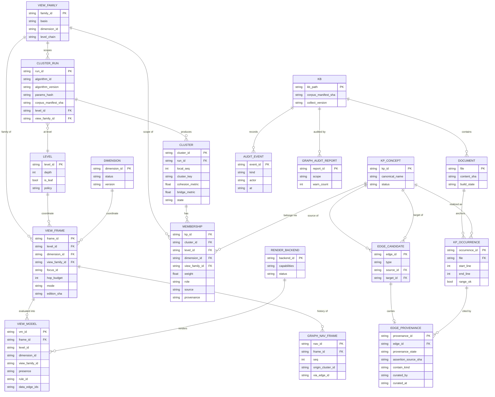

> 图注：Mermaid ER 的 `VIEW_MODEL` 属性行只列代表字段——`VIEW_MODEL` 在逻辑上是「一次取景的产物集合」，规范形态见 §1.4 的 `ViewModel` schema（S6a 冻结）；ER 图只表达它与 `VIEW_FRAME`/`RENDER_BACKEND` 的关系。

### 1.3 实体表（主键 / 基数 / 生命周期 / 事实源归属）

| 实体 | 主键 | 生命周期 | 归属 | 现存对应 / 差异 |
|---|---|---|---|---|
| `KB` | kb_path（DataSource 身份 = kb_path + corpus_manifest_sha + collect_version） | 打开/关闭 KB | 事实（外部） | 现 `state.kbPath`（`app.js:1843`）；身份三元组对齐 A-v2 §8 |
| `DOCUMENT` | file（KB 相对路径） | 文件创建/删除/改名 | 事实 | `collect_md_files`；`content_sha` 为 `manifest_sha` 的组成（`kg-ontology-v0.md:162-177`） |
| `KP_CONCEPT` | kp_id | 创建/合并/改名/删除 | 事实 | `kp_index.py:18-73` 的 `by_id` 键；改名 = 全库重命名（`document.py:2090-2100`） |
| `KP_OCCURRENCE` | occurrence_id（派生：file + kp_id + range） | 随正文/range 变化重建 | 事实（锚点） | 现 `KpIndexEntry` 多值被压成单节点（`collector.py:57-72`）——**新增层** |
| `CLUSTER_RUN` | run_id（稳定编码 = corpus_manifest + level + view_family + algorithm + version + params） | 每次聚类生成，旧 run 保留审计 | 派生缓存 | 无（现 group 现场算，无版本） |
| `CLUSTER` | cluster_id（run-scoped 实例 id = run_id + local_seq） | 随 run 生成；旧 run 保留审计 | 派生缓存 | `graph-groups.js:83-134` 的 `groups[]`（无版本/无 level）；`cluster_key` = sha256(sorted(member_canonical_ids)+algorithm_id+version+params_hash)（S0-RULINGS D-2） |
| `MEMBERSHIP` | (kp_id, cluster_id) 复合（**不唯一约束到单值**） | 随 run 重建 | 派生缓存（**不写产品 sidecar**，S0-RULINGS D-3） | 现 `nodeToGroup` 单值（`graph-groups.js:123-126`）——**必须废弃**；`view_family_id` 承载 partition 作用域 (level, 视图族)（D-1/A-v2 §7）；**同 `(level, view_family)` 内唯一性由校验器保证（v1 S0-7），不是 DB 唯一键** |
| `EDGE_CANDIDATE` | edge_id = `type|source_id|target_id`（沿用 `canonical_edge_id`，`edge_derivation.py:787-793`） | sidecar/正文变化时重建；保留 provenance | 事实 | `collector.py` 输出 `edges[]`（无 ctx）；type 三枚举 `{contain,reference,extend}` ⊇ R-1 最小集的边类型维度 |
| `EDGE_PROVENANCE` | provenance_id | 随 edge 生命周期；`valid_from/to` 只存不用 | 事实（审计） | `kg-edge-provenance.schema.json` 字段；`curated_by/at` |
| `LEVEL` | level_id | 配置/冻结后稳定 | 视图坐标（配置） | 无 —— S1 定层级语义 |
| `VIEW_FAMILY` | family_id | 配置（S1/S2 冻结定义） | 视图坐标（配置，partition 作用域） | **S0-terms-v1 R-2 已定名**：`view_family = ⟨family_id, basis, dimension_id, level_chain⟩`；partition 断言对象 = `(level, view_family)` |
| `DIMENSION` | dimension_id | 注册表项；`status` 取值按 S0-terms-v1/S1 统一（v1 未写全枚举，建议取 A-v2 超集） | 配置（含开放槽位） | 无 —— S1；`graphStyle` 明确**不是**维度 |
| `VIEW_FRAME` | frame_id | 每次取景一个，可被历史栈引用 | 视图状态（可持久化会话） | 无（现仅有 `graphGroupId`，`app.js:141`）；含 `view_family_id`（R-2）与 `mode`（Presentation 参数，v1 S0-6 ctx 含 mode）；`mode` 不写入 ViewModel（D-4） |
| `VIEW_MODEL` | vm_id | 每次渲染产物；按 frame+edition 缓存 | 派生缓存 | 现 `loadPayload` 载荷（`graph-engine.js:167-216`）；**不含导航/模式/capabilities**（D-4/S0-terms-v1 S0-9）；聚合边带 `data_edge_ids`（R-3） |
| `GRAPH_NAV_FRAME` | nav_id | 下钻/返回生命周期 | 视图状态（内存） | 现 `MemoriaNavStack` 是文件栈，非图谱栈（`nav-stack.js:23-36`） |
| `RENDER_BACKEND` | backend_id | 注册/切换 | 配置 + 运行时状态 | 现 2D/3D 各自持 engine（`app.js:1643-1660`） |
| `AUDIT_EVENT` | event_id | append-only | 事实（审计） | 新；现有交互计数仅内存（`app.js:26-101`） |
| `GRAPH_AUDIT_REPORT` | report_id | 每次审计生成 | 派生 | `graph_audit`（`document.py:2124-2132`） |

### 1.4 `ViewModel` 最小字段（ER 的投影形态，S6a 冻结）

> 纯度约束（S0-terms-v1 S0-9 / D-4）：ViewModel **不含导航状态、模式开关、capabilities**（`mode`/`breadcrumb`/`navigateBack` 归 `VIEW_FRAME`/`GRAPH_NAV_FRAME`/状态机；`capabilities` 由 `Renderer.getCapabilities()` 提供，不进 VM）。
> 字段并集来源：A-v2 §9（kind/role/state/presence/rule_id）+ B-v2 §9（role/事件/data_edge_ids/`Renderer.getCapabilities()`）。**presence 值域统一为 `shown|suppressed|unknown`**（S0-RULINGS S0-6；本文早期 v0 曾用 `present`，已改）。

```jsonc
{
  "view_model_id": "vm-...",
  "level_id": "L0",
  "dimension_id": "level",
  "view_family_id": "fam-whole-kb",
  "nodes": [{ "node_id": "...", "kind": "kp|cluster", "role": "member|one_hop|bridge|focus",
              "label": "...", "expandable": true,
              "metrics": { "member_count": 12, "degree": 4 }, "badges": ["+11"] }],
  "edges": [{ "edge_id": "...", "source": "...", "target": "...",
              "type": "extend", "contain_kind": null,
              "label": "semantic|structural|navigation",
              "display_type": "extend",
              "presence": "shown|suppressed|unknown",
              "rule_id": "admit.within_level", "state": null,
              "hop": 0, "underlying_hop_count": 0,
              "data_edge_ids": ["type|source_id|target_id"] }]
}
```

> 兼容性说明：本文早期 v0 用 `omitted[]` 单独列缺席边；为对齐 A-v2/B-v2，**缺席信息由每条边的 `presence/rule_id` 承载**（`omitted` 若保留只能是由 `presence!=shown` 导出的便捷视图，不得成为第二真相）。`frame_id`/`edition_sha`/`mode` 等取景元数据保留在 `VIEW_FRAME`，不塞进 ViewModel（D-4）。
> **R-3（S0-terms-v1 冻结）**：聚合/折叠边必须携带 `data_edge_ids`（映射回 DataSource 原始边 id）；机检 `expand_data_edges(VM) ⊆ DataSource.edges`，且 `shown(default) ⊆ shown(full)`。`data_edge_ids` 只存在于视图层，不写回事实源。

### 1.5 ER 待裁决点（S6a 前必须逐项裁决）

| # | 待裁决 | 候选 | 推荐（工程视角） | 依据 |
|---|---|---|---|---|
| D-ER-01 | KP 概念/出现位置是否拆两层 | 拆 / 不拆 | **拆**；不拆则 U-21 无法表达，且跳转目标（editor）永远只有一个 occurrence | E-2；`kp_index.py:37-73`；`collector.py:57-72` |
| D-ER-02 | 簇是分区（partition）还是覆盖（cover） | 分区 / 覆盖 | **覆盖**（支持多归属 U-21/U-31）；partition 仅在 (level, 视图族) 内成立（S0-RULINGS D-1） | `graph-groups.js:123-126`（现状分区） |
| D-ER-03 | 簇结果：事实 / 派生缓存 / 带审计 overlay | 三选一 | **派生缓存**；S0 禁止写产品 sidecar（S0-RULINGS D-3），簇 curation 待 S6 | `AGENTS.md` §1；`kg-ontology-v0.md:162-177` |
| D-ER-04 | `LEVEL` 是持久实体还是配置 | 实体 / 配置 | 配置（版本化）+ `CLUSTER_RUN` 引用；避免 level 成为第二事实源 | S0-2/H-1 |
| D-ER-05 | `EDGE_PROVENANCE` 是否独立实体 | 独立 / 内联 | 独立（审计与「只存不用」字段扩展频繁） | schema 已有 11 键 |
| D-ER-06 | `VIEW_MODEL` 是否持久化 | 持久缓存 / 纯内存 | 持久缓存（键 frame+edition），但**不得**被当作事实回写 | S0-6 |
| D-ER-07 | 审计事件表是否本板块新增 | 新增 / 复用 graph_audit | 新增 append-only，**与 graph_audit 分表**（口径不同） | `app.js:26-101` 仅内存计数 |

---

### 1.6 与 S0 提案 A/B 的形式化差异与 Lead 裁决（`S0-RULINGS.md`，已定）

> 差异原始清单见 `S0-engineering-review.md` §9；Lead 已在 `S0-RULINGS.md` §1/§2 裁决。**本文图按裁决形态维护**；若 S6a 冻结时裁决被推翻，按对应行回退。

| 差异 | Lead 裁决（S0-RULINGS） | 本文图已落实为 | 若未来推翻 |
|---|---|---|---|
| D-1 层次「每层划分」 vs 「粒度轴」 | **partition 只约束同一 (level, 视图族)**；跨层次嵌套、跨维度/视图族允许重叠（§2 D-1） | `MEMBERSHIP` 多对多、不写全局唯一约束；`scope_family` 字段承载作用域 | 若改全局每层划分：加 (level,kp) 唯一约束 + 新增 `LEVEL_PARTITION` 实体（ER-01@v2） |
| D-2 `cluster_id` 身份 | **run-scoped 实例 id + `cluster_key`**；curation/审计引用必须同时记 run 与 key（§2 D-2） | `CLUSTER.run_id` + `CLUSTER.cluster_key`；`CLUSTER_RUN` 保存算法/版本/参数/语料键 | 不采纳内容哈希主键（D-2 已否） |
| D-3 membership 持久化 | **S0 不允许**把簇/成员关系写入产品 sidecar 或新增产品段；semantic 边 curation overlay 仍走 v0.3；簇 curation 等 S6（§2 D-3） | `MEMBERSHIP.source` 只留 `derived_cluster`；DFD 簇存储标「派生缓存，不写产品 sidecar」 | 若 S6 允许 curation：恢复 `curated_overlay` + 审计字段（需 S6 契约） |
| D-4 ViewModel 纯度 | ViewModel **不含**导航状态与模式开关；导航归 S5，全展开是 Presentation 参数（§2 D-4） | `VIEW_MODEL` 只作渲染输入；导航/模式在 `VIEW_FRAME`/`GRAPH_NAV_FRAME`/状态图 Presentation 区 | 无（与 U-33 不冲突） |
| D-5 维度组合 | **v1 同一视图只激活一个维度**；组合留开放槽位（§2 D-5） | `VIEW_FRAME.dimension_id` 单值；字段表注明组合时扩展为有序列表 | S1 若开组合：`dimension_id` → `dimension_list + order`（S6a） |

---

### 1.7 与 S0 冻结候选（A-v2/B-v2）的一致性卡点（SE 机检产出，详见 `S0-freeze-check.md`）

> 下列为 A-v2 与 B-v2 口径不一致之处；**`S0-terms-v1.md` 已对 C-1/C-6 等作出裁决**，其余留给 S1/S2/S6a。本表用于交叉核对，不代裁。

| # | 卡点 | A-v2 | B-v2 | v1 处置 / 工程影响 |
|---|---|---|---|---|
| C-1 | `view_family` 定义 | `⟨family_id, basis, level_chain⟩`（A-v2 §2:100-108） | 「同一 (level, dimension) 下的视图族」（B-v2 §S0-2:91） | **v1 R-2 已裁**：`view_family = ⟨family_id, basis, dimension_id, level_chain⟩`，partition 断言对象 = `(level, view_family)`（ER 已按此建模） |
| C-2 | 渲染事件集 | `nodeClick/edgeClick/backgroundClick`（A-v2 §9:420-424） | `nodeClick/edgeClick/hover/clusterExpand`（B-v2 §S0-9:304-308） | **v1 S0-9 已裁**：最小集 `nodeClick/edgeClick/backgroundClick`；`hover/clusterExpand` 可选（S3/S5 定），导航/模式事件不进渲染契约 |
| C-3 | bridge 表示 | node `role=bridge`（A-v2 §9:410,434） | node `state=bridge` + role {member,one_hop,focus}（B-v2 §S0-9:295-296） | v1 S0-9 写「桥只能 role/state」；**S6a 需二选一**（建议 node `role=bridge` + edge `state=bridge_only`） |
| C-4 | partition 机检覆盖断言 | 伪代码 V5 用 `set(K)`（A-v2 §2:129），边界允许 basis⊂K（:149） | `check_level_partition` 同样用 `K`（B-v2 §S0-2:123-124） | **v1 S0-2 V5 已改为「并集=该层全集」**（不再写死 K）；S2/S6a 施工时参数化为 K_f |
| C-5 | `DIMENSION.status` 枚举 | `{reserved, specified, frozen, deprecated}`（A-v2 §3:166） | `{active, reserved}`（B-v2 §S0-3:146） | v1 未写全枚举 → **S1 必须补**（建议 A 超集 + B 的 active 映射），否则注册表校验不唯一 |
| C-6 | capabilities 归属 | `capabilities` 在 ViewModel（A-v2 §9:414） | `renderer_capabilities` / `Renderer.getCapabilities()`（B-v2 §S0-9:299） | **v1 S0-9 已裁**：capabilities 由 `Renderer.getCapabilities()` 提供，**不进 ViewModel**（已从 §1.4 移除） |

---

### 1.8 S1 增量（ER-02 草案；待 S1 冻结，不覆盖 S0 实体）

> 依据：`S1-RULINGS.md` R-S1-1..R-S1-8、`S1-charter.md` §4、S0 D-3/D-4/R-1/R-3。注册表是**版本化配置**（非事实源）；H 不参与关系扩展（`relation_sources=[]`、无 hop）；A 的 `relation_sources ⊇ E_relation_min`。

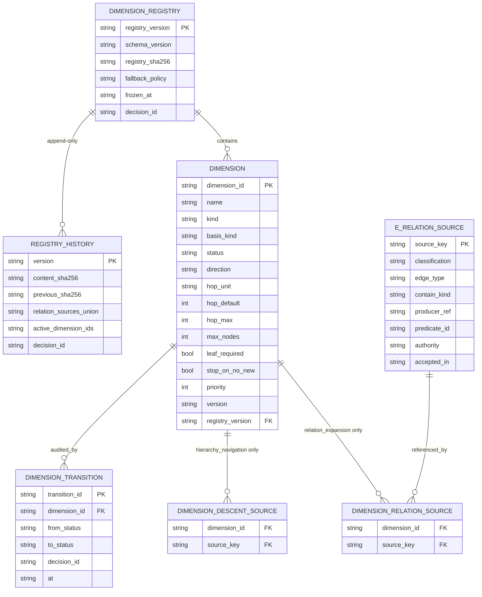

| 增量 | 落点 | 关键约束/机检点 |
|---|---|---|
| `DIMENSION` 扩展 | `kind ∈ {hierarchy_navigation, relation_expansion}`、`hop_unit ∈ {edge, n/a}`、`hop_default/hop_max`（H 必须 NULL）、`max_nodes` 字段存在 | H：`relation_sources=[]`、`hop_unit=n/a`、hop 全 NULL、direction=down；A：`hop_unit=edge`、`1 ≤ hop_default ≤ hop_max ≤ 2`、direction∈{both,out,in} |
| `DIMENSION_RELATION_SOURCE` | 仅 A（`relation_expansion`）的源集合 | 断言 ⊇ `E_relation_min`；R-1 只约束 A（H 为空） |
| `DIMENSION_DESCENT_SOURCE` | 仅 H 的下降源 | H 固定 `{contain(structural)}`；只作层次派生边来源，不挂接邻居 |
| `REGISTRY_HISTORY` | append-only（`version/content_sha256/previous_sha256/relation_sources_union/decisions`） | 跨版本 `union(new) ⊇ union(old)`；删除/改名 ⇒ `S0_REOPEN_REQUIRED` |
| `E_RELATION_SOURCE.classification` | `edge_type/projection/derived` | `derived` 不得进 v1 active；新源须有 `producer_ref`（DataSource 可生产） |
| `DIMENSION_REGISTRY.fallback_policy` | `allow_explicit/forbidden` | 显式 fallback 才可回默认 H，须审计 `fallback_reason`；`forbidden` ⇒ fail-closed |
| `DIMENSION_TRANSITION` | 状态机审计（reserved→active→deprecated） | deprecated→active 必须 S1 重开 + 版本升级；插件不得写注册表 |
| H 派生边（VM 层） | `derived_from=partition_refinement` + `partition_ref` + `data_edge_ids`（R-S1-11 冻结：`edge_id=sha256(canonical(parent_id, child_id, level, view_family))`；`data_edge_ids(e_H) = { e ∈ DataSource.edges \| e.type=contain ∧ e.contain_kind=structural ∧ e.source∈members(parent) ∧ e.target∈members(child) }`；去重/排序/可枚举；**允许空集**——字段必须存在、空集合法、不得伪造 id） | R-3 机检：`expand_data_edges(VM) ⊆ DataSource.edges`（空集合法）；空集不得被当成缺失 |
| `expand_data_edges(VM)` 签名 | `frozenset[EdgeId]`：对 VM 中 `derived_from=data_edge`（聚合/折叠）边与 H 结构边取 `data_edge_ids` 并集；前置条件 = VM 与 DataSource 同一 edition/registry_version | `expand_data_edges(VM) ⊆ DataSource.edges`；**空集合法（R-S1-11 冻结）**；不得回读事实层 |

> **ER-02 备注**：R-S1-11 已冻结 H 结构边的映射谓词与「允许空集」（不再待裁）；history 存放位置与 `registry_sha` 计算域/`history_ref` 类型由 S6a 定（O-S1-2，非阻塞）。

---

### 1.9 S2 增量（ER-03 草案：簇/成员/运行/稳定性；待 S2 冻结，不覆盖 S0/S1）

> 依据：`S2-charter.md` S2-1..S2-13、S0-4/S0-7/D-2/D-3、S1 R-2；簇是**派生缓存**（不写产品 sidecar）；身份 = run-scoped id + `cluster_key`；同 `(level, view_family)` 单归属、跨族/维多归属。

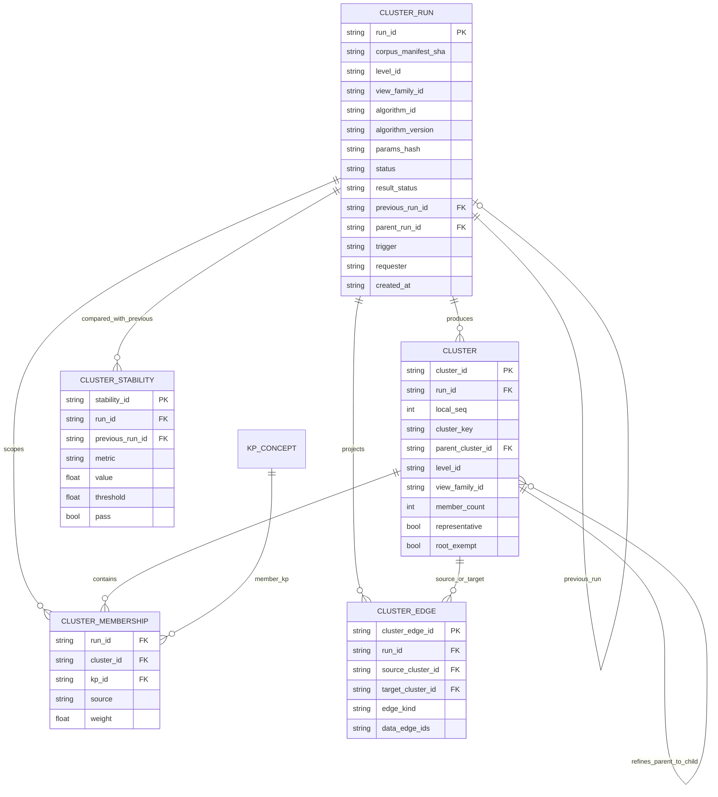

| 增量 | 落点 | 关键约束/机检点 |
|---|---|---|
| `CLUSTER_RUN.run_id` | **粒度 = `(level, view_family)`（R-S2-4）**；稳定编码 `sha256(canonical(corpus_manifest_sha, view_family_id, level_id, algorithm_id, algorithm_version, params_hash))` | 同输入同 run_id；Ready 后内容不可变；新 run 不改旧 run；父子层用 `parent_run_id` 关联（跨层 refinement 校验） |
| `CLUSTER_RUN.status` / `result_status` | 生命周期 `status ∈ {building, candidate, ready, superseded, failed}`（R-S2-5）；结果 `result_status ∈ {ok,no_semantic_edges,partial_disconnected,size_exceeded,algorithm_failed}`（R-S2-13） | `candidate` 必须带 `trigger/requester/reason/base_run_id` 审计；只有人/S5 可 adopt；`no_semantic_edges` 合法（coverage=0，无 representative 簇）；失败/超限保持旧 adopted run |
| `CLUSTER.cluster_id` | `(run_id, local_seq)`（run-scoped，D-2） | `local_seq` 按成员最小 canonical id 排序、run 内唯一；不得用内容哈希当实例 id |
| `CLUSTER.cluster_key` | `sha256(canonical(sorted(member_canonical_ids)) + algorithm_id + version + params_hash)`（S0-4/D-2） | 可复算/去重；curation/审计必须同时记 run_id + cluster_key |
| `CLUSTER_MEMBERSHIP` | `(run_id, cluster_id, kp_id)`；同 `(level, view_family)` 内 kp 唯一，跨族/维可重叠；`source=derived_cluster`（v1 无 curation） | 复合唯一约束由校验器保证；**role 不复用 S1 node role=bridge**（R-S2-7，桥只作边 state）；不写产品 sidecar（D-3） |
| `CLUSTER.parent_cluster_id` / `CLUSTER_RUN.parent_run_id` | Π_{ℓ+1}→Π_ℓ 精化关系（跨 run 用 parent_run_id） | 子簇成员 ⊆ 父簇成员；跨 view_family 不得成父；H 派生边由该关系 + R-S1-11 谓词生成 |
| `CLUSTER.representative` / `root_exempt` | singleton 不作代表节点（`representative=false`，μ=null）；L0 全库单块显式 `root_exempt=true`（R-S2-6） | singleton μ=null 不参与 τ 判定；root_exempt 不是普通簇，不参与普通簇统计 |
| `CLUSTER_EDGE` | 内部边/桥边聚合：`edge_kind ∈ {internal, bridge}`；`data_edge_ids` 映射回 DataSource（R-3） | 数据派生聚合边 `data_edge_ids` 必须非空；H 结构边按 S1 R-S1-11 允许空集（两者用 `derived_from` 区分）；桥判定确定性；边界呈现归 S4 |
| `CLUSTER_STABILITY` | 新 run 与上一 run 的 Jaccard/churn/split-merge（仅同 `(level, view_family)` 可比） | 度量确定性；首次 run 记 `initial/null`；阈值 S8；失败/回滚见 ST-03 |
| µ/β 参数 | 语义-only（R-S2-1）：`μ/β` 输入边集 == `E_sem`（label=semantic）；reference/structural/非 semantic extend **不进入** μ/β | 权重策略与 τ 进 `params_hash`；τ 默认值须由语义-only probe 标定（R-S2-2）；非法参数 fail-closed |
| 持久化 | 全部为**派生缓存**（`.memoria/build` 类），可重建；审计/决策记录非 sidecar | D-3：禁止写产品 sidecar/新段；S6 需求见 DF-03 |

> **ER-03 待裁决**：① `CLUSTER_MEMBERSHIP` 的「同族单归属」用 DB 唯一键还是校验器（推荐校验器，派生缓存可重建）；② `parent_cluster_id`/`parent_run_id` 是否需独立 `PARTITION_REFINEMENT` 关系表（推荐字段即可）；③ µ/β 参数/阈值存储位置（registry 配置 vs run 内嵌 params）——R-S2-4 已定 run 粒度；参数建议 run 内嵌 `params_hash` + params 只读文档，S6 定。

---

### 1.10 S3 增量（ER-04 草案：节点/边视图 + 视觉 token + 渲染后端；待 S3 冻结）

> 依据：`S3-charter.md` S3-1..S3-12、S0-8/S0-9、S1 D-4、S2 D-4、S0 D-3。**渲染只读**：视觉编码从 ViewModel/VIEW_STATUS 派生，渲染器不取数、不重算簇、不写状态；VM 中不含簇/run/dendrogram 内部字段。

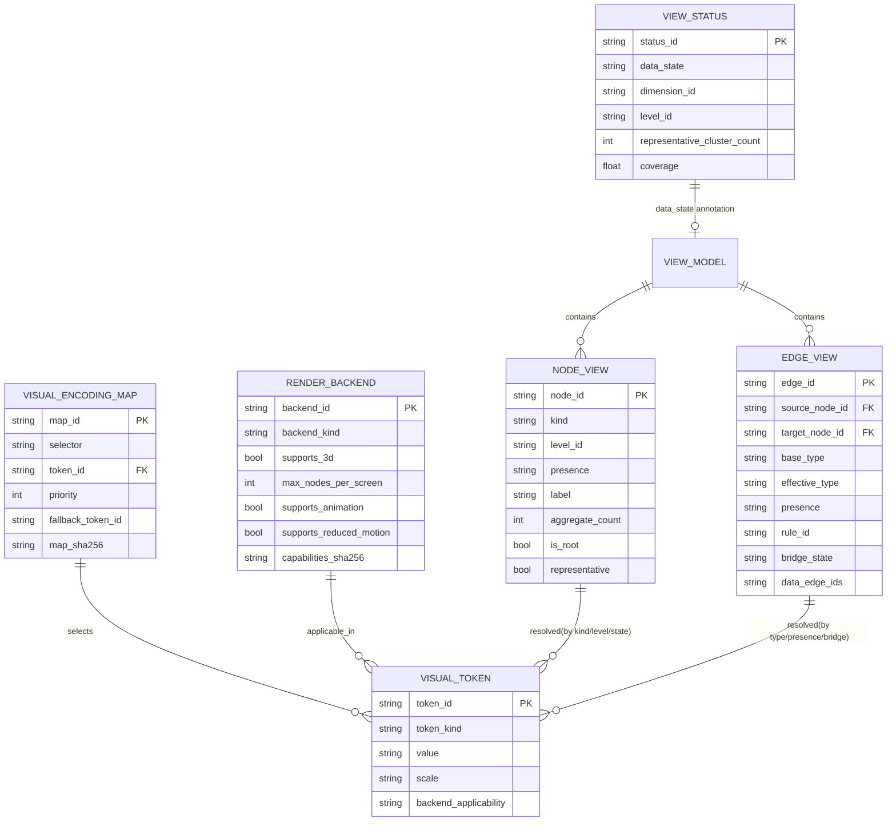

| 增量 | 落点 | 关键约束/机检点 |
|---|---|---|
| `NODE_VIEW` | `kind∈{kp,cluster}`（**不得第三类型**）；`role ∈ {member}`（v1 仅 member；**无 bridge**，R-S3-3；hover/selected/focus 为渲染器/Presentation 瞬态，不进 VM——符合 S0-9/S1 D-4）；presence 三值；cluster `aggregate_count`（取景层显式给出，R-S3-9）/`is_root`/`representative`；**label 确定性**（R-S3-1/R-S3-10：min canonical member id 的 KP label + i18n `cluster.more_members`；root=`cluster.root_label`；fallback `cluster_key[:8]`；禁 local_seq）；KP 固定 8px screen-space（R-S3-7/R-S3-11）；cluster 大小 `clamp(8+2.2·log2(member_count+1),12,28)`；`layout_group` 仅布局且 `semantic=false`（R-S3-5，**须在 VM 白名单**） | VM 不含 `cluster_key`/`run_id`/`dendrogram`/成员内部（S2 D-4）；singleton `representative=false`；`metrics` 不进 VM（R-S3-8） |
| `EDGE_VIEW` | base/effective type 分离；presence+rule_id；`state=bridge_only`（**桥只作边状态**，R-S3-3） | 不得以视觉编码暗示数据中不存在的边（S3-5）；`data_edge_ids` 允许在 VM 派生/聚合边上（审计/`expand_data_edges`），但 **Renderer schema 必须拒绝读取**（R-S3-9）；R-3 子集机检在 VM 构建侧 |
| `VIEW_STATUS` | 纯展示数据状态：`data_state ∈ {ok, no_semantic_edges}`（+ dimension/level/counts/coverage）；`level_label`（非交互显示串，R-S3-6）；**不是**簇/run 内部状态，也不含导航/模式 | 单独 DTO（不塞簇/run 内部进 VM，保持 S1 D-4）；`no_semantic_edges` 由 S2 run `result_status` 派生，仅暴露展示聚合 |
| `VISUAL_TOKEN` | `token_kind ∈ {color,size,shape,opacity,dash,icon,label}`；2D/3D 适用性；无数据语义 | token 值可机检（CSS/样式/DOM 断言）；不得含事实/语义判断 |
| `VISUAL_ENCODING_MAP` | `selector`（kind/edge_type/presence/bridge/level）→ token；priority/fallback；`map_sha256` | 映射表可机检（字段→token）；未命中 ⇒ 显式 fallback，不得静默无样式；同一 selector 冲突 ⇒ fail-closed |
| `RENDER_BACKEND` | 2D/3D 同接口（R-S3-4/R-S3-11）：`getCapabilities()`（含 `maxNodes/maxEdges/backends`）/`render(container, vm)`/`update(vm, opts)`/`dispose()`/`on(event)`；能力声明（max_nodes/max_edges/3d/animation/reduced_motion） | 2D/3D 同签名；**3D 固定大小=screen-space（R-S3-11）**；后端不可用 ⇒ 显式 fallback（2D）并提示；**预算裁剪归 S4**（R-S3-2）：Renderer 只校验+渲染已选 VM，超硬上限 ⇒ `RENDER_BUDGET_EXCEEDED` fail-visible；**Renderer schema 拒绝读取 `data_edge_ids`**（R-S3-9）；不取数、不重算簇、不写状态 |

> **ER-04 备注（v1 修复后）**：① `VIEW_STATUS` 与 VM 的关系建议独立 DTO（S3-8 的 `no_semantic_edges` 只读 `data_state`）；② v1 白名单已补 `layout_group?{semantic:false}`/`aggregate_count?`，M-S3-12 PASS；③ VM `role∈{member}`，focus/hover/selected 为瞬态，M-S3-1 PASS；④ 视觉映射表存版本化配置 + `map_sha256`（S6/S3 定）。

---

### 1.11 S4 增量（ER-05 草案：frame/presence/selection/one-hop；待 S4 冻结）

> 依据：`S4-charter.md` S4-1..S4-12、S0-6/S0-9、S1 H/A、S2 run、S3 VM/presence/Renderer 契约。**S4 是唯一裁剪者**（R-S3-2）：在 VM 构建前决定 `presence∈{shown,suppressed,unknown}` + `rule_id`；只改取景不改事实；簇/run 内部不进 VM；`shown(default) ⊆ shown(full)`。

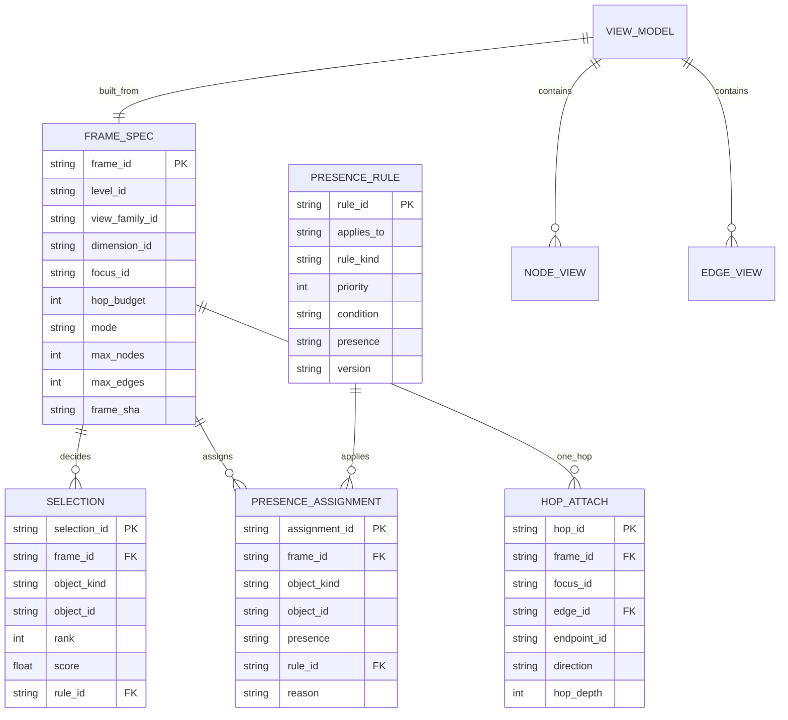

| 增量 | 落点 | 关键约束/机检点 |
|---|---|---|
| `FRAME_SPEC` | 取景输入：level/view_family/dimension/**focus（唯一 base）**/hop_budget/new_hop/mode/default/full/max_nodes/max_edges/**MANDATORY 最小必选集**/**reserved_ids（full 保留 default shown）**/`budget_full≥budget_default`/candidate_scope；frame_sha 可复算 | 同输入同 frame/presence；`base(F)={focus}`（R-S4-1）；`hop_budget≤S1 hop_max`；mode 只 default/full；预算与 S3 `getCapabilities()`/S8 同源；MANDATORY 可枚举；full 候选集必须 ⊇ default 候选集（R-S4-9） |
| `SELECTION` | 选点结果：rank/tier/hop/relation_class/label_rank/rule_id；确定性排序 | 排序键 = `(tier, hop, relation_class, label_rank, canonical_id)`（R-S4-6）；同输入同 rank/presence；不得随机/时间/内存序 |
| `PRESENCE_RULE` | 规则表：`rule_id` 11 类枚举（R-S4-5）；priority；presence 三值 | `rule_id` 闭合；同对象多规则按 priority 决出唯一 presence；unknown≠suppressed；不得改 type/label |
| `PRESENCE_ASSIGNMENT` | 每 object（node/edge）每 frame 恰一条 presence+rule_id；**候选全量载体**（R-S4-4）；VM 节点 presence/rule_id 按 `S3-ADDENDUM-1`（仅 view-status） | 覆盖所有候选对象（含 suppressed/unknown）；Renderer 只用 shown；`shown(default) ⊆ shown(full)` 由 reserved 构造保证，且需 full 候选 ⊇ default 候选 |
| `HOP_ATTACH` | 一跳：**F={focus}** → 恰好一条 `E_relation(D)` 边 → 端点（kind∈{kp,cluster}）；direction | **depth=1 严格**；不闭包/不带背后图；无隐式 2 跳（R-S4-2）；2 跳只能 S5 `EXPLICIT_NEW_HOP`；端点 kind/维度由 S1 定义 |
| 预算归属 | S4 唯一裁剪者；Renderer 不裁剪（S3 R-S3-2） | 超预算 ⇒ `suppressed+rule_id`（显式），不是 fail；VM 超硬上限才 `RENDER_BUDGET_EXCEEDED` |
| VM 纯度 | S4 输出 S3 VM schema；簇/run/内部字段不进 VM | `aggregate_count` 取景层给；`data_edge_ids` 仅审计（Renderer 禁读）；focus/selection/nav 不进 VM |

> **ER-05 待裁决/SE 发现（对照 `S4-render-v1.md` sha `2655043f…`）**：① `FRAME_SPEC` 是否复用 S0 `VIEW_MODEL`/`GRAPH_NAV_FRAME`（推荐 S4 FRAME 为输入、VIEW_MODEL 为输出）；② `PRESENCE_ASSIGNMENT` 推荐内存派生、审计可选；③ `unknown` 规则按 R-S4-5 四类；④ v1 已补 `candidates(full) ⊇ candidates(default)` + R-S4-7 四项机检 + R-S4-9 失败/回退，M-S4-9 PASS；⑤ `S3-ADDENDUM-1` 需在 S3-FREEZE-RECORD/决策索引登记（O-S4-2）；⑥ cluster 焦点在 A 维度的一跳语义（S4-3/S4-7）需 S4/S6a 补边界（O-S4-1）。

---

### 1.12 S5 增量（ER-06 草案：GraphNavFrame/nav stack/nav event；待 S5 冻结）

> 依据：`S5-charter.md` S5-1..S5-12、S0-9/D-4、S3 事件、S4 `frame_spec`/presence。**导航状态只属 Presentation/S5**：`GraphNavFrame` 不进 VM、不写产品 sidecar（D-3）；S5 只构造 `frame_spec` 交给 S4，不计算 presence。

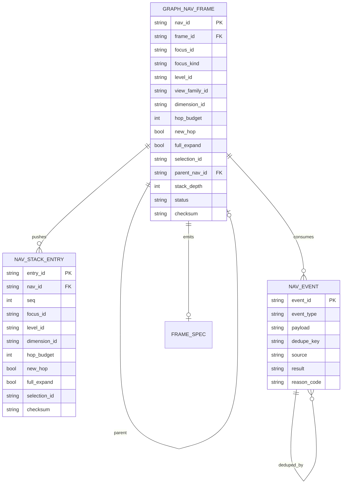

| 增量 | 落点 | 关键约束/机检点 |
|---|---|---|
| `GRAPH_NAV_FRAME` | focus/level/view_family/dimension/hop/new_hop/full/selection/parent/stack/status/checksum | **只在 Presentation**，不进 VM（S0-9/D-4）；S5→S4 只发 `frame_spec`；同输入同 frame |
| `NAV_STACK_ENTRY` | drill/back 可逆栈：focus/level/dimension/hop/new_hop/full/selection + checksum | drill push；back pop 恢复；栈上限/去重；back 到空栈 ⇒ 拒绝（fail-closed）；restore 需 checksum 校验 |
| `NAV_EVENT` | 事件类型：nodeClick/edgeClick/backgroundClick/drill/back/newHop/dimensionSwitch/fullToggle/restore；source：renderer/keyboard/url/presentation；result：accepted/rejected/idempotent | 非法转移 fail-closed（不改状态、记 reason）；重复 new_hop 幂等；hover 不改变导航状态；事件去重/防抖 |
| 持久化 | 导航历史/URL 书签（若做）仅 Presentation/会话；不写产品 sidecar（D-3） | 不进 VM、不进 S2/S4 派生缓存 |
| 边界 | S5 不计算 presence；S4_BUDGET_INVALID ⇒ 回退/提示（S5-9）；无簇 ⇒ EmptyNoSemantic 状态（S5-11） | 与 S4 `frame_spec`/presence、S3 事件、S1 H/A、S2 run 一致 |

> **ER-06 待裁决**：① 导航历史/URL 是否持久化（推荐仅会话/可选，D-3 不允许产品 sidecar）；② new_hop 是否入 nav stack（推荐独立 transient、不入栈；back 只回退 drill）；③ focus 丢失/重聚类后的恢复策略（S5-6）需冻结。

---

### 1.13 S6 增量（ER-07 定稿草案：DataSource→View→Frame→Presence→VM→Renderer + run/registry/nav/cache/audit；待 S6 冻结）

> 单一真源：**DataSource（事实）→ 各层派生 View/Frame/Presence → VM（渲染）**；`DataSource` 只读；`CLUSTER_RUN`/`VIEW_MODEL`/`PRESENCE_ASSIGNMENT`/`GRAPH_NAV_FRAME` 为派生/会话；缓存可重建；禁用并行事实源；D-3 不写产品 sidecar；D-4 VM 纯。

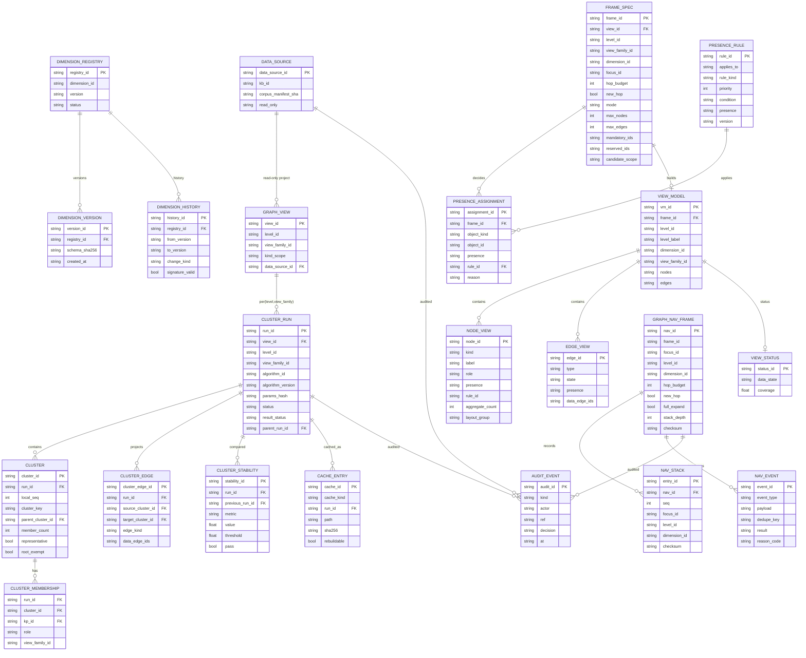

| 契约 | 单一真源/约束 |
|---|---|
| DataSource/GraphView | 只读事实；per `(level,view_family)`；不写产品 sidecar（D-3） |
| DIMENSION_REGISTRY/VERSION/HISTORY | registry 只增不删；history 不可变/签名；跨版本校验；失败 fail-closed |
| CLUSTER_RUN/CLUSTER/MEMBERSHIP/EDGE/STABILITY | 派生缓存；run_id/params_hash 按 S2；candidate 不自动 adopted；可重建 |
| FRAME_SPEC/PRESENCE_RULE/PRESENCE_ASSIGNMENT | S4 唯一裁剪；11 类 rule_id；候选全量 presence；MANDATORY/reserved；不写事实 |
| VIEW_MODEL/NODE_VIEW/EDGE_VIEW/VIEW_STATUS | S3 白名单 + ADDENDUM-1；data_edge_ids 审计/Renderer 禁读；VM 不含 nav/frame/run |
| GRAPH_NAV_FRAME/NAV_STACK/NAV_EVENT | Presentation 会话；frame_id=sha(canonical frame_spec)；T01–T30 生成 S5a；持久化白名单 |
| CACHE/AUDIT | 缓存可重建/删除；审计 append-only；GC 策略 S6/S6a |

> **ER-07 待裁决**：① `DIMENSION_HISTORY` 的签名/存储位置；② `AUDIT_EVENT` 是否产品内 append-only（不写用户数据段）；③ `CACHE_ENTRY` 的 GC/失败回退语义；④ 旧 `graph-groups` 数据忽略/迁移策略（S6-10）。

**0.5 实现接口清单（S6a 草案；供 S6-12 冻结）**

| # | 接口/模块 | 输入 | 输出 | 约束 |
|---|---|---|---|---|
| I-01 | `DataSourceReader` | kb path / manifest | nodes/edges/E_relation_min（只读） | 只读事实；不写 sidecar（D-3） |
| I-02 | `GraphViewBuilder` | DataSource + `(level,view_family)` | GraphView | per-level/family；不缓存事实 |
| I-03 | `RegistryService` | dimension schema / schema_sha | DimensionRegistry/Version/History | 只增不删；history 不可变；可选签名；失败 `GRAPH_REGISTRY_*` |
| I-04 | `ClusterRunBuilder` | GraphView + params_hash | CLUSTER_RUN/CLUSTER/MEMBERSHIP/EDGE/STABILITY | S2 身份/五状态；候选不自动 adopted |
| I-05 | `AdmissionService`（S4） | FRAME_SPEC + GraphView + run | PresenceAssignment + VM | 唯一裁剪；presence/rule_id/MANDATORY/subset；事务化 |
| I-06 | `ViewModelBuilder` | AdmissionResult + S3 白名单 | VM（NODE/EDGE_VIEW/VIEW_STATUS） | S3 白名单+ADDENDUM-1；data_edge_ids 审计/Renderer 禁读 |
| I-07 | `RendererAdapter`（S3） | VM + capabilities | 2D/3D 渲染 + 事件 | 同签名；不取数/不裁剪/不算 presence |
| I-08 | `NavController`（S5） | S3 事件 + Presentation 输入 | Frame/transition/next FRAME_SPEC | T01–T30；事务化 diff=0；frame_id 派生 |
| I-09 | `CacheStore` | run/nav/frame | cache entries | `.memoria/cache/graph/`；可删重建；GC 只删缓存 |
| I-10 | `AuditLog` | decisions/curation/agent 请求 | append-only audit | `.memoria/agent/audit/graph/`；不参与事实源 |
| I-11 | `G6Snapshot` | 全链路对象 sha | g6_version/shas/直方图/subset/closure | 可复跑；sha 稳定；阈值冻结 |
| I-12 | `ErrorMap` | S2–S5 legacy codes | `GRAPH_*` canonical + legacy_code | 统一命名空间；i18n key 归 UI |
| I-13 | `SchemaValidator` | 各 schema JSON | pass/fail + code | 字段/枚举/默认/失败码；fail-closed |

> **接口清单待 S6-12/Lead 裁**：I-01..I-13 的模块边界/依赖方向/0.5 做与不做；3D 只留 I-07 接口（capability=false）；agent 写/跨库/时间维不在 0.5。

> **S6a 定稿决策（SE，对照 `S6-contract-v1.md` sha `40f12e5f…`）**：① history 签名用 **detached `<content_sha>.sig`**（`content_sha` 不含 signature；entry `signature?` 可选但落盘以 detached 为准）；② cache 子布局 **`.memoria/cache/graph/{level}/{view_family}/{run_id}.json`**，edition 写入 run metadata（不进路径）；③ 旧 `.memoria/build/**`/旧 graph-groups **不读、可删**（只读 fallback 默认关闭）；④ GC 20 run/90 天只删 cache，history/audit 不 GC；⑤ 0.5 接口 I-01..I-13 采用本清单，2D 先发、3D 仅接口 capability=false。

---

### 1.14 S7 增量（ER-08 草案：agent 工具/引用/证据/审计；待 S7 冻结）

> S7 只定义 agent **消费**图谱的契约：只读、不绕过 DataSource、不把 VM/缓存当事实、不写 sidecar/registry（v1）；工具调用可审计；引用必须可回原文（kp/file/line 或 anchor）与簇引用（cluster_key/run_id）。

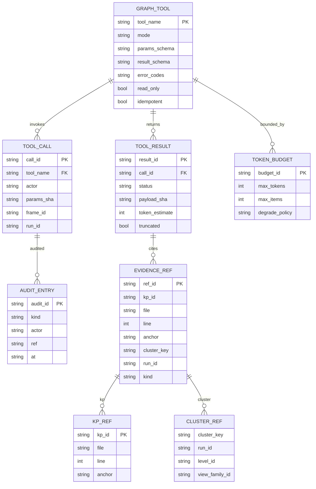

| agent 工具（G7 草案） | 参数（摘要） | 返回 | 约束 |
|---|---|---|---|
| `graph_focus` | `level, view_family, dimension, focus, hop≤1` | 邻域 + presence/rule_id | 复用 S4 focus-only；无隐式 2 跳 |
| `graph_explain_edge` | `edge_id` | `{presence,rule_id,claim_*,data_edge_ids?}` 受控解释 | 只读；可解释 suppressed；不批量泄漏原始边 |
| `graph_expand_cluster` | `cluster_key, run_id, level` | 簇成员摘要（label/member_count） | 只读 S2 run；不改 S5 导航状态/stack |
| `graph_summary` | `frame_id/run_id` | presence/rule_id 直方图 + suppressed_summary + G7 摘要 | 只读；无原始隐藏边；token 预算 |
| `graph_resolve_ref` | `{kp_id?|file+line|anchor}` | `{resolved,kp_id,file,line,anchor,stale,claim_type}` | 只读/幂等/审计；`GRAPH_ANCHOR_STALE` |
| 错误码 | — | `GRAPH_TOOL_INPUT_INVALID/BUDGET_EXCEEDED/ANCHOR_STALE/RETRIEVAL_UNAVAILABLE/WRITE_FORBIDDEN/AUDIT_FAILED`（S6-ADDENDUM-1） | 逐码 legacy/i18n/severity；audit_id |

> **ER-08/G7 待裁决**：① 工具名/错误码按 R-S7-3 冻结；`graph_path` v1 不做；② token budget 数值（S8）；③ 引用 anchor 采用行号还是 content hash；④ 审计落盘 `.memoria/agent/audit/graph/`（S6 路径）。

> **S7a 定稿注记（对照 `S7-agent-v1.md` sha `70dd8748…`）**：5 只读工具 `graph_focus/graph_explain_edge/graph_expand_cluster/graph_summary/graph_resolve_ref`；无 `graph_path`；`ViewResponse.edges[]` 只含 shown + `suppressed_summary/rule_histogram`；所有工具可选 `expected_edition`、回带 `edition_sha`（不匹配 `GRAPH_EDITION_STALE`）；`graph_resolve_ref` 对 source_assertion 返回 `source_excerpt`（≤500 字符、只读、不缓存正文、审计）；错误码按 S6 `GRAPH_*` + `S6-ADDENDUM-1` 六码；幂等键 `(tool,args,edition,budget)`；默认 `max_tokens=4000/max_nodes=200`；G7 引用 G6 字段不复制事实。

---

### 1.15 S8 增量（ER-09 草案：G6/G7 快照、指标、阈值、CI 门禁；待 S8 冻结）

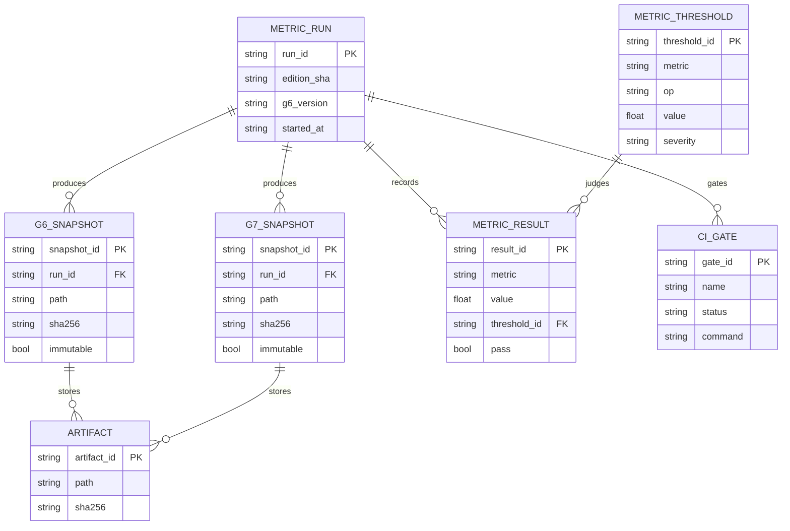

---

### 1.16 S9 增量（ER-10 草案：candidate_ref/score/reason/edition/索引/评估）

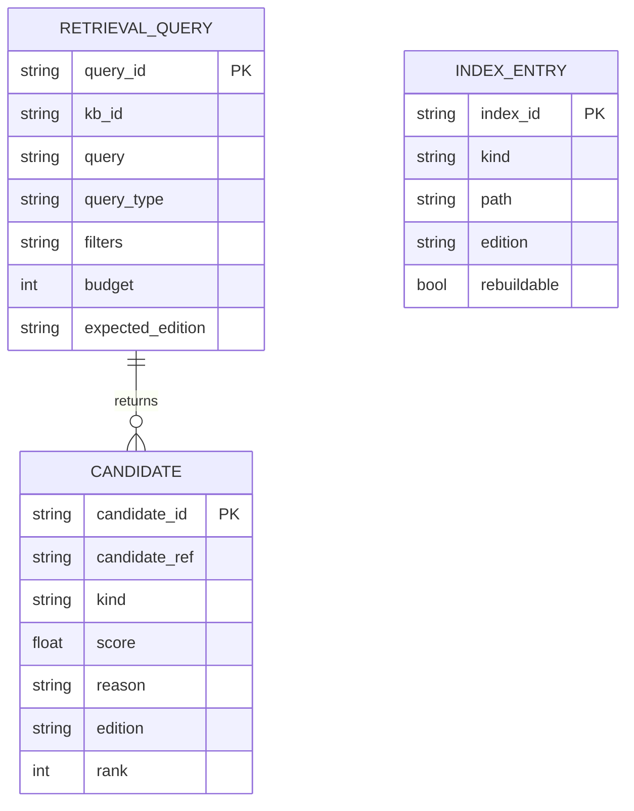

---

## 2. DFD v0 草案 —— 「草案-待 S9a 裁决（存储段与 S6a 联签）」

### 2.1 设计立场

- **一个 KB 一个根**（S0-11 不跨库）：DFD 不出现第二个 KB 根，ER 无 `kb_id` 外键；DataSource 身份 = `⟨kb_path, corpus_manifest_sha, collect_version⟩`（对齐 A-v2 §8）。
- **R-1（S0-terms-v1 冻结）**：`E_relation_min = {contain(structural), contain(semantic), reference, extend}`；维度取景/挂接边源 ⊇ 该最小集，S1 只能加不能删（删除须重开 S0）。`semantic/structural` 只是标签，不是 `E_relation` 过滤条件。
- **事实源 vs 缓存**：正文 `.md` 与 sidecar 是事实源；`.memoria/build/**`、cluster/embedding 是**可再生缓存**（`kg-ontology-v0.md:162-177`）；视图状态（frame/nav/设置）与视图配置注册表（level/dimension/view_family）**不是事实源**，不得被 agent 写。
- **取景在服务端**（U-32）：`P4 取景检索` + `P5 Admission` 属于后端；渲染后端只消费 ViewModel。
- **agent 只读取景**（S0-10）：`P9` 只有读箭头回到 agent，写路径归 `P2/curation`（另一条独立写流，见 `kg-ontology-v0.md:126`）。

### 2.2 DFD 图（v0，Context + Level-1）

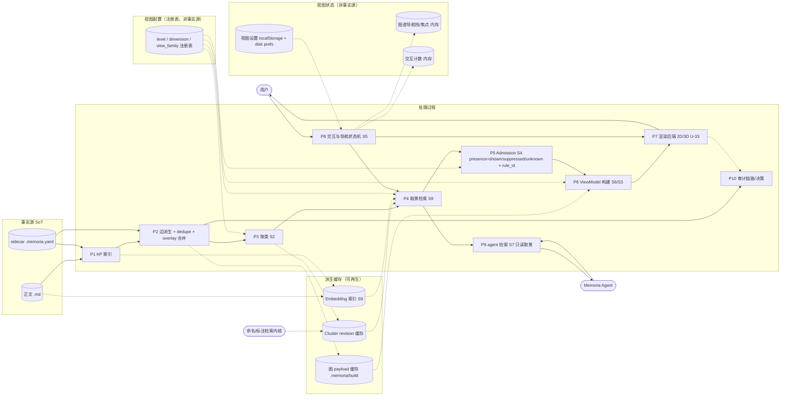

> 图注：实线 = 事实/主数据流；虚线 = 缓存、视图状态或配置（非事实）。`P2` 的写路径（curation overlay）在 v1 细化时应单独画一条「agent/人 → curation 校验 → sidecar」的写流（本图只保留 `SC → P2`，避免把写权画进主链）。`F1` 注册表是 S1 的 `level/dimension/view_family` 配置（reserved 槽位只登记、不进渲染分支）。

### 2.3 外部实体表

| 外部实体 | 交互 | 边界 | 依据 |
|---|---|---|---|
| `USER` | 打开图谱、点击下钻/返回、切维度、切 2D/3D、点 KP 跳编辑器 | 只通过 UI 事件，不直连存储 | `app.js:1661-1677`（KP 点击 → `jumpToTarget`） |
| `AGENT` | 读 framing/检索结果；写 KP/语义走 curation 接口（独立写流） | **不得写视图状态/缓存** | `kg-ontology-v0.md:23-26,126`；S0-10 |
| `LABELER` | 为簇提供命名建议（现有 `suggest_group_labels`） | 只回标签，不回写成员 | `app.js:1767-1790`；`ui.py:284-288` |

### 2.4 过程表

| 过程 | 做什么 | 输入 → 输出 | 现有实现 | 冻结场次 |
|---|---|---|---|---|
| P1 | 从正文+sidecar 建 KP 索引（概念/occurrence/range） | `MD, SC → KP 集` | `kp_index.py:37-73` | S6/S10 |
| P2 | 派生 contain/link/sidecar 边 + dedupe + semantic overlay 合并 | `MD, SC, KP → EdgeCandidate[]` | `collector.py:46-99`；`edge_derivation.py:630-717,862+` | S6 |
| P3 | 聚类（算法/参数/版本/语料键；视图族/level 作用域） | `EdgeCandidate[], KP, 配置 → CLUSTER_RUN` | 现 `graph-groups.js:83-134`（前端、无版本） | S2 |
| P4 | 取景：`(level,dimension,view_family,focus,budget) → 候选节点/簇/边` | `ctx, cache, 配置 → 候选集` | 无（S9 新设计，U-32 关键） | S9 |
| P5 | Admission：逐候选判 `presence∈{shown,suppressed,unknown}` + `rule_id` + effective_type；聚合边生成 `data_edge_ids`（R-3） | `候选集, ctx → 边状态` | 无（现全量渲染，`graph-view-2d.js:634-663`） | S4 |
| P6 | ViewModel 构建（按 §1.4 schema；不含导航/模式/capabilities） | `边状态, ctx → ViewModel` | `graph-engine.js:167-216`（旧载荷） | S6/S3 |
| P7 | 渲染后端（2D/3D 同一接口） | `ViewModel → 画面` | `graph-view-2d.js` / `graph-view-3d.js` | S3/S5a |
| P8 | 交互与导航状态机（见 §3） | `事件 → 新 ctx / 导航栈 / 编辑器跳转` | `app.js:1661-1677`；`nav-stack.js` | S5 |
| P9 | agent 检索（只读取景/链路） | `ctx → 检索结果` | 无（agent 目前不读边，`kg-ontology-v0.md:23-26`） | S7/S9 |
| P10 | 审计（链路/存无决策/簇 revision/交互） | `决策事件 → 审计记录` | `graph_audit`（`document.py:2124-2132`）；内存计数 | S8/S6 |

### 2.5 数据存储表（SoT 判定是冻结前提）

| 存储 | 内容 | 事实源？ | 失效/版本键 | 依据 |
|---|---|---|---|---|
| `正文 .md` | 用户知识原文 | ✅ 是 | `corpus_manifest_sha` | `kg-ontology-v0.md:162-177` |
| `sidecar .memoria.yaml` | KP/links/edges/curation overlay | ✅ 是 | 内容 sha + `curated_at` | `sidecar.py:75-112`；`kg-ontology-v0.md:61-131` |
| 图 payload 缓存 `.memoria/build` | collect_graph_data 产物 | ❌ 缓存 | `manifest_sha + collector_version` | `kg-ontology-v0.md:162-177`（严禁当事实源） |
| Cluster revision 缓存 | 簇/成员 | ❌ 派生缓存（**不写产品 sidecar**；S0-RULINGS D-3，簇 curation 待 S6） | `corpus_manifest_sha + level_id + view_family_id + algorithm_id + version + params_hash` + `cluster_run_id` | S0-4；E-9；S0-RULINGS §2 |
| Embedding 索引 | S9 近似检索 | ❌ 缓存 | `manifest_sha + embed_model + version` | H（S9 待定） |
| 视图配置注册表 | `level / dimension / view_family`（含 reserved 槽位） | ❌ 配置（非事实源；版本化） | `registry_version`（变更须 S1 章程 + 决策记录） | S0-3/S0-RULINGS D-5；A-v2 §3 |
| 视图设置 | graphStyle/节点半径/分组选择等 | ❌ 视图状态 | `-graph-*` localStorage + disk prefs | `graph-settings.js:127-138,193-212`；`app.js:141` |
| 图谱导航栈/焦点 | 下钻历史、externalFocus | ❌ 视图状态（内存） | 会话 | `nav-stack.js:23-36` |
| 交互计数 | node/edge 点击计数 | ❌ 遥测（内存） | 页面刷新清零 | `app.js:26-101`（明确不落盘/不建画像） |

### 2.6 DFD 待裁决点

| # | 待裁决 | 推荐 | 依据 |
|---|---|---|---|
| D-DF-01 | 取景/Admission 在前端还是后端 | **后端**（U-32 明确「关键在后端检索算法」；前端只渲染 ViewModel） | vision:71；agenda:115-120 |
| D-DF-02 | ViewModel 是否持久缓存 | 缓存但键含 edition（禁止回写事实） | S0-6；H-1 |
| D-DF-03 | 聚类在哪一端跑 | 后端（可复算、可被 agent 复用），前端不得自算语义簇 | E-3/E-9 |
| D-DF-04 | 全展开路径的数据源 | 与默认视图同一条 `collect_graph_data` 链路（禁止 454 路径） | `kg-ontology-v0.md:179-202` |
| D-DF-05 | 审计事件落盘位置 | append-only 审计文件（非 sidecar、非缓存） | `AGENTS.md` §1（新增事实源须登记） |

---

### 2.7 S1 增量（DF-02 草案：注册表校验器 + 维度解析 + 取景；待 S1 冻结）

> 维度参数进入 `present(e,ctx)` 的路径：`ctx.dimension_id` → `P12 resolve`（读注册表、版本校验、fail-closed）→ `P4 取景` → `P5 Admission`；**policy 对象不进 ViewModel**（VM 只带 `dimension_id`/`view_family_id`）。注册表/历史是版本化配置（非事实源），缓存键含 `registry_version`。


| 流/存储 | 约束 |
|---|---|
| `VAL` 校验器 | ① R-1 仅校验 `kind=relation_expansion`（A）⊇ `E_relation_min`；② 历史跨版本 `union(new) ⊇ union(old)`，删除/改名 ⇒ `S0_REOPEN_REQUIRED`；③ 新 source 必须有 DataSource 生产者（`producer_ref` 可跑）；④ H：`relation_sources=[]`/`hop_unit=n/a`/hop NULL；⑤ status 三态与迁移表 |
| `RES` 解析 | 未知/保留/弃用 ⇒ 错误码（fail-closed，不静默回退）；`fallback_policy=allow_explicit` 时显式 fallback + 审计 `fallback_reason`；纯函数、无会话态 |
| `FRAME/ADM` | `ctx` 含 `dimension_id`，policy 由 RES 注入；A：沿 `E_relation(A)` 的 BFS + hop_budget；H：层次派生边（不参与 hop）；截断 → `presence=suppressed/unknown + rule_id` |
| `VM` | 仅 `dimension_id`/`level_id`/`view_family_id`；无 mode/nav/capabilities/policy；H 结构边 `derived_from=partition_refinement` |
| `CACHE` | 键 = `⟨kb/corpus/collect, registry_version, ctx, view_family⟩`；registry 变更必须新键，禁止回写事实源 |
| 事实源 | 注册表/历史 = 设计产物+决策记录（非 sidecar；D-3）；`selected_dimension_id` = `VIEW_FRAME` 视图状态（非事实源） |
| P6 输出校验（R-3） | `expand_data_edges(VM)`：并集 VM 中 `derived_from=data_edge` 及 H 结构边的 `data_edge_ids`，断言 ⊆ `DataSource.edges`；H 结构边 `derived_from=partition_refinement`；**空集合法**（R-S1-11 冻结），空集不得当缺失 |
| 注册表加载 | 只读 + `registry_sha` 校验；`history_ref` 指向不可变 history（类型/计算域 S6a，O-S1-2）；损坏/版本不匹配 ⇒ fail-closed |

---

### 2.8 S2 增量（DF-03 草案：划分算法/重聚类/稳定性；待 S2 冻结）

> 聚类在**后端**确定性服务：输入 DataSource + `(level, view_family)` + 算法/参数；输出 `CLUSTER_RUN + CLUSTER + CLUSTER_MEMBERSHIP`（派生缓存）；**A 维度不参与聚类**（S2-10）；frame 按 `run_id` 读取（视图稳定）；写路径禁止产品 sidecar（D-3）。

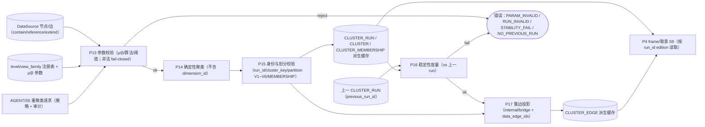

| 流/存储 | 约束/机检点 |
|---|---|
| `P13` 参数校验 | µ/β 公式（**只含 `E_sem`，R-S2-1**）、阈值类型/范围/默认出处（语义-only probe，R-S2-2）、算法 id/版本、参数 fail-closed；参数不得来自用户会话 |
| `P14` 聚类 | **canonical HAC（纯自实现、无网络库依赖；R-S2-3/R-S2-9）**：标准 average-linkage dendrogram + `cut_policy`（`target_k`/`min_cluster_size`）切分；**μ/β 只作后验质量校验，不作合并门控**；tie-break/序列化/golden 2x 逐字节一致（tie-break 精确规则待 S2-v1 冻结，见 SE 校核注）；输入不含 `dimension_id`（A 不影响簇）；禁止退化为严格连通分量；`status ∈ {ok,no_semantic_edges,partial_disconnected,size_exceeded,algorithm_failed}` |
| `P15` 身份/划分 | `run_id` 粒度 = `(level, view_family)`（R-S2-4）；`cluster_key` 可复算；partition V1–V6（S0-2）；同 `(level, view_family)` 单归属、跨族/维多归属；`parent_run_id`+`parent_cluster_id` 精化关系；singleton μ=null/representative=false；root_exempt 显式；**切分后 μ/β 校验失败 ⇒ 按 cut_policy 预注册规则调整或 `algorithm_failed`，不得输出违规簇**（SE 需 v1 明写） |
| `P16` 稳定性 | Jaccard/churn/split-merge（仅同 `(level, view_family)` 可比）；首次 run `initial/null`；阈值 S8；指标可复算 |
| `P17` 簇边投影 | `internal/bridge` 分类确定性；**数据派生聚合边 `data_edge_ids` 非空**（R-3）；H 结构边按 S1 R-S1-11 允许空集；`expand_data_edges ⊆ DataSource.edges`；边界呈现归 S4 |
| `C3/C4` 缓存 | 键 = `⟨corpus_manifest_sha, level, view_family, algorithm, version, params_hash⟩`；Ready 不可变；可重建；不写产品 sidecar（D-3） |
| `P4` frame 读取 | 按 `run_id`/edition 读取（重聚类不打断当前视图）；run 缺失/损坏 ⇒ fail-closed 或回退上一 Ready run（策略可配，须审计） |
| `AG` agent/S5 | v1 **默认只读**；允许请求**候选 run**（`status=candidate`，带 `trigger/requester/reason` 审计，**不自动采用**）；不得写 membership/缓存/manifest/渲染状态（R-S2-5） |

> **SE 校核结论（task-302，对照 `S2-clustering-v1.md` sha `92bb0041…`；详见 `S2-engineering-check.md`）**：v1 修复后复跑 **`M_fail=[]`、12/12 PASS**，S2 冻结工程门禁（SE）= **是**；已核对 μ/β 端点对去重（S2-2）、HAC 精确 tie-break + 后验失败规则 + 五状态（S2-4）、VM 纯度（S2-11/S2-13）。残余非阻塞：S6a 的 run 失败回滚/跨 run H 谓词/canonical 序列化、S8 的 τ live 复标定、β=0.25 边界单测、A probe tie-break 历史注记。

---

### 2.9 S3 增量（DF-04 草案：视觉解析 + 渲染接口 + 事件回传 + 无簇 UX；待 S3 冻结）

> 渲染是**纯展示**：输入 = `ViewModel`（S1 D-4，只含 dimension_id + 节点/边视图）+ `VIEW_STATUS`（展示数据状态）+ 版本化视觉映射表 + 后端能力；输出 = 场景/事件；**渲染器不取数、不重算簇、不做语义判断、不写状态**（S0-8 不得第二数据源）。

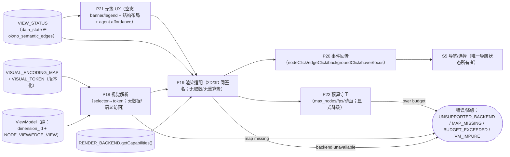

| 流/接口 | 约束/机检点 |
|---|---|
| `P18` 视觉解析 | 只读 `NODE_VIEW/EDGE_VIEW` + 映射表；label 由 VM 提供（R-S3-1/R-S3-10 确定性，渲染器不再生成/猜）；`selector` 未命中 ⇒ fallback token（不得无样式）；同一 selector 冲突 ⇒ fail-closed；**不得读 DataSource/簇/run 内部/metrics/`data_edge_ids`**（R-S3-9） |
| `P19` 渲染适配 | 2D/3D **同签名**（R-S3-4）`getCapabilities()`（`maxNodes/maxEdges/backends`）/`render(container, vm)`/`update(vm, opts)`/`dispose()`/`on(event)`；3D 固定大小=**screen-space**（R-S3-11）；后端不可用 ⇒ 显式 fallback（2D）并提示；渲染器不取数、不重算簇、不写状态、**拒绝读 `data_edge_ids`**；**不自行裁剪**（R-S3-2） |
| `P20` 事件回传 | 最小事件集 `nodeClick(node_id, kind)`/`edgeClick(edge_id)`/`backgroundClick()`；hover/focus 可选；**事件不含导航状态**；导航动作只在 S5（S3-7） |
| `P21` 无簇 UX | `VIEW_STATUS.data_state=no_semantic_edges` ⇒ 显示空态说明 + KP/结构布局（`semantic=false`、仅布局、不称簇、无徽标/展开语义）+ 用户动作触发的 agent affordance；**不得伪造语义簇**；状态转 `ok` 后回正常视图（S3-8/R-S3-5） |
| `P22` 预算守卫 | `max_nodes/max_edges`/帧率目标/动画时长/布局稳定性进 capabilities；**超预算由 S4 先裁剪（presence=suppressed+rule_id）**；Renderer 只校验已选 VM，VM 超硬上限 ⇒ `RENDER_BUDGET_EXCEEDED` fail-visible，不静默丢（R-S3-2/S3-11） |
| `P23` S4 接口 | S4 负责选择性渲染/选点/裁剪并产出 `presence/rule_id`；S3 只消费 VM；S4 不得注入结构/引用边制造语义簇（无簇态）、不得改变 kind/presence 语义（S3-8/S4 边界） |
| 数据源 | **不得引入第二数据源**（S0-8）；渲染路径无 RPC/无 facts 读写；D-3 无 sidecar |

---

### 2.10 S4 增量（DF-05 草案：取景/选点/预算/presence/一跳；待 S4 冻结）

> 取景在 **S4 唯一裁剪者**内完成：输入 DataSource（事实）+ S2 run（簇节点/成员）+ S1 维度/层次 + `FRAME_SPEC` + 预算；输出 S3 VM（presence/rule_id）；**一跳 depth=1、不闭包/不带背后图**；全展开同 `present` 且 `shown(default) ⊆ shown(full)`；渲染器只渲染已选 VM。

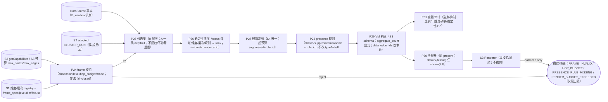

| 流/接口 | 约束/机检点 |
|---|---|
| `P24` frame 校验 | `ctx.dimension_id` 必须在 S1 registry active；level/view_family 合法；`hop_budget≤S1 hop_max`；mode∈{default,full}；非法 fail-closed；不得改事实 |
| `P25` 候选集 | H：focus + 当前层 partition/H 结构边；A：**F={focus}**，恰好一跳邻居（方向按 S1 dir），端点 kind∈{kp,cluster}；**不闭包**、不带背后图；无隐式 2 跳（R-S4-1/R-S4-2）；跨层边按 S4-5/S4-7 |
| `P26` 确定性排序 | 排序键冻结（R-S4-6）= `(tier, hop, relation_class, label_rank, canonical_id)`；relation_class=semantic<structural<navigation<reference；同输入同 rank/presence；不得随机/时间/内存序 |
| `P27` 预算裁剪 | **S4 唯一裁剪者**；`max_nodes/max_edges` 来自 S3 capabilities/S8；**先保证 MANDATORY（focus+必要上下文的最小集）**；其余超预算 `presence=suppressed`+`rule_id(budget)`；仅 MANDATORY 超预算才 `S4_BUDGET_INVALID`（R-S4-3）；不得静默丢、不得 Renderer 裁 |
| `P28` presence 规则 | 三值 + `rule_id` 枚举闭合（R-S4-5）；`unknown`（source.unavailable/endpoint.unresolved/admission.undecided/invalid.data）≠ `suppressed`（已知但不显示）；类型不同独立判定（U-27）；不改 type/label/contain_kind |
| `P29` VM 构建 | 严格 S3 VM schema + **候选节点/边逐条 presence/rule_id（R-S4-4）**；节点 presence/rule_id 按 `S3-ADDENDUM-1`（view-status，不改 S3 核心）；`aggregate_count` 取景层显式；`data_edge_ids` 仅审计（Renderer 禁读）；簇/run/dendrogram/focus/nav 不进 VM |
| `P30` 全展开 | 同 DataSource/同 present/同 Renderer；**构造保证**：full 先 reserved(default shown) 再按同一排序填剩余，`budget_full≥budget_default`，且 **candidates(full) ⊇ candidates(default)**；不满足 ⇒ `S4_BUDGET_INVALID`/显式回退 default（R-S4-9，禁止静默）；`shown(default) ⊆ shown(full)` 由构造保证（非事后断言）；全展开仍走预算/降级 |
| `P31` 度量/审计 | 每屏节点/边、抑制比例、一跳准确率、确定性、性能；G6 可复跑；审计不写产品 sidecar（D-3） |
| 数据源 | 不得第二数据源（S0-8）；presence 只改取景不改事实；无 sidecar |

---

### 2.11 S5 增量（DF-06 草案：事件→状态机→frame_spec→S4→VM；待 S5 冻结）

> 导航管线：S3 渲染器事件 + Presentation 键盘/URL + S2 run 状态 → **S5 状态机（唯一导航状态所有者）** → `frame_spec` → S4 Admission → VM → S3 Renderer；`GraphNavFrame` 只在 Presentation，不进 VM；S5 不计算 presence。

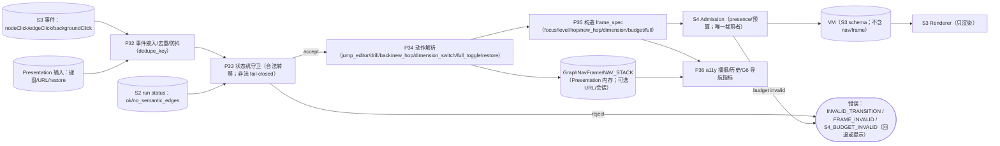

| 流/接口 | 约束/机检点 |
|---|---|
| `P32` 事件接入 | S3 事件→S5 动作映射唯一（kp→编辑器、cluster→drill）；hover 不改变导航状态；重复事件按 dedupe_key 去重/防抖 |
| `P33` 状态机守卫 | 状态/事件/转移闭包；非法转移 fail-closed（不改状态、记 reason）；未知事件拒绝；无死/不可达状态 |
| `P34` 动作 | kp→外部编辑器跳转（U-20，不改图状态）；cluster→drill（level+1、focus、hop 重置、push）；back→pop 恢复；new_hop→显式 hop=2（唯一动作、幂等、与默认隔离）；dimension_switch→hop 重置/focus 策略；full_toggle→正交；restore→checksum 校验 |
| `P35` frame_spec | 字段冻结（focus/level/hop/new_hop/dimension/budget/full）；同输入同 frame；不计算 presence；S4_BUDGET_INVALID 回退/提示 |
| `P36` a11y/历史 | 键盘等价/aria-live/历史/URL（如做）仅 Presentation；不写产品 sidecar（D-3）；G6 导航指标可复跑 |
| VM 纯度 | VM 不含 nav/focus/selection/frame；`GraphNavFrame` 不进 VM（D-4）；S5 只发 frame_spec |

---

### 2.12 S6 增量（DF-07 定稿草案：事实→view→框架→presence→VM→渲染 + run/registry/audit/GC；待 S6 冻结）

> 数据流定稿：DataSource（只读事实）→ GraphView（per level/view_family）→ Frame/Admission（S4 唯一裁剪）→ VM（S3 白名单）→ Renderer；run 构建/registry 校验/缓存/audit/GC 为旁路；失败回退按 S2/S4/S5 事务/降级语义；D-3/D-4 全链路。

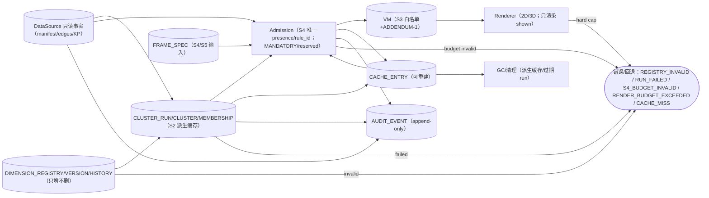

| 流/契约 | 约束 |
|---|---|
| 事实→view/run | DataSource 只读；per `(level,view_family)`；run 派生缓存、candidate 不自动 adopted；五状态 |
| registry 校验 | schema/版本/只增不删/签名；失败 fail-closed；history 可追溯 |
| frame→presence | S4 唯一裁剪；11 类 rule_id；候选全量 presence；MANDATORY/reserved；不写事实 |
| VM→Renderer | S3 白名单+ADDENDUM-1；data_edge_ids 审计/Renderer 禁读；无 nav/frame/run |
| cache/audit/GC | 缓存可重建/可删除；审计 append-only；GC 不删除事实/用户数据；D-3 |
| 失败回退 | registry/run/预算失败按 S2/S4/S5 语义；初始帧失败→Degraded；diff=0（S5） |

---

### 2.13 S7 增量（DF-08 草案：agent 查询/解释/展开/引用；待 S7 冻结）

> agent 查询走 **只读 View/Presence 层**（复用 S4 focus-only、S5 frame、S2 run）；不读 Renderer 禁读字段、不做语义重算、不做隐式多跳；结果带 `presence/rule_id` 解释、token 预算与截断标记、引用（kp/file/line/anchor、cluster_key/run_id）；调用审计。

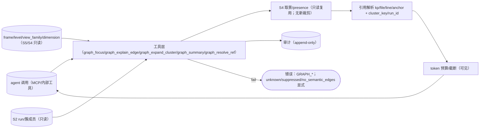

| 流/契约 | 约束 |
|---|---|
| `graph_focus` | 复用 S4：focus/一跳/presence/rule_id；不闭包、不带背后图 |
| `graph_explain_edge` | 关系解释 + `presence/rule_id`；`data_edge_ids` 仅审计，不暴露 Renderer 禁读 |
| `graph_expand_cluster` | 簇成员摘要（label/member_count/多归属）；只读 run、不重算簇 |
| `graph_resolve_ref` | kp_id/file/line/anchor + cluster_key/run_id；unknown 显式 |
| 无 `graph_path` | v1 不做隐式多跳；未来需显式 `allow_two_hop` + S5 `EXPLICIT_NEW_HOP` 另开修订 |
| 预算/降级 | token 预算/截断可见；`unknown/suppressed/no_semantic_edges` 显式，不编造 |
| 审计 | 每次调用可追溯；`.memoria/agent/audit/graph/`；只读 v1 |

---


> **G6/G7 快照命令（S8a 草案）**：`python scripts/benchmark/graph/g6_snapshot.py --out artifacts/agent/verify/graph/g6/<run_id>.json --sha256`；`python scripts/benchmark/graph/g7_snapshot.py --out .../g7/<run_id>.json`；复跑 `--replay <snapshot>` 断言 sha 一致。路径 cache/config/audit 按 S6。**CI 接入草案**：`pytest -q tests/graph` + `node --check` + mermaid `parse_mermaid.js`（24→27 图）+ G6/G7 snapshot sha + 性能守卫（60fps/≤180ms 条件化）；P0 失败阻断，flaky 重跑一次仍失败即阻断并留证。**0.5 DoD 映射**：I-01..I-13 逐项验收（DataSource→…→SchemaValidator）；I-05/I-06/I-07/I-08 为 P0 阻断，其余 P1。> **G6/G7 快照命令（S8a 草案）**：`python scripts/benchmark/graph/g6_snapshot.py --out artifacts/agent/verify/graph/g6/<run_id>.json --sha256`；`python scripts/benchmark/graph/g7_snapshot.py --out .../g7/<run_id>.json`；复跑 `--replay <snapshot>` 断言 sha 一致。路径 cache/config/audit 按 S6。**CI 接入草案**：`pytest -q tests/graph` + `node --check` + mermaid `parse_mermaid.js`（24→27 图）+ G6/G7 snapshot sha + 性能守卫（60fps/≤180ms 条件化）；P0 失败阻断，flaky 重跑一次仍失败即阻断并留证。**0.5 DoD 映射**：I-01..I-13 逐项验收（DataSource→…→SchemaValidator）；I-05/I-06/I-07/I-08 为 P0 阻断，其余 P1。
> **S8a 定稿（对照 `S8-metrics-v1.md` sha `c6a135ff…`）**：G6 唯一落盘 `.memoria/agent/audit/graph/g6/<snapshot_id>.json`，`snapshot_id=sha256(canonical(G6_SNAPSHOT without snapshot_id))`，不可变/`--replay` 复跑；G7 只存 id/anchor 引用/counts（无正文/excerpt/PII；90 天/100k/≤64MB）；CI P0 gates = G6 sha + G-G7（`write_attempts=0`/`read_only=100%`/引用完整率/无正文）+ 正确性/确定性/X-RULE/subset/closure/behind=0 + mermaid（27 图）；本地与 CI 同脚本；性能 P95 为「假设，需实测基线校准」，仅本地参考硬件门禁（N≥30、冷/热、环境）；flaky 不豁免 P0、诊断重试≤3、阈值不因 flaky 下调；DoD I-01..I-13（I-05/06/07/08 P0；I-07 只验 2D，3D capability=false）。

### 2.14 S8 增量（DF-09 草案：度量/快照/CI 管线）

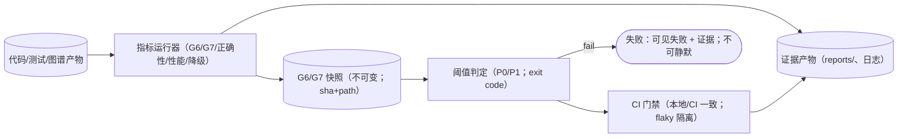

---

### 2.15 S9 增量（DF-10 草案：召回→排序→候选→S4；不写事实）

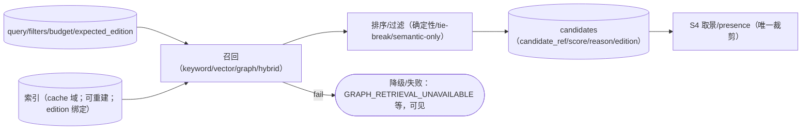

---

## 3. 状态图 v0 草案 —— 「草案-待 S5a 裁决」

### 3.1 设计立场

- **图谱导航栈与文件导航栈分离**（E-5）：`GRAPH_NAV_FRAME` 记录 `(focus, level, dimension, origin, via_edge)`；`MemoriaNavStack` 继续负责编辑器文件历史。
- **渲染事件 → 导航事件映射**（对齐 A-v2 §9 事件最小集 / B-v2 §9 并集）：渲染后端只发 `nodeClick{node_id,kind}` / `edgeClick` / `backgroundClick`（A）与 `hover` / `clusterExpand`（B）这类**交互**事件；本文 ST 表中的 `CLICK_KP` / `CLICK_CLUSTER` / `LINK_FOCUS` 是**导航服务 S5 层**的事件（由渲染事件 + 当前 ctx 派生），不是渲染器契约事件；`modeToggle/navigateBack` 归 S5/Presentation，不进渲染器（D-4）。
- **图 → 编辑器是单向**：点 KP 节点 = 现有 `jumpToTarget` 行为（U-20）；编辑器 → 图谱只允许「高亮/外部聚焦」（现有 `externalFocus`），**不得**改变图谱导航状态，以保住 U-17 的语义边界。证据：`app.js:1661-1677`；`app.js:5928-5945`；`app.js:8383-8410`。
- **返回要「从哪来回哪去」**（U-21）：进入簇时把 `origin` 写入 `GRAPH_NAV_FRAME`；多归属时回到**进入来源**，而不是「任意一个父簇」。
- **全展开是 Presentation 正交区的一个模式**，不改变 Navigation 的状态与数据源（U-26）；切换时执行**焦点保持/映射**（B-v2 §S0-8）：焦点仍可见 ⇒ 保留；被折叠 ⇒ 映射到包含它的最近 cluster/根并提示；无法映射 ⇒ 回当前 level 根 + 记录 reason。
- **跳跃方向与计法**（v1 S0-5）：H 维 `dir(D)=down`（外层→内层），A 维 `dir(D)=both`（可配置，S1 细化）；跨维度切换时跳数重置；聚合簇按 rendered-hop 计，`underlying_hop_count` 只报告不展开。ST 的 `CLICK_CLUSTER` 仅在 `cluster_expandable` 且 `dir` 允许加深时生效。
- **后端切换是 Backend 正交区**：2D/3D 切换必须无损（保留 frame/焦点/缩放语义），失败回滚（复用 `view-surface-contract.md:173-214` 的双插头纪律）。v1 S0-9 的「渲染器不写状态」解释为**不写导航/全局状态**；切换所需的视图捕获/恢复由 `Renderer.getCapabilities()` + 导航服务协调（S5a 冻结接口细节）。

### 3.2 状态图（v0）

```mermaid
stateDiagram-v2
    [*] --> Inactive
    Inactive --> Loading : OPEN_GRAPH backend_id
    Loading --> GraphView : DATA_READY
    Loading --> Degraded : DATA_FAILED
    Degraded --> Loading : RETRY
    Degraded --> Inactive : CLOSE
    GraphView --> Loading : RELOAD
    GraphView --> Inactive : CLOSE
    GraphView --> Degraded : CORPUS_CHANGED edition_mismatch

    state GraphView {
        state Navigation {
            [*] --> Overview
            Overview --> Deepened : CLICK_CLUSTER cluster_expandable / push_nav_frame
            Overview --> Overview : CLICK_KP / emit_node_click and jump_editor
            Overview --> Overview : LINK_FOCUS from_editor / set_external_focus
            Deepened --> Deepened : CLICK_CLUSTER cluster_expandable / push_nav_frame
            Deepened --> Deepened : CLICK_KP / emit_node_click and jump_editor
            Deepened --> Deepened : LINK_FOCUS from_editor / set_external_focus
            Deepened --> HopNetwork : ENTER_HOP_NETWORK hop_allowed / attach_hop_nodes
            HopNetwork --> HopNetwork : EXPAND_HOP budget_remaining / admit_next_hop
            HopNetwork --> Deepened : BACK / pop_nav_frame
            Deepened --> Deepened : BACK stack_depth_gt_1 / pop_nav_frame
            Deepened --> Overview : BACK stack_depth_eq_1 / pop_nav_frame
        }
        --
        state Presentation {
            [*] --> DefaultView
            DefaultView --> ExpandedAll : TOGGLE_EXPAND / load_full_candidate_set
            ExpandedAll --> DefaultView : TOGGLE_EXPAND / reapply_admission
        }
        --
        state Backend {
            [*] --> R2D
            R2D --> Switching : SWITCH_BACKEND
            R3D --> Switching : SWITCH_BACKEND
            Switching --> R3D : MOUNT_OK
            Switching --> R2D : MOUNT_OK_named_r2d
            Switching --> R2D : MOUNT_FAIL / rollback_backend
        }
    }
```

> 图注：`HopNetwork` 对应 U-22「进入关联网做新一跳」的候选，**状态命名与是否存在待 S5 裁决**；若 S5 决定「不做显式关联网状态」，则该状态删除，一跳仅作为 `Deepened` 内的取景参数（此时 ST 表相应行改为自转移 + 参数动作）。三块是**正交区（parallel regions）**：同一事件可被多个区独立处理（例如 `SWITCH_BACKEND` 只触发 Backend 区，`TOGGLE_EXPAND` 只触发 Presentation 区）。

### 3.3 转换表（ST 冻结时 100% 覆盖；当前 v0）

| # | From | 事件 | 守卫 | 动作 | 副作用 | To | U 依据 |
|---|---|---|---|---|---|---|---|
| ST-01 | Inactive | `OPEN_GRAPH` | `backend_registered` | 读视图设置、恢复上次 frame | 读 localStorage/disk（`graph-settings.js:127-212`） | Loading | U-26 |
| ST-02 | Loading | `DATA_READY` | `edition_sha` 匹配 | 构建首屏 frame（level=L0, dim=default） | 建 `GRAPH_NAV_FRAME#0` | GraphView.Overview | U-4/U-5 |
| ST-03 | Loading | `DATA_FAILED` | `retryable` | 显示降级提示 | 记录错误（不写事实源） | Degraded | — |
| ST-04 | GraphView | `RELOAD` | — | 重建 frame / 清空缓存引用 | 旧 frame 作废 | Loading | — |
| ST-05 | Overview | `CLICK_CLUSTER` | `cluster_expandable`（成员>0） | `push_nav_frame(origin=当前focus, via=cluster_id)`；请求子图取景 | 清 externalFocus；记审计 | Deepened | U-7/U-6 |
| ST-06 | Overview | `CLICK_KP` | `node.kind==kp ∧ node.file` | `emit_node_click` + `jump_editor(kp)` | **推文件导航栈**（`nav-stack.js:23-36`），图谱状态不变 | Overview | U-19/U-20 |
| ST-07 | Deepened | `CLICK_CLUSTER` | `depth < max_level` | `push_nav_frame`；请求下一层 | 同上 | Deepened | U-7/U-8 |
| ST-08 | Deepened | `CLICK_KP` | `node.kind==kp ∧ node.file` | `emit_node_click` + `jump_editor` | 推文件导航栈；图谱状态不变 | Deepened | U-19/U-20 |
| ST-09 | Deepened | `BACK` | `stack_depth > 1` | `pop_nav_frame()`；按 origin 恢复父聚焦 | 清 externalFocus | Deepened | U-21 |
| ST-10 | Deepened | `BACK` | `stack_depth == 1` | `pop_nav_frame()` → L0 | 清 externalFocus | Overview | U-21 |
| ST-11 | Overview/Deepened | `LINK_FOCUS` | `from_editor` | `set_external_focus(source,target)` | 只高亮已存在边（现 `app.js:8383-8410`）；**不改导航状态** | 原状态 | U-17 |
| ST-12 | Overview/Deepened | `ENTER_HOP_NETWORK` | `hop_allowed` | 取 `hop_budget=1` 挂接集；记录 underlying hops | 记审计（跳数/规则） | HopNetwork | U-15/U-18/U-22 |
| ST-13 | HopNetwork | `EXPAND_HOP` | `budget_remaining` | `hop_budget += 1`；重新 Admission | 记审计 | HopNetwork | U-11/U-22 |
| ST-14 | HopNetwork | `BACK` | — | 回到进入前的 Deepened frame | 清挂接节点 | Deepened | U-22 |
| ST-15 | DefaultView | `TOGGLE_EXPAND` | — | 关闭聚合与 Admission（保留 candidate 全集）；**执行焦点保持/映射**（B-v2 §S0-8） | 持久化开关；无法映射时记录 reason | ExpandedAll | U-26 |
| ST-16 | ExpandedAll | `TOGGLE_EXPAND` | — | 重新 Admission（回到默认视图）；**执行焦点保持/映射** | 持久化开关；无法映射时记录 reason | DefaultView | U-26 |
| ST-17 | R2D/R3D | `SWITCH_BACKEND` | `target_backend.available` | `flush 语义视图状态 → mount 新后端 → 恢复 frame/焦点` | 失败回滚旧后端并提示（`view-surface-contract.md:185-212`） | Switching | U-33 |
| ST-18 | GraphView | `CORPUS_CHANGED` | `edition_sha 不匹配` | 标记 stale、提示刷新 | 不自动重取景（避免打断用户） | Degraded | — |
| ST-19 | GraphView | `CLOSE` | — | 保存视图设置（不保存导航栈） | 清内存状态 | Inactive | U-26 |

### 3.4 状态图待裁决点

| # | 待裁决 | 推荐 | 依据 |
|---|---|---|---|
| D-ST-01 | 是否引入显式 `HopNetwork` 状态（U-22） | 先保留为可选状态；S5 决定后再冻结 | U-22；vision:39 |
| D-ST-02 | BACK 在「多归属进入」时回到 origin 还是父簇入口 | **origin**（记入 nav frame） | U-21；E-5 |
| D-ST-03 | 面包屑跳转是否清空中间栈 | 清空到目标层（新 frame 覆盖），保留可审计历史 | U-7 |
| D-ST-04 | 编辑器→图谱是否触发导航 | **否**，只 externalFocus | U-17；`app.js:8383-8410` |
| D-ST-05 | stale 时是否自动重取景 | 否（提示 + 手动刷新），避免打断 | S8 体验指标 |
| D-ST-06 | 全展开是否单独持久化 | 是（复用 `graph-settings` 持久化模式） | U-26；`graph-settings.js:127-212` |
| D-ST-07 | 会话恢复粒度（frame 深度/焦点） | v1 只恢复「上次 level=0」，深栈不恢复 | H（避免 stale 深栈） |

---

### 3.5 S1 增量（ST-02 草案：维度选择 / fail-closed / H 与 A 语义分离；待 S1 冻结）

> 维度切换属 Presentation/S5（新 `VIEW_FRAME`）；H 的下钻是**导航动作**（推进 level/focus，走 S0 状态图 Navigation 区），**不消耗 A 的 hop 预算**；S0-5 的 hop 机检只作用于 `basis=relation_neighborhood`（A）。注册表级 `active` 集合 = {H, A}（可用维度），视图级 `selected_dimension_id` 恰一个——两个断言作用对象不同。

```mermaid
stateDiagram-v2
    state Presentation {
        state ViewMode {
            [*] --> DefaultView
            DefaultView --> ExpandedAll : TOGGLE_EXPAND / load_full_candidate_set
            ExpandedAll --> DefaultView : TOGGLE_EXPAND / reapply_admission
        }
        --
        state DimensionSelection {
            [*] --> DimH
            DimH --> DimSwitching : SELECT_DIMENSION id_A
            DimA --> DimSwitching : SELECT_DIMENSION id_H
            DimH --> DimSwitching : SELECT_DIMENSION id_reserved_or_unknown
            DimA --> DimSwitching : SELECT_DIMENSION id_reserved_or_unknown
            DimSwitching --> DimA : RESOLVE_OK target_A / reset_hop_visited_focus
            DimSwitching --> DimH : RESOLVE_OK target_H / reset_hop_visited_focus
            DimSwitching --> DimensionBlocked : RESOLVE_FAIL unknown_reserved_deprecated
            DimensionBlocked --> DimH : DISMISS / record_reason_and_return_H
            DimA --> DimA : EXPAND_HOP budget_remaining / admit_next_hop
            DimA --> DimA : EXPLICIT_NEW_HOP new_hop / hop_budget = 2
            DimA --> DimA : TERMINATION_REACHED / hold_view
            DimA --> DimA : BUDGET_TRUNCATED / mark_suppressed_rule_id
            DimH --> DimH : DEEPEN_LEVEL level_depth_remaining / push_nav_frame
        }
    }
```

| 转换/状态 | 约束/机检 |
|---|---|
| `SELECT_DIMENSION(id)` | id 必须 `status=active`；reserved/deprecated/unknown ⇒ `DimensionBlocked`（`DIM_NOT_ACTIVE`/`DIM_UNKNOWN`），不静默回退 |
| `RESOLVE_OK` | 生成新 frame；`hop` 重置为**目标维度** default（H 无 hop）；focus 可表示则保持，否则映射/提示（S5） |
| `EXPAND_HOP` | 仅 A；`hop_budget ≤ hop_max=2`；预算耗尽 ⇒ suppressed+rule_id |
| `EXPLICIT_NEW_HOP` | **R-S1-10 唯一显式入口**：`new_hop=true` 才把 `hop_budget` 置 2；默认/自动路径禁止 2；S5a 冻结事件名/按钮/守卫（S1 只冻结语义；`present/frame` 断言 hop=2 ⇒ new_hop=true） |
| `DEEPEN_LEVEL` | 仅 H；一次一层，走 S0 Navigation `CLICK_CLUSTER` 语义；**不进入 hop_budget 机检** |
| `DimensionBlocked` | 必须记录 reason（未知/保留/弃用/版本不匹配）；`fallback_policy=allow_explicit` 时才可显式回 H 并审计 |
| VM/渲染器 | 维度切换事件只到 S5；Renderer 事件仍为 `nodeClick/edgeClick/backgroundClick`；VM 无维度状态 |

---

### 3.6 S2 增量（ST-03 草案：重聚类/run 生命周期/失败回滚；待 S2 冻结）

> 簇 run 是**版本化派生缓存**：Ready 后不可变；重聚类生成新 run（新 edition），旧 run 保留审计；失败回滚到上一 Ready run（可见错误/审计）；frame 使用固定 run_id，重聚类不打断当前视图（切 epoch 由 S5 决定）。

```mermaid
stateDiagram-v2
    state ClusterService {
        state RunLifecycle {
            [*] --> Building
            Building --> Candidate : RUN_VALIDATED / candidate_only
            Building --> Failed : RUN_INVALID
            Candidate --> Ready : ADOPT / human_or_S5_decides
            Candidate --> Superseded : DISCARD / candidate_not_adopted
            Ready --> Superseded : NEW_RUN_READY
        }
        --
        state ActiveClusterSet {
            [*] --> UsingRun
            UsingRun --> Reclustering : TRIGGER corpus_changed|params_changed|manual_request
            Reclustering --> UsingRun : RUN_READY new_run / switch_edition_after_audit
            Reclustering --> Rollback : RUN_INVALID
            Rollback --> UsingRun : KEEP_PREVIOUS_RUN / record_reason
        }
    }
```

| 转换/状态 | 约束/机检 |
|---|---|
| `TRIGGER` | 触发条件可机检：`corpus_manifest_sha` 变化 / 参数或算法版本变化 / 显式手动请求 / 稳定性阈值触发；触发必须审计，不得由渲染器直接发起 |
| `Building → Candidate` | 通过 `P15` 校验（partition/身份/多归属 + **后验 μ/β**）+ `P16` 稳定性后仍为**候选**（R-S2-5：agent/服务请求只能产生候选，不自动采用）；`status=candidate`；**result_status ∈ {ok,no_semantic_edges,partial_disconnected,size_exceeded,algorithm_failed}**（R-S2-13 统一枚举；`no_semantic_edges` 是合法结果，不代表失败） |
| `Candidate → Ready` | 只有人/S5 **显式 adopt** 才成为当前 run（新 edition）；adopt 必须审计；候选 run 不得静默替换当前视图 |
| `Candidate → Superseded` | 候选被丢弃：保留审计（不删除），不进入当前视图；不得用候选 run 生成默认视图或 S9 检索前提 |
| `Building → Ready` | （人工/服务直接发布路径，需决策记录）run 内容通过 P15+P16；Ready 后内容哈希固定（不可变） |
| `Building → Failed` | 校验失败/异常；保留失败原因；不得发布部分 run |
| `Reclustering` | 后台执行，不阻塞当前 frame（frame 持旧 run_id）；并发重聚类串行化（同 epoch 只允许一个 Building run） |
| `RUN_READY` | 新 run Ready 后切换当前 run（新 edition）；旧 run → `Superseded`（保留审计，不删除） |
| `RUN_INVALID` | 回滚到上一 Ready run（`KEEP_PREVIOUS_RUN`）；错误可见 + 审计；不得静默使用不一致 run |
| `NO_PREVIOUS_RUN` | 首次聚类无上一 run：允许 Ready 但稳定性判定为 `unknown`（不得伪造 pass） |
| `no_semantic_edges` run | `E_sem=∅` 时 run 仍可 Ready/adopted，但 `result_status=no_semantic_edges`、`coverage=0`、无 representative 簇（R-S2-12）；不得因此用结构边重算或伪造簇；默认视图 UX 归 S3/S4 |
| `base_run_id` | agent 候选请求必须带 `base_run_id`（R-S2-13）；候选与基线 run 并存、不覆盖；adopt 后旧 run 保留 |
| 失败回滚 | 重聚类失败/超限（`algorithm_failed`/`size_exceeded`）⇒ 保持当前 adopted run（`KEEP_PREVIOUS_RUN`），失败 run 不 adopted、错误可见+审计；不得静默替换（SE 需 v1 明写，v1 目前缺此句） |
| VM/渲染器 | 簇状态/run_id 不进 ViewModel（D-4）；frame 携带 run/edition 元数据（视图状态，非事实源） |

---

### 3.7 S3 增量（ST-04 草案：渲染器生命周期 + 展示/交互状态 + 无簇态；待 S3 冻结）

> 渲染器是**无状态展示适配器**：生命周期与后端能力显式；展示/交互状态可枚举；**导航状态只属 S5**；`no_semantic_edges` 是合法展示态（不伪造簇）。

```mermaid
stateDiagram-v2
    state Renderer {
        state Lifecycle {
            [*] --> Created
            Created --> Initialized : getCapabilities_ok
            Initialized --> Rendering : render(vm,status)
            Rendering --> Updating : update(vm,status)
            Updating --> Rendering : frame_done
            Rendering --> Suspended : hidden_or_background
            Suspended --> Rendering : resume
            Created --> Unsupported : capabilities_missing
            Unsupported --> Initialized : fallback_backend_2d
            Renderer --> Disposed : dispose
        }
        --
        state Presentation {
            [*] --> DefaultView
            DefaultView --> ExpandedAll : TOGGLE_EXPAND
            ExpandedAll --> DefaultView : TOGGLE_EXPAND
            DefaultView --> EmptyNoSemantic : VIEW_STATUS_no_semantic_edges
            EmptyNoSemantic --> DefaultView : VIEW_STATUS_ok
        }
        --
        state Interaction {
            [*] --> Idle
            Idle --> HoverNode : pointer_over_kp_or_cluster
            HoverNode --> Idle : pointer_out
            Idle --> HoverEdge : pointer_over_edge
            HoverEdge --> Idle : pointer_out
            Idle --> SelectedNode : nodeClick_emit_to_S5
            Idle --> SelectedEdge : edgeClick_emit_to_S5
            SelectedNode --> Idle : backgroundClick_or_S5_clear
            SelectedEdge --> Idle : backgroundClick_or_S5_clear
        }
    }
```

| 状态/转换 | 约束/机检 |
|---|---|
| `Created→Initialized` | `getCapabilities()` 显式返回能力（supports_3d/max_nodes/animation/reduced_motion）；2D/3D 同签名 |
| `Unsupported→Initialized` | 3D 不可用 ⇒ 显式 fallback 2D + 提示/审计；不得静默空白 |
| `Rendering/Updating` | 只接收 `(ViewModel, VIEW_STATUS)`；**不取数、不重算簇、不写状态**；VM 不纯/含簇内部 ⇒ 拒绝（VM_IMPURE） |
| `DefaultView↔ExpandedAll` | S0-8 正交展示开关；不得引入第二数据源（S0-8） |
| `DefaultView↔EmptyNoSemantic` | `VIEW_STATUS.data_state=no_semantic_edges` ⇒ 空态 banner + KP/结构布局 + agent affordance；**不得伪造语义簇**；`ok` 后回正常视图（S3-8） |
| `Interaction` | 只发最小事件（nodeClick/edgeClick/backgroundClick/hover/focus）；**导航动作/导航状态不在渲染器**（S5 唯一所有者）；事件 payload 不带 cluster_key/run_id 内部 |
| `Disposed` | 资源释放；无落盘状态（D-3）；重挂载从 VM/VIEW_STATUS 重建 |
| 预算 | `max_nodes/max_edges`/帧率/动画/reduced motion 进 capabilities；**裁剪归 S4**（R-S3-2），Renderer 超硬上限 ⇒ `RENDER_BUDGET_EXCEEDED` fail-visible；不静默丢节点/边（S3-11） |
| 角色边界 | node `role ∈ {member, focus}`（**无 bridge**，R-S3-3）；桥只作 edge `state=bridge_only`；事件按 `kind` 语义，不因 role 改变点击/导航（S3-1/S3-7） |

---

### 3.8 S4 增量（ST-05 草案：取景 frame 生命周期 + presence 决策 + 全展开/降级；待 S4 冻结）

> S4 状态只描述**取景计算**：ctx/focus/dimension/level 变化 ⇒ 新 frame；presence 三值决策确定；超预算显式 `suppressed`（非失败）；全展开同 `present`；**导航状态属 S5**，不在 S4/VM。

```mermaid
stateDiagram-v2
    state Framing {
        state FrameLifecycle {
            [*] --> FrameReady
            FrameReady --> Recomputing : CTX_CHANGED dimension|level|focus|hop_budget
            Recomputing --> FrameReady : PRESENCE_DECIDED
            FrameReady --> FullExpand : TOGGLE_FULL
            FullExpand --> FrameReady : TOGGLE_FULL
            Recomputing --> Failed : FRAME_INVALID
            FrameReady --> FrameReady : BUDGET_CHANGED / re_select
        }
        --
        state PresenceDecision {
            [*] --> Candidate
            Candidate --> Shown : SELECT_and_budget_ok
            Candidate --> Suppressed : BUDGET_TRIM / dimension_scope / level_scope
            Candidate --> Unknown : type_existence_unknown / data_unavailable
            Shown --> Suppressed : BUDGET_CHANGED_reduce
            Suppressed --> Shown : BUDGET_CHANGED_increase
        }
    }
```

| 状态/转换 | 约束/机检 |
|---|---|
| `CTX_CHANGED` | dimension 切换/drill/新一跳/full toggle/hop_budget 变化 ⇒ 新 frame；drill 后 hop_budget 重置为 S1 default；不得复用旧 presence |
| `PRESENCE_DECIDED` | 每个候选对象恰一个 `presence+rule_id`；同输入确定性；`shown` 只给通过预算+规则的；`suppressed` 带 rule_id |
| `PresenceDecision` | `unknown` 与 `suppressed` 语义不同；presence 只改取景不改 type/label/事实；决策在 S4，不在 Renderer |
| `FullExpand` | 同 present/同 Renderer；full 先 **reserved(default shown)** 再填剩余（`budget_full≥budget_default`）；`shown(default) ⊆ shown(full)` 由构造保证；全展开仍走预算/降级；不引入第二数据源 |
| `BUDGET_CHANGED` | 预算缩小 ⇒ Shown→Suppressed（rule_id budget）；预算增大 ⇒ 可恢复 Shown（无新事实）；不得 Renderer 裁剪 |
| `Failed` | frame 非法（dimension 非 active/level 非法/hop_budget 超限）⇒ fail-closed；不渲染部分结果 |
| `Renderer` 边界 | Renderer 只渲染 VM；`RENDER_BUDGET_EXCEEDED` 仅 VM 超硬上限（S4 应保证不超）；不取数/不重算簇 |
| S5 边界 | focus/selection/navigation 状态不进 VM；S5 消费 click 事件后触发新 frame |

---

### 3.9 S5 增量（ST-06 / **S5a 状态图草案**：9 主状态 + 正交变量；待 S5 冻结）

> **S5a（草案）**：主状态 9 个（`Idle/Loading/Degraded/Overview/Focused/HierarchyDrilled/RelationExpanded/RelationDeepened/Stale`）；`FullExpanded/EmptyNoSemantic` 为**正交变量**（mode/data_state），不作主状态；`(state,event)` 唯一、非法转移 fail-closed、无不可达/死状态；完整 30 组规范表/148 边由冻结稿承载并在 SE 复跑时生成校验（当前 v1 尚未附规范表，见 `S5-engineering-check.md` M-S5-2/3/4）。

```mermaid
stateDiagram-v2
    state S5 {
        state Navigation {
            [*] --> Idle
            Idle --> Loading : OPEN_GRAPH
            Loading --> Overview : DATA_READY [edition_match]
            Loading --> Degraded : DATA_FAILED
            Degraded --> Loading : RETRY
            Overview --> Focused : FOCUS_NODE
            Overview --> HierarchyDrilled : CLICK_CLUSTER [expandable]
            Focused --> HierarchyDrilled : CLICK_CLUSTER
            HierarchyDrilled --> HierarchyDrilled : CLICK_CLUSTER
            Focused --> RelationExpanded : EXPLICIT_NEW_HOP [A && hop=1]
            RelationExpanded --> RelationDeepened : EXPLICIT_NEW_HOP [hop=2]
            HierarchyDrilled --> Focused : BACK [stack_nonempty]
            RelationExpanded --> Focused : BACK
            RelationDeepened --> RelationExpanded : BACK
            Focused --> Overview : BACK
            Overview --> Stale : CORPUS_CHANGED
            Focused --> Stale : CORPUS_CHANGED
            HierarchyDrilled --> Stale : CORPUS_CHANGED
            RelationExpanded --> Stale : CORPUS_CHANGED
            RelationDeepened --> Stale : CORPUS_CHANGED
            Stale --> Loading : RELOAD / RESET
            Overview --> Overview : DATA_REFRESHED
            Focused --> Focused : DATA_REFRESHED
            HierarchyDrilled --> HierarchyDrilled : DATA_REFRESHED
            RelationExpanded --> RelationExpanded : DATA_REFRESHED
            RelationDeepened --> RelationDeepened : DATA_REFRESHED
            Focused --> Overview : CLICK_BACKGROUND
            Focused --> Overview : FOCUS_LOST
            HierarchyDrilled --> Overview : FOCUS_LOST
            RelationExpanded --> Overview : FOCUS_LOST
            RelationDeepened --> Overview : FOCUS_LOST
            Idle --> Idle : CLOSE
            Loading --> Idle : CLOSE
            Overview --> Idle : CLOSE
            Degraded --> Idle : CLOSE
        }
        --
        state Orthogonal {
            state Mode {
                [*] --> DefaultMode
                DefaultMode --> FullMode : TOGGLE_EXPAND
                FullMode --> DefaultMode : TOGGLE_EXPAND
            }
            state DataState {
                [*] --> OkData
                OkData --> EmptyData : DATA_REFRESHED_no_semantic
                EmptyData --> OkData : DATA_REFRESHED_ok
            }
        }
    }
```

| 状态/事件/守卫 | 约束 |
|---|---|
| `Idle/Loading/Degraded/Overview` | 启动/加载/失败重试/默认帧；`CLOSE` 全局回 Idle |
| `Focused/HierarchyDrilled` | 焦点/下钻；drill 事务化 push；BACK 事务化 pop 恢复 |
| `RelationExpanded/RelationDeepened` | 显式 NEW_HOP：hop=1→2、幂等、默认隔离；BACK 回退 |
| `Stale` | `CORPUS_CHANGED`/edition mismatch；`RELOAD/RESET` 回 Loading；`DATA_REFRESHED` 重算 data_state 不重取景 |
| `FOCUS_LOST` | 显示态→祖先/root（事务化）；不得静默 |
| `mode`/`data_state` | 正交变量；full 不改变导航状态；empty_nosemantic 不伪造簇、可恢复 |
| 非法转移 | `S5_ILLEGAL_TRANSITION` fail-closed（状态/栈不变、记录 reason） |

> **S5a 生成器复跑（对照 `S5-nav-v1.md` sha `7f4c4515…` 附录 A）**：table_rows=30；states=9、events=21；展开 **148 条唯一边**；`duplicate_state_event={}`、`unreachable_states=[]`、`states_without_outgoing=[]`、无禁用主状态；边集 sha `2fd19a06…`；T05 `ALL\{Idle}`（Idle CLOSE no-op 不产生边）已修并计数正确。附录 B 为投影，精确 S5a 以 `s5a_gen.py` 输出为准。

---


### 3.10 S6 增量（ST-07 定稿草案：run 生命周期/registry 版本/失败回滚 + S5a 引用；待 S6 冻结）

> run/registry/cache 状态与 S5a 导航状态机分离：S5a 见 §3.9（T01–T30 唯一真源，148 边由生成器）；本图只管**数据构建/版本/失败回滚**；缓存可重建、审计 append-only、失败不破坏当前 adopted run/frame。

```mermaid
stateDiagram-v2
    state DataContracts {
        state RunLifecycle {
            [*] --> RunBuilding
            RunBuilding --> RunCandidate : RUN_VALIDATED
            RunBuilding --> RunFailed : RUN_INVALID
            RunCandidate --> RunReady : ADOPT
            RunCandidate --> RunDiscarded : DISCARD
            RunReady --> RunSuperseded : NEW_RUN_READY
            RunFailed --> RunBuilding : RETRY
            RunSuperseded --> [*]
        }
        --
        state RegistryLifecycle {
            [*] --> RegistryLoading
            RegistryLoading --> RegistryActive : SCHEMA_VALID
            RegistryLoading --> RegistryInvalid : SCHEMA_INVALID
            RegistryActive --> RegistryStale : VERSION_STALE
            RegistryStale --> RegistryActive : RELOAD_VALID
            RegistryInvalid --> RegistryLoading : RETRY_OR_ROLLBACK
            RegistryActive --> RegistryRollback : ROLLBACK
            RegistryRollback --> RegistryActive : RESTORE_PREVIOUS
        }
        --
        state CacheLifecycle {
            [*] --> CacheMiss
            CacheMiss --> CacheBuilding : REBUILD
            CacheBuilding --> CacheReady : BUILD_OK
            CacheBuilding --> CacheFailed : BUILD_FAILED
            CacheReady --> CacheStale : EDITION_CHANGED
            CacheStale --> CacheBuilding : REBUILD
            CacheReady --> CacheEvicted : GC
            CacheEvicted --> [*]
        }
    }
```

| 状态/转移 | 约束/机检 |
|---|---|
| RunLifecycle | `Building→Candidate→Ready` 需 validation；candidate 不自动 adopted（S2）；失败保持当前 adopted run；旧 run 只读；五状态枚举 |
| RegistryLifecycle | schema/版本/只增不删校验；invalid fail-closed；stale 需 reload；rollback 只回上一有效版本；history 可追溯 |
| CacheLifecycle | 派生缓存可重建；GC 只删缓存；失败不影响事实/adopted run/frame；D-3 无产品 sidecar |
| S5a 引用 | 导航状态（Idle/Loading/.../Stale、T01–T30、148 边）见 §3.9；本图不替代 S5a；S5 事务化失败 diff=0 与 run/registry 失败隔离 |
| 失败回退 | 初始 run/registry 失败 ⇒ Degraded/提示；非初始保持原 run/frame；审计记录 |

---

### 3.11 S7 增量（ST-08 草案：agent token/预算/降级 + 写权限；待 S7 冻结）

> v1 agent **只读**：工具调用状态只描述查询/预算/降级/未知，不描述图写入；写路径仅 S10（工具 + 审计 + 人工确认）。`no_semantic_edges`、预算不足、unknown/suppressed 必须**可见降级**，不得编造。

```mermaid
stateDiagram-v2
    state AgentQuery {
        state Lifecycle {
            [*] --> Idle
            Idle --> Querying : TOOL_CALL
            Querying --> Bounded : RESULT_OK
            Querying --> Degraded : NO_SEMANTIC_EDGES / DATA_MISSING
            Querying --> Failed : GRAPH_ERROR
            Bounded --> Truncated : TOKEN_BUDGET_EXCEEDED
            Bounded --> Idle : CONSUMED
            Truncated --> Idle : CONSUMED
            Degraded --> Idle : CONSUMED
            Failed --> Idle : RETRY_OR_ABORT
        }
        --
        state ReadOnlyBoundary {
            [*] --> ReadOnly
            ReadOnly --> ReadOnly : TOOL_READ
            ReadOnly --> Denied : WRITE_ATTEMPT
            Denied --> ReadOnly : REPORT_ONLY
        }
    }
```

| 状态/转移 | 约束 |
|---|---|
| `Querying→Bounded` | 结果在 token/条目预算内；带 presence/rule_id/引用 |
| `Bounded→Truncated` | 超预算显式截断（`truncated=true`），不得静默 |
| `Degraded` | `no_semantic_edges`/数据缺失/unknown；显式说明，不编造 |
| `Failed` | `GRAPH_*` 错误；可重试/中止；审计 |
| `ReadOnly→Denied` | v1 任何写尝试拒绝（`GRAPH_READ_ONLY`）；写仅 S10 工具+审计/人工确认 |
| 审计 | 每次调用落 audit；无 sidecar/registry 写入（D-3） |

---

### 3.12 S8 增量（ST-09 草案：CI 门禁生命周期/flaky/重跑）

```mermaid
stateDiagram-v2
    state CIGate {
        state Gate {
            [*] --> Pending
            Pending --> Running : RUN
            Running --> Passed : ALL_P0_PASS
            Running --> Failed : P0_FAIL
            Running --> FlakySuspect : FLAKY_DETECTED
            FlakySuspect --> Rerun : RETRY_ONCE
            Rerun --> Passed : PASS
            Rerun --> Failed : FAIL
            Failed --> [*]
            Passed --> [*]
        }
    }
```

---

### 3.13 S9 增量（ST-10 草案：检索生命周期/预算/降级）

```mermaid
stateDiagram-v2
    state Retrieval {
        [*] --> Idle
        Idle --> Searching : QUERY
        Searching --> Bounded : RESULTS_OK
        Searching --> Degraded : INDEX_MISSING / STALE / NO_SEMANTIC
        Searching --> Unavailable : RETRIEVAL_UNAVAILABLE
        Bounded --> Truncated : BUDGET_EXCEEDED
        Bounded --> Idle : CONSUMED
        Truncated --> Idle : CONSUMED
        Degraded --> Idle : CONSUMED
        Unavailable --> Idle : RETRY_OR_ABORT
    }
```

---

## 4. 三张图最关键的 5 个设计决定（摘要给 Lead）

1. **两层身份**：`KP_CONCEPT` + `KP_OCCURRENCE` 拆开（ER）。不拆则 U-21 多归属/多锚点在数据层就无法表达（`kp_index.py:37-73` 已经是 1:N，`collector.py:57-72` 压成单值 = 丢信息）。
2. **边存在性 = 视图投影，不是事实**（DFD P5 + ER 不建 sighting 实体）：`presence ∈ {shown, suppressed, unknown}` + `rule_id`，且 `effective_type` 只在视图层。这样 U-27 的「存无/类型」才能既随上下文变化、又不写脏事实源。
3. **簇 = 版本化派生缓存（可选 curation overlay 为事实）**：`CLUSTER_RUN` 带 `algorithm_id/version/params_hash/corpus_manifest_sha`；`MEMBERSHIP` 多对多、单值 `nodeToGroup` 废弃。没有版本键 ⇒ 缓存永远无法判 stale（E-9）。
4. **单一 ViewModel → 2D/3D 双实现**（DFD P6/P7 + ER `VIEW_MODEL`/`RENDER_BACKEND`）：渲染后端不懂语义；复用 `view-surface-contract.md` 双插头 capabilities/switchTo/回滚先例。这正是 U-33 的工程落法。
5. **图谱导航栈与文件导航栈分离、图→编辑器单向**（状态图）：`GRAPH_NAV_FRAME` 记录 origin/via；KP 点击仍走 `jumpToTarget`（U-20）；编辑器→图谱只 externalFocus（U-17）。全展开是 Presentation 正交区开关，与 Navigation 解耦（U-26）。

---

## 5. 工程图纸执行计划（S5a / S6a / S9a）

### 5.1 角色与分工（按 U-35 + 议程 §5）

| 场次 | 负责人 | SE 交付 | 依赖（前置冻结） | 验收 |
|---|---|---|---|---|
| **S5 → S5a** | S5 主办 + Lead 裁决 | `S5a-statechart.md`：ST-01@v1 状态图 + 转换表全覆盖 + 边界用例 + D-ST 裁决记录 | S5 草案冻结、S0 术语冻结（S0-5/S0-6/S0-7） | 转换表每行有 U 依据；无「不可达状态」；BACK 用例含多归属 |
| **S6 → S6a** | S6 主办 + Lead | `S6a-er.md`：ER-01@v1 + 实体/关系/基数表 + ViewModel schema + D-ER 裁决 | S6 数据契约冻结、S2 簇定义（多归属/算法/版本） | 每个实体有 PK 与 SoT/缓存标签；每个字段有消费方 |
| **S9 → S9a** | S9 主办 + Lead | `S9a-dfd.md`：DF-01@v1 + 过程/存储表 + 取景接口输入输出 + D-DF 裁决 | S9 算法冻结、S4 Admission 规则冻结 | 每个存储有事实源/缓存标签；无第二 KB 根（S0-11）；agent 只读取景（S0-10） |
| **交叉一致性复核** | SE + verifier | `ENGINEERING-CONSISTENCY.md` | 三张图冻结后 | 三图交叉引用闭合（见 §5.3） |

### 5.2 执行顺序与门禁

```
S0 冻结（SE review 结论被采纳/否决）
  → S5 草案 ──→ S5a（状态图冻结）
  → S6 草案 ──→ S6a（ER 冻结）
  → S9 草案 ──→ S9a（DFD 冻结）
  → 交叉一致性复核（三图合体）→ 覆盖矩阵更新 → S8 验收（阈值取自图中不变量）
```
- 每场冻结**必须先有文字设计**，图不得领先文字（图是文字的校验视图，不是第二套设计）；
- 图变更不得晚于文字变更**同一提交/同一次决策**；跨图变更（如 ER 字段影响 DFD 存储）必须同轮处理，否则退回；
- S5a/S6a/S9a 期间**仍不写产品代码**（agenda §5 纪律 6）。

### 5.3 机检方案（冻结门禁建议）

| # | 检查 | 手段 | 现状 |
|---|---|---|---|
| G-1 | Mermaid 语法可解析 | mermaid `parse()` + jsdom DOM shim（本机已验证路径） | ✅ 已在本机跑通：本文 3 张图全部 `PARSE_OK`（er / flowchart-v2 / stateDiagram）。验证用 `mermaid@11.17.2` + `jsdom`；本仓 vendored 为 11.16.0，S5a 前需用同一 shim 对 vendored 版本复验一次（**H-4 降级为「版本复验」而非「可行性未知」**） |
| G-2 | 图内 ID ↔ 表内 ID 闭合 | Python 文本检查：抽取图内 `实体/状态/过程 ID` 与表内出现集合做双向差集 | 可实现（纯文本） |
| G-3 | 覆盖矩阵齐全 | 每个 U 编号（S0 范围）至少映射到一个图元素或明确标注「非图覆盖」 | 可实现 |
| G-4 | 三图交叉引用 | DFD 存储 ∈ ER 实体 ∪ {非持久化}；ST 消费的 ViewModel 字段 ⊆ ER/S6 schema | 可实现 |
| G-5 | 图与文字同一版本 | 图内 `@vN` + 表头 `@vN` + 决策记录 ID 一致 | 可实现 |
| G-6 | 缓存键完备 | ER 中每个「派生缓存」实体都有去重版本键（manifest/algorithm/params/edition） | 可实现 |

### 5.4 冻结、版本与回滚规则（建议写入 S5a/S6a/S9a 章程）

1. **冻结单元** = 图 + 表 + 覆盖矩阵 + 决策引用（四件同体），版本号 `vN` 写在图标题与表头；冻结后只允许「重开本场」修改，禁止后续场次私改（S0 章程 §7 同款纪律）。
2. **版本与回滚**：图是 Markdown 文本 ⇒ 冻结后回滚 = `git revert <commit>`（不涉及数据迁移）；若已产生缓存，回滚必须同时回退契约版本键（缓存自动失效），**禁止**手工删生产缓存当回滚。
3. **决策留痕**：每次冻结/回滚写 `Decision:` + `Why:`（`AGENTS.md` L10）；无法指到现行条款的「发现」只能作为建议，不得直接变成检查。
4. **机检产物**：每次冻结附 `artifacts/agent/verify/multilevel-graph/<场次>-diagram-check.json`（G-2/G-3/G-4/G-5 结果），作为冻结证据；不通过不得冻结。

---

## 6. 风险登记

| # | 风险 | 影响 | 缓解 |
|---|---|---|---|
| R-1 | S0-1「语义」判据未定 | S4/S6 无法冻结，ER 的 provenance 字段无判据 | 复用 `assertion_source + quote_sha256` 机检（`edge_derivation.py:812-859`）；链路级判定移交 GUE |
| R-2 | 把簇/存无写成事实源 | 违反单一事实源；数据漂移不可回滚 | ER 明确 SoT/缓存标签；Admission 只活在 ViewModel |
| R-3 | 图与文字设计脱节 | 后续实现各按一张图，返工 | §5.4 四件同体 + G-5 机检 + 同轮变更 |
| R-4 | 全展开走 454 路径 | 两视图看不同世界（本仓既有缺陷） | D-DF-04：同源断言；G-4 交叉检查 |
| R-5 | 多归属导致 BACK 歧义 | 用户迷失（S8 指标变差） | `GRAPH_NAV_FRAME.origin`；D-ST-02 |
| R-6 | agent 越权写视图状态 | 第二事实源 + 不可审计 | S0-10 allowlist + ER 中 agent 无写 `VIEW_MODEL/VIEW_FRAME` 路径 |
| R-7 | Mermaid 机检的版本/环境不复现 | 冻结门禁 G-1 不可执行 | 已验证「mermaid + jsdom shim」路径（本机 3 图 PARSE_OK）；S5a 前把 shim 固化为脚本并锁 mermaid 版本，否则降级为「人工渲染 + G-2..G-5」 |

---

## 7. 与 S0 校核的对接（哪些结论是本文前提）

| 前提 | 来源（S0-engineering-review） | 若被否决 |
|---|---|---|
| 三值 presence + rule_id + ctx 键 | S0-6、E-1、E-4 | ER 的 `VIEW_MODEL.presence/rule_id` 与 DFD P5 需重画 |
| KP 两层身份 | S0-2/S0-7、E-2 | ER 合并两实体，U-21 需另找承载（不可行） |
| 簇 = 派生缓存 + 多对多 | S0-4/S0-7、E-3/E-9 | `CLUSTER_RUN/MEMBERSHIP` 退化，S2 无法复算 |
| 渲染接口 = 单一 ViewModel | S0-9、E-6 | 2D/3D 各自实现语义（U-33 违背） |
| 导航双栈分离、图→编辑器单向 | S0-7、E-5 | 状态图 ST-06/ST-11 需重画，U-21 返回语义丢失 |

**本项目假设（H，需裁决）**：
- H-1：S6 采纳「EdgeCandidate + Admission 投影」两层模型；
- H-2：S2 提供版本化聚类参数；
- H-3：S5 采用独立 graph focus stack；
- H-4：vendored mermaid 11.16.0 与验证用 11.17.2 行为一致（本机已用 11.17.2 + jsdom 解析本文 3 图 PASS；冻结前需对 vendored 版本复验一次）。

---

## 8. 证据索引（本文引用，A 级）

```
vision:16-41,60-84                          U-1..U-35 与解读约束
agenda:47,92-120                            S5a/S6a/S9a 归口与交付
S0-charter:24-37                            S0-1..S0-12
kg-ontology-v0.md:23-26,34-49,61-131        agent 不读边 / link-edge / provenance / curation
kg-ontology-v0.md:162-202                   语料身份 / 缓存非事实源 / 404-vs-454 / build 写回残差
kg-edge-provenance.schema.json:20-151,202-241  边字段 / semantic 证据闸门
view-surface-contract.md:173-214            双插头（渲染后端契约先例）
kp_index.py:37-73                           KP 概念/出现位置 1:N
collector.py:46-99                          图 payload 结构（无 ctx 字段）
edge_derivation.py:630-717,787-793,812-859  dedupe/canonical id/sidecar 边/证据机检
graph-groups.js:83-134,152-164              连通分量 group / 单值归属 / 筛选
graph-layout-2d.js:219-257                  loadFromEngine（含 group 筛选）
graph-view-2d.js:518-592,634-663            nodeClick 埋点 / 全量渲染
graph-engine.js:167-216                     loadPayload
app.js:141,1111-1118,1643-1677              graphGroupId / hydrate / engine 初始化 / 节点点击跳编辑器
app.js:1767-1790,1842-1866                  suggest_group_labels / loadGraphData
app.js:5928-5945,8383-8410                  jumpToTarget+nav push / externalFocus
nav-stack.js:23-58                          文件导航栈
graph-settings.js:127-138,193-212           视图设置持久化（localStorage + disk）
src/memoria/ui/static/app/vendor/mermaid.min.js  mermaid 11.16.0（G-1 依据）
```
