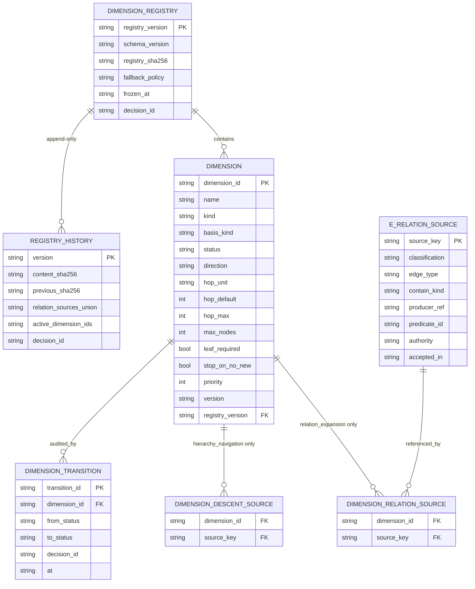
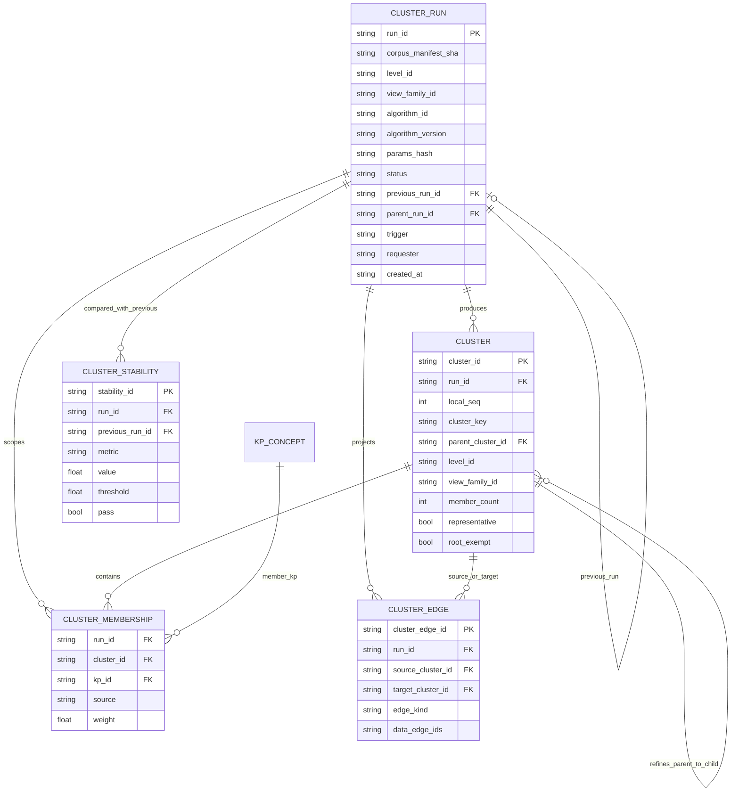
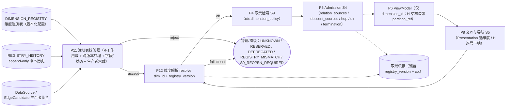
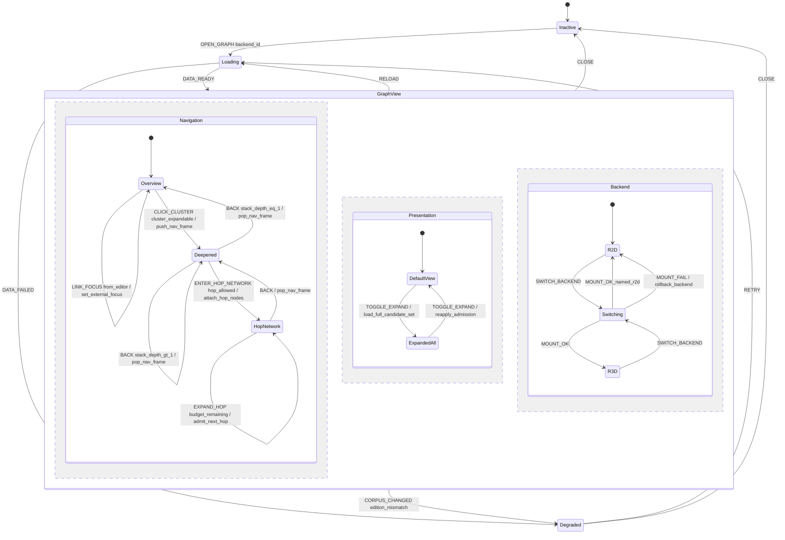
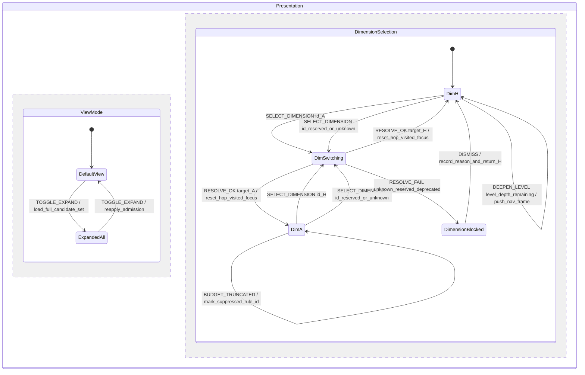
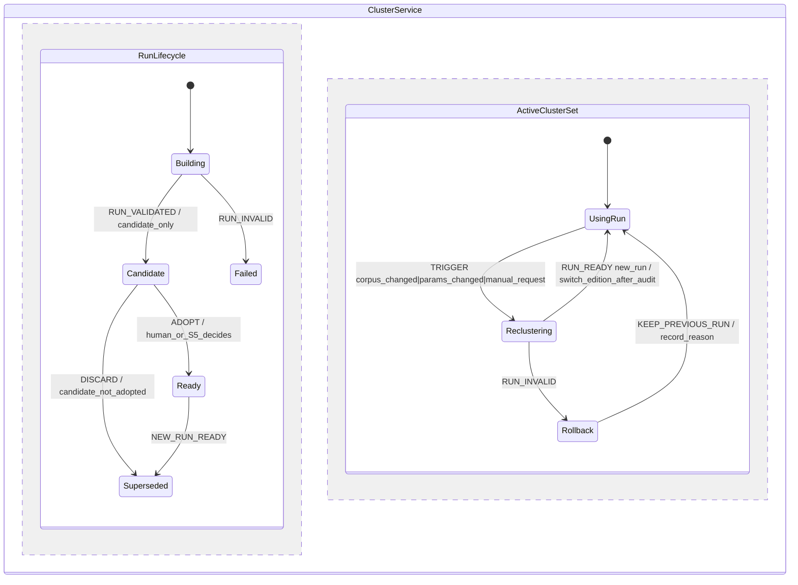

# 多层次图谱 · 工程图纸计划与 v0 草案（ER / DFD / 状态图）

> **性质**：**计划 + v0 草案**，不是冻结稿。每张图标注「草案-待 Sx 裁决」；冻结归 S5a / S6a / S9a。
> **依据（只读）**：`docs/design/multilevel-graph-vision.md`（U-1..U-35）；`multilevel-graph-seminar-agenda.md` V0.2（工程图归口 S5a/S6a/S9a，agenda:92-120）；
> `multilevel-graph/S0-charter.md`；`kg-ontology-v0.md`（v0.3）；`kg-edge-provenance.schema.json`；
> 只读实现 `src/memoria/graph/**`、`src/memoria/ui/static/app/js/graph-*.js`、`app.js`、`nav-stack.js`。
> **同批交付**：`S0-engineering-review.md`（S0-1..S0-12 可工程化校核；本文的图以那份的 E-1..E-10 为输入）。
> **作者 / 角色**：`graph-se-architect`（U-35 软件工程专家）；写域仅本文件与 `S0-engineering-review.md`。
> **日期**：2026-11-02（Asia/Shanghai）。**未写产品代码、未改契约、未 commit。**

---

## 0. 一页结论（图纸总览）

| 图纸 | 编号前缀 | 服务场次 | 冻结条件 | 当前状态 |
|---|---|---|---|---|
| ER 图（实体/关系/基数/主键/生命周期） | `ER-` | S6 → S6a | S6 数据契约文字冻结 + 本图实体与字段一致 + M-x 机检通过 | v0 草案 |
| DFD（数据流/存储/外部实体，含事实源 vs 缓存） | `DF-` | S9 → S9a（含 S6 存储段） | S9 检索/取景算法冻结 + 每个存储有 SoT/缓存标签 | v0 草案 |
| 状态图（导航状态机：状态/事件/守卫/动作/副作用） | `ST-` | S5 → S5a | S5 导航文字冻结 + 转换表 100% 覆盖 + 边界用例 | v0 草案 |

**编号与文件规则（建议 S5a/S6a/S9a 沿用）**：
- 每张图在冻结稿里有唯一 ID（如 `ER-01@v1`），**图、字段表、覆盖矩阵、决策引用四件同体**；缺一不得冻结。
- 图源 = Markdown 内嵌 Mermaid 块（mermaid 11.16.0，本仓 `src/memoria/ui/static/app/vendor/mermaid.min.js` 同版本）。图是文本 ⇒ 可评审、可 diff、可 git revert。
- 交叉引用：`DF-xx` 的存储必须是 `ER-xx` 的实体（或显式标「非持久化」）；`ST-xx` 的状态必须消费 `DF-xx` 的 ViewModel；三者由同一 `edition`/版本键对齐。

**本计划的三条硬原则**：
1. **语义不进渲染后端**（U-33）：2D/3D 只消费 ViewModel，不懂簇/跳/存无；
2. **新概念不得成为第二事实源**（`AGENTS.md` §1）：簇/层次/存无是派生投影或视图状态，事实源仍是正文 + sidecar；
3. **图与文字同步冻结、版本键驱动缓存失效**：任何图变更 ⇒ 契约版本 +1 ⇒ 相关缓存键失效；回滚 = git revert 文档 + 版本键回退（无数据迁移）。

---

## 1. ER 图 v0 草案 —— 「草案-待 S6a 裁决」

### 1.1 设计立场（先写清楚，避免 ER 被误读）

- **两层身份**（解决 E-2）：`KP_CONCEPT`（概念，id = kp_id，KB 内唯一）≠ `KP_OCCURRENCE`（出现位置：file + start_line/end_line）。
  现有实现把二者压成同一节点（`kp_index.py:37-73` 一对多；`collector.py:57-72` 只保留 preferred、`file` 单值）⇒ 多锚点/多文件 KP 会丢信息，U-21 多归属首当其冲。
- **事实 / 派生 / 视图 三分**：
  - 事实源：`DOCUMENT`、`KP_CONCEPT`、`KP_OCCURRENCE`、`EDGE_CANDIDATE`、`EDGE_PROVENANCE`（sidecar / 正文锚点）；curation overlay 也是事实（带审计）。
  - 派生缓存：`CLUSTER_RUN` / `CLUSTER` / `MEMBERSHIP`（可复算，键 = corpus manifest + algorithm + version + params）、`VIEW_MODEL`（键 = frame + edition）。
  - 视图状态（不持久化为事实）：`VIEW_FRAME`、`GRAPH_NAV_FRAME`、`RENDER_BACKEND`（注册表本身是配置，不是数据事实）。
- **边存在性不落 ER 实体**：`EDGE_CANDIDATE` 是「语义边候选」；「这条边这次渲染不渲染」属于 `VIEW_MODEL` 的字段（presence/rule_id），**不得**变成 sidecar 字段（S0-6 结论）。

### 1.2 ER 图（v0）


> 图注：Mermaid ER 的 `VIEW_MODEL` 属性行只列代表字段——`VIEW_MODEL` 在逻辑上是「一次取景的产物集合」，规范形态见 §1.4 的 `ViewModel` schema（S6a 冻结）；ER 图只表达它与 `VIEW_FRAME`/`RENDER_BACKEND` 的关系。

### 1.3 实体表（主键 / 基数 / 生命周期 / 事实源归属）

| 实体 | 主键 | 生命周期 | 归属 | 现存对应 / 差异 |
|---|---|---|---|---|
| `KB` | kb_path（DataSource 身份 = kb_path + corpus_manifest_sha + collect_version） | 打开/关闭 KB | 事实（外部） | 现 `state.kbPath`（`app.js:1843`）；身份三元组对齐 A-v2 §8 |
| `DOCUMENT` | file（KB 相对路径） | 文件创建/删除/改名 | 事实 | `collect_md_files`；`content_sha` 为 `manifest_sha` 的组成（`kg-ontology-v0.md:162-177`） |
| `KP_CONCEPT` | kp_id | 创建/合并/改名/删除 | 事实 | `kp_index.py:18-73` 的 `by_id` 键；改名 = 全库重命名（`document.py:2090-2100`） |
| `KP_OCCURRENCE` | occurrence_id（派生：file + kp_id + range） | 随正文/range 变化重建 | 事实（锚点） | 现 `KpIndexEntry` 多值被压成单节点（`collector.py:57-72`）——**新增层** |
| `CLUSTER_RUN` | run_id（稳定编码 = corpus_manifest + level + view_family + algorithm + version + params） | 每次聚类生成，旧 run 保留审计 | 派生缓存 | 无（现 group 现场算，无版本） |
| `CLUSTER` | cluster_id（run-scoped 实例 id = run_id + local_seq） | 随 run 生成；旧 run 保留审计 | 派生缓存 | `graph-groups.js:83-134` 的 `groups[]`（无版本/无 level）；`cluster_key` = sha256(sorted(member_canonical_ids)+algorithm_id+version+params_hash)（S0-RULINGS D-2） |
| `MEMBERSHIP` | (kp_id, cluster_id) 复合（**不唯一约束到单值**） | 随 run 重建 | 派生缓存（**不写产品 sidecar**，S0-RULINGS D-3） | 现 `nodeToGroup` 单值（`graph-groups.js:123-126`）——**必须废弃**；`view_family_id` 承载 partition 作用域 (level, 视图族)（D-1/A-v2 §7）；**同 `(level, view_family)` 内唯一性由校验器保证（v1 S0-7），不是 DB 唯一键** |
| `EDGE_CANDIDATE` | edge_id = `type|source_id|target_id`（沿用 `canonical_edge_id`，`edge_derivation.py:787-793`） | sidecar/正文变化时重建；保留 provenance | 事实 | `collector.py` 输出 `edges[]`（无 ctx）；type 三枚举 `{contain,reference,extend}` ⊇ R-1 最小集的边类型维度 |
| `EDGE_PROVENANCE` | provenance_id | 随 edge 生命周期；`valid_from/to` 只存不用 | 事实（审计） | `kg-edge-provenance.schema.json` 字段；`curated_by/at` |
| `LEVEL` | level_id | 配置/冻结后稳定 | 视图坐标（配置） | 无 —— S1 定层级语义 |
| `VIEW_FAMILY` | family_id | 配置（S1/S2 冻结定义） | 视图坐标（配置，partition 作用域） | **S0-terms-v1 R-2 已定名**：`view_family = ⟨family_id, basis, dimension_id, level_chain⟩`；partition 断言对象 = `(level, view_family)` |
| `DIMENSION` | dimension_id | 注册表项；`status` 取值按 S0-terms-v1/S1 统一（v1 未写全枚举，建议取 A-v2 超集） | 配置（含开放槽位） | 无 —— S1；`graphStyle` 明确**不是**维度 |
| `VIEW_FRAME` | frame_id | 每次取景一个，可被历史栈引用 | 视图状态（可持久化会话） | 无（现仅有 `graphGroupId`，`app.js:141`）；含 `view_family_id`（R-2）与 `mode`（Presentation 参数，v1 S0-6 ctx 含 mode）；`mode` 不写入 ViewModel（D-4） |
| `VIEW_MODEL` | vm_id | 每次渲染产物；按 frame+edition 缓存 | 派生缓存 | 现 `loadPayload` 载荷（`graph-engine.js:167-216`）；**不含导航/模式/capabilities**（D-4/S0-terms-v1 S0-9）；聚合边带 `data_edge_ids`（R-3） |
| `GRAPH_NAV_FRAME` | nav_id | 下钻/返回生命周期 | 视图状态（内存） | 现 `MemoriaNavStack` 是文件栈，非图谱栈（`nav-stack.js:23-36`） |
| `RENDER_BACKEND` | backend_id | 注册/切换 | 配置 + 运行时状态 | 现 2D/3D 各自持 engine（`app.js:1643-1660`） |
| `AUDIT_EVENT` | event_id | append-only | 事实（审计） | 新；现有交互计数仅内存（`app.js:26-101`） |
| `GRAPH_AUDIT_REPORT` | report_id | 每次审计生成 | 派生 | `graph_audit`（`document.py:2124-2132`） |

### 1.4 `ViewModel` 最小字段（ER 的投影形态，S6a 冻结）

> 纯度约束（S0-terms-v1 S0-9 / D-4）：ViewModel **不含导航状态、模式开关、capabilities**（`mode`/`breadcrumb`/`navigateBack` 归 `VIEW_FRAME`/`GRAPH_NAV_FRAME`/状态机；`capabilities` 由 `Renderer.getCapabilities()` 提供，不进 VM）。
> 字段并集来源：A-v2 §9（kind/role/state/presence/rule_id）+ B-v2 §9（role/事件/data_edge_ids/`Renderer.getCapabilities()`）。**presence 值域统一为 `shown|suppressed|unknown`**（S0-RULINGS S0-6；本文早期 v0 曾用 `present`，已改）。

```jsonc
{
  "view_model_id": "vm-...",
  "level_id": "L0",
  "dimension_id": "level",
  "view_family_id": "fam-whole-kb",
  "nodes": [{ "node_id": "...", "kind": "kp|cluster", "role": "member|one_hop|bridge|focus",
              "label": "...", "expandable": true,
              "metrics": { "member_count": 12, "degree": 4 }, "badges": ["+11"] }],
  "edges": [{ "edge_id": "...", "source": "...", "target": "...",
              "type": "extend", "contain_kind": null,
              "label": "semantic|structural|navigation",
              "display_type": "extend",
              "presence": "shown|suppressed|unknown",
              "rule_id": "admit.within_level", "state": null,
              "hop": 0, "underlying_hop_count": 0,
              "data_edge_ids": ["type|source_id|target_id"] }]
}
```

> 兼容性说明：本文早期 v0 用 `omitted[]` 单独列缺席边；为对齐 A-v2/B-v2，**缺席信息由每条边的 `presence/rule_id` 承载**（`omitted` 若保留只能是由 `presence!=shown` 导出的便捷视图，不得成为第二真相）。`frame_id`/`edition_sha`/`mode` 等取景元数据保留在 `VIEW_FRAME`，不塞进 ViewModel（D-4）。
> **R-3（S0-terms-v1 冻结）**：聚合/折叠边必须携带 `data_edge_ids`（映射回 DataSource 原始边 id）；机检 `expand_data_edges(VM) ⊆ DataSource.edges`，且 `shown(default) ⊆ shown(full)`。`data_edge_ids` 只存在于视图层，不写回事实源。

### 1.5 ER 待裁决点（S6a 前必须逐项裁决）

| # | 待裁决 | 候选 | 推荐（工程视角） | 依据 |
|---|---|---|---|---|
| D-ER-01 | KP 概念/出现位置是否拆两层 | 拆 / 不拆 | **拆**；不拆则 U-21 无法表达，且跳转目标（editor）永远只有一个 occurrence | E-2；`kp_index.py:37-73`；`collector.py:57-72` |
| D-ER-02 | 簇是分区（partition）还是覆盖（cover） | 分区 / 覆盖 | **覆盖**（支持多归属 U-21/U-31）；partition 仅在 (level, 视图族) 内成立（S0-RULINGS D-1） | `graph-groups.js:123-126`（现状分区） |
| D-ER-03 | 簇结果：事实 / 派生缓存 / 带审计 overlay | 三选一 | **派生缓存**；S0 禁止写产品 sidecar（S0-RULINGS D-3），簇 curation 待 S6 | `AGENTS.md` §1；`kg-ontology-v0.md:162-177` |
| D-ER-04 | `LEVEL` 是持久实体还是配置 | 实体 / 配置 | 配置（版本化）+ `CLUSTER_RUN` 引用；避免 level 成为第二事实源 | S0-2/H-1 |
| D-ER-05 | `EDGE_PROVENANCE` 是否独立实体 | 独立 / 内联 | 独立（审计与「只存不用」字段扩展频繁） | schema 已有 11 键 |
| D-ER-06 | `VIEW_MODEL` 是否持久化 | 持久缓存 / 纯内存 | 持久缓存（键 frame+edition），但**不得**被当作事实回写 | S0-6 |
| D-ER-07 | 审计事件表是否本板块新增 | 新增 / 复用 graph_audit | 新增 append-only，**与 graph_audit 分表**（口径不同） | `app.js:26-101` 仅内存计数 |

---

### 1.6 与 S0 提案 A/B 的形式化差异与 Lead 裁决（`S0-RULINGS.md`，已定）

> 差异原始清单见 `S0-engineering-review.md` §9；Lead 已在 `S0-RULINGS.md` §1/§2 裁决。**本文图按裁决形态维护**；若 S6a 冻结时裁决被推翻，按对应行回退。

| 差异 | Lead 裁决（S0-RULINGS） | 本文图已落实为 | 若未来推翻 |
|---|---|---|---|
| D-1 层次「每层划分」 vs 「粒度轴」 | **partition 只约束同一 (level, 视图族)**；跨层次嵌套、跨维度/视图族允许重叠（§2 D-1） | `MEMBERSHIP` 多对多、不写全局唯一约束；`scope_family` 字段承载作用域 | 若改全局每层划分：加 (level,kp) 唯一约束 + 新增 `LEVEL_PARTITION` 实体（ER-01@v2） |
| D-2 `cluster_id` 身份 | **run-scoped 实例 id + `cluster_key`**；curation/审计引用必须同时记 run 与 key（§2 D-2） | `CLUSTER.run_id` + `CLUSTER.cluster_key`；`CLUSTER_RUN` 保存算法/版本/参数/语料键 | 不采纳内容哈希主键（D-2 已否） |
| D-3 membership 持久化 | **S0 不允许**把簇/成员关系写入产品 sidecar 或新增产品段；semantic 边 curation overlay 仍走 v0.3；簇 curation 等 S6（§2 D-3） | `MEMBERSHIP.source` 只留 `derived_cluster`；DFD 簇存储标「派生缓存，不写产品 sidecar」 | 若 S6 允许 curation：恢复 `curated_overlay` + 审计字段（需 S6 契约） |
| D-4 ViewModel 纯度 | ViewModel **不含**导航状态与模式开关；导航归 S5，全展开是 Presentation 参数（§2 D-4） | `VIEW_MODEL` 只作渲染输入；导航/模式在 `VIEW_FRAME`/`GRAPH_NAV_FRAME`/状态图 Presentation 区 | 无（与 U-33 不冲突） |
| D-5 维度组合 | **v1 同一视图只激活一个维度**；组合留开放槽位（§2 D-5） | `VIEW_FRAME.dimension_id` 单值；字段表注明组合时扩展为有序列表 | S1 若开组合：`dimension_id` → `dimension_list + order`（S6a） |

---

### 1.7 与 S0 冻结候选（A-v2/B-v2）的一致性卡点（SE 机检产出，详见 `S0-freeze-check.md`）

> 下列为 A-v2 与 B-v2 口径不一致之处；**`S0-terms-v1.md` 已对 C-1/C-6 等作出裁决**，其余留给 S1/S2/S6a。本表用于交叉核对，不代裁。

| # | 卡点 | A-v2 | B-v2 | v1 处置 / 工程影响 |
|---|---|---|---|---|
| C-1 | `view_family` 定义 | `⟨family_id, basis, level_chain⟩`（A-v2 §2:100-108） | 「同一 (level, dimension) 下的视图族」（B-v2 §S0-2:91） | **v1 R-2 已裁**：`view_family = ⟨family_id, basis, dimension_id, level_chain⟩`，partition 断言对象 = `(level, view_family)`（ER 已按此建模） |
| C-2 | 渲染事件集 | `nodeClick/edgeClick/backgroundClick`（A-v2 §9:420-424） | `nodeClick/edgeClick/hover/clusterExpand`（B-v2 §S0-9:304-308） | **v1 S0-9 已裁**：最小集 `nodeClick/edgeClick/backgroundClick`；`hover/clusterExpand` 可选（S3/S5 定），导航/模式事件不进渲染契约 |
| C-3 | bridge 表示 | node `role=bridge`（A-v2 §9:410,434） | node `state=bridge` + role {member,one_hop,focus}（B-v2 §S0-9:295-296） | v1 S0-9 写「桥只能 role/state」；**S6a 需二选一**（建议 node `role=bridge` + edge `state=bridge_only`） |
| C-4 | partition 机检覆盖断言 | 伪代码 V5 用 `set(K)`（A-v2 §2:129），边界允许 basis⊂K（:149） | `check_level_partition` 同样用 `K`（B-v2 §S0-2:123-124） | **v1 S0-2 V5 已改为「并集=该层全集」**（不再写死 K）；S2/S6a 施工时参数化为 K_f |
| C-5 | `DIMENSION.status` 枚举 | `{reserved, specified, frozen, deprecated}`（A-v2 §3:166） | `{active, reserved}`（B-v2 §S0-3:146） | v1 未写全枚举 → **S1 必须补**（建议 A 超集 + B 的 active 映射），否则注册表校验不唯一 |
| C-6 | capabilities 归属 | `capabilities` 在 ViewModel（A-v2 §9:414） | `renderer_capabilities` / `Renderer.getCapabilities()`（B-v2 §S0-9:299） | **v1 S0-9 已裁**：capabilities 由 `Renderer.getCapabilities()` 提供，**不进 ViewModel**（已从 §1.4 移除） |

---

### 1.8 S1 增量（ER-02 草案；待 S1 冻结，不覆盖 S0 实体）

> 依据：`S1-RULINGS.md` R-S1-1..R-S1-8、`S1-charter.md` §4、S0 D-3/D-4/R-1/R-3。注册表是**版本化配置**（非事实源）；H 不参与关系扩展（`relation_sources=[]`、无 hop）；A 的 `relation_sources ⊇ E_relation_min`。



| 增量 | 落点 | 关键约束/机检点 |
|---|---|---|
| `DIMENSION` 扩展 | `kind ∈ {hierarchy_navigation, relation_expansion}`、`hop_unit ∈ {edge, n/a}`、`hop_default/hop_max`（H 必须 NULL）、`max_nodes` 字段存在 | H：`relation_sources=[]`、`hop_unit=n/a`、hop 全 NULL、direction=down；A：`hop_unit=edge`、`1 ≤ hop_default ≤ hop_max ≤ 2`、direction∈{both,out,in} |
| `DIMENSION_RELATION_SOURCE` | 仅 A（`relation_expansion`）的源集合 | 断言 ⊇ `E_relation_min`；R-1 只约束 A（H 为空） |
| `DIMENSION_DESCENT_SOURCE` | 仅 H 的下降源 | H 固定 `{contain(structural)}`；只作层次派生边来源，不挂接邻居 |
| `REGISTRY_HISTORY` | append-only（`version/content_sha256/previous_sha256/relation_sources_union/decisions`） | 跨版本 `union(new) ⊇ union(old)`；删除/改名 ⇒ `S0_REOPEN_REQUIRED` |
| `E_RELATION_SOURCE.classification` | `edge_type/projection/derived` | `derived` 不得进 v1 active；新源须有 `producer_ref`（DataSource 可生产） |
| `DIMENSION_REGISTRY.fallback_policy` | `allow_explicit/forbidden` | 显式 fallback 才可回默认 H，须审计 `fallback_reason`；`forbidden` ⇒ fail-closed |
| `DIMENSION_TRANSITION` | 状态机审计（reserved→active→deprecated） | deprecated→active 必须 S1 重开 + 版本升级；插件不得写注册表 |
| H 派生边（VM 层） | `derived_from=partition_refinement` + `partition_ref` + `data_edge_ids`（R-S1-11 冻结：`edge_id=sha256(canonical(parent_id, child_id, level, view_family))`；`data_edge_ids(e_H) = { e ∈ DataSource.edges \| e.type=contain ∧ e.contain_kind=structural ∧ e.source∈members(parent) ∧ e.target∈members(child) }`；去重/排序/可枚举；**允许空集**——字段必须存在、空集合法、不得伪造 id） | R-3 机检：`expand_data_edges(VM) ⊆ DataSource.edges`（空集合法）；空集不得被当成缺失 |
| `expand_data_edges(VM)` 签名 | `frozenset[EdgeId]`：对 VM 中 `derived_from=data_edge`（聚合/折叠）边与 H 结构边取 `data_edge_ids` 并集；前置条件 = VM 与 DataSource 同一 edition/registry_version | `expand_data_edges(VM) ⊆ DataSource.edges`；**空集合法（R-S1-11 冻结）**；不得回读事实层 |

> **ER-02 备注**：R-S1-11 已冻结 H 结构边的映射谓词与「允许空集」（不再待裁）；history 存放位置与 `registry_sha` 计算域/`history_ref` 类型由 S6a 定（O-S1-2，非阻塞）。

---

### 1.9 S2 增量（ER-03 草案：簇/成员/运行/稳定性；待 S2 冻结，不覆盖 S0/S1）

> 依据：`S2-charter.md` S2-1..S2-13、S0-4/S0-7/D-2/D-3、S1 R-2；簇是**派生缓存**（不写产品 sidecar）；身份 = run-scoped id + `cluster_key`；同 `(level, view_family)` 单归属、跨族/维多归属。



| 增量 | 落点 | 关键约束/机检点 |
|---|---|---|
| `CLUSTER_RUN.run_id` | **粒度 = `(level, view_family)`（R-S2-4）**；稳定编码 `sha256(canonical(corpus_manifest_sha, view_family_id, level_id, algorithm_id, algorithm_version, params_hash))` | 同输入同 run_id；Ready 后内容不可变；新 run 不改旧 run；父子层用 `parent_run_id` 关联（跨层 refinement 校验） |
| `CLUSTER_RUN.status` | `{building, candidate, ready, superseded, failed}`（R-S2-5：agent 可请求候选 run，**不自动采用**） | `candidate` 必须带 `trigger/requester/reason` 审计；只有人/S5 可 adopt 为 ready/current；不得静默替换 |
| `CLUSTER.cluster_id` | `(run_id, local_seq)`（run-scoped，D-2） | `local_seq` 按成员最小 canonical id 排序、run 内唯一；不得用内容哈希当实例 id |
| `CLUSTER.cluster_key` | `sha256(canonical(sorted(member_canonical_ids)) + algorithm_id + version + params_hash)`（S0-4/D-2） | 可复算/去重；curation/审计必须同时记 run_id + cluster_key |
| `CLUSTER_MEMBERSHIP` | `(run_id, cluster_id, kp_id)`；同 `(level, view_family)` 内 kp 唯一，跨族/维可重叠；`source=derived_cluster`（v1 无 curation） | 复合唯一约束由校验器保证；**role 不复用 S1 node role=bridge**（R-S2-7，桥只作边 state）；不写产品 sidecar（D-3） |
| `CLUSTER.parent_cluster_id` / `CLUSTER_RUN.parent_run_id` | Π_{ℓ+1}→Π_ℓ 精化关系（跨 run 用 parent_run_id） | 子簇成员 ⊆ 父簇成员；跨 view_family 不得成父；H 派生边由该关系 + R-S1-11 谓词生成 |
| `CLUSTER.representative` / `root_exempt` | singleton 不作代表节点（`representative=false`，μ=null）；L0 全库单块显式 `root_exempt=true`（R-S2-6） | singleton μ=null 不参与 τ 判定；root_exempt 不是普通簇，不参与普通簇统计 |
| `CLUSTER_EDGE` | 内部边/桥边聚合：`edge_kind ∈ {internal, bridge}`；`data_edge_ids` 映射回 DataSource（R-3） | 数据派生聚合边 `data_edge_ids` 必须非空；H 结构边按 S1 R-S1-11 允许空集（两者用 `derived_from` 区分）；桥判定确定性；边界呈现归 S4 |
| `CLUSTER_STABILITY` | 新 run 与上一 run 的 Jaccard/churn/split-merge（仅同 `(level, view_family)` 可比） | 度量确定性；首次 run 记 `initial/null`；阈值 S8；失败/回滚见 ST-03 |
| µ/β 参数 | 语义-only（R-S2-1）：`μ/β` 输入边集 == `E_sem`（label=semantic）；reference/structural/非 semantic extend **不进入** μ/β | 权重策略与 τ 进 `params_hash`；τ 默认值须由语义-only probe 标定（R-S2-2）；非法参数 fail-closed |
| 持久化 | 全部为**派生缓存**（`.memoria/build` 类），可重建；审计/决策记录非 sidecar | D-3：禁止写产品 sidecar/新段；S6 需求见 DF-03 |

> **ER-03 待裁决**：① `CLUSTER_MEMBERSHIP` 的「同族单归属」用 DB 唯一键还是校验器（推荐校验器，派生缓存可重建）；② `parent_cluster_id`/`parent_run_id` 是否需独立 `PARTITION_REFINEMENT` 关系表（推荐字段即可）；③ µ/β 参数/阈值存储位置（registry 配置 vs run 内嵌 params）——R-S2-4 已定 run 粒度；参数建议 run 内嵌 `params_hash` + params 只读文档，S6 定。

---

## 2. DFD v0 草案 —— 「草案-待 S9a 裁决（存储段与 S6a 联签）」

### 2.1 设计立场

- **一个 KB 一个根**（S0-11 不跨库）：DFD 不出现第二个 KB 根，ER 无 `kb_id` 外键；DataSource 身份 = `⟨kb_path, corpus_manifest_sha, collect_version⟩`（对齐 A-v2 §8）。
- **R-1（S0-terms-v1 冻结）**：`E_relation_min = {contain(structural), contain(semantic), reference, extend}`；维度取景/挂接边源 ⊇ 该最小集，S1 只能加不能删（删除须重开 S0）。`semantic/structural` 只是标签，不是 `E_relation` 过滤条件。
- **事实源 vs 缓存**：正文 `.md` 与 sidecar 是事实源；`.memoria/build/**`、cluster/embedding 是**可再生缓存**（`kg-ontology-v0.md:162-177`）；视图状态（frame/nav/设置）与视图配置注册表（level/dimension/view_family）**不是事实源**，不得被 agent 写。
- **取景在服务端**（U-32）：`P4 取景检索` + `P5 Admission` 属于后端；渲染后端只消费 ViewModel。
- **agent 只读取景**（S0-10）：`P9` 只有读箭头回到 agent，写路径归 `P2/curation`（另一条独立写流，见 `kg-ontology-v0.md:126`）。

### 2.2 DFD 图（v0，Context + Level-1）


> 图注：实线 = 事实/主数据流；虚线 = 缓存、视图状态或配置（非事实）。`P2` 的写路径（curation overlay）在 v1 细化时应单独画一条「agent/人 → curation 校验 → sidecar」的写流（本图只保留 `SC → P2`，避免把写权画进主链）。`F1` 注册表是 S1 的 `level/dimension/view_family` 配置（reserved 槽位只登记、不进渲染分支）。

### 2.3 外部实体表

| 外部实体 | 交互 | 边界 | 依据 |
|---|---|---|---|
| `USER` | 打开图谱、点击下钻/返回、切维度、切 2D/3D、点 KP 跳编辑器 | 只通过 UI 事件，不直连存储 | `app.js:1661-1677`（KP 点击 → `jumpToTarget`） |
| `AGENT` | 读 framing/检索结果；写 KP/语义走 curation 接口（独立写流） | **不得写视图状态/缓存** | `kg-ontology-v0.md:23-26,126`；S0-10 |
| `LABELER` | 为簇提供命名建议（现有 `suggest_group_labels`） | 只回标签，不回写成员 | `app.js:1767-1790`；`ui.py:284-288` |

### 2.4 过程表

| 过程 | 做什么 | 输入 → 输出 | 现有实现 | 冻结场次 |
|---|---|---|---|---|
| P1 | 从正文+sidecar 建 KP 索引（概念/occurrence/range） | `MD, SC → KP 集` | `kp_index.py:37-73` | S6/S10 |
| P2 | 派生 contain/link/sidecar 边 + dedupe + semantic overlay 合并 | `MD, SC, KP → EdgeCandidate[]` | `collector.py:46-99`；`edge_derivation.py:630-717,862+` | S6 |
| P3 | 聚类（算法/参数/版本/语料键；视图族/level 作用域） | `EdgeCandidate[], KP, 配置 → CLUSTER_RUN` | 现 `graph-groups.js:83-134`（前端、无版本） | S2 |
| P4 | 取景：`(level,dimension,view_family,focus,budget) → 候选节点/簇/边` | `ctx, cache, 配置 → 候选集` | 无（S9 新设计，U-32 关键） | S9 |
| P5 | Admission：逐候选判 `presence∈{shown,suppressed,unknown}` + `rule_id` + effective_type；聚合边生成 `data_edge_ids`（R-3） | `候选集, ctx → 边状态` | 无（现全量渲染，`graph-view-2d.js:634-663`） | S4 |
| P6 | ViewModel 构建（按 §1.4 schema；不含导航/模式/capabilities） | `边状态, ctx → ViewModel` | `graph-engine.js:167-216`（旧载荷） | S6/S3 |
| P7 | 渲染后端（2D/3D 同一接口） | `ViewModel → 画面` | `graph-view-2d.js` / `graph-view-3d.js` | S3/S5a |
| P8 | 交互与导航状态机（见 §3） | `事件 → 新 ctx / 导航栈 / 编辑器跳转` | `app.js:1661-1677`；`nav-stack.js` | S5 |
| P9 | agent 检索（只读取景/链路） | `ctx → 检索结果` | 无（agent 目前不读边，`kg-ontology-v0.md:23-26`） | S7/S9 |
| P10 | 审计（链路/存无决策/簇 revision/交互） | `决策事件 → 审计记录` | `graph_audit`（`document.py:2124-2132`）；内存计数 | S8/S6 |

### 2.5 数据存储表（SoT 判定是冻结前提）

| 存储 | 内容 | 事实源？ | 失效/版本键 | 依据 |
|---|---|---|---|---|
| `正文 .md` | 用户知识原文 | ✅ 是 | `corpus_manifest_sha` | `kg-ontology-v0.md:162-177` |
| `sidecar .memoria.yaml` | KP/links/edges/curation overlay | ✅ 是 | 内容 sha + `curated_at` | `sidecar.py:75-112`；`kg-ontology-v0.md:61-131` |
| 图 payload 缓存 `.memoria/build` | collect_graph_data 产物 | ❌ 缓存 | `manifest_sha + collector_version` | `kg-ontology-v0.md:162-177`（严禁当事实源） |
| Cluster revision 缓存 | 簇/成员 | ❌ 派生缓存（**不写产品 sidecar**；S0-RULINGS D-3，簇 curation 待 S6） | `corpus_manifest_sha + level_id + view_family_id + algorithm_id + version + params_hash` + `cluster_run_id` | S0-4；E-9；S0-RULINGS §2 |
| Embedding 索引 | S9 近似检索 | ❌ 缓存 | `manifest_sha + embed_model + version` | H（S9 待定） |
| 视图配置注册表 | `level / dimension / view_family`（含 reserved 槽位） | ❌ 配置（非事实源；版本化） | `registry_version`（变更须 S1 章程 + 决策记录） | S0-3/S0-RULINGS D-5；A-v2 §3 |
| 视图设置 | graphStyle/节点半径/分组选择等 | ❌ 视图状态 | `-graph-*` localStorage + disk prefs | `graph-settings.js:127-138,193-212`；`app.js:141` |
| 图谱导航栈/焦点 | 下钻历史、externalFocus | ❌ 视图状态（内存） | 会话 | `nav-stack.js:23-36` |
| 交互计数 | node/edge 点击计数 | ❌ 遥测（内存） | 页面刷新清零 | `app.js:26-101`（明确不落盘/不建画像） |

### 2.6 DFD 待裁决点

| # | 待裁决 | 推荐 | 依据 |
|---|---|---|---|
| D-DF-01 | 取景/Admission 在前端还是后端 | **后端**（U-32 明确「关键在后端检索算法」；前端只渲染 ViewModel） | vision:71；agenda:115-120 |
| D-DF-02 | ViewModel 是否持久缓存 | 缓存但键含 edition（禁止回写事实） | S0-6；H-1 |
| D-DF-03 | 聚类在哪一端跑 | 后端（可复算、可被 agent 复用），前端不得自算语义簇 | E-3/E-9 |
| D-DF-04 | 全展开路径的数据源 | 与默认视图同一条 `collect_graph_data` 链路（禁止 454 路径） | `kg-ontology-v0.md:179-202` |
| D-DF-05 | 审计事件落盘位置 | append-only 审计文件（非 sidecar、非缓存） | `AGENTS.md` §1（新增事实源须登记） |

---

### 2.7 S1 增量（DF-02 草案：注册表校验器 + 维度解析 + 取景；待 S1 冻结）

> 维度参数进入 `present(e,ctx)` 的路径：`ctx.dimension_id` → `P12 resolve`（读注册表、版本校验、fail-closed）→ `P4 取景` → `P5 Admission`；**policy 对象不进 ViewModel**（VM 只带 `dimension_id`/`view_family_id`）。注册表/历史是版本化配置（非事实源），缓存键含 `registry_version`。



| 流/存储 | 约束 |
|---|---|
| `VAL` 校验器 | ① R-1 仅校验 `kind=relation_expansion`（A）⊇ `E_relation_min`；② 历史跨版本 `union(new) ⊇ union(old)`，删除/改名 ⇒ `S0_REOPEN_REQUIRED`；③ 新 source 必须有 DataSource 生产者（`producer_ref` 可跑）；④ H：`relation_sources=[]`/`hop_unit=n/a`/hop NULL；⑤ status 三态与迁移表 |
| `RES` 解析 | 未知/保留/弃用 ⇒ 错误码（fail-closed，不静默回退）；`fallback_policy=allow_explicit` 时显式 fallback + 审计 `fallback_reason`；纯函数、无会话态 |
| `FRAME/ADM` | `ctx` 含 `dimension_id`，policy 由 RES 注入；A：沿 `E_relation(A)` 的 BFS + hop_budget；H：层次派生边（不参与 hop）；截断 → `presence=suppressed/unknown + rule_id` |
| `VM` | 仅 `dimension_id`/`level_id`/`view_family_id`；无 mode/nav/capabilities/policy；H 结构边 `derived_from=partition_refinement` |
| `CACHE` | 键 = `⟨kb/corpus/collect, registry_version, ctx, view_family⟩`；registry 变更必须新键，禁止回写事实源 |
| 事实源 | 注册表/历史 = 设计产物+决策记录（非 sidecar；D-3）；`selected_dimension_id` = `VIEW_FRAME` 视图状态（非事实源） |
| P6 输出校验（R-3） | `expand_data_edges(VM)`：并集 VM 中 `derived_from=data_edge` 及 H 结构边的 `data_edge_ids`，断言 ⊆ `DataSource.edges`；H 结构边 `derived_from=partition_refinement`；**空集合法**（R-S1-11 冻结），空集不得当缺失 |
| 注册表加载 | 只读 + `registry_sha` 校验；`history_ref` 指向不可变 history（类型/计算域 S6a，O-S1-2）；损坏/版本不匹配 ⇒ fail-closed |

---

### 2.8 S2 增量（DF-03 草案：划分算法/重聚类/稳定性；待 S2 冻结）

> 聚类在**后端**确定性服务：输入 DataSource + `(level, view_family)` + 算法/参数；输出 `CLUSTER_RUN + CLUSTER + CLUSTER_MEMBERSHIP`（派生缓存）；**A 维度不参与聚类**（S2-10）；frame 按 `run_id` 读取（视图稳定）；写路径禁止产品 sidecar（D-3）。


| 流/存储 | 约束/机检点 |
|---|---|
| `P13` 参数校验 | µ/β 公式（**只含 `E_sem`，R-S2-1**）、阈值类型/范围/默认出处（语义-only probe，R-S2-2）、算法 id/版本、参数 fail-closed；参数不得来自用户会话 |
| `P14` 聚类 | **确定性 HAC（纯自实现、无网络库依赖，R-S2-3）**：冻结精确伪代码/链接准则/tie-break（min canonical id）/序列化 + golden 2x 逐字节一致；输入不含 `dimension_id`（A 不影响簇）；禁止退化为严格连通分量（反例图机检）；规模超限 ⇒ 显式 `degraded` |
| `P15` 身份/划分 | `run_id` 粒度 = `(level, view_family)`（R-S2-4）；`cluster_key` 可复算；partition V1–V6（S0-2）；同 `(level, view_family)` 单归属、跨族/维多归属；`parent_run_id`+`parent_cluster_id` 精化关系；singleton μ=null/representative=false；root_exempt 显式 |
| `P16` 稳定性 | Jaccard/churn/split-merge（仅同 `(level, view_family)` 可比）；首次 run `initial/null`；阈值 S8；指标可复算 |
| `P17` 簇边投影 | `internal/bridge` 分类确定性；**数据派生聚合边 `data_edge_ids` 非空**（R-3）；H 结构边按 S1 R-S1-11 允许空集；`expand_data_edges ⊆ DataSource.edges`；边界呈现归 S4 |
| `C3/C4` 缓存 | 键 = `⟨corpus_manifest_sha, level, view_family, algorithm, version, params_hash⟩`；Ready 不可变；可重建；不写产品 sidecar（D-3） |
| `P4` frame 读取 | 按 `run_id`/edition 读取（重聚类不打断当前视图）；run 缺失/损坏 ⇒ fail-closed 或回退上一 Ready run（策略可配，须审计） |
| `AG` agent/S5 | v1 **默认只读**；允许请求**候选 run**（`status=candidate`，带 `trigger/requester/reason` 审计，**不自动采用**）；不得写 membership/缓存/manifest/渲染状态（R-S2-5） |

> **SE 校核待统一（task-302，详见 `S2-engineering-check.md`）**：① μ/β 必须按**端点对去重**（A-v2 的 `|E_sem|` 边计数可致 μ>1）；② 无 E_sem 时 β 应 `null/无定义`（A-v2 写 0）；③ HAC 契约 A（dendrogram+target_k）与 B（μ/β 门控合并）不一致，且 A 的切分不保证输出簇满足 μ/β、B 未定义**多级划分生成规则**；④ τ 默认值证据（A 合成夹具 vs B 待 probe）与 `params_hash` 字段集需 Lead 统一；⑤ B 需补 run 失败回滚与 VM 纯度一句。

---

## 3. 状态图 v0 草案 —— 「草案-待 S5a 裁决」

### 3.1 设计立场

- **图谱导航栈与文件导航栈分离**（E-5）：`GRAPH_NAV_FRAME` 记录 `(focus, level, dimension, origin, via_edge)`；`MemoriaNavStack` 继续负责编辑器文件历史。
- **渲染事件 → 导航事件映射**（对齐 A-v2 §9 事件最小集 / B-v2 §9 并集）：渲染后端只发 `nodeClick{node_id,kind}` / `edgeClick` / `backgroundClick`（A）与 `hover` / `clusterExpand`（B）这类**交互**事件；本文 ST 表中的 `CLICK_KP` / `CLICK_CLUSTER` / `LINK_FOCUS` 是**导航服务 S5 层**的事件（由渲染事件 + 当前 ctx 派生），不是渲染器契约事件；`modeToggle/navigateBack` 归 S5/Presentation，不进渲染器（D-4）。
- **图 → 编辑器是单向**：点 KP 节点 = 现有 `jumpToTarget` 行为（U-20）；编辑器 → 图谱只允许「高亮/外部聚焦」（现有 `externalFocus`），**不得**改变图谱导航状态，以保住 U-17 的语义边界。证据：`app.js:1661-1677`；`app.js:5928-5945`；`app.js:8383-8410`。
- **返回要「从哪来回哪去」**（U-21）：进入簇时把 `origin` 写入 `GRAPH_NAV_FRAME`；多归属时回到**进入来源**，而不是「任意一个父簇」。
- **全展开是 Presentation 正交区的一个模式**，不改变 Navigation 的状态与数据源（U-26）；切换时执行**焦点保持/映射**（B-v2 §S0-8）：焦点仍可见 ⇒ 保留；被折叠 ⇒ 映射到包含它的最近 cluster/根并提示；无法映射 ⇒ 回当前 level 根 + 记录 reason。
- **跳跃方向与计法**（v1 S0-5）：H 维 `dir(D)=down`（外层→内层），A 维 `dir(D)=both`（可配置，S1 细化）；跨维度切换时跳数重置；聚合簇按 rendered-hop 计，`underlying_hop_count` 只报告不展开。ST 的 `CLICK_CLUSTER` 仅在 `cluster_expandable` 且 `dir` 允许加深时生效。
- **后端切换是 Backend 正交区**：2D/3D 切换必须无损（保留 frame/焦点/缩放语义），失败回滚（复用 `view-surface-contract.md:173-214` 的双插头纪律）。v1 S0-9 的「渲染器不写状态」解释为**不写导航/全局状态**；切换所需的视图捕获/恢复由 `Renderer.getCapabilities()` + 导航服务协调（S5a 冻结接口细节）。

### 3.2 状态图（v0）



> 图注：`HopNetwork` 对应 U-22「进入关联网做新一跳」的候选，**状态命名与是否存在待 S5 裁决**；若 S5 决定「不做显式关联网状态」，则该状态删除，一跳仅作为 `Deepened` 内的取景参数（此时 ST 表相应行改为自转移 + 参数动作）。三块是**正交区（parallel regions）**：同一事件可被多个区独立处理（例如 `SWITCH_BACKEND` 只触发 Backend 区，`TOGGLE_EXPAND` 只触发 Presentation 区）。

### 3.3 转换表（ST 冻结时 100% 覆盖；当前 v0）

| # | From | 事件 | 守卫 | 动作 | 副作用 | To | U 依据 |
|---|---|---|---|---|---|---|---|
| ST-01 | Inactive | `OPEN_GRAPH` | `backend_registered` | 读视图设置、恢复上次 frame | 读 localStorage/disk（`graph-settings.js:127-212`） | Loading | U-26 |
| ST-02 | Loading | `DATA_READY` | `edition_sha` 匹配 | 构建首屏 frame（level=L0, dim=default） | 建 `GRAPH_NAV_FRAME#0` | GraphView.Overview | U-4/U-5 |
| ST-03 | Loading | `DATA_FAILED` | `retryable` | 显示降级提示 | 记录错误（不写事实源） | Degraded | — |
| ST-04 | GraphView | `RELOAD` | — | 重建 frame / 清空缓存引用 | 旧 frame 作废 | Loading | — |
| ST-05 | Overview | `CLICK_CLUSTER` | `cluster_expandable`（成员>0） | `push_nav_frame(origin=当前focus, via=cluster_id)`；请求子图取景 | 清 externalFocus；记审计 | Deepened | U-7/U-6 |
| ST-06 | Overview | `CLICK_KP` | `node.kind==kp ∧ node.file` | `emit_node_click` + `jump_editor(kp)` | **推文件导航栈**（`nav-stack.js:23-36`），图谱状态不变 | Overview | U-19/U-20 |
| ST-07 | Deepened | `CLICK_CLUSTER` | `depth < max_level` | `push_nav_frame`；请求下一层 | 同上 | Deepened | U-7/U-8 |
| ST-08 | Deepened | `CLICK_KP` | `node.kind==kp ∧ node.file` | `emit_node_click` + `jump_editor` | 推文件导航栈；图谱状态不变 | Deepened | U-19/U-20 |
| ST-09 | Deepened | `BACK` | `stack_depth > 1` | `pop_nav_frame()`；按 origin 恢复父聚焦 | 清 externalFocus | Deepened | U-21 |
| ST-10 | Deepened | `BACK` | `stack_depth == 1` | `pop_nav_frame()` → L0 | 清 externalFocus | Overview | U-21 |
| ST-11 | Overview/Deepened | `LINK_FOCUS` | `from_editor` | `set_external_focus(source,target)` | 只高亮已存在边（现 `app.js:8383-8410`）；**不改导航状态** | 原状态 | U-17 |
| ST-12 | Overview/Deepened | `ENTER_HOP_NETWORK` | `hop_allowed` | 取 `hop_budget=1` 挂接集；记录 underlying hops | 记审计（跳数/规则） | HopNetwork | U-15/U-18/U-22 |
| ST-13 | HopNetwork | `EXPAND_HOP` | `budget_remaining` | `hop_budget += 1`；重新 Admission | 记审计 | HopNetwork | U-11/U-22 |
| ST-14 | HopNetwork | `BACK` | — | 回到进入前的 Deepened frame | 清挂接节点 | Deepened | U-22 |
| ST-15 | DefaultView | `TOGGLE_EXPAND` | — | 关闭聚合与 Admission（保留 candidate 全集）；**执行焦点保持/映射**（B-v2 §S0-8） | 持久化开关；无法映射时记录 reason | ExpandedAll | U-26 |
| ST-16 | ExpandedAll | `TOGGLE_EXPAND` | — | 重新 Admission（回到默认视图）；**执行焦点保持/映射** | 持久化开关；无法映射时记录 reason | DefaultView | U-26 |
| ST-17 | R2D/R3D | `SWITCH_BACKEND` | `target_backend.available` | `flush 语义视图状态 → mount 新后端 → 恢复 frame/焦点` | 失败回滚旧后端并提示（`view-surface-contract.md:185-212`） | Switching | U-33 |
| ST-18 | GraphView | `CORPUS_CHANGED` | `edition_sha 不匹配` | 标记 stale、提示刷新 | 不自动重取景（避免打断用户） | Degraded | — |
| ST-19 | GraphView | `CLOSE` | — | 保存视图设置（不保存导航栈） | 清内存状态 | Inactive | U-26 |

### 3.4 状态图待裁决点

| # | 待裁决 | 推荐 | 依据 |
|---|---|---|---|
| D-ST-01 | 是否引入显式 `HopNetwork` 状态（U-22） | 先保留为可选状态；S5 决定后再冻结 | U-22；vision:39 |
| D-ST-02 | BACK 在「多归属进入」时回到 origin 还是父簇入口 | **origin**（记入 nav frame） | U-21；E-5 |
| D-ST-03 | 面包屑跳转是否清空中间栈 | 清空到目标层（新 frame 覆盖），保留可审计历史 | U-7 |
| D-ST-04 | 编辑器→图谱是否触发导航 | **否**，只 externalFocus | U-17；`app.js:8383-8410` |
| D-ST-05 | stale 时是否自动重取景 | 否（提示 + 手动刷新），避免打断 | S8 体验指标 |
| D-ST-06 | 全展开是否单独持久化 | 是（复用 `graph-settings` 持久化模式） | U-26；`graph-settings.js:127-212` |
| D-ST-07 | 会话恢复粒度（frame 深度/焦点） | v1 只恢复「上次 level=0」，深栈不恢复 | H（避免 stale 深栈） |

---

### 3.5 S1 增量（ST-02 草案：维度选择 / fail-closed / H 与 A 语义分离；待 S1 冻结）

> 维度切换属 Presentation/S5（新 `VIEW_FRAME`）；H 的下钻是**导航动作**（推进 level/focus，走 S0 状态图 Navigation 区），**不消耗 A 的 hop 预算**；S0-5 的 hop 机检只作用于 `basis=relation_neighborhood`（A）。注册表级 `active` 集合 = {H, A}（可用维度），视图级 `selected_dimension_id` 恰一个——两个断言作用对象不同。



| 转换/状态 | 约束/机检 |
|---|---|
| `SELECT_DIMENSION(id)` | id 必须 `status=active`；reserved/deprecated/unknown ⇒ `DimensionBlocked`（`DIM_NOT_ACTIVE`/`DIM_UNKNOWN`），不静默回退 |
| `RESOLVE_OK` | 生成新 frame；`hop` 重置为**目标维度** default（H 无 hop）；focus 可表示则保持，否则映射/提示（S5） |
| `EXPAND_HOP` | 仅 A；`hop_budget ≤ hop_max=2`；预算耗尽 ⇒ suppressed+rule_id |
| `EXPLICIT_NEW_HOP` | **R-S1-10 唯一显式入口**：`new_hop=true` 才把 `hop_budget` 置 2；默认/自动路径禁止 2；S5a 冻结事件名/按钮/守卫（S1 只冻结语义；`present/frame` 断言 hop=2 ⇒ new_hop=true） |
| `DEEPEN_LEVEL` | 仅 H；一次一层，走 S0 Navigation `CLICK_CLUSTER` 语义；**不进入 hop_budget 机检** |
| `DimensionBlocked` | 必须记录 reason（未知/保留/弃用/版本不匹配）；`fallback_policy=allow_explicit` 时才可显式回 H 并审计 |
| VM/渲染器 | 维度切换事件只到 S5；Renderer 事件仍为 `nodeClick/edgeClick/backgroundClick`；VM 无维度状态 |

---

### 3.6 S2 增量（ST-03 草案：重聚类/run 生命周期/失败回滚；待 S2 冻结）

> 簇 run 是**版本化派生缓存**：Ready 后不可变；重聚类生成新 run（新 edition），旧 run 保留审计；失败回滚到上一 Ready run（可见错误/审计）；frame 使用固定 run_id，重聚类不打断当前视图（切 epoch 由 S5 决定）。



| 转换/状态 | 约束/机检 |
|---|---|
| `TRIGGER` | 触发条件可机检：`corpus_manifest_sha` 变化 / 参数或算法版本变化 / 显式手动请求 / 稳定性阈值触发；触发必须审计，不得由渲染器直接发起 |
| `Building → Candidate` | 通过 `P15` 校验（partition/身份/多归属）+ `P16` 稳定性后仍为**候选**（R-S2-5：agent/服务请求只能产生候选，不自动采用）；`status=candidate` |
| `Candidate → Ready` | 只有人/S5 **显式 adopt** 才成为当前 run（新 edition）；adopt 必须审计；候选 run 不得静默替换当前视图 |
| `Candidate → Superseded` | 候选被丢弃：保留审计（不删除），不进入当前视图；不得用候选 run 生成默认视图或 S9 检索前提 |
| `Building → Ready` | （人工/服务直接发布路径，需决策记录）run 内容通过 P15+P16；Ready 后内容哈希固定（不可变） |
| `Building → Failed` | 校验失败/异常；保留失败原因；不得发布部分 run |
| `Reclustering` | 后台执行，不阻塞当前 frame（frame 持旧 run_id）；并发重聚类串行化（同 epoch 只允许一个 Building run） |
| `RUN_READY` | 新 run Ready 后切换当前 run（新 edition）；旧 run → `Superseded`（保留审计，不删除） |
| `RUN_INVALID` | 回滚到上一 Ready run（`KEEP_PREVIOUS_RUN`）；错误可见 + 审计；不得静默使用不一致 run |
| `NO_PREVIOUS_RUN` | 首次聚类无上一 run：允许 Ready 但稳定性判定为 `unknown`（不得伪造 pass） |
| VM/渲染器 | 簇状态/run_id 不进 ViewModel（D-4）；frame 携带 run/edition 元数据（视图状态，非事实源） |

---

## 4. 三张图最关键的 5 个设计决定（摘要给 Lead）

1. **两层身份**：`KP_CONCEPT` + `KP_OCCURRENCE` 拆开（ER）。不拆则 U-21 多归属/多锚点在数据层就无法表达（`kp_index.py:37-73` 已经是 1:N，`collector.py:57-72` 压成单值 = 丢信息）。
2. **边存在性 = 视图投影，不是事实**（DFD P5 + ER 不建 sighting 实体）：`presence ∈ {shown, suppressed, unknown}` + `rule_id`，且 `effective_type` 只在视图层。这样 U-27 的「存无/类型」才能既随上下文变化、又不写脏事实源。
3. **簇 = 版本化派生缓存（可选 curation overlay 为事实）**：`CLUSTER_RUN` 带 `algorithm_id/version/params_hash/corpus_manifest_sha`；`MEMBERSHIP` 多对多、单值 `nodeToGroup` 废弃。没有版本键 ⇒ 缓存永远无法判 stale（E-9）。
4. **单一 ViewModel → 2D/3D 双实现**（DFD P6/P7 + ER `VIEW_MODEL`/`RENDER_BACKEND`）：渲染后端不懂语义；复用 `view-surface-contract.md` 双插头 capabilities/switchTo/回滚先例。这正是 U-33 的工程落法。
5. **图谱导航栈与文件导航栈分离、图→编辑器单向**（状态图）：`GRAPH_NAV_FRAME` 记录 origin/via；KP 点击仍走 `jumpToTarget`（U-20）；编辑器→图谱只 externalFocus（U-17）。全展开是 Presentation 正交区开关，与 Navigation 解耦（U-26）。

---

## 5. 工程图纸执行计划（S5a / S6a / S9a）

### 5.1 角色与分工（按 U-35 + 议程 §5）

| 场次 | 负责人 | SE 交付 | 依赖（前置冻结） | 验收 |
|---|---|---|---|---|
| **S5 → S5a** | S5 主办 + Lead 裁决 | `S5a-statechart.md`：ST-01@v1 状态图 + 转换表全覆盖 + 边界用例 + D-ST 裁决记录 | S5 草案冻结、S0 术语冻结（S0-5/S0-6/S0-7） | 转换表每行有 U 依据；无「不可达状态」；BACK 用例含多归属 |
| **S6 → S6a** | S6 主办 + Lead | `S6a-er.md`：ER-01@v1 + 实体/关系/基数表 + ViewModel schema + D-ER 裁决 | S6 数据契约冻结、S2 簇定义（多归属/算法/版本） | 每个实体有 PK 与 SoT/缓存标签；每个字段有消费方 |
| **S9 → S9a** | S9 主办 + Lead | `S9a-dfd.md`：DF-01@v1 + 过程/存储表 + 取景接口输入输出 + D-DF 裁决 | S9 算法冻结、S4 Admission 规则冻结 | 每个存储有事实源/缓存标签；无第二 KB 根（S0-11）；agent 只读取景（S0-10） |
| **交叉一致性复核** | SE + verifier | `ENGINEERING-CONSISTENCY.md` | 三张图冻结后 | 三图交叉引用闭合（见 §5.3） |

### 5.2 执行顺序与门禁

```
S0 冻结（SE review 结论被采纳/否决）
  → S5 草案 ──→ S5a（状态图冻结）
  → S6 草案 ──→ S6a（ER 冻结）
  → S9 草案 ──→ S9a（DFD 冻结）
  → 交叉一致性复核（三图合体）→ 覆盖矩阵更新 → S8 验收（阈值取自图中不变量）
```
- 每场冻结**必须先有文字设计**，图不得领先文字（图是文字的校验视图，不是第二套设计）；
- 图变更不得晚于文字变更**同一提交/同一次决策**；跨图变更（如 ER 字段影响 DFD 存储）必须同轮处理，否则退回；
- S5a/S6a/S9a 期间**仍不写产品代码**（agenda §5 纪律 6）。

### 5.3 机检方案（冻结门禁建议）

| # | 检查 | 手段 | 现状 |
|---|---|---|---|
| G-1 | Mermaid 语法可解析 | mermaid `parse()` + jsdom DOM shim（本机已验证路径） | ✅ 已在本机跑通：本文 3 张图全部 `PARSE_OK`（er / flowchart-v2 / stateDiagram）。验证用 `mermaid@11.17.2` + `jsdom`；本仓 vendored 为 11.16.0，S5a 前需用同一 shim 对 vendored 版本复验一次（**H-4 降级为「版本复验」而非「可行性未知」**） |
| G-2 | 图内 ID ↔ 表内 ID 闭合 | Python 文本检查：抽取图内 `实体/状态/过程 ID` 与表内出现集合做双向差集 | 可实现（纯文本） |
| G-3 | 覆盖矩阵齐全 | 每个 U 编号（S0 范围）至少映射到一个图元素或明确标注「非图覆盖」 | 可实现 |
| G-4 | 三图交叉引用 | DFD 存储 ∈ ER 实体 ∪ {非持久化}；ST 消费的 ViewModel 字段 ⊆ ER/S6 schema | 可实现 |
| G-5 | 图与文字同一版本 | 图内 `@vN` + 表头 `@vN` + 决策记录 ID 一致 | 可实现 |
| G-6 | 缓存键完备 | ER 中每个「派生缓存」实体都有去重版本键（manifest/algorithm/params/edition） | 可实现 |

### 5.4 冻结、版本与回滚规则（建议写入 S5a/S6a/S9a 章程）

1. **冻结单元** = 图 + 表 + 覆盖矩阵 + 决策引用（四件同体），版本号 `vN` 写在图标题与表头；冻结后只允许「重开本场」修改，禁止后续场次私改（S0 章程 §7 同款纪律）。
2. **版本与回滚**：图是 Markdown 文本 ⇒ 冻结后回滚 = `git revert <commit>`（不涉及数据迁移）；若已产生缓存，回滚必须同时回退契约版本键（缓存自动失效），**禁止**手工删生产缓存当回滚。
3. **决策留痕**：每次冻结/回滚写 `Decision:` + `Why:`（`AGENTS.md` L10）；无法指到现行条款的「发现」只能作为建议，不得直接变成检查。
4. **机检产物**：每次冻结附 `artifacts/agent/verify/multilevel-graph/<场次>-diagram-check.json`（G-2/G-3/G-4/G-5 结果），作为冻结证据；不通过不得冻结。

---

## 6. 风险登记

| # | 风险 | 影响 | 缓解 |
|---|---|---|---|
| R-1 | S0-1「语义」判据未定 | S4/S6 无法冻结，ER 的 provenance 字段无判据 | 复用 `assertion_source + quote_sha256` 机检（`edge_derivation.py:812-859`）；链路级判定移交 GUE |
| R-2 | 把簇/存无写成事实源 | 违反单一事实源；数据漂移不可回滚 | ER 明确 SoT/缓存标签；Admission 只活在 ViewModel |
| R-3 | 图与文字设计脱节 | 后续实现各按一张图，返工 | §5.4 四件同体 + G-5 机检 + 同轮变更 |
| R-4 | 全展开走 454 路径 | 两视图看不同世界（本仓既有缺陷） | D-DF-04：同源断言；G-4 交叉检查 |
| R-5 | 多归属导致 BACK 歧义 | 用户迷失（S8 指标变差） | `GRAPH_NAV_FRAME.origin`；D-ST-02 |
| R-6 | agent 越权写视图状态 | 第二事实源 + 不可审计 | S0-10 allowlist + ER 中 agent 无写 `VIEW_MODEL/VIEW_FRAME` 路径 |
| R-7 | Mermaid 机检的版本/环境不复现 | 冻结门禁 G-1 不可执行 | 已验证「mermaid + jsdom shim」路径（本机 3 图 PARSE_OK）；S5a 前把 shim 固化为脚本并锁 mermaid 版本，否则降级为「人工渲染 + G-2..G-5」 |

---

## 7. 与 S0 校核的对接（哪些结论是本文前提）

| 前提 | 来源（S0-engineering-review） | 若被否决 |
|---|---|---|
| 三值 presence + rule_id + ctx 键 | S0-6、E-1、E-4 | ER 的 `VIEW_MODEL.presence/rule_id` 与 DFD P5 需重画 |
| KP 两层身份 | S0-2/S0-7、E-2 | ER 合并两实体，U-21 需另找承载（不可行） |
| 簇 = 派生缓存 + 多对多 | S0-4/S0-7、E-3/E-9 | `CLUSTER_RUN/MEMBERSHIP` 退化，S2 无法复算 |
| 渲染接口 = 单一 ViewModel | S0-9、E-6 | 2D/3D 各自实现语义（U-33 违背） |
| 导航双栈分离、图→编辑器单向 | S0-7、E-5 | 状态图 ST-06/ST-11 需重画，U-21 返回语义丢失 |

**本项目假设（H，需裁决）**：
- H-1：S6 采纳「EdgeCandidate + Admission 投影」两层模型；
- H-2：S2 提供版本化聚类参数；
- H-3：S5 采用独立 graph focus stack；
- H-4：vendored mermaid 11.16.0 与验证用 11.17.2 行为一致（本机已用 11.17.2 + jsdom 解析本文 3 图 PASS；冻结前需对 vendored 版本复验一次）。

---

## 8. 证据索引（本文引用，A 级）

```
vision:16-41,60-84                          U-1..U-35 与解读约束
agenda:47,92-120                            S5a/S6a/S9a 归口与交付
S0-charter:24-37                            S0-1..S0-12
kg-ontology-v0.md:23-26,34-49,61-131        agent 不读边 / link-edge / provenance / curation
kg-ontology-v0.md:162-202                   语料身份 / 缓存非事实源 / 404-vs-454 / build 写回残差
kg-edge-provenance.schema.json:20-151,202-241  边字段 / semantic 证据闸门
view-surface-contract.md:173-214            双插头（渲染后端契约先例）
kp_index.py:37-73                           KP 概念/出现位置 1:N
collector.py:46-99                          图 payload 结构（无 ctx 字段）
edge_derivation.py:630-717,787-793,812-859  dedupe/canonical id/sidecar 边/证据机检
graph-groups.js:83-134,152-164              连通分量 group / 单值归属 / 筛选
graph-layout-2d.js:219-257                  loadFromEngine（含 group 筛选）
graph-view-2d.js:518-592,634-663            nodeClick 埋点 / 全量渲染
graph-engine.js:167-216                     loadPayload
app.js:141,1111-1118,1643-1677              graphGroupId / hydrate / engine 初始化 / 节点点击跳编辑器
app.js:1767-1790,1842-1866                  suggest_group_labels / loadGraphData
app.js:5928-5945,8383-8410                  jumpToTarget+nav push / externalFocus
nav-stack.js:23-58                          文件导航栈
graph-settings.js:127-138,193-212           视图设置持久化（localStorage + disk）
src/memoria/ui/static/app/vendor/mermaid.min.js  mermaid 11.16.0（G-1 依据）
```
