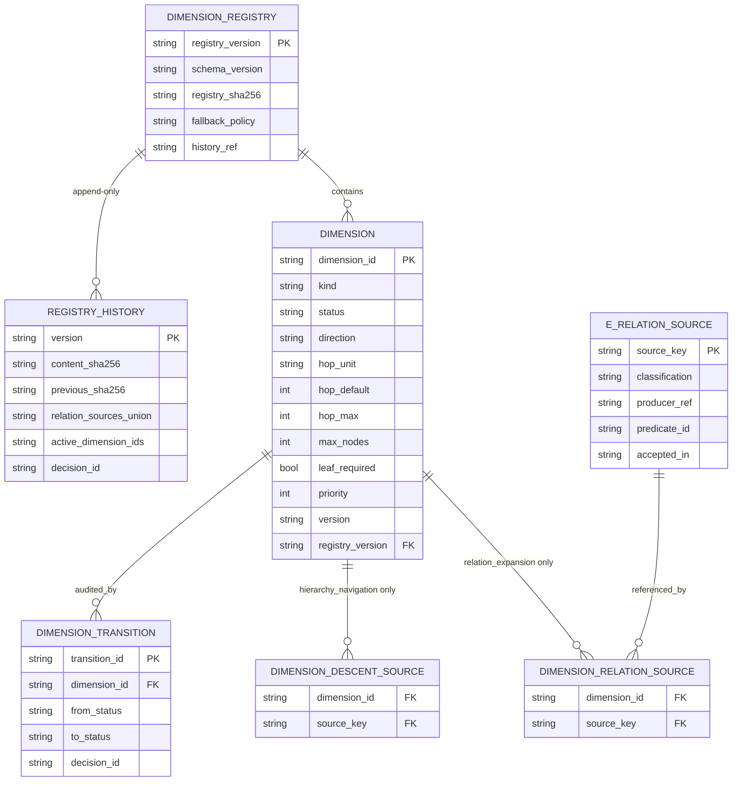
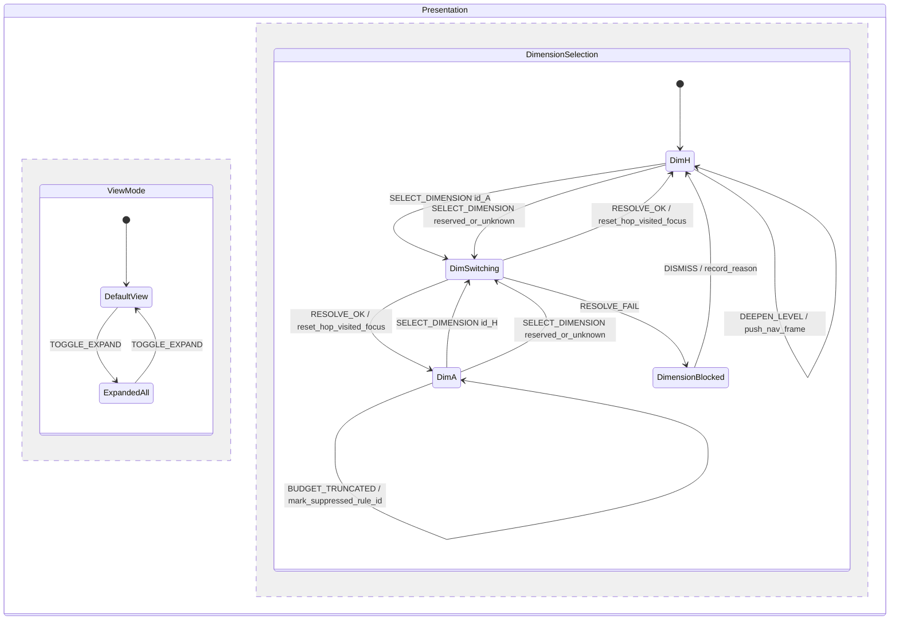
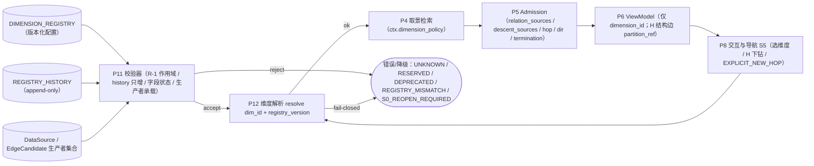

# S1 冻结前工程校核报告（SE · task-297）

> **冻结对象**：`docs/design/multilevel-graph/S1-dimensions-v1.md`（sha256 `6676c71d09c5722c5c42252c63158878638e5f4480ce0dade4dd114b94f5a866`，161 行；修复后复跑版；旧版 `c9ca49a2…` 为修复前快照）
> **证据链（只读，不是冻结对象）**：`S1-dimensions-proposal-A-v2.md`（`ae5f09e5…`）、`S1-dimensions-proposal-B-v2.md`（`c4cddcaf…`）、`S1-objections-v2.md`（`275a2c7a…`）、`S1-RULINGS.md`（`6b2b84bb…`）、`S1-charter.md`；
> **上游冻结**：`S0-terms-v1.md`（`241b1e1e…`，与 `S0-FREEZE-RECORD.md` 一致）+ 本仓 `ENGINEERING-PLAN.md`（`cc82e996…`，S1 增量已加）。
> **执行者**：`graph-se-architect`（SE 专家，domain=se）· **日期**：2026-11-03（Asia/Shanghai）
> **边界**：未改 A-v2/B-v2/异议-v2/RULINGS/S1-dimensions-v1；未写产品代码；未改契约；未 commit。本文件为 task-297 新增交付；另更新 `ENGINEERING-PLAN.md` 的 S1 增量章节（不覆盖 S0 冻结部分）。
> **结论**：**达到 S1 冻结工程门禁（是）**。复跑确认 **M-S1-1/M-S1-3 已转 PASS、`M_fail=[]`（12/12 PASS）**；六图同版本 mermaid 复验 PASS。旧版判定（v1 `c9ca49a2…`，2 FAIL）作为历史记录保留在 §2/§7。

---

## 0. 结论先行

### 0.1 M-S1-1..M-S1-12 结果（编号按 `S1-dimensions-v1.md` §3）

| M | 判据 | 判定 | 关键证据 |
|---|---|---|---|
| M-S1-1 | 注册表 schema 与 fail-closed | **PASS（复跑）** | v1:23-45 已补**字段/类型/枚举/默认值/失败码表**（含 `history_ref`、`fallback_policy`、`termination{max_nodes,leaf_required,stop_on_no_new}`）；`registry_sha = sha256(canonical(registry − registry_sha))`；`kind` 唯一规范字段 + `basis.kind=map(kind)` 不一致 ⇒ `DIM_KIND_MISMATCH`；hop 字段 null 语义写死 |
| M-S1-2 | registry_history 链与自包含 | **PASS** | v1:24——`content_sha` 为 id；条目自含 `version/relation_sources/active_dimensions/previous_sha/decision_id`；registry 带 `history_ref`，末条 `content_sha == registry_sha`；validator 不需外部旧 registry；A-v2/B-v2/异议-v2 §2-1 已闭合 |
| M-S1-3 | H kind/relation_sources/hop null | **PASS（复跑）** | v1:58-60 已冻结 `data_edge_ids(e_H)={e∈DataSource.edges \| e.type=contain ∧ contain_kind=structural ∧ e.source∈members(parent) ∧ e.target∈members(child)}`；**允许空集**（字段必存在、去重/排序/可枚举、不得伪造 id）；`expand_data_edges` 空集合法且 ⊆ DataSource.edges；`hop_unit="n/a"`/`hop_default=null`/`hop_max=null` |
| M-S1-4 | A ⊇ `E_relation_min` | **PASS** | v1:40——`relation_sources ⊇ E_relation_min`（contain(structural/semantic)、reference、extend 合并写法覆盖四源）；U-10 未窄化（异议-v2 §4-1） |
| M-S1-5 | hop/new_hop/去重/重置 | **PASS** | v1:41,51；R-S1-10 唯一显式入口语义已冻结；机检谓词 `hop=2 ⇒ new_hop=true` 可执行；S5a 只补事件名（本报告 §4.2 已给 `EXPLICIT_NEW_HOP`） |
| M-S1-6 | 方向枚举 | **PASS** | v1:56——`{down,up,both,out,in}`；H=down、A=both（可配 out/in）；非法 fail-closed |
| M-S1-7 | 终止有穷 + rule_id | **PASS** | v1:61——层叶/hop_max/max_nodes/frontier 空/取消；有穷、确定性、截断可解释 |
| M-S1-8 | 开放槽位不渲染 | **PASS** | v1:29-31——reserved 只登记、不得进渲染分支、v1 不晋升 |
| M-S1-9 | 三态/插件边界 | **PASS** | v1:71-73——`{reserved,active,deprecated}`；deprecated→active 仅重开 S1+版本+history；插件不得注册/激活/改写 |
| M-S1-10 | present 只改 presence | **PASS** | v1:76-78——只改 `presence∈{shown,suppressed,unknown}+rule_id`，不改 type/contain_kind/label；视图缺席≠数据缺席 |
| M-S1-11 | VM 纯度 | **PASS** | v1:81-83——VM 只含 `dimension_id`，不含切换控件/列表/历史/模式（D-4）；切换属 Presentation/S5 |
| M-S1-12 | U 覆盖 + 与 S0 无冲突 + 三图一致 | **PASS** | v1 §4 覆盖 S1 相关 U（U-8/9/10/11/12/25/26/30/32/33/34/35）；S0 一致性见 §6；`ENGINEERING-PLAN.md` 6 块图（S0 三图 + S1 三增量）全部 `PARSE_OK`（vendored mermaid 11.16.0） |

### 0.2 冻结工程门禁判定

**是**。`S1-charter.md` §7-2 要求「SE 工程校核 PASS（注册表 schema、跳数/终止/状态机可工程化，三图增量一致）」；复跑结果 **`M_fail=[]`、12/12 PASS**，六图（S0 三图 + S1 ER-02/DF-02/ST-02）同版本 mermaid 全部 `PARSE_OK`，故门禁条件 2 满足。

- 条件 1（A-v2/B-v2 关闭全部 R-S1/P1）：满足（证据链自检通过；异议-v2 §2-1/2-2/2-3 由 v1 R-S1-9/10/11 关闭）；
- 条件 2（SE 工程校核 PASS）：**满足（本报告）**；
- 条件 3（Lead 独立机检）：待 Lead；
- 条件 4（与 S0 无冲突）：满足（§5）；
- 条件 5（冻结 v1 + 写决策）：待 Lead。

**残余非阻塞项（O-S1-2/O-S1-4..O-S1-10）**：S6a 的 registry_sha/history 存储、A 在 L>0 的簇焦点遍历（S4/S5）、S5a 的 `EXPLICIT_NEW_HOP` 事件名、semver、deprecated 旧 frame、max_nodes 值、H 显示计数——均不阻塞 S1 冻结。
---

## 1. 方法与可复现证据

### 1.1 输入完整性（sha256）

| 文件 | sha256 | 角色 |
|---|---|---|
| `S1-dimensions-v1.md` | `6676c71d09c5722c5c42252c63158878638e5f4480ce0dade4dd114b94f5a866` | **冻结对象（修复后复跑版；旧版 `c9ca49a2…`）** |
| `S1-dimensions-proposal-A-v2.md` | `ae5f09e5cd159b915be0fce64a14bf0eb95aa672986609bcb5bd2f5e3bd76d03` | 证据链 |
| `S1-dimensions-proposal-B-v2.md` | `c4cddcafd5922fa13fee4542133db3567623856facd960e0f1644e3e16994053` | 证据链 |
| `S1-objections-v2.md` | `275a2c7a4b917ab362141e9d9670873ee9da9b5a5b9efd0f4526929ce1992be6` | 证据链（差异/异议） |
| `S1-RULINGS.md` | `6b2b84bbe7c7dbe01ec58407109874a32efe353a6c55293d0b69209e9cc017d1` | 裁决依据 |
| `S1-charter.md` | `d2a15340d04e310b8681a27147daf4b1a81701cd345d1b019a4929c2b99bd167` | 本场章程 |
| `S0-terms-v1.md` | `241b1e1e8b0a2fe6c8e1291e03a06c122d16cf71273d9e5d0d879f64ebf9ea78` | 上游冻结（= 冻结记录） |
| `ENGINEERING-PLAN.md` | `708d6f6fbc898954425a0ea490477ab0161743252463fcb10a605c2ebb6f81e7` | 工程图（S0 + S1 增量 6 图；已按 R-S1-11 冻结措辞对齐） |

### 1.2 环境与命令

```
node v24.21.0 ; python 3.12.4
mermaid = 仓库 vendored src/memoria/ui/static/app/vendor/mermaid.min.js
           bundle 内 version:"11.16.0" ; sha256 9198f6322f37f242a3396fbda15bec75a053095f9a81175340a3bb63ebd41b76
jsdom   = 29.1.1（仅提供 DOMPurify 所需 DOM）

# 图解析（同版本 mermaid；脚本见 S0-freeze-check.md 附录 A）
node <SE_DIR>/parse_mermaid.js docs/design/multilevel-graph/ENGINEERING-PLAN.md
node <SE_DIR>/parse_mermaid.js docs/design/multilevel-graph/S1-engineering-check.md
# M-S1 机检（脚本全文见附录 A）
python <SE_DIR>/s1check_v1.py > s1check-v1.json
```

### 1.3 机检输出摘要

```
PLAN mermaid: blocks=6 ; ok=6 ; failedBlocks=0
  #1 er(S0) / #2 er(S1 ER-02) / #3 flowchart-v2(S0 DFD) /
  #4 flowchart-v2(S1 DF-02) / #5 stateDiagram(S0 ST) / #6 stateDiagram(S1 ST-02)
BENCH（复跑）: M_fail=[] ; M-S1-1..M-S1-12 = 12/12 PASS ; gate=是
证据链自检: A-v2、B-v2 的 R-S1-1..8 关键断言均存在；异议-v2 差异表存在
```

---

## 2. M-S1 逐项证据

### M-S1-1 注册表 schema 与 fail-closed — **PASS（复跑）**

- **判据**：`S1-charter.md` §4-2；v1 §3 M-S1-1。
- **v1 证据（修复后）**：v1:23-45——
  - 字段/类型/枚举/默认值/**失败码**表齐全：`id/name/kind/basis.kind/relation_sources/direction/hop_unit/hop_default/hop_max/termination.{max_nodes,leaf_required,stop_on_no_new}/status/priority/version/history_ref/fallback_policy/registry_sha`；
  - `registry_sha = sha256(canonical(registry 去掉 registry_sha 字段后的序列化))`；
  - `kind` 是唯一规范字段、`basis.kind=map(kind)` 派生，二者不一致 ⇒ `DIM_KIND_MISMATCH`；
  - `history_ref` = 不可变 history 版本 id；`fallback_policy ∈ {allow,forbidden}`（registry 级默认 allow）；
  - hop 语义：`hop_unit="n/a"` 时 `hop_default/hop_max` 必须 null（H）；`"edge"` 时必须 int（A）。
- **机检**：`schema_gaps=[]`（类型/枚举/默认/失败码齐；`history_ref`/`fallback_policy`/termination 子字段已在 S1-2 内）；`type_tokens` 命中 26+。
- **证据链**：A-v2 §2、B-v2 §2（字段规则并集）；异议-v2 §2-1/§3 P2-1..P2-5 已由此表关闭。

### M-S1-2 registry_history 链与自包含 — **PASS**

- **判据**：R-S1-9（history 不可变 append-only；条目自包含；registry 带 `history_ref`；末条 `content_sha == registry_sha`；validator 不需外部旧 registry）。
- **v1 证据**：v1:24 逐条命中；history 字段 `version/relation_sources/active_dimensions/previous_sha/decision_id` 与 A/B-v2 并集一致；删除/改名 ⇒ `S0_REOPEN_REQUIRED`（v1:47）。
- **验证**：`history` 每个条目自带 `relation_sources`（A-v2 v1 曾缺，已由 R-S1-9 修正）→ 跨版本 `new⊇old` 可仅凭 history 判定；`history_ref` 使 registry 与 history 绑定。
- **备注（O-S1-2，非阻塞）**：`registry_sha` 的计算域（是否排除自身）与 `history_ref` 的类型（id vs 内容哈希）未写明；若 `history_ref` 为 history 文件内容哈希，则 history 含 `content_sha(=registry_sha)` 会形成哈希自指（不可实现）。S6a 须冻结：`registry_sha = sha256(canonical(registry 去掉 registry_sha 字段))`，`history_ref = 不可变 history 的版本 id`（或明确排除历史的哈希域）。

### M-S1-3 H kind/relation_sources/hop null — **PASS（复跑）**

- **判据**：R-S1-1/2/4/11；v1 §3 M-S1-3。
- **v1 证据（修复后）**：v1:57-61——
  - `relation_sources=[]`、`direction=down`、`hop_unit="n/a"`、`hop_default=null`、`hop_max=null`（H 无关系跳预算）；
  - `edge_id = sha256(canonical(parent_id, child_id, level, view_family))`；
  - **映射谓词已冻结**：`data_edge_ids(e_H) = { e ∈ DataSource.edges \| e.type=contain ∧ e.contain_kind=structural ∧ e.source ∈ members(parent) ∧ e.target ∈ members(child) }`；
  - **允许空集**：字段必须存在、空集合法、不得伪造 id；`expand_data_edges(H_vm)=⋃data_edge_ids(e_H) ⊆ DataSource.edges`（空集也满足）；
  - 机检明确：「每条 H 边有 `data_edge_ids` 字段（可为空集）；空集不得被当成缺失」。
- **机检**：`H_tokens_ok=true`、`gaps=[]`（谓词公式命中、空集合法、无「非空」矛盾、`null/n/a` 二义已消）。
- **为什么这是正确修法**：S0-2 的 Π 是聚类嵌套划分（S2 产出），`contain(structural)` 是 KP↔KP 正文包含边，块间未必存在对应数据边 ⇒ 空集合法是唯一可实现且不违反 R-3 审计本意的方案；若强制非空会迫使实现伪造 id。

### M-S1-4 A ⊇ `E_relation_min` — **PASS**

v1:40 用 `contain(structural/semantic)` 合并写法 + `reference` + `extend` 覆盖 `E_relation_min` 四源；`relation_sources ⊇ E_relation_min` 明确；U-10 三类（包含/引用/语义关联）未窄化（异议-v2 §4-1）。`label` 仅标签（v1:40 末）与 S0-1 一致。

### M-S1-5 hop/new_hop/去重/重置 — **PASS**

v1:41（R-S1-10）：`new_hop` 默认 false；`hop_budget=2` 仅当 `new_hop=true` 且由 S5 唯一显式动作设置；默认/自动路径禁止 2；`present/frame` 检查否则 fail-closed。v1:51：沿边计、默认 1/最大 2、最短距离+去重、跨维重置、截断 `suppressed+rule_id`。机检谓词 `hop=2 ⇒ new_hop=true` 可执行。**注**：S5 的动作名/事件由 S5a 定；本报告 §5.2 的 ST-02 已给 `EXPLICIT_NEW_HOP` 草案（O-S1-6）。

### M-S1-6 方向枚举 — **PASS**

v1:56：`{down,up,both,out,in}`；H=down、A=both（可配 out/in）；方向只影响取景、不改事实/类型；非法 fail-closed。与 A-v2/B-v2 并集一致。

### M-S1-7 终止有穷 + rule_id — **PASS**

v1:61：层叶 ∨ hop_max ∨ max_nodes ∨ frontier 空 ∨ 取消；有穷（不得 null/∞）、确定性、截断可解释；`max_nodes` 数值归 S8（示例值非规范，O-S1-9）。满足「可机检」要求。

### M-S1-8 开放槽位不渲染 — **PASS**

v1:29-31：reserved 只登记（定义/草案/why_not_v1），不得进渲染分支；晋升需定义齐全+机检+需求+审批+registry 版本升级；v1 不晋升。v1:92 机检：reserved 出现在 frame/present 的 active 集合 ⇒ FAIL。

### M-S1-9 三态/插件边界 — **PASS**

v1:71-73：`{reserved,active,deprecated}`；deprecated→active 只经 S1 重开+registry 版本+history；registry 是版本化配置非事实源；插件不得注册/激活/改写。与 R-S1-6 一致。

### M-S1-10 present 只改 presence — **PASS**

v1:76-78：维度经 `ctx.dimension_id` 进 `present(e,ctx)`；只改 `presence∈{shown,suppressed,unknown}` + `rule_id`；不改 type/contain_kind/label；视图缺席 ≠ 数据缺席。与 S0-6/S0-9 一致。

### M-S1-11 VM 纯度 — **PASS**

v1:81-83：VM 只含 `dimension_id`；不含切换控件/列表/历史/模式；切换属 Presentation/S5；渲染器只吃 VM。与 S0 D-4 一致（G-4 同源）。

### M-S1-12 U 覆盖 + 与 S0 无冲突 + 三图一致 — **PASS**

- **U 覆盖**：v1 §4 命中 S1 相关全部 U（U-8、U-9、U-10、U-11、U-12、U-25、U-26、U-30、U-32、U-33、U-34、U-35）；`S1-charter.md` §4-5 要求的 10 个 U 全部出现。
- **与 S0 无冲突**：见 §5（VM 纯度/R-1/present/kind/D-3/R-3 全部一致；唯一待修是 M-S1-3 的 R-S1-11 映射谓词，修后重跑）。
- **三图一致**：`ENGINEERING-PLAN.md` 6 块图（S0 三图 + S1 ER-02/DF-02/ST-02）全部 `PARSE_OK`，S1 增量与 v1 条款对应见 §4；本报告 §4 三块增量图也已由同版本 mermaid 解析通过。

---

## 3. 工程增量落点：v1 → 实体/状态/数据流

| v1 条款 | ER 增量 | ST 增量 | DFD 增量 | 判定 |
|---|---|---|---|---|
| S1-2/S1-11 registry + 状态机 | `DIMENSION_REGISTRY`（version/sha/fallback_policy/history_ref）、`DIMENSION`、`REGISTRY_HISTORY`、`DIMENSION_TRANSITION` | `DimensionSelection` 状态 + `DimensionBlocked`（fail-closed + reason） | `P11 校验器`（字段/history/状态）、`P12 resolve`（版本/active/fail-closed） | 落点成立；schema 类型表待补（M-S1-1） |
| S1-3/S1-15 reserved | `DIMENSION.status`、`DIMENSION_SLOT`（草案/why_not_v1/activation_criteria） | reserved 请求 → `DimensionBlocked`，无渲染分支 | 校验器拒绝 reserved 进 ctx；无取景流 | 成立 |
| S1-4/R-S1-11 H | `DIMENSION_DESCENT_SOURCE`（`{contain(structural)}`）、H 结构边 `derived_from=partition_refinement`+`partition_ref`+`data_edge_ids` | `DEEPEN_LEVEL`（导航动作，不占 hop） | P4/P5 走结构边；P6 输出 `expand_data_edges` 校验 | **部分**：映射谓词/空集待裁（M-S1-3） |
| S1-5/S1-7 A + hop | `DIMENSION_RELATION_SOURCE`（⊇ min）、`DIMENSION.hop_unit/hop_default/hop_max` | `EXPAND_HOP`（≤2）、`EXPLICIT_NEW_HOP`（唯一入口）、reset on switch | P4 BFS over `E_relation(A)` + budget；P5 presence/rule_id | 成立（S5a 事件名） |
| S1-6 扩展规则 | `E_RELATION_SOURCE`（classification/producer_ref/predicate_id）、`REGISTRY_HISTORY.relation_sources_union` | 删除/改名 ⇒ `S0_REOPEN_REQUIRED`（拒绝加载） | P11 跨版本 `new⊇old` + 生产者承载校验 | 成立 |
| S1-8 方向 | `DIMENSION.direction` | 仅 A/H 枚举约束 | P4/P5 方向过滤 | 成立 |
| S1-9 终止 | `DIMENSION.max_nodes/leaf_required/stop_on_no_new` | 终止状态与 rule_id | P5 截断标记 | 成立（子字段待入 schema） |
| S1-10 组合 | 组合槽位（reserved 表/文档，不建运行实体） | `DIM_COMBINATION_UNSUPPORTED` 拒绝 | P12 拒绝组合参数 | 成立 |
| S1-13 UI/导航 | `VIEW_FRAME.dimension_id`（新增/沿用） | 切换属 Presentation；VM 不带 | `selected_dimension_id` 只在 frame/视图状态 | 成立 |
| S1-14 agent | —（审计事件，非事实源） | — | `frame(DataSource, frame_spec)` 纯函数 + active 白名单 + fallback 显式审计 | 成立 |

---

## 4. 工程图增量（同版本 mermaid 已验证；全文见 `ENGINEERING-PLAN.md` §1.8/§2.7/§3.5）

### 4.1 ER-02（注册表/历史；PLAN §1.8）



**落点结论**：v1 的 registry/history/状态机可完整落到上述实体；主键/关系明确；`H.hop_*` 必须 NULL（H 无 hop）；`fallback_policy` 与 `history_ref` 补入 schema（对应 M-S1-1 修复）。

### 4.2 ST-02（维度切换/fail-closed/H 与 A 分离；PLAN §3.5）



**落点结论**：未知/保留/弃用维度 ⇒ `DimensionBlocked`（`DIM_UNKNOWN`/`DIM_NOT_ACTIVE`，不静默回退）；`EXPLICIT_NEW_HOP` 是 R-S1-10 的**唯一显式入口**（S5a 冻结事件名）；`DEEPEN_LEVEL` 是导航动作，**不参与 S0-5 hop 机检**；VM 无维度状态（D-4）。

### 4.3 DF-02（取景服务/frame/校验；PLAN §2.7）



**落点结论**：维度参数只进入 `ctx`（由 P12 注入），**不进 ViewModel**；注册表/历史只读、版本校验、fail-closed；`expand_data_edges(VM) ⊆ DataSource.edges` 在 P6 输出处校验。`frame(DataSource, frame_spec)` 签名：`frame_spec = {level_id, view_family_id, dimension_id, focus_id, hop_budget, new_hop?, fallback?}` → `ViewModel | FailClosed`（纯函数、无会话态）。

### 4.4 E_relation 扩展校验点（checkpoints）

| # | 检查 | 失败行为 |
|---|---|---|
| V-1 | 仅 `kind=relation_expansion`（A）断言 `relation_sources ⊇ E_relation_min`；H 必须 `[]` | `DIM_MISSING_MIN` / `DIM_H_RELATION_MUST_BE_EMPTY` |
| V-2 | history 链：`previous_sha` 逐条串联、末条 `content_sha == registry_sha`、无需外部旧 registry | `DIM_HISTORY_CHAIN` |
| V-3 | 跨版本 `union(new) ⊇ union(old)`；删除/改名 ⇒ 硬失败 | `S0_REOPEN_REQUIRED` |
| V-4 | 新 source 必须有 DataSource 生产者（`producer_ref`/`predicate_id` 可跑） | 标 `future`，禁止进 v1 active |
| V-5 | `classification ∈ {edge_type, projection, derived}`；`derived` 不得进 active | `DIM_SOURCE_DERIVED_ACTIVE` |
| V-6 | H：`hop_unit=n/a`、hop NULL、direction=down、leaf_required；A：`hop_unit=edge`、`1≤hop_default≤hop_max≤2`、direction∈{both,out,in} | `DIM_H_NO_HOP` / `DIM_A_HOP` / `DIM_H_DIRECTION` |
| V-7 | registry `active` 集合（可用维度）={H,A} 与 **view frame** `selected_dimension_id` 恰 1 —— 两个断言对象不同 | `DIM_ACTIVE_SET` / `DIM_MULTI_ACTIVE` |
| V-8 | reserved/deprecated/unknown 不得进 `ctx`/frame/present 的 active 集合 | `DIM_NOT_ACTIVE` / `DIM_UNKNOWN` |
| V-9 | `present` 只改 presence；type/contain_kind/label 与 DataSource 一致 | `DIM_FACT_MUTATED` |
| V-10 | VM 纯度：无 mode/nav/capabilities/dimension list/policy 对象 | `VM_IMPURE` |
| V-11 | `expand_data_edges(VM) ⊆ DataSource.edges`（空集合法，若 O-S1-1 采空集方案）；H 结构边 `derived_from=partition_refinement` | `R3_VIOLATION` |
| V-12 | 确定性：同 `(DataSource, frame_spec, registry_version)` 同 ViewModel；`hop=2 ⇒ new_hop=true` | `NONDETERMINISTIC` / `NEW_HOP_REQUIRED` |
| V-13 | 注册表/历史不写产品 sidecar（D-3）；`selected_dimension_id` 只在 VIEW_FRAME | `FACT_SOURCE_VIOLATION` |

**`expand_data_edges` 签名落地（R-S1-11）**：
```
expand_data_edges(vm: ViewModel) -> frozenset[EdgeId]
  前置：VM 与 DataSource 同一 edition + registry_version
  定义：∪ { e.data_edge_ids | e ∈ vm.edges, e.derived_from ∈ {data_edge, partition_refinement} }
  断言：结果 ⊆ DataSource.edges（空集合法，R-S1-11 已冻结）；不得回读/回写事实层
  说明：H 结构边若 data_edge_ids=[] ⇒ 空集，仍满足 R-3 的「可展开/可审计」语义；
        若 Lead 坚持非空，须先给 S2 划分保证（见 O-S1-1）
```

---

## 5. 与 S0 冻结条款的一致性（不得违反）

| S0 条款 | S1-dimensions-v1 落点 | 判定 |
|---|---|---|
| D-4 VM 纯度（无 nav/mode/capabilities） | S1-13（v1:81-83）VM 只 dimension_id | **一致** |
| R-1 `E_relation_min` 只增不删 | S1-4（H=[]）、S1-5（A⊇min）、S1-6（跨版本只增） | **一致**（R-1 作用域正确限定 A） |
| S0-6 present 唯一判据 + 三值 + rule_id | S1-12（v1:76-78） | **一致** |
| S0-9 `kind∈{kp,cluster}`、bridge=role/state | S1-5 机检「端点只含 kind∈{kp,cluster}」；H 结构边不是 kp/cluster 节点 | **一致**（结构边不新增节点类型） |
| D-3 不写产品 sidecar | S1-11（registry 版本化配置非事实源）；history/决策记录 | **一致** |
| R-3 聚合/折叠边 `data_edge_ids` | S1-4/R-S1-11 + §4.4 V-11 | **一致（R-S1-11 映射谓词 + 空集已冻结）** |
| S0-2 划分/最小粒度 | S1-4 H 用 `(level,view_family)`；一次一层 | **一致** |
| S0-5 一跳（只约束 A） | S1-5/S1-7；H 无 hop（R-S1-2） | **一致** |
| S0-8 默认/全展开 | S1-13（正交 Presentation 开关） | **一致** |
| D-5 v1 单维度 | S1-10 + ST-02 单 selected | **一致** |

---

## 6. 未关闭项（O-S1-1..O-S1-10）

| # | 项 | 阻塞? | 归属 | 修复建议 |
|---|---|---|---|---|
| ~~O-S1-1~~ | ~~R-S1-11 映射谓词/非空可行性~~ | **已关闭（v1 R-S1-11 冻结谓词 + 允许空集；M-S1-3 PASS）** | v1（Lead 已修） | 保留历史记录 |
| **O-S1-2** | `registry_sha` 计算域（排除自身）、`history_ref` 类型/哈希自指 | 阻塞（M-S1-1 修复同轮，文本级） | S6a/S1-2 | `registry_sha = sha256(canonical(registry − registry_sha))`；`history_ref = 不可变 history 版本 id` |
| ~~O-S1-3~~ | ~~schema 类型/默认值表缺失~~ | **已关闭（v1 S1-2 字段表已补；M-S1-1 PASS）** | v1（Lead 已修） | 保留历史记录 |
| O-S1-4 | A 在 L>0（焦点/基座是 cluster）时：起点映射到成员 KP 的规则、端点聚合、rendered-hop vs data-hop 计数 | 非阻塞（S4/S5） | S4/S5/S9 | S1-5/S1-7 补一句「A 从 focus 簇的 member KP 集合出发；端点按 bridge/折叠加 `underlying_hop_count`（S4）」 |
| O-S1-5 | B-v2 证据链残留 `H.hop_default==H.hop_max==0`（B-v2:325）与其自身 schema（null，B-v2:88/206）矛盾 | 非阻塞（v1 已用 null） | B-v2（审计） | B-v2 改为 `is None`，保证据链一致 |
| O-S1-6 | S5 的 `new_hop` 唯一显式动作名/事件/按钮未定义 | 非阻塞（S5a） | S5a | 采用本报告 §4.2 `EXPLICIT_NEW_HOP`；S5a 冻结事件名/守卫 |
| O-S1-7 | semver 版本比较（2.10 vs 2.9）未冻结 | 非阻塞（S6a） | S6a | 版本比较用 tuple 解析 + 单测 |
| O-S1-8 | deprecated 旧 frame 用旧 registry edition 解释 vs 重建 | 非阻塞（S6a） | S6a | 采用旧 edition 解释（不重算），S6 落存储 |
| O-S1-9 | `max_nodes=200` 示例值可能被抄死 | 非阻塞 | S8 | 文档标注非规范；S8 定值 |
| O-S1-10 | H 结构边显示计数/类型映射（S3） | 非阻塞（S3） | S3 | S1 已冻结集合语义；显示规则 S3 定 |

---

## 7. 冻结工程门禁判定与复跑记录

**判定：是（达到 `S1-charter.md` §7 工程门禁；Lead 独立机检条件 3/5 待执行）**

| 门禁条件 | 结果 |
|---|---|
| 1. A-v2/B-v2 关闭全部 R-S1/P1 | **满足**（证据链自检通过；异议-v2 §2-1/2-2/2-3 由 v1 R-S1-9/10/11 关闭） |
| 2. SE 工程校核 PASS | **满足**（复跑 `M_fail=[]`；12/12 PASS；六图 `PARSE_OK`） |
| 3. Lead 独立机检 | **待 Lead**（建议复跑附录 A 脚本 + 抽查 S1-2 字段表/R-S1-11 谓词/VM 纯度三条） |
| 4. 与 S0 无冲突 | **满足**（§5 矩阵全部一致） |
| 5. 冻结 `S1-dimensions-v1.md` + 写决策 | **待 Lead** |

**复跑记录（2026-11-03T19:0x）**

- 对象：`S1-dimensions-v1.md` sha256 `6676c71d09c5722c5c42252c63158878638e5f4480ce0dade4dd114b94f5a866`（161 行；S1-2 字段表 + R-S1-11 映射谓词已补）
- 命令与输出：

```
$ python s1check_v1.py
inputs.v1 = 6676c71d…
summary   = {"M_fail": [], "M_pass": [M-S1-1..M-S1-12], "gate": "是"}

$ node parse_mermaid.js docs/design/multilevel-graph/ENGINEERING-PLAN.md
blocks=6 ; ok=6 ; failedBlocks=0   # S0 三图 + S1 ER-02/DF-02/ST-02
$ node parse_mermaid.js docs/design/multilevel-graph/S1-engineering-check.md
blocks=3 ; ok=3 ; failedBlocks=0   # 本报告增量图
```

- 结论：**S1 冻结工程门禁达到（是）**；仅剩 Lead 独立机检与冻结决策。残余 O-S1-2/O-S1-4..O-S1-10 均不阻塞。

## 8. 边界与后续

- 本报告只读 A-v2/B-v2/异议-v2/RULINGS/S1-dimensions-v1；未改这些文件；未写产品代码；未改契约；未 commit。
- 本轮更新了 `ENGINEERING-PLAN.md` 的 **S1 增量**（§1.8 ER-02、§2.7 DF-02、§3.5 ST-02，含 `expand_data_edges` 签名与 `EXPLICIT_NEW_HOP`），**未改 S0 冻结部分**（S0 三图仍为 v0 草案，待 S5a/S6a/S9a 冻结）。
- S1 冻结后：S2 不得改 S1 的维度/注册表规则（v1:131）；S3/S4/S5/S6a/S8/S9 分别接管显示计数、A 端点聚合/hop、S5 导航动作、history 存储、max_nodes 值、agent 检索。
- 复跑已完成（本版）：M-S1-1/M-S1-3 转 PASS、`M_fail=[]`、门禁 = 是；旧版判定作为历史记录保留在 §2/§7。

---

---

## 附录 A — M-S1 机检脚本（SE 审计脚本，非产品代码；复跑版）

> 运行：`python s1check_v1.py > s1check-v1.json`；`BASE` 为本机仓库路径；只读输入、不写仓库。

````python
# -*- coding: utf-8 -*-
"""S1 冻结前工程校核机检（task-297）：对象 S1-dimensions-v1.md；A-v2/B-v2/异议-v2 为证据链。

M 编号采用 S1-dimensions-v1 §3 的 M-S1-1..M-S1-12。
用法： python s1check_v1.py > s1check-v1.json
"""
import hashlib
import json
import os
import re

BASE = "D:/AAA_Jupyter/Memoria/docs/design/multilevel-graph/"
F = {
    "V1": "S1-dimensions-v1.md",
    "A2": "S1-dimensions-proposal-A-v2.md",
    "B2": "S1-dimensions-proposal-B-v2.md",
    "OBJ2": "S1-objections-v2.md",
    "RUL": "S1-RULINGS.md",
    "CH": "S1-charter.md",
    "S0": "S0-terms-v1.md",
    "PLAN": "ENGINEERING-PLAN.md",
}
REQ_U = ["U-8", "U-9", "U-10", "U-11", "U-12", "U-25", "U-30", "U-32", "U-33", "U-34"]


def rd(k):
    p = BASE + F[k]
    return open(p, encoding="utf-8").read() if os.path.exists(p) else ""


def sha(k):
    p = BASE + F[k]
    return hashlib.sha256(open(p, "rb").read()).hexdigest() if os.path.exists(p) else None


def sec(text, name, next_name):
    a = re.search(rf"^#{{1,3}}\s*{re.escape(name)}\b", text, re.M)
    if not a:
        return ""
    b = re.search(rf"^#{{1,3}}\s*{re.escape(next_name)}\b", text[a.start():], re.M)
    return text[a.start(): a.start() + b.start()] if b else text[a.start():]


def has(text, pat):
    return re.findall(pat, text, re.I | re.M)


v1, a2, b2, obj2, rul, ch, s0, plan = (rd(k) for k in F)
s2 = sec(v1, "S1-2", "S1-3")
s4 = sec(v1, "S1-4", "S1-5")
s5 = sec(v1, "S1-5", "S1-6")
s12 = sec(v1, "S1-12", "S1-13")
s13 = sec(v1, "S1-13", "S1-14")

checks = []


def add(mid, status, evidence, note=""):
    checks.append({"id": mid, "status": status, "evidence": evidence, "note": note})


# ---- M-S1-1 注册表 schema/fail-closed ----
fields = ["kind", "basis", "relation_sources", "direction", "hop_unit", "hop_default",
          "hop_max", "termination", "status", "priority", "version"]
f_hit = {f: bool(has(v1, rf"`{f}`|\b{f}\b")) for f in fields}
type_tokens = len(has(s2, r"\b(int|bool|string|enum|integer|semver)\b"))
schema_gaps = []
if "fallback_policy" not in s2:
    schema_gaps.append("fallback_policy 未列入 S1-2 registry schema（仅在 S1-14 提及）")
if "history_ref" not in s2:
    schema_gaps.append("history_ref 未列入 S1-2 registry schema（仅在 R-S1-9 提及）")
if type_tokens == 0:
    schema_gaps.append("S1-2 无字段类型/枚举/默认值表（与 S1-2 机检『字段齐全/类型/枚举/默认值』自相矛盾；S1-charter §4-2 要求）")
if "termination" in s2 and not has(s2, r"max_nodes|leaf_required|stop_on_no_new|fixpoint"):
    schema_gaps.append("termination 子字段未定义（max_nodes/leaf_required/stop_on_no_new/fixpoint 未冻结）")
add("M-S1-1", "FAIL" if schema_gaps else "PASS",
    {"fields": f_hit, "type_tokens_in_S1-2": type_tokens, "gaps": schema_gaps},
    "S1-dimensions-v1 S1-2 需补字段类型/枚举/默认值表 + fallback_policy/history_ref + termination 子字段")

# ---- M-S1-2 registry_history 链与自包含 ----
h_tokens = {t: bool(has(v1, t)) for t in
            ["content_sha", "previous_sha", "decision_id", "active_dimensions",
             "relation_sources", "history_ref", "registry_sha", "append-only"]}
add("M-S1-2", "PASS" if all(h_tokens.values()) else "FAIL",
    {"tokens": h_tokens,
     "note": "字段/链规则齐；registry_sha 计算域（是否排除自身）与 history_ref 类型（id vs content hash）未写明，属 S6a 实现口径（O-S1-2，非阻塞）"},
    "自包含字段齐 + validator 无需外部旧 registry（文本规则）；建议补一句 registry_sha 计算域")

# ---- M-S1-3 H kind/relation_sources/hop null ----
h_ok = bool(has(s4, r"relation_sources\s*=\s*\[\s*\]")) \
       and bool(has(s4, r"hop_unit\s*=\s*.?n/a")) \
       and bool(has(s4, r"hop_default\s*=\s*null")) and bool(has(s4, r"hop_max\s*=\s*null")) \
       and bool(has(s4, r"edge_id = sha256")) and bool(has(s4, r"data_edge_ids\(e_H\)\s*=\s*\{"))
h_gaps = []
# 1) 映射谓词必须给出（R-S1-11）
if not has(v1, r"映射谓词|data_edge_ids\(e_H\)\s*=\s*\{"):
    h_gaps.append("R-S1-11 的 data_edge_ids 映射谓词未定义（机检不可判定）")
# 2) 空集必须明确允许（否则 S0-2 划分语义下不可满足）
if not has(v1, r"允许空集|空集合法"):
    h_gaps.append("未明确『允许空集』：S0-2 划分不保证块间存在 contain(structural) 数据边")
# 3) 若仍显式要求非空则与空集条款冲突
if has(v1, r"data_edge_ids.{0,12}非空|非空.{0,12}data_edge_ids"):
    h_gaps.append("同时要求 data_edge_ids 非空与允许空集，条款自相矛盾")
# 4) hop 字段不得写成二义 null/n/a
if has(s4, r"null/n/a"):
    h_gaps.append("hop 字段写法『null/n/a』二义（应 hop_unit=\"n/a\"、hop_default/hop_max=null）")
add("M-S1-3", "FAIL" if h_gaps else "PASS",
    {"H_tokens_ok": h_ok, "gaps": h_gaps,
     "note": "v1 已冻结映射谓词 + 允许空集（字段必存在、不得伪造 id）；hop 字段 null 语义统一"},
    "H 定义正确（[]/n/a/null）+ R-S1-11 映射谓词/空集已冻结")

# ---- M-S1-4 A ⊇ E_relation_min ----
min_ok = ("contain(structural" in v1 and ("contain(semantic" in v1 or "structural/semantic" in v1)
          and "reference" in v1 and "extend" in v1)
add("M-S1-4", "PASS" if min_ok and "⊇" in v1 else "FAIL",
    {"min_all": min_ok, "subset_symbol": "⊇" in v1,
     "note": "v1 用 contain(structural/semantic) 合并写法覆盖两 kind；语义 = E_relation_min 四源齐"},
    "A 覆盖 U-10 三类；E_relation_min 四源齐")

# ---- M-S1-5 hop/new_hop/去重/重置 ----
t5 = {t: bool(has(v1, t)) for t in ["new_hop", "hop_default", "hop_max", "去重", "重置", "suppressed", "rule_id"]}
add("M-S1-5", "PASS" if all(t5.values()) else "FAIL",
    {"tokens": t5, "note": "hop=2 ⇒ new_hop=true 可机检；S5 的『唯一显式动作』名称/事件留 S5a（语义已冻结，非阻塞）"},
    "A hop 1/2 + new_hop + 去重/重置/截断 rule_id")

# ---- M-S1-6 方向 ----
dir_ok = all(d in v1 for d in ["down", "up", "both", "out", "in"])
add("M-S1-6", "PASS" if dir_ok and "H=down" in v1.replace(" ", "") else "FAIL",
    {"enum_all": dir_ok, "H_down": "H=down" in v1.replace(" ", "")}, "5 枚举 + H down/A both")

# ---- M-S1-7 终止 ----
t7 = {t: bool(has(v1, t)) for t in ["终止", "有穷", "max_nodes", "取消", "rule_id"]}
add("M-S1-7", "PASS" if all(t7.values()) else "FAIL", {"tokens": t7}, "终止有穷+可解释")

# ---- M-S1-8 开放槽位 ----
add("M-S1-8", "PASS" if has(v1, r"reserved.{0,40}不得进渲染|不得进渲染分支") and "v1 不晋升" in v1 else "FAIL",
    {"reserved_no_render": bool(has(v1, r"reserved.{0,40}不得进渲染|不得进渲染分支"))}, "reserved 不渲染/不晋升")

# ---- M-S1-9 三态/插件 ----
t9 = {t: bool(has(v1, t)) for t in ["reserved", "active", "deprecated", "插件"]}
add("M-S1-9", "PASS" if all(t9.values()) and "不得注册" in v1 else "FAIL", {"tokens": t9}, "三态+插件禁写")

# ---- M-S1-10 present 只改 presence ----
t10 = {"presence_three": all(x in v1 for x in ["shown", "suppressed", "unknown"]),
       "type_unchanged": bool(has(s12, r"不改 type/contain_kind/label|不改.{0,10}type")),
       "no_absent_confusion": "视图缺席 ≠ 数据缺席" in v1}
add("M-S1-10", "PASS" if all(t10.values()) else "FAIL", t10, "present 三值 + 不改事实")

# ---- M-S1-11 VM 纯度 ----
t11 = {"vm_dimension_id": "dimension_id" in s13,
       "no_mode": bool(has(s13, r"不含.{0,20}模式|不含.{0,30}导航|mode")),
       "no_list": bool(has(s13, r"列表|切换控件|历史"))}
add("M-S1-11", "PASS" if t11["vm_dimension_id"] and t11["no_mode"] else "FAIL", t11, "VM 只 dimension_id")

# ---- M-S1-12 U 覆盖 + S0 无冲突 + 三图一致 ----
u_cov = {u: bool(has(v1, re.escape(u))) for u in REQ_U}
blocks = len(re.findall(r"```mermaid\n", plan))
types = re.findall(r"```mermaid\n(\w[\w-]*)", plan)
s0_ok = all(x in v1 for x in ["E_relation_min", "presence", "ViewModel", "dimension_id"]) and "kind" in v1
add("M-S1-12", "PASS" if all(u_cov.values()) and blocks == 6 and s0_ok else "FAIL",
    {"u_coverage": u_cov, "plan_mermaid_blocks": blocks, "plan_diagram_heads": types,
     "s0_tokens": s0_ok,
     "note": "U 矩阵齐；PLAN 6 图（S0 3 + S1 增量 3）；S0 一致性见报告 §5。若 M-S1-3 修订 R-S1-11，本项随之复跑"},
    "U 覆盖 + 三图增量一致（vendored mermaid 解析结果单独证据）")

# ---- 证据链检查 ----
def chain(text):
    return {
        "R-S1-1_H_empty": bool(has(text, r"relation_sources\s*=\s*\[\s*\]")),
        "R-S1-2_H_no_hop": bool(has(text, r"hop_unit\s*[=:].{0,6}n/a")),
        "R-S1-3_history": bool(has(text, r"history|previous_sha")),
        "R-S1-4_data_edge_ids": "data_edge_ids" in text,
        "R-S1-5_hop": bool(has(text, r"hop_max.{0,6}2")),
        "R-S1-6_fallback": "fallback" in text,
        "R-S1-7_candidates": all(x in text for x in ["time", "evidence", "task", "controversy", "authorship", "similarity", "path"]),
        "R-S1-8_union": bool(has(text, r"registry_sha")) and bool(has(text, r"hop_unit")),
    }


out = {
    "inputs": {k: sha(k) for k in F},
    "checks": checks,
    "evidence_chain": {"A2": chain(a2), "B2": chain(b2),
                       "OBJ2_diff_table": bool(re.search(r"\|\s*S1-\d+", obj2))},
    "summary": {
        "M_fail": [c["id"] for c in checks if c["status"] == "FAIL"],
        "M_pass": [c["id"] for c in checks if c["status"] == "PASS"],
        "gate": "否" if any(c["status"] != "PASS" for c in checks) else "是",
    },
}
print(json.dumps(out, ensure_ascii=False, indent=2))
````

## 附录 B — 复跑原始输出（本机执行）

> 注：下方为 2026-11-03T19:0x 捕获的原始输出；报告自身 fileSha256 为捕获时值（此后仅正文措辞/表格管道转义变化，图解析结果不变）。最终报告以磁盘为准。

```
$ node parse_mermaid.js docs/design/multilevel-graph/ENGINEERING-PLAN.md
{"kind":"meta","mermaidVersion":"11.16.0","mermaidSha256":"9198f6322f37f242a3396fbda15bec75a053095f9a81175340a3bb63ebd41b76","jsdomVersion":"29.1.1","node":"v24.21.0"}
{"kind":"file","file":"docs/design/multilevel-graph/ENGINEERING-PLAN.md","blocks":6,"fileSha256":"708d6f6fbc898954425a0ea490477ab0161743252463fcb10a605c2ebb6f81e7"}
{"kind":"block","file":"docs/design/multilevel-graph/ENGINEERING-PLAN.md","index":1,"ok":true,"diagramType":"er"}
{"kind":"block","file":"docs/design/multilevel-graph/ENGINEERING-PLAN.md","index":2,"ok":true,"diagramType":"er"}
{"kind":"block","file":"docs/design/multilevel-graph/ENGINEERING-PLAN.md","index":3,"ok":true,"diagramType":"flowchart-v2"}
{"kind":"block","file":"docs/design/multilevel-graph/ENGINEERING-PLAN.md","index":4,"ok":true,"diagramType":"flowchart-v2"}
{"kind":"block","file":"docs/design/multilevel-graph/ENGINEERING-PLAN.md","index":5,"ok":true,"diagramType":"stateDiagram"}
{"kind":"block","file":"docs/design/multilevel-graph/ENGINEERING-PLAN.md","index":6,"ok":true,"diagramType":"stateDiagram"}
{"kind":"summary","failedBlocks":0}

$ node parse_mermaid.js docs/design/multilevel-graph/S1-engineering-check.md
{"kind":"meta","mermaidVersion":"11.16.0","mermaidSha256":"9198f6322f37f242a3396fbda15bec75a053095f9a81175340a3bb63ebd41b76","jsdomVersion":"29.1.1","node":"v24.21.0"}
{"kind":"file","file":"docs/design/multilevel-graph/S1-engineering-check.md","blocks":3,"fileSha256":"1ebbd7dbed1184c4a24ee1f4f8db69bbfdb5d3bc8ba3301f6235c4c137083bd8"}
{"kind":"block","file":"docs/design/multilevel-graph/S1-engineering-check.md","index":1,"ok":true,"diagramType":"er"}
{"kind":"block","file":"docs/design/multilevel-graph/S1-engineering-check.md","index":2,"ok":true,"diagramType":"stateDiagram"}
{"kind":"block","file":"docs/design/multilevel-graph/S1-engineering-check.md","index":3,"ok":true,"diagramType":"flowchart-v2"}
{"kind":"summary","failedBlocks":0}

$ python s1check_v1.py > s1check-v1.json
{
 "inputs_v1_sha256": "6676c71d09c5722c5c42252c63158878638e5f4480ce0dade4dd114b94f5a866",
 "checks": [
  {
   "id": "M-S1-1",
   "status": "PASS"
  },
  {
   "id": "M-S1-2",
   "status": "PASS"
  },
  {
   "id": "M-S1-3",
   "status": "PASS"
  },
  {
   "id": "M-S1-4",
   "status": "PASS"
  },
  {
   "id": "M-S1-5",
   "status": "PASS"
  },
  {
   "id": "M-S1-6",
   "status": "PASS"
  },
  {
   "id": "M-S1-7",
   "status": "PASS"
  },
  {
   "id": "M-S1-8",
   "status": "PASS"
  },
  {
   "id": "M-S1-9",
   "status": "PASS"
  },
  {
   "id": "M-S1-10",
   "status": "PASS"
  },
  {
   "id": "M-S1-11",
   "status": "PASS"
  },
  {
   "id": "M-S1-12",
   "status": "PASS"
  }
 ],
 "summary": {
  "M_fail": [],
  "M_pass": [
   "M-S1-1",
   "M-S1-2",
   "M-S1-3",
   "M-S1-4",
   "M-S1-5",
   "M-S1-6",
   "M-S1-7",
   "M-S1-8",
   "M-S1-9",
   "M-S1-10",
   "M-S1-11",
   "M-S1-12"
  ],
  "gate": "是"
 }
}
```
