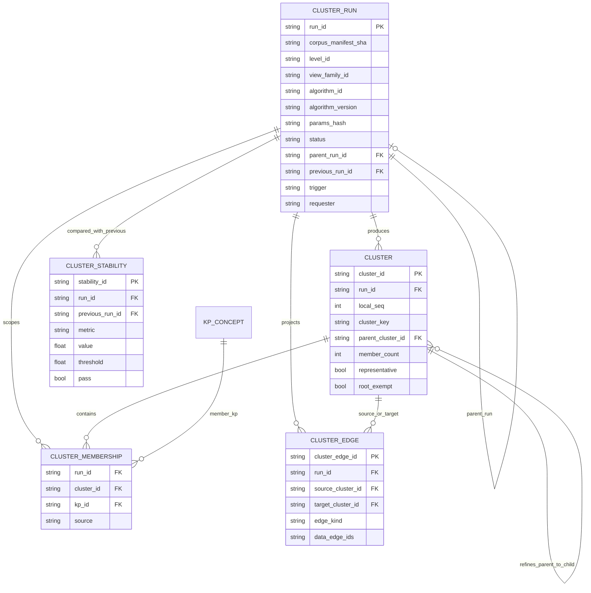
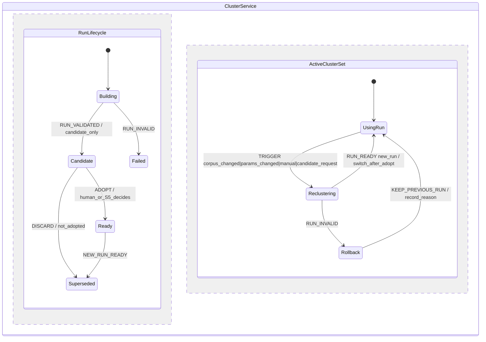
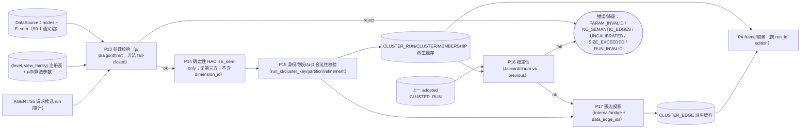

# S2 冻结前工程校核报告（SE · task-302，A-v2/B-v2 对照轮）

> **状态**：S2 **尚未有冻结候选**（无 `S2-clustering-v1.md`）；本报告对 **A-v2 / B-v2 + 异议-v2** 做工程校核，供 Lead 生成 S2 冻结候选；v1 落盘后 SE 将按同一脚本复跑并更新判定。
> **输入（只读）**：`S2-clustering-proposal-A-v2.md`（sha `154cf098…`）、`S2-clustering-proposal-B-v2.md`（sha `5a1d299d…`）、`S2-objections-v2.md`（sha `864a9cdd…`）、`S2-RULINGS.md`（sha `4a83c8a9…`）、`S2-charter.md`；
> **上游冻结**：`S0-terms-v1.md`（`241b1e1e…`）、`S1-dimensions-v1.md`（`6676c71d…`）；**工程图** `ENGINEERING-PLAN.md`（`7e189b77…`，含 S2 增量 3 图）。
> **执行者**：`graph-se-architect`（SE 专家，domain=se）· **日期**：2026-11-03（Asia/Shanghai）
> **边界**：未改 A-v2/B-v2/异议-v2/RULINGS；未写产品代码/契约；未 commit。本文件为 task-302 交付；同步更新 `ENGINEERING-PLAN.md` 的 S2 增量（不覆盖 S0/S1 冻结部分）。
> **结论**：**未达 S2 冻结工程门禁（否）**。R-S2-1..8 两版基本关闭、**无 P0**；但仍有 **2 类 P1 工程缺口 + 1 个跨版契约统一项 + τ 标定证据问题**：A-v2 的 μ/β 公式与 HAC 输出合法性、B-v2 的多级划分生成与失败回滚；需 A/B 各补最小项、Lead 统一 HAC/params_hash/τ 后，SE 复跑。

---

## 0. 结论先行

### 0.1 M-S2-1..M-S2-12（A-v2 / B-v2 对照）

| M | 判据 | A-v2 | B-v2 | 合并判定 |
|---|---|---|---|---|
| M-S2-1 | 簇定义/边界（≠严格连通分量；singleton/root/coverage） | PASS | PASS | **PASS** |
| M-S2-2 | μ 语义-only + 公式可复算 | **FAIL**：`μ=|E_sem(C)|/P` 未按端点对去重，同一对多语义边可 μ>1（A-v2:73/90） | PASS：`distinct unordered pairs/P`（B-v2:79） | **FAIL（A 修）** |
| M-S2-3 | β 语义-only + 无定义语义 | **FAIL**：无 E_sem 时写 `β=0`（A-v2:110），违反 R-S2-2「无定义标 unknown」 | PASS：`β=null`（B-v2:133/138） | **FAIL（A 修）** |
| M-S2-4 | 确定性 HAC 契约（伪代码/tie-break/golden/degraded/μ-β 合法性/多级） | **FAIL**：dendrogram+target_k 切分**不校验输出 μ/β**（A-v2:167-173） | **FAIL**：μ/β 门控合并自洽，但**未定义多级划分生成规则**（S2-4 单分区；S2-7/8 要求 per-level run/refinement） | **FAIL（Lead 统一契约）** |
| M-S2-5 | run 身份（per-level run_id/parent/local_seq/cluster_key） | PASS | PASS | **PASS** |
| M-S2-6 | 多归属/partition/role | PASS | PASS | **PASS** |
| M-S2-7 | 嵌套/展开/空/singleton | PASS（dendrogram 切分保证 refinement） | 条件 PASS（文本正确，但依赖 M-S2-4 缺多级生成） | **PASS（随 M-S2-4 修复）** |
| M-S2-8 | 簇边 internal/bridge + `data_edge_ids` + R-3/H 映射 | PASS | PASS | **PASS** |
| M-S2-9 | 稳定性/触发/不可变/失败回滚 | PASS（含回滚：忽略 run/重算） | **FAIL**：无 run 失败回滚语义（B-v2 S2-4/S2-5/S2-11 未写） | **FAIL（B 补）** |
| M-S2-10 | 持久化 D-3 + VM 纯度 | PASS | **FAIL**：未写「簇/run 状态不进 ViewModel」（D-4） | **FAIL（B 补一句）** |
| M-S2-11 | agent 只读 + candidate run + 审计 | PASS | PASS | **PASS** |
| M-S2-12 | 度量/G6/U 覆盖/S0-S1 一致/三图 | PASS | PASS | **PASS** |

### 0.2 S2 冻结工程门禁判定

**否**。`S2-charter.md` §7-2 要求「SE 工程校核 PASS（簇身份/缓存/多归属/ER/DFD/状态图增量、与 S0/S1 一致）」；当前合并判定含 **M-S2-2、M-S2-3、M-S2-4、M-S2-9、M-S2-10 五项 FAIL**（均为可文本级修复的最小项），故门禁未达。
**最小修复（见 §7）**：A 修 μ 端点对去重、β 无定义 null、HAC 输出 μ/β 合法性；B 补多级划分生成、失败回滚、VM 纯度一句；Lead 统一 HAC 契约、`params_hash` 字段集与 τ 默认值策略；S2-v1 写定后再复跑。

---

## 1. 方法与可复现证据

### 1.1 输入 sha256

| 文件 | sha256 |
|---|---|
| `S2-clustering-proposal-A-v2.md` | `154cf0981dbdc441fb18e378645f63d930271216273a6af0550f8ba21fd75104` |
| `S2-clustering-proposal-B-v2.md` | `5a1d299d11293ed3d671a79a66866a23d6aca38b1468faf61c85672e3444ab8c` |
| `S2-objections-v2.md` | `864a9cdde49c95d67f8b1a1f5d33687763ee94b6822ae4b6666653b5a66821af` |
| `S2-RULINGS.md` | `4a83c8a984bcf714e09b46b3972a93dffb6e876594725c74f19f8d78ca372f87` |
| `S0-terms-v1.md` / `S1-dimensions-v1.md` | `241b1e1e…` / `6676c71d…`（冻结） |
| `ENGINEERING-PLAN.md` | `7e189b77…`（S0 3 图 + S1 3 图 + S2 3 图 = 9 图） |

### 1.2 环境与命令

```
node v24.21.0 ; python 3.12.4
mermaid = 仓库 vendored src/memoria/ui/static/app/vendor/mermaid.min.js
          11.16.0 ; sha256 9198f6322f37f242a3396fbda15bec75a053095f9a81175340a3bb63ebd41b76
jsdom 29.1.1

node <SE_DIR>/parse_mermaid.js docs/design/multilevel-graph/ENGINEERING-PLAN.md
node <SE_DIR>/parse_mermaid.js docs/design/multilevel-graph/S2-engineering-check.md
python <SE_DIR>/s2check_ab.py > s2check-ab.json
```

### 1.3 机检输出摘要

```
PLAN mermaid: blocks=9 ; ok=9 ; failedBlocks=0（S0 3 + S1 3 + S2 3）
本报告 mermaid: blocks=3 ; ok=3 ; failedBlocks=0（ER-03/ST-03/DF-03）
s2check_ab: A2 fail = [pair_dedupe, beta_null, mu_beta_gate]
            B2 fail = [target_k, rollback, s0_chk(ViewModel)]
            R-S2 关关闭矩阵存在；U-6/13/14/15/17/21/22/31 两版全出现
```

---

## 2. M-S2 逐项证据

### M-S2-1 簇定义/边界 — PASS（两版）

A-v2:35-63、B-v2:42-69：簇=μ/β 语义块，≠严格连通分量（两版均以 `graph-groups.js` 为反例并禁 UnionFind 当实现）；空簇禁止、singleton 允许但 `representative=false`/`μ=null`、L0 `root_exempt`、coverage=代表簇覆盖 KP/全库 KP；A/B 一致（异议-v2 §0 已闭合 R-S2-6）。

### M-S2-2 μ — FAIL（A 修；B 通过）

- A-v2:73 `μ(C)=|E_sem(C)|/(|C|(|C|-1)/2)`：分子是**边条数**，同一对节点多条 semantic 边（如 `contain(semantic)` + `extend` 都断言）会重复计数，`|C|=2` 时 μ 可达 2，与 A-v2:90 自身 `μ∈[0,1]` 断言冲突。B-v2:79 用 `distinct unordered endpoint pairs`，正确。
- **修法**：A 改为 `μ=|distinct unordered endpoint pairs(E_sem(C))|/P`；机检 `0≤μ≤1`；β 同样按 pairs 去重。

### M-S2-3 β — FAIL（A 修；B 通过）

- A-v2:110「无 E_sem 关联时 β=0」；R-S2-2 与 S0-4 要求 β 无定义时 `null/unknown`（不得当 0，"0 桥"是优而不是未知）。B-v2:133/138 正确用 null。
- **修法**：A 改 `β=null` + `no_semantic_edges`（与 A 的 empty 状态对齐）。

### M-S2-4 HAC 契约 — FAIL（Lead 统一；两版各有缺口）

- **A-v2**（A-v2:132-205）：standard average-linkage HAC 建 dendrogram，按 `target_k_ℓ` 切分；嵌套由同 dendrogram 保证。但：
  1. `target_k` 由 S4/S8 外部给定，HAC 合并/切分**不检查 μ/β**；切分结果可能出现 μ<τ 或 β>τ 的簇，直接违反 S2-1/S2-2 的簇定义（机检会 FAIL）；
  2. `target_k_ℓ` 序列未冻结（A 自认 §16-3 待裁）。
- **B-v2**（B-v2:150-203）：每轮只在「合并后 μ(M)≥τ ∧ β(M)≤τ」时合并（门控），保证最终每个非 singleton 簇满足定义；但：
  1. 该循环**只有一个终态分区**，没有 target_k/切分/层级映射；而 S2-7/S2-8 要求 per-level run + `parent_run_id` + Π_{ℓ+1} refinement ⇒ **多级划分无法生成**；
  2. 门控合并非标准 HAC，dendrogram 语义与 A 不同；跨版本 golden 不可比。
- **修法（供 Lead 统一，二选一）**：
  - **方案 A+（推荐）**：standard average-linkage dendrogram（A），对每层 `target_k_ℓ` 切分后**校验所有非 singleton 簇 μ/β**；不合法时按预注册规则调整 k（或标 `degraded`，不得输出违规簇）；`target_k_ℓ` 序列由 S4/S8 冻结并进 `params_hash`。
  - **方案 B+**：保留 μ/β 门控合并（保证定义），但把**合并序列**作为 dendrogram，层 ℓ = 合并序列的预注册前缀（prefix length 由 S4/S8 参数化），从而恢复多级/refinement；`merge_prefix_ℓ` 进 `params_hash`。
  - 两方案都必须冻结精确伪代码、tie-break、canonical 序列化、golden 2x、`params_hash` 字段集。

### M-S2-5 run 身份 — PASS（两版）

A-v2:272-302、B-v2:247-265：run 粒度 `(level, view_family)`；`run_id=sha256(canonical(corpus_manifest_sha, view_family_id, level_id, algorithm_id, algorithm_version, params_hash))`；`parent_run_id` 同 family 上一层；`local_seq` 按最小 canonical id；`cluster_key` D-2；curation 引用 run+local_seq+key。两版一致（异议-v2 已闭合 R-S2-4）。

### M-S2-6 多归属 — PASS（两版）

A-v2:237-266、B-v2:227-243：同 `(level, view_family)` 每 KP 恰属一块、跨族/层/维多归属、v1 不设上限、membership≠appearance、`role∈{member}` 不复用 S1 bridge（R-S2-7）；与 S0-7/S1 R-2 一致。

### M-S2-7 嵌套/展开 — PASS（随 M-S2-4）

A-v2:306-329、B-v2:269-284：Π_{ℓ+1} refinement（子簇 ⊆ 唯一父）、展开到 KP、空簇禁止、singleton 不作代表、`degenerate_refinement` 显式；A 由共享 dendrogram 保证 refinement；B 文本正确但依赖 M-S2-4 补多级生成，修复后 PASS。

### M-S2-8 簇边 — PASS（两版）

A-v2:333-357、B-v2:288-302：internal/bridge 仅 `E_sem`；结构/引用边只 `diag_*` 诊断、不进 μ/β；聚合/折叠边带 `data_edge_ids`（R-3）；H 派生边按 S1 R-S1-11（允许空集、字段必存在）；`expand_data_edges ⊆ DataSource.edges`。

### M-S2-9 稳定性/回滚 — FAIL（B 补）

- 两版稳定性/触发/不可变 run 均 PASS（A-v2:206-233、B-v2:207-224）。
- **B 缺失败回滚**：run 构建失败/校验失败时，B-v2 只给了 `status`（S2-4 的 degraded 状态），未规定 ST-03 要求的「失败 → 保留上一 Ready run/不切换视图/错误可见 + 审计」。A-v2:403（回滚：删除缓存/忽略 run）已覆盖。
- **B 修法**：S2-11 或 S2-5 补一句「run 失败/超限 ⇒ 保持当前 adopted run，候选/失败 run 不 adopted，错误可见并审计」。

### M-S2-10 持久化/D-3/VM — FAIL（B 补一句；A 通过）

- 两版均：派生缓存、可重建、不写 sidecar/新段（D-3）、旧 run 只读、agent 无写（A-v2:391-415、B-v2:329-337）。
- **B 缺 VM 纯度声明**：未写「簇/run/树状态不进 ViewModel（只 frame 元数据）」（D-4）。A 在 S2-10/S2-13 有 VM 语义上下文；B 需补一句。
- **B 修法**：S2-11 加「ViewModel 只含 nodes/edges/level/dimension/view_family/presence；簇/run 状态在 VIEW_FRAME/缓存，不进 VM（D-4）」。

### M-S2-11 agent — PASS（两版）

A-v2:451-477、B-v2:363-379：v1 只读 + 可请求**候选 run**（`requester/reason/params` 审计），candidate **不自动 adopted**，人/S5 adopt；不得写 membership/缓存/manifest/渲染状态、不得静默改参数；R-S2-5 一致。

### M-S2-12 度量/G6/U/S0-S1/三图 — PASS（两版）

- coverage=代表簇覆盖 KP/全库 KP（`E_sem=0 ⇒ 0`；两版已修，R-S2-6）；
- G6 字段齐（corpus/run/level/family/parent/algorithm/version/params/cluster_key list/E_sem/μ/β/coverage/stability/status）；
- U-6/13/14/15/17/21/22/31 两版全覆盖（异议-v2 §0 已核）；
- S0/S1 一致性：见 §6；
- 工程图：PLAN 9 块 + 本报告 3 块全部 `PARSE_OK`（vendored mermaid 11.16.0）。

---

## 3. 关键工程发现（A/B 最小修）

| # | 发现 | 影响 | 最小修 |
|---|---|---|---|
| **F1** | A-v2 μ 用边条数（非端点对），多语义边可 μ>1 | 定义/机检自相矛盾（A-v2:73 vs :90）；阈值语义失效 | A：μ/β 按 distinct unordered pair 去重 |
| **F2** | A-v2 无 E_sem 时 β=0 | 把"未知"误作"最优"，违反 R-S2-2/S0-4 | A：β=null + `no_semantic_edges` |
| **F3** | A-v2 HAC 的 target_k 切分不校验 μ/β | 输出可能不满足簇定义，S2-1/S2-2 机检必 FAIL | A：切分后 μ/β 合法性校验 + k 选择规则；或采用 B 门控 |
| **F4** | B-v2 门控 HAC 无多级划分生成规则 | per-level run/`parent_run_id`/refinement 无法生成（S2-7/S2-8） | B：定层=合并序列预注册前缀（或 target_k 切分）+ 机检 refinement |
| **F5** | A/B HAC 契约不同（dendrogram+target_k vs μ/β 门控） | run_id/`params_hash`/G6 不可比，两套"合规"实现 | Lead 统一为一个 canonical 契约（§2 M-S2-4 方案 A+/B+） |
| **F6** | A 的 τ=0.5/0.25 来自合成夹具；real frozen/showcase E_sem=0；B τ=null 待 probe | R-S2-2 要求默认值有 probe 出处；两版无同一证据 | Lead 定 τ 策略：推荐默认 `null/uncalibrated`（诚实）+ 合成 probe 作参考 + S8 live 复标定；或冻结合成值+出处并明示限制 |
| **F7** | real frozen 357KP/62 边、showcase 35KP/73 边**E_sem=0** | S2 合法状态是「全部 singleton、coverage=0」⇒ 默认 H 视图退化；不得用结构边凑簇 | S2 v1 写定 `empty/no_semantic_edges` 为正式合法状态 + S4/S3 处理退化；S6 curation 激活后 S8 复标定 |
| **F8** | B 缺失败回滚 | ST-03 要求失败保持旧 run/可见错误/审计 | B 补一句（§2 M-S2-9） |
| **F9** | B 缺 VM 纯度声明 | D-4 与 S0/S1 一致性问题 | B 补一句（§2 M-S2-10） |
| **F10** | A/B `status` 枚举不同（A：ok/empty/partial_disconnected/degraded；B：ok/no_semantic_edges/uncalibrated/size_exceeded/algorithm_failed） | run 状态/G6 不可比 | Lead 在 v1 统一枚举（建议并集：ok/empty/no_semantic_edges/partial_disconnected/uncalibrated/size_exceeded/algorithm_failed/degraded） |
| **F11** | `params_hash` 字段集不同（A 含 target_k/min_cluster_size；B 含 n_max/无 target_k） | run_id 不同 ⇒ 同输入不同 run，违反可复算 | Lead 统一字段集并纳入 `params_hash`/G6 |
| **F12** | H 派生边 `data_edge_ids` 需**跨两个 run**（parent_run 的 parent block 与 child_run 的 child block）取 members | ER/DFD/校验器需明确跨 run 谓词 | S2 v1 明确：H edge 由 parent_run/child_run 的 memberships + S1 R-S1-11 谓词生成；H 空集合法 |

---

## 4. 工程图增量（与 `ENGINEERING-PLAN.md` §1.9/§2.8/§3.6 同步）

### 4.1 ER-03（簇/成员/运行/稳定性；PLAN §1.9）



**落点结论**：R-S2-4 的 per-level run + `parent_run_id`、D-2 身份、R-S2-6 singleton/root/coverage、R-S2-7 role 边界均可落为实体；`parent_cluster_id` 需允许**跨 run**（父子层）引用；H 结构边跨 run 映射见 F12。ER-03 已按 R-S2 更新（PLAN §1.9）。

### 4.2 ST-03（run 生命周期/候选/adopt/回滚；PLAN §3.6）



**落点结论**：候选 run（agent/服务请求）**不自动 adopted**（R-S2-5）；失败保持旧 Ready run（ST-03/§3 F8）；frame 按 run_id/edition 读取，重聚类不打断当前视图；簇/run 状态不进 VM（D-4，F9）；并发重聚类串行化。

### 4.3 DF-03（划分服务/校验/缓存；PLAN §2.8）



**落点结论**：划分在**后端确定性服务**；输入只 `DataSource/E_sem/(level,view_family)/params`（不含 `dimension_id`，A 不影响簇）；输出派生缓存（D-3）；候选 run 需审计且不自动 adopted；失败/降级显式（`no_semantic_edges`/`uncalibrated`/`size_exceeded`/`algorithm_failed`），不得静默回退连通分量。

---

## 5. 校验点（V-S2-1..V-S2-14）

| # | 检查 | 失败行为 |
|---|---|---|
| V-S2-1 | 同 `(level, view_family)` partition：覆盖 K_f、不交、非空；singleton `μ=null`/`representative=false`；root_exempt 仅 L0 | `PARTITION_INVALID` |
| V-S2-2 | μ/β 输入 == `E_sem`（label=semantic；reference/structural/非 semantic extend 禁止进入）；μ/β 按端点对去重且 `0≤μ≤1` | `SEMANTIC_PURITY_FAIL` / `MU_RANGE` |
| V-S2-3 | 无 E_sem ⇒ `β=null`/`no_semantic_edges`（A 修）；无定义不得当 0 | `BETA_UNDEFINED` |
| V-S2-4 | HAC 契约：精确伪代码/tie-break/canonical 序列化/golden 2x；无第三方图库；不退化为连通分量 | `ALGO_CONTRACT` / `GOLDEN_MISMATCH` |
| V-S2-5 | 输出非 singleton 簇 μ≥τ_coh ∧ β≤τ_bridge（A 的 target_k 切分必须后验；B 门控天然满足） | `CLUSTER_DEFINITION_VIOLATION` |
| V-S2-6 | 多级：`parent_run_id` 同 family 上一层；Π_{ℓ+1} refinement 机检（B 需先定义层生成规则） | `REFINEMENT_INVALID` |
| V-S2-7 | run 身份：per-level run_id 含 level/family/algorithm/version/params_hash；local_seq 排序可复算；cluster_key D-2；curation 三字段 | `IDENTITY_INVALID` |
| V-S2-8 | 多归属：同族每 KP 恰一块；跨族/层/维允许；role 不含 bridge；membership≠appearance | `MEMBERSHIP_INVALID` |
| V-S2-9 | 簇边：internal/bridge 仅 E_sem；聚合边 `data_edge_ids` 非空且 ⊆ DataSource；H 结构边按 S1（可空） | `R3_VIOLATION` |
| V-S2-10 | 稳定性：仅同 `(level, family)` 可比；首次 initial/null；Jaccard/churn 可复算；阈值 S8 | `STABILITY_INVALID` |
| V-S2-11 | 失败/降级：`no_semantic_edges`/`uncalibrated`/`size_exceeded`/`algorithm_failed` 显式；保持旧 adopted run；不静默替换 | `RUN_STATE_INVALID` |
| V-S2-12 | 持久化：派生缓存（可重建）；不写产品 sidecar/新段（D-3）；旧 run 只读；缓存损坏⇒重算 | `FACT_SOURCE_VIOLATION` |
| V-S2-13 | agent：只读 + 候选 run（requester/reason/params 审计），不自动 adopted；无写 membership/缓存/manifest/渲染 | `AGENT_PERMISSION` |
| V-S2-14 | VM 纯度：ViewModel 只含 nodes/edges/level/dimension/view_family/presence；簇/run 状态不进 VM | `VM_IMPURE` |

---

## 6. 与 S0/S1 冻结条款一致性

| 条款 | S2 落点 | 判定 |
|---|---|---|
| S0-1 `E_sem`（T1/T2/T4+G_sem） | μ/β/internal/bridge 只用 E_sem；reference/structural 仅 diag | **一致**（两版） |
| S0-4 簇定义（μ/β、非严格连通分量） | S2-1/2/3 | **一致**（A 修 μ/β 公式后） |
| S0-2 partition/最小粒度 | per-level partition、叶 KP、refinement | **一致** |
| S0-7 多归属 | 同族单归属/跨族多归属/不设上限 | **一致** |
| S0 D-2 身份 | run-scoped id + cluster_key；curation 三字段 | **一致** |
| S0 D-3 不写产品 sidecar | 簇/成员/边/run = 派生缓存 | **一致**（A/B；B 需补 VM 句） |
| S0 R-3 `data_edge_ids` | 聚合簇边非空；H 结构边按 S1 可空 | **一致** |
| S1 H/A 分工 | A 不产生/不改簇（机检伪代码）；H 每层独立 run | **一致** |
| S1 R-2 `view_family`/partition | run 粒度 `(level, view_family)`；parent_run_id | **一致** |
| S1 R-S1-11 H 边映射 | H 边由 parent/child run memberships + contain(structural) 谓词 | **一致**（需 F12 明确跨 run 谓词） |
| S1 D-4 VM 纯度 | 簇/run 状态不进 VM | **A 一致；B 需补一句** |

---

## 7. 最小修复清单与门禁

### 7.1 A-v2 需改（3 处）
1. **S2-2 μ**：`distinct unordered endpoint pairs(E_sem(C))/P`（不得用边条数）；机检 `0≤μ≤1`；β 同步去重。
2. **S2-3 β**：无 E_sem ⇒ `β=null`/`no_semantic_edges`，不得 0。
3. **S2-4 HAC**：切分后校验所有非 singleton 簇 μ/β；不合法 ⇒ 预注册的 k 调整规则或 `degraded`（不得输出违规簇）；`target_k_ℓ` 序列进 params_hash。

### 7.2 B-v2 需改（3 处）
1. **S2-4/S2-8 多级生成**：定义层 ℓ = 合并序列预注册前缀（`merge_prefix_ℓ` 进 params_hash）或 target_k 切分；补 refinement 机检（Π_{ℓ+1} ⊆ Π_ℓ）。
2. **S2-11/S2-5 失败回滚**：run 失败/超限 ⇒ 保持当前 adopted run、候选不 adopted、错误可见+审计。
3. **S2-11 VM 纯度**：补「簇/run/树状态不进 ViewModel（D-4）」一句。

### 7.3 Lead 需统一（3 项）
1. **HAC canonical 契约**（§2 M-S2-4 方案 A+/B+）：伪代码、tie-break、canonical 序列化、golden 2x、`params_hash` 字段集。
2. **τ 默认值策略**：推荐 `null/uncalibrated` 为冻结默认（诚实；real E_sem=0 时无簇合法）+ 合成 probe 作参考 + S8 live 复标定；或冻结合成值并写明出处/限制。
3. **status 枚举 + params_hash 字段集**统一（F10/F11），并把 `no_semantic_edges`/`uncalibrated` 作为正式状态写进 S2-v1。

### 7.4 门禁判定
**否（当前 A-v2/B-v2 合并态）**。待 A/B 各补最小项、Lead 统一 v1 后，SE 以同一脚本复跑；若 v1 全 PASS 则工程门禁转「是」。

---

## 8. 未关闭项（O-S2-1..O-S2-10）

| # | 项 | 阻塞? | 归属 | 修复建议 |
|---|---|---|---|---|
| **O-S2-1** | A μ 未按端点对去重（μ 可 >1） | **阻塞（M-S2-2）** | A-v2 | 用 distinct pairs；β 同步 |
| **O-S2-2** | A 无 E_sem 时 β=0 | **阻塞（M-S2-3）** | A-v2 | β=null/no_semantic_edges |
| **O-S2-3** | A HAC 输出不校验 μ/β | **阻塞（M-S2-4）** | A-v2 | 切分后校验 + k 规则/degraded |
| **O-S2-4** | B 无多级划分生成规则 | **阻塞（M-S2-4/M-S2-7）** | B-v2 | 层=合并前缀/target_k；refinement 机检 |
| **O-S2-5** | B 缺失败回滚 | **阻塞（M-S2-9）** | B-v2 | 保持旧 run/审计 |
| **O-S2-6** | B 缺 VM 纯度声明 | **阻塞（M-S2-10）** | B-v2 | 补 D-4 一句 |
| O-S2-7 | A/B HAC 契约不同 + params_hash 不同 | 阻塞（Lead 统一） | Lead | 选 canonical 契约；统一字段 |
| O-S2-8 | τ 默认值证据不一致（合成 vs null） | 阻塞（Lead 定策略） | Lead | τ=null 推荐；合成值作参考+S8 复标定 |
| O-S2-9 | status 枚举不一致 | 非阻塞（v1 统一） | Lead | 并集枚举写进 v1 |
| O-S2-10 | H 跨 run 的 data_edge_ids 谓词未明写 | 非阻塞（v1 补一句） | Lead/S6a | parent_run/child_run memberships + R-S1-11 |

> 说明：A/B v2 已无 P0（R-S2-1 语义污染关闭）；以上 O-S2-1..6 为**文本级最小修**，O-S2-7/8 需 Lead 裁决。

---

## 9. 边界与后续

- 本报告只读 A-v2/B-v2/异议-v2/RULINGS/S2-charter；未改这些文件；未写产品代码；未改契约；未 commit。
- 同步更新 `ENGINEERING-PLAN.md` S2 增量（§1.9 ER-03、§2.8 DF-03、§3.6 ST-03），并加入「SE 校核待统一」注记（μ 去重/β null/HAC 契约/多级生成/τ/回滚/VM）。
- S2-v1 落盘后：SE 以 `s2check_ab.py`（或其 v1 版）复跑 M-S2-1..12 + 三图解析，更新本报告 §0/§7；若全 PASS 则 S2 工程门禁转「是」。
- S3/S4/S5/S6/S8/S9 分别接管：桥呈现/默认视图退化、A 端点聚合/rendered-hop、adopt/导航、缓存路径/schema/GC、数值门禁/τ live 复标定、检索算法。

---

---

## 附录 A — S2 校核脚本（SE 审计脚本，非产品代码）

> 运行：`python s2check_ab.py > s2check-ab.json`；`BASE` 为本机仓库路径；只读输入、不写仓库。

````python
# -*- coding: utf-8 -*-
"""S2 冻结前工程校核机检（task-302，v2 轮）：对照 A-v2 / B-v2 两版提案。

对象：S2-clustering-proposal-A-v2.md、-B-v2.md；依据 S2-RULINGS.md R-S2-1..8、S2-charter §4、S0/S1 冻结条款。
只做机检（token/结构/一致性），语义裁决与最小修项见 S2-engineering-check.md。
用法： python s2check_ab.py > s2check-ab.json
"""
import hashlib
import json
import os
import re

BASE = "D:/AAA_Jupyter/Memoria/docs/design/multilevel-graph/"
FILES = {
    "A2": "S2-clustering-proposal-A-v2.md",
    "B2": "S2-clustering-proposal-B-v2.md",
    "OBJ2": "S2-objections-v2.md",
    "RUL": "S2-RULINGS.md",
    "CH": "S2-charter.md",
    "S0": "S0-terms-v1.md",
    "S1": "S1-dimensions-v1.md",
    "PLAN": "ENGINEERING-PLAN.md",
}
REQ_U = ["U-6", "U-13", "U-14", "U-15", "U-17", "U-21", "U-22", "U-31"]


def rd(k):
    p = BASE + FILES[k]
    return open(p, encoding="utf-8").read() if os.path.exists(p) else None


def sha(k):
    p = BASE + FILES[k]
    return hashlib.sha256(open(p, "rb").read()).hexdigest() if os.path.exists(p) else None


def has(t, pat):
    return re.findall(pat, t or "", re.I | re.M)


def check(t):
    return {
        # M-S2-1 定义/边界
        "not_strict_cc": bool(has(t, r"严格连通分量|并查集|graph-groups")),
        "mu_beta": bool(has(t, r"μ|mu")) and bool(has(t, r"β|beta")),
        "singleton": bool(has(t, r"singleton")),
        "singleton_mu_null": bool(has(t, r"singleton.{0,40}null|μ.{0,10}=.{0,6}null")),
        "root_exempt": "root_exempt" in (t or ""),
        "coverage": bool(has(t, r"coverage|覆盖率")),
        # M-S2-2 μ semantic-only
        "e_sem_only": bool(has(t, r"E_sem|semantic-only|语义-only")),
        "mu_formula": bool(has(t, r"μ\(C\).{0,20}=|mu\(c\).{0,20}=")),
        "pair_dedupe": bool(has(t, r"distinct.?pair|端点对.{0,10}去重|pairs\(C\)|endpoint pair")),
        "tau_coh": bool(has(t, r"τ_coh|tau_coh")),
        # M-S2-3 β
        "beta_formula": bool(has(t, r"β\(C\).{0,20}=|beta\(c\).{0,20}=")),
        "beta_null": bool(has(t, r"β.{0,10}null|无定义")),
        "tau_bridge": bool(has(t, r"τ_bridge|tau_bridge")),
        # M-S2-4 HAC 契约
        "hac": bool(has(t, r"HAC|层次凝聚")),
        "pseudo": bool(has(t, r"伪代码|pseudocode|def hac")),
        "tie_break": bool(has(t, r"tie.?break|字典序|canonical id")),
        "golden": bool(has(t, r"golden|逐字节|partition_sha")),
        "no_thirdparty": bool(has(t, r"第三方|networkx|无网络库")),
        "degraded": bool(has(t, r"degraded|降级")),
        "target_k": bool(has(t, r"target_k")),
        "mu_beta_gate": bool(has(t, r"门控|gating|合并后.{0,20}μ|mu\(M\)")),
        "multi_level_rule": bool(has(t, r"dendrogram.{0,20}切|target_k_ℓ|每层.{0,10}run|层.{0,6}run")),
        # M-S2-5 身份
        "run_id": bool(has(t, r"run_id|cluster_run_id")),
        "run_id_has_level": bool(has(t, r"run_id.{0,120}level_id|level_id.{0,60}run_id")),
        "parent_run": "parent_run_id" in (t or ""),
        "local_seq": "local_seq" in (t or ""),
        "cluster_key": "cluster_key" in (t or ""),
        # M-S2-6 多归属
        "multi": bool(has(t, r"多归属")),
        "single_family": bool(has(t, r"同.{0,8}\(level, ?view_family\).{0,20}(唯一|单归属)|partition")),
        "no_cap": bool(has(t, r"不设上限|无上限")),
        "role_no_bridge": bool(has(t, r"role.{0,20}bridge|bridge.{0,20}role")),
        # M-S2-7 嵌套
        "refine": bool(has(t, r"refinement|精化")),
        "expand_kp": bool(has(t, r"展开.{0,20}KP|KP 叶子")),
        "empty_ban": bool(has(t, r"空簇.{0,12}(禁|非法)|非空")),
        # M-S2-8 边
        "internal_bridge": bool(has(t, r"internal|bridge")),
        "data_edge_ids": "data_edge_ids" in (t or ""),
        "R3": bool(has(t, r"R-3|expand_data_edges")),
        "h_mapping": bool(has(t, r"R-S1-11|H 派生边")),
        # M-S2-9 稳定性
        "stability": bool(has(t, r"Jaccard|churn")),
        "immutable": bool(has(t, r"不可变|immutable|旧 run 只读")),
        "rollback": bool(has(t, r"回滚|rollback")),
        # M-S2-10 D-3/VM
        "cache": bool(has(t, r"派生缓存|缓存")),
        "no_sidecar": bool(has(t, r"sidecar.{0,20}(禁|不)|不得?写.{0,20}sidecar|D-3")),
        # M-S2-11 agent
        "agent_readonly": bool(has(t, r"只读|read-only")),
        "candidate_run": bool(has(t, r"candidate|候选 run")),
        "agent_audit": bool(has(t, r"requester|审计")),
        # U + S0/S1
        "u_all": all(u in (t or "") for u in REQ_U),
        "s0_chk": all(x in (t or "") for x in ["E_sem", "view_family", "ViewModel"]),
        "h_a_invariant": bool(has(t, r"A.{0,10}不.{0,8}(产生|改变).{0,6}簇|dimension_invariance")),
        # R-S2 关键
        "R1": bool(has(t, r"E_sem|semantic-only|语义-only")),
        "R2": bool(has(t, r"τ|tau")),
        "R3": bool(has(t, r"HAC|层次凝聚")),
        "R4": "parent_run_id" in (t or ""),
        "R5": bool(has(t, r"candidate|候选")),
        "R6": "singleton" in (t or "") and "root_exempt" in (t or ""),
        "R7": bool(has(t, r"role.{0,20}bridge|bridge.{0,20}role")),
    }


def main():
    a, b, obj, rul, ch, s0, s1, plan = (rd(k) for k in FILES)
    out = {"inputs": {k: sha(k) for k in FILES}}
    for tag, t in (("A2", a), ("B2", b)):
        c = check(t)
        out[tag] = {"checks": c,
                    "fail": [k for k, v in c.items() if not v]}
    out["plan_mermaid_blocks"] = len(re.findall(r"```mermaid\n", plan or ""))
    out["R_S2_closure"] = bool(obj and has(obj, r"R-S2-1"))
    out["M_fail_summary"] = {tag: out[tag]["fail"] for tag in ("A2", "B2")}
    print(json.dumps(out, ensure_ascii=False, indent=2))


if __name__ == "__main__":
    main()
````

## 附录 B — 原始输出（本机执行）

> 注：下方为 2026-11-03T19:4x 捕获的原始输出；报告自身 fileSha256 为捕获时值（此后仅追加附录/正文措辞变化，图解析结果不变）。最终报告以磁盘为准。

```
$ node parse_mermaid.js docs/design/multilevel-graph/ENGINEERING-PLAN.md
{"kind":"meta","mermaidVersion":"11.16.0","mermaidSha256":"9198f6322f37f242a3396fbda15bec75a053095f9a81175340a3bb63ebd41b76","jsdomVersion":"29.1.1","node":"v24.21.0"}
{"kind":"file","file":"docs/design/multilevel-graph/ENGINEERING-PLAN.md","blocks":9,"fileSha256":"7e189b7769cc06e88c5627c2bd376520758cd459fb29765989f0c62be8969ddc"}
{"kind":"block","file":"docs/design/multilevel-graph/ENGINEERING-PLAN.md","index":1,"ok":true,"diagramType":"er"}
{"kind":"block","file":"docs/design/multilevel-graph/ENGINEERING-PLAN.md","index":2,"ok":true,"diagramType":"er"}
{"kind":"block","file":"docs/design/multilevel-graph/ENGINEERING-PLAN.md","index":3,"ok":true,"diagramType":"er"}
{"kind":"block","file":"docs/design/multilevel-graph/ENGINEERING-PLAN.md","index":4,"ok":true,"diagramType":"flowchart-v2"}
{"kind":"block","file":"docs/design/multilevel-graph/ENGINEERING-PLAN.md","index":5,"ok":true,"diagramType":"flowchart-v2"}
{"kind":"block","file":"docs/design/multilevel-graph/ENGINEERING-PLAN.md","index":6,"ok":true,"diagramType":"flowchart-v2"}
{"kind":"block","file":"docs/design/multilevel-graph/ENGINEERING-PLAN.md","index":7,"ok":true,"diagramType":"stateDiagram"}
{"kind":"block","file":"docs/design/multilevel-graph/ENGINEERING-PLAN.md","index":8,"ok":true,"diagramType":"stateDiagram"}
{"kind":"block","file":"docs/design/multilevel-graph/ENGINEERING-PLAN.md","index":9,"ok":true,"diagramType":"stateDiagram"}
{"kind":"summary","failedBlocks":0}

$ node parse_mermaid.js docs/design/multilevel-graph/S2-engineering-check.md
{"kind":"meta","mermaidVersion":"11.16.0","mermaidSha256":"9198f6322f37f242a3396fbda15bec75a053095f9a81175340a3bb63ebd41b76","jsdomVersion":"29.1.1","node":"v24.21.0"}
{"kind":"file","file":"docs/design/multilevel-graph/S2-engineering-check.md","blocks":3,"fileSha256":"14676610047a67bf36f26ab5b9aee2a769ec7307a5495b497612606a705f2688"}
{"kind":"block","file":"docs/design/multilevel-graph/S2-engineering-check.md","index":1,"ok":true,"diagramType":"er"}
{"kind":"block","file":"docs/design/multilevel-graph/S2-engineering-check.md","index":2,"ok":true,"diagramType":"stateDiagram"}
{"kind":"block","file":"docs/design/multilevel-graph/S2-engineering-check.md","index":3,"ok":true,"diagramType":"flowchart-v2"}
{"kind":"summary","failedBlocks":0}

$ python s2check_ab.py > s2check-ab.json
{
 "inputs": {
  "A2": "154cf0981dbdc441fb18e378645f63d930271216273a6af0550f8ba21fd75104",
  "B2": "5a1d299d11293ed3d671a79a66866a23d6aca38b1468faf61c85672e3444ab8c",
  "OBJ2": "864a9cdde49c95d67f8b1a1f5d33687763ee94b6822ae4b6666653b5a66821af",
  "RUL": "4a83c8a984bcf714e09b46b3972a93dffb6e876594725c74f19f8d78ca372f87",
  "CH": "837fe0ebf35fcc0b873149993b27bcd24c5bb6955efcc206d3110bbb1d731073",
  "S0": "241b1e1e8b0a2fe6c8e1291e03a06c122d16cf71273d9e5d0d879f64ebf9ea78",
  "S1": "6676c71d09c5722c5c42252c63158878638e5f4480ce0dade4dd114b94f5a866",
  "PLAN": "7e189b7707e9d8ca5e45d2ccf264d98387bca23e8abec42c058eac4c772bc1ad"
 },
 "A2_fail": [
  "pair_dedupe",
  "beta_null",
  "mu_beta_gate"
 ],
 "B2_fail": [
  "target_k",
  "rollback",
  "s0_chk"
 ],
 "plan_blocks": 9,
 "R_S2_closure": true
}
```
