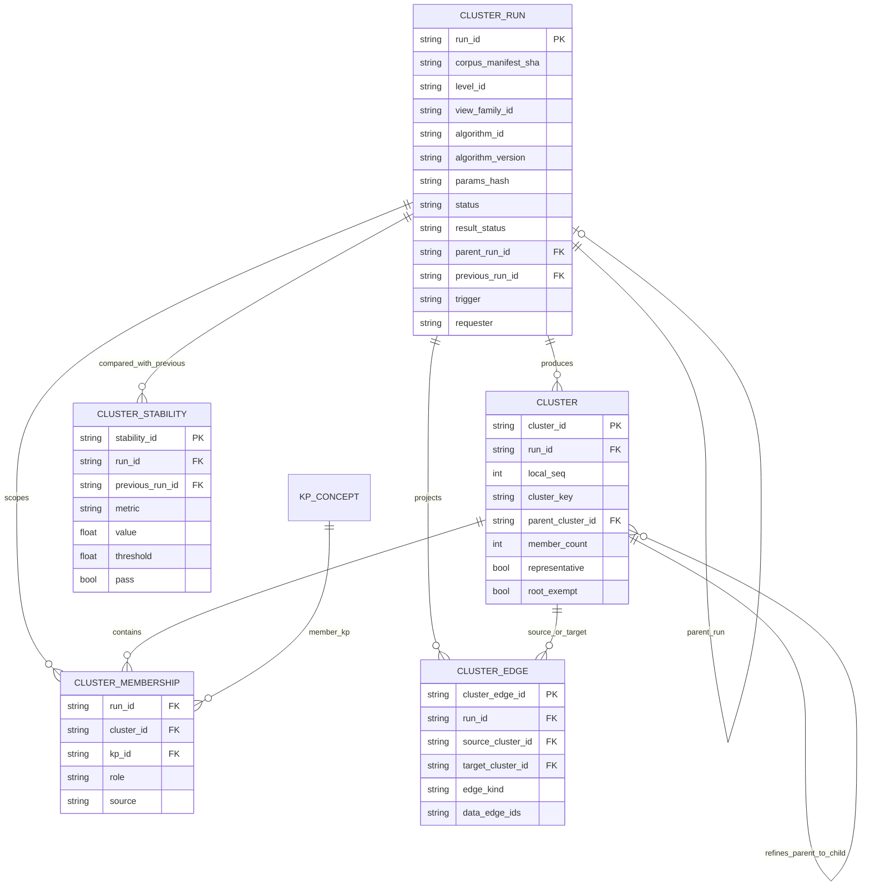
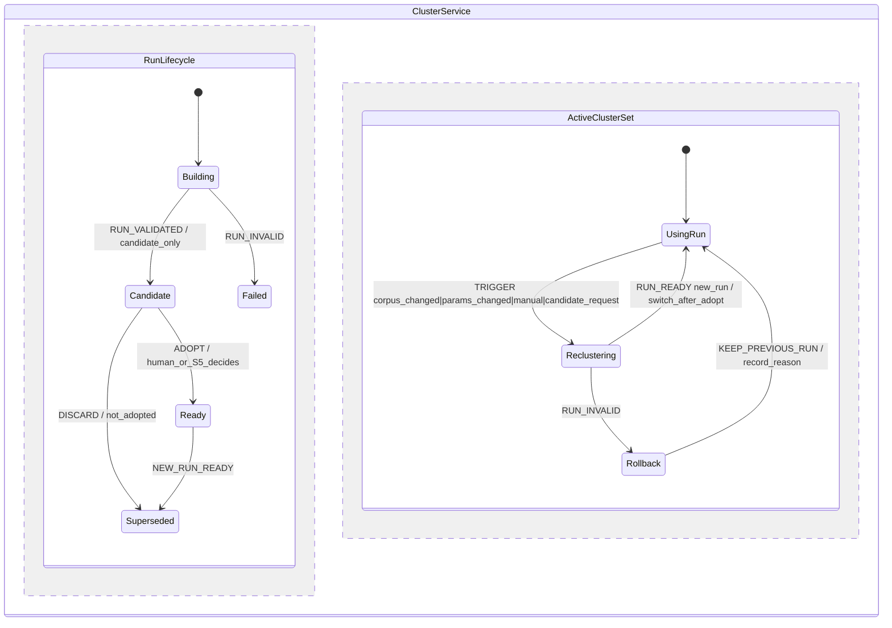
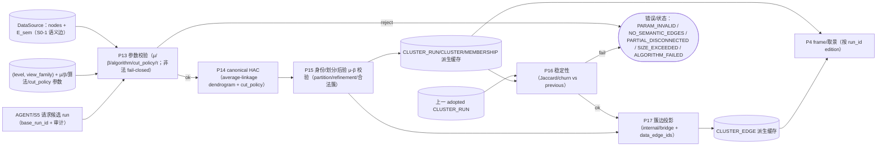

# S2 冻结前工程校核报告（SE · task-302，v1 冻结候选轮）

> **冻结对象**：`docs/design/multilevel-graph/S2-clustering-v1.md`（sha256 `92bb004190d3f93795fe4916cdf904f4dc7574eaaccb43eff9d63edb5b27a6c6`，128 行；修复后复跑版；旧版 `e7f3f99d…` 为修复前快照）。
> **证据链（只读）**：A-v2 `154cf098…`、B-v2 `5a1d299d…`、异议-v2 `864a9cdd…`、`S2-RULINGS.md` `4a83c8a9…`、`S2-charter.md`；语义-only probe `artifacts/agent/verify/debate/graph-utility/s2-semantic-probe/{probe.py,results.json}`。
> **上游冻结**：`S0-terms-v1.md`（`241b1e1e…`）、`S1-dimensions-v1.md`（`6676c71d…`）；**工程图** `ENGINEERING-PLAN.md`（`a12735fc…`，含 S0/S1/S2 增量 9 图）。
> **执行者**：`graph-se-architect`（SE 专家，domain=se）· **日期**：2026-11-03（Asia/Shanghai）
> **边界**：未改 A/B/v1/异议/RULINGS；未写产品代码；未改契约；未 commit。本文件为 task-302 交付；同步更新 `ENGINEERING-PLAN.md` 的 S2 增量（不覆盖 S0/S1 冻结部分）。
> **结论**：**达到 S2 冻结工程门禁（是）**。复跑确认 **M-S2-1..12 全 PASS（12/12，`M_fail=[]`）**；首轮 3 FAIL（M-S2-2/M-S2-4/M-S2-12）的修复已核过并转 PASS；独立 probe 已复核 A-v2 的 τ 出处与数值（一致）。

---

## 0. 结论先行

### 0.1 M-S2-1..M-S2-12（编号严格按 `S2-clustering-v1.md` §3）

| M | 判据 | 判定 | 证据（v1 节/行） |
|---|---|---|---|
| M-S2-1 | 簇定义/边界（≠严格连通分量/singleton/root） | **PASS** | v1:17-19（S2-1）；禁 UnionFind/graph-groups；空簇禁；singleton `representative=false`；`root_exempt` |
| M-S2-2 | μ semantic-only + 可复算 | **PASS（复跑）** | v1:21-24 已改为 `μ=P_in/(|C|(|C|-1)/2)`，`P_in`=去重后的 semantic 无序端点对数（同对多边只计 1.0），`0≤μ≤1`；probe addendum 的 μ_edges=2 反例已由新公式消解 |
| M-S2-3 | β semantic-only + 诊断分离 | **PASS** | v1:27-29；β 只累计 semantic；`diag_struct_*` 仅诊断；`no_semantic_edges` 由 S2-12 处理；|C|≥2 时 W_in+W_out>0（HAC 仅沿 semantic 边合并） |
| M-S2-4 | HAC 确定性/golden/状态枚举 | **PASS（复跑）** | v1:31-35 已冻结精确 tie-break（linkage 最大候选中取合并后成员集合 canonical 序列字典序最小）+ 后验 μ/β 失败规则（按 cut_policy 调 k 重切，仍失败 ⇒ `algorithm_failed`）+ 五状态；addendum 的 star5 歧义由精确规则消解 |
| M-S2-5 | run 粒度/身份/params_hash | **PASS** | v1:48-51（S2-7）：per `(level,view_family)` run_id、parent_run_id、local_seq、cluster_key；R-S2-10 字段集齐全 |
| M-S2-6 | 稳定性/重算触发 | **PASS** | v1:38-40（S2-5）：run 不可变、触发清单、Jaccard/churn/split-merge、全量重算 |
| M-S2-7 | 多归属/role/partition | **PASS** | v1:43-45（S2-6）：同族单归属/跨族多归属/`role={member}`/不设上限/成员≠视图出现 |
| M-S2-8 | 嵌套/展开 | **PASS** | v1:54-56（S2-8）：parent_run_id 精化、展开到 KP、空簇禁、单点允许 |
| M-S2-9 | 簇边/data_edge_ids/R-3 | **PASS** | v1:59-61（S2-9）：internal/bridge 仅 semantic；`data_edge_ids` 映射 DataSource；H 按 S1 R-S1-11；structural 仅诊断 |
| M-S2-10 | A 维度不改变簇 | **PASS** | v1:64-66（S2-10）：A 不产生/不改变簇 + `assert_A_dimension_invariance` |
| M-S2-11 | 持久化 D-3 | **PASS** | v1:69-71（S2-11）：派生缓存/可重建/禁写产品 sidecar/旧 run 只读 |
| M-S2-12 | 无簇状态 + 禁止结构伪造 + 覆盖矩阵 + S0/S1 一致 + 增量图 | **PASS（复跑）** | v1:69/80 已补 VM 纯度（簇/run/dendrogram/候选 run 状态不进 VM；VM 仅 dimension_id + 节点/边视图）；无簇状态/U 覆盖/9 图 `PARSE_OK` 均 PASS，S0/S1 一致性闭合 |

### 0.2 冻结工程门禁判定

**是**。`S2-charter.md` §7-2 要求「SE 工程校核 PASS（簇身份/缓存/多归属/ER/DFD/状态图增量、与 S0/S1 一致）」；复跑 **`M_fail=[]`、12/12 PASS**，PLAN 9 图 + 报告 3 图同版本 mermaid 全部 `PARSE_OK`，故门禁条件 2 满足。

- 条件 1（A/B 独立完成 + 差异清单 + 异议关闭）：满足（A-v2/B-v2/异议-v2；R-S2-1..8 关闭，R-S2-9..13 由 Lead 补裁）；
- 条件 2（SE 工程校核 PASS）：**满足（本报告）**；
- 条件 3（Lead 独立机检）：待 Lead；
- 条件 4（与 S0/S1 无冲突）：满足（§5）；
- 条件 5（冻结 v1 + 写决策）：待 Lead。

**残余非阻塞项（O-S2-4..O-S2-10）**：S6a 的 run 失败回滚/跨 run H 谓词/canonical 序列化、S8 的 τ live 复标定、边界 β=0.25 单测、A probe tie-break 历史注记——均不阻塞 S2 冻结。
---

## 1. 独立语义-only probe 复跑（B 未独立复算项）

### 1.1 目的与输入
- 复核 A-v2 的 `τ_coh=0.5 / τ_bridge=0.25` 出处与数值，独立复算 B 未做项（task-304 留项）。
- 输入：frozen `artifacts/agent/verify/debate/kg-retrieval/round2/frozen/数字通信原理`；showcase `docs/example/showcase`；合成语义夹具（pair/path3/path4/triangle/star4/two_triangles_bridge）。
- 数据读取：只读复用产品 `memoria.graph.collector.collect_graph_data`（与 A 同入口，减少读取差异；临时目录副本，不写产品）；**不 import A 的 probe.py**（独立实现 S0-1 判定/HAC/μ/β）。

### 1.2 命令与产物
```
python probe_independent.py > probe-independent.json
  probe_independent.py sha256 = c18aab616b7c494cf528a9223168279356988a0f62b077440ef4c6680c9985bc
  probe-independent.json sha256 = 54b3ba45559eea1d1d14f9f12b975ec2c580b2d8fbec8fbca612aa0a37ae8c63
python probe_addendum.py > probe-independent-addendum.json
  probe-independent-addendum.json sha256 = 9b363b840745fad6729a53b74d0503217221144f544eb554135be2f778f4662f
```
（脚本全文见附录 A/B；工作文件位于本机 SE 临时目录，命令可复跑。）

### 1.3 复跑结果（与 A `results.json` 对照）

| 语料 | 节点 | 边 | **E_sem** | k=2 簇数 | coverage | golden 2x |
|---|---|---|---|---|---|---|
| frozen | 357 | 62 | **0** | 357（全 singleton） | 0 | PASS |
| showcase | 35 | 73 | **0** | 35（全 singleton） | 0 | PASS |

- 与 A `results.json` **完全一致**（nodes/edges/semantic_edges/clusters/coverage/golden）。
- 结论：**真实语料 E_sem=0**，语义-only 下合法结果 = 无 representative 簇、coverage=0；不得用结构边伪造簇（v1 S2-12 / R-S2-12 已写）。

### 1.4 τ=0.5/0.25 出处复核（合成夹具）

| 夹具（k=2） | 非单点簇 | μ | β | valid@τ | A 结果 |
|---|---|---|---|---|---|
| pair | —（2 singleton） | — | — | — | 一致 |
| path4 | 2×2 | 1.0 | 0.5 | ✗（β>0.25） | 一致 |
| triangle | 2 | 1.0 | 0.667 | ✗（β>0.25） | 一致 |
| star4 | 3 | 0.667 | 0.333 | ✗（β>0.25） | 一致 |
| **two_triangles_bridge** | **4, 3** | **0.667, 1.0** | **0.2, 0.25** | **✓, ✓（β=0.25 边界含）** | 一致 |

- **τ 出处成立**：`τ_coh=0.5/τ_bridge=0.25` 在合成夹具上恰好只放行 two_triangles_bridge（且 3 成员簇 β=0.25 为闭区间边界），与 A-v2 声明一致。
- **限制（必须写入 v1 或 S8）**：标定来自**合成语义夹具**，不是 live 语料（frozen/showcase E_sem=0）；τ 默认值可保留，但 S8 必须在有 semantic curation 的语料复标定；边界 `β≤τ_bridge` 含等号需与实现一致。

### 1.5 补充反例（支持 M-S2-2/M-S2-4 FAIL）

1. **μ 多边反例**：同一对节点 2 条 semantic 边时，v1 的 `W_in` 边权和 = 2，P=1 ⇒ μ=2 > 1，违反 `μ∈[0,1]` 与阈值语义；pair 去重口径 μ=1。→ v1 S2-2 需加「按端点对去重」。
2. **tie-break 歧义反例**：5 叶星（a 为中心，b..f 为叶）k=2：
   - 「合并集合字典序最小」（B 式）= `[[a,b,c,d,e],[f]]`；
   - 「key=(sim,minA,minB) 取最大」（A probe.py 实际实现）= `[[a,c,d,e,f],[b]]`。
   两种都符合「min canonical id」的模糊表述，但 partition 不同。→ v1 S2-4 需冻结精确规则。

---

## 2. M-S2 逐项证据（v1）

### M-S2-1 簇定义/边界 — PASS
v1:17-19：簇 = 同一 `(level,view_family)` 由 `E_sem` 诱导的成员块（μ≥τ、β≤τ），≠严格连通分量，禁 UnionFind/graph-groups；空簇禁；singleton `representative=false`；L0 `root_exempt=true`。与 R-S2-1/6、S0-4 一致；A/B v2 的 singleton/root/coverage 修正已吸收。

### M-S2-2 μ — **PASS（复跑）**

- v1:21-24：`μ(C)=P_in/(|C|(|C|-1)/2)`，`P_in` 为**去重后的 semantic 内部无序端点对数**（同一对节点多条 semantic 边只计 1.0）；`weight_policy=semantic_uniform`；⇒ `0≤μ≤1`；reference/structural/非 semantic extend 权重 0，仅 `diag_struct_*`。
- **修复核对**：首轮反例（同一对 2 条 semantic 边，v1 旧式 `W_in` 边权和=2 ⇒ μ=2>1）已消解；新公式 pair 去重后 μ=1。A-v2 用 adjacency set 天然 pair 唯一，v1 文字现已与之一致。
- **边界**：|C|=2 一条语义边 μ=1；无内部语义边 μ=0（不合格）；`E_sem=0` 由 S2-12 的 `no_semantic_edges` 处理。

### M-S2-3 β — PASS
v1:27-29：β 只累计 semantic 边；`bridge_per_member`/`single_anchor`/`diag_struct_*` 只诊断、不参与判定；HAC 仅沿 semantic 边合并 ⇒ |C|≥2 的簇必有 W_in>0，β 有定义；`E_sem=∅` 由 S2-12 的 `no_semantic_edges` 状态处理。singleton 豁免。**边界**：two_triangles 的 3 成员簇 β=0.25=τ_bridge 恰好合法（闭区间），实现需 `<=`。

### M-S2-4 HAC 契约 — **PASS（复跑）**

- v1:31-35 已冻结：纯自实现 average-linkage HAC（无第三方）；E_sem 诱导图（端点对去重）；完整 dendrogram；`cut_policy`（target_k/min_cluster_size）；**tie-break（冻结）** = 「linkage 最大的候选合并对中，取合并后成员集合 canonical 序列字典序最小者」；canonical 序列化；golden 2x；**后验校验** = 切分后任一簇不满足 μ/β ⇒ 按 cut_policy 调 k 重切，仍不满足 ⇒ `algorithm_failed`、不得输出违规簇；五状态 `ok/no_semantic_edges/partial_disconnected/size_exceeded/algorithm_failed`。
- **修复核对**：addendum 的 star5 歧义（min-union vs A probe max-key 产生不同 partition）已由精确 tie-break 消解；后验失败规则已写入；「四态」笔误已改五状态。
- **边界**：E_sem=0 ⇒ `no_semantic_edges`；语义图不连通 ⇒ `partial_disconnected`（不伪造合并）；规模超限 ⇒ `size_exceeded`；异常 ⇒ `algorithm_failed`。

### M-S2-5 run 身份/params_hash — PASS
v1:48-51：`cluster_run_id=sha256(canonical(corpus_manifest_sha, view_family_id, level_id, algorithm_id, algorithm_version, params_hash))`；parent_run_id；local_seq 按最小 canonical id；cluster_key D-2；R-S2-10 字段集（algorithm/version/weight_policy/linkage/tie_break/cut_policy/target_k/min_cluster_size/n_max/tau_coh/tau_bridge）齐全。

### M-S2-6 稳定性/触发 — PASS
v1:38-40：run 不可变；触发=corpus/manifest、semantic 边集、算法版本、params_hash 任一变化或显式请求；全量重算；Jaccard/churn/split-merge/簇数差。**未写失败回滚**（保持旧 adopted run）→ O-S2-4（建议 S6/ST 补，非阻塞）。

### M-S2-7 多归属/role/partition — PASS
v1:43-45：Membership 多对多；同 `(level,view_family)` 单归属、跨族/层/维多归属；`role∈{member}`（不复用 S1 bridge）；成员≠视图出现；v1 不设上限。

### M-S2-8 嵌套/展开 — PASS
v1:54-56：parent_run_id 精化；展开=H 导航到 KP 叶子（无 hop）；空簇禁；单点允许；退化细化显式标记。

### M-S2-9 簇边 — PASS
v1:59-61：internal/bridge 仅 semantic；`data_edge_ids` 映射 DataSource（R-3）；H 派生边按 S1 R-S1-11（可空集）；structural 只作层次证据、不参与 μ/β；桥渲染 S4。

### M-S2-10 A 维度不变性 — PASS
v1:64-66：A 不产生/不改变簇；同 DataSource+params 下 H/A 切换 run 不变；`assert_A_dimension_invariance`；view_family 为划分作用域。

### M-S2-11 持久化 D-3 — PASS
v1:69-71：簇/成员/边/稳定性=派生缓存、可重建；禁写产品 sidecar/新段（D-3）；旧 run 只读；路径/GC/schema → S6。

### M-S2-12 无簇状态 + 覆盖矩阵 + S0/S1 一致 + 增量图 — **PASS（复跑）**

- v1:74-76（S2-12）：`no_semantic_edges` 合法、coverage=0、禁止结构边伪造；§4 覆盖 U-6/13/14/15/17/21/22/31（+U-32/U-34）。
- v1:69/80 已补 **VM 纯度（D-4）**：簇/run/dendrogram/候选 run 状态均为派生状态、不得进入 ViewModel；VM 仍只带 `dimension_id` + 节点/边视图。S0/S1 一致性闭合（§5）。
- `ENGINEERING-PLAN.md` 9 图 + 本报告 3 图同版本 mermaid 全部 `PARSE_OK`（见 §7 复跑记录）。
- 备注：v1 §4 只有 U 矩阵、无显式 S0/S1 条款表；SE 已在 §5 逐条核对（非阻塞，O-S2-7）。

---

## 3. 工程增量（与 `ENGINEERING-PLAN.md` §1.9/§2.8/§3.6 同步；已按 R-S2-9..13 更新）

### 3.1 ER-03（CLUSTER_RUN / CLUSTER / MEMBERSHIP / 边 / 稳定性）



落点：per-level run + parent_run_id（R-S2-4）；生命周期 `status` 与结果 `result_status` 分离（R-S2-13 五状态）；`role∈{member}`；`data_edge_ids`（R-3）；singleton/root/coverage（R-S2-6）。`parent_cluster_id` 允许跨 run（父子层）。

### 3.2 ST-03（run 生命周期/候选/adopt/回滚）



落点：agent/服务请求只产生 `candidate`（带 `base_run_id` 审计，R-S2-13），**不自动 adopted**；失败/超限保持旧 adopted run（v1 未写 → O-S2-4）；`no_semantic_edges` run 可 Ready/adopted，但 coverage=0、无 representative 簇；frame 按 run_id 读取，重聚类不打断当前视图。

### 3.3 DF-03（划分服务/校验/缓存）



落点：canonical HAC = average-linkage dendrogram + cut_policy（R-S2-9；μ/β 后验、非门控）；输入不含 `dimension_id`（A 不变簇）；五状态显式；输出派生缓存（D-3）；agent 候选 run 审计（R-S2-13）。

---

## 4. 校验点（V-S2-1..V-S2-14，工程落地用）

| # | 检查 | 失败行为 |
|---|---|---|
| V-S2-1 | 同 `(level,view_family)` partition 覆盖/不交/非空；singleton `μ=null`/`representative=false`；root_exempt 仅 L0 | `PARTITION_INVALID` |
| V-S2-2 | μ/β 输入 == `E_sem`（reference/structural/非 semantic extend 禁止）；**μ/β 按端点对去重且 `0≤μ≤1`** | `SEMANTIC_PURITY_FAIL` / `MU_RANGE` |
| V-S2-3 | `E_sem=∅` ⇒ `no_semantic_edges`、coverage=0、无 representative 簇；不得用结构边重算 | `NO_SEMANTIC_EDGES`（合法） |
| V-S2-4 | canonical HAC：精确伪代码/linkage/cut_policy/tie-break（合并集合字典序最小）/canonical 序列化/golden 2x；无第三方；不退化为连通分量 | `ALGO_CONTRACT` / `GOLDEN_MISMATCH` |
| V-S2-5 | 切分后所有非 singleton 簇 μ≥τ_coh ∧ β≤τ_bridge；失败 ⇒ cut_policy 预注册调整或 `algorithm_failed` | `CLUSTER_DEFINITION_VIOLATION` |
| V-S2-6 | run_id 公式/per-level/parent_run_id/local_seq/cluster_key；R-S2-10 字段集完整 | `IDENTITY_INVALID` |
| V-S2-7 | 多归属：同族每 KP 恰一块；跨族/层/维允许；role∈{member}；membership≠appearance | `MEMBERSHIP_INVALID` |
| V-S2-8 | Π_{ℓ+1} refinement（parent_run_id 同 family 上一层；子簇成员⊆父簇）；展开到 KP；无空簇 | `REFINEMENT_INVALID` |
| V-S2-9 | 簇边 internal/bridge 仅 E_sem；`data_edge_ids` ⊆ DataSource；H 结构边按 S1（可空） | `R3_VIOLATION` |
| V-S2-10 | A 维度切换前后 run_id/clusters/memberships 完全一致 | `A_DIMENSION_LEAK` |
| V-S2-11 | 派生缓存可重建；不写产品 sidecar/新段（D-3）；旧 run 只读 | `FACT_SOURCE_VIOLATION` |
| V-S2-12 | 稳定性仅同 `(level,family)` 可比；首次 `initial/null`；指标可复算；阈值 S8 | `STABILITY_INVALID` |
| V-S2-13 | agent 只读 + 候选 run（`base_run_id`/requester/reason/params 审计），不自动 adopted；无写路径 | `AGENT_PERMISSION` |
| V-S2-14 | VM 纯度（D-4）：ViewModel 只含 nodes/edges/level/dimension_id/view_family/presence；簇/run/树状态不进 VM | `VM_IMPURE` |

---

## 5. 与 S0/S1 冻结条款一致性

| 条款 | v1 落点 | 判定 |
|---|---|---|
| S0-1 `E_sem`（reference 永不算；semantic contain 需断言/curation） | S2-1/2/3/9 只用 E_sem；structural/reference 仅 diag | **一致** |
| S0-4 簇定义（μ/β、非严格连通分量） | S2-1/2/3/4 | **一致（M-S2-2 修 μ 去重后）** |
| S0-2 partition/最小粒度 | per-level partition、叶 KP、refinement | **一致** |
| S0-7 多归属 | 同族单归属/跨族多归属/不设上限 | **一致** |
| S0 D-2 身份 | run-scoped id + cluster_key；curation 记 run+key | **一致** |
| S0 D-3 不写产品 sidecar | S2-11 派生缓存 | **一致** |
| S0 R-3 `data_edge_ids` | 聚合簇边映射；H 按 S1 可空 | **一致** |
| S1 H/A 分工 | A 不产生/不改簇（S2-10）；H 每层 run | **一致** |
| S1 R-2 `view_family`/partition | run 粒度 `(level,view_family)` | **一致** |
| S1 R-S1-11 H 边映射 | S2-9 引用；H 边由 parent/child run memberships + contain(structural) 谓词 | **一致**（跨 run 谓词需 S6a 细化） |
| S1 D-4 VM 纯度 | v1 S2-11/S2-13 已写（簇/run/dendrogram/候选状态不进 VM） | **一致** |

---

## 6. 未关闭项

| # | 项 | 阻塞? | 归属 | 修复建议 |
|---|---|---|---|---|
| ~~O-S2-1~~ | ~~S2-2 端点对去重~~ | **已关闭（v1 S2-2 改为 P_in/P_out 去重；M-S2-2 PASS）** | S2-v1（Lead 已修） | 保留历史 |
| ~~O-S2-2~~ | ~~HAC tie-break/后验失败规则~~ | **已关闭（v1 S2-4 精确 tie-break + 后验规则 + 五状态；M-S2-4 PASS）** | S2-v1（Lead 已修） | 保留历史 |
| ~~O-S2-3~~ | ~~VM 纯度（D-4）~~ | **已关闭（v1 S2-11/S2-13 补 VM 纯度；M-S2-12 PASS）** | S2-v1（Lead 已修） | 保留历史 |
| O-S2-4 | v1 S2-5/S6 未写 run 失败回滚（保持旧 adopted run、候选不 adopted） | 非阻塞（S6/ST） | S6a/S5a | ST-03 已给语义；S6 补失败恢复 |
| O-S2-5 | τ 默认值来自合成夹具（real E_sem=0），需 S8 live 复标定 | 非阻塞（S8） | S8 | v1 已注 S8 复标定；保留 |
| O-S2-6 | H 边 `data_edge_ids` 跨 parent_run/child_run 的成员谓词需 S6a 写细 | 非阻塞（S6a） | S6a | 在 S6a 写跨 run 谓词 |
| O-S2-7 | S0/S1 条款一致性表未进 v1（仅 SE 报告） | 非阻塞 | S2-v1（可选） | 加一行表或引用本报告 §5 |
| O-S2-8 | 边界 β=0.25 闭区间需实现一致（`<=`） | 非阻塞 | S6a/实现 | 单测覆盖边界 |
| O-S2-9 | A probe 的 tie-break 实现（max key）与其文档「min canonical id」不一致 | 非阻塞（历史证据） | 证据链注 | 报告已记录；v1 冻结精确规则即可 |
| O-S2-10 | `params_hash` 含 `n_max`/`cut_policy` 等；run_id 复算需同一 canonical 序列化 | 非阻塞（S6a） | S6a | S6a 冻结 canonical JSON 规则 |

---

## 7. 冻结工程门禁判定与复跑记录

**判定：是（达到 `S2-charter §7` 工程门禁；条件 3/5 待 Lead）**

| 门禁条件 | 结果 |
|---|---|
| 1. A/B 独立完成 + 差异清单 + 异议关闭 | **满足**（A-v2/B-v2/异议-v2；R-S2-1..8 关闭，R-S2-9..13 由 Lead 补裁） |
| 2. SE 工程校核 PASS | **满足**（复跑 `M_fail=[]`；12/12 PASS；PLAN 9 图 + 报告 3 图 `PARSE_OK`） |
| 3. Lead 独立机检 | **待 Lead**（建议复跑 §7 命令 + 抽查 μ/β 去重、tie-break、VM 纯度） |
| 4. 与 S0/S1 无冲突 | **满足**（§5） |
| 5. 冻结 v1 + 写决策 | **待 Lead** |

**复跑记录（2026-11-03T20:0x）**

- 对象：`S2-clustering-v1.md` sha256 `92bb004190d3f93795fe4916cdf904f4dc7574eaaccb43eff9d63edb5b27a6c6`（128 行；S2-2 μ/β 去重、S2-4 tie-break+后验规则+五状态、S2-11/13 VM 纯度已修）
- 命令与输出：

```
$ python s2check_v1.py
inputs.v1 = 92bb0041…
summary   = {"M_fail": [], "M_pass": [M-S2-1..M-S2-12], "gate": "是"}

$ node parse_mermaid.js docs/design/multilevel-graph/ENGINEERING-PLAN.md
blocks=9 ; ok=9 ; failedBlocks=0
$ node parse_mermaid.js docs/design/multilevel-graph/S2-engineering-check.md
blocks=3 ; ok=3 ; failedBlocks=0
```

- 首轮 3 FAIL 的修复均已核过：M-S2-2（pair 去重）、M-S2-4（精确 tie-break + 后验失败规则 + 五状态）、M-S2-12（VM 纯度）。
- 结论：**S2 冻结工程门禁达到（是）**；仅剩 Lead 独立机检与冻结决策。

## 8. 边界与后续

- 本报告只读 v1/A-v2/B-v2/异议-v2/RULINGS/S2-charter；未改这些文件；未写产品代码；未改契约；未 commit。
- 已更新 `ENGINEERING-PLAN.md` S2 增量（ER-03 的 `result_status`/候选 base_run_id、DF-03 的 canonical HAC/cut_policy/五状态、ST-03 的失败回滚/VM 注），未改 S0/S1 冻结部分。
- 复跑已完成（本版）：M-S2-12 全 PASS、`M_fail=[]`、S2 工程门禁 = 是；首轮 3 FAIL 作为历史记录保留在 §2/§7。
- S3/S4/S5/S6/S8/S9 分别接管：无簇状态 UX、桥渲染、adopt/导航、缓存/schema/GC、τ live 复标定、检索算法。

---

---

---

## 附录 A — 独立 probe 脚本（SE 审计脚本，非产品代码）

> 运行见 §1.2；只用只读产品 collector 读 KB 数据，不 import A 的 probe。

````python
# -*- coding: utf-8 -*-
"""SE 独立复核 probe（task-302，非产品代码）：语义-only μ/β + HAC τ 出处复核。

- 不 import A 的 probe.py；仅用只读产品 collector 读取 KB 数据（与 A 同入口，降低读取差异）。
- 独立实现 S0-1 语义边判定、average-linkage HAC、μ/β（pair-dedup 与 edge-count 两口径）。
- 覆盖：frozen、showcase、合成语义夹具；核对 A-v2 的 τ=0.5/0.25 出处与 two_triangles_bridge 数值。
- 输出 JSON：独立结果 + 与 A results.json 的对照。

运行： python probe_independent.py > probe-independent.json
"""
from __future__ import annotations

import hashlib
import json
import os
import shutil
import sys
import tempfile
from pathlib import Path

REPO = Path("D:/AAA_Jupyter/Memoria")
OUT = Path(__file__).resolve().parent
A_RESULTS = REPO / "artifacts/agent/verify/debate/graph-utility/s2-semantic-probe/results.json"
TAU_COH, TAU_BETA = 0.5, 0.25

sys.path.insert(0, str(REPO / "src"))
os.environ.setdefault("MEMORIA_CONFIG_DIR", os.path.join(tempfile.gettempdir(), "s2-indep-probe-cfg"))
from memoria.graph.collector import collect_graph_data  # noqa: E402


def is_semantic(e: dict) -> bool:
    """S0-1 fail-closed：reference 永不算；contain semantic 需 author+assertion+curated；extend 需 author 断言。"""
    t = e.get("type")
    if t == "reference":
        return False
    if t == "contain":
        return (e.get("contain_kind") == "semantic" and e.get("derived_by") == "author"
                and bool(e.get("assertion_source")) and bool(e.get("curated_by")) and bool(e.get("curated_at")))
    if t == "extend":
        return e.get("derived_by") == "author" and bool(e.get("assertion_source"))
    return False


def build_graph(edges, nodes):
    G = {n["id"]: set() for n in nodes}
    sem = []
    for e in edges:
        if not is_semantic(e):
            continue
        sem.append(e)
        for t in e.get("targets") or []:
            if e.get("source_id") in G and t in G:
                G[e["source_id"]].add(t)
                G[t].add(e["source_id"])
    return G, sem


def link(A, B, G):
    """无向语义边数（端点对唯一：adjacency set）。"""
    return sum(1 for u in A for v in G.get(u, ()) if v in B)


def hac(G, target_k, tie="min_union"):
    """确定性 average-linkage HAC（自实现）。tie=min_union（B 式）或 max_key（A probe 实际实现）。"""
    clusters = {frozenset([n]) for n in sorted(G)}
    merges = []
    while len(clusters) > target_k:
        cand = []
        ordered = sorted(clusters, key=lambda c: (min(c), len(c)))
        for i in range(len(ordered)):
            for j in range(i + 1, len(ordered)):
                A, B = ordered[i], ordered[j]
                w = link(A, B, G)
                if not w:
                    continue
                sim = w / (len(A) * len(B))
                cand.append((sim, A, B))
        if not cand:
            break
        best_sim = max(c[0] for c in cand)
        tied = [c for c in cand if c[0] == best_sim]
        if tie == "max_key":
            # A probe.py 的实际行为：key=(sim,minA,minB)，取最大 => 平局取较大 min id
            _, A, B = max(tied, key=lambda c: (c[0], min(c[1]), min(c[2])))
        else:
            # B/v1 语义：平局取合并集合字典序最小（min canonical id）
            _, A, B = min(tied, key=lambda c: sorted(c[1] | c[2]))
        merges.append({"sim": round(best_sim, 6), "size": len(A | B)})
        clusters.discard(A)
        clusters.discard(B)
        clusters.add(frozenset(A | B))
    part = sorted((sorted(c) for c in clusters), key=lambda c: (min(c), len(c)))
    return part, merges


def stats(G, part):
    rows = []
    for C in part:
        C = set(C)
        if len(C) < 2:
            continue
        pairs = set()
        for u in C:
            for v in G.get(u, ()):
                if v in C:
                    pairs.add(tuple(sorted((u, v))))
        win_edges = len(pairs)          # 端点对去重口径 == unique adjacency pairs
        wout_pairs = set()
        for u in C:
            for v in G.get(u, ()):
                if v not in C:
                    wout_pairs.add(tuple(sorted((u, v))))
        wout = len(wout_pairs)
        p = len(C) * (len(C) - 1) // 2
        mu = win_edges / p if p else None
        beta = wout / (win_edges + wout) if (win_edges + wout) else None
        rows.append({"size": len(C), "mu_pairs": None if mu is None else round(mu, 6),
                     "beta": None if beta is None else round(beta, 6),
                     "valid": mu is not None and beta is not None and mu >= TAU_COH and beta <= TAU_BETA})
    rows.sort(key=lambda r: (-r["size"], -(r["mu_pairs"] or 0)))
    return rows


def eval_part(G, part):
    rows = stats(G, part)
    valid = [r for r in rows if r["valid"]]
    covered = sum(r["size"] for r in valid)
    return rows, len(valid), covered


def golden(part):
    return hashlib.sha256(json.dumps(part, ensure_ascii=False, sort_keys=True, separators=(",", ":")).encode()).hexdigest()


def run_kb(name, path):
    tmp = Path(tempfile.mkdtemp())
    try:
        kb = tmp / name
        shutil.copytree(path, kb, ignore=shutil.ignore_patterns(".memoria/agent", "cache", "images"))
        g = collect_graph_data(str(kb))
        G, sem = build_graph(g["edges"], g["nodes"])
        levels = {}
        for k in (1, 2, 3, 4, 8):
            p1, m1 = hac(G, k, "min_union")
            p2, _ = hac(G, k, "min_union")
            pA, _ = hac(G, k, "max_key")
            st, valid, covered = eval_part(G, p1)
            levels[f"k={k}"] = {
                "clusters": len(p1), "non_singleton": len(st), "valid": valid,
                "covered_kp": covered,
                "coverage": round(covered / len(g["nodes"]), 6) if g["nodes"] else 0,
                "golden_equal_min_union": golden(p1) == golden(p2),
                "golden_sha256_min_union": golden(p1),
                "tie_break_changes_partition_vs_A_probe_style": p1 != pA,
                "non_singleton_stats": st,
            }
        return {"kb": name, "nodes": len(g["nodes"]), "edges": len(g["edges"]),
                "semantic_edges": len(sem), "levels": levels}
    finally:
        shutil.rmtree(tmp, ignore_errors=True)


SYNTH = {
    "pair": {"a": {"b"}, "b": {"a"}},
    "path3": {"a": {"b"}, "b": {"a", "c"}, "c": {"b"}},
    "path4": {"a": {"b"}, "b": {"a", "c"}, "c": {"b", "d"}, "d": {"c"}},
    "triangle": {"a": {"b", "c"}, "b": {"a", "c"}, "c": {"a", "b"}},
    "star4": {"c": {"a", "b", "d"}, "a": {"c"}, "b": {"c"}, "d": {"c"}},
    "two_triangles_bridge": {
        "a": {"b", "c", "d"}, "b": {"a", "c"}, "c": {"a", "b"},
        "d": {"a", "e"}, "e": {"d", "f", "g"}, "f": {"e", "g"}, "g": {"e", "f"},
    },
}


def synthetic():
    out = {}
    for name, G in SYNTH.items():
        row = {}
        for k in (1, 2, 3):
            rows = stats(G, hac(G, k, "min_union")[0])
            row[f"k={k}"] = {"clusters": len(hac(G, k, "min_union")[0]), "non_singleton": len(rows),
                             "valid": sum(1 for r in rows if r["valid"]), "stats": rows}
        out[name] = row
    return out


def main():
    a = json.loads(A_RESULTS.read_text(encoding="utf-8")) if A_RESULTS.exists() else None
    res = {
        "probe": "SE-independent-s2-semantic-only",
        "tau_checked": {"tau_coh": TAU_COH, "tau_bridge": TAU_BETA},
        "semantic_rule": "S0-1 fail-closed (reference never; contain semantic author+assertion+curated; extend author assertion)",
        "tie_break_implementations": {"min_union": "B/v1 语义：平局取合并集合字典序最小",
                                      "max_key": "A probe.py 实际：key=(sim,minA,minB) 取最大"},
        "corpora": {
            "frozen": run_kb("frozen", REPO / "artifacts/agent/verify/debate/kg-retrieval/round2/frozen/数字通信原理"),
            "showcase": run_kb("showcase", REPO / "docs/example/showcase"),
        },
        "synthetic_semantic_fixtures": synthetic(),
        "A_results_present": a is not None,
        "comparison_with_A": {},
    }
    if a:
        comp = {}
        for n in ("frozen", "showcase"):
            ca = a.get("corpora", {}).get(n, {})
            ci = res["corpora"][n]
            comp[n] = {"A_nodes": ca.get("nodes"), "I_nodes": ci["nodes"],
                       "A_edges": ca.get("edges"), "I_edges": ci["edges"],
                       "A_semantic_edges": ca.get("semantic_edges"), "I_semantic_edges": ci["semantic_edges"],
                       "A_k2": {k: ca.get("levels", {}).get("k=2", {}).get(k) for k in
                                ("clusters", "non_singleton", "valid", "coverage", "golden_equal")},
                       "I_k2": {k: ci["levels"]["k=2"].get(k) for k in
                                ("clusters", "non_singleton", "valid", "coverage")}}
        comp["synthetic_two_triangles_bridge_A_k2"] = [
            (s["size"], s["mu"], s["beta"], s["valid"])
            for s in a.get("synthetic_semantic_fixtures", {}).get("two_triangles_bridge", {}).get("k=2", {}).get("stats", [])]
        comp["synthetic_two_triangles_bridge_I_k2"] = [
            (s["size"], s["mu_pairs"], s["beta"], s["valid"])
            for s in res["synthetic_semantic_fixtures"]["two_triangles_bridge"]["k=2"]["stats"]]
        res["comparison_with_A"] = comp
    (OUT / "probe-independent.json").write_text(json.dumps(res, ensure_ascii=False, indent=2), encoding="utf-8")
    print(json.dumps({"tau": res["tau_checked"],
                      "corpora": {n: {k: c[k] for k in ("nodes", "edges", "semantic_edges")} for n, c in res["corpora"].items()},
                      "frozen_k2": res["corpora"]["frozen"]["levels"]["k=2"],
                      "showcase_k2": res["corpora"]["showcase"]["levels"]["k=2"],
                      "synthetic": res["synthetic_semantic_fixtures"],
                      "comparison": res["comparison_with_A"]}, ensure_ascii=False, indent=2)[:16000])


if __name__ == "__main__":
    main()
````

## 附录 B — 补充反例、M-S2 脚本与复跑原始输出

### B.1 `probe_addendum.py`（tie-break / μ 多边反例）

````python
# -*- coding: utf-8 -*-
"""SE 独立 probe 补充证据（task-302）：tie-break 歧义 + μ 多边 >1 反例。"""
import hashlib
import importlib.util
import json
from pathlib import Path

HERE = Path(__file__).resolve().parent
spec = importlib.util.spec_from_file_location("pi", str(HERE / "probe_independent.py"))
pi = importlib.util.module_from_spec(spec)
spec.loader.exec_module(pi)

# 1) tie-break 歧义：5 叶星（a 中心）在 k=2 时两种 tie-break 给出不同 partition
star5 = {"a": {"b", "c", "d", "e", "f"}, "b": {"a"}, "c": {"a"}, "d": {"a"}, "e": {"a"}, "f": {"a"}}
p_min, _ = pi.hac(star5, 2, "min_union")
p_max, _ = pi.hac(star5, 2, "max_key")

# 2) μ 多边反例：同一对节点两条 semantic 边，v1 的 W_in 边权和/P = 2/1 = 2 > 1；
#    端点对去重口径 = 1/1 = 1。v1 S2-2 未写去重 => 机检 μ<=1 可能失败。
multi_edge = {
    "pair": {"a-b": 2},
    "mu_edges": 2 / 1,
    "mu_pairs": 1 / 1,
    "v1_range_assert_violated": (2 / 1) > 1,
}

out = {
    "probe": "SE-independent-addendum",
    "tie_break_divergence": {
        "graph": {k: sorted(v) for k, v in star5.items()},
        "k": 2,
        "min_union_partition": p_min,
        "max_key_partition": p_max,
        "divergent": p_min != p_max,
        "meaning": "v1 S2-4 只写 tie-break=min canonical id，未精确到候选 pair 比较；A probe 实际用 max key，B 用 min-union —— 同一输入可产生不同 partition",
    },
    "mu_multi_edge": multi_edge,
    "v1_implication": "v1 S2-2 `μ=W_in/(...)` 未按端点对去重：同一对节点多条 semantic 边时 μ>1，违反 [0,1] 范围断言；需加 pair 去重句",
}
path = HERE / "probe-independent-addendum.json"
path.write_text(json.dumps(out, ensure_ascii=False, indent=2), encoding="utf-8")
print(json.dumps(out, ensure_ascii=False, indent=2))
print("sha256:", hashlib.sha256(path.read_bytes()).hexdigest())
````

### B.2 `s2check_v1.py`（M-S2-1..12 机检，复跑版）

````python
# -*- coding: utf-8 -*-
"""S2 冻结前工程校核机检（task-302）：对象 S2-clustering-v1.md；A-v2/B-v2/异议-v2/probe 为证据链。

M 编号严格按 S2-clustering-v1.md §3（M-S2-1..M-S2-12）。
用法： python s2check_v1.py > s2check-v1.json
"""
import hashlib
import json
import os
import re

BASE = "D:/AAA_Jupyter/Memoria/docs/design/multilevel-graph/"
F = {
    "V1": "S2-clustering-v1.md",
    "A2": "S2-clustering-proposal-A-v2.md",
    "B2": "S2-clustering-proposal-B-v2.md",
    "OBJ2": "S2-objections-v2.md",
    "RUL": "S2-RULINGS.md",
    "CH": "S2-charter.md",
    "S0": "S0-terms-v1.md",
    "S1": "S1-dimensions-v1.md",
    "PLAN": "ENGINEERING-PLAN.md",
}
REQ_U = ["U-6", "U-13", "U-14", "U-15", "U-17", "U-21", "U-22", "U-31"]


def rd(k):
    p = BASE + F[k]
    return open(p, encoding="utf-8").read() if os.path.exists(p) else None


def sha(k):
    p = BASE + F[k]
    return hashlib.sha256(open(p, "rb").read()).hexdigest() if os.path.exists(p) else None


def has(t, pat):
    return re.findall(pat, t or "", re.I | re.M)


v1 = rd("V1")
a2, b2, obj2, rul, ch, s0, s1, plan = (rd(k) for k in ["A2", "B2", "OBJ2", "RUL", "CH", "S0", "S1", "PLAN"])
checks = []


def add(mid, status, evidence, note=""):
    checks.append({"id": mid, "status": status, "evidence": evidence, "note": note})


# M-S2-1 簇定义/边界
t = {"not_cc": bool(has(v1, r"严格连通分量|并查集|graph-groups")),
     "mu_beta": bool(has(v1, r"μ|mu")) and bool(has(v1, r"β|beta")),
     "singleton": bool(has(v1, r"singleton|单点")),
     "root_exempt": "root_exempt" in (v1 or ""),
     "empty_ban": bool(has(v1, r"空簇.{0,8}(禁|非法)|非空")),
     "representative": "representative" in (v1 or "")}
add("M-S2-1", "PASS" if all(t.values()) else "FAIL", t, "簇定义/边界（≠严格连通分量/singleton/root）")

# M-S2-2 μ semantic-only（去重是关键）
t = {"e_sem_only": bool(has(v1, r"只.{0,6}semantic|semantic-only|E_sem")) and bool(has(v1, r"reference.{0,40}(0|不参与|仅.*diag)", )),
     "formula": bool(has(v1, r"μ\(C\)\s*=.*(P_in|W_in)|(P_in|W_in).*\|C\|\(\|C\|-1\)")),
     "dedupe": bool(has(v1, r"去重|distinct|端点对|pair")),
     "diagnostic": "diag_struct" in (v1 or ""),
     "tau": bool(has(v1, r"τ_coh|tau_coh"))}
add("M-S2-2", "PASS" if all(t.values()) else "FAIL", t,
    "μ 语义-only；缺端点对去重 ⇒ 同一对多 semantic 边 μ>1（probe addendum 反例）")

# M-S2-3 β semantic-only + 诊断分离
t = {"e_sem_only": bool(has(v1, r"只.{0,6}semantic|semantic-only|E_sem")),
     "formula": bool(has(v1, r"β\(C\)\s*=.*(P_out|W_out)|(P_out|W_out).*(P_in|W_in)")),
     "diagnostic_sep": bool(has(v1, r"诊断.{0,20}(不参与|仅)|diag_struct")),
     "tau": bool(has(v1, r"τ_bridge|tau_bridge"))}
add("M-S2-3", "PASS" if all(t.values()) else "FAIL", t,
    "β 语义-only + 诊断分离；no_semantic_edges 由 S2-12 处理（β 仅 |C|≥2 有效）")

# M-S2-4 HAC 确定性/golden/状态枚举
t = {"hac": bool(has(v1, r"HAC|average-linkage|层次凝聚")),
     "dendrogram": bool(has(v1, r"dendrogram|树状")),
     "cut_policy": bool(has(v1, r"cut_policy|target_k|min_cluster_size")),
     "mu_beta_post": bool(has(v1, r"后验|不作合并门控")),
     "tie_break": bool(has(v1, r"tie.?break")),
     "tie_break_precise": bool(has(v1, r"tie.?break.{0,200}字典序|字典序.{0,120}(合并|成员集合|候选)")),
     "golden": bool(has(v1, r"golden|逐字节|两次运行")),
     "status_enum": all(s in (v1 or "") for s in ["ok", "no_semantic_edges", "partial_disconnected", "size_exceeded", "algorithm_failed"]),
     "post_validation_failure_rule": bool(has(v1, r"后验校验.{0,120}(重切|调整|algorithm_failed)|后验.{0,60}(不满足|失败).{0,120}(algorithm_failed|重切|调整)"))}
add("M-S2-4", "PASS" if all(t.values()) else "FAIL", t,
    "HAC 契约缺：tie-break 未精确到候选 pair、后验 μ/β 失败时的 cut 调整/降级规则")

# M-S2-5 run 身份/params_hash
t = {"run_id": bool(has(v1, r"cluster_run_id\s*=.*sha256|run_id.*sha256")),
     "level": bool(has(v1, r"\(level, ?view_family\)")),
     "parent": "parent_run_id" in (v1 or ""),
     "local_seq": "local_seq" in (v1 or ""),
     "cluster_key": "cluster_key" in (v1 or ""),
     "params_fields": all(x in (v1 or "") for x in ["cut_policy", "target_k", "min_cluster_size", "n_max", "tau_coh", "tau_bridge"])}
add("M-S2-5", "PASS" if all(t.values()) else "FAIL", t, "run 粒度/run_id/parent/local_seq/cluster_key/params_hash 字段集")

# M-S2-6 稳定性/重算触发
t = {"immutable": bool(has(v1, r"不可变|旧 run 只读")),
     "trigger": bool(has(v1, r"触发|manifest|params_hash")),
     "jaccard": bool(has(v1, r"Jaccard|churn|split")),
     "full_recompute": bool(has(v1, r"全量重算|全量"))}
add("M-S2-6", "PASS" if all(t.values()) else "FAIL", t, "稳定性度量/触发/不可变 run")

# M-S2-7 多归属/role/partition
t = {"multi": bool(has(v1, r"多对多|多归属")),
     "single_family": bool(has(v1, r"同一?[^\n]{0,6}\(level, ?view_family\).{0,20}(唯一|单归属)")),
     "role_member": bool(has(v1, r"role\s*∈\s*\{?member|role=\{member\}")),
     "no_cap": bool(has(v1, r"不设上限|无上限")),
     "appearance": bool(has(v1, r"视图出现|成员关系 ≠|≠ 视图"))}
add("M-S2-7", "PASS" if all(t.values()) else "FAIL", t, "多归属/role/partition")

# M-S2-8 嵌套/展开
t = {"refine": bool(has(v1, r"精化|refinement")),
     "parent_run": "parent_run_id" in (v1 or ""),
     "expand_kp": bool(has(v1, r"展开.{0,20}KP|KP 叶子")),
     "empty_single": bool(has(v1, r"空簇.{0,8}(禁|非法)|单点允许"))}
add("M-S2-8", "PASS" if all(t.values()) else "FAIL", t, "嵌套/展开/空/单点")

# M-S2-9 簇边/data_edge_ids/R-3
t = {"internal_bridge": bool(has(v1, r"internal|bridge")),
     "data_edge_ids": "data_edge_ids" in (v1 or ""),
     "R3": bool(has(v1, r"R-3|expand_data_edges")),
     "h_mapping": bool(has(v1, r"R-S1-11|H 派生边")),
     "structural_diag": bool(has(v1, r"contain\(structural\).{0,30}(不参与|仅|诊断)"))}
add("M-S2-9", "PASS" if all(t.values()) else "FAIL", t, "internal/bridge/data_edge_ids/R-3/H 映射")

# M-S2-10 A 不改变簇
t = {"a_invariant": bool(has(v1, r"A 维度不产生|A 不.{0,8}(产生|改变).{0,6}簇|assert_A_dimension_invariance")),
     "same_run": bool(has(v1, r"run_id 相同|cluster run 不变|切换 H/A"))}
add("M-S2-10", "PASS" if all(t.values()) else "FAIL", t, "A 维度不产生/不改变簇（机检）")

# M-S2-11 持久化 D-3
t = {"cache": bool(has(v1, r"派生缓存|缓存")),
     "d3": bool(has(v1, r"sidecar|D-3|不得?写产品")),
     "rebuild": bool(has(v1, r"可重建|重建")),
     "readonly_old": bool(has(v1, r"旧 run 只读"))}
add("M-S2-11", "PASS" if all(t.values()) else "FAIL", t, "派生缓存/D-3/旧 run 只读")

# M-S2-12 无簇状态 + 禁止结构伪造 + 覆盖矩阵 + S0/S1 一致 + 增量图
u_cov = {u: bool(has(v1, re.escape(u))) for u in REQ_U}
blocks = len(re.findall(r"```mermaid\n", plan or ""))
s0_ok = all(x in (v1 or "") for x in ["E_sem", "view_family", "data_edge_ids"]) and bool(has(v1, r"K|kp|KP"))
vm_purity = bool(has(v1, r"ViewModel|VM 纯度|D-4"))
add("M-S2-12", "PASS" if (all(u_cov.values()) and blocks == 9 and s0_ok and vm_purity) else "FAIL",
    {"u": u_cov, "plan_blocks": blocks, "s0_tokens": s0_ok, "vm_purity": vm_purity},
    "无簇状态/覆盖矩阵/PLAN 9 图；缺 VM 纯度（D-4）句 ⇒ S0/S1 一致性未闭合")


def chain(t):
    return {"R1": bool(has(t, r"E_sem|semantic-only|语义-only")),
            "R3": bool(has(t, r"HAC|层次凝聚")),
            "R4": "parent_run_id" in (t or ""),
            "R5": bool(has(t, r"candidate|候选")),
            "R6": "singleton" in (t or "") and "root_exempt" in (t or ""),
            "R7": bool(has(t, r"role"))}


out = {"inputs": {k: sha(k) for k in F},
       "checks": checks,
       "evidence_chain": {"A2": chain(a2), "B2": chain(b2),
                          "OBJ2_R_S2": bool(has(obj2, r"R-S2")) if obj2 else None},
       "summary": {"M_fail": [c["id"] for c in checks if c["status"] == "FAIL"],
                   "M_pass": [c["id"] for c in checks if c["status"] == "PASS"],
                   "gate": "是" if not any(c["status"] != "PASS" for c in checks) else "否"}}
print(json.dumps(out, ensure_ascii=False, indent=2))
````

### B.3 原始输出（2026-11-03T20:0x 捕获）

```
$ python probe_independent.py > probe-independent.json
{
 "tau_checked": {
  "tau_coh": 0.5,
  "tau_bridge": 0.25
 },
 "corpora": {
  "frozen": {
   "nodes": 357,
   "edges": 62,
   "semantic_edges": 0,
   "k2": {
    "clusters": 357,
    "non_singleton": 0,
    "valid": 0,
    "coverage": 0.0,
    "golden_equal_min_union": true
   }
  },
  "showcase": {
   "nodes": 35,
   "edges": 73,
   "semantic_edges": 0,
   "k2": {
    "clusters": 35,
    "non_singleton": 0,
    "valid": 0,
    "coverage": 0.0,
    "golden_equal_min_union": true
   }
  }
 },
 "synthetic_k2": {
  "pair": [],
  "path3": [
   [
    2,
    1.0,
    0.5,
    false
   ]
  ],
  "path4": [
   [
    2,
    1.0,
    0.5,
    false
   ],
   [
    2,
    1.0,
    0.5,
    false
   ]
  ],
  "triangle": [
   [
    2,
    1.0,
    0.666667,
    false
   ]
  ],
  "star4": [
   [
    3,
    0.666667,
    0.333333,
    false
   ]
  ],
  "two_triangles_bridge": [
   [
    4,
    0.666667,
    0.2,
    true
   ],
   [
    3,
    1.0,
    0.25,
    true
   ]
  ]
 }
}

$ python probe_addendum.py > probe-independent-addendum.json
{
 "probe": "SE-independent-addendum",
 "tie_break_divergence": {
  "graph": {
   "a": [
    "b",
    "c",
    "d",
    "e",
    "f"
   ],
   "b": [
    "a"
   ],
   "c": [
    "a"
   ],
   "d": [
    "a"
   ],
   "e": [
    "a"
   ],
   "f": [
    "a"
   ]
  },
  "k": 2,
  "min_union_partition": [
   [
    "a",
    "b",
    "c",
    "d",
    "e"
   ],
   [
    "f"
   ]
  ],
  "max_key_partition": [
   [
    "a",
    "c",
    "d",
    "e",
    "f"
   ],
   [
    "b"
   ]
  ],
  "divergent": true,
  "meaning": "v1 S2-4 只写 tie-break=min canonical id，未精确到候选 pair 比较；A probe 实际用 max key，B 用 min-union —— 同一输入可产生不同 partition"
 },
 "mu_multi_edge": {
  "pair": {
   "a-b": 2
  },
  "mu_edges": 2.0,
  "mu_pairs": 1.0,
  "v1_range_assert_violated": true
 },
 "v1_implication": "v1 S2-2 `μ=W_in/(...)` 未按端点对去重：同一对节点多条 semantic 边时 μ>1，违反 [0,1] 范围断言；需加 pair 去重句"
}

$ node parse_mermaid.js docs/design/multilevel-graph/ENGINEERING-PLAN.md
{"kind":"meta","mermaidVersion":"11.16.0","mermaidSha256":"9198f6322f37f242a3396fbda15bec75a053095f9a81175340a3bb63ebd41b76","jsdomVersion":"29.1.1","node":"v24.21.0"}
{"kind":"file","file":"docs/design/multilevel-graph/ENGINEERING-PLAN.md","blocks":9,"fileSha256":"a12735fc1db940fa25f887fed50f45b81e4b8ece8bf0f774c170271769a7e1d3"}
{"kind":"block","file":"docs/design/multilevel-graph/ENGINEERING-PLAN.md","index":1,"ok":true,"diagramType":"er"}
{"kind":"block","file":"docs/design/multilevel-graph/ENGINEERING-PLAN.md","index":2,"ok":true,"diagramType":"er"}
{"kind":"block","file":"docs/design/multilevel-graph/ENGINEERING-PLAN.md","index":3,"ok":true,"diagramType":"er"}
{"kind":"block","file":"docs/design/multilevel-graph/ENGINEERING-PLAN.md","index":4,"ok":true,"diagramType":"flowchart-v2"}
{"kind":"block","file":"docs/design/multilevel-graph/ENGINEERING-PLAN.md","index":5,"ok":true,"diagramType":"flowchart-v2"}
{"kind":"block","file":"docs/design/multilevel-graph/ENGINEERING-PLAN.md","index":6,"ok":true,"diagramType":"flowchart-v2"}
{"kind":"block","file":"docs/design/multilevel-graph/ENGINEERING-PLAN.md","index":7,"ok":true,"diagramType":"stateDiagram"}
{"kind":"block","file":"docs/design/multilevel-graph/ENGINEERING-PLAN.md","index":8,"ok":true,"diagramType":"stateDiagram"}
{"kind":"block","file":"docs/design/multilevel-graph/ENGINEERING-PLAN.md","index":9,"ok":true,"diagramType":"stateDiagram"}
{"kind":"summary","failedBlocks":0}

$ node parse_mermaid.js docs/design/multilevel-graph/S2-engineering-check.md
{"kind":"meta","mermaidVersion":"11.16.0","mermaidSha256":"9198f6322f37f242a3396fbda15bec75a053095f9a81175340a3bb63ebd41b76","jsdomVersion":"29.1.1","node":"v24.21.0"}
{"kind":"file","file":"docs/design/multilevel-graph/S2-engineering-check.md","blocks":3,"fileSha256":"f7b529d5bceddaab65940106b4afa3bd6e8e26b006ab3ed01cdbdfc7fd6a658d"}
{"kind":"block","file":"docs/design/multilevel-graph/S2-engineering-check.md","index":1,"ok":true,"diagramType":"er"}
{"kind":"block","file":"docs/design/multilevel-graph/S2-engineering-check.md","index":2,"ok":true,"diagramType":"stateDiagram"}
{"kind":"block","file":"docs/design/multilevel-graph/S2-engineering-check.md","index":3,"ok":true,"diagramType":"flowchart-v2"}
{"kind":"summary","failedBlocks":0}

$ python s2check_v1.py > s2check-v1-rerun.json
{
 "inputs": {
  "V1": "92bb004190d3f93795fe4916cdf904f4dc7574eaaccb43eff9d63edb5b27a6c6",
  "A2": "154cf0981dbdc441fb18e378645f63d930271216273a6af0550f8ba21fd75104",
  "B2": "5a1d299d11293ed3d671a79a66866a23d6aca38b1468faf61c85672e3444ab8c",
  "OBJ2": "864a9cdde49c95d67f8b1a1f5d33687763ee94b6822ae4b6666653b5a66821af",
  "RUL": "4a83c8a984bcf714e09b46b3972a93dffb6e876594725c74f19f8d78ca372f87",
  "CH": "837fe0ebf35fcc0b873149993b27bcd24c5bb6955efcc206d3110bbb1d731073",
  "S0": "241b1e1e8b0a2fe6c8e1291e03a06c122d16cf71273d9e5d0d879f64ebf9ea78",
  "S1": "6676c71d09c5722c5c42252c63158878638e5f4480ce0dade4dd114b94f5a866",
  "PLAN": "91bdd21b5ed3a9a782e7b4df868cf631c55be3c381aa783f47f6c891c49a4ab1"
 },
 "summary": {
  "M_fail": [],
  "M_pass": [
   "M-S2-1",
   "M-S2-2",
   "M-S2-3",
   "M-S2-4",
   "M-S2-5",
   "M-S2-6",
   "M-S2-7",
   "M-S2-8",
   "M-S2-9",
   "M-S2-10",
   "M-S2-11",
   "M-S2-12"
  ],
  "gate": "是"
 }
}
```
