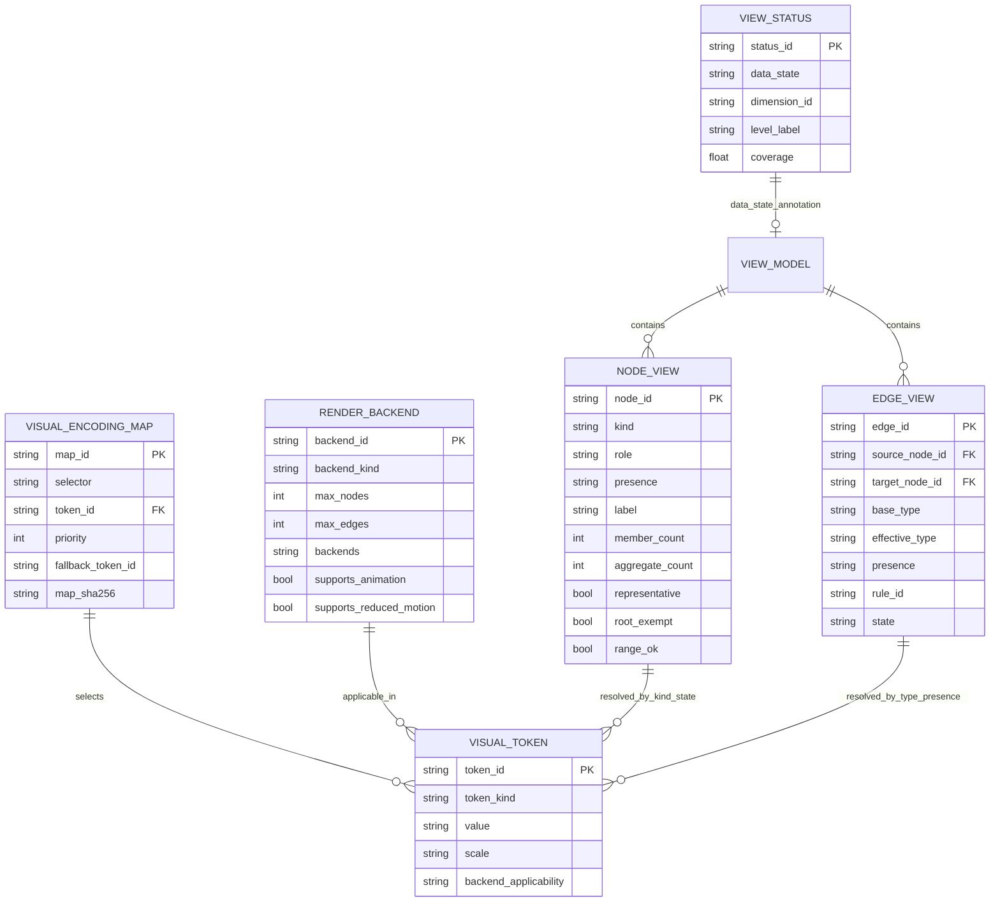
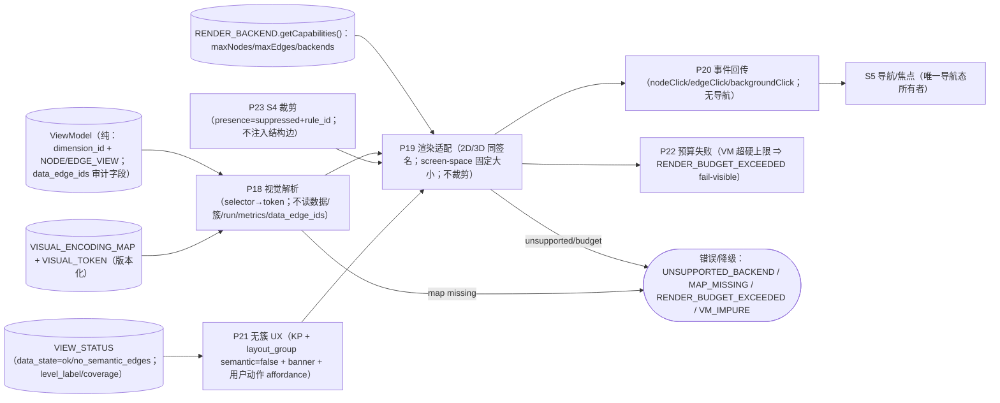

# S3 冻结前工程校核报告（SE · task-307，v1 冻结候选轮）

> **冻结对象**：`docs/design/multilevel-graph/S3-visual-v1.md`（sha256 `0ca4ea0e890aa7408a361ae97dbb4d8a8f06df60b1e191cbcb7d46ca5322cd6b`，112 行；修复后复跑版；旧版 `aa59739b…` 为修复前快照）。
> **证据链（只读）**：A-v2 `b8311e10…`、B-v2 `b3a6fdd8…`、异议-v2 `4783a113…`、`S3-RULINGS.md` `1d62fb48…`、`S3-charter.md`。
> **上游冻结**：`S0-terms-v1.md`（`241b1e1e…`）、`S1-dimensions-v1.md`（`6676c71d…`）、`S2-clustering-v1.md`（`92bb0041…`）；**工程图** `ENGINEERING-PLAN.md`（`977332e7…`，S0/S1/S2/S3 增量共 12 图）。
> **执行者**：`graph-se-architect`（SE 专家，domain=se）· **日期**：2026-11-03（Asia/Shanghai）
> **边界**：未改 A/B/v1/异议/RULINGS；未写产品代码；未改契约；未 commit。本文件为 task-307 交付；同步更新 `ENGINEERING-PLAN.md` 的 S3 增量（不覆盖 S0/S1/S2 冻结部分）。
> **结论**：**达到 S3 冻结工程门禁（是）**。复跑确认 **M-S3-1..12 全 PASS（12/12，`M_fail=[]`）**；首轮 2 FAIL（M-S3-1/M-S3-12）的修复已核过并转 PASS：VM `role∈{member}`（focus 瞬态不进 VM）、VM 白名单补 `layout_group?`/`aggregate_count?`。

---

## 0. 结论先行

### 0.1 M-S3-1..M-S3-12（编号严格按 `S3-visual-v1.md` §3）

| M | 判据 | 判定 | 证据（v1 节/行） |
|---|---|---|---|
| M-S3-1 | 节点类型/role | **PASS（复跑）** | v1:17 已改为 `kind∈{kp,cluster}`、singleton→kp、无 bridge；**VM node `role∈{member}`（只有 member）**；**hover/selected/focus 全部为渲染器/Presentation 瞬态、不进 VM**；S5 导航焦点留 GraphNavFrame/Presentation ⇒ 符合 S0-9/S1 D-4 |
| M-S3-2 | label 确定性/i18n | **PASS** | v1:23（S3-2）：`label=label_of(min canonical member id)`；i18n `cluster.more_members`/`cluster.root_label`；fallback `cluster_key[:8]`；禁 local_seq；跨 run 稳定；`label==deterministic_label(members,locale)` 可机检（R-S3-1/R-S3-10） |
| M-S3-3 | 簇公式/徽标/root | **PASS** | v1:22：`clamp(8+2.2·log2(member_count+1),12,28)`；badge=`member_count`；`expandable` chevron；`root_exempt` 虚线双环+「全库」 |
| M-S3-4 | KP 固定大小 | **PASS** | v1:27：KP **8px screen-space**、不按 degree/权重缩放；`range_ok=false` 失效样式；点击只发事件（U-20） |
| M-S3-5 | 层次/层标 | **PASS** | v1:32：VM `level_label`；渲染器只画**非交互**层标；面包屑/层级条/历史/切换归 Presentation/S5，不进 VM（R-S3-6） |
| M-S3-6 | 边 token/presence | **PASS** | v1:37：只画 `presence=shown`；`suppressed/unknown` 不画（禁幽灵边）；类型固定 token；bridge 仅 `state=bridge_only`；多类型分画 |
| M-S3-7 | 渲染接口/2D-3D 同签名 | **PASS** | v1:42：五方法 `getCapabilities/render/update/dispose/on`；`maxNodes/maxEdges/backends`；2D/3D 同签名；纯 VM；不取数/不重算簇；无 mount/setSelection（R-S3-4） |
| M-S3-8 | 事件最小/导航边界 | **PASS** | v1:47：`nodeClick{node_id,kind}`/`edgeClick{edge_id}`/`backgroundClick{}`；可选 hover/focus；payload 白名单无导航；导航只在 S5；2D/3D payload 一致 |
| M-S3-9 | 无簇 UX/layout_group | **PASS** | v1:52：`no_semantic_edges` 显示 KP；`layout_group`（`semantic=false`、非 cluster kind、无徽标/计数/展开语义）；banner+用户动作 affordance；不注入结构边/不伪造簇（R-S3-5） |
| M-S3-10 | 默认/全展开同源 | **PASS** | v1:57：同 DataSource/VM schema/Renderer；full 仅 ctx 不同+「全展开（兼容模式）」徽标；切换属 Presentation/S5；禁第二数据源/第二渲染器 |
| M-S3-11 | a11y/预算/降级 | **PASS** | v1:62-67：对比度 4.5/3、键盘路径、aria overlay、reduced-motion 0ms；`max_nodes=200/max_edges=400/60fps/≤180ms`（数值 S8 可调）；**S4 裁剪**、Renderer 只校验、超硬上限 `RENDER_BUDGET_EXCEEDED` fail-visible；WebGL 失败回退 2D |
| M-S3-12 | VM 白名单/禁读/覆盖矩阵/一致/图 | **PASS（复跑）** | v1:72 白名单已补 `nodes[].aggregate_count?` 与 `nodes[].layout_group?{semantic:false}`（且 layout_group 只在 no_semantic_edges、非 cluster、无徽标/计数）；`data_edge_ids` 允许 VM 审计但 Renderer 禁读、簇/run/dendrogram 不进 VM、U 覆盖齐、PLAN 12 图 `PARSE_OK` |

### 0.2 冻结工程门禁判定

**是**。`S3-charter.md` §7-2 要求「SE 工程校核 PASS（渲染接口/视觉编码/事件/预算/无簇 UX 的 ER/DFD/状态图增量，与 S0/S1/S2 一致）」；复跑 **`M_fail=[]`、12/12 PASS**，PLAN 12 图 + 报告 3 图同版本 mermaid 全部 `PARSE_OK`，故门禁条件 2 满足。

- 条件 1（A/B 独立完成 + 差异清单 + 异议关闭）：满足（A-v2/B-v2/异议-v2；R-S3-1..8 关闭，R-S3-9..11 由 Lead 补裁）；
- 条件 2（SE 工程校核 PASS）：**满足（本报告）**；
- 条件 3（Lead 独立机检）：待 Lead；
- 条件 4（与 S0/S1/S2 无冲突）：满足（§5）；
- 条件 5（冻结 v1 + 写决策）：待 Lead。

**残余非阻塞项（O-S3-3..O-S3-10）**：`no_semantic_edges` 状态透传（S4/S6a）、预算数值 S8、layout_group/`data_edge_ids` schema、3D DPI、label i18n 测试、aggregate_count 来源、VM schema 单源——均不阻塞 S3 冻结。
---

## 1. 方法与可复现证据

### 1.1 输入 sha256

| 文件 | sha256 |
|---|---|
| `S3-visual-v1.md` | `aa59739bf2fd2ad71efe1efc77bd39dfb13cf70d48a1a9ab16a94a79c6e68a9d` |
| `S3-visual-proposal-A-v2.md` | `b8311e10664a15c9e7325cd13b2cf44c9075e744443dd3ffe019afdbc775d2aa` |
| `S3-visual-proposal-B-v2.md` | `b3a6fdd84b2155c8c4e9ea9474418171710822c238dc1aa864087f5b6768f754` |
| `S3-objections-v2.md` | `4783a1131ac5395c2e6755b1186dd184bdf447be9f27ca8bff71af8c95f727ec` |
| `S3-RULINGS.md` | `1d62fb480294d5c53886f5c18dd3e2ab4861c3df1cff1c25ce24d4a39b68ce4e` |
| `S0-terms-v1.md` / `S1-dimensions-v1.md` / `S2-clustering-v1.md` | `241b1e1e…` / `6676c71d…` / `92bb0041…` |
| `ENGINEERING-PLAN.md` | `977332e7…`（S0/S1/S2/S3 增量共 12 图） |

### 1.2 环境与命令

```
node v24.21.0 ; python 3.12.4
mermaid = 仓库 vendored src/memoria/ui/static/app/vendor/mermaid.min.js
          11.16.0 ; sha256 9198f6322f37f242a3396fbda15bec75a053095f9a81175340a3bb63ebd41b76
jsdom 29.1.1

node <SE_DIR>/parse_mermaid.js docs/design/multilevel-graph/ENGINEERING-PLAN.md
node <SE_DIR>/parse_mermaid.js docs/design/multilevel-graph/S3-engineering-check.md
python <SE_DIR>/s3check_v1.py > s3check-v1.json
```

### 1.3 机检输出摘要

```
PLAN mermaid: blocks=12 ; ok=12 ; failedBlocks=0（S0 3 + S1 3 + S2 3 + S3 3）
本报告 mermaid: blocks=3 ; ok=3 ; failedBlocks=0（ER-04/ST-04/DF-04）
s3check_v1: M_fail=[M-S3-1, M-S3-12] ; 其余 10 PASS ; gate=否
```

---

## 2. M-S3 逐项证据（PASS 项要点）

### M-S3-2 label 确定性 — PASS
v1:23：`label=label_of(min canonical member id)`，>1 成员加 `cluster.more_members`，`root_exempt` 用 `cluster.root_label`，fallback `cluster_key[:8]`，禁 `local_seq`/run 序号；跨 run 同成员集稳定；机检 `label==deterministic_label(members,locale)`。A/B P1-1 已闭合。

### M-S3-3 簇视觉 — PASS
v1:22：半径公式、badge=member_count、chevron、root 虚线双环+「全库」；2D/3D 同 token；机检可断言公式/DOM 样式。

### M-S3-4 KP 视觉 — PASS
v1:27：KP 固定 8px screen-space（不按 degree/权重），`range_ok=false` 失效样式，点击只发事件；R-S3-7 闭合（P2-2 已消解）。

### M-S3-5 层次 — PASS
v1:32：VM `level_label`（非交互层标）；面包屑/层级条/历史/切换归 Presentation/S5；VM 无导航字段（S0-9/S1 D-4 语义）。

### M-S3-6 边视觉 — PASS
v1:37：只画 `presence=shown`；suppressed/unknown 不画（U-27 无幽灵边）；类型 token 固定；bridge 仅 edge state；2D/3D 同 token。

### M-S3-7 渲染接口 — PASS
v1:42：五方法 canonical（R-S3-4）；`getCapabilities()` 含 `maxNodes/maxEdges/backends`；2D/3D 同签名；纯 VM；不取数/不重算簇；无 `mount`/`setSelection`；无效 VM fail-visible。

### M-S3-8 事件 — PASS
v1:47：最小三事件+可选 hover/focus；payload 白名单；导航只在 S5；2D/3D payload 一致（现 3D 缺 edge_id 列为修复项）。

### M-S3-9 无簇 UX — PASS
v1:52：KP 显示；`layout_group` `semantic=false`、非 cluster kind、无徽标/计数/展开语义；banner+**仅用户动作** affordance；不注入结构边/不伪造簇（S2-12/R-S3-5）。

### M-S3-10 默认/全展开 — PASS
v1:57：同 DataSource/VM schema/Renderer；full 仅 ctx 差异+兼容徽标；切换 Presentation/S5；禁第二数据源/渲染器（S0-8）。

### M-S3-11 a11y/预算 — PASS
v1:62-67：WCAG 对比度/键盘/aria/reduced-motion；预算字段与 S4 裁剪归属（R-S3-2）；Renderer 只校验、硬上限 fail-visible；WebGL→2D 回退；数值默认归 S8（O-S3-1）。

---

## 3. 首轮 FAIL 修复核对（复跑 PASS）

### 3.1 M-S3-1 — VM `role=focus` 导航态（已修）
- 首轮证据：v1 旧版 `role∈{member,focus}`、`focus` 为 S5 导航焦点 ⇒ 违反 S0-9「VM 不含导航状态」/S1 D-4。
- 修复核对：v1:17 现为 **`role∈{member}`（v1 只有 member）**；hover/selected/**focus 全部为渲染器/Presentation 瞬态、不进 VM**；S5 导航焦点保存在 GraphNavFrame/Presentation。⇒ M-S3-1 PASS。

### 3.2 M-S3-12 — VM 白名单缺 `layout_group`/`aggregate_count`（已修）
- 首轮证据：v1:72 白名单无 `layout_group`（S3-8/R-S3-5 要求 VM 显式 `semantic=false`）与 `aggregate_count`（R-S3-9 取景层显式给出）。
- 修复核对：v1:72 节点白名单已含 **`aggregate_count?`** 与 **`layout_group?{semantic:false}`**；v1:52 仍要求 layout_group 只在 `no_semantic_edges`、非 cluster kind、无徽标/计数/展开语义；`data_edge_ids` 仅审计且 Renderer 禁读。⇒ M-S3-12 PASS。

## 4. 工程增量（与 `ENGINEERING-PLAN.md` §1.10/§2.9/§3.7 同步，已按 R-S3-9/10/11 更新）

### 4.1 ER-04（NODE_VIEW/EDGE_VIEW/VIEW_STATUS/VISUAL_TOKEN/MAP/RENDER_BACKEND）



落点：`kind∈{kp,cluster}`；`role` 按 R-S3-3（无 bridge；SE 建议 v1 收紧为 `{member}`/`focus` 移出 VM）；label 确定性（R-S3-1/R-S3-10）；KP 固定 screen-space（R-S3-11）；`layout_group`（semantic=false）与 `aggregate_count` **需进 VM 白名单**（M-S3-12 修项）；`data_edge_ids` 在 EDGE_VIEW 但 Renderer 禁读（R-S3-9）；`VIEW_STATUS` 独立 DTO 承载 `no_semantic_edges`/coverage/level_label 展示状态。

### 4.2 ST-04（渲染器生命周期/展示/交互/无簇态/预算失败）

```mermaid
stateDiagram-v2
    state Renderer {
        state Lifecycle {
            [*] --> Created
            Created --> Initialized : getCapabilities_ok
            Initialized --> Rendering : render(container, vm)
            Rendering --> Updating : update(vm, opts)
            Updating --> Rendering : frame_done
            Rendering --> Suspended : hidden_or_background
            Suspended --> Rendering : resume
            Created --> Unsupported : capabilities_missing
            Unsupported --> Initialized : fallback_backend_2d
            Rendering --> Failed : RENDER_BUDGET_EXCEEDED / invalid_vm
            Renderer --> Disposed : dispose
        }
        --
        state Presentation {
            [*] --> DefaultView
            DefaultView --> ExpandedAll : TOGGLE_EXPAND
            ExpandedAll --> DefaultView : TOGGLE_EXPAND
            DefaultView --> EmptyNoSemantic : VIEW_STATUS_no_semantic_edges
            EmptyNoSemantic --> DefaultView : VIEW_STATUS_ok
        }
        --
        state Interaction {
            [*] --> Idle
            Idle --> Hover : pointer_over_node_or_edge
            Hover --> Idle : pointer_out
            Idle --> Selected : click_emit_to_S5
            Selected --> Idle : backgroundClick_or_S5_clear
        }
    }
```

落点：hover/selected/focus 为渲染器/Presentation 瞬态（修 M-S3-1 后 `focus` 不得进 VM）；`RENDER_BUDGET_EXCEEDED`/invalid VM 显式失败态；无簇态由 `VIEW_STATUS.data_state` 驱动；导航状态只在 S5。

### 4.3 DF-04（视觉解析/渲染适配/事件/无簇/预算）



落点：P18 不读 `data_edge_ids`（R-S3-9）；P19 不裁剪、3D screen-space、拒绝读审计字段；P21 空态不伪造簇；P22 失败可见；P23 S4 裁剪单一归属（R-S3-2）；导航只在 S5；无第二数据源（S0-8）。

---

## 5. 与 S0/S1/S2 冻结条款一致性

| 条款 | v1 落点 | 判定 |
|---|---|---|
| S0-9 VM 纯度（无导航/模式/capabilities） | S3-6/S3-12：无 mode/nav/capabilities；VM `role∈{member}`，focus 瞬态不进 VM | **一致** |
| S0-9 `kind∈{kp,cluster}`；bridge 只 role/state | S3-1：kind 两类、无 bridge role；桥仅 edge state | **一致** |
| S0-9 2D/3D 同一接口 | S3-6/S3-11：同签名+capabilities；screen-space | **一致** |
| S1 D-4 VM 无切换/列表/历史/模式 | S3-12 白名单无 mode/nav/history；`level_label` 为展示串（S0-9 允许 level/view_family）；focus 瞬态不进 VM | **一致** |
| S1 R-S1-11 / R-3 `data_edge_ids` | S3-12：在 VM 可审计但 Renderer 禁读；`aggregate_count` 不遍历 | **一致（补白名单后闭合）** |
| S2 D-4 簇/run/dendrogram 不进 VM | S3-12：明确不进 VM | **一致** |
| S2-12 `no_semantic_edges` 合法/不伪造 | S3-8：KP+仅布局分组+banner+不伪造 | **一致** |
| S0-8 不得第二数据源 | S3-9：同 DataSource/VM/Renderer | **一致** |
| presence 三值 | S3-5：只画 shown、suppressed/unknown 不画 | **一致** |
| D-3 不写 sidecar | S3 无持久化；渲染器无写状态 | **一致** |

---

## 6. 未关闭项（O-S3-1..O-S3-10）

| # | 项 | 阻塞? | 归属 | 修复建议 |
|---|---|---|---|---|
| ~~O-S3-1~~ | ~~VM `role=focus` 导航态~~ | **已关闭（v1 role∈{member}；focus 瞬态不进 VM；M-S3-1 PASS）** | S3-v1（Lead 已修） | 保留历史 |
| ~~O-S3-2~~ | ~~VM 白名单缺字段~~ | **已关闭（v1 白名单已补 layout_group?/aggregate_count?；M-S3-12 PASS）** | S3-v1（Lead 已修） | 保留历史 |
| O-S3-3 | `no_semantic_edges` 状态如何到达 Presentation/VIEW_STATUS（v1 未写来源） | 非阻塞（S4/S6a） | S4/S6a | 明确 frame/present 透传 `data_state`；渲染器不猜（S3-12 已禁簇/run 进 VM） |
| O-S3-4 | 预算数值 200/400/60fps/180ms 属默认示例，S8 定终值 | 非阻塞（S8） | S8 | v1 标注非规范/可调；S8 定值 |
| O-S3-5 | `layout_group` schema 白名单/S6a 冻结（不得产生 cluster 视觉） | 非阻塞（S6a） | S6a | presentation-only、`semantic=false`、无徽标/展开/计数 |
| O-S3-6 | `data_edge_ids` Renderer 禁读的 schema 投影实现 | 非阻塞（S6a） | S6a | Renderer 输入投影剔除 `data_edge_ids`；机检 grep/schema |
| O-S3-7 | 3D screen-space 的 DPI 缩放断言 | 非阻塞（测试） | S6a/S8 | 2D/3D 同 VM 屏幕直径 token 单测（允许 DPI） |
| O-S3-8 | label fallback/i18n 唯一字符串测试 | 非阻塞（测试） | S6a | `cluster.more_members`/`cluster.root_label`/`cluster_key[:8]` 单测 |
| O-S3-9 | `aggregate_count` 来源与计算（不遍历 data_edge_ids） | 非阻塞（S4/S6a） | S4/S6a | 取景层显式字段；不得在渲染器遍历内部 |
| O-S3-10 | VM 白名单单点事实源（S3-12/S6a schema） | 非阻塞（S6a） | S6a | 冻结 schema；M-S3 机检以白名单为准 |

---

## 7. 冻结工程门禁判定与复跑记录

**判定：是（达到 `S3-charter §7` 工程门禁；条件 3/5 待 Lead）**

| 门禁条件 | 结果 |
|---|---|
| 1. A/B 独立完成 + 差异清单 + 异议关闭 | **满足**（A-v2/B-v2/异议-v2；R-S3-1..8 关闭，R-S3-9..11 由 Lead 补裁） |
| 2. SE 工程校核 PASS | **满足**（复跑 `M_fail=[]`；12/12 PASS；PLAN 12 图 + 报告 3 图 `PARSE_OK`） |
| 3. Lead 独立机检 | **待 Lead**（建议复跑 §7 命令 + 抽查 VM role/白名单、label 确定性、预算归属、无簇 UX） |
| 4. 与 S0/S1/S2 无冲突 | **满足**（§5） |
| 5. 冻结 v1 + 写决策 | **待 Lead** |

**复跑记录（2026-11-03T20:3x）**

- 对象：`S3-visual-v1.md` sha256 `0ca4ea0e890aa7408a361ae97dbb4d8a8f06df60b1e191cbcb7d46ca5322cd6b`（112 行；S3-1 role/瞬态、S3-12 VM 白名单已修）
- 命令与输出：

```
$ python s3check_v1.py
inputs.v1 = 0ca4ea0e…
summary   = {"M_fail": [], "M_pass": [M-S3-1..M-S3-12], "gate": "是"}

$ node parse_mermaid.js docs/design/multilevel-graph/ENGINEERING-PLAN.md
blocks=12 ; ok=12 ; failedBlocks=0
$ node parse_mermaid.js docs/design/multilevel-graph/S3-engineering-check.md
blocks=3 ; ok=3 ; failedBlocks=0
```

- 首轮 2 FAIL 的修复均已核过：M-S3-1（VM role={member}、focus 瞬态）、M-S3-12（白名单补 layout_group/aggregate_count）。
- 结论：**S3 冻结工程门禁达到（是）**；仅剩 Lead 独立机检与冻结决策。

## 8. 边界与后续

- 本报告只读 v1/A-v2/B-v2/异议-v2/RULINGS/S3-charter；未改这些文件；未写产品代码；未改契约；未 commit。
- 已更新 `ENGINEERING-PLAN.md` S3 增量（ER-04：label/i18n、KP screen-space、layout_group/aggregate_count 注、data_edge_ids 审计但 Renderer 禁读；DF-04：P18/P19/P23；ST-04：预算失败态/瞬态），未改 S0/S1/S2 冻结部分。
- 复跑已完成（本版）：M-S3 全 PASS、`M_fail=[]`、S3 工程门禁 = 是；首轮 2 FAIL 作为历史记录保留在 §3/§7。
- S4/S5/S6a/S8 分别接管：选择性渲染/裁剪、导航焦点、VM schema/契约、预算数值/测试。

---

---

---

## 附录 A — M-S3 机检脚本（SE 审计脚本，非产品代码；复跑版）

> 运行：`python s3check_v1.py > s3check-v1.json`；`BASE` 为本机仓库路径；只读输入、不写仓库。

````python
# -*- coding: utf-8 -*-
"""S3 冻结前工程校核机检（task-307）：对象 S3-visual-v1.md；A-v2/B-v2/异议-v2/RULINGS 为证据链。

M 编号严格按 S3-visual-v1.md §3（M-S3-1..M-S3-12）。
用法： python s3check_v1.py > s3check-v1.json
"""
import hashlib
import json
import os
import re

BASE = "D:/AAA_Jupyter/Memoria/docs/design/multilevel-graph/"
F = {
    "V1": "S3-visual-v1.md",
    "A2": "S3-visual-proposal-A-v2.md",
    "B2": "S3-visual-proposal-B-v2.md",
    "OBJ2": "S3-objections-v2.md",
    "RUL": "S3-RULINGS.md",
    "CH": "S3-charter.md",
    "S0": "S0-terms-v1.md",
    "S1": "S1-dimensions-v1.md",
    "S2": "S2-clustering-v1.md",
    "PLAN": "ENGINEERING-PLAN.md",
}
REQ_U = ["U-3", "U-5", "U-6", "U-15", "U-16", "U-18", "U-19", "U-20", "U-26", "U-27", "U-33"]


def rd(k):
    p = BASE + F[k]
    return open(p, encoding="utf-8").read() if os.path.exists(p) else None


def sha(k):
    p = BASE + F[k]
    return hashlib.sha256(open(p, "rb").read()).hexdigest() if os.path.exists(p) else None


def has(t, pat):
    return re.findall(pat, t or "", re.I | re.M)


v1 = rd("V1")
a2, b2, obj2, rul, ch, s0, s1, s2, plan = (rd(k) for k in F if k != "V1")
checks = []


def add(mid, status, evidence, note=""):
    checks.append({"id": mid, "status": status, "evidence": evidence, "note": note})


if not v1:
    print(json.dumps({"status": "WAITING_FOR_V1", "inputs": {k: sha(k) for k in F}}, ensure_ascii=False, indent=2))
    raise SystemExit(0)

# M-S3-1 节点类型/role
t = {"kind_two": bool(has(v1, r"kind\s*∈\s*\{?\s*kp.{0,10}cluster|kind ∈ \{kp, cluster\}")),
     "no_third": bool(has(v1, r"不得.{0,10}(第三|新增).{0,6}(节点类型|kind)|禁止第三")),
     "singleton_kp": bool(has(v1, r"singleton.{0,40}(kp|representative=false)")),
     "role_no_bridge": bool(has(v1, r"role\s*∈\s*\{?\s*member\s*\}?") and not has(v1, r"role\s*∈\s*\{[^}]*focus")
                             and bool(has(v1, r"无.{0,10}role=bridge|无 bridge|v1 无"))),
     "interaction_not_vm": bool(has(v1, r"(hover|selected).{0,60}(不进 VM|内部瞬态|瞬态)")),
     "focus_not_nav_vm": (not has(v1, r"role\s*∈\s*\{[^}]*focus"))
                         or bool(has(v1, r"focus.{0,40}(不进 VM|瞬态|Presentation|非导航)"))}
add("M-S3-1", "PASS" if all(t.values()) else "FAIL", t,
    "kind/role/singleton/交互态；role=focus 若为导航焦点且进 VM ⇒ 与 S0-9/S1 D-4 冲突")

# M-S3-2 label 确定性/i18n
t = {"min_member": bool(has(v1, r"min canonical member|最小 canonical.{0,6}成员")),
     "more_members_key": "cluster.more_members" in (v1 or ""),
     "root_key": "cluster.root_label" in (v1 or ""),
     "fallback_key": bool(has(v1, r"cluster_key\[:8\]|cluster_key 前 8|cluster_key\(:8\)")),
     "no_local_seq": bool(has(v1, r"禁止.{0,30}local_seq|local_seq.{0,30}(禁|不得|禁止)")),
     "cross_run": bool(has(v1, r"跨 run 稳定|同成员集.{0,20}稳定")),
     "deterministic_check": bool(has(v1, r"deterministic_label\(members"))}
add("M-S3-2", "PASS" if all(t.values()) else "FAIL", t, "label 确定性/i18n/fallback")

# M-S3-3 簇公式/徽标/root
t = {"formula": bool(has(v1, r"clamp\(8\s*\+\s*2\.2|8\s*\+\s*2\.2.{0,20}log2")),
     "badge": bool(has(v1, r"徽标.{0,20}member_count|badge.{0,20}member_count")),
     "root": bool(has(v1, r"root_exempt.{0,40}(全库|虚线|双环)")),
     "expand": bool(has(v1, r"chevron|expandable|展开"))}
add("M-S3-3", "PASS" if all(t.values()) else "FAIL", t, "簇大小/徽标/root/展开")

# M-S3-4 KP 固定大小
t = {"fixed_8": bool(has(v1, r"8px|固定.{0,6}8")),
     "screen_space": bool(has(v1, r"screen-space|屏幕空间")),
     "no_degree": bool(has(v1, r"不按.{0,20}degree|degree.{0,20}(不|无)|无 degree")),
     "range": bool(has(v1, r"range_ok")),
     "click_event": bool(has(v1, r"点击.{0,20}(只发|事件)"))}
add("M-S3-4", "PASS" if all(t.values()) else "FAIL", t, "KP 固定 8px/screen-space/无 degree")

# M-S3-5 层次/层标
t = {"level_label": "level_label" in (v1 or ""),
     "non_interactive": bool(has(v1, r"非交互.{0,10}层标|层标.{0,10}非交互")),
     "nav_presentation": bool(has(v1, r"面包屑|层级条|历史.{0,20}(Presentation|S5)")),
     "no_nav_vm": bool(has(v1, r"导航字段.{0,10}无|无导航字段|VM 无.{0,20}(导航|mode|history)"))}
add("M-S3-5", "PASS" if all(t.values()) else "FAIL", t, "level_label/导航归 Presentation")

# M-S3-6 边 token/presence
t = {"shown_only": bool(has(v1, r"只画.{0,10}shown|presence=shown")),
     "presence_three": all(x in (v1 or "") for x in ["shown", "suppressed", "unknown"]),
     "no_ghost": bool(has(v1, r"禁止幽灵边|不画.{0,10}幽灵|幽灵边")),
     "bridge_edge": bool(has(v1, r"bridge.{0,20}(state=bridge_only|仅叠加|边状态)")),
     "type_tokens": bool(has(v1, r"token 表|类型.{0,20}token"))}
add("M-S3-6", "PASS" if all(t.values()) else "FAIL", t, "边 token/presence/bridge 边状态")

# M-S3-7 渲染接口/2D-3D 同签名
t = {"methods": all(x in (v1 or "") for x in ["getCapabilities", "render(", "update(", "dispose(", "on("]),
     "same_sig": bool(has(v1, r"2D/3D.{0,20}(同签名|同一?签名)")),
     "caps": bool(has(v1, r"maxNodes") and has(v1, r"maxEdges") and has(v1, r"backends")),
     "no_mount": "mount(" not in (v1 or ""),
     "no_setselection": "setSelection" not in (v1 or ""),
     "vm_whitelist": bool(has(v1, r"VM 字段白名单|白名单"))}
add("M-S3-7", "PASS" if all(t.values()) else "FAIL", t, "五方法/同签名/capabilities/白名单")

# M-S3-8 事件最小/导航边界
t = {"events": all(x in (v1 or "") for x in ["nodeClick", "edgeClick", "backgroundClick"]),
     "no_nav_fields": bool(has(v1, r"payload.{0,40}(白名单|无).{0,20}(导航|mode|history)|无导航字段")),
     "s5_owner": bool(has(v1, r"导航动作只在 S5|导航.{0,20}S5")),
     "payload_same": bool(has(v1, r"2D/3D payload 一致|payload 一致"))}
add("M-S3-8", "PASS" if all(t.values()) else "FAIL", t, "事件集/payload/2D3D 一致")

# M-S3-9 无簇 UX/layout_group
t = {"no_semantic": "no_semantic_edges" in (v1 or ""),
     "layout_semantic_false": bool(has(v1, r"layout_group.{0,60}semantic=false|semantic=false")),
     "non_cluster": bool(has(v1, r"非 cluster kind|不是 cluster")),
     "banner": bool(has(v1, r"banner|尚无语义簇")),
     "user_action": bool(has(v1, r"仅用户动作|用户动作")),
     "no_fake": bool(has(v1, r"不伪造.{0,10}簇|绝不伪造")),
     "no_structural": bool(has(v1, r"不注入结构边|结构边.{0,20}(不得|不)"))}
add("M-S3-9", "PASS" if all(t.values()) else "FAIL", t, "无簇 UX/layout_group/不伪造")

# M-S3-10 默认/全展开同源
t = {"same_source": bool(has(v1, r"同 DataSource|同源|同一? DataSource")),
     "same_vm_renderer": bool(has(v1, r"同 VM schema|同 Renderer|同渲染器")),
     "toggle": bool(has(v1, r"全展开|ExpandedAll")),
     "no_second": bool(has(v1, r"禁止第二数据源|无第二数据源"))}
add("M-S3-10", "PASS" if all(t.values()) else "FAIL", t, "同源/全展开/无第二数据源")

# M-S3-11 a11y/预算/降级
t = {"contrast": bool(has(v1, r"对比度|≥4\.5:1|4\.5:1")),
     "keyboard": bool(has(v1, r"键盘|Tab/方向键")),
     "aria": "aria" in (v1 or ""),
     "reduced_motion": bool(has(v1, r"reduced-motion|prefers-reduced-motion")),
     "budget": bool(has(v1, r"max_nodes=200|max_nodes/max_edges|max_nodes")),
     "s4_trim": bool(has(v1, r"S4 负责选点|S4.{0,20}裁剪")),
     "renderer_no_trim": bool(has(v1, r"Renderer 只校验|不裁剪|不静默丢")),
     "fail_visible": "RENDER_BUDGET_EXCEEDED" in (v1 or ""),
     "webgl_fallback": bool(has(v1, r"WebGL.{0,20}(回退|fallback).{0,10}2D|回退 2D"))}
add("M-S3-11", "PASS" if all(t.values()) else "FAIL", t, "a11y/预算归属/失败可见/3D 回退")

# M-S3-12 VM 白名单/禁读/覆盖矩阵/一致/图
u_cov = {u: bool(has(v1, re.escape(u))) for u in REQ_U}
blocks = len(re.findall(r"```mermaid\n", plan or ""))
t = {"whitelist": bool(has(v1, r"VM 字段白名单")),
     "no_run_state": bool(has(v1, r"簇/run/dendrogram|run/dendrogram")),
     "data_edge_ids_renderer_reject": bool(has(v1, r"Renderer.{0,40}(不得读取|禁读|拒绝读取)")),
     "data_edge_ids_audit": bool(has(v1, r"data_edge_ids.{0,40}(审计|expand_data_edges)")),
     "aggregate_explicit": bool(has(v1, r"aggregate_count.{0,40}(显式|不遍历)")),
     "u_all": all(u_cov.values()),
     "plan_blocks": blocks == 12,
     "s0_consistency": bool(has(v1, r"S0/S1|R-3|R-S1-11|D-4|presence")),
     "layout_group_in_whitelist": "layout_group" in ((v1 or "")[(v1 or "").find("VM 字段白名单"):(v1 or "").find("VM 字段白名单") + 500]),
     "aggregate_count_in_whitelist": "aggregate_count" in ((v1 or "")[(v1 or "").find("VM 字段白名单"):(v1 or "").find("VM 字段白名单") + 500])}
add("M-S3-12", "PASS" if all(t.values()) else "FAIL", dict(t, u=u_cov, plan_blocks=blocks),
    "VM 白名单/data_edge_ids 禁读/覆盖矩阵/12 图；S3-8 的 layout_group 与 R-S3-9 的 aggregate_count 必须出现在 VM 白名单")

out = {"inputs": {k: sha(k) for k in F},
       "checks": checks,
       "R_S3": {k: bool(has(v1, k)) for k in [f"R-S3-{i}" for i in range(1, 12)]},
       "summary": {"M_fail": [c["id"] for c in checks if c["status"] == "FAIL"],
                   "M_pass": [c["id"] for c in checks if c["status"] == "PASS"],
                   "gate": "是" if not any(c["status"] != "PASS" for c in checks) else "否"}}
print(json.dumps(out, ensure_ascii=False, indent=2))
````

## 附录 B — 复跑原始输出（2026-11-03T20:3x 捕获）

> 注：下方为捕获时的原始输出；报告/计划 fileSha256 为捕获时值（此后仅追加附录/正文变化，图解析不变）。最终以磁盘为准。

```
$ node parse_mermaid.js docs/design/multilevel-graph/ENGINEERING-PLAN.md
{"kind":"meta","mermaidVersion":"11.16.0","mermaidSha256":"9198f6322f37f242a3396fbda15bec75a053095f9a81175340a3bb63ebd41b76","jsdomVersion":"29.1.1","node":"v24.21.0"}
{"kind":"file","file":"docs/design/multilevel-graph/ENGINEERING-PLAN.md","blocks":12,"fileSha256":"977332e7da1fae7e482fa5535603dce5b295c2a3785308204684a1ad24e53549"}
{"kind":"block","file":"docs/design/multilevel-graph/ENGINEERING-PLAN.md","index":1,"ok":true,"diagramType":"er"}
{"kind":"block","file":"docs/design/multilevel-graph/ENGINEERING-PLAN.md","index":2,"ok":true,"diagramType":"er"}
{"kind":"block","file":"docs/design/multilevel-graph/ENGINEERING-PLAN.md","index":3,"ok":true,"diagramType":"er"}
{"kind":"block","file":"docs/design/multilevel-graph/ENGINEERING-PLAN.md","index":4,"ok":true,"diagramType":"er"}
{"kind":"block","file":"docs/design/multilevel-graph/ENGINEERING-PLAN.md","index":5,"ok":true,"diagramType":"flowchart-v2"}
{"kind":"block","file":"docs/design/multilevel-graph/ENGINEERING-PLAN.md","index":6,"ok":true,"diagramType":"flowchart-v2"}
{"kind":"block","file":"docs/design/multilevel-graph/ENGINEERING-PLAN.md","index":7,"ok":true,"diagramType":"flowchart-v2"}
{"kind":"block","file":"docs/design/multilevel-graph/ENGINEERING-PLAN.md","index":8,"ok":true,"diagramType":"flowchart-v2"}
{"kind":"block","file":"docs/design/multilevel-graph/ENGINEERING-PLAN.md","index":9,"ok":true,"diagramType":"stateDiagram"}
{"kind":"block","file":"docs/design/multilevel-graph/ENGINEERING-PLAN.md","index":10,"ok":true,"diagramType":"stateDiagram"}
{"kind":"block","file":"docs/design/multilevel-graph/ENGINEERING-PLAN.md","index":11,"ok":true,"diagramType":"stateDiagram"}
{"kind":"block","file":"docs/design/multilevel-graph/ENGINEERING-PLAN.md","index":12,"ok":true,"diagramType":"stateDiagram"}
{"kind":"summary","failedBlocks":0}

$ node parse_mermaid.js docs/design/multilevel-graph/S3-engineering-check.md
{"kind":"meta","mermaidVersion":"11.16.0","mermaidSha256":"9198f6322f37f242a3396fbda15bec75a053095f9a81175340a3bb63ebd41b76","jsdomVersion":"29.1.1","node":"v24.21.0"}
{"kind":"file","file":"docs/design/multilevel-graph/S3-engineering-check.md","blocks":3,"fileSha256":"7d36aeac7f2066c1147c87a869458e98fadc28982e5f74bd43e4d594797834c7"}
{"kind":"block","file":"docs/design/multilevel-graph/S3-engineering-check.md","index":1,"ok":true,"diagramType":"er"}
{"kind":"block","file":"docs/design/multilevel-graph/S3-engineering-check.md","index":2,"ok":true,"diagramType":"stateDiagram"}
{"kind":"block","file":"docs/design/multilevel-graph/S3-engineering-check.md","index":3,"ok":true,"diagramType":"flowchart-v2"}
{"kind":"summary","failedBlocks":0}

$ python s3check_v1.py > s3check-v1-rerun.json
{
 "inputs": {
  "V1": "0ca4ea0e890aa7408a361ae97dbb4d8a8f06df60b1e191cbcb7d46ca5322cd6b",
  "A2": "b8311e10664a15c9e7325cd13b2cf44c9075e744443dd3ffe019afdbc775d2aa",
  "B2": "b3a6fdd84b2155c8c4e9ea9474418171710822c238dc1aa864087f5b6768f754",
  "OBJ2": "4783a1131ac5395c2e6755b1186dd184bdf447be9f27ca8bff71af8c95f727ec",
  "RUL": "1d62fb480294d5c53886f5c18dd3e2ab4861c3df1cff1c25ce24d4a39b68ce4e",
  "CH": "b6835a742b0840cd1b604c54c0e37008a3399e4a131729178d49aeef9af60184",
  "S0": "241b1e1e8b0a2fe6c8e1291e03a06c122d16cf71273d9e5d0d879f64ebf9ea78",
  "S1": "6676c71d09c5722c5c42252c63158878638e5f4480ce0dade4dd114b94f5a866",
  "S2": "92bb004190d3f93795fe4916cdf904f4dc7574eaaccb43eff9d63edb5b27a6c6",
  "PLAN": "a990a585b7f012ef7c0d76b413e4254429181201b49d98d4e17fd454a0e73e71"
 },
 "summary": {
  "M_fail": [],
  "M_pass": [
   "M-S3-1",
   "M-S3-2",
   "M-S3-3",
   "M-S3-4",
   "M-S3-5",
   "M-S3-6",
   "M-S3-7",
   "M-S3-8",
   "M-S3-9",
   "M-S3-10",
   "M-S3-11",
   "M-S3-12"
  ],
  "gate": "是"
 }
}
```
