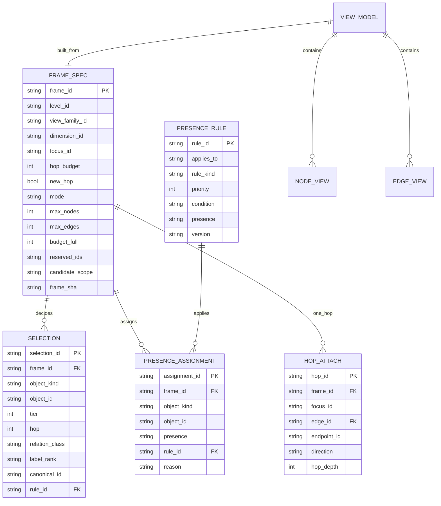
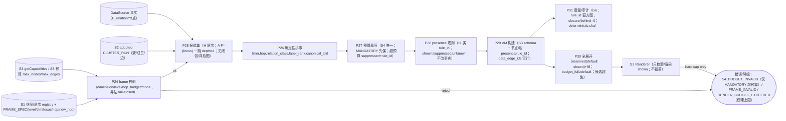
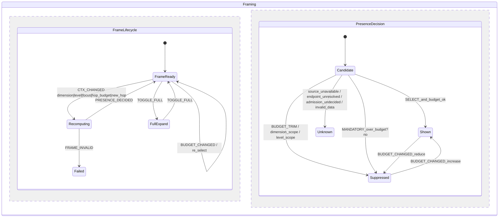

# S4 冻结前工程校核报告（SE · task-312，v1 冻结候选轮）

> **冻结对象**：`docs/design/multilevel-graph/S4-render-v1.md`（sha256 `2576f6c8472ce5175f6cb1fd878f782e2c128bde675b8925981ee0d63a3f5c94`，111 行；修复后复跑版；旧版 `2655043f…` 为修复前快照）。
> **证据链（只读）**：A-v2 `634cb9cf…`、B-v2 `048b9909…`、异议-v2 `a8f10629…`、`S4-RULINGS.md` `efa597aa…`、`S4-charter.md`；**S3 增补** `S3-ADDENDUM-1.md` `6007e47a…`。
> **上游冻结**：`S0-terms-v1.md`（`241b1e1e…`）、`S1-dimensions-v1.md`（`6676c71d…`）、`S2-clustering-v1.md`（`92bb0041…`）、`S3-visual-v1.md`（`0ca4ea0e…`）+ `S3-ADDENDUM-1`；**工程图** `ENGINEERING-PLAN.md`（`7b66355f…`，S0–S4 增量共 15 图）。
> **执行者**：`graph-se-architect`（SE 专家，domain=se）· **日期**：2026-11-03（Asia/Shanghai）
> **边界**：未改 A/B/v1/异议/RULINGS/S3-ADDENDUM；未写产品代码；未改契约；未 commit。本文件为 task-312 交付；同步更新 `ENGINEERING-PLAN.md` 的 S4 增量（不覆盖 S0–S3 冻结部分）。
> **结论**：**达到 S4 冻结工程门禁（是）**。复跑确认 **M-S4-1..12 全 PASS（12/12，`M_fail=[]`）**；首轮唯一 FAIL（M-S4-9）已修复：S4-9 补 `candidates(full) ⊇ candidates(default)` 前提、R-S4-7 四项机检、R-S4-9 失败/回退语义。

---

## 0. 结论先行

### 0.1 M-S4-1..M-S4-12（编号严格按 `S4-render-v1.md` §3）

| M | 判据 | 判定 | 证据（v1 节/行） |
|---|---|---|---|
| M-S4-1 | 唯一裁剪者 | **PASS** | v1:16-19（S4-1）：S4=Admission 是 presence 唯一产生者；只改取景不改事实/type/label/contain_kind；Renderer 只校验/渲染；旧「有边就画」被替代 |
| M-S4-2 | 排序/预算 | **PASS** | v1:21-24（S4-2）：排序键 `(tier,hop,relation_class,label_rank,canonical_id)`；`semantic<structural<navigation<reference`；`max_nodes/max_edges` S8；超预算 suppressed+rule_id；同输入同结果 |
| M-S4-3 | focus 一跳 | **PASS** | v1:26-29（S4-3）：`F={focus}`、`one_hop(F)={v \| ∃e∈E_relation(D)…}`、`base(F)=={focus}`、默认 `max_hop(shown)==1`、端点 kind∈{kp,cluster}、不闭包/不带背后图 |
| M-S4-4 | 无隐式 2 跳 | **PASS** | v1:31-34（S4-4）：tier2 只含 focus + H 同层节点，不含一跳端点的邻居；`hop≤hop_budget`；2 跳仅 S5 `EXPLICIT_NEW_HOP`/`new_hop=true` |
| M-S4-5 | 最小必选集/降级 | **PASS** | v1:36-39（S4-5）：A=`{focus}`；H=`{focus}∪first K children`；`K=MANDATORY_CONTEXT_CAP=2`；先保 MANDATORY，其余 suppressed+rule_id；仅 MANDATORY 超预算 `S4_BUDGET_INVALID`；S8 保证 `max_nodes≥1+K` |
| M-S4-6 | presence/rule_id/unknown | **PASS** | v1:41-44（S4-6）：三值；11 类 rule_id（含 `dimension.level.cross_layer`、`invalid.data` 等）；unknown 仅后 4 类（`endpoint.unresolved/source.unavailable/admission.undecided/invalid.data`）；unknown≠无关系；类型独立 |
| M-S4-7 | 维度接入 | **PASS** | v1:46-49（S4-7）：`frame_spec.dimension_id` 解析 S1；H 无 hop/contain 下钻；A=E_relation_min/hop 1-2；维度只改 presence；未知/保留维度 fail-closed |
| M-S4-8 | drill/跨层 | **PASS** | v1:51-54（S4-8）：drill=新 frame（level+1、focus=簇、hop 重置）；只读 S2 run、不重算簇；跨层非 H 边 `dimension.level.cross_layer` suppressed；多归属按当前 view_family |
| M-S4-9 | 全展开 subset 构造 | **PASS（复跑）** | v1:57-59（S4-9）：已补 **`candidates(full) ⊇ candidates(default)`** 前提；不成立 ⇒ `S4_BUDGET_INVALID` 或**显式回退 default**（禁止静默，R-S4-9）；R-S4-7 机检四项：候选超集、`reserved(full)==shown(default)`、`budget_full≥budget_default`、无第二数据源；subset 由构造保证 |
| M-S4-10 | VM 载体/S3 addendum | **PASS** | v1:61-64（S4-10）：AdmissionResult 携带全部候选节点/边 presence+rule_id；VM 按 S3 白名单投影；`S3-ADDENDUM-1` 扩展节点 `presence?/rule_id?`（view-status，不改 S3 核心）；Renderer 只渲染 shown；`data_edge_ids` 仍只审计/Renderer 禁读 |
| M-S4-11 | S5 边界 | **PASS** | v1:66-69（S4-11）：S4 纯取景函数；focus/selection/navigation 不进 VM；事件→S5；new_hop 仅 S5；S4 无导航状态机 |
| M-S4-12 | S1/S2 一致 + G6 + 图 | **PASS** | v1:71-74（S4-12）：presence 不改 type/label/contain_kind；A 不改变簇；run/簇不进 VM；多归属按 view_family；无簇不伪造/不注入结构边；G6（candidate/mandatory/shown 计数、rule_id 直方图、max_hop、closure/behind=0、deterministic sha、subset_ok、budget、candidate_scope）；U 覆盖齐；PLAN 15 图 `PARSE_OK` |

> 附：`X-ADD`（S3-ADDENDUM-1 节点 presence/rule_id 扩展）**PASS**：只加 view-status 字段、S3 核心不变、Renderer 只 shown、变更控制/身份记录明确。

### 0.2 冻结工程门禁判定

**是**。`S4-charter.md` §7-2 要求「SE 工程校核 PASS」；复跑 **`M_fail=[]`、12/12 PASS**，PLAN 15 图 + 报告 3 图同版本 mermaid 全部 `PARSE_OK`，故门禁条件 2 满足。

- 条件 1（A/B 独立完成 + 差异清单 + 异议关闭）：满足（A-v2/B-v2/异议-v2；R-S4-1..8 关闭；R-S4-9/10 由 Lead 补裁）；
- 条件 2（SE 工程校核 PASS）：**满足（本报告）**；
- 条件 3（Lead 独立机检）：待 Lead；
- 条件 4（与 S0–S3 无冲突）：满足（§5；addendum 记录项 O-S4-2 非阻塞）；
- 条件 5（冻结 v1 + 写决策）：待 Lead。

**残余非阻塞项（O-S4-2..O-S4-11）**：S3-ADDENDUM 登记、R-S4-9/10 补入 RULINGS、rule_id 命名统一、H 叶焦点 min、cluster 焦点 A 一跳边界、G6 canonical/字段（S6a/S8）——均不阻塞 S4 冻结。
---

## 1. 方法与可复现证据

### 1.1 输入 sha256

| 文件 | sha256 |
|---|---|
| `S4-render-v1.md` | `2655043f3b5cd738253e4399409e5359c7ba745abe89d223e756399c7945b536` |
| `S4-render-proposal-A-v2.md` | `634cb9cf064dc657e0f7eaa572f46bb5397b7dc18626be34f70c9fde688af2d2` |
| `S4-render-proposal-B-v2.md` | `048b9909dd4cd25b6111af19c7b170eb1cd7775f6740d5988b9be80d333d3117` |
| `S4-objections-v2.md` | `a8f1062978a90370c510a411ec0e46a28320a6f274557f9f649996b41e20fd18` |
| `S4-RULINGS.md` | `efa597aa5ec7491b8bd4d0747b7cf3d9d9f39d162785454875729354e0b20901` |
| `S3-ADDENDUM-1.md` | `6007e47a05eb5184c1d1bf7ae9627435a82c750c467247afbdaa58c58e31117d` |
| `S0/S1/S2/S3` | `241b1e1e…`/`6676c71d…`/`92bb0041…`/`0ca4ea0e…` |
| `ENGINEERING-PLAN.md` | `7b66355f…`（S0–S4 增量共 15 图） |

### 1.2 环境与命令

```
node v24.21.0 ; python 3.12.4
mermaid = 仓库 vendored src/memoria/ui/static/app/vendor/mermaid.min.js
          11.16.0 ; sha256 9198f6322f37f242a3396fbda15bec75a053095f9a81175340a3bb63ebd41b76
jsdom 29.1.1

node <SE_DIR>/parse_mermaid.js docs/design/multilevel-graph/ENGINEERING-PLAN.md
node <SE_DIR>/parse_mermaid.js docs/design/multilevel-graph/S4-engineering-check.md
python <SE_DIR>/s4check_v1.py > s4check-v1.json
```

### 1.3 机检输出摘要

```
PLAN mermaid: blocks=15 ; ok=15 ; failedBlocks=0（S0 3 + S1 3 + S2 3 + S3 3 + S4 3）
本报告 mermaid: blocks=3 ; ok=3 ; failedBlocks=0（ER-05/ST-05/DF-05）
s4check_v1: M_fail=[M-S4-9] ; 其余 11 PASS + X-ADD PASS ; gate=否
```

---

## 2. 首轮 FAIL 修复核对（复跑 PASS）

### M-S4-9 — subset 构造缺候选超集前提（已修）
- 首轮证据：S4-9 写了 reserved(default shown)+同排序填剩余+`budget_full≥budget_default`，但未写 full 候选集必须 ⊇ default 候选集；若 full 候选不是超集，reserved 中的 default shown 可能不存在，subset 无法由构造保证（强行补入会改 full 的 candidate_scope 语义）。
- 修复核对：v1:57 已补 **`candidates(full) ⊇ candidates(default)`**；不成立 ⇒ `S4_BUDGET_INVALID` 或**显式回退 default**（禁止静默，v1:59 R-S4-9）；v1:58 R-S4-7 机检四项（候选超集/`reserved(full)==shown(default)`/`budget_full≥budget_default`/无第二数据源）。⇒ M-S4-9 PASS。

## 3. PASS 项要点（工程落地证据）

- **M-S4-1 唯一裁剪**：S4=Admission，仅 S4 产生 presence/rule_id；Renderer 只渲染 shown；事实字段不变（S3 R-S3-2）。
- **M-S4-2 排序/预算**：冻结排序键与 relation_class 顺序；max_nodes/max_edges 与 S3 capabilities/S8 同源；同输入同 presence；超预算 suppressed+rule_id。
- **M-S4-3/M-S4-4 一跳边界**：F={focus} 严格；tier2 不含一跳端点邻居；默认 hop=1；2 跳仅 S5 `EXPLICIT_NEW_HOP`；S0-5/U-17/U-18 语义闭合。
- **M-S4-5 MANDATORY**：A={focus}、H={focus}+first 2 children；只有 MANDATORY 超预算才 fail，其余 suppressed；S8 保证 `max_nodes≥1+K`；可用性优先于整屏失败。
- **M-S4-6 presence/rule_id**：11 类 rule_id 闭合；unknown 仅 4 类；unknown≠无关系、suppressed=已知但取景不显示；类型独立（U-27）。
- **M-S4-7/M-S4-8 维度/层次**：dimension 只改 presence；H/A 输入分开；未知维度 fail-closed；drill 新 frame/hop 重置/不重算簇/跨层 suppressed/view_family 多归属。
- **M-S4-10 VM 载体**：AdmissionResult 全候选 presence+rule_id；VM 按 S3 白名单投影；节点 presence/rule_id 由 `S3-ADDENDUM-1`（view-status）承载；Renderer 只 shown；data_edge_ids 审计禁读。
- **M-S4-11 S5 边界**：S4 纯取景；导航/focus/selection 不进 VM；new_hop 仅 S5；S4 无状态机。
- **M-S4-12 一致/G6**：presence 不改事实；A 不改变簇；run/簇不进 VM；无簇不伪造/不注入结构边；G6 指标可复跑；U 覆盖齐。

---

## 4. 工程增量（与 `ENGINEERING-PLAN.md` §1.11/§2.10/§3.8 同步，已按 R-S4-9/10 + S3-ADDENDUM-1 更新）

### 4.1 ER-05（FRAME_SPEC/SELECTION/PRESENCE_RULE/PRESENCE_ASSIGNMENT/HOP_ATTACH）



落点：F={focus}（R-S4-1）；MANDATORY K=2（R-S4-10）；full reserved/default shown + candidate 超集（R-S4-9，**待 v1 补超集前提**）；候选全量 presence/rule_id（R-S4-4）；节点 presence/rule_id 按 `S3-ADDENDUM-1`；`hop_depth=1`/2 仅 new_hop；无簇/run 内部不进 VM。

### 4.2 DF-05（取景/选点/预算/presence/一跳/full）



落点：P25 严格 F={focus}/无隐式 2 跳；P27 MANDATORY+suppressed；P28 rule_id 枚举/unknown；P29 VM 载体+S3 addendum；P30 subset 构造（**必须带候选超集前提**）。

### 4.3 ST-05（frame 生命周期/presence 决策/全展开/降级）



落点：ctx/drill/new_hop ⇒ 新 frame 且 hop 重置；presence 决策确定；`MANDATORY` 超预算 ⇒ Failed(`S4_BUDGET_INVALID`)；其余超预算 suppressed；unknown≠suppressed；full 用 reserved 构造 subset；导航状态只在 S5。

---

## 5. 与 S0–S3 冻结条款一致性

| 条款 | v1 落点 | 判定 |
|---|---|---|
| S0-5 一跳（当前视图一条边，不闭包） | S4-3/S4-4：F={focus}、depth≤hop_budget、2 跳仅 S5 | **一致** |
| S0-6 presence 三值 + rule_id | S4-6：三值、11 类、unknown≠无关系 | **一致** |
| S0-8 无第二数据源 | S4-9：同 Admission/present；full candidate_scope 不直出 raw data | **一致（补候选超集后更强）** |
| S0 D-3 无 sidecar | S4 内存派生/审计；无产品写入 | **一致** |
| S1 H/A 定义 | S4-7：H 无 hop/contain 下钻；A=E_relation_min/hop 1-2；维度只 presence | **一致** |
| S1 D-4 VM 纯度 | S4-11：focus/selection/nav 不进 VM | **一致** |
| S1 R-S1-11/R-3 data_edge_ids | S4-10：仅审计/expand，Renderer 禁读 | **一致** |
| S2 run/簇不进 VM、A 不改簇 | S4-8/S4-12：只读 run、不重算、A 不改簇 | **一致** |
| S2 多归属/无簇 | S4-8/S4-12：按 view_family；无簇不伪造/不注入结构边 | **一致** |
| S3 R-S3-2 裁剪单一归属 | S4-1/S4-2：S4 唯一裁剪，Renderer 不裁剪 | **一致** |
| S3 R-S3-9 data_edge_ids 禁读 | S4-10：同 | **一致** |
| S3 VM 白名单 | S4-10 + `S3-ADDENDUM-1`：节点 presence/rule_id 扩展（view-status） | **一致（增补记录）** |
| presence 只改取景不改事实 | S4-1/S4-12：事实不变 | **一致** |

---

## 6. 未关闭项（O-S4-1..O-S4-10）

| # | 项 | 阻塞? | 归属 | 修复建议 |
|---|---|---|---|---|
| ~~O-S4-1~~ | ~~S4-9 缺候选超集前提~~ | **已关闭（v1 已补 + R-S4-7 四项机检 + R-S4-9 回退；M-S4-9 PASS）** | S4-v1（Lead 已修） | 保留历史 |
| O-S4-2 | `S3-ADDENDUM-1` 未在 `S3-FREEZE-RECORD`/决策索引登记（v1 称随 S4 冻结） | 非阻塞（记录） | Lead/S3 记录 | 在 S3 冻结记录/决策索引登记 addendum sha 与决策 |
| O-S4-3 | R-S4-9/R-S4-10 只在 v1，未写入 `S4-RULINGS.md` | 非阻塞（治理） | Lead | 把两条补入 RULINGS 或冻结记录 |
| O-S4-4 | rule_id 命名 `dimension.level.cross_layer` vs 早期 `level.cross_layer` 不统一 | 非阻塞（S6a） | S6a | 在 S6a/G6 冻结 canonical rule_id 表 |
| O-S4-5 | H MANDATORY `first K children` 未写 `min(children,K)`/叶焦点规则 | 非阻塞（S4/S8） | S4/S8 | 写明 K 受实际子数约束；叶焦点 MANDATORY={focus} |
| O-S4-6 | A 维度 cluster 焦点的一跳语义（cluster 无 E_relation 边时为空 vs 成员代理） | 非阻塞（S6a/S4） | S6a | 明确 cluster 焦点一跳边界；空视图合法或成员代理（需 S1） |
| O-S4-7 | subset 机检的候选超集/ G6 字段需 S6a 定义 | 非阻塞（S6a） | S6a | `candidate_superset_ok`、`reserved_equals_default_shown` |
| O-S4-8 | `budget_full≥budget_default` 与 S8 数值关系需 S8 校准 | 非阻塞（S8） | S8 | S8 定默认/全展开预算 |
| O-S4-9 | G6 deterministic sha 的 canonical 序列化未冻结 | 非阻塞（S6a） | S6a | 冻结 canonical JSON/sha 规则 |
| O-S4-10 | S4-9 full 若配置不满足候选超集，回退/失败语义需实现一致 | 非阻塞（实现） | S6a | fail-visible 或回退 default（不得静默改 scope） |
| O-S4-11 | v1 §2 第 80 行 R-S4-9 标注仍为「subset 构造」，与 §1 R-S4-9（候选超集失败/回退）编号语义重复 | 非阻塞（编辑） | S4-v1/冻结记录 | 冻结记录统一 R-S4-9 含义（§1 为准），§2 旧标注同步改措辞 |

---

## 7. 冻结工程门禁判定与复跑记录

**判定：是（达到 `S4-charter §7` 工程门禁；条件 3/5 待 Lead）**

| 门禁条件 | 结果 |
|---|---|
| 1. A/B 独立完成 + 差异清单 + 异议关闭 | **满足**（A-v2/B-v2/异议-v2；R-S4-1..8 关闭，R-S4-9/10 由 Lead 补裁） |
| 2. SE 工程校核 PASS | **满足**（复跑 `M_fail=[]`；12/12 PASS；PLAN 15 图 + 报告 3 图 `PARSE_OK`） |
| 3. Lead 独立机检 | **待 Lead**（建议复跑 §7 命令 + 抽查 F={focus}/MANDATORY/候选超集/R-S4-7 四项/VM 载体/addendum） |
| 4. 与 S0–S3 无冲突 | **满足**（§5） |
| 5. 冻结 v1 + 写决策 | **待 Lead** |

**复跑记录（2026-11-03T21:0x）**

- 对象：`S4-render-v1.md` sha256 `2576f6c8472ce5175f6cb1fd878f782e2c128bde675b8925981ee0d63a3f5c94`（111 行；S4-9 候选超集 + R-S4-7 四项机检 + R-S4-9 回退已修）
- 命令与输出：

```
$ python s4check_v1.py
inputs.v1 = 2576f6c8…
summary   = {"M_fail": [], "M_pass": [M-S4-1..M-S4-12, X-ADD], "gate": "是"}

$ node parse_mermaid.js docs/design/multilevel-graph/ENGINEERING-PLAN.md
blocks=15 ; ok=15 ; failedBlocks=0
$ node parse_mermaid.js docs/design/multilevel-graph/S4-engineering-check.md
blocks=3 ; ok=3 ; failedBlocks=0
```

- 首轮唯一 FAIL 的修复已核过：S4-9（候选超集前提 + R-S4-7 四项机检 + R-S4-9 失败/回退）。
- 结论：**S4 冻结工程门禁达到（是）**；仅剩 Lead 独立机检与冻结决策。

## 8. 边界与后续

- 本报告只读 v1/A-v2/B-v2/异议-v2/RULINGS/S3-ADDENDUM；未改这些文件；未写产品代码；未改契约；未 commit。
- 已更新 `ENGINEERING-PLAN.md` S4 增量（ER-05：FRAME_SPEC reserved/budget_full/candidate_scope、PRESENCE_ASSIGNMENT 全候选 + addendum 节点 presence、HOP_ATTACH F={focus}；DF-05：P24–P31、候选超集；ST-05：reserved subset/降级），未改 S0–S3 冻结部分。
- 复跑已完成（本版）：M-S4 全 PASS、`M_fail=[]`、S4 工程门禁 = 是；首轮 FAIL 作为历史核对保留（§2/§7）。
- S5/S6a/S8 分别接管：导航状态机（消费 S4 frame_spec/presence）、VM/schema/G6、预算数值与门禁。

---

---

---

---

## 附录 A — M-S4 机检脚本（SE 审计脚本，非产品代码；复跑版）

> 运行：python s4check_v1.py > s4check-v1.json；BASE 为本机仓库路径；只读输入、不写仓库。

``python
# -*- coding: utf-8 -*-
"""S4 冻结前工程校核机检（task-312）：对象 S4-render-v1.md；A-v2/B-v2/异议-v2/裁决/S3 增补为证据链。

M 编号严格按 S4-render-v1.md §3（M-S4-1..M-S4-12）。
用法： python s4check_v1.py > s4check-v1.json
"""
import hashlib
import json
import os
import re

BASE = "D:/AAA_Jupyter/Memoria/docs/design/multilevel-graph/"
F = {
    "V1": "S4-render-v1.md",
    "A2": "S4-render-proposal-A-v2.md",
    "B2": "S4-render-proposal-B-v2.md",
    "OBJ2": "S4-objections-v2.md",
    "RUL": "S4-RULINGS.md",
    "CH": "S4-charter.md",
    "S0": "S0-terms-v1.md",
    "S1": "S1-dimensions-v1.md",
    "S2": "S2-clustering-v1.md",
    "S3": "S3-visual-v1.md",
    "ADD": "S3-ADDENDUM-1.md",
    "PLAN": "ENGINEERING-PLAN.md",
}
REQ_U = ["U-5", "U-15", "U-16", "U-17", "U-18", "U-19", "U-21", "U-22", "U-27", "U-28", "U-31"]


def rd(k):
    p = BASE + F[k]
    return open(p, encoding="utf-8").read() if os.path.exists(p) else None


def sha(k):
    p = BASE + F[k]
    return hashlib.sha256(open(p, "rb").read()).hexdigest() if os.path.exists(p) else None


def has(t, pat):
    return re.findall(pat, t or "", re.I | re.M)


v1 = rd("V1")
rest = {k: rd(k) for k in F if k != "V1"}
checks = []


def add(mid, status, evidence, note=""):
    checks.append({"id": mid, "status": status, "evidence": evidence, "note": note})


if not v1:
    print(json.dumps({"status": "WAITING_FOR_V1", "inputs": {k: sha(k) for k in F}}, ensure_ascii=False, indent=2))
    raise SystemExit(0)

# M-S4-1 唯一裁剪者
t = {"admission": bool(has(v1, r"S4\s*=\s*Admission|S4.*Admission")),
     "only_s4": bool(has(v1, r"唯一.{0,10}(裁剪|presence)|只有 S4.{0,20}(产生|决定)")),
     "renderer_no_trim": bool(has(v1, r"Renderer.{0,40}(只校验|不裁剪|只渲染|无裁剪)")),
     "facts_unchanged": bool(has(v1, r"不改.{0,20}(事实|type|label|contain_kind)")),
     "no_raw_all": bool(has(v1, r"旧.{0,20}有边就画|替代|不再全量"))}
add("M-S4-1", "PASS" if all(t.values()) else "FAIL", t, "唯一裁剪者/事实不变")

# M-S4-2 排序/预算
t = {"sort_key": all(x in (v1 or "") for x in ["tier", "hop", "relation_class", "label_rank", "canonical_id"]),
     "class_order": bool(has(v1, r"semantic\s*<\s*structural\s*<\s*navigation\s*<\s*reference")),
     "budget": bool(has(v1, r"max_nodes|max_edges")),
     "deterministic": bool(has(v1, r"同输入同|两次运行.{0,20}(相同|一致)|可复算")),
     "suppressed_rule": bool(has(v1, r"suppressed\s*\+\s*rule_id|suppressed.{0,20}rule_id"))}
add("M-S4-2", "PASS" if all(t.values()) else "FAIL", t, "排序键/class 顺序/预算/确定性")

# M-S4-3 focus 一跳
t = {"f_focus": bool(has(v1, r"F\s*=\s*\{focus\}|基座集.{0,10}\{focus\}")),
     "base": bool(has(v1, r"base\(F\)\s*==\s*\{focus\}|base\(F\)")),
     "one_hop_def": bool(has(v1, r"one_hop\(F\).{0,80}E_relation")),
     "max_hop1": bool(has(v1, r"max_hop\(shown\).{0,20}==?\s*1|max_hop\(shown\)\s*≤")),
     "endpoint_kind": bool(has(v1, r"kind\s*∈\s*\{kp, ?cluster\}|kind∈\{kp,cluster\}")),
     "no_closure": bool(has(v1, r"不闭包|无闭包"))}
add("M-S4-3", "PASS" if all(t.values()) else "FAIL", t, "F={focus}/一跳/端点 kind")

# M-S4-4 无隐式 2 跳
t = {"tier2": bool(has(v1, r"tier2.{0,40}(基座|focus).{0,20}H|tier2.{0,20}不含.{0,20}邻居")),
     "hop_budget": bool(has(v1, r"hop\s*≤\s*hop_budget|hop≤hop_budget")),
     "default1": bool(has(v1, r"默认.{0,10}1|默认 1|hop_budget.{0,10}1")),
     "new_hop_s5": bool(has(v1, r"new_hop.{0,20}(仅|只).{0,10}S5|EXPLICIT_NEW_HOP.{0,20}S5")),
     "no_implicit": bool(has(v1, r"不得.{0,10}隐式|无隐式|禁止.{0,10}隐式"))}
add("M-S4-4", "PASS" if all(t.values()) else "FAIL", t, "无隐式 2 跳/2 跳仅 S5")

# M-S4-5 MANDATORY
t = {"formula": bool(has(v1, r"MANDATORY.{0,80}(focus).{0,80}children|H.{0,10}=\s*\{focus\}\s*∪\s*first")),
     "k2": bool(has(v1, r"K\s*=\s*MANDATORY_CONTEXT_CAP\s*=\s*2|MANDATORY_CONTEXT_CAP.{0,10}2")),
     "s8": bool(has(v1, r"S8.{0,40}max_nodes\s*≥\s*1\s*\+\s*MANDATORY_CONTEXT_CAP|max_nodes\s*≥\s*1\s*\+\s*K")),
     "only_mandatory_fail": bool(has(v1, r"仅 MANDATORY.{0,20}(超预算|失败)|只有 MANDATORY")),
     "budget_invalid": "S4_BUDGET_INVALID" in (v1 or ""),
     "suppress_others": bool(has(v1, r"其余.{0,20}suppressed|非必选.{0,20}suppressed"))}
add("M-S4-5", "PASS" if all(t.values()) else "FAIL", t, "MANDATORY 公式/K=2/仅必选失败")

# M-S4-6 presence/rule_id/unknown
rule_ids = ["dimension.sources", "dimension.direction", "cross_layer", "hop.budget", "node.budget",
            "edge.budget", "cluster.folded", "endpoint.unresolved", "source.unavailable",
            "admission.undecided", "invalid.data"]
t = {"three": all(x in (v1 or "") for x in ["shown", "suppressed", "unknown"]),
     "rule_enum": all(x in (v1 or "") for x in rule_ids),
     "unknown_only4": bool(has(v1, r"unknown.{0,30}(后 4|后4|仅由|只有).{0,40}(endpoint|source|admission|invalid)")),
     "unknown_not_none": bool(has(v1, r"unknown\s*≠\s*无关系|unknown.{0,20}不等于.{0,10}无关系")),
     "type_independent": bool(has(v1, r"类型.{0,10}独立|类型独立|同对多类型"))}
add("M-S4-6", "PASS" if all(t.values()) else "FAIL", t, "三值/11 rule_id/unknown 四类")

# M-S4-7 维度
t = {"frame_dim": bool(has(v1, r"frame_spec\.dimension_id|frame_spec.{0,20}dimension")),
     "h_a": bool(has(v1, r"H.{0,30}A.{0,30}E_relation|H=.*A=.*E_relation")),
     "only_presence": bool(has(v1, r"维度.{0,10}只.{0,10}presence|只改 presence")),
     "fail_closed": bool(has(v1, r"未知.{0,10}维度.{0,20}(fail|无输出)|fail-closed"))}
add("M-S4-7", "PASS" if all(t.values()) else "FAIL", t, "dimension 只改 presence/未知 fail-closed")

# M-S4-8 drill
t = {"new_frame": bool(has(v1, r"drill.{0,20}(新 frame|level\+1|level\s*\+\s*1)")),
     "hop_reset": bool(has(v1, r"hop.{0,10}重置|重置.{0,10}hop")),
     "no_recluster": bool(has(v1, r"不重算簇|只读.{0,10}S2 run|run.{0,10}只读")),
     "cross_layer": bool(has(v1, r"cross_layer|跨层")),
     "view_family": bool(has(v1, r"view_family|多归属"))}
add("M-S4-8", "PASS" if all(t.values()) else "FAIL", t, "drill/hop 重置/跨层/view_family")

# M-S4-9 subset 构造
t = {"same_present": bool(has(v1, r"同一.{0,20}Admission|同一.{0,10}present|同 Admission")),
     "reserved": bool(has(v1, r"reserved|保留")),
     "budget_full": bool(has(v1, r"budget_full\s*≥\s*budget_default|budget_full.*>.*budget_default")),
     "construct": bool(has(v1, r"构造.{0,10}保证|由构造保证")),
     "no_second_source": bool(has(v1, r"无第二数据源|不.{0,10}第二数据源")),
     "candidate_scope": bool(has(v1, r"candidate_scope")),
     "candidate_superset": bool(has(v1, r"candidates?\(full\).{0,20}(⊇|superset|超集)|候选.{0,10}超集"))}
add("M-S4-9", "PASS" if all(t.values()) else "FAIL", t,
    "subset 构造/reserved/budget_full；full 候选集必须显式 ⊇ default 候选集，否则 reserved 无法保留 default shown")

# M-S4-10 VM 载体 + addendum
t = {"all_candidates": bool(has(v1, r"AdmissionResult.{0,30}全部候选|全部候选节点")),
     "presence_rule_vm": bool(has(v1, r"VM.{0,40}presence\+rule_id|节点/边.{0,20}presence")),
     "addendum": bool(has(v1, r"S3-ADDENDUM-1")),
     "renderer_shown": bool(has(v1, r"Renderer.{0,20}(只|仅).{0,10}shown")),
     "data_edge_audit": bool(has(v1, r"data_edge_ids.{0,30}(审计|禁读)"))}
add("M-S4-10", "PASS" if all(t.values()) else "FAIL", t, "AdmissionResult/VM 投影/addendum")

# M-S4-11 S5 边界
t = {"pure": bool(has(v1, r"S4.{0,20}(纯取景|纯).{0,20}函数|纯取景函数")),
     "nav_not_vm": bool(has(v1, r"focus/selection/navigation.{0,20}(不进|不在).{0,10}VM|导航.{0,20}不进 VM")),
     "events_s5": bool(has(v1, r"事件.{0,10}→?\s*S5|事件.{0,10}到 S5")),
     "new_hop_s5": bool(has(v1, r"new_hop.{0,20}仅 S5")),
     "no_nav_state": bool(has(v1, r"S4 无导航状态|无导航状态机"))}
add("M-S4-11", "PASS" if all(t.values()) else "FAIL", t, "S4 纯取景/S5 边界")

# M-S4-12 S1/S2/G6/图
u_cov = {u: bool(has(v1, re.escape(u))) for u in REQ_U}
plan = rest.get("PLAN") or ""
blocks = len(re.findall(r"```mermaid\n", plan))
t = {"no_fact_change": bool(has(v1, r"presence.{0,20}不改.{0,20}(type|label|contain_kind|事实)")),
     "a_no_cluster": bool(has(v1, r"A.{0,20}不改变簇|A 不改簇")),
     "run_not_vm": bool(has(v1, r"run/簇.{0,10}不进 VM|run.{0,10}不进 VM|簇.{0,10}不进 VM")),
     "no_fake": bool(has(v1, r"不伪造|不注入结构边")),
     "g6": all(x in (v1 or "") for x in ["G6", "deterministic sha", "subset_ok", "rule_id 直方图"]),
     "u_all": all(u_cov.values()),
     "plan_blocks": blocks == 15}
add("M-S4-12", "PASS" if all(t.values()) else "FAIL", dict(t, u=u_cov, plan_blocks=blocks),
    "S1/S2 一致/G6/覆盖矩阵/PLAN 15 图")

addendum = rest.get("ADD") or ""
add("X-ADD", "PASS" if ("presence?" in addendum and "rule_id?" in addendum and "view-status" in addendum) else "FAIL",
    {"node_presence": "presence?" in addendum, "node_rule": "rule_id?" in addendum,
     "view_status": "view-status" in addendum, "renderer": "shown" in addendum},
    "S3-ADDENDUM-1 节点 presence/rule_id 扩展")

out = {"inputs": {k: sha(k) for k in F},
       "checks": checks,
       "R_S4": {k: bool(has(v1, k)) for k in [f"R-S4-{i}" for i in range(1, 11)] + ["S3-ADDENDUM-1"]},
       "summary": {"M_fail": [c["id"] for c in checks if c["status"] == "FAIL"],
                   "M_pass": [c["id"] for c in checks if c["status"] == "PASS"],
                   "gate": "是" if not any(c["status"] != "PASS" for c in checks) else "否"}}
print(json.dumps(out, ensure_ascii=False, indent=2))
``

## 附录 B — 复跑原始输出（2026-11-03T21:0x 捕获）

> 注：下方为捕获时的原始输出；报告/计划 fileSha256 为捕获时值（此后仅追加附录/正文变化，图解析不变）。最终以磁盘为准。

`
$ node parse_mermaid.js docs/design/multilevel-graph/ENGINEERING-PLAN.md
{"kind":"meta","mermaidVersion":"11.16.0","mermaidSha256":"9198f6322f37f242a3396fbda15bec75a053095f9a81175340a3bb63ebd41b76","jsdomVersion":"29.1.1","node":"v24.21.0"}
{"kind":"file","file":"docs/design/multilevel-graph/ENGINEERING-PLAN.md","blocks":15,"fileSha256":"7b66355fca310aa48723524bce5f62d4ee826acbb452deb7220c4a7d6e5747a3"}
{"kind":"block","file":"docs/design/multilevel-graph/ENGINEERING-PLAN.md","index":1,"ok":true,"diagramType":"er"}
{"kind":"block","file":"docs/design/multilevel-graph/ENGINEERING-PLAN.md","index":2,"ok":true,"diagramType":"er"}
{"kind":"block","file":"docs/design/multilevel-graph/ENGINEERING-PLAN.md","index":3,"ok":true,"diagramType":"er"}
{"kind":"block","file":"docs/design/multilevel-graph/ENGINEERING-PLAN.md","index":4,"ok":true,"diagramType":"er"}
{"kind":"block","file":"docs/design/multilevel-graph/ENGINEERING-PLAN.md","index":5,"ok":true,"diagramType":"er"}
{"kind":"block","file":"docs/design/multilevel-graph/ENGINEERING-PLAN.md","index":6,"ok":true,"diagramType":"flowchart-v2"}
{"kind":"block","file":"docs/design/multilevel-graph/ENGINEERING-PLAN.md","index":7,"ok":true,"diagramType":"flowchart-v2"}
{"kind":"block","file":"docs/design/multilevel-graph/ENGINEERING-PLAN.md","index":8,"ok":true,"diagramType":"flowchart-v2"}
{"kind":"block","file":"docs/design/multilevel-graph/ENGINEERING-PLAN.md","index":9,"ok":true,"diagramType":"flowchart-v2"}
{"kind":"block","file":"docs/design/multilevel-graph/ENGINEERING-PLAN.md","index":10,"ok":true,"diagramType":"flowchart-v2"}
{"kind":"block","file":"docs/design/multilevel-graph/ENGINEERING-PLAN.md","index":11,"ok":true,"diagramType":"stateDiagram"}
{"kind":"block","file":"docs/design/multilevel-graph/ENGINEERING-PLAN.md","index":12,"ok":true,"diagramType":"stateDiagram"}
{"kind":"block","file":"docs/design/multilevel-graph/ENGINEERING-PLAN.md","index":13,"ok":true,"diagramType":"stateDiagram"}
{"kind":"block","file":"docs/design/multilevel-graph/ENGINEERING-PLAN.md","index":14,"ok":true,"diagramType":"stateDiagram"}
{"kind":"block","file":"docs/design/multilevel-graph/ENGINEERING-PLAN.md","index":15,"ok":true,"diagramType":"stateDiagram"}
{"kind":"summary","failedBlocks":0}

$ node parse_mermaid.js docs/design/multilevel-graph/S4-engineering-check.md
{"kind":"meta","mermaidVersion":"11.16.0","mermaidSha256":"9198f6322f37f242a3396fbda15bec75a053095f9a81175340a3bb63ebd41b76","jsdomVersion":"29.1.1","node":"v24.21.0"}
{"kind":"file","file":"docs/design/multilevel-graph/S4-engineering-check.md","blocks":3,"fileSha256":"85bc115971bed8e90c2362eaf8c2e15c47fe5c12809319eb4d71e7db331f91f0"}
{"kind":"block","file":"docs/design/multilevel-graph/S4-engineering-check.md","index":1,"ok":true,"diagramType":"er"}
{"kind":"block","file":"docs/design/multilevel-graph/S4-engineering-check.md","index":2,"ok":true,"diagramType":"flowchart-v2"}
{"kind":"block","file":"docs/design/multilevel-graph/S4-engineering-check.md","index":3,"ok":true,"diagramType":"stateDiagram"}
{"kind":"summary","failedBlocks":0}

$ python s4check_v1.py > s4check-v1-rerun.json
{
 "inputs": {
  "V1": "2576f6c8472ce5175f6cb1fd878f782e2c128bde675b8925981ee0d63a3f5c94",
  "A2": "634cb9cf064dc657e0f7eaa572f46bb5397b7dc18626be34f70c9fde688af2d2",
  "B2": "048b9909dd4cd25b6111af19c7b170eb1cd7775f6740d5988b9be80d333d3117",
  "OBJ2": "a8f1062978a90370c510a411ec0e46a28320a6f274557f9f649996b41e20fd18",
  "RUL": "efa597aa5ec7491b8bd4d0747b7cf3d9d9f39d162785454875729354e0b20901",
  "CH": "3acc213c49a47313c86bfad9fbf1120147f8cdd18a9a32c45f963a8925905591",
  "S0": "241b1e1e8b0a2fe6c8e1291e03a06c122d16cf71273d9e5d0d879f64ebf9ea78",
  "S1": "6676c71d09c5722c5c42252c63158878638e5f4480ce0dade4dd114b94f5a866",
  "S2": "92bb004190d3f93795fe4916cdf904f4dc7574eaaccb43eff9d63edb5b27a6c6",
  "S3": "0ca4ea0e890aa7408a361ae97dbb4d8a8f06df60b1e191cbcb7d46ca5322cd6b",
  "ADD": "6007e47a05eb5184c1d1bf7ae9627435a82c750c467247afbdaa58c58e31117d",
  "PLAN": "d82844f19b754156604b8982da719e43fede6139810bcb6dee02a880db9ebfa9"
 },
 "summary": {
  "M_fail": [],
  "M_pass": [
   "M-S4-1",
   "M-S4-2",
   "M-S4-3",
   "M-S4-4",
   "M-S4-5",
   "M-S4-6",
   "M-S4-7",
   "M-S4-8",
   "M-S4-9",
   "M-S4-10",
   "M-S4-11",
   "M-S4-12",
   "X-ADD"
  ],
  "gate": "是"
 }
}
`
