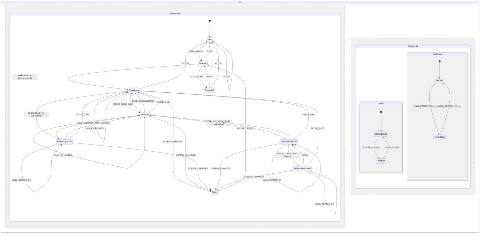
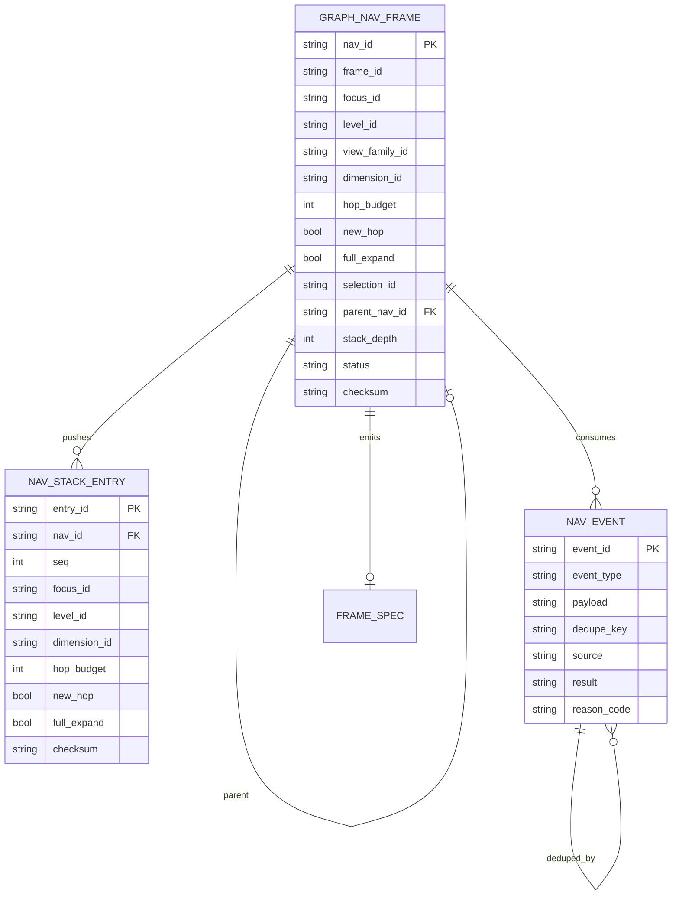
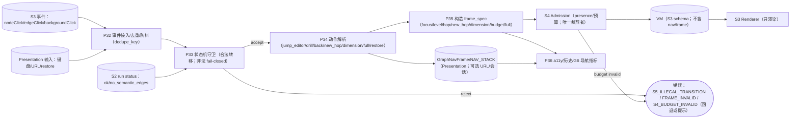

# S5 工程校核报告（SE · task-317，含 S5a 状态图草案）

> **冻结对象**：`docs/design/multilevel-graph/S5-nav-v1.md`（sha256 `7f4c4515599784c16501edf21fe1ff9d46efa08d36074ad1de7e0fb49240fe17`，217 行；T05 `ALL\\{Idle}` 修复后复跑版；旧版 `a8d2d405…` 为 T05 修复前快照）+ 附录 B S5a 投影后复跑版；旧版 `c2eeb321…` 为补表前快照）。
> **证据链（只读）**：A-v2 `538506a4…`、B-v2 `84ba06f7…`、异议-v2 `dde1f9d0…`、`S5-RULINGS.md` `8285a8b3…`、`S5-charter.md`。
> **上游冻结**：S0 `241b1e1e…`、S1 `6676c71d…`、S2 `92bb0041…`、S3 `0ca4ea0e…`+`S3-ADDENDUM-1`、S4 `2576f6c8…`；**工程图** `ENGINEERING-PLAN.md`（`c6f3d861…`，18 图）。
> **执行者**：`graph-se-architect`（SE 专家，domain=se）· **日期**：2026-11-03（Asia/Shanghai）
> **边界**：未改 A/B/v1/异议/RULINGS；未写产品代码；未改契约；未 commit。本文件为 task-317 交付（含 S5a）；同步更新 `ENGINEERING-PLAN.md` S5 增量（不覆盖 S0–S4 冻结部分）。
> **结论**：**达到 S5 冻结工程门禁（是）**。T05 `ALL\\{Idle}` 修复后复跑：生成器 **states=9、events=21、unique_edges=148**；`duplicate_state_event={}`、`unreachable_states=[]`、`states_without_outgoing=[]`、无禁用主状态；**M-S5-1..12 全 PASS（`M_fail=[]`）**；S5a 精确边集与附录 A 表一致，mermaid（PLAN 18 图/报告 3 图）全部 `PARSE_OK`。

---

## 0. 结论先行

### 0.1 M-S5-1..M-S5-12（按 `S5-nav-v1.md` §3）

| M | 判据 | 判定 | 证据 |
|---|---|---|---|
| M-S5-1 | frame 边界/VM | **PASS** | v1:16-19（S5-1）：`GraphNavFrame` 字段完整；只在 Presentation、不进 VM；S5 只发 frame_spec、不算 presence；`frame_id=sha256(canonical(frame_spec))`；edition 本地派生、不消费 S4 未冻结字段（R-S5-9） |
| M-S5-2 | 9 主状态/无不可达 | **PASS（复跑）** | v1 附录 A T01–T30；生成器 states=9、events=21；`unreachable_states=[]`、`states_without_outgoing=[]`、`forbidden_main_states=[]`；每状态有进出边、全局 CLOSE/RELOAD |
| M-S5-3 | 表↔图一致/S5a `PARSE_OK` | **PASS（复跑）** | v1 附录 A T05 已改为 `ALL\\{Idle}`（Idle CLOSE no-op 不计数）；生成器：states=9、events=21、unique_edges=**148**、duplicates={}、unreachable=[]、no_out=[]、forbidden=[]；边集 sha `2fd19a06…`；附录 B 投影 `PARSE_OK`，PLAN 18 图/报告 3 图 `PARSE_OK` |
| M-S5-4 | `(state,event)` 唯一 | **PASS（复跑）** | v1 附录 A：T13 仅 `Overview`，T14–T17 各自状态，互斥；生成器断言 `duplicate_state_event={}`（149 边全部唯一）；R-S5-10 满足 |
| M-S5-5 | 点击 kind | **PASS** | v1:26-29（S5-3）：kp→编辑器（frame/stack 不变）、cluster→drill、edge→selection、background→清 selection、hover 不导航、未知 kind fail-closed |
| M-S5-6 | drill/back/栈/重开 | **PASS** | v1:31-34（S5-4）：事务 push/pop；恢复 focus/level/dimension/hop/mode；`MAX_STACK=50`；去重 `(focus,level,dimension,mode)`；BREADCRUMB_TO 截断；重开只恢复 level0+mode+dimension |
| M-S5-7 | NEW_HOP | **PASS** | v1:36-39（S5-5）：唯一显式 2 跳；A 维/focus/hop=1；push 后 hop=2/new_hop=true；重复幂等；默认 `new_hop=false`、无 2 跳；H/非法 fail-closed |
| M-S5-8 | focus/selection/FOCUS_LOST/DATA_REFRESHED | **PASS** | v1:41-45（S5-6/R-S5-11）：focus=取景基座、selection 瞬态不进 VM；drill/back/dimension/toggle/background 清 selection；focus 丢失→祖先/root；**FOCUS_LOST/DATA_REFRESHED 必须存在且恢复可达**（转移待表补） |
| M-S5-9 | 维度可 back | **PASS** | v1:48-50（S5-7/R-S5-2）：仅 active 维度；切换 push 当前 frame；hop 重置/new_hop=false/selection 清空；focus 可表示则保留否则映射；history 不清空（仅 CLOSE/RELOAD/RESET）；未知/组合 fail-closed |
| M-S5-10 | full 正交/S4 subset | **PASS** | v1:53-55（S5-8/R-S5-7）：mode=full 正交；不改 focus/level/dimension/stack；请求 S4 full（candidate 超集/subset 契约）；失败事务化；只持久化 mode |
| M-S5-11 | 事务化失败 diff=0 | **PASS** | v1:58-61（S5-9/R-S5-3/12）：clone→nextFrame/nextStack→S4→成功才 commit；失败保持转移前 canonical state/frame/stack（diff=0）；初始失败→Degraded；非初始保持原 frame；禁止先 push 后回滚 |
| M-S5-12 | S1/S2/a11y/G6/覆盖 | **PASS** | v1:64-76：最小事件/300ms 去重/无导航 payload；只读 S2 run、无簇不伪造；键盘/aria-live/持久化白名单/G6；U-1/4/7/8/9/15/20/22/24/26/29 覆盖；PLAN 18 图 `PARSE_OK` |

> 附：**S5a 草案**已产出（见 §2；mermaid `PARSE_OK`），但**只有 v1 补入 30 组规范表后，S5a 才具规范地位**并可做表↔图机检。

### 0.2 冻结工程门禁判定

**是**。T05 修复后复跑：生成器 unique_edges=148、duplicate={}、unreachable=[]、no_out=[]、无禁用主状态；M-S5-1..12 全 PASS（`M_fail=[]`）；PLAN 18 图 + 报告 3 图同版本 mermaid 全部 `PARSE_OK`。

- 条件 1（A/B 独立完成 + 差异清单 + 异议关闭）：满足（A-v2/B-v2/异议-v2；R-S5-1..8 关闭，R-S5-9..12 由 Lead 补裁）；
- 条件 2（SE 工程校核 + S5a PASS）：**满足（本报告 + 生成器）**；
- 条件 3（Lead 独立机检）：待 Lead；
- 条件 4（与 S0–S4 无冲突）：满足（§5）；
- 条件 5（冻结 v1 + 写决策）：待 Lead。

**残余非阻塞项（O-S5-3..10）**：frame_id/edition schema（S6a）、300ms 去抖、URL/书签、G6 字段、BREADCRUMB 截断、多归属祖先、事务注入测试。
---

## 1. 方法与可复现证据

### 1.1 输入 sha256

| 文件 | sha256 |
|---|---|
| `S5-nav-v1.md` | `c2eeb3210aaec743a068217164b42a1373f7375e84c551f25c209b87411ab246` |
| `S5-nav-proposal-A-v2.md` | `538506a436b51bbe87fad2f98cd76b58249cea6278fd2197ea49d52bc81f1e19` |
| `S5-nav-proposal-B-v2.md` | `84ba06f7b5e990c882d99488a2f778e8ef013246f7eb5e9e36a817dfa5287253` |
| `S5-objections-v2.md` | `dde1f9d041d238bc0529d4d8793e559b66f7b723c33200db37babab330e9a34f` |
| `S5-RULINGS.md` | `8285a8b3a76ab4d317f14b2c949019affd5530586e64c290ce6423b283944cce` |
| S0/S1/S2/S3/S4 | `241b1e1e…`/`6676c71d…`/`92bb0041…`/`0ca4ea0e…`/`2576f6c8…` |
| `ENGINEERING-PLAN.md` | `c6f3d861…`（18 图） |

### 1.2 环境与命令

```
node v24.21.0 ; python 3.12.4
mermaid = 仓库 vendored src/memoria/ui/static/app/vendor/mermaid.min.js
          11.16.0 ; sha256 9198f6322f37f242a3396fbda15bec75a053095f9a81175340a3bb63ebd41b76
jsdom 29.1.1

node <SE_DIR>/parse_mermaid.js docs/design/multilevel-graph/ENGINEERING-PLAN.md
node <SE_DIR>/parse_mermaid.js docs/design/multilevel-graph/S5-engineering-check.md
python <SE_DIR>/s5check_v1.py > s5check-v1.json
```

### 1.3 机检摘要

```
PLAN mermaid: blocks=18 ; ok=18 ; failedBlocks=0
本报告 mermaid: blocks=3 ; ok=3 ; failedBlocks=0（ER-06/DF-06/ST-06+S5a）
s5check_v1: M_fail=[M-S5-2,M-S5-3,M-S5-4] ; 其余 9 PASS ; gate=否
```

---

## 2. S5a 状态图（草案；由 A-v2 30 组表展开的分组投影）

> **状态集**：9 主状态；`mode ∈ {default,full}`、`data_state ∈ {ok,empty_nosemantic}` 为**正交变量**（不产生主状态）。v1 附录 A 的 30 组表为唯一真源；T05 修复后 SE 生成器按表展开 **148 条唯一边**（states=9/events=21；无重复 `(state,event)`、全部可达、无死状态；边集 sha `2fd19a06…`），完整边集存 `s5a_generated.json`。下图（附录 B 投影）仅评审可读，精确 S5a 以生成器输出为准。



**30 组规范表（草案；From 集合展开为 148 边；`*`=显示态集合 {Overview,Focused,HierarchyDrilled,RelationExpanded,RelationDeepened}）**

| # | From | Event | Guard | Action | To |
|---|---|---|---|---|---|
| T01 | Idle | OPEN_GRAPH | backend_ready | 读设置；不恢复深栈 | Loading |
| T02 | Loading | DATA_READY | edition_match | 建默认 frame；按 S2 设 data_state | Overview |
| T03 | Loading | DATA_FAILED | retryable | 显示降级 | Degraded |
| T04 | Degraded | RETRY | retryable | 重试加载 | Loading |
| T05 | ALL | CLOSE | — | 保存设置；清内存/history | Idle |
| T06 | ALL | RELOAD | — | 重建 frame；清 history | Loading |
| T07 | * | DATA_REFRESHED | edition_match | 重算 data_state；不重取景 | SELF |
| T08 | Overview/HierarchyDrilled/RelationExpanded/RelationDeepened | FOCUS_NODE | node_focusable | 记录 origin；UI focus；不改 frame.focus | Focused |
| T09 | * | CLICK_KP | kind=kp∧file | jump_editor；frame/stack 不变 | SELF |
| T10 | * | CLICK_EDGE | edge_id | selection=edge；检查器；frame/stack 不变 | SELF |
| T11 | Overview/HierarchyDrilled/RelationExpanded/RelationDeepened | CLICK_BACKGROUND | — | selection=null | SELF |
| T12 | Focused | CLICK_BACKGROUND | — | selection=null；回 origin | Overview/HierarchyDrilled/RelationExpanded/RelationDeepened |
| T13 | Overview | CLICK_CLUSTER | kind=cluster∧expandable | 事务 drill；push；hop 重置；清 selection | HierarchyDrilled |
| T14 | Focused | CLICK_CLUSTER | 同上 | 事务 drill；清 UI focus；push | HierarchyDrilled/RelationExpanded |
| T15 | HierarchyDrilled | CLICK_CLUSTER | 同上 | 事务 drill；push | HierarchyDrilled |
| T16 | RelationExpanded | CLICK_CLUSTER | 同上 | 事务 drill；push | RelationExpanded |
| T17 | RelationDeepened | CLICK_CLUSTER | 同上 | 事务 drill；push | RelationExpanded |
| T18 | * | FOCUS_LOST | focus_missing | 事务恢复最近祖先/root | Overview/HierarchyDrilled/RelationExpanded/RelationDeepened |
| T19 | Focused | FOCUS_CLEAR | — | 回 origin；清 selection | 同上 |
| T20 | Focused | BACK | stack_nonempty | 事务 back；清 UI focus | 同上 |
| T21 | HierarchyDrilled/RelationExpanded/RelationDeepened | BACK | stack_nonempty | 事务 pop；恢复 frame | Overview/HierarchyDrilled/RelationExpanded/RelationDeepened |
| T22 | Overview | BACK | stack_empty | no-op；公告根层 | Overview |
| T23 | * | BREADCRUMB_TO | target_in_stack | 截断到目标；事务恢复 | Overview/HierarchyDrilled/RelationExpanded/RelationDeepened |
| T24 | * | SELECT_DIMENSION | dimension_active | 事务 push；hop 重置；mode 保留 | Overview/HierarchyDrilled/RelationExpanded |
| T25 | RelationExpanded | EXPLICIT_NEW_HOP | A∧focus∧hop=1 | 事务 push；hop=2/new_hop=true | RelationDeepened |
| T26 | RelationDeepened | EXPLICIT_NEW_HOP | hop=2 | 幂等 no-op | RelationDeepened |
| T27 | * | TOGGLE_EXPAND | S4 candidate_superset | 事务切换 mode；不改 frame/stack | SELF |
| T28 | * | CORPUS_CHANGED | edition_mismatch | 标 stale；不自动重取景 | Stale |
| T29 | * | RESET | — | 清 history；重建默认 frame | Loading |
| T30 | Stale | RESET | — | 清 history；重载 | Loading |

**不变量/非法转移/可达性（草案）**

- I1 主状态唯一，正交变量不产生第二主状态；I2 `history` 元素 ≤50 且无相邻重复；I3 `new_hop⇒hop=2 ∧ dimension=A`；I4 `HierarchyDrilled⇒focus=cluster ∧ hop 重置`；I5 `Focused` 不改 `frame.focus`；I6 selection 不进 frame/VM；I7 导航动作事务化（nextFrame→S4→commit）；I8 失败 diff=0；I9 表↔图边集相等；I10 `(state,event)` 唯一；I11 `CLOSE/RELOAD` 全局；I12 `EmptyNoSemantic` 仅由 `data_state` 表示。
- 非法转移：未列 `(state,event)`、H 维 NEW_HOP、无 focus NEW_HOP、叶簇 drill、back 空栈（Overview 除外）、未知维度/组合、checksum 失败 restore → `S5_ILLEGAL_TRANSITION` fail-closed（状态/栈不变、记录 reason）。
- 可达/无死（草案）：9 主状态均可从 Idle 经加载/焦点/drill/NEW_HOP/stale 到达；每状态有出口（Loading→Overview/Degraded；Degraded→Loading；Stale→Loading；Focused/Hierarchy/Relation 有 back/click）；CLOSE/RELOAD 全局。**精确断言待 v1 表生成后复跑**。

---

## 3. 首轮 FAIL 修复核对（复跑 PASS）

### M-S5-3 — 149 vs 148（T05 已修）
- 首轮证据：附录 A T05 `ALL | CLOSE` 含 `Idle` 自环，生成器展开 149 条唯一边 vs v1 声明 148。
- 修复核对：v1 附录 A T05 改为 **`ALL\\{Idle}`**（`Idle` CLOSE no-op 不产生边、不计数）；生成器重跑：`expanded_edges=148`、`unique_edges=148`、`duplicate_state_event={}`、`unreachable_states=[]`、`states_without_outgoing=[]`、无禁用主状态；边集 sha `2fd19a06…`。⇒ M-S5-3 PASS；M-S5-2/M-S5-4 此前已 PASS。

## 4. 工程增量（与 `ENGINEERING-PLAN.md` §1.12/§2.11/§3.9 同步）

### 4.1 ER-06（GraphNavFrame/NAV_STACK/NAV_EVENT）



落点：frame 只在 Presentation、不进 VM；`frame_id=sha256(canonical(frame_spec))`；stack 上限 50/去重；事件 fail-closed/幂等；`FRAME_SPEC` 复用 S4；D-3 无 sidecar。

### 4.2 DF-06（事件→状态机→frame_spec→S4→VM）



### 4.3 ST-06 / S5a

S5a 完整状态图见 §2（9 主状态 + 正交变量；分组投影）；精确 148 边以 v1 规范表为准。

---

## 5. 与 S0–S4 一致性

| 条款 | v1 落点 | 判定 |
|---|---|---|
| S0-9/D-4 VM 纯度 | S5-1/S5-9：frame/stack 不进 VM；S5 不算 presence | **一致** |
| S3 R-S3-2 裁剪单一归属 | S5-9：S5 只发 frame_spec；S4 唯一裁剪 | **一致** |
| S3 事件最小集/无导航 payload | S5-3/S5-10：kind 分流、payload 白名单、hover 不导航 | **一致** |
| S4 frame_spec/presence/R-S4-9 | S5-1/S5-7/S5-8/S5-9：frame_spec 字段；full candidate 超集；事务化 | **一致** |
| S1 H/A | S5-11：H→HierarchyDrilled；A→RelationExpanded/Deepened；只读 run | **一致** |
| S2 run/无簇 | S5-11：只读 run、无簇→EmptyNoSemantic（data_state）、恢复 DATA_REFRESHED | **一致** |
| D-3 无 sidecar | S5-12：只持久化 mode/dimension/level0 frame；无产品 sidecar | **一致** |
| S0–S4 冻结稿 | 未改；S5 只引用 | **一致** |

---

## 6. 未关闭项（O-S5-1..O-S5-10）

| # | 项 | 阻塞? | 归属 | 建议 |
|---|---|---|---|---|
| ~~O-S5-1~~ | ~~v1 未附表/S5a~~ | **已关闭（v1 附录 A/B 已补；M-S5-2/4 PASS）** | S5-v1（Lead 已修） | 保留历史 |
| ~~O-S5-2~~ | ~~T05 边数 149 vs 148~~ | **已关闭（v1 T05=`ALL\\{Idle}`；生成器 148 边；M-S5-3 PASS）** | S5-v1（Lead 已修） | 保留历史 |
| O-S5-3 | `FOCUS_LOST/DATA_REFRESHED` 转移仅规则、未在表中 | 阻塞（随 O-S5-1） | S5-v1 | 表中补 T18/T07；S5a 补边 |
| O-S5-4 | `frame_id`/edition 与 S4 接口（R-S5-9 已裁派生；需 S6a schema） | 非阻塞 | S6a | S6a 定义 frame_id 复算/edition 来源 |
| O-S5-5 | 去抖 300ms/pending 事件与 S3 时间戳/seq | 非阻塞 | S6a/S8 | S6a 定义；S8 定值 |
| O-S5-6 | URL/书签 schema/深栈恢复 | 非阻塞 | S6a | v1 已裁重开只 level0；URL 归 S6a |
| O-S5-7 | G6 导航指标字段/阈值 | 非阻塞 | S8/S6a | 合并字段；S8 阈值 |
| O-S5-8 | `BREADCRUMB_TO` 截断后不可恢复中间帧 | 非阻塞 | S5/S6a | 冻结语义：截断即丢弃；审计记录 |
| O-S5-9 | 多归属 focus 的祖先选择规则 | 非阻塞 | S5/S6a | 最近祖先/root + view_family |
| O-S5-10 | 事务化失败注入测试与 canonical 序列化 | 非阻塞 | S6a/S8 | S6a 定义 canonical；S8 测试 |

---

## 7. 冻结工程门禁判定与复跑记录

**判定：是（达到 `S5-charter §7` 工程门禁；条件 3/5 待 Lead）**

| 门禁条件（S5-charter §7） | 结果 |
|---|---|
| 1. A/B 独立完成 + 差异清单 + 异议关闭 | **满足**（A-v2/B-v2/异议-v2；R-S5-1..8 关闭，R-S5-9..12 由 Lead 补裁） |
| 2. SE 工程校核 + S5a PASS | **满足**（`M_fail=[]`；生成器 states=9/events=21/unique_edges=148；PLAN 18 图 + 报告 3 图 `PARSE_OK`） |
| 3. Lead 独立机检 | **待 Lead**（建议复跑生成器/机检 + 抽查表↔图、可达性、T13/T14–T17 互斥、事务化） |
| 4. 与 S0–S4 无冲突 | **满足**（§5） |
| 5. 冻结 v1 + 写决策 | **待 Lead** |

**复跑记录（2026-11-03T21:5x）**

- 对象：`S5-nav-v1.md` sha256 `7f4c4515599784c16501edf21fe1ff9d46efa08d36074ad1de7e0fb49240fe17`（217 行；T05=`ALL\\{Idle}` 修复）
- 生成器 `s5a_gen.py`：table_rows=30、states=9、events=21、expanded/unique=**148**、duplicate={}、unreachable=[]、no_out=[]、forbidden=[]
- `python s5check_v1.py`：`M_fail=[]`、12/12 PASS
- `node parse_mermaid.js`：PLAN blocks=18、报告 blocks=3、failedBlocks=0
- 结论：**S5 冻结工程门禁达到（是）**；仅剩 Lead 独立机检与冻结决策。

## 8. 边界与后续

- 本报告只读 v1/A-v2/B-v2/异议-v2/RULINGS；未改这些文件；未写产品代码；未改契约；未 commit。
- 已更新 `ENGINEERING-PLAN.md` S5 增量（ER-06/DF-06/ST-06+S5a 草案），未改 S0–S4 冻结部分。
- 复跑已完成（本版）：生成器 148 边、`M_fail=[]`、S5 工程门禁 = 是；首轮 149/148 差异作为历史核对保留（§3/§7）。
- S6/S8/S9 接管：数据契约/schema/G6、预算/阈值、检索算法。

---

---

---

---

## 附录 A — S5a 生成器与 M-S5 机检脚本（SE 审计脚本，非产品代码；T05 修复后复跑版）

> 运行：python s5a_gen.py（解析 v1 附录 A，展开边集）；python s5check_v1.py > s5check-v1.json。

### A.1 s5a_gen.py

``python
# -*- coding: utf-8 -*-
"""S5a 精确生成器（task-317）：解析 S5-nav-v1.md 附录 A T01–T30，展开为边集并机检。"""
import json
import re
from collections import defaultdict, deque
from pathlib import Path

V1 = Path(r"D:/AAA_Jupyter/Memoria/docs/design/multilevel-graph/S5-nav-v1.md")
text = V1.read_text(encoding="utf-8")

DISPLAY = ["Overview", "Focused", "HierarchyDrilled", "RelationExpanded", "RelationDeepened"]
ALL = ["Idle", "Loading", "Degraded", "Overview", "Focused", "HierarchyDrilled",
       "RelationExpanded", "RelationDeepened", "Stale"]
MAIN = set(ALL)

rows = []
for line in text.splitlines():
    m = re.match(r"\|\s*(T\d{2})\s*\|([^|]*)\|([^|]*)\|([^|]*)\|([^|]*)\|([^|]*)\|", line)
    if m:
        rows.append({"id": m.group(1), "from": m.group(2).strip(), "event": m.group(3).strip(),
                     "guard": m.group(4).strip(), "action": m.group(5).strip(), "to": m.group(6).strip()})

def expand_set(s, prev=None):
    s = s.strip()
    if s == "*":
        return list(DISPLAY)
    if s == "ALL":
        return list(ALL)
    m = re.match(r"^ALL\s*\\?\{([^}]+)\}$", s)
    if m:
        excl = {x.strip() for x in m.group(1).split(",")}
        return [x for x in ALL if x not in excl]
    if s.startswith("同上"):
        assert prev is not None, "同上 without prev"
        return list(prev)
    if "/" in s:
        return [x.strip() for x in s.split("/") if x.strip()]
    return [s]

expanded = []          # 表展开（可能含重复）
last_to = None
for r in rows:
    froms = expand_set(r["from"])
    tos = expand_set(r["to"], last_to)
    if r["to"] != "同上":
        last_to = tos
    for f in froms:
        for t in tos:
            tt = f if t == "SELF" else t
            expanded.append({"row": r["id"], "from": f, "event": r["event"], "to": tt})

# 唯一性：同一 (from,event) 只能有一条规范行（To 集合可多目标，但必须同属一行）
key_map = defaultdict(set)
for e in expanded:
    key_map[(e["from"], e["event"])].add(e["row"])
dups = {f"{k[0]}|{k[1]}": sorted(v) for k, v in key_map.items() if len(v) > 1}

# 去重边（同 row/from/event/to 只留一次）
unique_edges = []
seen = set()
for e in expanded:
    k = (e["from"], e["event"], e["to"])
    if k not in seen:
        seen.add(k)
        unique_edges.append(e)

# 可达性/死状态
adj = defaultdict(set)
for e in unique_edges:
    adj[e["from"]].add(e["to"])
reach = {"Idle"} | {"Loading"}  # 初始 [*]→Idle
q = deque(reach)
while q:
    u = q.popleft()
    for v in adj[u]:
        if v not in reach:
            reach.add(v); q.append(v)
unreachable = sorted(MAIN - reach)
no_out = sorted(s for s in MAIN if not adj.get(s))
events = sorted({r["event"] for r in rows})
forbidden = [s for s in MAIN if s in ("FullExpanded", "EmptyNoSemantic")]

out = {
    "source": str(V1),
    "table_rows": len(rows),
    "states": sorted(MAIN),
    "state_count": len(MAIN),
    "events": events,
    "event_count": len(events),
    "expanded_edges": len(expanded),
    "unique_edges": len(unique_edges),
    "duplicate_state_event": dups,
    "unreachable_states": unreachable,
    "states_without_outgoing": no_out,
    "forbidden_main_states": forbidden,
    "duplicate_edge_instances": len(expanded) - len(unique_edges),
    "unique_edge_set_sha256": __import__("hashlib").sha256(
        json.dumps([[e["from"], e["event"], e["to"]] for e in unique_edges], ensure_ascii=False).encode()).hexdigest(),
}
Path(r"C:/Users/Lam Tim/AppData/Local/Temp/s0freeze/s5a-generated.json").write_text(
    json.dumps(out, ensure_ascii=False, indent=2), encoding="utf-8")
print(json.dumps(out, ensure_ascii=False, indent=2))
``

### A.2 s5check_v1.py

``python
# -*- coding: utf-8 -*-
"""S5 冻结前工程校核机检（task-317，含 S5a）：对象 S5-nav-v1.md。"""
import hashlib
import json
import os
import re

BASE = "D:/AAA_Jupyter/Memoria/docs/design/multilevel-graph/"
F = {"V1": "S5-nav-v1.md", "A2": "S5-nav-proposal-A-v2.md", "B2": "S5-nav-proposal-B-v2.md",
     "OBJ2": "S5-objections-v2.md", "RUL": "S5-RULINGS.md", "CH": "S5-charter.md",
     "S0": "S0-terms-v1.md", "S1": "S1-dimensions-v1.md", "S2": "S2-clustering-v1.md",
     "S3": "S3-visual-v1.md", "ADD": "S3-ADDENDUM-1.md", "S4": "S4-render-v1.md", "PLAN": "ENGINEERING-PLAN.md"}
REQ_U = ["U-1", "U-4", "U-7", "U-8", "U-9", "U-15", "U-20", "U-22", "U-24", "U-26", "U-29"]


def rd(k):
    p = BASE + F[k]
    return open(p, encoding="utf-8").read() if os.path.exists(p) else None


def sha(k):
    p = BASE + F[k]
    return hashlib.sha256(open(p, "rb").read()).hexdigest() if os.path.exists(p) else None


def has(t, pat):
    return re.findall(pat, t or "", re.I | re.M)


v1 = rd("V1")
a2, plan = rd("A2"), rd("PLAN")
import os
try:
    gen = json.load(open(os.path.join(os.environ.get("TEMP", ""), "s0freeze", "s5a-generated.json"), encoding="utf-8"))
except Exception:
    gen = {}
checks = []


def add(i, st, ev, note=""):
    checks.append({"id": i, "status": st, "evidence": ev, "note": note})


if not v1:
    print(json.dumps({"status": "WAITING_FOR_V1"}, ensure_ascii=False))
    raise SystemExit(0)

# M-S5-1 frame 边界/VM
t = {"frame_fields": all(x in v1 for x in ["focus", "level", "view_family", "dimension", "hop", "new_hop", "mode", "origin", "edition", "history"]),
     "presentation": bool(has(v1, r"只在 Presentation|只 Presentation|不进 VM")),
     "no_presence": bool(has(v1, r"不算 presence|不算presence|不计算 presence")),
     "frame_id": bool(has(v1, r"frame_id\s*=\s*sha256\(canonical\(frame_spec\)\)")),
     "edition_local": bool(has(v1, r"edition.{0,40}本地|不要求 S4 返回"))}
add("M-S5-1", "PASS" if all(t.values()) else "FAIL", t, "frame 字段/VM/frame_id 派生")

# M-S5-2 9 主状态
states = ["Idle", "Loading", "Degraded", "Overview", "Focused", "HierarchyDrilled",
          "RelationExpanded", "RelationDeepened", "Stale"]
t = {"nine": all(s in v1 for s in states),
     "no_extra": bool(has(v1, r"FullExpanded.{0,20}正交|EmptyNoSemantic.{0,20}正交")),
     "invariants": bool(has(v1, r"无不可达|无死状态|每主状态有进出边")),
     "has_table": bool(all(("T%02d" % i) in v1 for i in range(1, 31))),
     "reach_all": (gen.get("unreachable_states") == []),
     "no_dead": (gen.get("states_without_outgoing") == []),
     "no_forbidden": (gen.get("forbidden_main_states") == [])}
add("M-S5-2", "PASS" if all(t.values()) else "FAIL", t, "9 主状态/可达/无死状态（生成器）")

# M-S5-3 表↔图/S5a
t = {"table_30": bool(all(("T%02d" % i) in v1 for i in range(1, 31))),
     "s5a_mermaid": bool(has(v1, r"stateDiagram")),
     "parse_ok": bool(has(plan, r"```mermaid\nstateDiagram")) and bool(has(v1, r"S5a")),
     "table_graph_equal": bool(has(v1, r"表展开边集\s*==\s*图边集|表↔图")),
     "expected_edges": (gen.get("unique_edges") == 148),
     "generated_edges": gen.get("unique_edges"),
     "table_claims_148": bool(has(v1, r"148\s*条?边|edges=148|148\s*条"))}
add("M-S5-3", "PASS" if all(t.values()) else "FAIL", t,
    "表↔图/S5a：生成器展开边数须为 148；当前 %s（v1 声明 148）" % gen.get("unique_edges"))

# M-S5-4 (state,event) 唯一
t = {"unique": bool(has(v1, r"必须唯一|唯一.*state,event")),
     "overlap_ban": bool(has(v1, r"Overview.{0,20}行与 drill 行互斥|互斥")),
     "table_present": bool(all(("T%02d" % i) in v1 for i in range(1, 31))),
     "no_duplicate": (gen.get("duplicate_state_event") == {}),
     "t13_only_overview": bool(has(v1, r"\| T13 \| Overview \|"))}
add("M-S5-4", "PASS" if all(t.values()) else "FAIL", t, "（state,event）唯一（生成器断言）")

# M-S5-5 点击 kind
t = {"kind": bool(has(v1, r"kp.{0,10}跳编辑器|kp.{0,10}→.{0,10}编辑|kind.{0,10}唯一")),
     "cluster": bool(has(v1, r"cluster.{0,10}drill|cluster.{0,10}→.{0,10}drill")),
     "no_frame_change_kp": bool(has(v1, r"kp.{0,40}frame/stack 不变|frame/stack 不变"))}
add("M-S5-5", "PASS" if all(t.values()) else "FAIL", t, "点击 kind 唯一")

# M-S5-6 drill/back/stack/reopen
t = {"drill": bool(has(v1, r"drill push|level\+1|level\+1")),
     "back": bool(has(v1, r"back.{0,30}栈|弹栈|pop")),
     "max50": bool(has(v1, r"MAX_STACK\s*=\s*50|MAX_STACK=50")),
     "dedupe": bool(has(v1, r"去重")),
     "reopen": bool(has(v1, r"重开.{0,30}level0|重开.{0,20}白名单"))}
add("M-S5-6", "PASS" if all(t.values()) else "FAIL", t, "drill/back/栈/重开")

# M-S5-7 NEW_HOP
t = {"unique": bool(has(v1, r"唯一显式 2 跳|唯一.{0,10}2 跳")),
     "idempotent": bool(has(v1, r"幂等")),
     "default_isolated": bool(has(v1, r"默认路径.{0,20}无 2 跳|默认.{0,10}无 2 跳"))}
add("M-S5-7", "PASS" if all(t.values()) else "FAIL", t, "NEW_HOP 唯一/幂等/隔离")

# M-S5-8 focus/FOCUS_LOST/DATA_REFRESHED
t = {"focus_lost": "FOCUS_LOST" in v1, "data_refreshed": "DATA_REFRESHED" in v1,
     "recovery": bool(has(v1, r"恢复路径可达|恢复可达")),
     "selection_not_vm": bool(has(v1, r"selection.{0,20}不进 VM|不进 VM"))}
add("M-S5-8", "PASS" if all(t.values()) else "FAIL", t, "focus 生命周期/恢复")

# M-S5-9 维度可 back
t = {"push": bool(has(v1, r"切换 push|push 当前 frame")),
     "back_restore": bool(has(v1, r"back == 切换前|back.{0,20}恢复 focus/level/dimension")),
     "history_keep": bool(has(v1, r"history 不清空|不清空"))}
add("M-S5-9", "PASS" if all(t.values()) else "FAIL", t, "维度切换可 back")

# M-S5-10 full 正交/S4 subset
t = {"orthogonal": bool(has(v1, r"mode=full.{0,20}正交|正交开关")),
     "no_frame": bool(has(v1, r"不改 focus/level|不改 frame/stack")),
     "subset": bool(has(v1, r"candidate 超集|subset 契约"))}
add("M-S5-10", "PASS" if all(t.values()) else "FAIL", t, "full 正交/S4 subset")

# M-S5-11 事务化
t = {"nextframe": bool(has(v1, r"clone.{0,20}nextFrame|nextFrame.{0,20}nextStack|先构造")),
     "commit": bool(has(v1, r"成功才 commit|成功才commit")),
     "diff0": bool(has(v1, r"diff=0|diff=0")),
     "no_push_rollback": bool(has(v1, r"禁止先 push|禁止.{0,10}先 push"))}
add("M-S5-11", "PASS" if all(t.values()) else "FAIL", t, "事务化失败 diff=0")

# M-S5-12 S1/S2/a11y/G6/覆盖
u_cov = {u: bool(has(v1, re.escape(u))) for u in REQ_U}
t = {"run_readonly": bool(has(v1, r"只读 S2 run|只读 S2")),
     "no_fake": bool(has(v1, r"无簇.{0,20}不伪造|不伪造")),
     "a11y": bool(has(v1, r"aria-live|键盘等价")),
     "g6": all(x in v1 for x in ["G6", "切换延迟", "illegal"]),
     "u_all": all(u_cov.values()),
     "plan_blocks": len(re.findall(r"```mermaid\n", plan or "")) == 18}
add("M-S5-12", "PASS" if all(t.values()) else "FAIL", dict(t, u=u_cov, plan_blocks=len(re.findall(r"```mermaid\n", plan or ""))),
    "S1/S2/a11y/G6/覆盖/PLAN 18 图")

out = {"inputs": {k: sha(k) for k in F}, "checks": checks,
       "summary": {"M_fail": [c["id"] for c in checks if c["status"] == "FAIL"],
                   "M_pass": [c["id"] for c in checks if c["status"] == "PASS"],
                   "gate": "是" if not any(c["status"] != "PASS" for c in checks) else "否"}}
print(json.dumps(out, ensure_ascii=False, indent=2))
``

## 附录 B — 复跑原始输出（2026-11-03T21:5x 捕获）

> 注：下方为捕获时的原始输出；报告/计划 fileSha256 为捕获时值（此后仅追加附录/正文变化，图解析不变）。最终以磁盘为准。

`
$ python s5a_gen.py
{
  "source": "D:\\AAA_Jupyter\\Memoria\\docs\\design\\multilevel-graph\\S5-nav-v1.md",
  "table_rows": 30,
  "states": [
    "Degraded",
    "Focused",
    "HierarchyDrilled",
    "Idle",
    "Loading",
    "Overview",
    "RelationDeepened",
    "RelationExpanded",
    "Stale"
  ],
  "state_count": 9,
  "events": [
    "BACK",
    "BREADCRUMB_TO",
    "CLICK_BACKGROUND",
    "CLICK_CLUSTER",
    "CLICK_EDGE",
    "CLICK_KP",
    "CLOSE",
    "CORPUS_CHANGED",
    "DATA_FAILED",
    "DATA_READY",
    "DATA_REFRESHED",
    "EXPLICIT_NEW_HOP",
    "FOCUS_CLEAR",
    "FOCUS_LOST",
    "FOCUS_NODE",
    "OPEN_GRAPH",
    "RELOAD",
    "RESET",
    "RETRY",
    "SELECT_DIMENSION",
    "TOGGLE_EXPAND"
  ],
  "event_count": 21,
  "expanded_edges": 148,
  "unique_edges": 148,
  "duplicate_state_event": {},
  "unreachable_states": [],
  "states_without_outgoing": [],
  "forbidden_main_states": [],
  "duplicate_edge_instances": 0,
  "unique_edge_set_sha256": "2fd19a0627cc5f2a85c0388962a18acf0b951d4f7cb1287119a8a4bf78d67235"
}

$ node parse_mermaid.js docs/design/multilevel-graph/ENGINEERING-PLAN.md
{"kind":"meta","mermaidVersion":"11.16.0","mermaidSha256":"9198f6322f37f242a3396fbda15bec75a053095f9a81175340a3bb63ebd41b76","jsdomVersion":"29.1.1","node":"v24.21.0"}
{"kind":"file","file":"docs/design/multilevel-graph/ENGINEERING-PLAN.md","blocks":18,"fileSha256":"c6f3d86150cd5c3f4a9f62cb9ce9380690ff3dda095db0d15cef166ae45356f0"}
{"kind":"block","file":"docs/design/multilevel-graph/ENGINEERING-PLAN.md","index":1,"ok":true,"diagramType":"er"}
{"kind":"block","file":"docs/design/multilevel-graph/ENGINEERING-PLAN.md","index":2,"ok":true,"diagramType":"er"}
{"kind":"block","file":"docs/design/multilevel-graph/ENGINEERING-PLAN.md","index":3,"ok":true,"diagramType":"er"}
{"kind":"block","file":"docs/design/multilevel-graph/ENGINEERING-PLAN.md","index":4,"ok":true,"diagramType":"er"}
{"kind":"block","file":"docs/design/multilevel-graph/ENGINEERING-PLAN.md","index":5,"ok":true,"diagramType":"er"}
{"kind":"block","file":"docs/design/multilevel-graph/ENGINEERING-PLAN.md","index":6,"ok":true,"diagramType":"er"}
{"kind":"block","file":"docs/design/multilevel-graph/ENGINEERING-PLAN.md","index":7,"ok":true,"diagramType":"flowchart-v2"}
{"kind":"block","file":"docs/design/multilevel-graph/ENGINEERING-PLAN.md","index":8,"ok":true,"diagramType":"flowchart-v2"}
{"kind":"block","file":"docs/design/multilevel-graph/ENGINEERING-PLAN.md","index":9,"ok":true,"diagramType":"flowchart-v2"}
{"kind":"block","file":"docs/design/multilevel-graph/ENGINEERING-PLAN.md","index":10,"ok":true,"diagramType":"flowchart-v2"}
{"kind":"block","file":"docs/design/multilevel-graph/ENGINEERING-PLAN.md","index":11,"ok":true,"diagramType":"flowchart-v2"}
{"kind":"block","file":"docs/design/multilevel-graph/ENGINEERING-PLAN.md","index":12,"ok":true,"diagramType":"flowchart-v2"}
{"kind":"block","file":"docs/design/multilevel-graph/ENGINEERING-PLAN.md","index":13,"ok":true,"diagramType":"stateDiagram"}
{"kind":"block","file":"docs/design/multilevel-graph/ENGINEERING-PLAN.md","index":14,"ok":true,"diagramType":"stateDiagram"}
{"kind":"block","file":"docs/design/multilevel-graph/ENGINEERING-PLAN.md","index":15,"ok":true,"diagramType":"stateDiagram"}
{"kind":"block","file":"docs/design/multilevel-graph/ENGINEERING-PLAN.md","index":16,"ok":true,"diagramType":"stateDiagram"}
{"kind":"block","file":"docs/design/multilevel-graph/ENGINEERING-PLAN.md","index":17,"ok":true,"diagramType":"stateDiagram"}
{"kind":"block","file":"docs/design/multilevel-graph/ENGINEERING-PLAN.md","index":18,"ok":true,"diagramType":"stateDiagram"}
{"kind":"summary","failedBlocks":0}

$ node parse_mermaid.js docs/design/multilevel-graph/S5-engineering-check.md
{"kind":"meta","mermaidVersion":"11.16.0","mermaidSha256":"9198f6322f37f242a3396fbda15bec75a053095f9a81175340a3bb63ebd41b76","jsdomVersion":"29.1.1","node":"v24.21.0"}
{"kind":"file","file":"docs/design/multilevel-graph/S5-engineering-check.md","blocks":3,"fileSha256":"7a46bfc502ecee903cc8d4b0b1ea06d783e6939c10897f14c151b5b08ff27876"}
{"kind":"block","file":"docs/design/multilevel-graph/S5-engineering-check.md","index":1,"ok":true,"diagramType":"stateDiagram"}
{"kind":"block","file":"docs/design/multilevel-graph/S5-engineering-check.md","index":2,"ok":true,"diagramType":"er"}
{"kind":"block","file":"docs/design/multilevel-graph/S5-engineering-check.md","index":3,"ok":true,"diagramType":"flowchart-v2"}
{"kind":"summary","failedBlocks":0}

$ python s5check_v1.py > s5check-v1.json
{
 "inputs": {
  "V1": "7f4c4515599784c16501edf21fe1ff9d46efa08d36074ad1de7e0fb49240fe17",
  "A2": "538506a436b51bbe87fad2f98cd76b58249cea6278fd2197ea49d52bc81f1e19",
  "B2": "84ba06f7b5e990c882d99488a2f778e8ef013246f7eb5e9e36a817dfa5287253",
  "OBJ2": "dde1f9d041d238bc0529d4d8793e559b66f7b723c33200db37babab330e9a34f",
  "RUL": "8285a8b3a76ab4d317f14b2c949019affd5530586e64c290ce6423b283944cce",
  "CH": "77fcb0a5f833a2b2fb10d6e24868f72d59b4b5e8450bd01f4ecf5b500181aaa2",
  "S0": "241b1e1e8b0a2fe6c8e1291e03a06c122d16cf71273d9e5d0d879f64ebf9ea78",
  "S1": "6676c71d09c5722c5c42252c63158878638e5f4480ce0dade4dd114b94f5a866",
  "S2": "92bb004190d3f93795fe4916cdf904f4dc7574eaaccb43eff9d63edb5b27a6c6",
  "S3": "0ca4ea0e890aa7408a361ae97dbb4d8a8f06df60b1e191cbcb7d46ca5322cd6b",
  "ADD": "6007e47a05eb5184c1d1bf7ae9627435a82c750c467247afbdaa58c58e31117d",
  "S4": "2576f6c8472ce5175f6cb1fd878f782e2c128bde675b8925981ee0d63a3f5c94",
  "PLAN": "5248af872a58609f9566057bbd237803a8c440844e04edc8b318de461d726de6"
 },
 "summary": {
  "M_fail": [],
  "M_pass": [
   "M-S5-1",
   "M-S5-2",
   "M-S5-3",
   "M-S5-4",
   "M-S5-5",
   "M-S5-6",
   "M-S5-7",
   "M-S5-8",
   "M-S5-9",
   "M-S5-10",
   "M-S5-11",
   "M-S5-12"
  ],
  "gate": "是"
 }
}
`
