# S5 提案 A-v2：导航状态机（正交状态 / 事务化 / 维度可 back / 表图一致）

> **提案方**：主办研究（`gm-seminar-researcher`）｜**票**：task-318｜**日期**：2026-11-03（Asia/Shanghai）
> **唯一修订依据**：`docs/design/multilevel-graph/S5-RULINGS.md`（R-S5-1..R-S5-8）。
> **最高依据**：`vision.md`；上游冻结：S0（`241b1e1e…`）、S1（`6676c71d…`）、S2（`92bb0041…`）、S3（`0ca4ea0e…`+`ADDENDUM-1`）、S4（`2576f6c8…`）。
> **本文件**：A 修订版；**不覆盖** `S5-nav-proposal-A.md`（v1 `6eee4f66…`），保留审计链。
> **纪律**：不写产品代码/不改 S0–S4 冻结稿/契约/不 commit；独立写。

---

## 0. 修订摘要（R-S5 → 结构变化）

| 裁决 | v1 问题 | v2 落实 |
|---|---|---|
| **R-S5-1（P1）** S5a 表↔图 | v1 把 `FullExpanded/EmptyNoSemantic` 画成独立状态，与"正交复合"声明冲突 | 主状态**只** 9 个；`mode/data_state` 为**正交变量**；`Focused/Stale` 补全所有适用进出边；S5a **由转移表逐条生成**，表/图状态集、边集、事件集一致（§S5-2/§S5a） |
| **R-S5-2（P1）** 维度可 back | v1 维度切换清空 history | 维度切换 **push 当前 frame**，可 `BACK` 恢复 focus/level/dimension/hop/mode；仅 `CLOSE/RELOAD/RESET` 清空 history（§S5-7） |
| **R-S5-3（P1）** 事务化 | v1 先 push 再调 S4，失败留半改状态 | 先构造 `nextFrame`（不改当前 frame/stack）→ S4 → 成功才 commit；失败 canonical state diff=0；初始帧失败→`Degraded`，非初始→提示且原 frame 不变（§S5-9） |
| **R-S5-4** 主状态集 | — | 9 主状态固定：`Idle/Loading/Degraded/Overview/Focused/HierarchyDrilled/RelationExpanded/RelationDeepened/Stale`；无不可达/死状态；`CLOSE/RELOAD` 全局（§S5-2） |
| **R-S5-5** Focused | v1 语义模糊 | `Focused` 主状态但**不改 `frame.focus`**；selection/hover 仍瞬态（§S5-6） |
| **R-S5-6** 栈/重开 | — | `MAX_STACK=50`；`BREADCRUMB_TO` 截断；重开只恢复 level0+mode+dimension；同 `(focus,level,dimension,mode)` 去重（§S5-4） |
| **R-S5-7** full/drill | v1 full 与 drill 关系未钉 | `mode=full` 与 drill/back 正交；drill 不强制退出 full；full 请求满足 S4 candidate 超集；失败事务化（§S5-8） |
| **R-S5-8** 并集 | — | 吸收 B 的维度可 back/严格 VM/focus 一跳；`frame_id/edition` 与 S4 frame_spec 对齐；去抖 300ms；G6 字段统一（§S5-1/§S5-10/§S5-12） |

**总口径不变**：`GraphNavFrame` 只在 Presentation、不进 VM；S5 只发 `frame_spec` 给 S4；S5 不算 presence；点击语义按 `kind` 唯一。

---

## 1. S5-1 GraphNavFrame 与 S4 对齐边界

**定义/规则（一句话）**：`GraphNavFrame` 是 Presentation 的导航坐标快照；`frame_id`/`edition_sha` 必须与 S4 frame_spec/输出对齐；VM 不含 focus/selection/history/mode。

**形式化**：
```
GraphNavFrame = {
  frame_id: string,                 // = S4 AdmissionResult/VM frame_id（同一 frame_spec 同一 id）
  focus_id: string|null,            // 当前取景基座（S4 one_hop F={focus}）
  level_id: string, view_family_id: string,
  dimension_id: "hierarchy"|"association",
  hop_budget: 1|2|null, new_hop: boolean,
  mode: "default"|"full",           // 正交变量（不产生主状态）
  budget: {max_nodes:int,max_edges:int},
  edition_sha: string,              // 与 S4 请求/VM 的 corpus+view_family edition 一致
  origin: {from_frame_id:string|null, via_cluster_id:string|null,
           via:"drill"|"back"|"new_hop"|"dimension"|"mode"|"reset"}
}
NavState = {
  status: 9 主状态之一,
  frame: GraphNavFrame,
  stack: GraphNavFrame[],           // 历史；不含当前 frame
  selection_id: string|null,        // UI 瞬态；不进 VM
  data_state: "ok"|"empty_nosemantic",  // 正交；EmptyNoSemantic 不是主状态
  stale_reason: string|null
}
```
**边界**：`focus_id=null` 只 Idle/Loading/Degraded；进入图后默认 root focus；`history` 只是栈，不是 VM 字段；`edition_sha` 不匹配 ⇒ Stale/事务失败。
**机检条件**：
```
- GraphNavFrame 白名单；无 presence/rule_id/VM 字段
- VM 无 focus/selection/history/mode（S0-9/S1-13/S3-12）
- frame_id 与 S4 frame_spec/VM 对齐；edition_sha 与 S4 一致
- S5 无 DataSource/presence 计算
```
**反例**：VM 带 focus/history；S5 自造 frame_id；edition 不一致仍显示；S5 算 presence。
**U 映射**：U-1、U-4、U-7、U-21。
**建议裁决**：采纳字段/对齐规则；只 Presentation；S5 只发 frame_spec。
**证据等级**：A（S0-9/D-4；S1-13；S4-11 `S4-render-v1.md:67-70`；`ENGINEERING-PLAN.md:629,969`）；**本项目假设**（frame_id 取值细节）。

---

## 2. S5-2 状态机全表（9 主状态 + 正交变量）

**定义/规则（一句话）**：主状态 = 9 个；`FullExpanded/EmptyNoSemantic` **只是正交变量组合**（`mode=full` / `data_state=empty_nosemantic`），不是状态；每个事件要么进入转移表，要么 fail-closed；表由 30 组行展开为 148 条边，S5a 逐条生成。

**状态集合（冻结）**：
```
PRIMARY = {Idle, Loading, Degraded, Overview, Focused,
           HierarchyDrilled, RelationExpanded, RelationDeepened, Stale}
ORTHOGONAL = {mode: default|full, data_state: ok|empty_nosemantic, selection_id: null|id}
禁止：FullExpanded/EmptyNoSemantic 作为独立主状态（R-S5-1）
```
**不变量**：
```
I1 主状态唯一；正交变量不产生第二主状态
I2 stack 栈顶=前一 frame；当前 frame 不在 stack；深度≤50
I3 frame.focus_id 在 VM 中存在（Idle/Loading/Degraded 除外）
I4 H hop=null；A hop∈{1,2}；hop=2 ⇒ new_hop=true
I5 S5 不计算/不修改 presence；只发 frame_spec
I6 点击语义按 kind 唯一；Focused 不改 frame.focus
I7 所有导航动作事务化：nextFrame 先构造，S4 成功才 commit
I8 非法 (state,event) ⇒ fail-closed；canonical state diff=0
I9 selection 在 drill/back/breadcrumb/dimension/toggle/background 后清空
I10 无不可达/死状态；CLOSE/RELOAD 全局可达 Idle/Loading
I11 Stale 不自动重取景
I12 EmptyNoSemantic 只由 data_state 表示，不改主状态
```
**转移表（30 组；`from`/`to` 可为集合；`SELF`=各自 from；按 §S5a 规则展开）**：

| # | From | Event | Guard | Action | To |
|---|---|---|---|---|---|
| T01 | Idle | OPEN_GRAPH | backend_ready | 读设置，不恢复深栈 | Loading |
| T02 | Loading | DATA_READY | edition_match | 建默认 frame；按 S2 设置 data_state | Overview |
| T03 | Loading | DATA_FAILED | retryable | 显示降级 | Degraded |
| T04 | Degraded | RETRY | retryable | 重试加载 | Loading |
| T05 | ALL | CLOSE | — | 保存设置；清内存；清 history | Idle |
| T06 | ALL | RELOAD | — | 重建 frame；清 history | Loading |
| T07 | Overview/Focused/HierarchyDrilled/RelationExpanded/RelationDeepened | DATA_REFRESHED | edition_match | 重算 data_state；不重取景 | SELF |
| T08 | Overview/HierarchyDrilled/RelationExpanded/RelationDeepened | FOCUS_NODE | node_focusable | 记录 origin；UI focus；不改 frame.focus | Focused |
| T09 | Overview/Focused/HierarchyDrilled/RelationExpanded/RelationDeepened | CLICK_KP | kind=kp∧file | jump_editor；frame/stack 不变 | SELF |
| T10 | 同上 | CLICK_EDGE | edge_id | selection=edge；打开检查器；frame/stack 不变 | SELF |
| T11 | Overview/HierarchyDrilled/RelationExpanded/RelationDeepened | CLICK_BACKGROUND | — | selection=null | SELF |
| T12 | Focused | CLICK_BACKGROUND | — | selection=null；回 origin 主状态 | Overview/HierarchyDrilled/RelationExpanded/RelationDeepened |
| T13 | Overview/HierarchyDrilled/RelationExpanded/RelationDeepened | CLICK_CLUSTER | kind=cluster∧expandable | 事务 drill；push；hop 重置；selection 清空 | HierarchyDrilled/RelationExpanded |
| T14 | Focused | CLICK_CLUSTER | 同上 | 事务 drill；清 UI focus；push | HierarchyDrilled/RelationExpanded |
| T15 | HierarchyDrilled | CLICK_CLUSTER | 同上 | 事务 drill；push | HierarchyDrilled |
| T16 | RelationExpanded | CLICK_CLUSTER | 同上 | 事务 drill；push | RelationExpanded |
| T17 | RelationDeepened | CLICK_CLUSTER | 同上 | 事务 drill；push | RelationExpanded |
| T18 | 显示态集合 | FOCUS_LOST | focus_missing | 事务恢复最近祖先/根 | Overview/HierarchyDrilled/RelationExpanded/RelationDeepened |
| T19 | Focused | FOCUS_CLEAR | — | 回 origin；清 selection | 同上 |
| T20 | Focused | BACK | stack_nonempty | 事务 back；清 UI focus | 同上 |
| T21 | HierarchyDrilled/RelationExpanded/RelationDeepened | BACK | stack_nonempty | 事务 pop；恢复 frame | Overview/HierarchyDrilled/RelationExpanded/RelationDeepened |
| T22 | Overview | BACK | stack_empty | no-op；公告根层 | Overview |
| T23 | Overview/Focused/HierarchyDrilled/RelationExpanded/RelationDeepened | BREADCRUMB_TO | target_in_stack | 截断到目标；事务恢复 | Overview/HierarchyDrilled/RelationExpanded |
| T24 | 显示态集合 | SELECT_DIMENSION | dimension_active | 事务 push；hop 重置；mode 保留 | Overview/HierarchyDrilled/RelationExpanded |
| T25 | RelationExpanded | EXPLICIT_NEW_HOP | A∧focus∧hop=1 | 事务 push；hop=2/new_hop=true | RelationDeepened |
| T26 | RelationDeepened | EXPLICIT_NEW_HOP | hop=2 | 幂等 no-op | RelationDeepened |
| T27 | 显示态集合 | TOGGLE_EXPAND | S4 candidate_superset | 事务切换 mode；不改 frame/stack | SELF |
| T28 | 显示态集合 | CORPUS_CHANGED | edition_mismatch | 标 stale；不自动重取景 | Stale |
| T29 | 显示态集合 | RESET | — | 清 history；重建默认 frame | Loading |
| T30 | Stale | RESET | — | 清 history；重载 | Loading |

**定义**：显示态集合 = `Overview/Focused/HierarchyDrilled/RelationExpanded/RelationDeepened`；`ALL`=9 主状态。`T05/T06` 为全局转移（含 Idle 自环/→Loading）；未列出的 `(state,event)` 一律 fail-closed（`S5_ILLEGAL_TRANSITION`，state 不变）。
**反例**：把 `FullExpanded/EmptyNoSemantic` 当状态另绘；`Focused` 缺进入边；`Stale` 无离开边；先 push 再失败回滚；未列事件静默忽略。
**边界**：初始加载失败；空 data_state；full 下 drill；维度切换后 back；栈满/去重；Stale 恢复。
**机检条件**：
```
- 主状态集合 == 9；无 FullExpanded/EmptyNoSemantic 主状态
- 每个主状态有进入/离开边；CLOSE/RELOAD 全局；无不可达/死状态
- 表展开边集 == S5a 边集；状态集/事件集相同（§S5a 生成器）
- 未列 (state,event) fail-closed；canonical diff=0
```
**U 映射**：U-4、U-7、U-19、U-21、U-26、U-29。
**建议裁决**：采纳 9 主状态 + 正交变量 + 30 组转移 + 表图逐条一致。
**证据等级**：A（S5-RULINGS R-S5-1/4；S0/S1/S3/S4 约束；`ENGINEERING-PLAN.md:1026-1048` ST 草案）；**本项目假设**（状态划分/动作细节）。

---

## 3. S5-3 点击语义（kind 唯一）

**定义/规则（一句话）**：`nodeClick` 按 `kind` 唯一分流：kp→编辑器（frame/stack 不变，U-20）；cluster→事务 drill（U-7）；edgeClick→selection/检查器；backgroundClick→清 selection；不混用。

**形式化**：
```
nodeClick{node_id,kind}:
  kp      → file 存在? jumpEditor(kp) : 公告；frame/stack 不变；状态自环
  cluster → expandable ∧ level<max ? 事务 drill（T13/T14） : 公告"不可展开"
  其他    → fail-closed（S3 只允许 kp/cluster）
edgeClick    → selection=edge；检查器；frame/stack 不变
backgroundClick → selection=null；Focused 回 origin；frame/stack 不变
hover/focus  → UI 瞬态；不改状态/nav
```
**反例**：cluster 直接跳编辑器；kp 触发 drill；edge 改 focus；background 清栈；hover 改状态；kind 混用。
**边界**：kp 无 file；cluster 无子；edge 无检查器；连续点击去重。
**机检条件**：
```
- 动作仅由 kind 决定；kp 点击 frame/stack 不变；cluster 点击事务 push
- edge/background 不改 frame/stack；hover 不进转移
- 非法 kind fail-closed
```
**U 映射**：U-7、U-19、U-20。
**建议裁决**：采纳 kind 唯一分流；kp 不导航；cluster 事务 drill。
**证据等级**：A（U-7/U-20；S3-7；现状 `app.js:1661-1677` 统一 jumpToTarget 反例）；**本项目假设**（检查器/公告）。

---

## 4. S5-4 drill / back / 面包屑 / 栈

**定义/规则（一句话）**：drill 事务化 push（level+1、focus=簇、hop 重置、dimension/mode 保持）；back 事务化 pop 并精确恢复；`BREADCRUMB_TO` 截断中间栈；MAX_STACK=50、去重、重开只恢复 level0。

**形式化**：
```
drill（事务）:
  nextFrame = clone(current) + {level+1, focus=cluster, hop=default,
              new_hop=false, dimension/mode 保持, origin.via=drill}
  nextStack = stack + [current]（去重/上限检查）
  S4(frame_spec(nextFrame)) 成功 ⇒ commit(nextFrame,nextStack)
  失败 ⇒ 保持 current（diff=0）
back（事务）:
  stack 非空 ⇒ target=pop；S4(frame_spec(target)) 成功 ⇒ commit(target)
  stack 空且当前 Overview ⇒ no-op；其它 ⇒ fail-closed
breadcrumb:
  target 在 stack ⇒ nextStack=stack[0..target]（截断中间）；事务恢复 target
栈规则:
  MAX_STACK=50；去重键 (focus,level,dimension,mode)；
  栈满 ⇒ 丢弃最旧（保留根）并审计
重开:
  只恢复 level0 frame + mode + dimension；不恢复深栈/selection/UI focus（D-ST-07）
```
**反例**：drill 失败仍 push；back 重建 frame 丢 dimension/hop；breadcrumb 清根；栈无限；重开恢复深栈。
**边界**：drill 到叶层；back 到根；breadcrumb 当前帧；栈满；多归属 origin。
**机检条件**：
```
- drill/back 全部经 S4 成功才 commit；失败 diff=0
- back 恢复 frame 全字段（canonical diff=0）；stack 无孤立项
- MAX_STACK/去重/截断；重开白名单字段
```
**U 映射**：U-5、U-7、U-19、U-21。
**建议裁决**：采纳事务 drill/back + 截断 + 上限/去重/重开 level0。
**证据等级**：A（S5-RULINGS R-S5-3/6；U-7/U-21；`ENGINEERING-PLAN.md:1034-1044` ST-05/09/10、D-ST-02/03/07）；**本项目假设**（栈上限/去重/恢复粒度）。

---

## 5. S5-5 `EXPLICIT_NEW_HOP`（唯一显式 2 跳）

**定义/规则（一句话）**：唯一允许把 A hop 1→2 的动作；仅 A、focus、hop=1；事务 push hop=1 frame，hop=2/new_hop=true；重复幂等；默认路径禁 2。

**形式化**：
```
guards: dimension=A ∧ focus≠null ∧ hop_budget=1 ∧ new_hop=false ∧ state=RelationExpanded
effect（事务）:
  nextFrame = clone + {hop=2,new_hop=true}；nextStack=stack+[current]
  S4(frame_spec(nextFrame,new_hop=true)) 成功 ⇒ commit；失败 ⇒ diff=0
idempotent: state RelationDeepened/ hop=2 ⇒ no push/no commit（公告）
invalid: H、无 focus、hop=2 未带 new_hop、Loading/Degraded/Stale ⇒ fail-closed
默认隔离: 默认 frame_spec.new_hop=false；hop=2 ⇒ new_hop=true（S1/S4）
```
**反例**：默认 A 自动 2 跳；H 触发；重复 push；失败留 hop2；维度切换保留 2。
**边界**：重复点击；back 回 hop1；维度切换/back 清 new_hop；full 正交。
**机检条件**：
```
- new_hop=true 仅由该事件产生；默认 false
- hop=2 ⇒ new_hop=true；H hop=null
- 重复触发 frame/stack 不变；失败 diff=0
```
**U 映射**：U-11、U-18、U-22。
**建议裁决**：采纳唯一入口/条件/幂等/默认隔离/事务化。
**证据等级**：A（S1-5 R-S1-10；S4-4；`ENGINEERING-PLAN.md:1042,1088,1101`）；**本项目假设**（命令细节）。

---

## 6. S5-6 Focused / selection 生命周期

**定义/规则（一句话）**：`Focused` 是主状态（UI 焦点）但**不改 `frame.focus`**；selection/hover 瞬态、不进 VM；selection 在导航动作后清空；focus 丢失恢复最近祖先/根。

**形式化**：
```
Focused: UI focus_id（selection/键盘）与 frame.focus_id 分离；
  进入只记录 origin 主状态，不改 frame；离开回 origin；不 push stack
selection: 清空于 drill/back/breadcrumb/dimension/toggle/background；不进 VM
focus 丢失:
  FOCUS_LOST → 在 stack 中向上找 focus 存在的最近 frame；否则 root level0
  事务化恢复；失败 diff=0
默认 frame: focus=root（S2 view_family root/首块 canonical id）
```
**反例**：Focused 改 frame.focus；selection 写 VM；drill 后旧 selection；focus 丢失空白；无 root。
**边界**：多归属 focus 当前族不存在；重聚类后 singleton；Focused 下维度切换（回 origin/目标）。
**机检条件**：
```
- Focused 进出不修改 frame.focus；VM 无 selection
- selection 生命周期可枚举；FOCUS_LOST 有恢复路径
- 默认 frame focus=root；无 root deterministic
```
**U 映射**：U-19、U-21、U-22。
**建议裁决**：采纳 Focused 不改 frame.focus/selection 瞬态/丢失恢复。
**证据等级**：A（R-S5-5；U-19/U-21；S0-9/D-4；S4-3 F={focus}）；**本项目假设**（恢复细节）。

---

## 7. S5-7 维度切换（push 可 back；仅三事件清 history）

**定义/规则（一句话）**：`SELECT_DIMENSION` **事务 push 当前 frame**，新 frame 切维度、hop 重置、mode 保留；`BACK` 可恢复 focus/level/dimension/hop/mode；**仅 CLOSE/RELOAD/RESET 清 history**。

**形式化**：
```
SELECT_DIMENSION(target):
  guard: active dim；非组合
  nextFrame = clone(current) + {dimension=target, hop=default, new_hop=false}
  nextStack = stack + [current]（不截断，不去 history）
  focus: 可表示则保留；否则父簇/root；selection 清空（commit 后）
  S4 成功 ⇒ commit；target=H ⇒ Overview/HierarchyDrilled；target=A ⇒ RelationExpanded
  失败 ⇒ diff=0（history 不变）
BACK 恢复: 恢复 dimension/hop/focus/level/mode 全部字段
清 history 仅: CLOSE / RELOAD / RESET（T05/T06/T29/T30）
未知/reserved/组合 ⇒ fail-closed（状态不变）
```
**反例**：维度切换清 history；back 不恢复 dimension/hop；切换失败仍 push；组合维度接受。
**边界**：H↔A；同维度重复；full 下切换；focus 不可表示；Stale 下切换（不允许）。
**机检条件**：
```
- dimension switch 后 stack 非空；back canonical frame == 切换前 frame
- 仅 CLOSE/RELOAD/RESET 清 history；失败 diff=0
- 未知/组合 fail-closed；hop 重置
```
**U 映射**：U-8、U-9、U-10、U-11、U-12。
**建议裁决**：采纳维度 push 可 back；仅三事件清 history。
**证据等级**：A（R-S5-2；S1-5/S1-13；D-5）；**本项目假设**（focus 映射细节）。

---

## 8. S5-8 全展开（正交；drill 不退出 full；事务）

**定义/规则（一句话）**：`mode=full` 是正交变量，不产生主状态；与 drill/back 正交，drill 不强制退出 full；full 请求满足 S4 candidate 超集；失败事务化 diff=0。

**形式化**：
```
TOGGLE_EXPAND（事务）:
  nextFrame = clone + {mode: full↔default}
  frame/stack/focus/level/dimension/hop 不变；selection 清空（commit 后）
  full 请求需 S4 candidates(full)⊇candidates(default) ∧ budget_full≥budget_default
  S4 成功 ⇒ commit；失败 ⇒ mode 不变（diff=0），提示
drill/back: mode 保持（不强制回 default）
持久化: mode 存设置（非深栈）；重开恢复 mode
EmptyNoSemantic: data_state 变量；DATA_REFRESHED 自转移重算，不产生主状态
```
**反例**：full 第二数据源；切换清栈/focus；drill 强制回 default；full 失败静默或半改。
**边界**：full 下 drill/back；full 下维度切换；预算不足；重开恢复。
**机检条件**：
```
- TOGGLE 前后 frame/stack/focus/level/dimension 不变（仅 mode）
- full 下 drill 后 mode=full；失败 diff=0
- 持久化仅 mode/设置；无 FullExpanded 主状态
```
**U 映射**：U-5、U-26、U-27。
**建议裁决**：采纳正交 mode + 事务 full + drill 保持 full。
**证据等级**：A（R-S5-1/7；S0-8；S4-9；`ENGINEERING-PLAN.md:1044-1045` ST-15/16）；**本项目假设**（selection 清空/持久化键）。

---

## 9. S5-9 与 S4 接口（事务化；frame_id/edition 对齐）

**定义/规则（一句话）**：S5 从 NavState 构造 `frame_spec`；任何导航先构造 `nextFrame`（不改当前 frame/stack）→ 调 S4 → 成功才 commit；失败保持 canonical diff=0；S5 不计算 presence。

**形式化（事务协议）**：
```
def navigate(state, event):
  base = canonical_snapshot(state)          # 当前 frame/stack/status/selection
  cand = clone(state)                      # 不修改 state
  apply_event(cand, event)                 # 只改 cand：nextFrame/nextStack
  spec = frame_spec(cand)                  # {level,view_family,dimension,focus,
                                           #  hop,new_hop,mode,budget}
  res = S4.admit(spec)                     # 纯；不写 state
  if res.ok:
     cand.frame.frame_id = res.frame_id
     cand.frame.edition_sha = res.edition_sha
     commit(cand)                          # 唯一写点
  else:
     if is_initial_frame(state): state.status = Degraded
     else: announce("操作失败，保持当前视图")
     assert canonical(state) == base        # diff=0
  return state
```
**错误处理**：
```
S4_BUDGET_INVALID / S4_FOCUS_UNRESOLVED / DIM_* / S5_ILLEGAL_TRANSITION
  ⇒ 不 commit；初始帧 Degraded；非初始原 frame 不变
S5 不把 presence/selection/history 传给 S4
frame_id/edition: 以 S4 结果为准；不一致 ⇒ 事务失败
```
**边界**：初始帧 S4 失败（无前 frame）⇒ Degraded；导航动作失败 ⇒ 原 frame 不变；full 失败 ⇒ mode 回 default；帧切换中事件去重/排队；S4 结果与当前 edition 不一致 ⇒ 事务失败并 Stale。
**反例**：先 push 再调 S4；失败回滚半改；S5 自己算 presence；frame_id 自造；edition 不一致仍 commit。
**机检条件**：
```
- 所有导航动作只有 commit 写状态；失败注入后 canonical diff=0
- 无孤立 stack 项；S4 调用输入 frame_spec 白名单
- frame_id/edition 与 S4 对齐；S5 无 DataSource/presence 调用
```
**U 映射**：U-15、U-18、U-22、U-32。
**建议裁决**：采纳事务协议/失败 diff=0/初始 Degraded/frame_id edition 对齐。
**证据等级**：A（R-S5-3/8；S4-11；S4-9；U-32）；**本项目假设**（canonical_snapshot/commit 实现）。

---

## 10. S5-10 与 S3 事件契约（去抖 300ms）

**定义/规则（一句话）**：S5 只消费 S3 最小事件；payload 无导航字段；300ms 去重；hover 不改导航；渲染器无导航动作；事件异常隔离。

**形式化**：
```
映射：nodeClick(kp)→jump_editor；nodeClick(cluster)→事务 drill；
     edgeClick→selection；backgroundClick→clear selection；hover/focus→UI 瞬态
去重：同 node/edge 300ms 内重复 click 忽略；drill pending 忽略同 cluster；
     stale event 丢弃并审计
S5 不要求 S3 增加导航事件；事件 payload 仅 node_id/kind/edge_id
渲染器: 只发事件；无 navigate/drill/back
```
**反例**：事件带 mode/level；双击 drill 两次；hover 改状态；stale click 执行；渲染器导航。
**边界**：快速点击；键盘等价；edge 无检查器；background。
**机检条件**：
```
- payload 白名单；无导航字段
- 300ms 去重/pending；重复 click 不重复 push
- hover/focus 不改 frame/stack；渲染器无导航调用
```
**U 映射**：U-7、U-19、U-20、U-33。
**建议裁决**：采纳最小事件/300ms 去重/渲染器无导航。
**证据等级**：A（S3-7 `S3-visual-v1.md:46-49`；S4-11；`ENGINEERING-PLAN.md:1088-1101`）；**本项目假设**（300ms）。

---

## 11. S5-11 与 S1/S2（EmptyNoSemantic 正交/恢复；只读 run）

**定义/规则（一句话）**：H→HierarchyDrilled、A→RelationExpanded/Deepened；S5 只读 S2 run；无簇用 `data_state=empty_nosemantic` 正交表示（非主状态），`DATA_REFRESHED` 恢复；A 不改变簇。

**形式化**：
```
H: hop=null；drill→HierarchyDrilled
A: hop 1/2；SELECT_DIMENSION→RelationExpanded；EXPLICIT_NEW_HOP→RelationDeepened
S2: 只读 run(level,view_family)/status；不调用聚类；不修改 membership
无簇: data_state=empty_nosemantic；主状态仍 Overview/...；
      S3 显示 KP+layout_group；CLICK_CLUSTER 不适用；
      DATA_REFRESHED (edition 变化) ⇒ 重算 data_state；ok ⇒ 正常视图（公告）
多归属: origin 记录进入路径；BACK 回 origin；不合并跨族
A 不改变簇: S5 不因 A 触发 S2
```
**反例**：EmptyNoSemantic 当主状态；无簇伪造簇；A 重新聚类；data_state 恢复无转移；多归属 back 错父。
**边界**：无簇大图；data_state 恢复；A↔H；多归属。
**机检条件**：
```
- H frame hop=null；A hop∈{1,2}
- data_state 正交；主状态集合仍 9；DATA_REFRESHED 自转移
- S5 无聚类调用；run_id 同 edition 不变
- EmptyNoSemantic 时 VM 无 cluster
```
**U 映射**：U-15、U-17、U-21、U-22。
**建议裁决**：采纳 H/A 状态差异/只读 run/data_state 正交与恢复。
**证据等级**：A（S1-4/S1-5；S2-10/S2-12；S3-8）；**本项目假设**（恢复触发细节）。

---

## 12. S5-12 可访问性 / 持久化 / 度量（G6 统一）

**定义/规则（一句话）**：键盘等价动作、aria-live 播报、持久化白名单（level0+mode+dimension）、G6 导航指标；frame 切换延迟目标可量化。

**形式化**：
```
键盘: Enter/Space 激活；Backspace/Alt+Left=BACK；Escape=清 selection；
     方向键移动 UI focus；Tab 进出；PageUp/Down 可选
aria-live: 进入/返回/维度切换/全展开/焦点失效/空簇恢复
持久化: 只存 level0 frame + mode + dimension + 设置；不存深栈/selection/UI focus
G6: frame_switch_latency_ms、depth、back_success_rate、illegal_transition_count、
    focus_lost_count、data_state_transitions、new_hop_count、dimension_switch_count、
    mode_toggle_count、stack_depth_max
边界: 读屏/无键盘/深栈恢复禁用/空状态播报
```
**反例**：键盘不能 drill/back；aria 不播报；持久化深栈；G6 无指标。
**边界**：读屏；无键盘；空状态；深栈。
**机检条件**：
```
- 键盘映射覆盖 click/back/dimension/mode
- aria-live 在 frame 变化触发；不含正文
- 持久化白名单；重开只 level0+mode+dimension
- G6 指标可复算/复跑
```
**U 映射**：U-24、U-26、U-33、U-34。
**建议裁决**：采纳键盘/aria/持久化白名单/G6 指标。
**证据等级**：A（S3-10；`ENGINEERING-PLAN.md:1059-1060` D-ST-06/07；`graph-settings.js:127-212`）；**本项目假设**（键位/延迟值）。

---

## 13. S5a 状态图（由 §S5-2 表逐条生成）

**生成规则（机检一致性的唯一来源）**：
```
S = 9 主状态；E = 事件集（21 个）
对 §S5-2 每一行：from 集合 × to 集合（SELF 解析为各自的 from）
  ⇒ 每个 (from,event,to) 一条有向边，标签 "event / action"
边集去重；不添加表中不存在的边；正交变量只出现在 guard/action，不产生状态
S5a = mermaid(stateDiagram-v2) 的 [*] --> Idle + 上述边
机检：parse(S5a).states == S；parse(S5a).edges == expand(table)；
      parse(S5a).events == E；无不可达/死状态；PARSE_OK
```


```mermaid
stateDiagram-v2
    [*] --> Idle
    Idle --> Loading : OPEN_GRAPH / restore_prefs_no_deep_stack
    Loading --> Overview : DATA_READY / build_default_frame+set_data_state
    Loading --> Degraded : DATA_FAILED / show_degraded
    Degraded --> Loading : RETRY / retry_load
    Idle --> Idle : CLOSE / persist_settings_clear_memory
    Loading --> Idle : CLOSE / persist_settings_clear_memory
    Degraded --> Idle : CLOSE / persist_settings_clear_memory
    Overview --> Idle : CLOSE / persist_settings_clear_memory
    Focused --> Idle : CLOSE / persist_settings_clear_memory
    HierarchyDrilled --> Idle : CLOSE / persist_settings_clear_memory
    RelationExpanded --> Idle : CLOSE / persist_settings_clear_memory
    RelationDeepened --> Idle : CLOSE / persist_settings_clear_memory
    Stale --> Idle : CLOSE / persist_settings_clear_memory
    Idle --> Loading : RELOAD / rebuild_frame
    Loading --> Loading : RELOAD / rebuild_frame
    Degraded --> Loading : RELOAD / rebuild_frame
    Overview --> Loading : RELOAD / rebuild_frame
    Focused --> Loading : RELOAD / rebuild_frame
    HierarchyDrilled --> Loading : RELOAD / rebuild_frame
    RelationExpanded --> Loading : RELOAD / rebuild_frame
    RelationDeepened --> Loading : RELOAD / rebuild_frame
    Stale --> Loading : RELOAD / rebuild_frame
    Overview --> Overview : DATA_REFRESHED / recompute_data_state
    Focused --> Focused : DATA_REFRESHED / recompute_data_state
    HierarchyDrilled --> HierarchyDrilled : DATA_REFRESHED / recompute_data_state
    RelationExpanded --> RelationExpanded : DATA_REFRESHED / recompute_data_state
    RelationDeepened --> RelationDeepened : DATA_REFRESHED / recompute_data_state
    Overview --> Focused : FOCUS_NODE / set_ui_focus_no_frame_change
    HierarchyDrilled --> Focused : FOCUS_NODE / set_ui_focus_no_frame_change
    RelationExpanded --> Focused : FOCUS_NODE / set_ui_focus_no_frame_change
    RelationDeepened --> Focused : FOCUS_NODE / set_ui_focus_no_frame_change
    Overview --> Overview : CLICK_KP / jump_editor_no_frame_change
    Focused --> Focused : CLICK_KP / jump_editor_no_frame_change
    HierarchyDrilled --> HierarchyDrilled : CLICK_KP / jump_editor_no_frame_change
    RelationExpanded --> RelationExpanded : CLICK_KP / jump_editor_no_frame_change
    RelationDeepened --> RelationDeepened : CLICK_KP / jump_editor_no_frame_change
    Overview --> Overview : CLICK_EDGE / select_edge_no_frame_change
    Focused --> Focused : CLICK_EDGE / select_edge_no_frame_change
    HierarchyDrilled --> HierarchyDrilled : CLICK_EDGE / select_edge_no_frame_change
    RelationExpanded --> RelationExpanded : CLICK_EDGE / select_edge_no_frame_change
    RelationDeepened --> RelationDeepened : CLICK_EDGE / select_edge_no_frame_change
    Overview --> Overview : CLICK_BACKGROUND / clear_selection
    HierarchyDrilled --> HierarchyDrilled : CLICK_BACKGROUND / clear_selection
    RelationExpanded --> RelationExpanded : CLICK_BACKGROUND / clear_selection
    RelationDeepened --> RelationDeepened : CLICK_BACKGROUND / clear_selection
    Focused --> Overview : CLICK_BACKGROUND / clear_selection_restore_origin
    Focused --> HierarchyDrilled : CLICK_BACKGROUND / clear_selection_restore_origin
    Focused --> RelationExpanded : CLICK_BACKGROUND / clear_selection_restore_origin
    Focused --> RelationDeepened : CLICK_BACKGROUND / clear_selection_restore_origin
    Overview --> HierarchyDrilled : CLICK_CLUSTER / transaction_drill_push
    Overview --> RelationExpanded : CLICK_CLUSTER / transaction_drill_push
    HierarchyDrilled --> HierarchyDrilled : CLICK_CLUSTER / transaction_drill_push
    HierarchyDrilled --> RelationExpanded : CLICK_CLUSTER / transaction_drill_push
    RelationExpanded --> HierarchyDrilled : CLICK_CLUSTER / transaction_drill_push
    RelationExpanded --> RelationExpanded : CLICK_CLUSTER / transaction_drill_push
    RelationDeepened --> HierarchyDrilled : CLICK_CLUSTER / transaction_drill_push
    RelationDeepened --> RelationExpanded : CLICK_CLUSTER / transaction_drill_push
    Focused --> HierarchyDrilled : CLICK_CLUSTER / transaction_drill_push
    Focused --> RelationExpanded : CLICK_CLUSTER / transaction_drill_push
    Overview --> Overview : FOCUS_LOST / restore_nearest_ancestor_or_root
    Overview --> HierarchyDrilled : FOCUS_LOST / restore_nearest_ancestor_or_root
    Overview --> RelationExpanded : FOCUS_LOST / restore_nearest_ancestor_or_root
    Overview --> RelationDeepened : FOCUS_LOST / restore_nearest_ancestor_or_root
    Focused --> Overview : FOCUS_LOST / restore_nearest_ancestor_or_root
    Focused --> HierarchyDrilled : FOCUS_LOST / restore_nearest_ancestor_or_root
    Focused --> RelationExpanded : FOCUS_LOST / restore_nearest_ancestor_or_root
    Focused --> RelationDeepened : FOCUS_LOST / restore_nearest_ancestor_or_root
    HierarchyDrilled --> Overview : FOCUS_LOST / restore_nearest_ancestor_or_root
    HierarchyDrilled --> HierarchyDrilled : FOCUS_LOST / restore_nearest_ancestor_or_root
    HierarchyDrilled --> RelationExpanded : FOCUS_LOST / restore_nearest_ancestor_or_root
    HierarchyDrilled --> RelationDeepened : FOCUS_LOST / restore_nearest_ancestor_or_root
    RelationExpanded --> Overview : FOCUS_LOST / restore_nearest_ancestor_or_root
    RelationExpanded --> HierarchyDrilled : FOCUS_LOST / restore_nearest_ancestor_or_root
    RelationExpanded --> RelationExpanded : FOCUS_LOST / restore_nearest_ancestor_or_root
    RelationExpanded --> RelationDeepened : FOCUS_LOST / restore_nearest_ancestor_or_root
    RelationDeepened --> Overview : FOCUS_LOST / restore_nearest_ancestor_or_root
    RelationDeepened --> HierarchyDrilled : FOCUS_LOST / restore_nearest_ancestor_or_root
    RelationDeepened --> RelationExpanded : FOCUS_LOST / restore_nearest_ancestor_or_root
    RelationDeepened --> RelationDeepened : FOCUS_LOST / restore_nearest_ancestor_or_root
    Focused --> Overview : FOCUS_CLEAR / restore_origin
    Focused --> HierarchyDrilled : FOCUS_CLEAR / restore_origin
    Focused --> RelationExpanded : FOCUS_CLEAR / restore_origin
    Focused --> RelationDeepened : FOCUS_CLEAR / restore_origin
    Focused --> Overview : BACK / transaction_back
    Focused --> HierarchyDrilled : BACK / transaction_back
    Focused --> RelationExpanded : BACK / transaction_back
    Focused --> RelationDeepened : BACK / transaction_back
    HierarchyDrilled --> Overview : BACK / transaction_back
    HierarchyDrilled --> HierarchyDrilled : BACK / transaction_back
    HierarchyDrilled --> RelationExpanded : BACK / transaction_back
    HierarchyDrilled --> RelationDeepened : BACK / transaction_back
    RelationExpanded --> Overview : BACK / transaction_back
    RelationExpanded --> HierarchyDrilled : BACK / transaction_back
    RelationExpanded --> RelationExpanded : BACK / transaction_back
    RelationExpanded --> RelationDeepened : BACK / transaction_back
    RelationDeepened --> Overview : BACK / transaction_back
    RelationDeepened --> HierarchyDrilled : BACK / transaction_back
    RelationDeepened --> RelationExpanded : BACK / transaction_back
    RelationDeepened --> RelationDeepened : BACK / transaction_back
    Overview --> Overview : BACK / noop_announce_root
    Overview --> Overview : BREADCRUMB_TO / truncate_stack_restore_target
    Overview --> HierarchyDrilled : BREADCRUMB_TO / truncate_stack_restore_target
    Overview --> RelationExpanded : BREADCRUMB_TO / truncate_stack_restore_target
    Focused --> Overview : BREADCRUMB_TO / truncate_stack_restore_target
    Focused --> HierarchyDrilled : BREADCRUMB_TO / truncate_stack_restore_target
    Focused --> RelationExpanded : BREADCRUMB_TO / truncate_stack_restore_target
    HierarchyDrilled --> Overview : BREADCRUMB_TO / truncate_stack_restore_target
    HierarchyDrilled --> HierarchyDrilled : BREADCRUMB_TO / truncate_stack_restore_target
    HierarchyDrilled --> RelationExpanded : BREADCRUMB_TO / truncate_stack_restore_target
    RelationExpanded --> Overview : BREADCRUMB_TO / truncate_stack_restore_target
    RelationExpanded --> HierarchyDrilled : BREADCRUMB_TO / truncate_stack_restore_target
    RelationExpanded --> RelationExpanded : BREADCRUMB_TO / truncate_stack_restore_target
    RelationDeepened --> Overview : BREADCRUMB_TO / truncate_stack_restore_target
    RelationDeepened --> HierarchyDrilled : BREADCRUMB_TO / truncate_stack_restore_target
    RelationDeepened --> RelationExpanded : BREADCRUMB_TO / truncate_stack_restore_target
    Overview --> Overview : SELECT_DIMENSION / transaction_dimension_push
    Overview --> HierarchyDrilled : SELECT_DIMENSION / transaction_dimension_push
    Overview --> RelationExpanded : SELECT_DIMENSION / transaction_dimension_push
    Focused --> Overview : SELECT_DIMENSION / transaction_dimension_push
    Focused --> HierarchyDrilled : SELECT_DIMENSION / transaction_dimension_push
    Focused --> RelationExpanded : SELECT_DIMENSION / transaction_dimension_push
    HierarchyDrilled --> Overview : SELECT_DIMENSION / transaction_dimension_push
    HierarchyDrilled --> HierarchyDrilled : SELECT_DIMENSION / transaction_dimension_push
    HierarchyDrilled --> RelationExpanded : SELECT_DIMENSION / transaction_dimension_push
    RelationExpanded --> Overview : SELECT_DIMENSION / transaction_dimension_push
    RelationExpanded --> HierarchyDrilled : SELECT_DIMENSION / transaction_dimension_push
    RelationExpanded --> RelationExpanded : SELECT_DIMENSION / transaction_dimension_push
    RelationDeepened --> Overview : SELECT_DIMENSION / transaction_dimension_push
    RelationDeepened --> HierarchyDrilled : SELECT_DIMENSION / transaction_dimension_push
    RelationDeepened --> RelationExpanded : SELECT_DIMENSION / transaction_dimension_push
    RelationExpanded --> RelationDeepened : EXPLICIT_NEW_HOP / transaction_new_hop
    RelationDeepened --> RelationDeepened : EXPLICIT_NEW_HOP / idempotent_noop
    Overview --> Overview : TOGGLE_EXPAND / transaction_toggle_mode
    Focused --> Focused : TOGGLE_EXPAND / transaction_toggle_mode
    HierarchyDrilled --> HierarchyDrilled : TOGGLE_EXPAND / transaction_toggle_mode
    RelationExpanded --> RelationExpanded : TOGGLE_EXPAND / transaction_toggle_mode
    RelationDeepened --> RelationDeepened : TOGGLE_EXPAND / transaction_toggle_mode
    Overview --> Stale : CORPUS_CHANGED / mark_stale_no_auto_reframe
    Focused --> Stale : CORPUS_CHANGED / mark_stale_no_auto_reframe
    HierarchyDrilled --> Stale : CORPUS_CHANGED / mark_stale_no_auto_reframe
    RelationExpanded --> Stale : CORPUS_CHANGED / mark_stale_no_auto_reframe
    RelationDeepened --> Stale : CORPUS_CHANGED / mark_stale_no_auto_reframe
    Overview --> Loading : RESET / clear_history_reload
    Focused --> Loading : RESET / clear_history_reload
    HierarchyDrilled --> Loading : RESET / clear_history_reload
    RelationExpanded --> Loading : RESET / clear_history_reload
    RelationDeepened --> Loading : RESET / clear_history_reload
    Stale --> Loading : RESET / clear_history_reload
```

**表↔图一致性证据**：生成器输出 `states=9, events=21, edges=148`（§S5-2 30 组行展开）；S5a 与展开边逐一对应；无 `FullExpanded/EmptyNoSemantic` 节点。详见 evidence §14。

---

## 14. A-v2 变更表（逐条旧→新，含 v1 行号）

> 旧文件：`S5-nav-proposal-A.md`（v1 `6eee4f66…`）。

| # | 旧（v1） | 新（v2） | 裁决 |
|---|---|---|---|
| 1 | S5-2（L62）`FullExpanded/EmptyNoSemantic` 当复合/独立状态 | 只 9 主状态；两者为正交变量；S5a 不画独立状态（§2/§13） | R-S5-1 |
| 2 | S5a（L~500）含 `FullExpanded/EmptyNoSemantic` 节点 | S5a 由 30 组表展开 148 边生成；表/图状态/边/事件一致（§13） | R-S5-1 |
| 3 | S5-2 Focused/Stale 边不全 | Focused/Stale 补全适用进出；全局 CLOSE/RELOAD（§2） | R-S5-1/4 |
| 4 | S5-7（L~350）维度切换清空 history | 维度切换 push 可 back；仅 CLOSE/RELOAD/RESET 清（§7） | R-S5-2 |
| 5 | S5-4/S5-9 先 push 后调 S4 | 事务化：nextFrame→S4→commit；失败 diff=0（§4/§9） | R-S5-3 |
| 6 | S5-2 状态集/复合状态 | 9 主状态固定；Stale/Focused 补全；无死状态（§2） | R-S5-4 |
| 7 | S5-6 Focused 语义模糊 | Focused 不改 frame.focus；selection 瞬态（§6） | R-S5-5 |
| 8 | S5-4 栈上限/去重/重开 | 保留并明确 MAX_STACK=50/去重键/重开白名单（§4） | R-S5-6 |
| 9 | S5-8 full 与 drill | mode 正交；drill 保持 full；失败事务化（§8） | R-S5-7 |
| 10 | S5-1/S5-9 frame_id/edition | 与 S4 对齐；事务失败不 commit（§1/§9） | R-S5-8 |
| 11 | S5-10 去抖未固定 | 300ms 去重/pending（§10） | R-S5-8 |
| 12 | S5-12 指标/G6 | 统一 G6 字段（§12） | R-S5-8 |

---

## 15. 仍存争议 / 待 Lead·SE 裁决

1. **S5a 展开粒度**：148 条边由 30 组行展开；是否把表直接以展开形式落盘（更易逐条机检、但更长）需 S5a/SE 定。
2. **维度切换 push 后的状态目标**：`Overview/HierarchyDrilled/RelationExpanded` 由 level/dimension 决定，表用目标集；是否拆成确定性函数需 S5 修订。
3. **`DATA_REFRESHED` 事件命名/触发面**：用于 data_state 恢复（空簇→ok）；S9/S6 是否提供 edition 变更信号需对齐。
4. **`Focused` 的进入事件**：S3 只有可选 focus 事件；键盘/命令来源需 S5/S3 接口明确。
5. **重开恢复**：只 level0+mode+dimension；是否恢复 focus（若 edition 匹配）需 UX 定。
6. **事务失败提示形式**：非初始 frame 失败 toast vs 状态内 banner 需 S8/UX。

---

## 16. 证据锚

```text
裁决：S5-RULINGS.md:10-16（复核）、:20-49（R-S5-1..8）、:51-63（修订轮/门禁）
原话：vision.md:18-26（U-1/4/7/8/9）、:32-39（U-15/20/22）、:65-70（U-26/29）
S0：S0-terms-v1.md:49-54、:56-61、:69-73、:75-79
S1：S1-dimensions-v1.md:13-15、:57-67、:99-107
S2：S2-clustering-v1.md:17、:64-71、:73-76
S3：S3-visual-v1.md:36-39、:46-49、:51-54、:56-59、:61-69、:71-75；S3-ADDENDUM-1
S4：S4-render-v1.md:26-34、:56-60、:67-70
工程：ENGINEERING-PLAN.md:1026-1048（ST）、:1050-1060（D-ST）、:1088-1101（事件/new_hop）
代码：app.js:1661-1677；nav-stack.js:23-36；graph-settings.js:127-212
```
