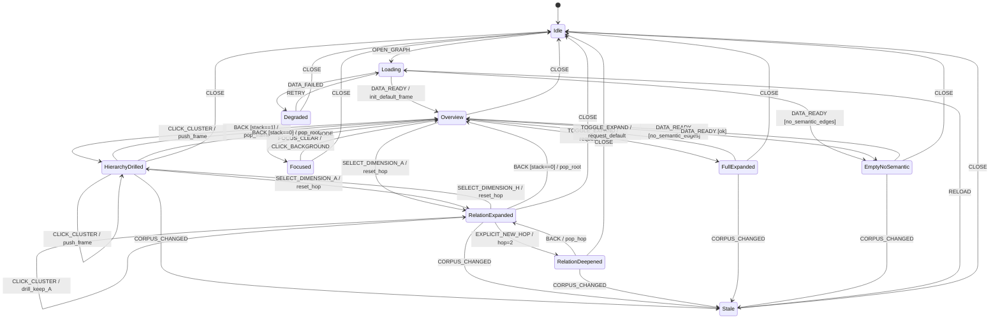

# S5 提案 A：导航状态机（GraphNavFrame、drill/back、EXPLICIT_NEW_HOP、focus 生命周期）

> **提案方**：主办研究（`gm-seminar-researcher`）｜**票**：task-315｜**日期**：2026-11-03（Asia/Shanghai）
> **最高依据**：`docs/design/multilevel-graph-vision.md`（U-1..U-35）。
> **上游冻结（不得违反）**：`S0-terms-v1.md`（`241b1e1e…`）、`S1-dimensions-v1.md`（`6676c71d…`）、`S2-clustering-v1.md`（`92bb0041…`）、`S3-visual-v1.md`（`0ca4ea0e…`）+ `S3-ADDENDUM-1`、`S4-render-v1.md`（`2576f6c8…`）。
> **本场章程**：`docs/design/multilevel-graph/S5-charter.md`（S5-1..S5-12 + S5a）。
> **工程输入**：`ENGINEERING-PLAN.md`（ST-01..ST-19、S1/S2/S4 增量）。
> **独立性**：未阅读 S5 复核方草稿（S5-nav-proposal-B / S5-objections）；本提案独立撰写。
> **纪律**：只写设计；不改产品代码/契约/用户库；未 commit。

---

## 0. 总口径

```
用户/键盘事件 → S5（Presentation 导航状态机）
  → GraphNavFrame（focus/level/hop/new_hop/dimension/history；**只在 Presentation**）
  → frame_spec（给 S4）→ S4 Admission/VM → S3 Renderer（只渲染）
S5 不算 presence、不读 DataSource、不写事实；只维护导航坐标与历史。
```

**冻结不变量**：VM 不含 focus/selection/navigation/history/mode（S0 D-4/S1-13/S3-12）；S5 只发 `frame_spec`（S4-11）；点击语义由 `node.kind` 唯一决定；`EXPLICIT_NEW_HOP` 唯一显式 2 跳；drill/back 可逆栈。

**证据等级**：A（原话/冻结契约/决策/可复跑代码）；B（单源实测产物）；C（单源推理）；**本项目假设**（状态命名/栈上限/交互细节等显式约定）。

---

## 1. S5-1 GraphNavFrame 与边界

**定义/规则（一句话）**：`GraphNavFrame` 是 Presentation 的导航坐标快照（focus/level/hop/new_hop/dimension/history/origin），**不进 ViewModel**；S5 只把它转成 `frame_spec` 交给 S4，不计算 presence。

**形式化**：
```
GraphNavFrame = {
  frame_id: string,              // S4 VM/frame 身份（或 sha256(frame_spec)）
  focus_id: string|null,         // 当前焦点节点 id；Idle/Loading/Degraded 为 null
  level_id: string,              // H 层坐标（L0..Lmax）
  view_family_id: string,        // S2/S1 的划分作用域
  dimension_id: "hierarchy"|"association",   // v1 active 单维度
  hop_budget: 1|2|null,          // A：1/2；H：null
  new_hop: boolean,              // 仅 A hop=2 时 true
  mode: "default"|"full",        // Presentation 正交模式
  budget: {max_nodes:int, max_edges:int},    // 与 S4/Renderer 同源
  origin: {from_frame_id:string|null, via_cluster_id:string|null, via:"drill"|"back"|"new_hop"|"dimension"|"mode"},
  edition_sha: string            // corpus/manifest + view-family edition
}
NavState = {
  status: primary state（§S5-2）,
  frame: GraphNavFrame,
  stack: GraphNavFrame[],        // history；栈顶=当前 frame 的前一帧（不含当前）
  selection_id: string|null,     // UI 选择（边/节点）；非导航 focus
  data_state: "ok"|"no_semantic_edges",
  stale_reason: string|null
}
```
**边界**：`focus_id=null` 只在 Idle/Loading/Degraded；进入图后必须有 focus（默认 root）。`history` 是栈而非 VM 字段。S5 不存簇成员/run/dendrogram。
**机检条件**：
```
- GraphNavFrame 字段白名单；无 presence/rule_id/VM 字段
- VM 无 focus/selection/history/mode（S0/S1/S3）
- S5 只构造 frame_spec；无 DataSource/presence 计算调用
- frame_id 与 S4 输出一致（同 frame_spec 同 frame）
```
**反例**：VM 带 focus/history；S5 自己算 presence；把 selection 当 focus；GraphNavFrame 存簇统计/run。
**U 映射**：U-1、U-4、U-7、U-21。
**建议裁决**：采纳字段/边界；只存 Presentation；S5 只发 frame_spec。
**证据等级**：A（S0-9/D-4；S1-13；S4-11；`ENGINEERING-PLAN.md:629,969` GRAPH_NAV_FRAME）；**本项目假设**（字段命名/stack 结构）。

---

## 2. S5-2 状态机全表（状态/转移/不变量/非法 fail-closed）

**定义/规则（一句话）**：导航状态由**主状态 N** + 正交变量 `(view_mode∈{default,full}, data_state∈{ok,no_semantic_edges}, selection_id)` 组成；每个事件在给定状态下有唯一合法动作或 fail-closed；无死状态/不可达状态。

**状态集合**：
```
主状态 N = {Idle, Loading, Degraded, Overview, Focused,
            HierarchyDrilled, RelationExpanded, RelationDeepened, Stale}
正交：
  view_mode = default | full
  data_state = ok | no_semantic_edges
  selection_id = null | node/edge id
命名复合状态（用于 UX/aria）：
  FullExpanded    := view_mode=full（任意可显示主状态）
  EmptyNoSemantic := data_state=no_semantic_edges（任意可显示主状态；通常 Overview）
  Focused         := 主状态 Focused（有 UI 焦点、无导航变化）
```
**不变量**：
```
I1 主状态唯一；复合状态由正交变量导出，不是第二主状态
I2 stack 栈顶=前一 frame；当前 frame 不在 stack；栈深≤MAX_STACK=50
I3 frame.focus_id 在可见 VM 中存在（或 root/null 于 Idle/Loading/Degraded）
I4 hop：H=null；A∈{1,2}；hop=2 ⇒ new_hop=true
I5 只有 S4 产生 presence；S5 不计算/不修改 VM
I6 点击语义按 kind 唯一：kp→编辑器、cluster→drill；不混用
I7 mode=full 时请求 frame 必须满足 candidates(full)⊇candidates(default)（S4-9）
I8 非法 (state,event) ⇒ fail-closed：状态不变、记录 S5_ILLEGAL_TRANSITION、aria 公告
I9 selection 在 drill/back/dimension/breadcrumb 后清空；focus 不清（除非丢失）
I10 每个主状态可经 CLOSE→Idle、RELOAD→Loading（无死状态）
I11 Stale 不自动重取景（D-ST-05）
I12 EmptyNoSemantic 只在 data_state=no_semantic_edges 时成立
```
**转移表（允许项；未列出的 (state,event) 一律 fail-closed）**：

| # | From | Event | Guard | Action | To |
|---|---|---|---|---|---|
| T01 | Idle | OPEN_GRAPH | backend ready | 读设置、恢复上次 mode/dimension（不恢复深栈） | Loading |
| T02 | Loading | DATA_READY | edition 匹配 | 建默认 frame：H/level0/focus=root/hop=null/mode 按持久化；根据 S2 设置 data_state | Overview（或 EmptyNoSemantic 复合） |
| T03 | Loading | DATA_FAILED | — | 显示降级；不写事实 | Degraded |
| T04 | Degraded | RETRY | retryable | 重试加载 | Loading |
| T05 | Degraded | CLOSE | — | 保存设置、清内存 | Idle |
| T06 | Overview | CLICK_CLUSTER | kind=cluster ∧ expandable ∧ level<max | push frame（origin=via）；level+1；focus=cluster；hop 重置；清 selection；请求子图 | HierarchyDrilled（H）或 RelationExpanded（A 维） |
| T07 | HierarchyDrilled | CLICK_CLUSTER | 同上 | 同上（更深） | HierarchyDrilled |
| T08 | RelationExpanded | CLICK_CLUSTER | cluster expandable | 同上（level+1，dimension 不变） | RelationExpanded（A 维） |
| T09 | RelationDeepened | CLICK_CLUSTER | cluster expandable | 同上；new_hop 清零 | RelationExpanded/HierarchyDrilled |
| T10 | Overview/HierarchyDrilled/RelationExpanded/RelationDeepened/EmptyNoSemantic | CLICK_KP | kind=kp ∧ file | 发射 nodeClick 调用；jump_editor；nav frame 不变 | 原状态 |
| T11 | 可显示状态 | CLICK_EDGE | edge_id | selection=edge；打开检查器（可选）；nav 不变 | 原状态 |
| T12 | 可显示状态 | CLICK_BACKGROUND | — | selection=null；若 Focused 且无 selection 回到先前主状态 | 原状态/先前状态 |
| T13 | HierarchyDrilled/RelationExpanded/RelationDeepened | BACK | stack 非空 | pop frame；恢复 focus/level/dimension/hop/mode；清 selection；清 new_hop | 栈顶对应状态 |
| T14 | Overview | BACK | stack 空 | 无操作；aria 公告"已在根层" | Overview |
| T15 | 可显示状态 | BREADCRUMB_TO | 目标 frame 在 stack | 弹栈到目标（截断中间栈，审计）；恢复 frame；清 selection | 目标状态 |
| T16 | RelationExpanded | EXPLICIT_NEW_HOP | dimension=A ∧ focus≠null ∧ hop=1 ∧ !new_hop | push frame；hop=2；new_hop=true；请求新 frame | RelationDeepened |
| T17 | RelationDeepened | EXPLICIT_NEW_HOP | hop=2 | 幂等：不 push、不变、公告"已是新一跳" | RelationDeepened |
| T18 | 可显示状态 | SELECT_DIMENSION | 目标 active ∧ 合法 | hop 重置 default；new_hop=false；清 selection；focus 可表示则保留否则映射 root/祖先；**v1 清空 history**；请求新 frame | H→HierarchyDrilled/Overview；A→RelationExpanded |
| T19 | 可显示状态 | SELECT_DIMENSION | 未知/reserved/deprecated | fail-closed：状态不变；记录 reason；公告 | 原状态 |
| T20 | 可显示状态 | TOGGLE_EXPAND | S4 可用 | 翻转 mode；请求 frame（full 需 candidate 超集前提）；focus/level/stack 不变；持久化 | FullExpanded 复合或回 default |
| T21 | 可显示状态 | CORPUS_CHANGED | edition 不匹配 | 标记 stale；不自动重取景 | Stale |
| T22 | Stale | RELOAD | 用户确认 | 重新加载 | Loading |
| T23 | Stale | DISMISS_ERROR | — | 保留旧帧只读；标记 stale | Stale |
| T24 | 任意主状态 | CLOSE | — | 保存设置（不保存深栈）；清内存 | Idle |
| T25 | 任意主状态 | RELOAD | — | 重建 frame/清缓存引用 | Loading |
| T26 | Overview/… | FOCUS_NODE | 节点可聚焦 | 记录先前主状态；focus=node（UI 焦点，不改 frame focus） | Focused |
| T27 | Focused | FOCUS_CLEAR | — | 恢复先前主状态；清 selection | 先前状态 |
| T28 | RelationExpanded/Deepened | SELECT_DIMENSION_H | 合法 | 切 H；hop=null；清 new_hop；focus/level 保留或映射 | HierarchyDrilled/Overview |

**非法转移示例**：Idle 收到 CLICK_CLUSTER；H 状态收到 `EXPLICIT_NEW_HOP`；hop=2 未带 new_hop；`SELECT_DIMENSION` 未知；`BACK` 栈空且非 Overview；`TOGGLE_EXPAND` 在 Loading/Degraded。全部 fail-closed、状态不变、记录 `S5_ILLEGAL_TRANSITION`。
**反例**：允许多个主状态并存；只写"正常路径"不列非法项；BACK 重建 frame 丢 dimension；`FullExpanded` 当第二主状态另起一套转移；状态事件表存在未定义行为（静默忽略）。
**边界**：状态图必须覆盖所有主状态与命名复合状态；`EmptyNoSemantic`/`FullExpanded` 与主状态正交组合（如 `HierarchyDrilled+full`）；CLOSE/RELOAD 从任意状态可达；首次进入/空数据/加载失败/恢复。
**机检条件**：
```
- 状态/事件集合枚举；转移表覆盖所有允许项；未列项 fail-closed
- 无不可达状态（从 Idle 可达所有主状态）；无死状态（CLOSE/RELOAD 全局）
- 不变量 I1–I12 可断言（状态/帧/栈/hop/mode/selection）
- 状态图 S5a 与转移表逐条对应（同版本 mermaid 解析 PASS）
```
**U 映射**：U-4、U-7、U-19、U-21、U-26、U-29。
**建议裁决**：采纳状态集合/转移表/不变量/非法 fail-closed；S5a 状态图见 §13。
**证据等级**：A（S0/S1/S3/S4 约束；`ENGINEERING-PLAN.md:1026-1048` ST-01..19）；**本项目假设**（状态划分/转移细节）。

---

## 3. S5-3 点击语义（kind 唯一）

**定义/规则（一句话）**：`nodeClick` 按 `kind` 唯一分流：kp→跳编辑器（U-20，图谱状态不变）；cluster→drill（U-7，新 frame）；edgeClick→selection/检查器；backgroundClick→清 selection；**不混用**。

**形式化**：
```
nodeClick{node_id,kind}:
  kind=kp      → 若 node.file 存在：jumpEditor(kp)；nav frame 不变；selection 可选清空；状态不变
                  若 file 缺失：公告/记录，不跳转
  kind=cluster → 若 expandable ∧ level<max：drill（T06/T08）；否则公告"不可展开"
  kind 其他   → fail-closed（S3 只允许 kp/cluster）
edgeClick{edge_id}     → selection=edge；打开检查器（可选）；nav 不变
backgroundClick{}      → selection=null；若 Focused 恢复先前主状态
```
**S3 事件→S5 动作映射**：
| S3 事件 | S5 动作 | 导航副作用 |
|---|---|---|
| `nodeClick(kp)` | `jump_editor` | 无（frame/stack 不变） |
| `nodeClick(cluster)` | `CLICK_CLUSTER` | drill（push） |
| `edgeClick` | `select_edge` | 无 |
| `backgroundClick` | `clear_selection` | 无（Focused→先前状态） |
| `hover/focus`（可选） | UI 高亮/焦点 | 无导航 |
**反例**：cluster 直接 jumpToTarget；kp 触发 drill；edgeClick 改 focus；background 清导航栈；hover 改变状态；kind 混用。
**边界**：kp 无 file；cluster 无子/degenerate；edge 检查器关闭；连续点击防抖。
**机检条件**：
```
- nodeClick 动作仅由 kind 决定；无"先看 node.file 决定 drill"等混用
- kp 点击后 frame/stack 不变；cluster 点击后 level+1/push
- edge/background 不改变 frame/stack；hover 不在 S5 状态转移中
- 非法 kind fail-closed
```
**U 映射**：U-7、U-19、U-20。
**建议裁决**：采纳 kind 唯一分流；kp 跳编辑器不改导航；cluster drill；edge/background 不导航。
**证据等级**：A（U-7/U-20；S3-7 事件；现状 `app.js:1661-1677` 统一 jumpToTarget 是反例）；**本项目假设**（检查器/公告细节）。

---

## 4. S5-4 drill / back / 面包屑（栈语义）

**定义/规则（一句话）**：drill 把当前 frame 入栈并创建新 frame（level+1、focus=簇、hop 重置、dimension 不变）；back 弹栈并**精确恢复**上一 frame（focus/level/dimension/hop/mode）；栈上限 50、去重、面包屑可跳到祖先。

**形式化**：
```
drill:
  push(current frame + origin{via=cluster_id})
  new frame: level=level+1, focus=cluster_id, hop=default(1 for A / null for H),
             new_hop=false, dimension 不变, mode 不变, selection=null
  H → HierarchyDrilled；A → RelationExpanded
back:
  if stack empty ⇒ Overview（T14，公告）；else pop → 恢复 frame 全字段；selection=null
  恢复的 frame 的 focus 必须仍存在；否则按 FOCUS_LOST 处理（S5-6）
面包屑：
  BREADCRUMB_TO(frame_id) ⇒ 弹栈到该 frame（中间帧丢弃但审计记录）；selection 清空
栈规则：
  MAX_STACK=50；同 frame_id 连续 push 去重；栈满 ⇒ 丢弃最旧（保留根）并审计
重新打开：
  v1 只恢复“上次 level=0 的 frame + mode/dimension”；深栈不恢复（D-ST-07）
```
**反例**：drill 不 push；back 重建 frame 丢 dimension/hop；栈无限增长；breadcrumb 清空根；重开恢复深栈导致 stale；连续 drill 同 frame 重复入栈。
**边界**：drill 到叶层仍可 push 但 cluster 无子不可 drill；back 到根；breadcrumb 到当前帧；栈满；多归属 origin 记录。
**机检条件**：
```
- drill 后 stack+1、frame.level+1、focus=cluster、hop 重置、selection=null
- back 恢复字段与入栈 frame 完全相同（canonical diff=0）
- MAX_STACK/去重/审计；重开只恢复 level0
- 面包屑目标必须在 stack；失败 fail-closed
```
**U 映射**：U-5、U-7、U-19、U-21。
**建议裁决**：采纳 drill/back 精确栈 + 面包屑截断 + 上限/去重/重开恢复 level0。
**证据等级**：A（U-7/U-21；`ENGINEERING-PLAN.md:1034-1044` ST-05/09/10、D-ST-02/03/07；S4-8 drill 语义）；**本项目假设**（MAX_STACK/去重/恢复粒度）。

---

## 5. S5-5 `EXPLICIT_NEW_HOP`（唯一显式 2 跳）

**定义/规则（一句话）**：`EXPLICIT_NEW_HOP` 是 S5 唯一允许把 A 维 hop 从 1 提到 2 的动作；必须 A 维、有 focus、当前 hop=1；效果是 push hop=1 frame、hop=2/new_hop=true；重复触发幂等；与默认路径隔离。

**形式化**：
```
event EXPLICIT_NEW_HOP（Presentation 按钮/命令；S5 内部唯一入口）
guards: dimension==association ∧ focus_id≠null ∧ hop_budget==1 ∧ new_hop==false
effect:
  push(current frame, origin.via="new_hop")
  frame.hop_budget=2; frame.new_hop=true; mode/dimension/focus/level 不变
  state RelationExpanded → RelationDeepened
  request frame_spec(new_hop=true, hop_budget=2)
idempotent:
  if hop==2 ∧ new_hop==true ⇒ no push/no change；公告“已是新一跳”
invalid:
  H/无 focus/hop=2 未带 new_hop/loading/degraded ⇒ fail-closed（S5_NEW_HOP_NOT_ALLOWED）
默认隔离:
  默认路径 frame_spec.new_hop=false；S4 校验 hop=2 ⇒ new_hop=true（S1 R-S1-10）
```
**反例**：默认 A 视图自动 2 跳；H 触发；无 focus；重复 push；new_hop 不进 frame_spec；切换维度后保留 2。
**边界**：重复点击；从 hop2 back 回 hop1；维度切换/SELECT_DIMENSION_H 清 new_hop；全展开模式与 new_hop 正交。
**机检条件**：
```
- new_hop=true 仅由 EXPLICIT_NEW_HOP 产生；默认 frame_spec.new_hop=false
- hop=2 ⇒ new_hop=true；H hop=null
- 重复触发 frame/stack 不变（幂等）
- 维度切换/back 清 new_hop
```
**U 映射**：U-11、U-18、U-22。
**建议裁决**：采纳唯一显式入口/条件/幂等/默认隔离。
**证据等级**：A（S1-5 R-S1-10；S4-4；`ENGINEERING-PLAN.md:1042,1088,1101` ST-13/EXPLICIT_NEW_HOP）；**本项目假设**（按钮/命令细节）。

---

## 6. S5-6 focus 与 selection 生命周期

**定义/规则（一句话）**：focus=导航坐标（哪一簇/节点作为取景基座），selection=UI 选中（边/节点检查器）；selection 在 drill/back/dimension/breadcrumb/background 后清空；focus 丢失/重聚类时映射到最近祖先/根；默认 frame 有 root focus。

**形式化**：
```
focus ∈ frame.focus_id（导航；S4 one_hop F={focus}）
selection ∈ NavState.selection_id（UI；不进 VM；不改变 frame）
清空 selection：drill、back、breadcrumb、SELECT_DIMENSION、TOGGLE_EXPAND、backgroundClick、FOCUS_CLEAR
保留 focus：drill 设 focus=cluster；back 恢复旧 focus；dimension 可表示则保留
focus 丢失（删除/重聚类/edition 变）：
  FOCUS_LOST → 在 stack 中向上找 focus 仍存在的最近 frame；否则 root level0
  公告“焦点已失效，回到 X”；不自动重取景（stale 时先提示）
无 focus：Idle/Loading/Degraded；进入图默认 focus=root（S2 view_family root/首块 canonical id）
Focused 主状态：UI 焦点（键盘）≠ frame.focus；进入不改 frame；离开恢复先前主状态
```
**反例**：selection 与 focus 混用；drill 后旧 selection 残留；焦点丢失停在空白；默认 frame 无 focus 导致 S4 失败；Focused 状态写入 frame.focus。
**边界**：多归属 focus 在其它族存在但当前族不存在；重聚类后 focus 变成 singleton；无 root。
**机检条件**：
```
- selection 变更不写 GraphNavFrame/VM；drill/back/dimension/breadcrumb 后 selection=null
- frame.focus_id 在 S4 VM 中存在（除 Idle/Loading/Degraded）
- FOCUS_LOST 有恢复路径（祖先/根），无 dead state
- 默认 frame focus=root；无 root 时 deterministic 首块
```
**U 映射**：U-19、U-21、U-22。
**建议裁决**：采纳 focus/selection 分离 + 清空/恢复规则 + 默认 root focus。
**证据等级**：A（U-19/U-21；S0-9/D-4；S4-3 F={focus}；`ENGINEERING-PLAN.md:1034-1038` origin/via）；**本项目假设**（focus 丢失映射细节）。

---

## 7. S5-7 维度切换（hop 重置、history 处理、未知 fail-closed）

**定义/规则（一句话）**：`SELECT_DIMENSION` 仅接受 active 维度；切换后 hop 重置 default、new_hop=false、selection 清空；focus 可表示则保留否则映射；v1 清空 history（新导航上下文）；未知/保留/弃用 fail-closed。

**形式化**：
```
SELECT_DIMENSION(target):
  guard: target ∈ registry.active（S1）；当前状态可显示
  effect:
    dimension=target；hop_budget=target.hop_default（H=null/A=1）；
    new_hop=false；selection=null；
    focus: 若在当前 level/view_family 可表示则保留，否则父簇/root；
    v1 清空 stack（记录审计 reason）；mode 保留（full 正交）
    request frame
  state: target=H ⇒ level>0 ? HierarchyDrilled : Overview
         target=A ⇒ RelationExpanded
fail: DIM_UNKNOWN/DIM_NOT_ACTIVE/DIM_COMBINATION_UNSUPPORTED ⇒ 状态不变+公告
组合：v1 单维度；组合槽位只在 registry reserved，S5 不接受组合参数
```
**反例**：切换保留旧 hop=2；history 混入旧维度 frame；未知维度静默回退；组合维度被接受；focus 不可表示仍保留。
**边界**：H↔A；同维度重复选择（no-op/公告）；full 模式切换；focus 在多归属中其它族存在。
**机检条件**：
```
- 切换后 hop=default、new_hop=false、selection=null
- v1 stack 清空（或明确保留策略，需机检）；未知维度 fail-closed
- 组合参数拒绝；ViewModel dimension_id 单值
```
**U 映射**：U-8、U-9、U-10、U-11、U-12。
**建议裁决**：采纳切换规则 + v1 清空 history；未知 fail-closed。
**证据等级**：A（S1-5/S1-13；D-5；S0-9）；**本项目假设**（清空 history 的取舍，见 §14 争议）。

---

## 8. S5-8 全展开开关（正交、持久化、不破坏 focus）

**定义/规则（一句话）**：`TOGGLE_EXPAND` 是 Presentation 正交模式切换，不改变 focus/level/dimension/stack；切换只改 `mode` 并请求 S4 full frame；持久化模式偏好；full 必须满足 S4 的 candidate 超集/subset 前提。

**形式化**：
```
TOGGLE_EXPAND:
  mode default↔full；请求 frame(mode=...)
  focus/level/dimension/hop/new_hop/stack 不变；selection 清空（v1；避免 full 下旧选中悬空）
  full 请求：S4 candidates(full)⊇candidates(default) ∧ budget_full≥budget_default
             ⇒ shown(default)⊆shown(full)；失败 ⇒ 回退 default + 公告（不部分）
  持久化：mode 存 graph-settings（非导航栈）；重开恢复 mode
  FullExpanded 是复合状态（view_mode=full），不改变主状态
```
**反例**：full 第二数据源；切换清空 focus/栈；full 失败静默；持久化深栈；TOGGLE 在 Loading/Degraded。
**边界**：full 下 drill/back 允许（mode 保持）；full 下维度切换；full 预算不足；重开恢复。
**机检条件**：
```
- TOGGLE 前后 focus/level/dimension/stack 不变（仅 mode）
- full 请求满足 S4 subset 前提；失败回退可见
- 持久化仅 mode/设置，不存深栈；Loading/Degraded 拒绝 toggle
```
**U 映射**：U-5、U-26、U-27。
**建议裁决**：采纳正交 toggle + 持久化 + focus 不变 + S4 subset。
**证据等级**：A（S0-8；S4-9；`ENGINEERING-PLAN.md:1044-1045,1059` ST-15/16/D-ST-06）；**本项目假设**（selection 清空/持久化键）。

---

## 9. S5-9 与 S4 接口（frame_spec；S5 不算 presence）

**定义/规则（一句话）**：S5 从 NavState 构造 `frame_spec` 调 S4；S5 不读取 DataSource/不计算 presence；同 frame_spec 同结果；`S4_BUDGET_INVALID` 按“回退上一帧/初始降级”处理。

**形式化**：
```
frame_spec = {
  level_id, view_family_id, dimension_id, focus_id,
  hop_budget, new_hop, mode, budget{max_nodes,max_edges}
}
调用：admission = S4.admit(frame_spec) → AdmissionResult/VM
S5 记录 frame.frame_id = admission.vm_id/frame id；只读 VM（不修改）
S4 错误：
  S4_BUDGET_INVALID：
    - 首次/默认 frame ⇒ Degraded（可见降级，不部分渲染）
    - 导航动作（drill/back/new_hop/dimension/toggle）⇒ 回退上一 frame，状态不变，公告
  S4_FOCUS_UNRESOLVED ⇒ focus 恢复流程（S5-6）
  DIM_* ⇒ fail-closed 状态不变
确定性：同 NavState/同设置 ⇒ 同 frame_spec ⇒ 同 S4 输出；S5 不追加随机
S5 不把 presence/selection/history 传给 S4
```
**反例**：S5 自己算 presence/裁剪；frame_spec 带 history；S4 错误时部分渲染；同输入不同 frame；S5 直接读 DataSource。
**边界**：初始空数据；S4 预算失败；full 前提失败；focus 丢失。
**机检条件**：
```
- frame_spec 字段白名单；无 presence/history/selection
- S5 无 DataSource/presence 计算调用；同 frame_spec 同 frame
- S4_BUDGET_INVALID 路径：回退/初始降级，无部分 VM
```
**U 映射**：U-15、U-18、U-22、U-32。
**建议裁决**：采纳 frame_spec/错误处理/确定性；S5 不算 presence。
**证据等级**：A（S4-11 `S4-render-v1.md:67-70`；S4-1/2/9；U-32）；**本项目假设**（frame_id 取值/错误展示）。

---

## 10. S5-10 与 S3 事件契约（最小映射、去重、渲染器无导航）

**定义/规则（一句话）**：S5 只消费 S3 最小事件 `nodeClick/edgeClick/backgroundClick`（可选 hover/focus）；事件 payload 无导航字段；S5 做防抖/去重；hover 不改导航；渲染器无导航动作。

**形式化**：
```
S3→S5 映射：见 S5-3 表；payload 仅 node_id/kind/edge_id
去重/防抖：
  同一 node/edge 在 300ms 内重复 click ⇒ 忽略重复（防双击 drill 两次）
  cluster drill 请求期间（pending）忽略同 cluster 再次 click
  stale 事件（当前 frame/edition 已变）丢弃并审计
hover/focus：只更新 UI 高亮/键盘焦点；不进入状态转移（Focused 仅由 FOCUS_NODE 命令）
渲染器：不处理返回/drill/维度/模式；只发事件
错误隔离：事件 handler 异常不改变状态，记录审计
```
**反例**：渲染器发 navigate；事件带 mode/level；双击 drill 两次；hover 改状态；stale click 执行。
**边界**：快速连续 click；键盘与鼠标同事件；edge click 无检查器；background click。
**机检条件**：
```
- 事件 payload 白名单；无导航字段
- 300ms 去重/pending 守卫；重复 click 不重复 push
- hover/focus 不改变 frame/stack；渲染器无导航调用
```
**U 映射**：U-7、U-19、U-20、U-33。
**建议裁决**：采纳最小事件映射/去重/渲染器无导航；hover 不改导航。
**证据等级**：A（S3-7 `S3-visual-v1.md:46-49`；S4-11；`ENGINEERING-PLAN.md:1088-1101` 事件映射）；**本项目假设**（防抖窗口 300ms）。

---

## 11. S5-11 与 S1/S2 一致（H/A 状态差异、只读 run、EmptyNoSemantic）

**定义/规则（一句话）**：H 下钻→HierarchyDrilled，A 扩展开→RelationExpanded/Deepened；S5 只读 S2 run，不重算簇；无簇时进入 EmptyNoSemantic 复合状态，恢复由 data_state 变化驱动；A 不改变簇。

**形式化**：
```
H: 下钻 level+1，hop=null；state HierarchyDrilled；无关系跳
A: 切换后 RelationExpanded；一 hop=1；EXPLICIT_NEW_HOP→RelationDeepened(hop=2)
S2: S5 只读 run(level,view_family)/status；不调用聚类；不修改 membership
无簇：DATA_READY 且 data_state=no_semantic_edges ⇒ EmptyNoSemantic
  UX：KP + layout_group（S3-8）；CLICK_KP 跳编辑器；CLICK_CLUSTER 不适用（无 cluster）
恢复：data_state→ok（新 edition/curation）⇒ 回到 Overview/当前 level；公告
多归属：origin 记录进入路径；BACK 回 origin；跨族不合并
A 不改变簇：S5 不因 A 触发 S2；S5 状态不写 S2 run
```
**反例**：H 出现关系 hop；A 重新聚类；EmptyNoSemantic 伪造簇；S5 写 run；多归属 back 到错误父。
**边界**：无簇大图；data_state 恢复；A↔H 切换；多归属 origin。
**机检条件**：
```
- H frame hop=null；A hop∈{1,2}
- S5 无聚类调用；run_id 不变（同 edition）
- EmptyNoSemantic 时 VM 无 cluster；CLICK_CLUSTER 无效
- data_state 恢复有明确转移；多归属 origin 可复算
```
**U 映射**：U-15、U-17、U-21、U-22。
**建议裁决**：采纳 H/A 状态差异/只读 run/EmptyNoSemantic 恢复。
**证据等级**：A（S1-4/S1-5；S2-10/S2-12；S3-8）；**本项目假设**（data_state 恢复触发细节）。

---

## 12. S5-12 可访问性 / 持久化 / 度量

**定义/规则（一句话）**：S5 提供键盘等价动作、aria-live 导航播报、设置持久化（不存深栈）与 G6 导航指标；frame 切换目标延迟可量化。

**形式化**：
```
键盘（等价鼠标）：
  Enter/Space 激活焦点节点（kp→编辑器；cluster→drill）
  Backspace/Alt+Left = BACK；Escape = 清 selection/关闭检查器
  Arrow keys 在节点间移动焦点（Focused）；Tab 进/出图；PageUp/PageDown 可选层级
aria-live：
  "进入第 N 层，焦点：<label>"、"已返回上一视图"、"焦点已失效，回到 <label>"
  "维度已切换为 <name>"、"全展开已开启/关闭"、"尚无语义簇"
持久化：
  仅保存 mode/dimension/last level0 frame/focus（若 edition 匹配）/设置；不保存深栈（D-ST-07）
  URL/书签：v1 不编码深导航（避免 stale）；可选只读链接不含 focus
度量/G6：
  frame_switch_latency_ms（目标 <200ms，S8 定）、depth_distribution、
  back_success_rate、illegal_transition_count、focus_lost_count、
  empty_state_entries、new_hop_count、dimension_switch_count、mode_toggle_count
```
**反例**：键盘无法 drill/back；aria 不播报；持久化深栈导致 stale；URL 编码深栈；切换延迟无指标。
**边界**：读屏用户；无键盘设备；深栈持久化禁用；空状态播报。
**机检条件**：
```
- 键盘动作映射表覆盖 click/back/dimension/mode
- aria-live 在 frame 变化时触发；播报不含正文（隐私）
- 持久化仅白名单字段；重开不恢复深栈
- G6 指标可复算/可复跑
```
**U 映射**：U-24（原话供起来/流程）、U-26、U-33、U-34。
**建议裁决**：采纳键盘/aria/持久化白名单/度量；数值 S8。
**证据等级**：A（S3-10 a11y；`ENGINEERING-PLAN.md:1059-1060` D-ST-06/07；现有 settings 持久化 `graph-settings.js:127-212`）；**本项目假设**（键位/延迟目标）。

---

## 13. S5a 状态图（mermaid）

> 说明：主状态为 `Idle/Loading/Degraded/Overview/Focused/HierarchyDrilled/RelationExpanded/RelationDeepened/Stale`；`FullExpanded` 与 `EmptyNoSemantic` 是正交复合状态（mode/data_state），图中以显式状态表示但**不是第二主状态**。



**机检**：状态图与 §S5-2 转移表逐条对应；无死状态（CLOSE 全局；RELOAD 全局）；无不可达状态；同版本 mermaid `failedBlocks:0`（SE/S5a 复验）。

---

## 14. 仍存争议 / 待 Lead·SE 裁决

1. **维度切换时 history 清空 vs 保留**：本提案 v1 清空（新导航上下文）；反方可能要求保留以便回退到切换前维度。
2. **`Focused` 是否作为主状态**：本提案把它作为主状态（UI 焦点）但明确不改 frame.focus；也可改为纯正交 selection/focus 变量。
3. **`FullExpanded`/`EmptyNoSemantic` 的复合状态表达**：本提案用正交变量+复合名；反方可能要求独立主状态，影响转移表规模。
4. **MAX_STACK=50、去重、重开恢复 level0**：具体值/恢复粒度需 S8/UX 定。
5. **full 下 drill/back 是否保持 full**：本提案保持 mode；反方可能要求 drill 自动回 default。
6. **`S4_BUDGET_INVALID` 的导航动作处理**：本提案回退上一 frame；反方可能要求进入 Degraded/提示重试。

---

## 15. 证据锚（详见 `S5-evidence-A.md`）

```text
原话：vision.md:22（U-1/U-4 相关）、:24（U-7）、:25-26（U-8/U-9）、:32（U-15）、:37（U-20）、:39（U-22）、:68（U-29）、:65（U-26）
S0：S0-terms-v1.md:49-54（一跳）、:56-61（present）、:69-73（full）、:75-79（VM/D-4）
S1：S1-dimensions-v1.md:13-15（H/A）、:57-67（new_hop）、:99-107（present/VM）
S2：S2-clustering-v1.md:17（簇）、:64-71（S2-10/11）、:73-76（无簇）
S3：S3-visual-v1.md:46-49（事件）、:66-69（预算）、:71-75（VM）；S3-ADDENDUM-1（node presence/rule_id）
S4：S4-render-v1.md:26-34（focus 一跳/2 跳）、:67-70（S5 边界）、:56-60（full subset）
工程：ENGINEERING-PLAN.md:1026-1048（ST-01..19）、:1050-1060（D-ST）、:1088-1101（事件/new_hop）
代码（现状/反例）：app.js:1661-1677（统一 jumpToTarget，无 kind 分流）；nav-stack.js:23-36（文件栈，非图谱导航）
```
