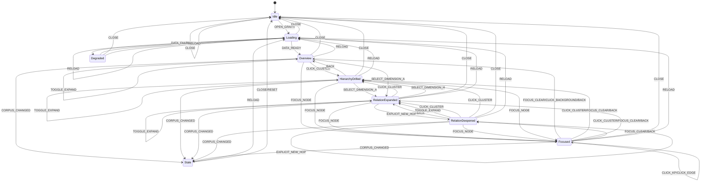

# S5 导航状态机提案 B-v2（独立复核方修订版）

> **依据（唯一裁决依据）**：`docs/design/multilevel-graph/S5-RULINGS.md`（R-S5-1..R-S5-8）；最高原话 `multilevel-graph-vision.md`；上游冻结 `S0-terms-v1.md`（`241b1e1e…`）、`S1-dimensions-v1.md`（`6676c71d…`）、`S2-clustering-v1.md`（`92bb0041…`）、`S3-visual-v1.md`（`0ca4ea0e…`）+ `S3-ADDENDUM-1`、`S4-render-v1.md`（`2576f6c8…`），不得违反。
> **输入**：B v1（`81066c59…`）、A v1（`6eee4f66…`）、`S5-objections.md`。A-v2 写作时尚未落盘；本文件先独立完成（完成后才对照 A-v2，见 `S5-objections-v2.md`）。
> **性质**：独立复核方修订提案；不覆盖旧版；不写产品代码/契约；未 commit。
> **证据等级**：A=可执行/机检源码；B=冻结数据/实测；C=冻结契约/文档推断；PI=本项目假设；R=S5-RULINGS/S0–S4 冻结。
> **日期**：2026-11-03（Asia/Shanghai）。

---

## 0. B-v2 变更表（相对 B v1；逐条落 R-S5）

| # | 位置 | B v1 | B-v2（依据） | 类型 |
|---|---|---|---|---|
| 1 | S5-2 | 7 状态，含不可达 `FullExpanded`；`EmptyNoSemantic` 为状态 | **吸收 A 主状态**（9 状态）；`FullExpanded`/`EmptyNoSemantic` 改为正交变量 `mode`/`data_state`；无不可达/死状态（R-S5-1/R-S5-4） | 修正 |
| 2 | S5a | mermaid 草案与表不完全对应 | **S5a 由转移表逐条生成/对照**；状态集/边集/事件集一致；`PARSE_OK`；Focused/Stale 补全所有适用边（R-S5-1） | 修正 |
| 3 | S5-7 | 维度切换 push，但未冻结 back 恢复 | **维度切换 push 当前 frame；back 恢复 focus/level/dimension/hop/mode**；history 仅 CLOSE/RELOAD/RESET 清空（R-S5-2） | 确认/强化 |
| 4 | S5-9 | 错误回退，未定义事务 | **导航事务化：nextFrame→S4→commit；失败 canonical diff=0；初始帧 Degraded；非初始提示保持原 frame；禁止先 push 后回滚（R-S5-3）** | 修正 |
| 5 | S5-2/S5-4 | 状态集不足/缺 Loading/Degraded/Stale/Overview/RelationDeepened | 吸收 A 状态集；Focused 不改 frame.focus；MAX_STACK=50/去重/重开只 level0；full 与 drill 正交（R-S5-4..7） | 修正 |
| 6 | S5-1/S5-9/S5-10/S5-12 | frame_id/edition/去抖/G6 较简 | **frame_id=sha256(canonical(frame_spec))、edition 与 S4 输入对齐；去抖 300ms；G6 字段统一**（R-S5-8） | 并集 |

---

## 0.1 覆盖矩阵（U + S0–S4）

| U# | 落点 | U# | 落点 |
|---|---|---|---|
| U-1/U-4 | 语义/层次=S5-2/S5-4 | U-7/U-8 | 下钻/层次=S5-3/S5-4 |
| U-9 | 其他维度=S5-7 | U-15 | 一跳=S5-5 |
| U-20 | KP 编辑器=S5-3 | U-22 | 新一跳=S5-5 |
| U-24 | 导航状态/返回=S5-2/S5-4 | U-26 | 全展开=S5-8 |
| U-29 | agent 只读=S5-12 | S0-9/D-4 | VM 纯度=S5-1/S5-9 |
| S1 H/A | drill/A 扩展=S5-7/S5-11 | S2 | run 只读/无簇=S5-11 |
| S3 事件 | S5-10 | S4 frame/presence | S5-9 |

---

## S5-1 导航状态与边界

**规则**：S5 持有 `GraphNavFrame`（Presentation）；字段冻结：
```
GraphNavFrame = {
  frame_id: sha256(canonical(frame_spec)),   # 与 S4 输入同身份（R-S5-8）
  edition_sha: string,                        # S5 本地 stale 校验；不写入 VM
  level_id, view_family_id, dimension_id,
  focus_id|null, hop_budget∈{1,2}|null, new_hop:boolean,
  mode∈{default,full}, data_state∈{ok,empty_nosemantic},
  history: FrameSnapshot[], history_limit=50,
  return_state?: 主状态（Focused 返回态）
}
FrameSnapshot = {level_id, view_family_id, dimension_id, focus_id, hop_budget, new_hop, mode}
```
`selection` 不进 frame（Presentation 瞬态）；`Focused` 是主状态但**不改 frame.focus**（R-S5-5）；frame/stack 不进 VM；S5 只构造 `frame_spec` 调 S4，不算 presence。
**机检**：frame 字段白名单；VM 无 frame/history/focus/selection/mode/data_state；S5 无 presence/裁剪调用；`frame_id == sha256(canonical(frame_spec))` 且与 S4 AdmissionResult 身份一致。
**反例**：VM 带 frame/focus/history；S5 算 presence；Focused 改 frame.focus；selection 写 VM；frame_id 由随机/时间生成。
**边界**：Idle/Loading/Degraded 允许 focus=null；进入图后默认 root focus；空 history；edition 不匹配→Stale。
**U 映射**：U-1、U-4、U-7、U-21。
**建议裁决**：冻结字段/只 Presentation/不算 presence/frame_id 对齐 S4。
**证据等级**：A（S0-9/D-4；S4-11；R-S5-8）+ R。

---

## S5-2 状态机全表（9 主状态 + 正交变量）

**主状态**：`Idle, Loading, Degraded, Overview, Focused, HierarchyDrilled, RelationExpanded, RelationDeepened, Stale`。
**正交变量**：`mode ∈ {default, full}`（FullExpanded 是复合描述，不是主状态）；`data_state ∈ {ok, empty_nosemantic}`（EmptyNoSemantic 是复合描述）；`selection_id` UI 瞬态。
**状态不变量**：
```
I1 主状态唯一；mode/data_state 为变量
I2 stack 顶=前一 frame；当前 frame 不在 stack；stack≤50；同 (focus,level,dimension,mode) 不重复 push
I3 非 Idle/Loading/Degraded：frame.focus 存在且来自 S4 VM；Focused 不改 frame.focus
I4 H hop=null；A hop∈{1,2}；hop=2⇒new_hop=true
I5 S5 不算 presence/不裁剪；只发 frame_spec
I6 kind 唯一：kp→编辑器；cluster→drill
I7 导航事务：失败 canonical diff=0（R-S5-3）
I8 mode=full 请求需 S4 candidate 超集前提（R-S5-7）
I9 selection 在 drill/back/dimension/breadcrumb/background 后清空
I10 每主状态有进入/离开；CLOSE/RELOAD/RESET 全局转移；无死状态
I11 Stale 不自动重取景；RELOAD 显式
I12 data_state=empty_nosemantic 仅无簇状态；恢复由 DATA_READY 驱动
```
**转移表（允许项；未列为非法 fail-closed）**：

| # | From | Event | Guard | Action | To |
|---|---|---|---|---|---|
| T01 | Idle | OPEN_GRAPH | backend ready | 读设置（mode/dimension；不恢复深栈） | Loading |
| T02 | Loading | DATA_READY | edition 匹配 | 建默认 H/level0/root frame；设置 data_state | Overview |
| T03 | Loading | DATA_FAILED | — | 显示降级 | Degraded |
| T04 | Degraded | RETRY | retryable | 重试 | Loading |
| T05 | Loading/Degraded/Idle | CLOSE | — | 清内存；保存设置 | Idle |
| T06 | Overview | CLICK_KP | kind=kp | jumpEditor；frame/stack 不变 | Overview |
| T07 | Overview | CLICK_CLUSTER | kind=cluster∧expandable∧level<max | 事务：nextFrame(level+1,focus=cluster,hop=default,new_hop=false)；push；selection=null | HierarchyDrilled |
| T08 | HierarchyDrilled | CLICK_CLUSTER | 同上 | 同 T07（更深）；push | HierarchyDrilled |
| T09 | RelationExpanded/RelationDeepened | CLICK_CLUSTER | expandable | 事务 drill（level+1；dimension 不变；new_hop=false；push） | HierarchyDrilled / RelationExpanded |
| T10 | 任意可显示主状态 | CLICK_KP | kind=kp | jumpEditor；frame/stack 不变 | 同状态 |
| T11 | 任意可显示主状态 | CLICK_EDGE | edge_id | selection=edge；检查器可选；frame 不变 | 同状态 |
| T12 | 任意可显示主状态 | CLICK_BACKGROUND | — | selection=null；Focused→return_state；否则同状态 | 同状态/return_state |
| T13 | HierarchyDrilled/RelationExpanded/RelationDeepened | BACK | stack 非空 | 事务：nextFrame=stack.top；S4 validate；pop+commit；selection=null | 栈顶主状态 |
| T14 | Overview | BACK | stack 空 | 公告“已在根层”；无变化 | Overview |
| T15 | 可显示主状态 | BREADCRUMB_TO | target∈stack | 事务：截断到 target（保留 target 前项）；commit；selection=null | 目标主状态 |
| T16 | 任意可显示主状态 | FOCUS_NODE | 节点可聚焦 | 记录 return_state；Focused；**不改 frame.focus** | Focused |
| T17 | Focused | FOCUS_CLEAR / CLICK_BACKGROUND | — | 清除 UI 焦点/selection；回到 return_state | return_state |
| T18 | Focused | CLICK_CLUSTER | cluster expandable | 先退出 UI 焦点；按 return_state 的 drill 转移（frame focus 驱动） | HierarchyDrilled/RelationExpanded |
| T19 | Focused | CLICK_KP / CLICK_EDGE | — | jumpEditor/selection；保持 Focused | Focused |
| T20 | Focused | BACK | — | 清除 UI 焦点；回到 return_state（不额外弹栈） | return_state |
| T21 | RelationExpanded | EXPLICIT_NEW_HOP | dim=A∧focus存在∧hop=1∧!new_hop | 事务：nextFrame(hop=2,new_hop=true)；push；commit | RelationDeepened |
| T22 | RelationDeepened | EXPLICIT_NEW_HOP | hop=2 | 幂等：不 push/不变；公告 | RelationDeepened |
| T23 | 任意可显示主状态 | SELECT_DIMENSION(dim) | dim∈active | 事务：nextFrame(dim,hop=default,new_hop=false,focus 可表示则保留否则 root)；push 当前 frame；commit；selection=null | H→HierarchyDrilled/Overview；A→RelationExpanded |
| T24 | 任意可显示主状态 | SELECT_DIMENSION(dim) | 未知/reserved/deprecated | fail-closed：状态/frame/stack 不变 | 同状态 |
| T25 | 任意可显示主状态 | TOGGLE_EXPAND | S4 可用 | 事务：nextFrame(mode 翻转)；S4 成功 commit；focus/level/dimension/stack 不变；selection=null | 同状态（mode 变） |
| T26 | 任意可显示主状态 | CORPUS_CHANGED | edition 不匹配 | 标记 stale；不自动重取景 | Stale |
| T27 | Stale | RELOAD | 用户确认 | 重建 frame | Loading |
| T28 | 任意主状态 | RELOAD/RESET | — | 清 history/状态；重建 | Loading/Idle |
| T29 | 任意主状态 | CLOSE | — | 保存设置（不保存深栈）；清内存 | Idle |

**非法示例**：Idle 收到 CLICK_CLUSTER；H 状态 `EXPLICIT_NEW_HOP`；hop=2 未 new_hop；未知维度；BACK 栈空于非 Overview；TOGGLE 在 Loading/Degraded；全部 fail-closed、状态/frame/stack 不变 + `S5_ILLEGAL_TRANSITION`。
**机检**：
```python
assert 主状态集合 == {...9...}; 正交变量 mode/data_state
assert 转移表覆盖允许项；未列事件 fail-closed
assert 可达性：Idle→...→所有主状态；CLOSE/RELOAD/RESET 全局；无死状态
assert I1–I12；非法转移 canonical diff=0
assert S5a 表↔图一致
```
**反例**：FullExpanded/EmptyNoSemantic 作为主状态（A v1 P1，禁止）；缺 Loading/Degraded/Stale；死状态；非法转移静默；Focused 改 frame.focus。
**边界**：空数据/加载失败/stale/无簇/深栈/栈满/重复点击；主状态与 mode/data_state 组合。
**U 映射**：U-4、U-7、U-19、U-21、U-26、U-29。
**建议裁决**：冻结 9 主状态/正交变量/转移表/不变量/非法 fail-closed/无死状态。
**证据等级**：A（R-S5-1..7；S0-9；S4 ST）+ PI（转移细节）。

---

## S5-3 点击语义（kind 唯一）

**规则**：`nodeClick(kind)`：`kp→jumpEditor`（frame/stack 不变）；`cluster→drill`（事务 T07/T09；不可展开则公告不动）；`edgeClick→selection/检查器`；`backgroundClick→清 selection`；`hover/focus` 只 UI，不导航。
**机检**：kp 不产生 push/level 变化；cluster 只 drill；未知 kind fail-closed；payload 仅 id/kind；S5 不调 Renderer 导航。
**反例**：kp 下钻；cluster 跳编辑器；未知 kind 默认 kp；edge 改 focus；hover 改状态。
**边界**：kp 无 file；cluster 无子；重复点击；键盘等价。
**U 映射**：U-7、U-19、U-20。
**建议裁决**：冻结 kp→编辑器/cluster→drill/edge/background 不导航；未知 kind fail-closed。
**证据等级**：A（S3-7；U-20）+ R。

---

## S5-4 drill/back/面包屑（事务化可逆栈）

**规则**：drill 事务（nextFrame→S4→成功 push+commit）；back 事务（nextFrame=stack.top→S4 validate→成功 pop+commit）；恢复 focus/level/dimension/hop/mode；`MAX_STACK=50`；同 `(focus,level,dimension,mode)` 去重；面包屑截断到 target（保留 target 前项）；重开只恢复 level0 frame+mode+dimension（不恢复深栈，R-S5-6）。
**机检**：
```python
assert drill success: stack+1; frame.level+1; focus=cluster; hop reset; selection null
assert back success: restored canonical == snapshot; selection null
assert MAX_STACK/dedup/truncate; reopen only level0/mode/dimension
assert failure => diff=0 (R-S5-3)
```
**反例**：drill 不 push；back 重建丢字段；栈无限/重复；breadcrumb 清根；重开深栈；失败半事务。
**边界**：叶层/无子；back 根；breadcrumb 当前帧；栈满；多归属 origin。
**U 映射**：U-4、U-7、U-8、U-24。
**建议裁决**：冻结事务化 drill/back/面包屑/上限/去重/重开白名单。
**证据等级**：A（R-S5-2/3/6；S4 drill）+ R。

---

## S5-5 `EXPLICIT_NEW_HOP`（唯一/幂等/事务）

**规则**：唯一显式 2 跳：`dimension=A∧focus有效∧hop=1∧!new_hop`；事务 push（hop=1 frame）→hop=2/new_hop=true→RelationDeepened；重复幂等（不 push/不变）；H/无 focus/loading/degraded/非法 fail-closed；默认路径 new_hop=false。
**机检**：
```python
assert NEW_HOP guards; new_hop⇒hop=2; default new_hop=false
assert repeated idempotent; H/invalid fail-closed; failure diff=0
```
**反例**：默认自动 2 跳；重复 push/3 跳；H 触发；无 focus；失败半事务。
**边界**：已 new_hop 再触；back 后再 new_hop；维度切换清 new_hop；full 正交。
**U 映射**：U-15、U-22。
**建议裁决**：冻结唯一入口/条件/幂等/事务/默认隔离/2 跳上限。
**证据等级**：A（S1 A hop2；S4 R-S4-2）+ R。

---

## S5-6 焦点/选择生命周期

**规则**：focus 是导航坐标（frame.focus）；selection 是 UI 瞬态（不进 frame/VM）；selection 在 drill/back/dimension/breadcrumb/background/TOGGLE 后清空；Focused 主状态只 UI 焦点且**不改 frame.focus**；focus 丢失（删除/重聚类/edition 变）→最近祖先/root，显式公告；无 focus 仅 Idle/Loading/Degraded；默认 root focus。
**机检**：
```python
assert selection not in frame/VM; nav actions clear selection
assert FOCUS_NODE/FOCUS_CLEAR no frame.focus change
assert fail focus recovery path; default root focus
assert no focus in Idle/Loading/Degraded only
```
**反例**：Focused 改 frame.focus；selection 持久化；focus 指向删除节点；无 focus 默认随机。
**边界**：多归属 focus 跨族；重聚类变 singleton；无 root；focus=root_exempt。
**U 映射**：U-19、U-21、U-24。
**建议裁决**：冻结 focus/selection 分离/清空/Focused 不改 frame/恢复/默认 root。
**证据等级**：A（S0-9；S4 F={focus}；R-S5-5）+ R。

---

## S5-7 维度切换（push/back 恢复）

**规则**：`SELECT_DIMENSION(dim)` 仅 active；事务：nextFrame(dim,hop=default,new_hop=false,focus 可表示保留否则 root) → S4 → 成功后 **push 当前 frame** 并 commit；back 恢复 focus/level/dimension/hop/mode；history 仅在 CLOSE/RELOAD/RESET 清空；未知/保留/弃用 fail-closed；组合参数拒绝。
**机检**：
```python
assert dimension active; unknown fail-closed no diff
assert switch pushes exactly once; back == pre-switch canonical frame
assert history nonempty after switch; clear only CLOSE/RELOAD/RESET
assert hop reset/new_hop false/selection null
```
**反例**：切换清空 history（A v1 P1）；back 丢 dimension/focus；未知维度回退；组合维度；切换保留 2 跳。
**边界**：H↔A；focus 不可表示；full 保持；同维度重复选择 no-op；失败 diff=0。
**U 映射**：U-8、U-9、U-10、U-12。
**建议裁决**：冻结 active/事务/push/back 恢复/hop reset/fail-closed；禁止清空 history（除 CLOSE/RELOAD/RESET）。
**证据等级**：A（S1 D-5；S4 frame_spec；R-S5-2）+ R。

---

## S5-8 全展开开关（正交）

**规则**：`TOGGLE_EXPAND` 只改 `mode`（default/full），不改 level/focus/dimension/hop/new_hop/stack，不 push history；事务请求 S4 full（candidate 超集/硬上限），成功 commit；失败保持原 mode（初始则 Degraded）；持久化 mode（非导航栈）；与 drill 正交（drill 不退出 full）。
**机检**：
```python
assert only mode changes; no push; focus/level/dim/hop unchanged
assert full S4 precondition; failure diff=0
assert drill under full keeps mode; persist only mode
```
**反例**：full 清 focus/改 level；full push history；失败静默；第二数据源。
**边界**：full 下 drill/back/dimension；S4 失败；持久化恢复。
**U 映射**：U-5、U-26、U-27。
**建议裁决**：冻结正交/不 push/事务失败回退/persist mode/S4 契约。
**证据等级**：A（S4 R-S4-7；S3-9；R-S5-7）+ R。

---

## S5-9 与 S4 接口（frame_spec/事务）

**规则**：S5 由 NavState 构造 `frame_spec`：
```
{level_id, view_family_id, dimension_id, focus_id|null, hop_budget, new_hop, mode, budget}
```
调用 S4；S5 不读 DataSource/不算 presence/不裁剪；`frame_id=sha256(canonical(frame_spec))`；edition 来自语料/manifest（S5 stale 用，不写入 S4 spec 除 S4 输入身份）；事务：nextFrame→S4→成功 commit；失败 canonical diff=0；初始帧失败→Degraded；非初始→保持原 frame + 提示；`DIM_*`/FOCUS 失败同类。
**机检**：
```python
assert frame_spec 白名单; no presence/history/selection
assert frame_id deterministic == S4 result identity
assert failure injection => state/frame/stack canonical diff=0
assert initial failure=>Degraded; non-initial unchanged
```
**反例**：S5 算 presence；frame_spec 带 history；失败半改；同输入不同 frame；S5 读 DataSource。
**边界**：初始空/失败；S4_BUDGET_INVALID；FOCUS_UNRESOLVED；DIM_UNKNOWN；full 前提失败。
**U 映射**：U-15、U-18、U-22、U-32。
**建议裁决**：冻结 frame_spec/frame_id/事务/错误路径/确定性。
**证据等级**：A（S4-11；R-S5-3/R-S5-8）+ R。

---

## S5-10 与 S3 事件契约

**规则**：只消费 S3 最小事件 `nodeClick/edgeClick/backgroundClick`；payload 白名单 `{node_id,kind,edge_id}`；**去抖 300ms**（同 id/kind）与 pending 守卫；hover/focus 不改导航；事件在事务前校验 edition/frame 有效性；S5 不向 Renderer 发导航动作。
**机检**：
```python
assert payload whitelist; no nav fields
assert debounce 300ms/pending; repeated click no double push
assert hover no state change; renderer no nav
assert stale event dropped with audit
```
**反例**：event 带 mode/level；双击 drill 两次；hover 改状态；渲染器导航；stale click 执行。
**边界**：键盘/鼠标同事件；快速连续；检查器关闭。
**U 映射**：U-7、U-19、U-20。
**建议裁决**：冻结最小事件/payload/300ms 去抖/hover 不导航/渲染器无导航。
**证据等级**：A（S3-7；R-S5-8）+ R。

---

## S5-11 与 S1/S2 一致

**规则**：H drill→HierarchyDrilled；A→RelationExpanded/RelationDeepened；S2 run 只读、不重算簇；`data_state=empty_nosemantic` 为**正交变量**（不是主状态）：默认 frame 显示 KP+layout_group，不伪造簇；恢复由 DATA_READY/run 更新驱动；多归属按当前 view_family；run/簇状态不进 VM。
**机检**：
```python
assert H hop null; A hop 1/2; H drill level+1
assert S2 run read-only; no HAC/mu/beta in S5
assert empty_nosemantic => VM no cluster/fake; recovery on data_state change
assert VM no run/cluster state
```
**反例**：A 改 level；S5 重算簇；empty 时造假簇；run 进 VM；多归属合并。
**边界**：无簇大图；data_state 恢复；A↔H；多归属。
**U 映射**：U-8、U-10、U-21、U-28。
**建议裁决**：冻结 H/A 状态差异/run 只读/data_state 正交/恢复。
**证据等级**：A（S1/S2 冻结）+ R。

---

## S5-12 可访问性/持久化/度量

**规则**：
- 键盘：Enter/Space=nodeClick、Backspace/Alt+Left=BACK、Escape=清 selection/关闭、方向键=UI 焦点、Tab 进出；aria-live 播报 level/focus/state/mode/data_state；reduced motion 遵守。
- 持久化：只保存 `level0 frame + mode + dimension + 设置`（不保存深栈，R-S5-6）；URL/书签 schema 归 S6a；恢复校验 edition/level/dim/focus，无效→默认 frame+提示；selection 不持久化。
- G6：frame_switch_latency_ms、depth_distribution、back_success_rate、illegal_transition_count、focus_lost_count、empty_state_entries、new_hop_count、dimension_switch_count、mode_toggle_count、state_distribution；可复跑。
**机检**：
```python
assert keyboard mapping; aria-live; reduced motion
assert persistence whitelist; invalid restore->default; no selection
assert G6 fields; illegal transition=0; deterministic
```
**反例**：仅鼠标；无 aria；持久化深栈；URL 深栈；指标缺失。
**边界**：书签/旧 frame；重聚类恢复；无权限；键盘。
**U 映射**：U-19、U-24、U-26、U-34。
**建议裁决**：冻结键盘/aria/持久化白名单/G6；数值 S8；URL 归 S6a。
**证据等级**：A（S3 a11y；R-S5-6/8）+ PI（字段）。

---

## S5a 状态图（由转移表逐条生成）

> 说明：主状态 9 个；`mode`/`data_state` 是正交变量，**不画成主状态**。Focused 的 UI 焦点不回写 frame.focus；Stale 不自动重取景。下图边与 §S5-2 转移表 T01–T29 一一对应（T06/T10/T11/T12 等同状态自环省略部分，表为准）。


**生成规则**：S5a 由转移表 T01–T29 逐条生成；自环（同状态）可省略但必须在表；S5a 机检：状态集/边集/事件集与表完全相同（忽略自环标注），mermaid `PARSE_OK`；`Focused` 必须覆盖 Overview/HierarchyDrilled/RelationExpanded/RelationDeepened 的进入/退出；`Stale` 必须覆盖所有可显示主状态的 `CORPUS_CHANGED`。上图为草案，**以表为准**；SE 用脚本从表生成最终 S5a。

---

## 附：R-S5 自检（8 条）

| 裁决 | B-v2 落位 |
|---|---|
| R-S5-1 S5a 表↔图一致/正交变量 | S5-2 + S5a（9 主状态；mode/data_state 正交；生成规则） |
| R-S5-2 维度切换可 back | S5-7（push；back 恢复全部；history 仅 CLOSE/RELOAD/RESET 清） |
| R-S5-3 事务化 | S5-9（nextFrame→S4→commit；失败 diff=0；初始 Degraded；非初始保持） |
| R-S5-4 主状态并集 | S5-2（9 状态；每状态有进出；CLOSE/RELOAD 全局） |
| R-S5-5 Focused 不改 frame.focus | S5-1/S5-6/S5-2 T16–T20 |
| R-S5-6 栈/重开 | S5-4（MAX_STACK=50/去重/截断/重开只 level0） |
| R-S5-7 full 与 drill 正交 | S5-8（只 mode；drill 保持 mode；失败 diff=0） |
| R-S5-8 并集 | S5-1/S5-9/S5-10/S5-12（frame_id/edition/300ms/G6） |

> 独立声明：B-v2 先于 A-v2 完成（A-v2 落盘后才对照）；差异与判断见 `S5-objections-v2.md`；未写产品代码/契约，未 commit。
