# S5 导航状态机提案 B（独立复核方）

> **依据（不可改写）**：`multilevel-graph-vision.md` U-1..U-35；上游冻结 `S0-terms-v1.md`（`241b1e1e…`）、`S1-dimensions-v1.md`（`6676c71d…`）、`S2-clustering-v1.md`（`92bb0041…`）、`S3-visual-v1.md`（`0ca4ea0e…`）+ `S3-ADDENDUM-1`、`S4-render-v1.md`（`2576f6c8…`），不得违反；本场 `S5-charter.md`。
> **性质**：独立复核方提案；写作时**未读** `S5-nav-proposal-A.md`（尚未落盘）；写完再对照，差异见 `S5-objections.md`。
> **证据等级**：A=可执行/机检源码；B=冻结数据/实测；C=冻结契约/文档推断；PI=本项目假设；R=S0–S4 冻结。
> **日期**：2026-11-03（Asia/Shanghai）。

---

## 0. 总原则（S5 不得改 S0–S4）

1. `GraphNavFrame` 是 **Presentation 导航状态**，**不进 ViewModel**（S0 D-4/S1 D-4/S3/S4）；S5 只构造 `frame_spec` 调 S4，**不计算 presence、不裁剪、不渲染**。
2. 点击语义按 **kind 唯一**：`kp→编辑器跳转`，`cluster→drill`（H 下一层）；不混用；edge/background 不改导航（仅选择/检查器）。
3. 状态机必须**闭包、可达、无死状态**；非法转移 **fail-closed**（状态不变 + 显式错误）。
4. drill/back 是**可逆栈**：弹出恢复 focus/level/dimension；hop 重置；栈有上限/去重；恢复失败显式 fallback，不静默。
5. `EXPLICIT_NEW_HOP` **唯一、幂等、与默认路径隔离**；2 跳只能由它产生（S4 R-S4-2）。
6. 维度/全展开与 focus 正交交互；未知维度 fail-closed；与 S4 `shown(default)⊆shown(full)` 构造契约一致。
7. VM 纯：无 focus/selection/history/mode/nav；S5 不写产品事实；S2 run 只读、不重算簇。
8. 可访问性/持久化/度量可机检；frame 序列化版本化。

### 0.1 覆盖矩阵（U + S0–S4）

| U# | 落点 | U# | 落点 |
|---|---|---|---|
| U-1/U-4 | 语义/层次导航=S5-2/S5-4 | U-7/U-8 | 下钻/层次=S5-3/S5-4 |
| U-9 | 其他维度=S5-7 | U-15 | 一跳=S5-5 |
| U-20 | KP 跳编辑器=S5-3 | U-22 | 新一跳=S5-5 |
| U-24 | 导航状态/返回=S5-2/S5-4 | U-26 | 全展开=S5-8 |
| U-29 | agent（只读=S5-12） | S0-9/D-4 | VM 纯度=S5-1/S5-9 |
| S1 H/A | drill/A 扩展=S5-7/S5-11 | S2 | run 只读/无簇=S5-11 |
| S3 事件 | S5-10 | S4 frame/presence | S5-9 |

---

## S5-1 导航状态与边界

**规则**：S5 持有 `GraphNavFrame`（Presentation）；字段冻结：
```
GraphNavFrame = {
  frame_version, level_id, view_family_id, dimension_id,
  focus_id|null, hop_budget∈{1,2}, new_hop:boolean, mode∈{default,full},
  history: FrameSnapshot[], history_limit, focus_recovery?
}
FrameSnapshot = {level_id, view_family_id, dimension_id, focus_id, hop_budget, new_hop, mode}
```
`selection` 不进 frame（Presentation 本地瞬态）；focus 是导航目标；history 用于 back；frame 不进 VM。
**机检**：`GraphNavFrame` 无 VM 字段；S5 只输出 `frame_spec`；S4 输出 presence；S5 不调用 present/不裁剪；VM 无 frame/history/focus/selection。
**反例**：VM 带 frame/focus/history/mode；S5 直接计算 presence/裁剪；S5 把 selection 写 VM；S4 持有 history。
**边界**：无 focus 默认 frame；空 history；level/dim 无效；S4 报错；无簇。
**U 映射**：U-1、U-7、U-8、U-24、U-26。
**建议裁决**：冻结 GraphNavFrame 字段/只 Presentation/不进 VM/S5 只发 frame_spec。
**证据等级**：A（S0-9/D-4；S3/S4 边界）+ R。

---

## S5-2 状态机全表（闭包/可达/无死状态）

**状态集合**：`Idle`、`Focused`、`HierarchyDrilled`、`RelationExpanded`、`FullExpanded`、`EmptyNoSemantic`、`ErrorRecoverable`。
**转移表**（事件×状态→新状态）：
| 事件 | 源状态 | 目标状态 | 动作 |
|---|---|---|---|
| `NODE_CLICK(kp)` | 任意非 Error | 同状态 | jumpToTarget（S5 外部动作）；不改 frame |
| `NODE_CLICK(cluster)` | Idle/Focused/HierarchyDrilled/RelationExpanded/FullExpanded | HierarchyDrilled | push；level+1；focus=cluster；hop=1；new_hop=false；selection清空 |
| `EDGE_CLICK` | 任意 | 同状态 | 选择/检查器；不改 frame |
| `BACKGROUND_CLICK` | 任意 | 同状态 | 清 selection |
| `BACK` | HierarchyDrilled/RelationExpanded/Focused/FullExpanded | 弹出后状态（栈空→Idle） | pop 恢复 level/focus/dimension/hop/mode；selection清空 |
| `NEW_HOP` | Focused/RelationExpanded（A 维、focus 有效、hop≤2） | RelationExpanded | push（仅首次）；hop=2；new_hop=true；重复幂等 |
| `DIMENSION_SWITCH(dim)` | Idle/Focused/HierarchyDrilled/RelationExpanded/FullExpanded | Focused 或 Idle | push；dimension=dim；hop=目标默认；new_hop=false；focus 有效性检查 |
| `FULL_TOGGLE` | 任意非 Error | 同状态 | mode=full/default；不 push；focus/history 保持 |
| `RUN_UPDATED`（S2/S4 变化） | 任意 | 同状态/ErrorRecoverable | focus 有效性检查；失效则 fallback |
| `RESET` | 任意 | Idle | 清 history/focus/selection；默认 frame |
| `INVALID_EVENT` | 任意 | 同状态（不变） | fail-closed 错误；不计状态转移 |
**不变量**：`history` 元素数 ≤ limit；`history` 无相邻重复（去重）；`hop_budget∈{1,2}`；`new_hop⇒hop_budget=2`；`new_hop⇒dimension=A`；`HierarchyDrilled⇒focus 是 cluster`；`Focused⇒focus 有效`；`FullExpanded⇒mode=full`。
**机检**：
```python
assert states == {...}; transitions total for valid events; no unreachable/dead
assert invalid transition => state unchanged + error code
assert invariants; history dedup/limit; hop/new_hop
```
**反例**：状态遗漏/不可达；非法事件静默改状态；死状态只能进不能出；history 无上限；new_hop 在 H；drill 后 focus 非簇。
**边界**：空栈 back；重复点击；同状态事件；Error 恢复；无 focus。
**U 映射**：U-7、U-8、U-24。
**建议裁决**：冻结状态/转移表/不变量/非法 fail-closed/无死状态。
**证据等级**：A（S4 ST-05/S5 charter；S0-9）+ PI（状态命名）。

---

## S5-3 点击语义（kind 唯一）

**规则**：`nodeClick(kind)`：
- `kind=kp` → **编辑器跳转**（`JUMP_EDITOR`），不改 level/focus/history；不触发 drill；选中状态可清空。
- `kind=cluster` → **drill**（H 下一层），push frame/level+1/focus=cluster；若 cluster 无子/叶：显式 no-op + 提示，不进入非法状态。
`edgeClick` → 检查器/选择（可选）；`backgroundClick` → 清 selection；hover 不改变状态。
**机检**：kp 不产生 drill/push；cluster 只 drill；kind 未知 fail-closed；payload 仅 node_id/kind；无混用。
**反例**：kp click 下钻；cluster click 跳编辑器；kind 未知默认 kp；nodeClick 带导航状态；edge click 导航。
**边界**：cluster 无子；kp 无 anchor（range_ok=false）→ 错误提示；重复 click 去抖；键盘等价。
**U 映射**：U-7、U-19、U-20。
**建议裁决**：冻结 kp→编辑器/cluster→drill/edge/background 语义；未知 kind fail-closed；不混用。
**证据等级**：A（S0-9；S3 事件；U-20）+ R。

---

## S5-4 drill/back/面包屑（可逆栈）

**规则**：drill push `FrameSnapshot`；back pop 恢复 focus/level/dimension/hop/new_hop/mode；栈上限 `history_limit`（S8/配置，建议 32），相邻重复去重；back 空栈→Idle/默认 frame；栈内容可序列化（书签/重开）；面包屑只展示 history，不写 VM。
**机检**：
```python
assert push/pop round-trip: back(drill(s)) == s (focus/level/dimension/hop/mode)
assert history len<=limit; no adjacent dup
assert back empty -> Idle/default; no partial restore
assert breadcrumb derived from history; not VM
```
**反例**：back 只改 level 不恢复 focus；栈无上限/重复；back 空栈崩溃；恢复后 hop 未重置；面包屑可编辑导航状态。
**边界**：多级 drill；A 扩展后 back；维度切换入栈；重聚类后恢复失效；栈满。
**U 映射**：U-4、U-7、U-8、U-24。
**建议裁决**：冻结可逆栈/快照字段/hop reset/上限/去重/空栈默认；面包屑只读。
**证据等级**：A（S4 drill；S0-9）+ PI（limit）。

---

## S5-5 `EXPLICIT_NEW_HOP`（唯一/幂等/隔离）

**规则**：唯一显式 2 跳动作：仅当 `dimension=A`、focus 有效、`hop_budget` 允许 2、当前未 new_hop 时触发；设置 `hop_budget=2,new_hop=true`，push 一次（重复触发幂等，不重复入栈）；默认路径（无此动作）永远 hop=1；H 维禁止；不能产生 3 跳。
**机检**：
```python
assert NEW_HOP => dimension=="A" and focus valid and hop<=2
assert new_hop => hop_budget==2; !new_hop => hop_budget==1 default
assert repeated NEW_HOP idempotent (no extra push/state change)
assert H/unknown dimension => fail-closed
assert no >2 hops
```
**反例**：默认自动 2 跳；重复 NEW_HOP 多次入栈/3 跳；H 触发；无 focus 触发；S4 直接收到 new_hop 未经 S5。
**边界**：已 new_hop 再触；back 后再次 new_hop；focus 失效；S4 报 hop gate。
**U 映射**：U-15、U-22。
**建议裁决**：冻结唯一动作/条件/幂等/push once/与默认隔离/2 跳上限。
**证据等级**：A（S1 A hop 2/S4 R-S4-2；U-22）+ R。

---

## S5-6 焦点/选择生命周期

**规则**：focus 是导航目标（GraphNavFrame）；selection 是 Presentation 本地瞬态（不进 frame/VM）。selection 在 drill/back/dimension switch 时清空；background 清空；FULL_TOGGLE 保留 focus，selection 清空/保留由 S3 选择；focus 失效（节点删除/重聚类/level 无效）→ 恢复策略：
```
1) 若 focus 在新 run/层仍存在 ⇒ 保留
2) 若原 focus 是 KP 且其新簇存在 ⇒ focus=新簇（focus.recovered）
3) 否则 fallback 到默认 frame（level 默认/无 focus）并显式提示
```
无 focus 默认 frame：Idle/default level；不得伪造 focus。
**机检**：selection 不在 frame/VM；nav 转移清 selection；失效 focus 必有 `focus.recovery` 事件/错误；默认 frame 无 focus；恢复可复算。
**反例**：focus 静默指向已删除节点；selection 持久化进 frame/VM；无 focus 时随机选节点；重聚类后仍用旧 cluster id。
**边界**：focus=root_exempt；focus 在旧 run 消失；多归属；空 KB；无簇。
**U 映射**：U-7、U-19、U-21、U-24。
**建议裁决**：冻结 focus vs selection/清空规则/recovery 3 步/默认 frame。
**证据等级**：A（S1/S2/S4 run；S0-9）+ PI（recovery 规则）。

---

## S5-7 维度切换（hop 重置/focus 处理）

**规则**：`DIMENSION_SWITCH(dim)`：校验 S1 active（未知/保留/弃用 fail-closed）；push 当前 frame（可 back）；dimension=dim；hop=目标默认（H 无 hop；A hop=1）；new_hop=false；focus 若在新维度/层有效则保留，否则清空→默认 frame；history 保留可回；与 S1 单维度/组合槽位一致（ctx 单 dimension）。
**机检**：
```python
assert dimension in active registry; unknown => fail-closed no change
assert hop = target default; new_hop=false
assert focus retained iff valid in target view; else cleared with event
assert history push exactly once; back restores prior dimension/hop/focus
```
**反例**：未知维度静默回 H；切换保留 2 跳；切换不重置 focus 导致非法；组合 dimension 进 ctx；history 清空不可 back。
**边界**：H↔A；focus 不存在于目标层；组合 reserved；切换后 S4_BUDGET_INVALID；full toggle 保持。
**U 映射**：U-8、U-9、U-10、U-12。
**建议裁决**：冻结切换校验/hop reset/focus 有效性/push/未知 fail-closed。
**证据等级**：A（S1 D-5/registry；S4 frame_spec）+ R。

---

## S5-8 全展开开关（与 drill/focus 正交）

**规则**：`FULL_TOGGLE` 只改 `mode`（default/full），不改 level/focus/dimension/hop/new_hop；不 push history；状态持久化（session/URL）可选；与 S4 `candidate_scope/full budget/reserved` 契约一致；全展开失败（S4_BUDGET_INVALID）回退 default，显式提示。
**机检**：
```python
assert FULL_TOGGLE => only mode changes; focus/level/dim/hop unchanged
assert not push history; back unaffected
assert S4 full frame uses candidate_scope/reserved(shown(default))
assert failure => mode=default + error, no partial
```
**反例**：全展开清 focus/切换维度；全展开改 level；全展开 push history 导致 back 混乱；失败静默。
**边界**：无 focus；与 drill 同时；S4 subset 失败；持久化恢复。
**U 映射**：U-26、U-5、U-2。
**建议裁决**：冻结正交/不 push/mode 持久化/S4 契约/失败回退。
**证据等级**：A（S4 R-S4-7；S0-8/S3-9）+ R。

---

## S5-9 与 S4 接口（S5 不算 presence）

**规则**：S5 构造 `frame_spec`：
```
{level_id, view_family_id, dimension_id, focus_id|null, hop_budget, new_hop, mode, budget}
```
调 S4 Admission；S4 返回 VM/AdmissionResult；S5 不计算/不修改 presence、不裁剪；同输入同 frame_spec 同结果；`S4_BUDGET_INVALID` 处理：显示错误 + 回退上一帧/默认（不静默降预算）。
**机检**：
```python
assert S5 no presence/rule_id generation; no trim; only frame_spec
assert same frame_spec => same S4 result
assert S4_BUDGET_INVALID => visible error + rollback/fallback; no partial VM
assert frame_spec 不含 selection/history; dimension single
```
**反例**：S5 自行裁节点/改 presence；S4_BUDGET_INVALID 静默降低预算；S5 把 history 传 S4；frame_spec 带 selection。
**边界**：无 focus 默认 frame；预算 0；full；S4 超限；未知维度。
**U 映射**：U-16、U-32；S4 契约。
**建议裁决**：冻结 frame_spec 字段/只调 S4/不计算 presence/错误回退。
**证据等级**：A（S4 R-S4-1..9；S3/S4 边界）+ R。

---

## S5-10 与 S3 事件契约

**规则**：S5 只消费 S3 最小事件：`nodeClick{node_id,kind}`、`edgeClick{edge_id}`、`backgroundClick{}`；可选 hover/focus 忽略导航；payload 无导航状态；事件去重/防抖（同 id+kind 在 250ms 内只处理一次）；hover 不改变状态；S5 不向 Renderer 发导航动作。
**机检**：
```python
assert event payload keys ⊆ {node_id,edge_id,kind}; no nav/mode/level/history
assert S5 does not call renderer navigation/api; renderer no nav events
assert debounce/dedup; hover no state change
```
**反例**：event 带 mode/level 决定导航；renderer 发导航动作；未去抖重复 drill；hover 触发状态。
**边界**：键盘 Enter/Space 等价 click；Escape 清 selection/回退；backspace back；重复点击。
**U 映射**：U-7、U-19、U-20。
**建议裁决**：冻结事件映射/payload/去重/键盘等价；渲染器无导航。
**证据等级**：A（S3-7；S0-9）+ C。

---

## S5-11 与 S1/S2 一致

**规则**：H drill 与 A 扩展状态不同：H 下钻切换 level/focus；A 只扩展一跳不改 level；S2 run 只读、不重算簇；`EmptyNoSemantic` 状态（S2 no_semantic_edges/coverage=0）：默认 frame 显示 KP/结构布局，不伪造簇；语义恢复（新 run 有 representative 簇）后转 Idle/Focused 正常；focus 失效恢复见 S5-6。
**机检**：
```python
assert H drill changes level; A expansion doesn't
assert S2 run read-only; no HAC/mu/beta in S5
assert EmptyNoSemantic no cluster kind/fake; recovery when run status changes
assert run/cluster state not in VM
```
**反例**：A 扩展改 level；S5 重算簇；无簇时造簇；run 进 VM；S5 写 S2 缓存。
**边界**：A 一跳；H 叶层；无簇恢复；多归属。
**U 映射**：U-8、U-10、U-21、U-28。
**建议裁决**：冻结 H/A 状态差异/run 只读/无簇状态/恢复。
**证据等级**：A（S1/S2 冻结）+ R。

---

## S5-12 可访问性/持久化/度量

**规则**：
- 键盘等价：Enter/Space=nodeClick，Backspace=back，Escape=清 selection/关闭，方向键移动焦点（S3 视觉），aria-live 播报 level/focus/state；reduced motion 遵守。
- 持久化：GraphNavFrame 可序列化（版本/frame_version/level/focus/dimension/hop/mode/history 可选）；不进产品事实；恢复时校验 level/dim/focus/run；无效→默认 frame + 提示；selection 不持久化。
- 度量/G6：frame 切换延迟、转移计数/非法转移=0、history 深度、focus recovery、new_hop 次数、状态分布；可复跑。
**机检**：
```python
assert keyboard mappings; aria-live announcement; reduced motion
assert frame schema/version; persisted fields; invalid restore -> default; no selection
assert metrics fields; invalid transition=0; deterministic
```
**反例**：只能鼠标；无 aria-live；持久化 selection/旧 run 焦点；frame 版本不校验；指标缺失。
**边界**：书签恢复；旧版本 frame；重聚类后恢复；无权限；键盘。
**U 映射**：U-19、U-24、U-34。
**建议裁决**：冻结键盘/aria/持久化 schema/恢复/度量；数值 S8。
**证据等级**：A（S3 a11y；S0-9）+ PI（frame schema）。

---

## 附：S5a 状态图（mermaid 草案）

```mermaid
stateDiagram-v2
  [*] --> Idle
  Idle --> Focused: NODE_CLICK(kp) [jump editor; no frame]
  Idle --> HierarchyDrilled: NODE_CLICK(cluster)
  Focused --> HierarchyDrilled: NODE_CLICK(cluster)
  Focused --> RelationExpanded: NEW_HOP
  RelationExpanded --> RelationExpanded: NEW_HOP [idempotent]
  HierarchyDrilled --> Focused: BACK
  RelationExpanded --> Focused: BACK
  Focused --> Idle: RESET/BACK(empty)
  Focused --> Focused: DIMENSION_SWITCH [push]
  HierarchyDrilled --> HierarchyDrilled: DIMENSION_SWITCH [push; hop reset]
  Focused --> Focused: FULL_TOGGLE [mode only]
  HierarchyDrilled --> HierarchyDrilled: FULL_TOGGLE
  Focused --> EmptyNoSemantic: RUN_UPDATED(no_semantic)
  EmptyNoSemantic --> Focused: RUN_UPDATED(semantic)
  Focused --> ErrorRecoverable: S4_BUDGET_INVALID
  ErrorRecoverable --> Focused: BACK/RESET
```


**说明**：`NODE_CLICK(kp)` 不改变状态（只跳编辑器）；`EDGE_CLICK/BACKGROUND_CLICK/hover` 不改变状态；`FULL_TOGGLE` 不 push；所有状态有 RESET/`[*]` 可达；`ErrorRecoverable` 只能回退/重置，不是死状态。
**机检**：状态图节点/边与转移表一致；无不可达状态；每条边事件已定义；SE mermaid `PARSE_OK`（S5a）。

---

## 附：S5 章程预注册判据自检

| 判据 | 本提案 |
|---|---|
| 状态机可机检/闭包/非法 fail-closed/无死状态 | S5-2 + S5a ✅ |
| GraphNavFrame 不进 VM/S5 不算 presence | S5-1/S5-9 ✅ |
| 点击语义按 kind 唯一 | S5-3 ✅ |
| drill/back 可逆/hop 重置/栈上限 | S5-4 ✅ |
| EXPLICIT_NEW_HOP 唯一/幂等/隔离 | S5-5 ✅ |
| 维度/全展开与 focus 交互/未知 fail-closed/S4 subset | S5-7/S5-8/S5-9 ✅ |
| A/B 差异逐条 | 见 `S5-objections.md`（写完对照） |
| 覆盖 U-1/4/7/8/9/15/20/22/24/26/29 | §0.1 ✅ |
| 不写产品代码/契约/commit | 本文件只写设计 ✅ |

> 独立声明：本文件写作时未读 `S5-nav-proposal-A.md`（尚未落盘）；差异与判断见 `S5-objections.md`，逐项列不合并。
