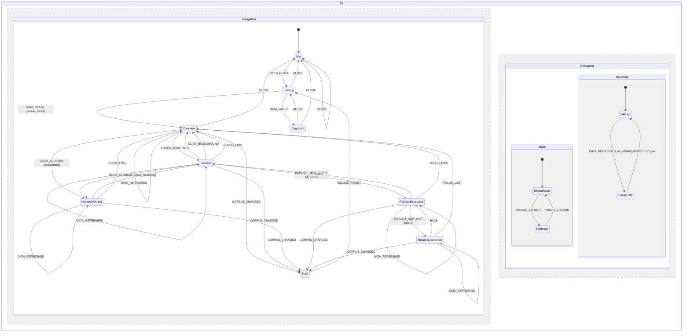

# S5 导航状态机 · 冻结稿 v1（候选）

> **依据**：`multilevel-graph-vision.md`；`S5-charter.md`；`S5-RULINGS.md`。
> **上游冻结**：S0（`241b1e1e…`）、S1（`6676c71d…`）、S2（`92bb0041…`）、S3（`0ca4ea0e…`+`S3-ADDENDUM-1`）、S4（`2576f6c8…`）——不得违反。
> **输入**：A-v2（`538506a4…`）、B-v2（`84ba06f7…`）、异议-v2（`dde1f9d0…`）。
> **状态**：冻结候选 v1，待 SE 工程校核（task-317，含 S5a）与 Lead 独立机检后冻结；冻结前不写产品代码。

---

## 0. 一句话口径

导航 = `GraphNavFrame`（只在 Presentation）驱动；S5 只构造 `frame_spec` 交给 S4，**不算 presence、不进 VM**；点击按 `kind` 唯一分流（KP→编辑器、簇→drill）；drill/back/dimension 全部**事务化**（成功才 commit），失败 canonical diff=0。

## 1. 规范性条款（S5-1..S5-12）

### S5-1 GraphNavFrame 与边界
- **规则**：`GraphNavFrame{focus, level, view_family, dimension, hop, new_hop, mode, budget, origin, edition, history}`；只在 Presentation，**不进 VM**；S5 只构造 `frame_spec` 给 S4（`level/view_family/dimension/focus/hop/new_hop/mode/budget`）；S5 不算 presence、不读 DataSource。
- **R-S5-9（冻结）**：`frame_id = sha256(canonical(frame_spec))` 由 S5 派生；`edition` 由 S5 从 corpus/manifest 派生并在本地做 stale 校验；**不要求 S4 返回 `frame_id/edition_sha` 等未冻结字段**；若未来需要，须走 S4 增补/Lead 批。
- **机检**：frame 字段；frame_id 可复算；VM 无 nav/focus/history/mode。

### S5-2 状态机全表
- **规则**：主状态 **9 个**：`Idle/Loading/Degraded/Overview/Focused/HierarchyDrilled/RelationExpanded/RelationDeepened/Stale`；`FullExpanded`/`EmptyNoSemantic` 是 **正交变量**（`mode ∈ {default,full}`、`data_state ∈ {ok, empty_nosemantic}`），**不作主状态**；每主状态有进出边；`CLOSE/RELOAD/RESET` 全局转移；未列 `(state,event)` 一律 `S5_ILLEGAL_TRANSITION` fail-closed；无不可达/死状态。
- **R-S5-10（冻结）**：**`(state,event)` 必须唯一**（不得一条事件在多个转移行重复）；`CLICK_CLUSTER` 的 `Overview` 行与 drill 行互斥；S5a 由转移表**逐条生成**（30 组规范表为唯一真源；148 条展开边是生成产物，不手工维护）；机检表展开边集 == 图边集、`PARSE_OK`。
- **来源**：A-v2 S5-2/S5-13；B-v2 S5-2；R-S5-1/4/10。

### S5-3 点击语义
- **规则**：`nodeClick(kind)` 唯一分流：`kp`→跳编辑器（frame/stack 不变，U-20）；`cluster`→drill；`edgeClick`→selection/检查器；`backgroundClick`→清 selection；`hover/focus` 不改导航；未知 kind fail-closed。
- **机检**：kind 分流唯一；kp 不改 frame/stack。
- **来源**：A-v2 S5-3；B-v2 S5-3。

### S5-4 drill / back / 面包屑
- **规则**：drill push（level+1、focus=簇、hop 重置）；back 精确弹栈恢复 focus/level/dimension/hop/mode；`BREADCRUMB_TO` 截断中间栈；`MAX_STACK=50`；同 `(focus,level,dimension,mode)` 去重；重开只恢复 `level0` frame + mode + dimension（不恢复深栈）。
- **机检**：back 栈可逆；栈上限/去重；重开白名单。
- **来源**：A-v2 S5-4；B-v2 S5-4；R-S5-6。

### S5-5 `EXPLICIT_NEW_HOP`
- **规则**：唯一显式 2 跳动作：仅 A 维、有 focus、hop=1；push 当前 frame 后 hop=1 基座、`hop=2/new_hop=true`；重复触发幂等；默认路径 `new_hop=false`、无 2 跳；H 维/非法 fail-closed。
- **机检**：默认无 2 跳；唯一动作；幂等。
- **来源**：A-v2 S5-5；B-v2 S5-5；S4 R-S4-2。

### S5-6 焦点/选择生命周期
- **规则**：focus=取景基座；selection=UI 选中（瞬态、不进 VM）；drill/back/breadcrumb/dimension/toggle/background 后清 selection；focus 丢失→最近祖先/根；默认 frame focus=root。
- **R-S5-11（冻结）**：必须包含 `FOCUS_LOST` 转移（显示态→祖先/root，事务化）与 `DATA_REFRESHED` 转移（edition 匹配时重算 `data_state`，不重取景，SELF）；两者进入 S5a 且恢复路径可达。
- **机检**：FOCUS_LOST/DATA_REFRESHED 存在；恢复可达；selection 不进 VM。
- **来源**：A-v2 S5-6；B-v2 S5-6；R-S5-11。

### S5-7 维度切换
- **规则**：仅 active 维度；**切换 push 当前 frame**，hop 重置、new_hop=false、selection 清空；focus 可表示则保留、否则映射；**history 不清空**（仅 CLOSE/RELOAD/RESET 清空）；未知/reserved/组合 fail-closed。
- **机检**：切换后 back == 切换前 canonical frame；history 非空。
- **来源**：A-v2 S5-7；B-v2 S5-7；R-S5-2。

### S5-8 全展开
- **规则**：`mode=full` 是 Presentation 正交开关；不改 focus/level/dimension/stack；请求 S4 full（candidate 超集/subset 契约）；失败按事务化；只持久化 mode。
- **机检**：full 与 drill 正交；失败 diff=0。
- **来源**：A-v2 S5-8；B-v2 S5-8；R-S5-7。

### S5-9 与 S4 接口与事务化
- **规则**：`frame_spec` 构造见 S5-1；S5 不算 presence；同输入同 frame；导航 = clone→构造 nextFrame/nextStack→请求 S4→**成功才 commit**；失败（`S4_BUDGET_INVALID`/`FOCUS_UNRESOLVED`/`DIM_*`/非法转移）保持转移前 canonical state/frame/stack（diff=0）；初始帧失败→`Degraded`，非初始→提示且原 frame 不变；禁止先 push 后回滚。
- **R-S5-12（冻结）**：`frame_id` 派生自 `frame_spec`；edition 本地校验；S4 未冻结字段不得消费。
- **机检**：失败注入 diff=0；无孤立 stack；frame_id 可复算。
- **来源**：A-v2 S5-9；B-v2 S5-9；R-S5-3/9/12。

### S5-10 与 S3 事件
- **规则**：最小事件映射；payload 白名单无导航字段；300ms 去重/pending 守卫；hover 不改导航；渲染器无导航动作。
- **机检**：事件集；无导航 payload；去重。
- **来源**：A-v2 S5-10；B-v2 S5-10。

### S5-11 与 S1/S2
- **规则**：H→`HierarchyDrilled`（hop=null）；A→`RelationExpanded/RelationDeepened`（hop 1/2）；只读 S2 run、不重算簇；无簇→`EmptyNoSemantic`（KP+layout_group，`data_state` 正交），恢复由 `DATA_REFRESHED` 驱动；A 不改变簇。
- **机检**：只读 run；无簇不伪造；恢复转移存在。
- **来源**：A-v2 S5-11；B-v2 S5-11。

### S5-12 可访问性/持久化/度量
- **规则**：键盘等价动作（Enter/Space/Backspace/Alt+Left/Escape/方向键）；`aria-live` 导航播报；只持久化 `mode/dimension/level0 frame`（不存深栈、不存 focus）；G6 导航指标（切换延迟/back 次数/illegal/focus_lost/empty/new_hop）；URL/书签归 S6a。
- **机检**：键盘路径；持久化白名单；G6 可复跑。
- **来源**：A-v2 S5-12；B-v2 S5-12；R-S5-6/8。

## 2. 跨议题裁决（R-S5-1..R-S5-12）

- R-S5-1 正交复合状态 + 表↔图一致；R-S5-2 维度可 back；R-S5-3 事务化；R-S5-4 主状态并集；R-S5-5 Focused 不改 frame.focus；R-S5-6 栈/重开；R-S5-7 full 正交；R-S5-8 并集。
- **R-S5-9**：frame_id 派生、edition 本地、不消费 S4 未冻结字段。
- **R-S5-10**：`(state,event)` 唯一；S5a 由表生成（30 组规范表为真源，148 边为产物）。
- **R-S5-11**：FOCUS_LOST/DATA_REFRESHED 必须存在且恢复可达。
- **R-S5-12**：导航事务化 + 失败 diff=0 + frame_id 可复算。

## 3. 冻结前机检（SE + Lead）

M-S5-1 frame 边界/VM；M-S5-2 主状态 9/无不可达；M-S5-3 表↔图一致/S5a `PARSE_OK`；M-S5-4 `(state,event)` 唯一；M-S5-5 点击 kind；M-S5-6 drill/back/栈/重开；M-S5-7 NEW_HOP 唯一/幂等；M-S5-8 focus/selection/FOCUS_LOST/DATA_REFRESHED；M-S5-9 维度可 back；M-S5-10 full 正交/S4 subset；M-S5-11 事务化失败 diff=0；M-S5-12 S1/S2/a11y/G6 + 覆盖矩阵。

## 4. 覆盖矩阵（U → 条款）

| U# | 要点 | 落地 |
|---|---|---|
| U-1 | 白板→图谱 | S5-2/S5-3 |
| U-4 | 点击节点 | S5-3 |
| U-7 | 深入一层 | S5-4 |
| U-8 | 层次多层 | S5-4/S5-11 |
| U-9 | 多维度 | S5-7 |
| U-15 | 深入后经语义边挂接 | S1/S4；S5-5 |
| U-20 | 点击 KP 回编辑器 | S5-3 |
| U-22 | 新一跳 vs 跳更深 | S5-5 |
| U-24 | 返回 | S5-4 |
| U-26 | 默认替代+全展开 | S5-8 |
| U-29 | 时间/状态 | S5-12（持久化/指标） |

## 5. 冻结后进入的下一场

S6（数据契约 + ER/DFD/S6a：run/registry/history/VISUAL/NAV/CACHE 的 schema、存储/审计/GC、S4/S5 需求收口）。

## 6. 变更控制

- 加状态/事件/动作：S5 修订 + 决策；删/改状态机语义/点击语义/new_hop/frame 字段：重开 S5；
- S5a 由规范表生成；手工改图视为破坏冻结。

---

## 附录 A：30 组规范转移表（**冻结**；唯一真源）

> `*` = 显示态集合 `{Overview, Focused, HierarchyDrilled, RelationExpanded, RelationDeepened}`；`ALL` = 全部 9 主状态。
> `(state,event)` 唯一；本表展开为 148 条边（由脚本生成，不手工维护）；与附录 B 的 S5a 必须一致。

| # | From | Event | Guard | Action | To |
|---|---|---|---|---|---|
| T01 | Idle | OPEN_GRAPH | backend_ready | 读设置；不恢复深栈 | Loading |
| T02 | Loading | DATA_READY | edition_match | 建默认 frame；按 S2 设 data_state | Overview |
| T03 | Loading | DATA_FAILED | retryable | 显示降级 | Degraded |
| T04 | Degraded | RETRY | retryable | 重试加载 | Loading |
| T05 | ALL\{Idle} | CLOSE | — | 保存设置；清内存/history | Idle |
| T06 | ALL | RELOAD | — | 重建 frame；清 history | Loading |
| T07 | * | DATA_REFRESHED | edition_match | 重算 data_state；不重取景 | SELF |
| T08 | Overview/HierarchyDrilled/RelationExpanded/RelationDeepened | FOCUS_NODE | node_focusable | 记录 origin；UI focus；不改 frame.focus | Focused |
| T09 | * | CLICK_KP | kind=kp∧file | jump_editor；frame/stack 不变 | SELF |
| T10 | * | CLICK_EDGE | edge_id | selection=edge；检查器；frame/stack 不变 | SELF |
| T11 | Overview/HierarchyDrilled/RelationExpanded/RelationDeepened | CLICK_BACKGROUND | — | selection=null | SELF |
| T12 | Focused | CLICK_BACKGROUND | — | selection=null；回 origin | Overview/HierarchyDrilled/RelationExpanded/RelationDeepened |
| T13 | Overview | CLICK_CLUSTER | kind=cluster∧expandable | 事务 drill；push；hop 重置；清 selection | HierarchyDrilled |
| T14 | Focused | CLICK_CLUSTER | 同上 | 事务 drill；清 UI focus；push | HierarchyDrilled/RelationExpanded |
| T15 | HierarchyDrilled | CLICK_CLUSTER | 同上 | 事务 drill；push | HierarchyDrilled |
| T16 | RelationExpanded | CLICK_CLUSTER | 同上 | 事务 drill；push | RelationExpanded |
| T17 | RelationDeepened | CLICK_CLUSTER | 同上 | 事务 drill；push | RelationExpanded |
| T18 | * | FOCUS_LOST | focus_missing | 事务恢复最近祖先/root | Overview/HierarchyDrilled/RelationExpanded/RelationDeepened |
| T19 | Focused | FOCUS_CLEAR | — | 回 origin；清 selection | 同上 |
| T20 | Focused | BACK | stack_nonempty | 事务 back；清 UI focus | 同上 |
| T21 | HierarchyDrilled/RelationExpanded/RelationDeepened | BACK | stack_nonempty | 事务 pop；恢复 frame | Overview/HierarchyDrilled/RelationExpanded/RelationDeepened |
| T22 | Overview | BACK | stack_empty | no-op；公告根层 | Overview |
| T23 | * | BREADCRUMB_TO | target_in_stack | 截断到目标；事务恢复 | Overview/HierarchyDrilled/RelationExpanded/RelationDeepened |
| T24 | * | SELECT_DIMENSION | dimension_active | 事务 push；hop 重置；mode 保留 | Overview/HierarchyDrilled/RelationExpanded |
| T25 | RelationExpanded | EXPLICIT_NEW_HOP | A∧focus∧hop=1 | 事务 push；hop=2/new_hop=true | RelationDeepened |
| T26 | RelationDeepened | EXPLICIT_NEW_HOP | hop=2 | 幂等 no-op | RelationDeepened |
| T27 | * | TOGGLE_EXPAND | S4 candidate_superset | 事务切换 mode；不改 frame/stack | SELF |
| T28 | * | CORPUS_CHANGED | edition_mismatch | 标 stale；不自动重取景 | Stale |
| T29 | * | RESET | — | 清 history；重建默认 frame | Loading |
| T30 | Stale | RESET | — | 清 history；重载 | Loading |

> **T05 注**：`Idle` 上 `CLOSE` 为 no-op，不产生边、不计数；因此 `ALL\{Idle}` 展开 8 边，全表唯一展开边数 = **148**。

## 附录 B：S5a 状态图（**非规范投影**；精确 S5a 由附录 A 生成；`FullExpanded`/`EmptyNoSemantic` 为直角正交变量）

> **规范性说明**：附录 B 的 mermaid 是**人读投影**，不是 148 条精确图。精确 S5a = 由附录 A 的 T01–T30 在脚本中展开生成的 `states=9, events, edges=148` 边集；机检以**生成器输出**为准（断言「表展开边集 == 生成图边集」「`PARSE_OK`」「无禁用主状态」）。附录 B 仅用于评审可读性。

> **注**：附录 B 为分组投影；精确 148 条边由附录 A 展开生成，机检以「展开边集 == 图边集」为准。
