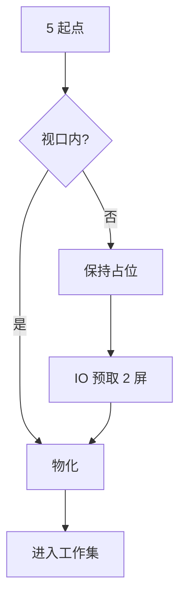
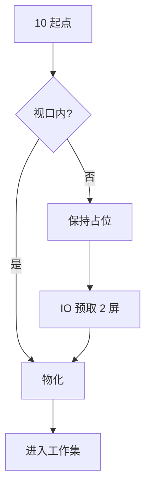
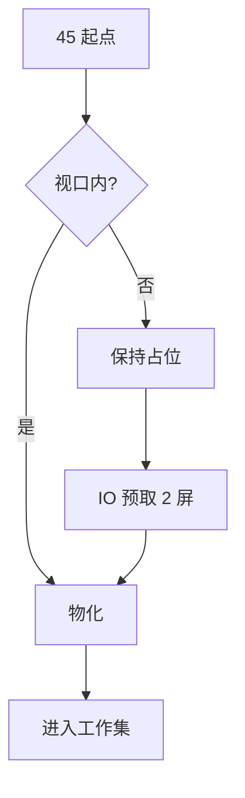
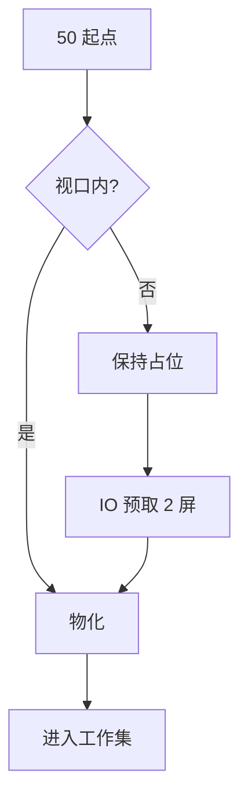
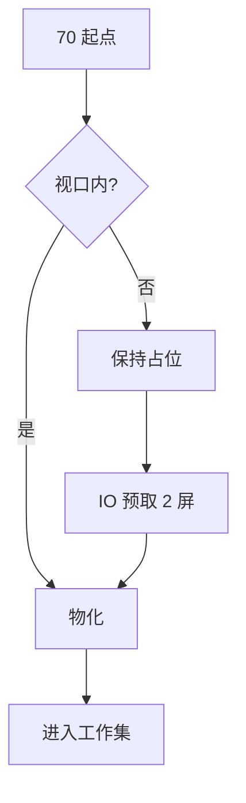

# 惰性门禁大文档（合成 fixture）

> 本文件由 `scripts/benchmark/surface/make_lazy_gate_fixture.py` 确定性生成，**请勿手改**。
> 用途：W4.1 惰性路径交互门禁（≥1000 块；含行内/块级公式、表格、mermaid、代码、列表、引用）。
> 每节首段含 `LAZYGATE-MARK-<NNNN>`：门禁用它把「视口里看到的文本」与「源文件行号」对齐。


## 第 1 节 · 惰性门禁样章 0001


LAZYGATE-MARK-0001 区域标记：本节用于验证大文档的惰性物化与工作集淘汰；标记行号是门禁的文本-位置对齐锚点。


本节讨论第 1 组样本的物化与淘汰行为：设输入序列为 $x_{1} = \sum_{k=1}^{4}\alpha_k y_k$，在窗口宽度为 1280 的视口内，只有落入工作集的块会被真正排版；其余块保持占位（高度由实测行高 22.4 推算，不硬编码像素）。实验标记 `TOKEN-0001-A` 用于确认文本没有串位；英文段落 the quick brown fox jumps over the lazy dog, sample 1, width 1280.


### 1.2 观察项


- 观察项 A：占位块高度必须由实测行高推算，禁止硬编码。
- 观察项 B：滚动停止 50ms 内，视口内占位块数应回到 0。
- 观察项 C：远处块允许被淘汰；被编辑/选中的块必须保留。
- 观察项 D：滚回原位时绝对行号漂移 ≤5 行。


> 引用 0001：工作集淘汰是“缺页换出”，不是渲染裁剪；占位必须保高。


---


## 第 2 节 · 惰性门禁样章 0002


LAZYGATE-MARK-0002 区域标记：本节用于验证大文档的惰性物化与工作集淘汰；标记行号是门禁的文本-位置对齐锚点。


本节讨论第 2 组样本的物化与淘汰行为：设输入序列为 $x_{2} = \sum_{k=1}^{5}\alpha_k y_k$，在窗口宽度为 1296 的视口内，只有落入工作集的块会被真正排版；其余块保持占位（高度由实测行高 22.4 推算，不硬编码像素）。实验标记 `TOKEN-0002-A` 用于确认文本没有串位；英文段落 the quick brown fox jumps over the lazy dog, sample 2, width 1296.


$$
\begin{aligned}
S_{2} &= \sum_{i=1}^{N} w_i \cdot f(x_i) \\
       &= \frac{1}{2} \sum_{j=1}^{2} \left( a_j + b_j \right)^2
\end{aligned}
\tag{2.1}
$$


### 2.3 观察项


- 观察项 A：占位块高度必须由实测行高推算，禁止硬编码。
- 观察项 B：滚动停止 50ms 内，视口内占位块数应回到 0。
- 观察项 C：远处块允许被淘汰；被编辑/选中的块必须保留。
- 观察项 D：滚回原位时绝对行号漂移 ≤5 行。


> 引用 0002：工作集淘汰是“缺页换出”，不是渲染裁剪；占位必须保高。


---


## 第 3 节 · 惰性门禁样章 0003


LAZYGATE-MARK-0003 区域标记：本节用于验证大文档的惰性物化与工作集淘汰；标记行号是门禁的文本-位置对齐锚点。


本节讨论第 3 组样本的物化与淘汰行为：设输入序列为 $x_{3} = \sum_{k=1}^{6}\alpha_k y_k$，在窗口宽度为 1264 的视口内，只有落入工作集的块会被真正排版；其余块保持占位（高度由实测行高 22.4 推算，不硬编码像素）。实验标记 `TOKEN-0003-A` 用于确认文本没有串位；英文段落 the quick brown fox jumps over the lazy dog, sample 3, width 1264.


| 序号 | 参数 | 取值 | 说明 |
|---:|---|---:|---|
| 3 | `keepScreens` | 4 | 视口上下各保留屏数 |
| 3 | `batchMax` | 60 | 单批淘汰上限 |
| 3 | `recentMs` | 1500 | LRU 近期窗口 |
| 3 | `viewport` | 1264×821 | 门禁窗口 |


### 3.1 观察项


- 观察项 A：占位块高度必须由实测行高推算，禁止硬编码。
- 观察项 B：滚动停止 50ms 内，视口内占位块数应回到 0。
- 观察项 C：远处块允许被淘汰；被编辑/选中的块必须保留。
- 观察项 D：滚回原位时绝对行号漂移 ≤5 行。


> 引用 0003：工作集淘汰是“缺页换出”，不是渲染裁剪；占位必须保高。


---


## 第 4 节 · 惰性门禁样章 0004


LAZYGATE-MARK-0004 区域标记：本节用于验证大文档的惰性物化与工作集淘汰；标记行号是门禁的文本-位置对齐锚点。


本节讨论第 4 组样本的物化与淘汰行为：设输入序列为 $x_{4} = \sum_{k=1}^{3}\alpha_k y_k$，在窗口宽度为 1280 的视口内，只有落入工作集的块会被真正排版；其余块保持占位（高度由实测行高 22.4 推算，不硬编码像素）。实验标记 `TOKEN-0004-A` 用于确认文本没有串位；英文段落 the quick brown fox jumps over the lazy dog, sample 4, width 1280.


$$
\begin{aligned}
S_{4} &= \sum_{i=1}^{N} w_i \cdot f(x_i) \\
       &= \frac{1}{4} \sum_{j=1}^{4} \left( a_j + b_j \right)^2
\end{aligned}
\tag{4.1}
$$


```python
def materialize_range(blocks, start, end):
    """第 4 组：只物化 [start, end) 内的占位块。"""
    made = []
    for i in range(start, end):
        if blocks[i].is_placeholder:
            made.append(blocks[i].materialize())
    return made
```


### 4.2 观察项


- 观察项 A：占位块高度必须由实测行高推算，禁止硬编码。
- 观察项 B：滚动停止 50ms 内，视口内占位块数应回到 0。
- 观察项 C：远处块允许被淘汰；被编辑/选中的块必须保留。
- 观察项 D：滚回原位时绝对行号漂移 ≤5 行。


> 引用 0004：工作集淘汰是“缺页换出”，不是渲染裁剪；占位必须保高。


---


## 第 5 节 · 惰性门禁样章 0005


LAZYGATE-MARK-0005 区域标记：本节用于验证大文档的惰性物化与工作集淘汰；标记行号是门禁的文本-位置对齐锚点。


本节讨论第 5 组样本的物化与淘汰行为：设输入序列为 $x_{5} = \sum_{k=1}^{4}\alpha_k y_k$，在窗口宽度为 1296 的视口内，只有落入工作集的块会被真正排版；其余块保持占位（高度由实测行高 22.4 推算，不硬编码像素）。实验标记 `TOKEN-0005-A` 用于确认文本没有串位；英文段落 the quick brown fox jumps over the lazy dog, sample 5, width 1296.





### 5.3 观察项


- 观察项 A：占位块高度必须由实测行高推算，禁止硬编码。
- 观察项 B：滚动停止 50ms 内，视口内占位块数应回到 0。
- 观察项 C：远处块允许被淘汰；被编辑/选中的块必须保留。
- 观察项 D：滚回原位时绝对行号漂移 ≤5 行。


> 引用 0005：工作集淘汰是“缺页换出”，不是渲染裁剪；占位必须保高。


---


## 第 6 节 · 惰性门禁样章 0006


LAZYGATE-MARK-0006 区域标记：本节用于验证大文档的惰性物化与工作集淘汰；标记行号是门禁的文本-位置对齐锚点。


本节讨论第 6 组样本的物化与淘汰行为：设输入序列为 $x_{6} = \sum_{k=1}^{5}\alpha_k y_k$，在窗口宽度为 1264 的视口内，只有落入工作集的块会被真正排版；其余块保持占位（高度由实测行高 22.4 推算，不硬编码像素）。实验标记 `TOKEN-0006-A` 用于确认文本没有串位；英文段落 the quick brown fox jumps over the lazy dog, sample 6, width 1264.


$$
\begin{aligned}
S_{6} &= \sum_{i=1}^{N} w_i \cdot f(x_i) \\
       &= \frac{1}{6} \sum_{j=1}^{6} \left( a_j + b_j \right)^2
\end{aligned}
\tag{6.1}
$$


| 序号 | 参数 | 取值 | 说明 |
|---:|---|---:|---|
| 6 | `keepScreens` | 4 | 视口上下各保留屏数 |
| 6 | `batchMax` | 60 | 单批淘汰上限 |
| 6 | `recentMs` | 1500 | LRU 近期窗口 |
| 6 | `viewport` | 1264×821 | 门禁窗口 |


### 6.1 观察项


- 观察项 A：占位块高度必须由实测行高推算，禁止硬编码。
- 观察项 B：滚动停止 50ms 内，视口内占位块数应回到 0。
- 观察项 C：远处块允许被淘汰；被编辑/选中的块必须保留。
- 观察项 D：滚回原位时绝对行号漂移 ≤5 行。


> 引用 0006：工作集淘汰是“缺页换出”，不是渲染裁剪；占位必须保高。


---


## 第 7 节 · 惰性门禁样章 0007


LAZYGATE-MARK-0007 区域标记：本节用于验证大文档的惰性物化与工作集淘汰；标记行号是门禁的文本-位置对齐锚点。


本节讨论第 7 组样本的物化与淘汰行为：设输入序列为 $x_{7} = \sum_{k=1}^{6}\alpha_k y_k$，在窗口宽度为 1280 的视口内，只有落入工作集的块会被真正排版；其余块保持占位（高度由实测行高 22.4 推算，不硬编码像素）。实验标记 `TOKEN-0007-A` 用于确认文本没有串位；英文段落 the quick brown fox jumps over the lazy dog, sample 7, width 1280.


### 7.2 观察项


- 观察项 A：占位块高度必须由实测行高推算，禁止硬编码。
- 观察项 B：滚动停止 50ms 内，视口内占位块数应回到 0。
- 观察项 C：远处块允许被淘汰；被编辑/选中的块必须保留。
- 观察项 D：滚回原位时绝对行号漂移 ≤5 行。


> 引用 0007：工作集淘汰是“缺页换出”，不是渲染裁剪；占位必须保高。


---


## 第 8 节 · 惰性门禁样章 0008


LAZYGATE-MARK-0008 区域标记：本节用于验证大文档的惰性物化与工作集淘汰；标记行号是门禁的文本-位置对齐锚点。


本节讨论第 8 组样本的物化与淘汰行为：设输入序列为 $x_{8} = \sum_{k=1}^{3}\alpha_k y_k$，在窗口宽度为 1296 的视口内，只有落入工作集的块会被真正排版；其余块保持占位（高度由实测行高 22.4 推算，不硬编码像素）。实验标记 `TOKEN-0008-A` 用于确认文本没有串位；英文段落 the quick brown fox jumps over the lazy dog, sample 8, width 1296.


$$
\begin{aligned}
S_{8} &= \sum_{i=1}^{N} w_i \cdot f(x_i) \\
       &= \frac{1}{8} \sum_{j=1}^{8} \left( a_j + b_j \right)^2
\end{aligned}
\tag{8.1}
$$


```python
def materialize_range(blocks, start, end):
    """第 8 组：只物化 [start, end) 内的占位块。"""
    made = []
    for i in range(start, end):
        if blocks[i].is_placeholder:
            made.append(blocks[i].materialize())
    return made
```


### 8.3 观察项


- 观察项 A：占位块高度必须由实测行高推算，禁止硬编码。
- 观察项 B：滚动停止 50ms 内，视口内占位块数应回到 0。
- 观察项 C：远处块允许被淘汰；被编辑/选中的块必须保留。
- 观察项 D：滚回原位时绝对行号漂移 ≤5 行。


> 引用 0008：工作集淘汰是“缺页换出”，不是渲染裁剪；占位必须保高。


---


## 第 9 节 · 惰性门禁样章 0009


LAZYGATE-MARK-0009 区域标记：本节用于验证大文档的惰性物化与工作集淘汰；标记行号是门禁的文本-位置对齐锚点。


本节讨论第 9 组样本的物化与淘汰行为：设输入序列为 $x_{9} = \sum_{k=1}^{4}\alpha_k y_k$，在窗口宽度为 1264 的视口内，只有落入工作集的块会被真正排版；其余块保持占位（高度由实测行高 22.4 推算，不硬编码像素）。实验标记 `TOKEN-0009-A` 用于确认文本没有串位；英文段落 the quick brown fox jumps over the lazy dog, sample 9, width 1264.


| 序号 | 参数 | 取值 | 说明 |
|---:|---|---:|---|
| 9 | `keepScreens` | 4 | 视口上下各保留屏数 |
| 9 | `batchMax` | 60 | 单批淘汰上限 |
| 9 | `recentMs` | 1500 | LRU 近期窗口 |
| 9 | `viewport` | 1264×821 | 门禁窗口 |


### 9.1 观察项


- 观察项 A：占位块高度必须由实测行高推算，禁止硬编码。
- 观察项 B：滚动停止 50ms 内，视口内占位块数应回到 0。
- 观察项 C：远处块允许被淘汰；被编辑/选中的块必须保留。
- 观察项 D：滚回原位时绝对行号漂移 ≤5 行。


> 引用 0009：工作集淘汰是“缺页换出”，不是渲染裁剪；占位必须保高。


---


## 第 10 节 · 惰性门禁样章 0010


LAZYGATE-MARK-0010 区域标记：本节用于验证大文档的惰性物化与工作集淘汰；标记行号是门禁的文本-位置对齐锚点。


本节讨论第 10 组样本的物化与淘汰行为：设输入序列为 $x_{10} = \sum_{k=1}^{5}\alpha_k y_k$，在窗口宽度为 1280 的视口内，只有落入工作集的块会被真正排版；其余块保持占位（高度由实测行高 22.4 推算，不硬编码像素）。实验标记 `TOKEN-0010-A` 用于确认文本没有串位；英文段落 the quick brown fox jumps over the lazy dog, sample 10, width 1280.


$$
\begin{aligned}
S_{10} &= \sum_{i=1}^{N} w_i \cdot f(x_i) \\
       &= \frac{1}{10} \sum_{j=1}^{10} \left( a_j + b_j \right)^2
\end{aligned}
\tag{10.1}
$$





### 10.2 观察项


- 观察项 A：占位块高度必须由实测行高推算，禁止硬编码。
- 观察项 B：滚动停止 50ms 内，视口内占位块数应回到 0。
- 观察项 C：远处块允许被淘汰；被编辑/选中的块必须保留。
- 观察项 D：滚回原位时绝对行号漂移 ≤5 行。


> 引用 0010：工作集淘汰是“缺页换出”，不是渲染裁剪；占位必须保高。


---


## 第 11 节 · 惰性门禁样章 0011


LAZYGATE-MARK-0011 区域标记：本节用于验证大文档的惰性物化与工作集淘汰；标记行号是门禁的文本-位置对齐锚点。


本节讨论第 11 组样本的物化与淘汰行为：设输入序列为 $x_{11} = \sum_{k=1}^{6}\alpha_k y_k$，在窗口宽度为 1296 的视口内，只有落入工作集的块会被真正排版；其余块保持占位（高度由实测行高 22.4 推算，不硬编码像素）。实验标记 `TOKEN-0011-A` 用于确认文本没有串位；英文段落 the quick brown fox jumps over the lazy dog, sample 11, width 1296.


### 11.3 观察项


- 观察项 A：占位块高度必须由实测行高推算，禁止硬编码。
- 观察项 B：滚动停止 50ms 内，视口内占位块数应回到 0。
- 观察项 C：远处块允许被淘汰；被编辑/选中的块必须保留。
- 观察项 D：滚回原位时绝对行号漂移 ≤5 行。


> 引用 0011：工作集淘汰是“缺页换出”，不是渲染裁剪；占位必须保高。


---


## 第 12 节 · 惰性门禁样章 0012


LAZYGATE-MARK-0012 区域标记：本节用于验证大文档的惰性物化与工作集淘汰；标记行号是门禁的文本-位置对齐锚点。


本节讨论第 12 组样本的物化与淘汰行为：设输入序列为 $x_{12} = \sum_{k=1}^{3}\alpha_k y_k$，在窗口宽度为 1264 的视口内，只有落入工作集的块会被真正排版；其余块保持占位（高度由实测行高 22.4 推算，不硬编码像素）。实验标记 `TOKEN-0012-A` 用于确认文本没有串位；英文段落 the quick brown fox jumps over the lazy dog, sample 12, width 1264.


$$
\begin{aligned}
S_{12} &= \sum_{i=1}^{N} w_i \cdot f(x_i) \\
       &= \frac{1}{12} \sum_{j=1}^{12} \left( a_j + b_j \right)^2
\end{aligned}
\tag{12.1}
$$


| 序号 | 参数 | 取值 | 说明 |
|---:|---|---:|---|
| 12 | `keepScreens` | 4 | 视口上下各保留屏数 |
| 12 | `batchMax` | 60 | 单批淘汰上限 |
| 12 | `recentMs` | 1500 | LRU 近期窗口 |
| 12 | `viewport` | 1264×821 | 门禁窗口 |


```python
def materialize_range(blocks, start, end):
    """第 12 组：只物化 [start, end) 内的占位块。"""
    made = []
    for i in range(start, end):
        if blocks[i].is_placeholder:
            made.append(blocks[i].materialize())
    return made
```


### 12.1 观察项


- 观察项 A：占位块高度必须由实测行高推算，禁止硬编码。
- 观察项 B：滚动停止 50ms 内，视口内占位块数应回到 0。
- 观察项 C：远处块允许被淘汰；被编辑/选中的块必须保留。
- 观察项 D：滚回原位时绝对行号漂移 ≤5 行。


> 引用 0012：工作集淘汰是“缺页换出”，不是渲染裁剪；占位必须保高。


---


## 第 13 节 · 惰性门禁样章 0013


LAZYGATE-MARK-0013 区域标记：本节用于验证大文档的惰性物化与工作集淘汰；标记行号是门禁的文本-位置对齐锚点。


本节讨论第 13 组样本的物化与淘汰行为：设输入序列为 $x_{13} = \sum_{k=1}^{4}\alpha_k y_k$，在窗口宽度为 1280 的视口内，只有落入工作集的块会被真正排版；其余块保持占位（高度由实测行高 22.4 推算，不硬编码像素）。实验标记 `TOKEN-0013-A` 用于确认文本没有串位；英文段落 the quick brown fox jumps over the lazy dog, sample 13, width 1280.


### 13.2 观察项


- 观察项 A：占位块高度必须由实测行高推算，禁止硬编码。
- 观察项 B：滚动停止 50ms 内，视口内占位块数应回到 0。
- 观察项 C：远处块允许被淘汰；被编辑/选中的块必须保留。
- 观察项 D：滚回原位时绝对行号漂移 ≤5 行。


> 引用 0013：工作集淘汰是“缺页换出”，不是渲染裁剪；占位必须保高。


---


## 第 14 节 · 惰性门禁样章 0014


LAZYGATE-MARK-0014 区域标记：本节用于验证大文档的惰性物化与工作集淘汰；标记行号是门禁的文本-位置对齐锚点。


本节讨论第 14 组样本的物化与淘汰行为：设输入序列为 $x_{14} = \sum_{k=1}^{5}\alpha_k y_k$，在窗口宽度为 1296 的视口内，只有落入工作集的块会被真正排版；其余块保持占位（高度由实测行高 22.4 推算，不硬编码像素）。实验标记 `TOKEN-0014-A` 用于确认文本没有串位；英文段落 the quick brown fox jumps over the lazy dog, sample 14, width 1296.


$$
\begin{aligned}
S_{14} &= \sum_{i=1}^{N} w_i \cdot f(x_i) \\
       &= \frac{1}{14} \sum_{j=1}^{14} \left( a_j + b_j \right)^2
\end{aligned}
\tag{14.1}
$$


### 14.3 观察项


- 观察项 A：占位块高度必须由实测行高推算，禁止硬编码。
- 观察项 B：滚动停止 50ms 内，视口内占位块数应回到 0。
- 观察项 C：远处块允许被淘汰；被编辑/选中的块必须保留。
- 观察项 D：滚回原位时绝对行号漂移 ≤5 行。


> 引用 0014：工作集淘汰是“缺页换出”，不是渲染裁剪；占位必须保高。


---


## 第 15 节 · 惰性门禁样章 0015


LAZYGATE-MARK-0015 区域标记：本节用于验证大文档的惰性物化与工作集淘汰；标记行号是门禁的文本-位置对齐锚点。


本节讨论第 15 组样本的物化与淘汰行为：设输入序列为 $x_{15} = \sum_{k=1}^{6}\alpha_k y_k$，在窗口宽度为 1264 的视口内，只有落入工作集的块会被真正排版；其余块保持占位（高度由实测行高 22.4 推算，不硬编码像素）。实验标记 `TOKEN-0015-A` 用于确认文本没有串位；英文段落 the quick brown fox jumps over the lazy dog, sample 15, width 1264.


| 序号 | 参数 | 取值 | 说明 |
|---:|---|---:|---|
| 15 | `keepScreens` | 4 | 视口上下各保留屏数 |
| 15 | `batchMax` | 60 | 单批淘汰上限 |
| 15 | `recentMs` | 1500 | LRU 近期窗口 |
| 15 | `viewport` | 1264×821 | 门禁窗口 |


### 15.1 观察项


- 观察项 A：占位块高度必须由实测行高推算，禁止硬编码。
- 观察项 B：滚动停止 50ms 内，视口内占位块数应回到 0。
- 观察项 C：远处块允许被淘汰；被编辑/选中的块必须保留。
- 观察项 D：滚回原位时绝对行号漂移 ≤5 行。


> 引用 0015：工作集淘汰是“缺页换出”，不是渲染裁剪；占位必须保高。


---


## 第 16 节 · 惰性门禁样章 0016


LAZYGATE-MARK-0016 区域标记：本节用于验证大文档的惰性物化与工作集淘汰；标记行号是门禁的文本-位置对齐锚点。


本节讨论第 16 组样本的物化与淘汰行为：设输入序列为 $x_{16} = \sum_{k=1}^{3}\alpha_k y_k$，在窗口宽度为 1280 的视口内，只有落入工作集的块会被真正排版；其余块保持占位（高度由实测行高 22.4 推算，不硬编码像素）。实验标记 `TOKEN-0016-A` 用于确认文本没有串位；英文段落 the quick brown fox jumps over the lazy dog, sample 16, width 1280.


$$
\begin{aligned}
S_{16} &= \sum_{i=1}^{N} w_i \cdot f(x_i) \\
       &= \frac{1}{16} \sum_{j=1}^{16} \left( a_j + b_j \right)^2
\end{aligned}
\tag{16.1}
$$


```python
def materialize_range(blocks, start, end):
    """第 16 组：只物化 [start, end) 内的占位块。"""
    made = []
    for i in range(start, end):
        if blocks[i].is_placeholder:
            made.append(blocks[i].materialize())
    return made
```


### 16.2 观察项


- 观察项 A：占位块高度必须由实测行高推算，禁止硬编码。
- 观察项 B：滚动停止 50ms 内，视口内占位块数应回到 0。
- 观察项 C：远处块允许被淘汰；被编辑/选中的块必须保留。
- 观察项 D：滚回原位时绝对行号漂移 ≤5 行。


> 引用 0016：工作集淘汰是“缺页换出”，不是渲染裁剪；占位必须保高。


---


## 第 17 节 · 惰性门禁样章 0017


LAZYGATE-MARK-0017 区域标记：本节用于验证大文档的惰性物化与工作集淘汰；标记行号是门禁的文本-位置对齐锚点。


本节讨论第 17 组样本的物化与淘汰行为：设输入序列为 $x_{17} = \sum_{k=1}^{4}\alpha_k y_k$，在窗口宽度为 1296 的视口内，只有落入工作集的块会被真正排版；其余块保持占位（高度由实测行高 22.4 推算，不硬编码像素）。实验标记 `TOKEN-0017-A` 用于确认文本没有串位；英文段落 the quick brown fox jumps over the lazy dog, sample 17, width 1296.


### 17.3 观察项


- 观察项 A：占位块高度必须由实测行高推算，禁止硬编码。
- 观察项 B：滚动停止 50ms 内，视口内占位块数应回到 0。
- 观察项 C：远处块允许被淘汰；被编辑/选中的块必须保留。
- 观察项 D：滚回原位时绝对行号漂移 ≤5 行。


> 引用 0017：工作集淘汰是“缺页换出”，不是渲染裁剪；占位必须保高。


---


## 第 18 节 · 惰性门禁样章 0018


LAZYGATE-MARK-0018 区域标记：本节用于验证大文档的惰性物化与工作集淘汰；标记行号是门禁的文本-位置对齐锚点。


本节讨论第 18 组样本的物化与淘汰行为：设输入序列为 $x_{18} = \sum_{k=1}^{5}\alpha_k y_k$，在窗口宽度为 1264 的视口内，只有落入工作集的块会被真正排版；其余块保持占位（高度由实测行高 22.4 推算，不硬编码像素）。实验标记 `TOKEN-0018-A` 用于确认文本没有串位；英文段落 the quick brown fox jumps over the lazy dog, sample 18, width 1264.


$$
\begin{aligned}
S_{18} &= \sum_{i=1}^{N} w_i \cdot f(x_i) \\
       &= \frac{1}{18} \sum_{j=1}^{18} \left( a_j + b_j \right)^2
\end{aligned}
\tag{18.1}
$$


| 序号 | 参数 | 取值 | 说明 |
|---:|---|---:|---|
| 18 | `keepScreens` | 4 | 视口上下各保留屏数 |
| 18 | `batchMax` | 60 | 单批淘汰上限 |
| 18 | `recentMs` | 1500 | LRU 近期窗口 |
| 18 | `viewport` | 1264×821 | 门禁窗口 |


### 18.1 观察项


- 观察项 A：占位块高度必须由实测行高推算，禁止硬编码。
- 观察项 B：滚动停止 50ms 内，视口内占位块数应回到 0。
- 观察项 C：远处块允许被淘汰；被编辑/选中的块必须保留。
- 观察项 D：滚回原位时绝对行号漂移 ≤5 行。


> 引用 0018：工作集淘汰是“缺页换出”，不是渲染裁剪；占位必须保高。


---


## 第 19 节 · 惰性门禁样章 0019


LAZYGATE-MARK-0019 区域标记：本节用于验证大文档的惰性物化与工作集淘汰；标记行号是门禁的文本-位置对齐锚点。


本节讨论第 19 组样本的物化与淘汰行为：设输入序列为 $x_{19} = \sum_{k=1}^{6}\alpha_k y_k$，在窗口宽度为 1280 的视口内，只有落入工作集的块会被真正排版；其余块保持占位（高度由实测行高 22.4 推算，不硬编码像素）。实验标记 `TOKEN-0019-A` 用于确认文本没有串位；英文段落 the quick brown fox jumps over the lazy dog, sample 19, width 1280.


### 19.2 观察项


- 观察项 A：占位块高度必须由实测行高推算，禁止硬编码。
- 观察项 B：滚动停止 50ms 内，视口内占位块数应回到 0。
- 观察项 C：远处块允许被淘汰；被编辑/选中的块必须保留。
- 观察项 D：滚回原位时绝对行号漂移 ≤5 行。


> 引用 0019：工作集淘汰是“缺页换出”，不是渲染裁剪；占位必须保高。


---


## 第 20 节 · 惰性门禁样章 0020


LAZYGATE-MARK-0020 区域标记：本节用于验证大文档的惰性物化与工作集淘汰；标记行号是门禁的文本-位置对齐锚点。


本节讨论第 20 组样本的物化与淘汰行为：设输入序列为 $x_{20} = \sum_{k=1}^{3}\alpha_k y_k$，在窗口宽度为 1296 的视口内，只有落入工作集的块会被真正排版；其余块保持占位（高度由实测行高 22.4 推算，不硬编码像素）。实验标记 `TOKEN-0020-A` 用于确认文本没有串位；英文段落 the quick brown fox jumps over the lazy dog, sample 20, width 1296.


$$
\begin{aligned}
S_{20} &= \sum_{i=1}^{N} w_i \cdot f(x_i) \\
       &= \frac{1}{20} \sum_{j=1}^{20} \left( a_j + b_j \right)^2
\end{aligned}
\tag{20.1}
$$


```python
def materialize_range(blocks, start, end):
    """第 20 组：只物化 [start, end) 内的占位块。"""
    made = []
    for i in range(start, end):
        if blocks[i].is_placeholder:
            made.append(blocks[i].materialize())
    return made
```


### 20.3 观察项


- 观察项 A：占位块高度必须由实测行高推算，禁止硬编码。
- 观察项 B：滚动停止 50ms 内，视口内占位块数应回到 0。
- 观察项 C：远处块允许被淘汰；被编辑/选中的块必须保留。
- 观察项 D：滚回原位时绝对行号漂移 ≤5 行。


> 引用 0020：工作集淘汰是“缺页换出”，不是渲染裁剪；占位必须保高。


---


## 第 21 节 · 惰性门禁样章 0021


LAZYGATE-MARK-0021 区域标记：本节用于验证大文档的惰性物化与工作集淘汰；标记行号是门禁的文本-位置对齐锚点。


本节讨论第 21 组样本的物化与淘汰行为：设输入序列为 $x_{21} = \sum_{k=1}^{4}\alpha_k y_k$，在窗口宽度为 1264 的视口内，只有落入工作集的块会被真正排版；其余块保持占位（高度由实测行高 22.4 推算，不硬编码像素）。实验标记 `TOKEN-0021-A` 用于确认文本没有串位；英文段落 the quick brown fox jumps over the lazy dog, sample 21, width 1264.


| 序号 | 参数 | 取值 | 说明 |
|---:|---|---:|---|
| 21 | `keepScreens` | 4 | 视口上下各保留屏数 |
| 21 | `batchMax` | 60 | 单批淘汰上限 |
| 21 | `recentMs` | 1500 | LRU 近期窗口 |
| 21 | `viewport` | 1264×821 | 门禁窗口 |


### 21.1 观察项


- 观察项 A：占位块高度必须由实测行高推算，禁止硬编码。
- 观察项 B：滚动停止 50ms 内，视口内占位块数应回到 0。
- 观察项 C：远处块允许被淘汰；被编辑/选中的块必须保留。
- 观察项 D：滚回原位时绝对行号漂移 ≤5 行。


> 引用 0021：工作集淘汰是“缺页换出”，不是渲染裁剪；占位必须保高。


---


## 第 22 节 · 惰性门禁样章 0022


LAZYGATE-MARK-0022 区域标记：本节用于验证大文档的惰性物化与工作集淘汰；标记行号是门禁的文本-位置对齐锚点。


本节讨论第 22 组样本的物化与淘汰行为：设输入序列为 $x_{22} = \sum_{k=1}^{5}\alpha_k y_k$，在窗口宽度为 1280 的视口内，只有落入工作集的块会被真正排版；其余块保持占位（高度由实测行高 22.4 推算，不硬编码像素）。实验标记 `TOKEN-0022-A` 用于确认文本没有串位；英文段落 the quick brown fox jumps over the lazy dog, sample 22, width 1280.


$$
\begin{aligned}
S_{22} &= \sum_{i=1}^{N} w_i \cdot f(x_i) \\
       &= \frac{1}{22} \sum_{j=1}^{22} \left( a_j + b_j \right)^2
\end{aligned}
\tag{22.1}
$$


### 22.2 观察项


- 观察项 A：占位块高度必须由实测行高推算，禁止硬编码。
- 观察项 B：滚动停止 50ms 内，视口内占位块数应回到 0。
- 观察项 C：远处块允许被淘汰；被编辑/选中的块必须保留。
- 观察项 D：滚回原位时绝对行号漂移 ≤5 行。


> 引用 0022：工作集淘汰是“缺页换出”，不是渲染裁剪；占位必须保高。


---


## 第 23 节 · 惰性门禁样章 0023


LAZYGATE-MARK-0023 区域标记：本节用于验证大文档的惰性物化与工作集淘汰；标记行号是门禁的文本-位置对齐锚点。


本节讨论第 23 组样本的物化与淘汰行为：设输入序列为 $x_{23} = \sum_{k=1}^{6}\alpha_k y_k$，在窗口宽度为 1296 的视口内，只有落入工作集的块会被真正排版；其余块保持占位（高度由实测行高 22.4 推算，不硬编码像素）。实验标记 `TOKEN-0023-A` 用于确认文本没有串位；英文段落 the quick brown fox jumps over the lazy dog, sample 23, width 1296.


### 23.3 观察项


- 观察项 A：占位块高度必须由实测行高推算，禁止硬编码。
- 观察项 B：滚动停止 50ms 内，视口内占位块数应回到 0。
- 观察项 C：远处块允许被淘汰；被编辑/选中的块必须保留。
- 观察项 D：滚回原位时绝对行号漂移 ≤5 行。


> 引用 0023：工作集淘汰是“缺页换出”，不是渲染裁剪；占位必须保高。


---


## 第 24 节 · 惰性门禁样章 0024


LAZYGATE-MARK-0024 区域标记：本节用于验证大文档的惰性物化与工作集淘汰；标记行号是门禁的文本-位置对齐锚点。


本节讨论第 24 组样本的物化与淘汰行为：设输入序列为 $x_{24} = \sum_{k=1}^{3}\alpha_k y_k$，在窗口宽度为 1264 的视口内，只有落入工作集的块会被真正排版；其余块保持占位（高度由实测行高 22.4 推算，不硬编码像素）。实验标记 `TOKEN-0024-A` 用于确认文本没有串位；英文段落 the quick brown fox jumps over the lazy dog, sample 24, width 1264.


$$
\begin{aligned}
S_{24} &= \sum_{i=1}^{N} w_i \cdot f(x_i) \\
       &= \frac{1}{24} \sum_{j=1}^{24} \left( a_j + b_j \right)^2
\end{aligned}
\tag{24.1}
$$


| 序号 | 参数 | 取值 | 说明 |
|---:|---|---:|---|
| 24 | `keepScreens` | 4 | 视口上下各保留屏数 |
| 24 | `batchMax` | 60 | 单批淘汰上限 |
| 24 | `recentMs` | 1500 | LRU 近期窗口 |
| 24 | `viewport` | 1264×821 | 门禁窗口 |


```python
def materialize_range(blocks, start, end):
    """第 24 组：只物化 [start, end) 内的占位块。"""
    made = []
    for i in range(start, end):
        if blocks[i].is_placeholder:
            made.append(blocks[i].materialize())
    return made
```


### 24.1 观察项


- 观察项 A：占位块高度必须由实测行高推算，禁止硬编码。
- 观察项 B：滚动停止 50ms 内，视口内占位块数应回到 0。
- 观察项 C：远处块允许被淘汰；被编辑/选中的块必须保留。
- 观察项 D：滚回原位时绝对行号漂移 ≤5 行。


> 引用 0024：工作集淘汰是“缺页换出”，不是渲染裁剪；占位必须保高。


---


## 第 25 节 · 惰性门禁样章 0025


LAZYGATE-MARK-0025 区域标记：本节用于验证大文档的惰性物化与工作集淘汰；标记行号是门禁的文本-位置对齐锚点。


本节讨论第 25 组样本的物化与淘汰行为：设输入序列为 $x_{25} = \sum_{k=1}^{4}\alpha_k y_k$，在窗口宽度为 1280 的视口内，只有落入工作集的块会被真正排版；其余块保持占位（高度由实测行高 22.4 推算，不硬编码像素）。实验标记 `TOKEN-0025-A` 用于确认文本没有串位；英文段落 the quick brown fox jumps over the lazy dog, sample 25, width 1280.


### 25.2 观察项


- 观察项 A：占位块高度必须由实测行高推算，禁止硬编码。
- 观察项 B：滚动停止 50ms 内，视口内占位块数应回到 0。
- 观察项 C：远处块允许被淘汰；被编辑/选中的块必须保留。
- 观察项 D：滚回原位时绝对行号漂移 ≤5 行。


> 引用 0025：工作集淘汰是“缺页换出”，不是渲染裁剪；占位必须保高。


---


## 第 26 节 · 惰性门禁样章 0026


LAZYGATE-MARK-0026 区域标记：本节用于验证大文档的惰性物化与工作集淘汰；标记行号是门禁的文本-位置对齐锚点。


本节讨论第 26 组样本的物化与淘汰行为：设输入序列为 $x_{26} = \sum_{k=1}^{5}\alpha_k y_k$，在窗口宽度为 1296 的视口内，只有落入工作集的块会被真正排版；其余块保持占位（高度由实测行高 22.4 推算，不硬编码像素）。实验标记 `TOKEN-0026-A` 用于确认文本没有串位；英文段落 the quick brown fox jumps over the lazy dog, sample 26, width 1296.


$$
\begin{aligned}
S_{26} &= \sum_{i=1}^{N} w_i \cdot f(x_i) \\
       &= \frac{1}{26} \sum_{j=1}^{26} \left( a_j + b_j \right)^2
\end{aligned}
\tag{26.1}
$$


### 26.3 观察项


- 观察项 A：占位块高度必须由实测行高推算，禁止硬编码。
- 观察项 B：滚动停止 50ms 内，视口内占位块数应回到 0。
- 观察项 C：远处块允许被淘汰；被编辑/选中的块必须保留。
- 观察项 D：滚回原位时绝对行号漂移 ≤5 行。


> 引用 0026：工作集淘汰是“缺页换出”，不是渲染裁剪；占位必须保高。


---


## 第 27 节 · 惰性门禁样章 0027


LAZYGATE-MARK-0027 区域标记：本节用于验证大文档的惰性物化与工作集淘汰；标记行号是门禁的文本-位置对齐锚点。


本节讨论第 27 组样本的物化与淘汰行为：设输入序列为 $x_{27} = \sum_{k=1}^{6}\alpha_k y_k$，在窗口宽度为 1264 的视口内，只有落入工作集的块会被真正排版；其余块保持占位（高度由实测行高 22.4 推算，不硬编码像素）。实验标记 `TOKEN-0027-A` 用于确认文本没有串位；英文段落 the quick brown fox jumps over the lazy dog, sample 27, width 1264.


| 序号 | 参数 | 取值 | 说明 |
|---:|---|---:|---|
| 27 | `keepScreens` | 4 | 视口上下各保留屏数 |
| 27 | `batchMax` | 60 | 单批淘汰上限 |
| 27 | `recentMs` | 1500 | LRU 近期窗口 |
| 27 | `viewport` | 1264×821 | 门禁窗口 |


### 27.1 观察项


- 观察项 A：占位块高度必须由实测行高推算，禁止硬编码。
- 观察项 B：滚动停止 50ms 内，视口内占位块数应回到 0。
- 观察项 C：远处块允许被淘汰；被编辑/选中的块必须保留。
- 观察项 D：滚回原位时绝对行号漂移 ≤5 行。


> 引用 0027：工作集淘汰是“缺页换出”，不是渲染裁剪；占位必须保高。


---


## 第 28 节 · 惰性门禁样章 0028


LAZYGATE-MARK-0028 区域标记：本节用于验证大文档的惰性物化与工作集淘汰；标记行号是门禁的文本-位置对齐锚点。


本节讨论第 28 组样本的物化与淘汰行为：设输入序列为 $x_{28} = \sum_{k=1}^{3}\alpha_k y_k$，在窗口宽度为 1280 的视口内，只有落入工作集的块会被真正排版；其余块保持占位（高度由实测行高 22.4 推算，不硬编码像素）。实验标记 `TOKEN-0028-A` 用于确认文本没有串位；英文段落 the quick brown fox jumps over the lazy dog, sample 28, width 1280.


$$
\begin{aligned}
S_{28} &= \sum_{i=1}^{N} w_i \cdot f(x_i) \\
       &= \frac{1}{28} \sum_{j=1}^{28} \left( a_j + b_j \right)^2
\end{aligned}
\tag{28.1}
$$


```python
def materialize_range(blocks, start, end):
    """第 28 组：只物化 [start, end) 内的占位块。"""
    made = []
    for i in range(start, end):
        if blocks[i].is_placeholder:
            made.append(blocks[i].materialize())
    return made
```


### 28.2 观察项


- 观察项 A：占位块高度必须由实测行高推算，禁止硬编码。
- 观察项 B：滚动停止 50ms 内，视口内占位块数应回到 0。
- 观察项 C：远处块允许被淘汰；被编辑/选中的块必须保留。
- 观察项 D：滚回原位时绝对行号漂移 ≤5 行。


> 引用 0028：工作集淘汰是“缺页换出”，不是渲染裁剪；占位必须保高。


---


## 第 29 节 · 惰性门禁样章 0029


LAZYGATE-MARK-0029 区域标记：本节用于验证大文档的惰性物化与工作集淘汰；标记行号是门禁的文本-位置对齐锚点。


本节讨论第 29 组样本的物化与淘汰行为：设输入序列为 $x_{29} = \sum_{k=1}^{4}\alpha_k y_k$，在窗口宽度为 1296 的视口内，只有落入工作集的块会被真正排版；其余块保持占位（高度由实测行高 22.4 推算，不硬编码像素）。实验标记 `TOKEN-0029-A` 用于确认文本没有串位；英文段落 the quick brown fox jumps over the lazy dog, sample 29, width 1296.


### 29.3 观察项


- 观察项 A：占位块高度必须由实测行高推算，禁止硬编码。
- 观察项 B：滚动停止 50ms 内，视口内占位块数应回到 0。
- 观察项 C：远处块允许被淘汰；被编辑/选中的块必须保留。
- 观察项 D：滚回原位时绝对行号漂移 ≤5 行。


> 引用 0029：工作集淘汰是“缺页换出”，不是渲染裁剪；占位必须保高。


---


## 第 30 节 · 惰性门禁样章 0030


LAZYGATE-MARK-0030 区域标记：本节用于验证大文档的惰性物化与工作集淘汰；标记行号是门禁的文本-位置对齐锚点。


本节讨论第 30 组样本的物化与淘汰行为：设输入序列为 $x_{30} = \sum_{k=1}^{5}\alpha_k y_k$，在窗口宽度为 1264 的视口内，只有落入工作集的块会被真正排版；其余块保持占位（高度由实测行高 22.4 推算，不硬编码像素）。实验标记 `TOKEN-0030-A` 用于确认文本没有串位；英文段落 the quick brown fox jumps over the lazy dog, sample 30, width 1264.


$$
\begin{aligned}
S_{30} &= \sum_{i=1}^{N} w_i \cdot f(x_i) \\
       &= \frac{1}{30} \sum_{j=1}^{30} \left( a_j + b_j \right)^2
\end{aligned}
\tag{30.1}
$$


| 序号 | 参数 | 取值 | 说明 |
|---:|---|---:|---|
| 30 | `keepScreens` | 4 | 视口上下各保留屏数 |
| 30 | `batchMax` | 60 | 单批淘汰上限 |
| 30 | `recentMs` | 1500 | LRU 近期窗口 |
| 30 | `viewport` | 1264×821 | 门禁窗口 |


### 30.1 观察项


- 观察项 A：占位块高度必须由实测行高推算，禁止硬编码。
- 观察项 B：滚动停止 50ms 内，视口内占位块数应回到 0。
- 观察项 C：远处块允许被淘汰；被编辑/选中的块必须保留。
- 观察项 D：滚回原位时绝对行号漂移 ≤5 行。


> 引用 0030：工作集淘汰是“缺页换出”，不是渲染裁剪；占位必须保高。


---


## 第 31 节 · 惰性门禁样章 0031


LAZYGATE-MARK-0031 区域标记：本节用于验证大文档的惰性物化与工作集淘汰；标记行号是门禁的文本-位置对齐锚点。


本节讨论第 31 组样本的物化与淘汰行为：设输入序列为 $x_{31} = \sum_{k=1}^{6}\alpha_k y_k$，在窗口宽度为 1280 的视口内，只有落入工作集的块会被真正排版；其余块保持占位（高度由实测行高 22.4 推算，不硬编码像素）。实验标记 `TOKEN-0031-A` 用于确认文本没有串位；英文段落 the quick brown fox jumps over the lazy dog, sample 31, width 1280.


### 31.2 观察项


- 观察项 A：占位块高度必须由实测行高推算，禁止硬编码。
- 观察项 B：滚动停止 50ms 内，视口内占位块数应回到 0。
- 观察项 C：远处块允许被淘汰；被编辑/选中的块必须保留。
- 观察项 D：滚回原位时绝对行号漂移 ≤5 行。


> 引用 0031：工作集淘汰是“缺页换出”，不是渲染裁剪；占位必须保高。


---


## 第 32 节 · 惰性门禁样章 0032


LAZYGATE-MARK-0032 区域标记：本节用于验证大文档的惰性物化与工作集淘汰；标记行号是门禁的文本-位置对齐锚点。


本节讨论第 32 组样本的物化与淘汰行为：设输入序列为 $x_{32} = \sum_{k=1}^{3}\alpha_k y_k$，在窗口宽度为 1296 的视口内，只有落入工作集的块会被真正排版；其余块保持占位（高度由实测行高 22.4 推算，不硬编码像素）。实验标记 `TOKEN-0032-A` 用于确认文本没有串位；英文段落 the quick brown fox jumps over the lazy dog, sample 32, width 1296.


$$
\begin{aligned}
S_{32} &= \sum_{i=1}^{N} w_i \cdot f(x_i) \\
       &= \frac{1}{32} \sum_{j=1}^{32} \left( a_j + b_j \right)^2
\end{aligned}
\tag{32.1}
$$


```python
def materialize_range(blocks, start, end):
    """第 32 组：只物化 [start, end) 内的占位块。"""
    made = []
    for i in range(start, end):
        if blocks[i].is_placeholder:
            made.append(blocks[i].materialize())
    return made
```


### 32.3 观察项


- 观察项 A：占位块高度必须由实测行高推算，禁止硬编码。
- 观察项 B：滚动停止 50ms 内，视口内占位块数应回到 0。
- 观察项 C：远处块允许被淘汰；被编辑/选中的块必须保留。
- 观察项 D：滚回原位时绝对行号漂移 ≤5 行。


> 引用 0032：工作集淘汰是“缺页换出”，不是渲染裁剪；占位必须保高。


---


## 第 33 节 · 惰性门禁样章 0033


LAZYGATE-MARK-0033 区域标记：本节用于验证大文档的惰性物化与工作集淘汰；标记行号是门禁的文本-位置对齐锚点。


本节讨论第 33 组样本的物化与淘汰行为：设输入序列为 $x_{33} = \sum_{k=1}^{4}\alpha_k y_k$，在窗口宽度为 1264 的视口内，只有落入工作集的块会被真正排版；其余块保持占位（高度由实测行高 22.4 推算，不硬编码像素）。实验标记 `TOKEN-0033-A` 用于确认文本没有串位；英文段落 the quick brown fox jumps over the lazy dog, sample 33, width 1264.


| 序号 | 参数 | 取值 | 说明 |
|---:|---|---:|---|
| 33 | `keepScreens` | 4 | 视口上下各保留屏数 |
| 33 | `batchMax` | 60 | 单批淘汰上限 |
| 33 | `recentMs` | 1500 | LRU 近期窗口 |
| 33 | `viewport` | 1264×821 | 门禁窗口 |


### 33.1 观察项


- 观察项 A：占位块高度必须由实测行高推算，禁止硬编码。
- 观察项 B：滚动停止 50ms 内，视口内占位块数应回到 0。
- 观察项 C：远处块允许被淘汰；被编辑/选中的块必须保留。
- 观察项 D：滚回原位时绝对行号漂移 ≤5 行。


> 引用 0033：工作集淘汰是“缺页换出”，不是渲染裁剪；占位必须保高。


---


## 第 34 节 · 惰性门禁样章 0034


LAZYGATE-MARK-0034 区域标记：本节用于验证大文档的惰性物化与工作集淘汰；标记行号是门禁的文本-位置对齐锚点。


本节讨论第 34 组样本的物化与淘汰行为：设输入序列为 $x_{34} = \sum_{k=1}^{5}\alpha_k y_k$，在窗口宽度为 1280 的视口内，只有落入工作集的块会被真正排版；其余块保持占位（高度由实测行高 22.4 推算，不硬编码像素）。实验标记 `TOKEN-0034-A` 用于确认文本没有串位；英文段落 the quick brown fox jumps over the lazy dog, sample 34, width 1280.


$$
\begin{aligned}
S_{34} &= \sum_{i=1}^{N} w_i \cdot f(x_i) \\
       &= \frac{1}{34} \sum_{j=1}^{34} \left( a_j + b_j \right)^2
\end{aligned}
\tag{34.1}
$$


### 34.2 观察项


- 观察项 A：占位块高度必须由实测行高推算，禁止硬编码。
- 观察项 B：滚动停止 50ms 内，视口内占位块数应回到 0。
- 观察项 C：远处块允许被淘汰；被编辑/选中的块必须保留。
- 观察项 D：滚回原位时绝对行号漂移 ≤5 行。


> 引用 0034：工作集淘汰是“缺页换出”，不是渲染裁剪；占位必须保高。


---


## 第 35 节 · 惰性门禁样章 0035


LAZYGATE-MARK-0035 区域标记：本节用于验证大文档的惰性物化与工作集淘汰；标记行号是门禁的文本-位置对齐锚点。


本节讨论第 35 组样本的物化与淘汰行为：设输入序列为 $x_{35} = \sum_{k=1}^{6}\alpha_k y_k$，在窗口宽度为 1296 的视口内，只有落入工作集的块会被真正排版；其余块保持占位（高度由实测行高 22.4 推算，不硬编码像素）。实验标记 `TOKEN-0035-A` 用于确认文本没有串位；英文段落 the quick brown fox jumps over the lazy dog, sample 35, width 1296.


### 35.3 观察项


- 观察项 A：占位块高度必须由实测行高推算，禁止硬编码。
- 观察项 B：滚动停止 50ms 内，视口内占位块数应回到 0。
- 观察项 C：远处块允许被淘汰；被编辑/选中的块必须保留。
- 观察项 D：滚回原位时绝对行号漂移 ≤5 行。


> 引用 0035：工作集淘汰是“缺页换出”，不是渲染裁剪；占位必须保高。


---


## 第 36 节 · 惰性门禁样章 0036


LAZYGATE-MARK-0036 区域标记：本节用于验证大文档的惰性物化与工作集淘汰；标记行号是门禁的文本-位置对齐锚点。


本节讨论第 36 组样本的物化与淘汰行为：设输入序列为 $x_{36} = \sum_{k=1}^{3}\alpha_k y_k$，在窗口宽度为 1264 的视口内，只有落入工作集的块会被真正排版；其余块保持占位（高度由实测行高 22.4 推算，不硬编码像素）。实验标记 `TOKEN-0036-A` 用于确认文本没有串位；英文段落 the quick brown fox jumps over the lazy dog, sample 36, width 1264.


$$
\begin{aligned}
S_{36} &= \sum_{i=1}^{N} w_i \cdot f(x_i) \\
       &= \frac{1}{36} \sum_{j=1}^{36} \left( a_j + b_j \right)^2
\end{aligned}
\tag{36.1}
$$


| 序号 | 参数 | 取值 | 说明 |
|---:|---|---:|---|
| 36 | `keepScreens` | 4 | 视口上下各保留屏数 |
| 36 | `batchMax` | 60 | 单批淘汰上限 |
| 36 | `recentMs` | 1500 | LRU 近期窗口 |
| 36 | `viewport` | 1264×821 | 门禁窗口 |


```python
def materialize_range(blocks, start, end):
    """第 36 组：只物化 [start, end) 内的占位块。"""
    made = []
    for i in range(start, end):
        if blocks[i].is_placeholder:
            made.append(blocks[i].materialize())
    return made
```


### 36.1 观察项


- 观察项 A：占位块高度必须由实测行高推算，禁止硬编码。
- 观察项 B：滚动停止 50ms 内，视口内占位块数应回到 0。
- 观察项 C：远处块允许被淘汰；被编辑/选中的块必须保留。
- 观察项 D：滚回原位时绝对行号漂移 ≤5 行。


> 引用 0036：工作集淘汰是“缺页换出”，不是渲染裁剪；占位必须保高。


---


## 第 37 节 · 惰性门禁样章 0037


LAZYGATE-MARK-0037 区域标记：本节用于验证大文档的惰性物化与工作集淘汰；标记行号是门禁的文本-位置对齐锚点。


本节讨论第 37 组样本的物化与淘汰行为：设输入序列为 $x_{37} = \sum_{k=1}^{4}\alpha_k y_k$，在窗口宽度为 1280 的视口内，只有落入工作集的块会被真正排版；其余块保持占位（高度由实测行高 22.4 推算，不硬编码像素）。实验标记 `TOKEN-0037-A` 用于确认文本没有串位；英文段落 the quick brown fox jumps over the lazy dog, sample 37, width 1280.


### 37.2 观察项


- 观察项 A：占位块高度必须由实测行高推算，禁止硬编码。
- 观察项 B：滚动停止 50ms 内，视口内占位块数应回到 0。
- 观察项 C：远处块允许被淘汰；被编辑/选中的块必须保留。
- 观察项 D：滚回原位时绝对行号漂移 ≤5 行。


> 引用 0037：工作集淘汰是“缺页换出”，不是渲染裁剪；占位必须保高。


---


## 第 38 节 · 惰性门禁样章 0038


LAZYGATE-MARK-0038 区域标记：本节用于验证大文档的惰性物化与工作集淘汰；标记行号是门禁的文本-位置对齐锚点。


本节讨论第 38 组样本的物化与淘汰行为：设输入序列为 $x_{38} = \sum_{k=1}^{5}\alpha_k y_k$，在窗口宽度为 1296 的视口内，只有落入工作集的块会被真正排版；其余块保持占位（高度由实测行高 22.4 推算，不硬编码像素）。实验标记 `TOKEN-0038-A` 用于确认文本没有串位；英文段落 the quick brown fox jumps over the lazy dog, sample 38, width 1296.


$$
\begin{aligned}
S_{38} &= \sum_{i=1}^{N} w_i \cdot f(x_i) \\
       &= \frac{1}{38} \sum_{j=1}^{38} \left( a_j + b_j \right)^2
\end{aligned}
\tag{38.1}
$$


### 38.3 观察项


- 观察项 A：占位块高度必须由实测行高推算，禁止硬编码。
- 观察项 B：滚动停止 50ms 内，视口内占位块数应回到 0。
- 观察项 C：远处块允许被淘汰；被编辑/选中的块必须保留。
- 观察项 D：滚回原位时绝对行号漂移 ≤5 行。


> 引用 0038：工作集淘汰是“缺页换出”，不是渲染裁剪；占位必须保高。


---


## 第 39 节 · 惰性门禁样章 0039


LAZYGATE-MARK-0039 区域标记：本节用于验证大文档的惰性物化与工作集淘汰；标记行号是门禁的文本-位置对齐锚点。


本节讨论第 39 组样本的物化与淘汰行为：设输入序列为 $x_{39} = \sum_{k=1}^{6}\alpha_k y_k$，在窗口宽度为 1264 的视口内，只有落入工作集的块会被真正排版；其余块保持占位（高度由实测行高 22.4 推算，不硬编码像素）。实验标记 `TOKEN-0039-A` 用于确认文本没有串位；英文段落 the quick brown fox jumps over the lazy dog, sample 39, width 1264.


| 序号 | 参数 | 取值 | 说明 |
|---:|---|---:|---|
| 39 | `keepScreens` | 4 | 视口上下各保留屏数 |
| 39 | `batchMax` | 60 | 单批淘汰上限 |
| 39 | `recentMs` | 1500 | LRU 近期窗口 |
| 39 | `viewport` | 1264×821 | 门禁窗口 |


### 39.1 观察项


- 观察项 A：占位块高度必须由实测行高推算，禁止硬编码。
- 观察项 B：滚动停止 50ms 内，视口内占位块数应回到 0。
- 观察项 C：远处块允许被淘汰；被编辑/选中的块必须保留。
- 观察项 D：滚回原位时绝对行号漂移 ≤5 行。


> 引用 0039：工作集淘汰是“缺页换出”，不是渲染裁剪；占位必须保高。


---


## 第 40 节 · 惰性门禁样章 0040


LAZYGATE-MARK-0040 区域标记：本节用于验证大文档的惰性物化与工作集淘汰；标记行号是门禁的文本-位置对齐锚点。


本节讨论第 40 组样本的物化与淘汰行为：设输入序列为 $x_{40} = \sum_{k=1}^{3}\alpha_k y_k$，在窗口宽度为 1280 的视口内，只有落入工作集的块会被真正排版；其余块保持占位（高度由实测行高 22.4 推算，不硬编码像素）。实验标记 `TOKEN-0040-A` 用于确认文本没有串位；英文段落 the quick brown fox jumps over the lazy dog, sample 40, width 1280.


$$
\begin{aligned}
S_{40} &= \sum_{i=1}^{N} w_i \cdot f(x_i) \\
       &= \frac{1}{40} \sum_{j=1}^{40} \left( a_j + b_j \right)^2
\end{aligned}
\tag{40.1}
$$


```python
def materialize_range(blocks, start, end):
    """第 40 组：只物化 [start, end) 内的占位块。"""
    made = []
    for i in range(start, end):
        if blocks[i].is_placeholder:
            made.append(blocks[i].materialize())
    return made
```


### 40.2 观察项


- 观察项 A：占位块高度必须由实测行高推算，禁止硬编码。
- 观察项 B：滚动停止 50ms 内，视口内占位块数应回到 0。
- 观察项 C：远处块允许被淘汰；被编辑/选中的块必须保留。
- 观察项 D：滚回原位时绝对行号漂移 ≤5 行。


> 引用 0040：工作集淘汰是“缺页换出”，不是渲染裁剪；占位必须保高。


---


## 第 41 节 · 惰性门禁样章 0041


LAZYGATE-MARK-0041 区域标记：本节用于验证大文档的惰性物化与工作集淘汰；标记行号是门禁的文本-位置对齐锚点。


本节讨论第 41 组样本的物化与淘汰行为：设输入序列为 $x_{41} = \sum_{k=1}^{4}\alpha_k y_k$，在窗口宽度为 1296 的视口内，只有落入工作集的块会被真正排版；其余块保持占位（高度由实测行高 22.4 推算，不硬编码像素）。实验标记 `TOKEN-0041-A` 用于确认文本没有串位；英文段落 the quick brown fox jumps over the lazy dog, sample 41, width 1296.


### 41.3 观察项


- 观察项 A：占位块高度必须由实测行高推算，禁止硬编码。
- 观察项 B：滚动停止 50ms 内，视口内占位块数应回到 0。
- 观察项 C：远处块允许被淘汰；被编辑/选中的块必须保留。
- 观察项 D：滚回原位时绝对行号漂移 ≤5 行。


> 引用 0041：工作集淘汰是“缺页换出”，不是渲染裁剪；占位必须保高。


---


## 第 42 节 · 惰性门禁样章 0042


LAZYGATE-MARK-0042 区域标记：本节用于验证大文档的惰性物化与工作集淘汰；标记行号是门禁的文本-位置对齐锚点。


本节讨论第 42 组样本的物化与淘汰行为：设输入序列为 $x_{42} = \sum_{k=1}^{5}\alpha_k y_k$，在窗口宽度为 1264 的视口内，只有落入工作集的块会被真正排版；其余块保持占位（高度由实测行高 22.4 推算，不硬编码像素）。实验标记 `TOKEN-0042-A` 用于确认文本没有串位；英文段落 the quick brown fox jumps over the lazy dog, sample 42, width 1264.


$$
\begin{aligned}
S_{42} &= \sum_{i=1}^{N} w_i \cdot f(x_i) \\
       &= \frac{1}{42} \sum_{j=1}^{42} \left( a_j + b_j \right)^2
\end{aligned}
\tag{42.1}
$$


| 序号 | 参数 | 取值 | 说明 |
|---:|---|---:|---|
| 42 | `keepScreens` | 4 | 视口上下各保留屏数 |
| 42 | `batchMax` | 60 | 单批淘汰上限 |
| 42 | `recentMs` | 1500 | LRU 近期窗口 |
| 42 | `viewport` | 1264×821 | 门禁窗口 |


### 42.1 观察项


- 观察项 A：占位块高度必须由实测行高推算，禁止硬编码。
- 观察项 B：滚动停止 50ms 内，视口内占位块数应回到 0。
- 观察项 C：远处块允许被淘汰；被编辑/选中的块必须保留。
- 观察项 D：滚回原位时绝对行号漂移 ≤5 行。


> 引用 0042：工作集淘汰是“缺页换出”，不是渲染裁剪；占位必须保高。


---


## 第 43 节 · 惰性门禁样章 0043


LAZYGATE-MARK-0043 区域标记：本节用于验证大文档的惰性物化与工作集淘汰；标记行号是门禁的文本-位置对齐锚点。


本节讨论第 43 组样本的物化与淘汰行为：设输入序列为 $x_{43} = \sum_{k=1}^{6}\alpha_k y_k$，在窗口宽度为 1280 的视口内，只有落入工作集的块会被真正排版；其余块保持占位（高度由实测行高 22.4 推算，不硬编码像素）。实验标记 `TOKEN-0043-A` 用于确认文本没有串位；英文段落 the quick brown fox jumps over the lazy dog, sample 43, width 1280.


### 43.2 观察项


- 观察项 A：占位块高度必须由实测行高推算，禁止硬编码。
- 观察项 B：滚动停止 50ms 内，视口内占位块数应回到 0。
- 观察项 C：远处块允许被淘汰；被编辑/选中的块必须保留。
- 观察项 D：滚回原位时绝对行号漂移 ≤5 行。


> 引用 0043：工作集淘汰是“缺页换出”，不是渲染裁剪；占位必须保高。


---


## 第 44 节 · 惰性门禁样章 0044


LAZYGATE-MARK-0044 区域标记：本节用于验证大文档的惰性物化与工作集淘汰；标记行号是门禁的文本-位置对齐锚点。


本节讨论第 44 组样本的物化与淘汰行为：设输入序列为 $x_{44} = \sum_{k=1}^{3}\alpha_k y_k$，在窗口宽度为 1296 的视口内，只有落入工作集的块会被真正排版；其余块保持占位（高度由实测行高 22.4 推算，不硬编码像素）。实验标记 `TOKEN-0044-A` 用于确认文本没有串位；英文段落 the quick brown fox jumps over the lazy dog, sample 44, width 1296.


$$
\begin{aligned}
S_{44} &= \sum_{i=1}^{N} w_i \cdot f(x_i) \\
       &= \frac{1}{44} \sum_{j=1}^{44} \left( a_j + b_j \right)^2
\end{aligned}
\tag{44.1}
$$


```python
def materialize_range(blocks, start, end):
    """第 44 组：只物化 [start, end) 内的占位块。"""
    made = []
    for i in range(start, end):
        if blocks[i].is_placeholder:
            made.append(blocks[i].materialize())
    return made
```


### 44.3 观察项


- 观察项 A：占位块高度必须由实测行高推算，禁止硬编码。
- 观察项 B：滚动停止 50ms 内，视口内占位块数应回到 0。
- 观察项 C：远处块允许被淘汰；被编辑/选中的块必须保留。
- 观察项 D：滚回原位时绝对行号漂移 ≤5 行。


> 引用 0044：工作集淘汰是“缺页换出”，不是渲染裁剪；占位必须保高。


---


## 第 45 节 · 惰性门禁样章 0045


LAZYGATE-MARK-0045 区域标记：本节用于验证大文档的惰性物化与工作集淘汰；标记行号是门禁的文本-位置对齐锚点。


本节讨论第 45 组样本的物化与淘汰行为：设输入序列为 $x_{45} = \sum_{k=1}^{4}\alpha_k y_k$，在窗口宽度为 1264 的视口内，只有落入工作集的块会被真正排版；其余块保持占位（高度由实测行高 22.4 推算，不硬编码像素）。实验标记 `TOKEN-0045-A` 用于确认文本没有串位；英文段落 the quick brown fox jumps over the lazy dog, sample 45, width 1264.


| 序号 | 参数 | 取值 | 说明 |
|---:|---|---:|---|
| 45 | `keepScreens` | 4 | 视口上下各保留屏数 |
| 45 | `batchMax` | 60 | 单批淘汰上限 |
| 45 | `recentMs` | 1500 | LRU 近期窗口 |
| 45 | `viewport` | 1264×821 | 门禁窗口 |





### 45.1 观察项


- 观察项 A：占位块高度必须由实测行高推算，禁止硬编码。
- 观察项 B：滚动停止 50ms 内，视口内占位块数应回到 0。
- 观察项 C：远处块允许被淘汰；被编辑/选中的块必须保留。
- 观察项 D：滚回原位时绝对行号漂移 ≤5 行。


> 引用 0045：工作集淘汰是“缺页换出”，不是渲染裁剪；占位必须保高。


---


## 第 46 节 · 惰性门禁样章 0046


LAZYGATE-MARK-0046 区域标记：本节用于验证大文档的惰性物化与工作集淘汰；标记行号是门禁的文本-位置对齐锚点。


本节讨论第 46 组样本的物化与淘汰行为：设输入序列为 $x_{46} = \sum_{k=1}^{5}\alpha_k y_k$，在窗口宽度为 1280 的视口内，只有落入工作集的块会被真正排版；其余块保持占位（高度由实测行高 22.4 推算，不硬编码像素）。实验标记 `TOKEN-0046-A` 用于确认文本没有串位；英文段落 the quick brown fox jumps over the lazy dog, sample 46, width 1280.


$$
\begin{aligned}
S_{46} &= \sum_{i=1}^{N} w_i \cdot f(x_i) \\
       &= \frac{1}{46} \sum_{j=1}^{46} \left( a_j + b_j \right)^2
\end{aligned}
\tag{46.1}
$$


### 46.2 观察项


- 观察项 A：占位块高度必须由实测行高推算，禁止硬编码。
- 观察项 B：滚动停止 50ms 内，视口内占位块数应回到 0。
- 观察项 C：远处块允许被淘汰；被编辑/选中的块必须保留。
- 观察项 D：滚回原位时绝对行号漂移 ≤5 行。


> 引用 0046：工作集淘汰是“缺页换出”，不是渲染裁剪；占位必须保高。


---


## 第 47 节 · 惰性门禁样章 0047


LAZYGATE-MARK-0047 区域标记：本节用于验证大文档的惰性物化与工作集淘汰；标记行号是门禁的文本-位置对齐锚点。


本节讨论第 47 组样本的物化与淘汰行为：设输入序列为 $x_{47} = \sum_{k=1}^{6}\alpha_k y_k$，在窗口宽度为 1296 的视口内，只有落入工作集的块会被真正排版；其余块保持占位（高度由实测行高 22.4 推算，不硬编码像素）。实验标记 `TOKEN-0047-A` 用于确认文本没有串位；英文段落 the quick brown fox jumps over the lazy dog, sample 47, width 1296.


### 47.3 观察项


- 观察项 A：占位块高度必须由实测行高推算，禁止硬编码。
- 观察项 B：滚动停止 50ms 内，视口内占位块数应回到 0。
- 观察项 C：远处块允许被淘汰；被编辑/选中的块必须保留。
- 观察项 D：滚回原位时绝对行号漂移 ≤5 行。


> 引用 0047：工作集淘汰是“缺页换出”，不是渲染裁剪；占位必须保高。


---


## 第 48 节 · 惰性门禁样章 0048


LAZYGATE-MARK-0048 区域标记：本节用于验证大文档的惰性物化与工作集淘汰；标记行号是门禁的文本-位置对齐锚点。


本节讨论第 48 组样本的物化与淘汰行为：设输入序列为 $x_{48} = \sum_{k=1}^{3}\alpha_k y_k$，在窗口宽度为 1264 的视口内，只有落入工作集的块会被真正排版；其余块保持占位（高度由实测行高 22.4 推算，不硬编码像素）。实验标记 `TOKEN-0048-A` 用于确认文本没有串位；英文段落 the quick brown fox jumps over the lazy dog, sample 48, width 1264.


$$
\begin{aligned}
S_{48} &= \sum_{i=1}^{N} w_i \cdot f(x_i) \\
       &= \frac{1}{48} \sum_{j=1}^{48} \left( a_j + b_j \right)^2
\end{aligned}
\tag{48.1}
$$


| 序号 | 参数 | 取值 | 说明 |
|---:|---|---:|---|
| 48 | `keepScreens` | 4 | 视口上下各保留屏数 |
| 48 | `batchMax` | 60 | 单批淘汰上限 |
| 48 | `recentMs` | 1500 | LRU 近期窗口 |
| 48 | `viewport` | 1264×821 | 门禁窗口 |


```python
def materialize_range(blocks, start, end):
    """第 48 组：只物化 [start, end) 内的占位块。"""
    made = []
    for i in range(start, end):
        if blocks[i].is_placeholder:
            made.append(blocks[i].materialize())
    return made
```


### 48.1 观察项


- 观察项 A：占位块高度必须由实测行高推算，禁止硬编码。
- 观察项 B：滚动停止 50ms 内，视口内占位块数应回到 0。
- 观察项 C：远处块允许被淘汰；被编辑/选中的块必须保留。
- 观察项 D：滚回原位时绝对行号漂移 ≤5 行。


> 引用 0048：工作集淘汰是“缺页换出”，不是渲染裁剪；占位必须保高。


---


## 第 49 节 · 惰性门禁样章 0049


LAZYGATE-MARK-0049 区域标记：本节用于验证大文档的惰性物化与工作集淘汰；标记行号是门禁的文本-位置对齐锚点。


本节讨论第 49 组样本的物化与淘汰行为：设输入序列为 $x_{49} = \sum_{k=1}^{4}\alpha_k y_k$，在窗口宽度为 1280 的视口内，只有落入工作集的块会被真正排版；其余块保持占位（高度由实测行高 22.4 推算，不硬编码像素）。实验标记 `TOKEN-0049-A` 用于确认文本没有串位；英文段落 the quick brown fox jumps over the lazy dog, sample 49, width 1280.


### 49.2 观察项


- 观察项 A：占位块高度必须由实测行高推算，禁止硬编码。
- 观察项 B：滚动停止 50ms 内，视口内占位块数应回到 0。
- 观察项 C：远处块允许被淘汰；被编辑/选中的块必须保留。
- 观察项 D：滚回原位时绝对行号漂移 ≤5 行。


> 引用 0049：工作集淘汰是“缺页换出”，不是渲染裁剪；占位必须保高。


---


## 第 50 节 · 惰性门禁样章 0050


LAZYGATE-MARK-0050 区域标记：本节用于验证大文档的惰性物化与工作集淘汰；标记行号是门禁的文本-位置对齐锚点。


本节讨论第 50 组样本的物化与淘汰行为：设输入序列为 $x_{50} = \sum_{k=1}^{5}\alpha_k y_k$，在窗口宽度为 1296 的视口内，只有落入工作集的块会被真正排版；其余块保持占位（高度由实测行高 22.4 推算，不硬编码像素）。实验标记 `TOKEN-0050-A` 用于确认文本没有串位；英文段落 the quick brown fox jumps over the lazy dog, sample 50, width 1296.


$$
\begin{aligned}
S_{50} &= \sum_{i=1}^{N} w_i \cdot f(x_i) \\
       &= \frac{1}{50} \sum_{j=1}^{50} \left( a_j + b_j \right)^2
\end{aligned}
\tag{50.1}
$$





### 50.3 观察项


- 观察项 A：占位块高度必须由实测行高推算，禁止硬编码。
- 观察项 B：滚动停止 50ms 内，视口内占位块数应回到 0。
- 观察项 C：远处块允许被淘汰；被编辑/选中的块必须保留。
- 观察项 D：滚回原位时绝对行号漂移 ≤5 行。


> 引用 0050：工作集淘汰是“缺页换出”，不是渲染裁剪；占位必须保高。


---


## 第 51 节 · 惰性门禁样章 0051


LAZYGATE-MARK-0051 区域标记：本节用于验证大文档的惰性物化与工作集淘汰；标记行号是门禁的文本-位置对齐锚点。


本节讨论第 51 组样本的物化与淘汰行为：设输入序列为 $x_{51} = \sum_{k=1}^{6}\alpha_k y_k$，在窗口宽度为 1264 的视口内，只有落入工作集的块会被真正排版；其余块保持占位（高度由实测行高 22.4 推算，不硬编码像素）。实验标记 `TOKEN-0051-A` 用于确认文本没有串位；英文段落 the quick brown fox jumps over the lazy dog, sample 51, width 1264.


| 序号 | 参数 | 取值 | 说明 |
|---:|---|---:|---|
| 51 | `keepScreens` | 4 | 视口上下各保留屏数 |
| 51 | `batchMax` | 60 | 单批淘汰上限 |
| 51 | `recentMs` | 1500 | LRU 近期窗口 |
| 51 | `viewport` | 1264×821 | 门禁窗口 |


### 51.1 观察项


- 观察项 A：占位块高度必须由实测行高推算，禁止硬编码。
- 观察项 B：滚动停止 50ms 内，视口内占位块数应回到 0。
- 观察项 C：远处块允许被淘汰；被编辑/选中的块必须保留。
- 观察项 D：滚回原位时绝对行号漂移 ≤5 行。


> 引用 0051：工作集淘汰是“缺页换出”，不是渲染裁剪；占位必须保高。


---


## 第 52 节 · 惰性门禁样章 0052


LAZYGATE-MARK-0052 区域标记：本节用于验证大文档的惰性物化与工作集淘汰；标记行号是门禁的文本-位置对齐锚点。


本节讨论第 52 组样本的物化与淘汰行为：设输入序列为 $x_{52} = \sum_{k=1}^{3}\alpha_k y_k$，在窗口宽度为 1280 的视口内，只有落入工作集的块会被真正排版；其余块保持占位（高度由实测行高 22.4 推算，不硬编码像素）。实验标记 `TOKEN-0052-A` 用于确认文本没有串位；英文段落 the quick brown fox jumps over the lazy dog, sample 52, width 1280.


$$
\begin{aligned}
S_{52} &= \sum_{i=1}^{N} w_i \cdot f(x_i) \\
       &= \frac{1}{52} \sum_{j=1}^{52} \left( a_j + b_j \right)^2
\end{aligned}
\tag{52.1}
$$


```python
def materialize_range(blocks, start, end):
    """第 52 组：只物化 [start, end) 内的占位块。"""
    made = []
    for i in range(start, end):
        if blocks[i].is_placeholder:
            made.append(blocks[i].materialize())
    return made
```


### 52.2 观察项


- 观察项 A：占位块高度必须由实测行高推算，禁止硬编码。
- 观察项 B：滚动停止 50ms 内，视口内占位块数应回到 0。
- 观察项 C：远处块允许被淘汰；被编辑/选中的块必须保留。
- 观察项 D：滚回原位时绝对行号漂移 ≤5 行。


> 引用 0052：工作集淘汰是“缺页换出”，不是渲染裁剪；占位必须保高。


---


## 第 53 节 · 惰性门禁样章 0053


LAZYGATE-MARK-0053 区域标记：本节用于验证大文档的惰性物化与工作集淘汰；标记行号是门禁的文本-位置对齐锚点。


本节讨论第 53 组样本的物化与淘汰行为：设输入序列为 $x_{53} = \sum_{k=1}^{4}\alpha_k y_k$，在窗口宽度为 1296 的视口内，只有落入工作集的块会被真正排版；其余块保持占位（高度由实测行高 22.4 推算，不硬编码像素）。实验标记 `TOKEN-0053-A` 用于确认文本没有串位；英文段落 the quick brown fox jumps over the lazy dog, sample 53, width 1296.


### 53.3 观察项


- 观察项 A：占位块高度必须由实测行高推算，禁止硬编码。
- 观察项 B：滚动停止 50ms 内，视口内占位块数应回到 0。
- 观察项 C：远处块允许被淘汰；被编辑/选中的块必须保留。
- 观察项 D：滚回原位时绝对行号漂移 ≤5 行。


> 引用 0053：工作集淘汰是“缺页换出”，不是渲染裁剪；占位必须保高。


---


## 第 54 节 · 惰性门禁样章 0054


LAZYGATE-MARK-0054 区域标记：本节用于验证大文档的惰性物化与工作集淘汰；标记行号是门禁的文本-位置对齐锚点。


本节讨论第 54 组样本的物化与淘汰行为：设输入序列为 $x_{54} = \sum_{k=1}^{5}\alpha_k y_k$，在窗口宽度为 1264 的视口内，只有落入工作集的块会被真正排版；其余块保持占位（高度由实测行高 22.4 推算，不硬编码像素）。实验标记 `TOKEN-0054-A` 用于确认文本没有串位；英文段落 the quick brown fox jumps over the lazy dog, sample 54, width 1264.


$$
\begin{aligned}
S_{54} &= \sum_{i=1}^{N} w_i \cdot f(x_i) \\
       &= \frac{1}{54} \sum_{j=1}^{54} \left( a_j + b_j \right)^2
\end{aligned}
\tag{54.1}
$$


| 序号 | 参数 | 取值 | 说明 |
|---:|---|---:|---|
| 54 | `keepScreens` | 4 | 视口上下各保留屏数 |
| 54 | `batchMax` | 60 | 单批淘汰上限 |
| 54 | `recentMs` | 1500 | LRU 近期窗口 |
| 54 | `viewport` | 1264×821 | 门禁窗口 |


### 54.1 观察项


- 观察项 A：占位块高度必须由实测行高推算，禁止硬编码。
- 观察项 B：滚动停止 50ms 内，视口内占位块数应回到 0。
- 观察项 C：远处块允许被淘汰；被编辑/选中的块必须保留。
- 观察项 D：滚回原位时绝对行号漂移 ≤5 行。


> 引用 0054：工作集淘汰是“缺页换出”，不是渲染裁剪；占位必须保高。


---


## 第 55 节 · 惰性门禁样章 0055


LAZYGATE-MARK-0055 区域标记：本节用于验证大文档的惰性物化与工作集淘汰；标记行号是门禁的文本-位置对齐锚点。


本节讨论第 55 组样本的物化与淘汰行为：设输入序列为 $x_{55} = \sum_{k=1}^{6}\alpha_k y_k$，在窗口宽度为 1280 的视口内，只有落入工作集的块会被真正排版；其余块保持占位（高度由实测行高 22.4 推算，不硬编码像素）。实验标记 `TOKEN-0055-A` 用于确认文本没有串位；英文段落 the quick brown fox jumps over the lazy dog, sample 55, width 1280.


### 55.2 观察项


- 观察项 A：占位块高度必须由实测行高推算，禁止硬编码。
- 观察项 B：滚动停止 50ms 内，视口内占位块数应回到 0。
- 观察项 C：远处块允许被淘汰；被编辑/选中的块必须保留。
- 观察项 D：滚回原位时绝对行号漂移 ≤5 行。


> 引用 0055：工作集淘汰是“缺页换出”，不是渲染裁剪；占位必须保高。


---


## 第 56 节 · 惰性门禁样章 0056


LAZYGATE-MARK-0056 区域标记：本节用于验证大文档的惰性物化与工作集淘汰；标记行号是门禁的文本-位置对齐锚点。


本节讨论第 56 组样本的物化与淘汰行为：设输入序列为 $x_{56} = \sum_{k=1}^{3}\alpha_k y_k$，在窗口宽度为 1296 的视口内，只有落入工作集的块会被真正排版；其余块保持占位（高度由实测行高 22.4 推算，不硬编码像素）。实验标记 `TOKEN-0056-A` 用于确认文本没有串位；英文段落 the quick brown fox jumps over the lazy dog, sample 56, width 1296.


$$
\begin{aligned}
S_{56} &= \sum_{i=1}^{N} w_i \cdot f(x_i) \\
       &= \frac{1}{56} \sum_{j=1}^{56} \left( a_j + b_j \right)^2
\end{aligned}
\tag{56.1}
$$


```python
def materialize_range(blocks, start, end):
    """第 56 组：只物化 [start, end) 内的占位块。"""
    made = []
    for i in range(start, end):
        if blocks[i].is_placeholder:
            made.append(blocks[i].materialize())
    return made
```


### 56.3 观察项


- 观察项 A：占位块高度必须由实测行高推算，禁止硬编码。
- 观察项 B：滚动停止 50ms 内，视口内占位块数应回到 0。
- 观察项 C：远处块允许被淘汰；被编辑/选中的块必须保留。
- 观察项 D：滚回原位时绝对行号漂移 ≤5 行。


> 引用 0056：工作集淘汰是“缺页换出”，不是渲染裁剪；占位必须保高。


---


## 第 57 节 · 惰性门禁样章 0057


LAZYGATE-MARK-0057 区域标记：本节用于验证大文档的惰性物化与工作集淘汰；标记行号是门禁的文本-位置对齐锚点。


本节讨论第 57 组样本的物化与淘汰行为：设输入序列为 $x_{57} = \sum_{k=1}^{4}\alpha_k y_k$，在窗口宽度为 1264 的视口内，只有落入工作集的块会被真正排版；其余块保持占位（高度由实测行高 22.4 推算，不硬编码像素）。实验标记 `TOKEN-0057-A` 用于确认文本没有串位；英文段落 the quick brown fox jumps over the lazy dog, sample 57, width 1264.


| 序号 | 参数 | 取值 | 说明 |
|---:|---|---:|---|
| 57 | `keepScreens` | 4 | 视口上下各保留屏数 |
| 57 | `batchMax` | 60 | 单批淘汰上限 |
| 57 | `recentMs` | 1500 | LRU 近期窗口 |
| 57 | `viewport` | 1264×821 | 门禁窗口 |


### 57.1 观察项


- 观察项 A：占位块高度必须由实测行高推算，禁止硬编码。
- 观察项 B：滚动停止 50ms 内，视口内占位块数应回到 0。
- 观察项 C：远处块允许被淘汰；被编辑/选中的块必须保留。
- 观察项 D：滚回原位时绝对行号漂移 ≤5 行。


> 引用 0057：工作集淘汰是“缺页换出”，不是渲染裁剪；占位必须保高。


---


## 第 58 节 · 惰性门禁样章 0058


LAZYGATE-MARK-0058 区域标记：本节用于验证大文档的惰性物化与工作集淘汰；标记行号是门禁的文本-位置对齐锚点。


本节讨论第 58 组样本的物化与淘汰行为：设输入序列为 $x_{58} = \sum_{k=1}^{5}\alpha_k y_k$，在窗口宽度为 1280 的视口内，只有落入工作集的块会被真正排版；其余块保持占位（高度由实测行高 22.4 推算，不硬编码像素）。实验标记 `TOKEN-0058-A` 用于确认文本没有串位；英文段落 the quick brown fox jumps over the lazy dog, sample 58, width 1280.


$$
\begin{aligned}
S_{58} &= \sum_{i=1}^{N} w_i \cdot f(x_i) \\
       &= \frac{1}{58} \sum_{j=1}^{58} \left( a_j + b_j \right)^2
\end{aligned}
\tag{58.1}
$$


### 58.2 观察项


- 观察项 A：占位块高度必须由实测行高推算，禁止硬编码。
- 观察项 B：滚动停止 50ms 内，视口内占位块数应回到 0。
- 观察项 C：远处块允许被淘汰；被编辑/选中的块必须保留。
- 观察项 D：滚回原位时绝对行号漂移 ≤5 行。


> 引用 0058：工作集淘汰是“缺页换出”，不是渲染裁剪；占位必须保高。


---


## 第 59 节 · 惰性门禁样章 0059


LAZYGATE-MARK-0059 区域标记：本节用于验证大文档的惰性物化与工作集淘汰；标记行号是门禁的文本-位置对齐锚点。


本节讨论第 59 组样本的物化与淘汰行为：设输入序列为 $x_{59} = \sum_{k=1}^{6}\alpha_k y_k$，在窗口宽度为 1296 的视口内，只有落入工作集的块会被真正排版；其余块保持占位（高度由实测行高 22.4 推算，不硬编码像素）。实验标记 `TOKEN-0059-A` 用于确认文本没有串位；英文段落 the quick brown fox jumps over the lazy dog, sample 59, width 1296.


### 59.3 观察项


- 观察项 A：占位块高度必须由实测行高推算，禁止硬编码。
- 观察项 B：滚动停止 50ms 内，视口内占位块数应回到 0。
- 观察项 C：远处块允许被淘汰；被编辑/选中的块必须保留。
- 观察项 D：滚回原位时绝对行号漂移 ≤5 行。


> 引用 0059：工作集淘汰是“缺页换出”，不是渲染裁剪；占位必须保高。


---


## 第 60 节 · 惰性门禁样章 0060


LAZYGATE-MARK-0060 区域标记：本节用于验证大文档的惰性物化与工作集淘汰；标记行号是门禁的文本-位置对齐锚点。


本节讨论第 60 组样本的物化与淘汰行为：设输入序列为 $x_{60} = \sum_{k=1}^{3}\alpha_k y_k$，在窗口宽度为 1264 的视口内，只有落入工作集的块会被真正排版；其余块保持占位（高度由实测行高 22.4 推算，不硬编码像素）。实验标记 `TOKEN-0060-A` 用于确认文本没有串位；英文段落 the quick brown fox jumps over the lazy dog, sample 60, width 1264.


$$
\begin{aligned}
S_{60} &= \sum_{i=1}^{N} w_i \cdot f(x_i) \\
       &= \frac{1}{60} \sum_{j=1}^{60} \left( a_j + b_j \right)^2
\end{aligned}
\tag{60.1}
$$


| 序号 | 参数 | 取值 | 说明 |
|---:|---|---:|---|
| 60 | `keepScreens` | 4 | 视口上下各保留屏数 |
| 60 | `batchMax` | 60 | 单批淘汰上限 |
| 60 | `recentMs` | 1500 | LRU 近期窗口 |
| 60 | `viewport` | 1264×821 | 门禁窗口 |


```python
def materialize_range(blocks, start, end):
    """第 60 组：只物化 [start, end) 内的占位块。"""
    made = []
    for i in range(start, end):
        if blocks[i].is_placeholder:
            made.append(blocks[i].materialize())
    return made
```


### 60.1 观察项


- 观察项 A：占位块高度必须由实测行高推算，禁止硬编码。
- 观察项 B：滚动停止 50ms 内，视口内占位块数应回到 0。
- 观察项 C：远处块允许被淘汰；被编辑/选中的块必须保留。
- 观察项 D：滚回原位时绝对行号漂移 ≤5 行。


> 引用 0060：工作集淘汰是“缺页换出”，不是渲染裁剪；占位必须保高。


---


## 第 61 节 · 惰性门禁样章 0061


LAZYGATE-MARK-0061 区域标记：本节用于验证大文档的惰性物化与工作集淘汰；标记行号是门禁的文本-位置对齐锚点。


本节讨论第 61 组样本的物化与淘汰行为：设输入序列为 $x_{61} = \sum_{k=1}^{4}\alpha_k y_k$，在窗口宽度为 1280 的视口内，只有落入工作集的块会被真正排版；其余块保持占位（高度由实测行高 22.4 推算，不硬编码像素）。实验标记 `TOKEN-0061-A` 用于确认文本没有串位；英文段落 the quick brown fox jumps over the lazy dog, sample 61, width 1280.


### 61.2 观察项


- 观察项 A：占位块高度必须由实测行高推算，禁止硬编码。
- 观察项 B：滚动停止 50ms 内，视口内占位块数应回到 0。
- 观察项 C：远处块允许被淘汰；被编辑/选中的块必须保留。
- 观察项 D：滚回原位时绝对行号漂移 ≤5 行。


> 引用 0061：工作集淘汰是“缺页换出”，不是渲染裁剪；占位必须保高。


---


## 第 62 节 · 惰性门禁样章 0062


LAZYGATE-MARK-0062 区域标记：本节用于验证大文档的惰性物化与工作集淘汰；标记行号是门禁的文本-位置对齐锚点。


本节讨论第 62 组样本的物化与淘汰行为：设输入序列为 $x_{62} = \sum_{k=1}^{5}\alpha_k y_k$，在窗口宽度为 1296 的视口内，只有落入工作集的块会被真正排版；其余块保持占位（高度由实测行高 22.4 推算，不硬编码像素）。实验标记 `TOKEN-0062-A` 用于确认文本没有串位；英文段落 the quick brown fox jumps over the lazy dog, sample 62, width 1296.


$$
\begin{aligned}
S_{62} &= \sum_{i=1}^{N} w_i \cdot f(x_i) \\
       &= \frac{1}{62} \sum_{j=1}^{62} \left( a_j + b_j \right)^2
\end{aligned}
\tag{62.1}
$$


### 62.3 观察项


- 观察项 A：占位块高度必须由实测行高推算，禁止硬编码。
- 观察项 B：滚动停止 50ms 内，视口内占位块数应回到 0。
- 观察项 C：远处块允许被淘汰；被编辑/选中的块必须保留。
- 观察项 D：滚回原位时绝对行号漂移 ≤5 行。


> 引用 0062：工作集淘汰是“缺页换出”，不是渲染裁剪；占位必须保高。


---


## 第 63 节 · 惰性门禁样章 0063


LAZYGATE-MARK-0063 区域标记：本节用于验证大文档的惰性物化与工作集淘汰；标记行号是门禁的文本-位置对齐锚点。


本节讨论第 63 组样本的物化与淘汰行为：设输入序列为 $x_{63} = \sum_{k=1}^{6}\alpha_k y_k$，在窗口宽度为 1264 的视口内，只有落入工作集的块会被真正排版；其余块保持占位（高度由实测行高 22.4 推算，不硬编码像素）。实验标记 `TOKEN-0063-A` 用于确认文本没有串位；英文段落 the quick brown fox jumps over the lazy dog, sample 63, width 1264.


| 序号 | 参数 | 取值 | 说明 |
|---:|---|---:|---|
| 63 | `keepScreens` | 4 | 视口上下各保留屏数 |
| 63 | `batchMax` | 60 | 单批淘汰上限 |
| 63 | `recentMs` | 1500 | LRU 近期窗口 |
| 63 | `viewport` | 1264×821 | 门禁窗口 |


### 63.1 观察项


- 观察项 A：占位块高度必须由实测行高推算，禁止硬编码。
- 观察项 B：滚动停止 50ms 内，视口内占位块数应回到 0。
- 观察项 C：远处块允许被淘汰；被编辑/选中的块必须保留。
- 观察项 D：滚回原位时绝对行号漂移 ≤5 行。


> 引用 0063：工作集淘汰是“缺页换出”，不是渲染裁剪；占位必须保高。


---


## 第 64 节 · 惰性门禁样章 0064


LAZYGATE-MARK-0064 区域标记：本节用于验证大文档的惰性物化与工作集淘汰；标记行号是门禁的文本-位置对齐锚点。


本节讨论第 64 组样本的物化与淘汰行为：设输入序列为 $x_{64} = \sum_{k=1}^{3}\alpha_k y_k$，在窗口宽度为 1280 的视口内，只有落入工作集的块会被真正排版；其余块保持占位（高度由实测行高 22.4 推算，不硬编码像素）。实验标记 `TOKEN-0064-A` 用于确认文本没有串位；英文段落 the quick brown fox jumps over the lazy dog, sample 64, width 1280.


$$
\begin{aligned}
S_{64} &= \sum_{i=1}^{N} w_i \cdot f(x_i) \\
       &= \frac{1}{64} \sum_{j=1}^{64} \left( a_j + b_j \right)^2
\end{aligned}
\tag{64.1}
$$


```python
def materialize_range(blocks, start, end):
    """第 64 组：只物化 [start, end) 内的占位块。"""
    made = []
    for i in range(start, end):
        if blocks[i].is_placeholder:
            made.append(blocks[i].materialize())
    return made
```


### 64.2 观察项


- 观察项 A：占位块高度必须由实测行高推算，禁止硬编码。
- 观察项 B：滚动停止 50ms 内，视口内占位块数应回到 0。
- 观察项 C：远处块允许被淘汰；被编辑/选中的块必须保留。
- 观察项 D：滚回原位时绝对行号漂移 ≤5 行。


> 引用 0064：工作集淘汰是“缺页换出”，不是渲染裁剪；占位必须保高。


---


## 第 65 节 · 惰性门禁样章 0065


LAZYGATE-MARK-0065 区域标记：本节用于验证大文档的惰性物化与工作集淘汰；标记行号是门禁的文本-位置对齐锚点。


本节讨论第 65 组样本的物化与淘汰行为：设输入序列为 $x_{65} = \sum_{k=1}^{4}\alpha_k y_k$，在窗口宽度为 1296 的视口内，只有落入工作集的块会被真正排版；其余块保持占位（高度由实测行高 22.4 推算，不硬编码像素）。实验标记 `TOKEN-0065-A` 用于确认文本没有串位；英文段落 the quick brown fox jumps over the lazy dog, sample 65, width 1296.


### 65.3 观察项


- 观察项 A：占位块高度必须由实测行高推算，禁止硬编码。
- 观察项 B：滚动停止 50ms 内，视口内占位块数应回到 0。
- 观察项 C：远处块允许被淘汰；被编辑/选中的块必须保留。
- 观察项 D：滚回原位时绝对行号漂移 ≤5 行。


> 引用 0065：工作集淘汰是“缺页换出”，不是渲染裁剪；占位必须保高。


---


## 第 66 节 · 惰性门禁样章 0066


LAZYGATE-MARK-0066 区域标记：本节用于验证大文档的惰性物化与工作集淘汰；标记行号是门禁的文本-位置对齐锚点。


本节讨论第 66 组样本的物化与淘汰行为：设输入序列为 $x_{66} = \sum_{k=1}^{5}\alpha_k y_k$，在窗口宽度为 1264 的视口内，只有落入工作集的块会被真正排版；其余块保持占位（高度由实测行高 22.4 推算，不硬编码像素）。实验标记 `TOKEN-0066-A` 用于确认文本没有串位；英文段落 the quick brown fox jumps over the lazy dog, sample 66, width 1264.


$$
\begin{aligned}
S_{66} &= \sum_{i=1}^{N} w_i \cdot f(x_i) \\
       &= \frac{1}{66} \sum_{j=1}^{66} \left( a_j + b_j \right)^2
\end{aligned}
\tag{66.1}
$$


| 序号 | 参数 | 取值 | 说明 |
|---:|---|---:|---|
| 66 | `keepScreens` | 4 | 视口上下各保留屏数 |
| 66 | `batchMax` | 60 | 单批淘汰上限 |
| 66 | `recentMs` | 1500 | LRU 近期窗口 |
| 66 | `viewport` | 1264×821 | 门禁窗口 |


### 66.1 观察项


- 观察项 A：占位块高度必须由实测行高推算，禁止硬编码。
- 观察项 B：滚动停止 50ms 内，视口内占位块数应回到 0。
- 观察项 C：远处块允许被淘汰；被编辑/选中的块必须保留。
- 观察项 D：滚回原位时绝对行号漂移 ≤5 行。


> 引用 0066：工作集淘汰是“缺页换出”，不是渲染裁剪；占位必须保高。


---


## 第 67 节 · 惰性门禁样章 0067


LAZYGATE-MARK-0067 区域标记：本节用于验证大文档的惰性物化与工作集淘汰；标记行号是门禁的文本-位置对齐锚点。


本节讨论第 67 组样本的物化与淘汰行为：设输入序列为 $x_{67} = \sum_{k=1}^{6}\alpha_k y_k$，在窗口宽度为 1280 的视口内，只有落入工作集的块会被真正排版；其余块保持占位（高度由实测行高 22.4 推算，不硬编码像素）。实验标记 `TOKEN-0067-A` 用于确认文本没有串位；英文段落 the quick brown fox jumps over the lazy dog, sample 67, width 1280.


### 67.2 观察项


- 观察项 A：占位块高度必须由实测行高推算，禁止硬编码。
- 观察项 B：滚动停止 50ms 内，视口内占位块数应回到 0。
- 观察项 C：远处块允许被淘汰；被编辑/选中的块必须保留。
- 观察项 D：滚回原位时绝对行号漂移 ≤5 行。


> 引用 0067：工作集淘汰是“缺页换出”，不是渲染裁剪；占位必须保高。


---


## 第 68 节 · 惰性门禁样章 0068


LAZYGATE-MARK-0068 区域标记：本节用于验证大文档的惰性物化与工作集淘汰；标记行号是门禁的文本-位置对齐锚点。


本节讨论第 68 组样本的物化与淘汰行为：设输入序列为 $x_{68} = \sum_{k=1}^{3}\alpha_k y_k$，在窗口宽度为 1296 的视口内，只有落入工作集的块会被真正排版；其余块保持占位（高度由实测行高 22.4 推算，不硬编码像素）。实验标记 `TOKEN-0068-A` 用于确认文本没有串位；英文段落 the quick brown fox jumps over the lazy dog, sample 68, width 1296.


$$
\begin{aligned}
S_{68} &= \sum_{i=1}^{N} w_i \cdot f(x_i) \\
       &= \frac{1}{68} \sum_{j=1}^{68} \left( a_j + b_j \right)^2
\end{aligned}
\tag{68.1}
$$


```python
def materialize_range(blocks, start, end):
    """第 68 组：只物化 [start, end) 内的占位块。"""
    made = []
    for i in range(start, end):
        if blocks[i].is_placeholder:
            made.append(blocks[i].materialize())
    return made
```


### 68.3 观察项


- 观察项 A：占位块高度必须由实测行高推算，禁止硬编码。
- 观察项 B：滚动停止 50ms 内，视口内占位块数应回到 0。
- 观察项 C：远处块允许被淘汰；被编辑/选中的块必须保留。
- 观察项 D：滚回原位时绝对行号漂移 ≤5 行。


> 引用 0068：工作集淘汰是“缺页换出”，不是渲染裁剪；占位必须保高。


---


## 第 69 节 · 惰性门禁样章 0069


LAZYGATE-MARK-0069 区域标记：本节用于验证大文档的惰性物化与工作集淘汰；标记行号是门禁的文本-位置对齐锚点。


本节讨论第 69 组样本的物化与淘汰行为：设输入序列为 $x_{69} = \sum_{k=1}^{4}\alpha_k y_k$，在窗口宽度为 1264 的视口内，只有落入工作集的块会被真正排版；其余块保持占位（高度由实测行高 22.4 推算，不硬编码像素）。实验标记 `TOKEN-0069-A` 用于确认文本没有串位；英文段落 the quick brown fox jumps over the lazy dog, sample 69, width 1264.


| 序号 | 参数 | 取值 | 说明 |
|---:|---|---:|---|
| 69 | `keepScreens` | 4 | 视口上下各保留屏数 |
| 69 | `batchMax` | 60 | 单批淘汰上限 |
| 69 | `recentMs` | 1500 | LRU 近期窗口 |
| 69 | `viewport` | 1264×821 | 门禁窗口 |


### 69.1 观察项


- 观察项 A：占位块高度必须由实测行高推算，禁止硬编码。
- 观察项 B：滚动停止 50ms 内，视口内占位块数应回到 0。
- 观察项 C：远处块允许被淘汰；被编辑/选中的块必须保留。
- 观察项 D：滚回原位时绝对行号漂移 ≤5 行。


> 引用 0069：工作集淘汰是“缺页换出”，不是渲染裁剪；占位必须保高。


---


## 第 70 节 · 惰性门禁样章 0070


LAZYGATE-MARK-0070 区域标记：本节用于验证大文档的惰性物化与工作集淘汰；标记行号是门禁的文本-位置对齐锚点。


本节讨论第 70 组样本的物化与淘汰行为：设输入序列为 $x_{70} = \sum_{k=1}^{5}\alpha_k y_k$，在窗口宽度为 1280 的视口内，只有落入工作集的块会被真正排版；其余块保持占位（高度由实测行高 22.4 推算，不硬编码像素）。实验标记 `TOKEN-0070-A` 用于确认文本没有串位；英文段落 the quick brown fox jumps over the lazy dog, sample 70, width 1280.


$$
\begin{aligned}
S_{70} &= \sum_{i=1}^{N} w_i \cdot f(x_i) \\
       &= \frac{1}{70} \sum_{j=1}^{70} \left( a_j + b_j \right)^2
\end{aligned}
\tag{70.1}
$$





### 70.2 观察项


- 观察项 A：占位块高度必须由实测行高推算，禁止硬编码。
- 观察项 B：滚动停止 50ms 内，视口内占位块数应回到 0。
- 观察项 C：远处块允许被淘汰；被编辑/选中的块必须保留。
- 观察项 D：滚回原位时绝对行号漂移 ≤5 行。


> 引用 0070：工作集淘汰是“缺页换出”，不是渲染裁剪；占位必须保高。


---


## 第 71 节 · 惰性门禁样章 0071


LAZYGATE-MARK-0071 区域标记：本节用于验证大文档的惰性物化与工作集淘汰；标记行号是门禁的文本-位置对齐锚点。


本节讨论第 71 组样本的物化与淘汰行为：设输入序列为 $x_{71} = \sum_{k=1}^{6}\alpha_k y_k$，在窗口宽度为 1296 的视口内，只有落入工作集的块会被真正排版；其余块保持占位（高度由实测行高 22.4 推算，不硬编码像素）。实验标记 `TOKEN-0071-A` 用于确认文本没有串位；英文段落 the quick brown fox jumps over the lazy dog, sample 71, width 1296.


### 71.3 观察项


- 观察项 A：占位块高度必须由实测行高推算，禁止硬编码。
- 观察项 B：滚动停止 50ms 内，视口内占位块数应回到 0。
- 观察项 C：远处块允许被淘汰；被编辑/选中的块必须保留。
- 观察项 D：滚回原位时绝对行号漂移 ≤5 行。


> 引用 0071：工作集淘汰是“缺页换出”，不是渲染裁剪；占位必须保高。


---


## 第 72 节 · 惰性门禁样章 0072


LAZYGATE-MARK-0072 区域标记：本节用于验证大文档的惰性物化与工作集淘汰；标记行号是门禁的文本-位置对齐锚点。


本节讨论第 72 组样本的物化与淘汰行为：设输入序列为 $x_{72} = \sum_{k=1}^{3}\alpha_k y_k$，在窗口宽度为 1264 的视口内，只有落入工作集的块会被真正排版；其余块保持占位（高度由实测行高 22.4 推算，不硬编码像素）。实验标记 `TOKEN-0072-A` 用于确认文本没有串位；英文段落 the quick brown fox jumps over the lazy dog, sample 72, width 1264.


$$
\begin{aligned}
S_{72} &= \sum_{i=1}^{N} w_i \cdot f(x_i) \\
       &= \frac{1}{72} \sum_{j=1}^{72} \left( a_j + b_j \right)^2
\end{aligned}
\tag{72.1}
$$


| 序号 | 参数 | 取值 | 说明 |
|---:|---|---:|---|
| 72 | `keepScreens` | 4 | 视口上下各保留屏数 |
| 72 | `batchMax` | 60 | 单批淘汰上限 |
| 72 | `recentMs` | 1500 | LRU 近期窗口 |
| 72 | `viewport` | 1264×821 | 门禁窗口 |


```python
def materialize_range(blocks, start, end):
    """第 72 组：只物化 [start, end) 内的占位块。"""
    made = []
    for i in range(start, end):
        if blocks[i].is_placeholder:
            made.append(blocks[i].materialize())
    return made
```


### 72.1 观察项


- 观察项 A：占位块高度必须由实测行高推算，禁止硬编码。
- 观察项 B：滚动停止 50ms 内，视口内占位块数应回到 0。
- 观察项 C：远处块允许被淘汰；被编辑/选中的块必须保留。
- 观察项 D：滚回原位时绝对行号漂移 ≤5 行。


> 引用 0072：工作集淘汰是“缺页换出”，不是渲染裁剪；占位必须保高。


---


## 第 73 节 · 惰性门禁样章 0073


LAZYGATE-MARK-0073 区域标记：本节用于验证大文档的惰性物化与工作集淘汰；标记行号是门禁的文本-位置对齐锚点。


本节讨论第 73 组样本的物化与淘汰行为：设输入序列为 $x_{73} = \sum_{k=1}^{4}\alpha_k y_k$，在窗口宽度为 1280 的视口内，只有落入工作集的块会被真正排版；其余块保持占位（高度由实测行高 22.4 推算，不硬编码像素）。实验标记 `TOKEN-0073-A` 用于确认文本没有串位；英文段落 the quick brown fox jumps over the lazy dog, sample 73, width 1280.


### 73.2 观察项


- 观察项 A：占位块高度必须由实测行高推算，禁止硬编码。
- 观察项 B：滚动停止 50ms 内，视口内占位块数应回到 0。
- 观察项 C：远处块允许被淘汰；被编辑/选中的块必须保留。
- 观察项 D：滚回原位时绝对行号漂移 ≤5 行。


> 引用 0073：工作集淘汰是“缺页换出”，不是渲染裁剪；占位必须保高。


---


## 第 74 节 · 惰性门禁样章 0074


LAZYGATE-MARK-0074 区域标记：本节用于验证大文档的惰性物化与工作集淘汰；标记行号是门禁的文本-位置对齐锚点。


本节讨论第 74 组样本的物化与淘汰行为：设输入序列为 $x_{74} = \sum_{k=1}^{5}\alpha_k y_k$，在窗口宽度为 1296 的视口内，只有落入工作集的块会被真正排版；其余块保持占位（高度由实测行高 22.4 推算，不硬编码像素）。实验标记 `TOKEN-0074-A` 用于确认文本没有串位；英文段落 the quick brown fox jumps over the lazy dog, sample 74, width 1296.


$$
\begin{aligned}
S_{74} &= \sum_{i=1}^{N} w_i \cdot f(x_i) \\
       &= \frac{1}{74} \sum_{j=1}^{74} \left( a_j + b_j \right)^2
\end{aligned}
\tag{74.1}
$$


### 74.3 观察项


- 观察项 A：占位块高度必须由实测行高推算，禁止硬编码。
- 观察项 B：滚动停止 50ms 内，视口内占位块数应回到 0。
- 观察项 C：远处块允许被淘汰；被编辑/选中的块必须保留。
- 观察项 D：滚回原位时绝对行号漂移 ≤5 行。


> 引用 0074：工作集淘汰是“缺页换出”，不是渲染裁剪；占位必须保高。


---


## 第 75 节 · 惰性门禁样章 0075


LAZYGATE-MARK-0075 区域标记：本节用于验证大文档的惰性物化与工作集淘汰；标记行号是门禁的文本-位置对齐锚点。


本节讨论第 75 组样本的物化与淘汰行为：设输入序列为 $x_{75} = \sum_{k=1}^{6}\alpha_k y_k$，在窗口宽度为 1264 的视口内，只有落入工作集的块会被真正排版；其余块保持占位（高度由实测行高 22.4 推算，不硬编码像素）。实验标记 `TOKEN-0075-A` 用于确认文本没有串位；英文段落 the quick brown fox jumps over the lazy dog, sample 75, width 1264.


| 序号 | 参数 | 取值 | 说明 |
|---:|---|---:|---|
| 75 | `keepScreens` | 4 | 视口上下各保留屏数 |
| 75 | `batchMax` | 60 | 单批淘汰上限 |
| 75 | `recentMs` | 1500 | LRU 近期窗口 |
| 75 | `viewport` | 1264×821 | 门禁窗口 |


### 75.1 观察项


- 观察项 A：占位块高度必须由实测行高推算，禁止硬编码。
- 观察项 B：滚动停止 50ms 内，视口内占位块数应回到 0。
- 观察项 C：远处块允许被淘汰；被编辑/选中的块必须保留。
- 观察项 D：滚回原位时绝对行号漂移 ≤5 行。


> 引用 0075：工作集淘汰是“缺页换出”，不是渲染裁剪；占位必须保高。


---


## 第 76 节 · 惰性门禁样章 0076


LAZYGATE-MARK-0076 区域标记：本节用于验证大文档的惰性物化与工作集淘汰；标记行号是门禁的文本-位置对齐锚点。


本节讨论第 76 组样本的物化与淘汰行为：设输入序列为 $x_{76} = \sum_{k=1}^{3}\alpha_k y_k$，在窗口宽度为 1280 的视口内，只有落入工作集的块会被真正排版；其余块保持占位（高度由实测行高 22.4 推算，不硬编码像素）。实验标记 `TOKEN-0076-A` 用于确认文本没有串位；英文段落 the quick brown fox jumps over the lazy dog, sample 76, width 1280.


$$
\begin{aligned}
S_{76} &= \sum_{i=1}^{N} w_i \cdot f(x_i) \\
       &= \frac{1}{76} \sum_{j=1}^{76} \left( a_j + b_j \right)^2
\end{aligned}
\tag{76.1}
$$


```python
def materialize_range(blocks, start, end):
    """第 76 组：只物化 [start, end) 内的占位块。"""
    made = []
    for i in range(start, end):
        if blocks[i].is_placeholder:
            made.append(blocks[i].materialize())
    return made
```


### 76.2 观察项


- 观察项 A：占位块高度必须由实测行高推算，禁止硬编码。
- 观察项 B：滚动停止 50ms 内，视口内占位块数应回到 0。
- 观察项 C：远处块允许被淘汰；被编辑/选中的块必须保留。
- 观察项 D：滚回原位时绝对行号漂移 ≤5 行。


> 引用 0076：工作集淘汰是“缺页换出”，不是渲染裁剪；占位必须保高。


---


## 第 77 节 · 惰性门禁样章 0077


LAZYGATE-MARK-0077 区域标记：本节用于验证大文档的惰性物化与工作集淘汰；标记行号是门禁的文本-位置对齐锚点。


本节讨论第 77 组样本的物化与淘汰行为：设输入序列为 $x_{77} = \sum_{k=1}^{4}\alpha_k y_k$，在窗口宽度为 1296 的视口内，只有落入工作集的块会被真正排版；其余块保持占位（高度由实测行高 22.4 推算，不硬编码像素）。实验标记 `TOKEN-0077-A` 用于确认文本没有串位；英文段落 the quick brown fox jumps over the lazy dog, sample 77, width 1296.


### 77.3 观察项


- 观察项 A：占位块高度必须由实测行高推算，禁止硬编码。
- 观察项 B：滚动停止 50ms 内，视口内占位块数应回到 0。
- 观察项 C：远处块允许被淘汰；被编辑/选中的块必须保留。
- 观察项 D：滚回原位时绝对行号漂移 ≤5 行。


> 引用 0077：工作集淘汰是“缺页换出”，不是渲染裁剪；占位必须保高。


---


## 第 78 节 · 惰性门禁样章 0078


LAZYGATE-MARK-0078 区域标记：本节用于验证大文档的惰性物化与工作集淘汰；标记行号是门禁的文本-位置对齐锚点。


本节讨论第 78 组样本的物化与淘汰行为：设输入序列为 $x_{78} = \sum_{k=1}^{5}\alpha_k y_k$，在窗口宽度为 1264 的视口内，只有落入工作集的块会被真正排版；其余块保持占位（高度由实测行高 22.4 推算，不硬编码像素）。实验标记 `TOKEN-0078-A` 用于确认文本没有串位；英文段落 the quick brown fox jumps over the lazy dog, sample 78, width 1264.


$$
\begin{aligned}
S_{78} &= \sum_{i=1}^{N} w_i \cdot f(x_i) \\
       &= \frac{1}{78} \sum_{j=1}^{78} \left( a_j + b_j \right)^2
\end{aligned}
\tag{78.1}
$$


| 序号 | 参数 | 取值 | 说明 |
|---:|---|---:|---|
| 78 | `keepScreens` | 4 | 视口上下各保留屏数 |
| 78 | `batchMax` | 60 | 单批淘汰上限 |
| 78 | `recentMs` | 1500 | LRU 近期窗口 |
| 78 | `viewport` | 1264×821 | 门禁窗口 |


### 78.1 观察项


- 观察项 A：占位块高度必须由实测行高推算，禁止硬编码。
- 观察项 B：滚动停止 50ms 内，视口内占位块数应回到 0。
- 观察项 C：远处块允许被淘汰；被编辑/选中的块必须保留。
- 观察项 D：滚回原位时绝对行号漂移 ≤5 行。


> 引用 0078：工作集淘汰是“缺页换出”，不是渲染裁剪；占位必须保高。


---


## 第 79 节 · 惰性门禁样章 0079


LAZYGATE-MARK-0079 区域标记：本节用于验证大文档的惰性物化与工作集淘汰；标记行号是门禁的文本-位置对齐锚点。


本节讨论第 79 组样本的物化与淘汰行为：设输入序列为 $x_{79} = \sum_{k=1}^{6}\alpha_k y_k$，在窗口宽度为 1280 的视口内，只有落入工作集的块会被真正排版；其余块保持占位（高度由实测行高 22.4 推算，不硬编码像素）。实验标记 `TOKEN-0079-A` 用于确认文本没有串位；英文段落 the quick brown fox jumps over the lazy dog, sample 79, width 1280.


### 79.2 观察项


- 观察项 A：占位块高度必须由实测行高推算，禁止硬编码。
- 观察项 B：滚动停止 50ms 内，视口内占位块数应回到 0。
- 观察项 C：远处块允许被淘汰；被编辑/选中的块必须保留。
- 观察项 D：滚回原位时绝对行号漂移 ≤5 行。


> 引用 0079：工作集淘汰是“缺页换出”，不是渲染裁剪；占位必须保高。


---


## 第 80 节 · 惰性门禁样章 0080


LAZYGATE-MARK-0080 区域标记：本节用于验证大文档的惰性物化与工作集淘汰；标记行号是门禁的文本-位置对齐锚点。


本节讨论第 80 组样本的物化与淘汰行为：设输入序列为 $x_{80} = \sum_{k=1}^{3}\alpha_k y_k$，在窗口宽度为 1296 的视口内，只有落入工作集的块会被真正排版；其余块保持占位（高度由实测行高 22.4 推算，不硬编码像素）。实验标记 `TOKEN-0080-A` 用于确认文本没有串位；英文段落 the quick brown fox jumps over the lazy dog, sample 80, width 1296.


$$
\begin{aligned}
S_{80} &= \sum_{i=1}^{N} w_i \cdot f(x_i) \\
       &= \frac{1}{80} \sum_{j=1}^{80} \left( a_j + b_j \right)^2
\end{aligned}
\tag{80.1}
$$


```python
def materialize_range(blocks, start, end):
    """第 80 组：只物化 [start, end) 内的占位块。"""
    made = []
    for i in range(start, end):
        if blocks[i].is_placeholder:
            made.append(blocks[i].materialize())
    return made
```


### 80.3 观察项


- 观察项 A：占位块高度必须由实测行高推算，禁止硬编码。
- 观察项 B：滚动停止 50ms 内，视口内占位块数应回到 0。
- 观察项 C：远处块允许被淘汰；被编辑/选中的块必须保留。
- 观察项 D：滚回原位时绝对行号漂移 ≤5 行。


> 引用 0080：工作集淘汰是“缺页换出”，不是渲染裁剪；占位必须保高。


---


## 第 81 节 · 惰性门禁样章 0081


LAZYGATE-MARK-0081 区域标记：本节用于验证大文档的惰性物化与工作集淘汰；标记行号是门禁的文本-位置对齐锚点。


本节讨论第 81 组样本的物化与淘汰行为：设输入序列为 $x_{81} = \sum_{k=1}^{4}\alpha_k y_k$，在窗口宽度为 1264 的视口内，只有落入工作集的块会被真正排版；其余块保持占位（高度由实测行高 22.4 推算，不硬编码像素）。实验标记 `TOKEN-0081-A` 用于确认文本没有串位；英文段落 the quick brown fox jumps over the lazy dog, sample 81, width 1264.


| 序号 | 参数 | 取值 | 说明 |
|---:|---|---:|---|
| 81 | `keepScreens` | 4 | 视口上下各保留屏数 |
| 81 | `batchMax` | 60 | 单批淘汰上限 |
| 81 | `recentMs` | 1500 | LRU 近期窗口 |
| 81 | `viewport` | 1264×821 | 门禁窗口 |


### 81.1 观察项


- 观察项 A：占位块高度必须由实测行高推算，禁止硬编码。
- 观察项 B：滚动停止 50ms 内，视口内占位块数应回到 0。
- 观察项 C：远处块允许被淘汰；被编辑/选中的块必须保留。
- 观察项 D：滚回原位时绝对行号漂移 ≤5 行。


> 引用 0081：工作集淘汰是“缺页换出”，不是渲染裁剪；占位必须保高。


---


## 第 82 节 · 惰性门禁样章 0082


LAZYGATE-MARK-0082 区域标记：本节用于验证大文档的惰性物化与工作集淘汰；标记行号是门禁的文本-位置对齐锚点。


本节讨论第 82 组样本的物化与淘汰行为：设输入序列为 $x_{82} = \sum_{k=1}^{5}\alpha_k y_k$，在窗口宽度为 1280 的视口内，只有落入工作集的块会被真正排版；其余块保持占位（高度由实测行高 22.4 推算，不硬编码像素）。实验标记 `TOKEN-0082-A` 用于确认文本没有串位；英文段落 the quick brown fox jumps over the lazy dog, sample 82, width 1280.


$$
\begin{aligned}
S_{82} &= \sum_{i=1}^{N} w_i \cdot f(x_i) \\
       &= \frac{1}{82} \sum_{j=1}^{82} \left( a_j + b_j \right)^2
\end{aligned}
\tag{82.1}
$$


### 82.2 观察项


- 观察项 A：占位块高度必须由实测行高推算，禁止硬编码。
- 观察项 B：滚动停止 50ms 内，视口内占位块数应回到 0。
- 观察项 C：远处块允许被淘汰；被编辑/选中的块必须保留。
- 观察项 D：滚回原位时绝对行号漂移 ≤5 行。


> 引用 0082：工作集淘汰是“缺页换出”，不是渲染裁剪；占位必须保高。


---


## 第 83 节 · 惰性门禁样章 0083


LAZYGATE-MARK-0083 区域标记：本节用于验证大文档的惰性物化与工作集淘汰；标记行号是门禁的文本-位置对齐锚点。


本节讨论第 83 组样本的物化与淘汰行为：设输入序列为 $x_{83} = \sum_{k=1}^{6}\alpha_k y_k$，在窗口宽度为 1296 的视口内，只有落入工作集的块会被真正排版；其余块保持占位（高度由实测行高 22.4 推算，不硬编码像素）。实验标记 `TOKEN-0083-A` 用于确认文本没有串位；英文段落 the quick brown fox jumps over the lazy dog, sample 83, width 1296.


### 83.3 观察项


- 观察项 A：占位块高度必须由实测行高推算，禁止硬编码。
- 观察项 B：滚动停止 50ms 内，视口内占位块数应回到 0。
- 观察项 C：远处块允许被淘汰；被编辑/选中的块必须保留。
- 观察项 D：滚回原位时绝对行号漂移 ≤5 行。


> 引用 0083：工作集淘汰是“缺页换出”，不是渲染裁剪；占位必须保高。


---


## 第 84 节 · 惰性门禁样章 0084


LAZYGATE-MARK-0084 区域标记：本节用于验证大文档的惰性物化与工作集淘汰；标记行号是门禁的文本-位置对齐锚点。


本节讨论第 84 组样本的物化与淘汰行为：设输入序列为 $x_{84} = \sum_{k=1}^{3}\alpha_k y_k$，在窗口宽度为 1264 的视口内，只有落入工作集的块会被真正排版；其余块保持占位（高度由实测行高 22.4 推算，不硬编码像素）。实验标记 `TOKEN-0084-A` 用于确认文本没有串位；英文段落 the quick brown fox jumps over the lazy dog, sample 84, width 1264.


$$
\begin{aligned}
S_{84} &= \sum_{i=1}^{N} w_i \cdot f(x_i) \\
       &= \frac{1}{84} \sum_{j=1}^{84} \left( a_j + b_j \right)^2
\end{aligned}
\tag{84.1}
$$


| 序号 | 参数 | 取值 | 说明 |
|---:|---|---:|---|
| 84 | `keepScreens` | 4 | 视口上下各保留屏数 |
| 84 | `batchMax` | 60 | 单批淘汰上限 |
| 84 | `recentMs` | 1500 | LRU 近期窗口 |
| 84 | `viewport` | 1264×821 | 门禁窗口 |


```python
def materialize_range(blocks, start, end):
    """第 84 组：只物化 [start, end) 内的占位块。"""
    made = []
    for i in range(start, end):
        if blocks[i].is_placeholder:
            made.append(blocks[i].materialize())
    return made
```


### 84.1 观察项


- 观察项 A：占位块高度必须由实测行高推算，禁止硬编码。
- 观察项 B：滚动停止 50ms 内，视口内占位块数应回到 0。
- 观察项 C：远处块允许被淘汰；被编辑/选中的块必须保留。
- 观察项 D：滚回原位时绝对行号漂移 ≤5 行。


> 引用 0084：工作集淘汰是“缺页换出”，不是渲染裁剪；占位必须保高。


---


## 第 85 节 · 惰性门禁样章 0085


LAZYGATE-MARK-0085 区域标记：本节用于验证大文档的惰性物化与工作集淘汰；标记行号是门禁的文本-位置对齐锚点。


本节讨论第 85 组样本的物化与淘汰行为：设输入序列为 $x_{85} = \sum_{k=1}^{4}\alpha_k y_k$，在窗口宽度为 1280 的视口内，只有落入工作集的块会被真正排版；其余块保持占位（高度由实测行高 22.4 推算，不硬编码像素）。实验标记 `TOKEN-0085-A` 用于确认文本没有串位；英文段落 the quick brown fox jumps over the lazy dog, sample 85, width 1280.


### 85.2 观察项


- 观察项 A：占位块高度必须由实测行高推算，禁止硬编码。
- 观察项 B：滚动停止 50ms 内，视口内占位块数应回到 0。
- 观察项 C：远处块允许被淘汰；被编辑/选中的块必须保留。
- 观察项 D：滚回原位时绝对行号漂移 ≤5 行。


> 引用 0085：工作集淘汰是“缺页换出”，不是渲染裁剪；占位必须保高。


---


## 第 86 节 · 惰性门禁样章 0086


LAZYGATE-MARK-0086 区域标记：本节用于验证大文档的惰性物化与工作集淘汰；标记行号是门禁的文本-位置对齐锚点。


本节讨论第 86 组样本的物化与淘汰行为：设输入序列为 $x_{86} = \sum_{k=1}^{5}\alpha_k y_k$，在窗口宽度为 1296 的视口内，只有落入工作集的块会被真正排版；其余块保持占位（高度由实测行高 22.4 推算，不硬编码像素）。实验标记 `TOKEN-0086-A` 用于确认文本没有串位；英文段落 the quick brown fox jumps over the lazy dog, sample 86, width 1296.


$$
\begin{aligned}
S_{86} &= \sum_{i=1}^{N} w_i \cdot f(x_i) \\
       &= \frac{1}{86} \sum_{j=1}^{86} \left( a_j + b_j \right)^2
\end{aligned}
\tag{86.1}
$$


### 86.3 观察项


- 观察项 A：占位块高度必须由实测行高推算，禁止硬编码。
- 观察项 B：滚动停止 50ms 内，视口内占位块数应回到 0。
- 观察项 C：远处块允许被淘汰；被编辑/选中的块必须保留。
- 观察项 D：滚回原位时绝对行号漂移 ≤5 行。


> 引用 0086：工作集淘汰是“缺页换出”，不是渲染裁剪；占位必须保高。


---


## 第 87 节 · 惰性门禁样章 0087


LAZYGATE-MARK-0087 区域标记：本节用于验证大文档的惰性物化与工作集淘汰；标记行号是门禁的文本-位置对齐锚点。


本节讨论第 87 组样本的物化与淘汰行为：设输入序列为 $x_{87} = \sum_{k=1}^{6}\alpha_k y_k$，在窗口宽度为 1264 的视口内，只有落入工作集的块会被真正排版；其余块保持占位（高度由实测行高 22.4 推算，不硬编码像素）。实验标记 `TOKEN-0087-A` 用于确认文本没有串位；英文段落 the quick brown fox jumps over the lazy dog, sample 87, width 1264.


| 序号 | 参数 | 取值 | 说明 |
|---:|---|---:|---|
| 87 | `keepScreens` | 4 | 视口上下各保留屏数 |
| 87 | `batchMax` | 60 | 单批淘汰上限 |
| 87 | `recentMs` | 1500 | LRU 近期窗口 |
| 87 | `viewport` | 1264×821 | 门禁窗口 |


### 87.1 观察项


- 观察项 A：占位块高度必须由实测行高推算，禁止硬编码。
- 观察项 B：滚动停止 50ms 内，视口内占位块数应回到 0。
- 观察项 C：远处块允许被淘汰；被编辑/选中的块必须保留。
- 观察项 D：滚回原位时绝对行号漂移 ≤5 行。


> 引用 0087：工作集淘汰是“缺页换出”，不是渲染裁剪；占位必须保高。


---


## 第 88 节 · 惰性门禁样章 0088


LAZYGATE-MARK-0088 区域标记：本节用于验证大文档的惰性物化与工作集淘汰；标记行号是门禁的文本-位置对齐锚点。


本节讨论第 88 组样本的物化与淘汰行为：设输入序列为 $x_{88} = \sum_{k=1}^{3}\alpha_k y_k$，在窗口宽度为 1280 的视口内，只有落入工作集的块会被真正排版；其余块保持占位（高度由实测行高 22.4 推算，不硬编码像素）。实验标记 `TOKEN-0088-A` 用于确认文本没有串位；英文段落 the quick brown fox jumps over the lazy dog, sample 88, width 1280.


$$
\begin{aligned}
S_{88} &= \sum_{i=1}^{N} w_i \cdot f(x_i) \\
       &= \frac{1}{88} \sum_{j=1}^{88} \left( a_j + b_j \right)^2
\end{aligned}
\tag{88.1}
$$


```python
def materialize_range(blocks, start, end):
    """第 88 组：只物化 [start, end) 内的占位块。"""
    made = []
    for i in range(start, end):
        if blocks[i].is_placeholder:
            made.append(blocks[i].materialize())
    return made
```


### 88.2 观察项


- 观察项 A：占位块高度必须由实测行高推算，禁止硬编码。
- 观察项 B：滚动停止 50ms 内，视口内占位块数应回到 0。
- 观察项 C：远处块允许被淘汰；被编辑/选中的块必须保留。
- 观察项 D：滚回原位时绝对行号漂移 ≤5 行。


> 引用 0088：工作集淘汰是“缺页换出”，不是渲染裁剪；占位必须保高。


---


## 第 89 节 · 惰性门禁样章 0089


LAZYGATE-MARK-0089 区域标记：本节用于验证大文档的惰性物化与工作集淘汰；标记行号是门禁的文本-位置对齐锚点。


本节讨论第 89 组样本的物化与淘汰行为：设输入序列为 $x_{89} = \sum_{k=1}^{4}\alpha_k y_k$，在窗口宽度为 1296 的视口内，只有落入工作集的块会被真正排版；其余块保持占位（高度由实测行高 22.4 推算，不硬编码像素）。实验标记 `TOKEN-0089-A` 用于确认文本没有串位；英文段落 the quick brown fox jumps over the lazy dog, sample 89, width 1296.


### 89.3 观察项


- 观察项 A：占位块高度必须由实测行高推算，禁止硬编码。
- 观察项 B：滚动停止 50ms 内，视口内占位块数应回到 0。
- 观察项 C：远处块允许被淘汰；被编辑/选中的块必须保留。
- 观察项 D：滚回原位时绝对行号漂移 ≤5 行。


> 引用 0089：工作集淘汰是“缺页换出”，不是渲染裁剪；占位必须保高。


---


## 第 90 节 · 惰性门禁样章 0090


LAZYGATE-MARK-0090 区域标记：本节用于验证大文档的惰性物化与工作集淘汰；标记行号是门禁的文本-位置对齐锚点。


本节讨论第 90 组样本的物化与淘汰行为：设输入序列为 $x_{90} = \sum_{k=1}^{5}\alpha_k y_k$，在窗口宽度为 1264 的视口内，只有落入工作集的块会被真正排版；其余块保持占位（高度由实测行高 22.4 推算，不硬编码像素）。实验标记 `TOKEN-0090-A` 用于确认文本没有串位；英文段落 the quick brown fox jumps over the lazy dog, sample 90, width 1264.


$$
\begin{aligned}
S_{90} &= \sum_{i=1}^{N} w_i \cdot f(x_i) \\
       &= \frac{1}{90} \sum_{j=1}^{90} \left( a_j + b_j \right)^2
\end{aligned}
\tag{90.1}
$$


| 序号 | 参数 | 取值 | 说明 |
|---:|---|---:|---|
| 90 | `keepScreens` | 4 | 视口上下各保留屏数 |
| 90 | `batchMax` | 60 | 单批淘汰上限 |
| 90 | `recentMs` | 1500 | LRU 近期窗口 |
| 90 | `viewport` | 1264×821 | 门禁窗口 |


### 90.1 观察项


- 观察项 A：占位块高度必须由实测行高推算，禁止硬编码。
- 观察项 B：滚动停止 50ms 内，视口内占位块数应回到 0。
- 观察项 C：远处块允许被淘汰；被编辑/选中的块必须保留。
- 观察项 D：滚回原位时绝对行号漂移 ≤5 行。


> 引用 0090：工作集淘汰是“缺页换出”，不是渲染裁剪；占位必须保高。


---


## 第 91 节 · 惰性门禁样章 0091


LAZYGATE-MARK-0091 区域标记：本节用于验证大文档的惰性物化与工作集淘汰；标记行号是门禁的文本-位置对齐锚点。


本节讨论第 91 组样本的物化与淘汰行为：设输入序列为 $x_{91} = \sum_{k=1}^{6}\alpha_k y_k$，在窗口宽度为 1280 的视口内，只有落入工作集的块会被真正排版；其余块保持占位（高度由实测行高 22.4 推算，不硬编码像素）。实验标记 `TOKEN-0091-A` 用于确认文本没有串位；英文段落 the quick brown fox jumps over the lazy dog, sample 91, width 1280.


### 91.2 观察项


- 观察项 A：占位块高度必须由实测行高推算，禁止硬编码。
- 观察项 B：滚动停止 50ms 内，视口内占位块数应回到 0。
- 观察项 C：远处块允许被淘汰；被编辑/选中的块必须保留。
- 观察项 D：滚回原位时绝对行号漂移 ≤5 行。


> 引用 0091：工作集淘汰是“缺页换出”，不是渲染裁剪；占位必须保高。


---


## 第 92 节 · 惰性门禁样章 0092


LAZYGATE-MARK-0092 区域标记：本节用于验证大文档的惰性物化与工作集淘汰；标记行号是门禁的文本-位置对齐锚点。


本节讨论第 92 组样本的物化与淘汰行为：设输入序列为 $x_{92} = \sum_{k=1}^{3}\alpha_k y_k$，在窗口宽度为 1296 的视口内，只有落入工作集的块会被真正排版；其余块保持占位（高度由实测行高 22.4 推算，不硬编码像素）。实验标记 `TOKEN-0092-A` 用于确认文本没有串位；英文段落 the quick brown fox jumps over the lazy dog, sample 92, width 1296.


$$
\begin{aligned}
S_{92} &= \sum_{i=1}^{N} w_i \cdot f(x_i) \\
       &= \frac{1}{92} \sum_{j=1}^{92} \left( a_j + b_j \right)^2
\end{aligned}
\tag{92.1}
$$


```python
def materialize_range(blocks, start, end):
    """第 92 组：只物化 [start, end) 内的占位块。"""
    made = []
    for i in range(start, end):
        if blocks[i].is_placeholder:
            made.append(blocks[i].materialize())
    return made
```


### 92.3 观察项


- 观察项 A：占位块高度必须由实测行高推算，禁止硬编码。
- 观察项 B：滚动停止 50ms 内，视口内占位块数应回到 0。
- 观察项 C：远处块允许被淘汰；被编辑/选中的块必须保留。
- 观察项 D：滚回原位时绝对行号漂移 ≤5 行。


> 引用 0092：工作集淘汰是“缺页换出”，不是渲染裁剪；占位必须保高。


---


## 第 93 节 · 惰性门禁样章 0093


LAZYGATE-MARK-0093 区域标记：本节用于验证大文档的惰性物化与工作集淘汰；标记行号是门禁的文本-位置对齐锚点。


本节讨论第 93 组样本的物化与淘汰行为：设输入序列为 $x_{93} = \sum_{k=1}^{4}\alpha_k y_k$，在窗口宽度为 1264 的视口内，只有落入工作集的块会被真正排版；其余块保持占位（高度由实测行高 22.4 推算，不硬编码像素）。实验标记 `TOKEN-0093-A` 用于确认文本没有串位；英文段落 the quick brown fox jumps over the lazy dog, sample 93, width 1264.


| 序号 | 参数 | 取值 | 说明 |
|---:|---|---:|---|
| 93 | `keepScreens` | 4 | 视口上下各保留屏数 |
| 93 | `batchMax` | 60 | 单批淘汰上限 |
| 93 | `recentMs` | 1500 | LRU 近期窗口 |
| 93 | `viewport` | 1264×821 | 门禁窗口 |


### 93.1 观察项


- 观察项 A：占位块高度必须由实测行高推算，禁止硬编码。
- 观察项 B：滚动停止 50ms 内，视口内占位块数应回到 0。
- 观察项 C：远处块允许被淘汰；被编辑/选中的块必须保留。
- 观察项 D：滚回原位时绝对行号漂移 ≤5 行。


> 引用 0093：工作集淘汰是“缺页换出”，不是渲染裁剪；占位必须保高。


---


## 第 94 节 · 惰性门禁样章 0094


LAZYGATE-MARK-0094 区域标记：本节用于验证大文档的惰性物化与工作集淘汰；标记行号是门禁的文本-位置对齐锚点。


本节讨论第 94 组样本的物化与淘汰行为：设输入序列为 $x_{94} = \sum_{k=1}^{5}\alpha_k y_k$，在窗口宽度为 1280 的视口内，只有落入工作集的块会被真正排版；其余块保持占位（高度由实测行高 22.4 推算，不硬编码像素）。实验标记 `TOKEN-0094-A` 用于确认文本没有串位；英文段落 the quick brown fox jumps over the lazy dog, sample 94, width 1280.


$$
\begin{aligned}
S_{94} &= \sum_{i=1}^{N} w_i \cdot f(x_i) \\
       &= \frac{1}{94} \sum_{j=1}^{94} \left( a_j + b_j \right)^2
\end{aligned}
\tag{94.1}
$$


### 94.2 观察项


- 观察项 A：占位块高度必须由实测行高推算，禁止硬编码。
- 观察项 B：滚动停止 50ms 内，视口内占位块数应回到 0。
- 观察项 C：远处块允许被淘汰；被编辑/选中的块必须保留。
- 观察项 D：滚回原位时绝对行号漂移 ≤5 行。


> 引用 0094：工作集淘汰是“缺页换出”，不是渲染裁剪；占位必须保高。


---


## 第 95 节 · 惰性门禁样章 0095


LAZYGATE-MARK-0095 区域标记：本节用于验证大文档的惰性物化与工作集淘汰；标记行号是门禁的文本-位置对齐锚点。


本节讨论第 95 组样本的物化与淘汰行为：设输入序列为 $x_{95} = \sum_{k=1}^{6}\alpha_k y_k$，在窗口宽度为 1296 的视口内，只有落入工作集的块会被真正排版；其余块保持占位（高度由实测行高 22.4 推算，不硬编码像素）。实验标记 `TOKEN-0095-A` 用于确认文本没有串位；英文段落 the quick brown fox jumps over the lazy dog, sample 95, width 1296.


### 95.3 观察项


- 观察项 A：占位块高度必须由实测行高推算，禁止硬编码。
- 观察项 B：滚动停止 50ms 内，视口内占位块数应回到 0。
- 观察项 C：远处块允许被淘汰；被编辑/选中的块必须保留。
- 观察项 D：滚回原位时绝对行号漂移 ≤5 行。


> 引用 0095：工作集淘汰是“缺页换出”，不是渲染裁剪；占位必须保高。


---


## 第 96 节 · 惰性门禁样章 0096


LAZYGATE-MARK-0096 区域标记：本节用于验证大文档的惰性物化与工作集淘汰；标记行号是门禁的文本-位置对齐锚点。


本节讨论第 96 组样本的物化与淘汰行为：设输入序列为 $x_{96} = \sum_{k=1}^{3}\alpha_k y_k$，在窗口宽度为 1264 的视口内，只有落入工作集的块会被真正排版；其余块保持占位（高度由实测行高 22.4 推算，不硬编码像素）。实验标记 `TOKEN-0096-A` 用于确认文本没有串位；英文段落 the quick brown fox jumps over the lazy dog, sample 96, width 1264.


$$
\begin{aligned}
S_{96} &= \sum_{i=1}^{N} w_i \cdot f(x_i) \\
       &= \frac{1}{96} \sum_{j=1}^{96} \left( a_j + b_j \right)^2
\end{aligned}
\tag{96.1}
$$


| 序号 | 参数 | 取值 | 说明 |
|---:|---|---:|---|
| 96 | `keepScreens` | 4 | 视口上下各保留屏数 |
| 96 | `batchMax` | 60 | 单批淘汰上限 |
| 96 | `recentMs` | 1500 | LRU 近期窗口 |
| 96 | `viewport` | 1264×821 | 门禁窗口 |


```python
def materialize_range(blocks, start, end):
    """第 96 组：只物化 [start, end) 内的占位块。"""
    made = []
    for i in range(start, end):
        if blocks[i].is_placeholder:
            made.append(blocks[i].materialize())
    return made
```


### 96.1 观察项


- 观察项 A：占位块高度必须由实测行高推算，禁止硬编码。
- 观察项 B：滚动停止 50ms 内，视口内占位块数应回到 0。
- 观察项 C：远处块允许被淘汰；被编辑/选中的块必须保留。
- 观察项 D：滚回原位时绝对行号漂移 ≤5 行。


> 引用 0096：工作集淘汰是“缺页换出”，不是渲染裁剪；占位必须保高。


---


## 第 97 节 · 惰性门禁样章 0097


LAZYGATE-MARK-0097 区域标记：本节用于验证大文档的惰性物化与工作集淘汰；标记行号是门禁的文本-位置对齐锚点。


本节讨论第 97 组样本的物化与淘汰行为：设输入序列为 $x_{97} = \sum_{k=1}^{4}\alpha_k y_k$，在窗口宽度为 1280 的视口内，只有落入工作集的块会被真正排版；其余块保持占位（高度由实测行高 22.4 推算，不硬编码像素）。实验标记 `TOKEN-0097-A` 用于确认文本没有串位；英文段落 the quick brown fox jumps over the lazy dog, sample 97, width 1280.


### 97.2 观察项


- 观察项 A：占位块高度必须由实测行高推算，禁止硬编码。
- 观察项 B：滚动停止 50ms 内，视口内占位块数应回到 0。
- 观察项 C：远处块允许被淘汰；被编辑/选中的块必须保留。
- 观察项 D：滚回原位时绝对行号漂移 ≤5 行。


> 引用 0097：工作集淘汰是“缺页换出”，不是渲染裁剪；占位必须保高。


---


## 第 98 节 · 惰性门禁样章 0098


LAZYGATE-MARK-0098 区域标记：本节用于验证大文档的惰性物化与工作集淘汰；标记行号是门禁的文本-位置对齐锚点。


本节讨论第 98 组样本的物化与淘汰行为：设输入序列为 $x_{98} = \sum_{k=1}^{5}\alpha_k y_k$，在窗口宽度为 1296 的视口内，只有落入工作集的块会被真正排版；其余块保持占位（高度由实测行高 22.4 推算，不硬编码像素）。实验标记 `TOKEN-0098-A` 用于确认文本没有串位；英文段落 the quick brown fox jumps over the lazy dog, sample 98, width 1296.


$$
\begin{aligned}
S_{98} &= \sum_{i=1}^{N} w_i \cdot f(x_i) \\
       &= \frac{1}{98} \sum_{j=1}^{98} \left( a_j + b_j \right)^2
\end{aligned}
\tag{98.1}
$$


### 98.3 观察项


- 观察项 A：占位块高度必须由实测行高推算，禁止硬编码。
- 观察项 B：滚动停止 50ms 内，视口内占位块数应回到 0。
- 观察项 C：远处块允许被淘汰；被编辑/选中的块必须保留。
- 观察项 D：滚回原位时绝对行号漂移 ≤5 行。


> 引用 0098：工作集淘汰是“缺页换出”，不是渲染裁剪；占位必须保高。


---


## 第 99 节 · 惰性门禁样章 0099


LAZYGATE-MARK-0099 区域标记：本节用于验证大文档的惰性物化与工作集淘汰；标记行号是门禁的文本-位置对齐锚点。


本节讨论第 99 组样本的物化与淘汰行为：设输入序列为 $x_{99} = \sum_{k=1}^{6}\alpha_k y_k$，在窗口宽度为 1264 的视口内，只有落入工作集的块会被真正排版；其余块保持占位（高度由实测行高 22.4 推算，不硬编码像素）。实验标记 `TOKEN-0099-A` 用于确认文本没有串位；英文段落 the quick brown fox jumps over the lazy dog, sample 99, width 1264.


| 序号 | 参数 | 取值 | 说明 |
|---:|---|---:|---|
| 99 | `keepScreens` | 4 | 视口上下各保留屏数 |
| 99 | `batchMax` | 60 | 单批淘汰上限 |
| 99 | `recentMs` | 1500 | LRU 近期窗口 |
| 99 | `viewport` | 1264×821 | 门禁窗口 |


### 99.1 观察项


- 观察项 A：占位块高度必须由实测行高推算，禁止硬编码。
- 观察项 B：滚动停止 50ms 内，视口内占位块数应回到 0。
- 观察项 C：远处块允许被淘汰；被编辑/选中的块必须保留。
- 观察项 D：滚回原位时绝对行号漂移 ≤5 行。


> 引用 0099：工作集淘汰是“缺页换出”，不是渲染裁剪；占位必须保高。


---


## 第 100 节 · 惰性门禁样章 0100


LAZYGATE-MARK-0100 区域标记：本节用于验证大文档的惰性物化与工作集淘汰；标记行号是门禁的文本-位置对齐锚点。


本节讨论第 100 组样本的物化与淘汰行为：设输入序列为 $x_{100} = \sum_{k=1}^{3}\alpha_k y_k$，在窗口宽度为 1280 的视口内，只有落入工作集的块会被真正排版；其余块保持占位（高度由实测行高 22.4 推算，不硬编码像素）。实验标记 `TOKEN-0100-A` 用于确认文本没有串位；英文段落 the quick brown fox jumps over the lazy dog, sample 100, width 1280.


$$
\begin{aligned}
S_{100} &= \sum_{i=1}^{N} w_i \cdot f(x_i) \\
       &= \frac{1}{100} \sum_{j=1}^{100} \left( a_j + b_j \right)^2
\end{aligned}
\tag{100.1}
$$


```python
def materialize_range(blocks, start, end):
    """第 100 组：只物化 [start, end) 内的占位块。"""
    made = []
    for i in range(start, end):
        if blocks[i].is_placeholder:
            made.append(blocks[i].materialize())
    return made
```


### 100.2 观察项


- 观察项 A：占位块高度必须由实测行高推算，禁止硬编码。
- 观察项 B：滚动停止 50ms 内，视口内占位块数应回到 0。
- 观察项 C：远处块允许被淘汰；被编辑/选中的块必须保留。
- 观察项 D：滚回原位时绝对行号漂移 ≤5 行。


> 引用 0100：工作集淘汰是“缺页换出”，不是渲染裁剪；占位必须保高。


---


## 第 101 节 · 惰性门禁样章 0101


LAZYGATE-MARK-0101 区域标记：本节用于验证大文档的惰性物化与工作集淘汰；标记行号是门禁的文本-位置对齐锚点。


本节讨论第 101 组样本的物化与淘汰行为：设输入序列为 $x_{101} = \sum_{k=1}^{4}\alpha_k y_k$，在窗口宽度为 1296 的视口内，只有落入工作集的块会被真正排版；其余块保持占位（高度由实测行高 22.4 推算，不硬编码像素）。实验标记 `TOKEN-0101-A` 用于确认文本没有串位；英文段落 the quick brown fox jumps over the lazy dog, sample 101, width 1296.


### 101.3 观察项


- 观察项 A：占位块高度必须由实测行高推算，禁止硬编码。
- 观察项 B：滚动停止 50ms 内，视口内占位块数应回到 0。
- 观察项 C：远处块允许被淘汰；被编辑/选中的块必须保留。
- 观察项 D：滚回原位时绝对行号漂移 ≤5 行。


> 引用 0101：工作集淘汰是“缺页换出”，不是渲染裁剪；占位必须保高。


---


## 第 102 节 · 惰性门禁样章 0102


LAZYGATE-MARK-0102 区域标记：本节用于验证大文档的惰性物化与工作集淘汰；标记行号是门禁的文本-位置对齐锚点。


本节讨论第 102 组样本的物化与淘汰行为：设输入序列为 $x_{102} = \sum_{k=1}^{5}\alpha_k y_k$，在窗口宽度为 1264 的视口内，只有落入工作集的块会被真正排版；其余块保持占位（高度由实测行高 22.4 推算，不硬编码像素）。实验标记 `TOKEN-0102-A` 用于确认文本没有串位；英文段落 the quick brown fox jumps over the lazy dog, sample 102, width 1264.


$$
\begin{aligned}
S_{102} &= \sum_{i=1}^{N} w_i \cdot f(x_i) \\
       &= \frac{1}{102} \sum_{j=1}^{102} \left( a_j + b_j \right)^2
\end{aligned}
\tag{102.1}
$$


| 序号 | 参数 | 取值 | 说明 |
|---:|---|---:|---|
| 102 | `keepScreens` | 4 | 视口上下各保留屏数 |
| 102 | `batchMax` | 60 | 单批淘汰上限 |
| 102 | `recentMs` | 1500 | LRU 近期窗口 |
| 102 | `viewport` | 1264×821 | 门禁窗口 |


### 102.1 观察项


- 观察项 A：占位块高度必须由实测行高推算，禁止硬编码。
- 观察项 B：滚动停止 50ms 内，视口内占位块数应回到 0。
- 观察项 C：远处块允许被淘汰；被编辑/选中的块必须保留。
- 观察项 D：滚回原位时绝对行号漂移 ≤5 行。


> 引用 0102：工作集淘汰是“缺页换出”，不是渲染裁剪；占位必须保高。


---


## 第 103 节 · 惰性门禁样章 0103


LAZYGATE-MARK-0103 区域标记：本节用于验证大文档的惰性物化与工作集淘汰；标记行号是门禁的文本-位置对齐锚点。


本节讨论第 103 组样本的物化与淘汰行为：设输入序列为 $x_{103} = \sum_{k=1}^{6}\alpha_k y_k$，在窗口宽度为 1280 的视口内，只有落入工作集的块会被真正排版；其余块保持占位（高度由实测行高 22.4 推算，不硬编码像素）。实验标记 `TOKEN-0103-A` 用于确认文本没有串位；英文段落 the quick brown fox jumps over the lazy dog, sample 103, width 1280.


### 103.2 观察项


- 观察项 A：占位块高度必须由实测行高推算，禁止硬编码。
- 观察项 B：滚动停止 50ms 内，视口内占位块数应回到 0。
- 观察项 C：远处块允许被淘汰；被编辑/选中的块必须保留。
- 观察项 D：滚回原位时绝对行号漂移 ≤5 行。


> 引用 0103：工作集淘汰是“缺页换出”，不是渲染裁剪；占位必须保高。


---


## 第 104 节 · 惰性门禁样章 0104


LAZYGATE-MARK-0104 区域标记：本节用于验证大文档的惰性物化与工作集淘汰；标记行号是门禁的文本-位置对齐锚点。


本节讨论第 104 组样本的物化与淘汰行为：设输入序列为 $x_{104} = \sum_{k=1}^{3}\alpha_k y_k$，在窗口宽度为 1296 的视口内，只有落入工作集的块会被真正排版；其余块保持占位（高度由实测行高 22.4 推算，不硬编码像素）。实验标记 `TOKEN-0104-A` 用于确认文本没有串位；英文段落 the quick brown fox jumps over the lazy dog, sample 104, width 1296.


$$
\begin{aligned}
S_{104} &= \sum_{i=1}^{N} w_i \cdot f(x_i) \\
       &= \frac{1}{104} \sum_{j=1}^{104} \left( a_j + b_j \right)^2
\end{aligned}
\tag{104.1}
$$


```python
def materialize_range(blocks, start, end):
    """第 104 组：只物化 [start, end) 内的占位块。"""
    made = []
    for i in range(start, end):
        if blocks[i].is_placeholder:
            made.append(blocks[i].materialize())
    return made
```


### 104.3 观察项


- 观察项 A：占位块高度必须由实测行高推算，禁止硬编码。
- 观察项 B：滚动停止 50ms 内，视口内占位块数应回到 0。
- 观察项 C：远处块允许被淘汰；被编辑/选中的块必须保留。
- 观察项 D：滚回原位时绝对行号漂移 ≤5 行。


> 引用 0104：工作集淘汰是“缺页换出”，不是渲染裁剪；占位必须保高。


---


## 第 105 节 · 惰性门禁样章 0105


LAZYGATE-MARK-0105 区域标记：本节用于验证大文档的惰性物化与工作集淘汰；标记行号是门禁的文本-位置对齐锚点。


本节讨论第 105 组样本的物化与淘汰行为：设输入序列为 $x_{105} = \sum_{k=1}^{4}\alpha_k y_k$，在窗口宽度为 1264 的视口内，只有落入工作集的块会被真正排版；其余块保持占位（高度由实测行高 22.4 推算，不硬编码像素）。实验标记 `TOKEN-0105-A` 用于确认文本没有串位；英文段落 the quick brown fox jumps over the lazy dog, sample 105, width 1264.


| 序号 | 参数 | 取值 | 说明 |
|---:|---|---:|---|
| 105 | `keepScreens` | 4 | 视口上下各保留屏数 |
| 105 | `batchMax` | 60 | 单批淘汰上限 |
| 105 | `recentMs` | 1500 | LRU 近期窗口 |
| 105 | `viewport` | 1264×821 | 门禁窗口 |


```mermaid
graph TD
    A[105 起点] --> B{视口内?}
    B -->|是| C[物化]
    B -->|否| D[保持占位]
    C --> E[进入工作集]
    D --> F[IO 预取 2 屏]
    F --> C
```


### 105.1 观察项


- 观察项 A：占位块高度必须由实测行高推算，禁止硬编码。
- 观察项 B：滚动停止 50ms 内，视口内占位块数应回到 0。
- 观察项 C：远处块允许被淘汰；被编辑/选中的块必须保留。
- 观察项 D：滚回原位时绝对行号漂移 ≤5 行。


> 引用 0105：工作集淘汰是“缺页换出”，不是渲染裁剪；占位必须保高。


---


## 第 106 节 · 惰性门禁样章 0106


LAZYGATE-MARK-0106 区域标记：本节用于验证大文档的惰性物化与工作集淘汰；标记行号是门禁的文本-位置对齐锚点。


本节讨论第 106 组样本的物化与淘汰行为：设输入序列为 $x_{106} = \sum_{k=1}^{5}\alpha_k y_k$，在窗口宽度为 1280 的视口内，只有落入工作集的块会被真正排版；其余块保持占位（高度由实测行高 22.4 推算，不硬编码像素）。实验标记 `TOKEN-0106-A` 用于确认文本没有串位；英文段落 the quick brown fox jumps over the lazy dog, sample 106, width 1280.


$$
\begin{aligned}
S_{106} &= \sum_{i=1}^{N} w_i \cdot f(x_i) \\
       &= \frac{1}{106} \sum_{j=1}^{106} \left( a_j + b_j \right)^2
\end{aligned}
\tag{106.1}
$$


### 106.2 观察项


- 观察项 A：占位块高度必须由实测行高推算，禁止硬编码。
- 观察项 B：滚动停止 50ms 内，视口内占位块数应回到 0。
- 观察项 C：远处块允许被淘汰；被编辑/选中的块必须保留。
- 观察项 D：滚回原位时绝对行号漂移 ≤5 行。


> 引用 0106：工作集淘汰是“缺页换出”，不是渲染裁剪；占位必须保高。


---


## 第 107 节 · 惰性门禁样章 0107


LAZYGATE-MARK-0107 区域标记：本节用于验证大文档的惰性物化与工作集淘汰；标记行号是门禁的文本-位置对齐锚点。


本节讨论第 107 组样本的物化与淘汰行为：设输入序列为 $x_{107} = \sum_{k=1}^{6}\alpha_k y_k$，在窗口宽度为 1296 的视口内，只有落入工作集的块会被真正排版；其余块保持占位（高度由实测行高 22.4 推算，不硬编码像素）。实验标记 `TOKEN-0107-A` 用于确认文本没有串位；英文段落 the quick brown fox jumps over the lazy dog, sample 107, width 1296.


### 107.3 观察项


- 观察项 A：占位块高度必须由实测行高推算，禁止硬编码。
- 观察项 B：滚动停止 50ms 内，视口内占位块数应回到 0。
- 观察项 C：远处块允许被淘汰；被编辑/选中的块必须保留。
- 观察项 D：滚回原位时绝对行号漂移 ≤5 行。


> 引用 0107：工作集淘汰是“缺页换出”，不是渲染裁剪；占位必须保高。


---


## 第 108 节 · 惰性门禁样章 0108


LAZYGATE-MARK-0108 区域标记：本节用于验证大文档的惰性物化与工作集淘汰；标记行号是门禁的文本-位置对齐锚点。


本节讨论第 108 组样本的物化与淘汰行为：设输入序列为 $x_{108} = \sum_{k=1}^{3}\alpha_k y_k$，在窗口宽度为 1264 的视口内，只有落入工作集的块会被真正排版；其余块保持占位（高度由实测行高 22.4 推算，不硬编码像素）。实验标记 `TOKEN-0108-A` 用于确认文本没有串位；英文段落 the quick brown fox jumps over the lazy dog, sample 108, width 1264.


$$
\begin{aligned}
S_{108} &= \sum_{i=1}^{N} w_i \cdot f(x_i) \\
       &= \frac{1}{108} \sum_{j=1}^{108} \left( a_j + b_j \right)^2
\end{aligned}
\tag{108.1}
$$


| 序号 | 参数 | 取值 | 说明 |
|---:|---|---:|---|
| 108 | `keepScreens` | 4 | 视口上下各保留屏数 |
| 108 | `batchMax` | 60 | 单批淘汰上限 |
| 108 | `recentMs` | 1500 | LRU 近期窗口 |
| 108 | `viewport` | 1264×821 | 门禁窗口 |


```python
def materialize_range(blocks, start, end):
    """第 108 组：只物化 [start, end) 内的占位块。"""
    made = []
    for i in range(start, end):
        if blocks[i].is_placeholder:
            made.append(blocks[i].materialize())
    return made
```


### 108.1 观察项


- 观察项 A：占位块高度必须由实测行高推算，禁止硬编码。
- 观察项 B：滚动停止 50ms 内，视口内占位块数应回到 0。
- 观察项 C：远处块允许被淘汰；被编辑/选中的块必须保留。
- 观察项 D：滚回原位时绝对行号漂移 ≤5 行。


> 引用 0108：工作集淘汰是“缺页换出”，不是渲染裁剪；占位必须保高。


---


## 第 109 节 · 惰性门禁样章 0109


LAZYGATE-MARK-0109 区域标记：本节用于验证大文档的惰性物化与工作集淘汰；标记行号是门禁的文本-位置对齐锚点。


本节讨论第 109 组样本的物化与淘汰行为：设输入序列为 $x_{109} = \sum_{k=1}^{4}\alpha_k y_k$，在窗口宽度为 1280 的视口内，只有落入工作集的块会被真正排版；其余块保持占位（高度由实测行高 22.4 推算，不硬编码像素）。实验标记 `TOKEN-0109-A` 用于确认文本没有串位；英文段落 the quick brown fox jumps over the lazy dog, sample 109, width 1280.


### 109.2 观察项


- 观察项 A：占位块高度必须由实测行高推算，禁止硬编码。
- 观察项 B：滚动停止 50ms 内，视口内占位块数应回到 0。
- 观察项 C：远处块允许被淘汰；被编辑/选中的块必须保留。
- 观察项 D：滚回原位时绝对行号漂移 ≤5 行。


> 引用 0109：工作集淘汰是“缺页换出”，不是渲染裁剪；占位必须保高。


---


## 第 110 节 · 惰性门禁样章 0110


LAZYGATE-MARK-0110 区域标记：本节用于验证大文档的惰性物化与工作集淘汰；标记行号是门禁的文本-位置对齐锚点。


本节讨论第 110 组样本的物化与淘汰行为：设输入序列为 $x_{110} = \sum_{k=1}^{5}\alpha_k y_k$，在窗口宽度为 1296 的视口内，只有落入工作集的块会被真正排版；其余块保持占位（高度由实测行高 22.4 推算，不硬编码像素）。实验标记 `TOKEN-0110-A` 用于确认文本没有串位；英文段落 the quick brown fox jumps over the lazy dog, sample 110, width 1296.


$$
\begin{aligned}
S_{110} &= \sum_{i=1}^{N} w_i \cdot f(x_i) \\
       &= \frac{1}{110} \sum_{j=1}^{110} \left( a_j + b_j \right)^2
\end{aligned}
\tag{110.1}
$$


```mermaid
graph TD
    A[110 起点] --> B{视口内?}
    B -->|是| C[物化]
    B -->|否| D[保持占位]
    C --> E[进入工作集]
    D --> F[IO 预取 2 屏]
    F --> C
```


### 110.3 观察项


- 观察项 A：占位块高度必须由实测行高推算，禁止硬编码。
- 观察项 B：滚动停止 50ms 内，视口内占位块数应回到 0。
- 观察项 C：远处块允许被淘汰；被编辑/选中的块必须保留。
- 观察项 D：滚回原位时绝对行号漂移 ≤5 行。


> 引用 0110：工作集淘汰是“缺页换出”，不是渲染裁剪；占位必须保高。


---


## 第 111 节 · 惰性门禁样章 0111


LAZYGATE-MARK-0111 区域标记：本节用于验证大文档的惰性物化与工作集淘汰；标记行号是门禁的文本-位置对齐锚点。


本节讨论第 111 组样本的物化与淘汰行为：设输入序列为 $x_{111} = \sum_{k=1}^{6}\alpha_k y_k$，在窗口宽度为 1264 的视口内，只有落入工作集的块会被真正排版；其余块保持占位（高度由实测行高 22.4 推算，不硬编码像素）。实验标记 `TOKEN-0111-A` 用于确认文本没有串位；英文段落 the quick brown fox jumps over the lazy dog, sample 111, width 1264.


| 序号 | 参数 | 取值 | 说明 |
|---:|---|---:|---|
| 111 | `keepScreens` | 4 | 视口上下各保留屏数 |
| 111 | `batchMax` | 60 | 单批淘汰上限 |
| 111 | `recentMs` | 1500 | LRU 近期窗口 |
| 111 | `viewport` | 1264×821 | 门禁窗口 |


### 111.1 观察项


- 观察项 A：占位块高度必须由实测行高推算，禁止硬编码。
- 观察项 B：滚动停止 50ms 内，视口内占位块数应回到 0。
- 观察项 C：远处块允许被淘汰；被编辑/选中的块必须保留。
- 观察项 D：滚回原位时绝对行号漂移 ≤5 行。


> 引用 0111：工作集淘汰是“缺页换出”，不是渲染裁剪；占位必须保高。


---


## 第 112 节 · 惰性门禁样章 0112


LAZYGATE-MARK-0112 区域标记：本节用于验证大文档的惰性物化与工作集淘汰；标记行号是门禁的文本-位置对齐锚点。


本节讨论第 112 组样本的物化与淘汰行为：设输入序列为 $x_{112} = \sum_{k=1}^{3}\alpha_k y_k$，在窗口宽度为 1280 的视口内，只有落入工作集的块会被真正排版；其余块保持占位（高度由实测行高 22.4 推算，不硬编码像素）。实验标记 `TOKEN-0112-A` 用于确认文本没有串位；英文段落 the quick brown fox jumps over the lazy dog, sample 112, width 1280.


$$
\begin{aligned}
S_{112} &= \sum_{i=1}^{N} w_i \cdot f(x_i) \\
       &= \frac{1}{112} \sum_{j=1}^{112} \left( a_j + b_j \right)^2
\end{aligned}
\tag{112.1}
$$


```python
def materialize_range(blocks, start, end):
    """第 112 组：只物化 [start, end) 内的占位块。"""
    made = []
    for i in range(start, end):
        if blocks[i].is_placeholder:
            made.append(blocks[i].materialize())
    return made
```


### 112.2 观察项


- 观察项 A：占位块高度必须由实测行高推算，禁止硬编码。
- 观察项 B：滚动停止 50ms 内，视口内占位块数应回到 0。
- 观察项 C：远处块允许被淘汰；被编辑/选中的块必须保留。
- 观察项 D：滚回原位时绝对行号漂移 ≤5 行。


> 引用 0112：工作集淘汰是“缺页换出”，不是渲染裁剪；占位必须保高。


---


## 第 113 节 · 惰性门禁样章 0113


LAZYGATE-MARK-0113 区域标记：本节用于验证大文档的惰性物化与工作集淘汰；标记行号是门禁的文本-位置对齐锚点。


本节讨论第 113 组样本的物化与淘汰行为：设输入序列为 $x_{113} = \sum_{k=1}^{4}\alpha_k y_k$，在窗口宽度为 1296 的视口内，只有落入工作集的块会被真正排版；其余块保持占位（高度由实测行高 22.4 推算，不硬编码像素）。实验标记 `TOKEN-0113-A` 用于确认文本没有串位；英文段落 the quick brown fox jumps over the lazy dog, sample 113, width 1296.


### 113.3 观察项


- 观察项 A：占位块高度必须由实测行高推算，禁止硬编码。
- 观察项 B：滚动停止 50ms 内，视口内占位块数应回到 0。
- 观察项 C：远处块允许被淘汰；被编辑/选中的块必须保留。
- 观察项 D：滚回原位时绝对行号漂移 ≤5 行。


> 引用 0113：工作集淘汰是“缺页换出”，不是渲染裁剪；占位必须保高。


---


## 第 114 节 · 惰性门禁样章 0114


LAZYGATE-MARK-0114 区域标记：本节用于验证大文档的惰性物化与工作集淘汰；标记行号是门禁的文本-位置对齐锚点。


本节讨论第 114 组样本的物化与淘汰行为：设输入序列为 $x_{114} = \sum_{k=1}^{5}\alpha_k y_k$，在窗口宽度为 1264 的视口内，只有落入工作集的块会被真正排版；其余块保持占位（高度由实测行高 22.4 推算，不硬编码像素）。实验标记 `TOKEN-0114-A` 用于确认文本没有串位；英文段落 the quick brown fox jumps over the lazy dog, sample 114, width 1264.


$$
\begin{aligned}
S_{114} &= \sum_{i=1}^{N} w_i \cdot f(x_i) \\
       &= \frac{1}{114} \sum_{j=1}^{114} \left( a_j + b_j \right)^2
\end{aligned}
\tag{114.1}
$$


| 序号 | 参数 | 取值 | 说明 |
|---:|---|---:|---|
| 114 | `keepScreens` | 4 | 视口上下各保留屏数 |
| 114 | `batchMax` | 60 | 单批淘汰上限 |
| 114 | `recentMs` | 1500 | LRU 近期窗口 |
| 114 | `viewport` | 1264×821 | 门禁窗口 |


### 114.1 观察项


- 观察项 A：占位块高度必须由实测行高推算，禁止硬编码。
- 观察项 B：滚动停止 50ms 内，视口内占位块数应回到 0。
- 观察项 C：远处块允许被淘汰；被编辑/选中的块必须保留。
- 观察项 D：滚回原位时绝对行号漂移 ≤5 行。


> 引用 0114：工作集淘汰是“缺页换出”，不是渲染裁剪；占位必须保高。


---


## 第 115 节 · 惰性门禁样章 0115


LAZYGATE-MARK-0115 区域标记：本节用于验证大文档的惰性物化与工作集淘汰；标记行号是门禁的文本-位置对齐锚点。


本节讨论第 115 组样本的物化与淘汰行为：设输入序列为 $x_{115} = \sum_{k=1}^{6}\alpha_k y_k$，在窗口宽度为 1280 的视口内，只有落入工作集的块会被真正排版；其余块保持占位（高度由实测行高 22.4 推算，不硬编码像素）。实验标记 `TOKEN-0115-A` 用于确认文本没有串位；英文段落 the quick brown fox jumps over the lazy dog, sample 115, width 1280.


```mermaid
graph TD
    A[115 起点] --> B{视口内?}
    B -->|是| C[物化]
    B -->|否| D[保持占位]
    C --> E[进入工作集]
    D --> F[IO 预取 2 屏]
    F --> C
```


### 115.2 观察项


- 观察项 A：占位块高度必须由实测行高推算，禁止硬编码。
- 观察项 B：滚动停止 50ms 内，视口内占位块数应回到 0。
- 观察项 C：远处块允许被淘汰；被编辑/选中的块必须保留。
- 观察项 D：滚回原位时绝对行号漂移 ≤5 行。


> 引用 0115：工作集淘汰是“缺页换出”，不是渲染裁剪；占位必须保高。


---


## 第 116 节 · 惰性门禁样章 0116


LAZYGATE-MARK-0116 区域标记：本节用于验证大文档的惰性物化与工作集淘汰；标记行号是门禁的文本-位置对齐锚点。


本节讨论第 116 组样本的物化与淘汰行为：设输入序列为 $x_{116} = \sum_{k=1}^{3}\alpha_k y_k$，在窗口宽度为 1296 的视口内，只有落入工作集的块会被真正排版；其余块保持占位（高度由实测行高 22.4 推算，不硬编码像素）。实验标记 `TOKEN-0116-A` 用于确认文本没有串位；英文段落 the quick brown fox jumps over the lazy dog, sample 116, width 1296.


$$
\begin{aligned}
S_{116} &= \sum_{i=1}^{N} w_i \cdot f(x_i) \\
       &= \frac{1}{116} \sum_{j=1}^{116} \left( a_j + b_j \right)^2
\end{aligned}
\tag{116.1}
$$


```python
def materialize_range(blocks, start, end):
    """第 116 组：只物化 [start, end) 内的占位块。"""
    made = []
    for i in range(start, end):
        if blocks[i].is_placeholder:
            made.append(blocks[i].materialize())
    return made
```


### 116.3 观察项


- 观察项 A：占位块高度必须由实测行高推算，禁止硬编码。
- 观察项 B：滚动停止 50ms 内，视口内占位块数应回到 0。
- 观察项 C：远处块允许被淘汰；被编辑/选中的块必须保留。
- 观察项 D：滚回原位时绝对行号漂移 ≤5 行。


> 引用 0116：工作集淘汰是“缺页换出”，不是渲染裁剪；占位必须保高。


---


## 第 117 节 · 惰性门禁样章 0117


LAZYGATE-MARK-0117 区域标记：本节用于验证大文档的惰性物化与工作集淘汰；标记行号是门禁的文本-位置对齐锚点。


本节讨论第 117 组样本的物化与淘汰行为：设输入序列为 $x_{117} = \sum_{k=1}^{4}\alpha_k y_k$，在窗口宽度为 1264 的视口内，只有落入工作集的块会被真正排版；其余块保持占位（高度由实测行高 22.4 推算，不硬编码像素）。实验标记 `TOKEN-0117-A` 用于确认文本没有串位；英文段落 the quick brown fox jumps over the lazy dog, sample 117, width 1264.


| 序号 | 参数 | 取值 | 说明 |
|---:|---|---:|---|
| 117 | `keepScreens` | 4 | 视口上下各保留屏数 |
| 117 | `batchMax` | 60 | 单批淘汰上限 |
| 117 | `recentMs` | 1500 | LRU 近期窗口 |
| 117 | `viewport` | 1264×821 | 门禁窗口 |


### 117.1 观察项


- 观察项 A：占位块高度必须由实测行高推算，禁止硬编码。
- 观察项 B：滚动停止 50ms 内，视口内占位块数应回到 0。
- 观察项 C：远处块允许被淘汰；被编辑/选中的块必须保留。
- 观察项 D：滚回原位时绝对行号漂移 ≤5 行。


> 引用 0117：工作集淘汰是“缺页换出”，不是渲染裁剪；占位必须保高。


---


## 第 118 节 · 惰性门禁样章 0118


LAZYGATE-MARK-0118 区域标记：本节用于验证大文档的惰性物化与工作集淘汰；标记行号是门禁的文本-位置对齐锚点。


本节讨论第 118 组样本的物化与淘汰行为：设输入序列为 $x_{118} = \sum_{k=1}^{5}\alpha_k y_k$，在窗口宽度为 1280 的视口内，只有落入工作集的块会被真正排版；其余块保持占位（高度由实测行高 22.4 推算，不硬编码像素）。实验标记 `TOKEN-0118-A` 用于确认文本没有串位；英文段落 the quick brown fox jumps over the lazy dog, sample 118, width 1280.


$$
\begin{aligned}
S_{118} &= \sum_{i=1}^{N} w_i \cdot f(x_i) \\
       &= \frac{1}{118} \sum_{j=1}^{118} \left( a_j + b_j \right)^2
\end{aligned}
\tag{118.1}
$$


### 118.2 观察项


- 观察项 A：占位块高度必须由实测行高推算，禁止硬编码。
- 观察项 B：滚动停止 50ms 内，视口内占位块数应回到 0。
- 观察项 C：远处块允许被淘汰；被编辑/选中的块必须保留。
- 观察项 D：滚回原位时绝对行号漂移 ≤5 行。


> 引用 0118：工作集淘汰是“缺页换出”，不是渲染裁剪；占位必须保高。


---


## 第 119 节 · 惰性门禁样章 0119


LAZYGATE-MARK-0119 区域标记：本节用于验证大文档的惰性物化与工作集淘汰；标记行号是门禁的文本-位置对齐锚点。


本节讨论第 119 组样本的物化与淘汰行为：设输入序列为 $x_{119} = \sum_{k=1}^{6}\alpha_k y_k$，在窗口宽度为 1296 的视口内，只有落入工作集的块会被真正排版；其余块保持占位（高度由实测行高 22.4 推算，不硬编码像素）。实验标记 `TOKEN-0119-A` 用于确认文本没有串位；英文段落 the quick brown fox jumps over the lazy dog, sample 119, width 1296.


### 119.3 观察项


- 观察项 A：占位块高度必须由实测行高推算，禁止硬编码。
- 观察项 B：滚动停止 50ms 内，视口内占位块数应回到 0。
- 观察项 C：远处块允许被淘汰；被编辑/选中的块必须保留。
- 观察项 D：滚回原位时绝对行号漂移 ≤5 行。


> 引用 0119：工作集淘汰是“缺页换出”，不是渲染裁剪；占位必须保高。


---


## 第 120 节 · 惰性门禁样章 0120


LAZYGATE-MARK-0120 区域标记：本节用于验证大文档的惰性物化与工作集淘汰；标记行号是门禁的文本-位置对齐锚点。


本节讨论第 120 组样本的物化与淘汰行为：设输入序列为 $x_{120} = \sum_{k=1}^{3}\alpha_k y_k$，在窗口宽度为 1264 的视口内，只有落入工作集的块会被真正排版；其余块保持占位（高度由实测行高 22.4 推算，不硬编码像素）。实验标记 `TOKEN-0120-A` 用于确认文本没有串位；英文段落 the quick brown fox jumps over the lazy dog, sample 120, width 1264.


$$
\begin{aligned}
S_{120} &= \sum_{i=1}^{N} w_i \cdot f(x_i) \\
       &= \frac{1}{120} \sum_{j=1}^{120} \left( a_j + b_j \right)^2
\end{aligned}
\tag{120.1}
$$


| 序号 | 参数 | 取值 | 说明 |
|---:|---|---:|---|
| 120 | `keepScreens` | 4 | 视口上下各保留屏数 |
| 120 | `batchMax` | 60 | 单批淘汰上限 |
| 120 | `recentMs` | 1500 | LRU 近期窗口 |
| 120 | `viewport` | 1264×821 | 门禁窗口 |


```mermaid
graph TD
    A[120 起点] --> B{视口内?}
    B -->|是| C[物化]
    B -->|否| D[保持占位]
    C --> E[进入工作集]
    D --> F[IO 预取 2 屏]
    F --> C
```


```python
def materialize_range(blocks, start, end):
    """第 120 组：只物化 [start, end) 内的占位块。"""
    made = []
    for i in range(start, end):
        if blocks[i].is_placeholder:
            made.append(blocks[i].materialize())
    return made
```


### 120.1 观察项


- 观察项 A：占位块高度必须由实测行高推算，禁止硬编码。
- 观察项 B：滚动停止 50ms 内，视口内占位块数应回到 0。
- 观察项 C：远处块允许被淘汰；被编辑/选中的块必须保留。
- 观察项 D：滚回原位时绝对行号漂移 ≤5 行。


> 引用 0120：工作集淘汰是“缺页换出”，不是渲染裁剪；占位必须保高。


---


## 第 121 节 · 惰性门禁样章 0121


LAZYGATE-MARK-0121 区域标记：本节用于验证大文档的惰性物化与工作集淘汰；标记行号是门禁的文本-位置对齐锚点。


本节讨论第 121 组样本的物化与淘汰行为：设输入序列为 $x_{121} = \sum_{k=1}^{4}\alpha_k y_k$，在窗口宽度为 1280 的视口内，只有落入工作集的块会被真正排版；其余块保持占位（高度由实测行高 22.4 推算，不硬编码像素）。实验标记 `TOKEN-0121-A` 用于确认文本没有串位；英文段落 the quick brown fox jumps over the lazy dog, sample 121, width 1280.


### 121.2 观察项


- 观察项 A：占位块高度必须由实测行高推算，禁止硬编码。
- 观察项 B：滚动停止 50ms 内，视口内占位块数应回到 0。
- 观察项 C：远处块允许被淘汰；被编辑/选中的块必须保留。
- 观察项 D：滚回原位时绝对行号漂移 ≤5 行。


> 引用 0121：工作集淘汰是“缺页换出”，不是渲染裁剪；占位必须保高。


---


## 第 122 节 · 惰性门禁样章 0122


LAZYGATE-MARK-0122 区域标记：本节用于验证大文档的惰性物化与工作集淘汰；标记行号是门禁的文本-位置对齐锚点。


本节讨论第 122 组样本的物化与淘汰行为：设输入序列为 $x_{122} = \sum_{k=1}^{5}\alpha_k y_k$，在窗口宽度为 1296 的视口内，只有落入工作集的块会被真正排版；其余块保持占位（高度由实测行高 22.4 推算，不硬编码像素）。实验标记 `TOKEN-0122-A` 用于确认文本没有串位；英文段落 the quick brown fox jumps over the lazy dog, sample 122, width 1296.


$$
\begin{aligned}
S_{122} &= \sum_{i=1}^{N} w_i \cdot f(x_i) \\
       &= \frac{1}{122} \sum_{j=1}^{122} \left( a_j + b_j \right)^2
\end{aligned}
\tag{122.1}
$$


### 122.3 观察项


- 观察项 A：占位块高度必须由实测行高推算，禁止硬编码。
- 观察项 B：滚动停止 50ms 内，视口内占位块数应回到 0。
- 观察项 C：远处块允许被淘汰；被编辑/选中的块必须保留。
- 观察项 D：滚回原位时绝对行号漂移 ≤5 行。


> 引用 0122：工作集淘汰是“缺页换出”，不是渲染裁剪；占位必须保高。


---


## 第 123 节 · 惰性门禁样章 0123


LAZYGATE-MARK-0123 区域标记：本节用于验证大文档的惰性物化与工作集淘汰；标记行号是门禁的文本-位置对齐锚点。


本节讨论第 123 组样本的物化与淘汰行为：设输入序列为 $x_{123} = \sum_{k=1}^{6}\alpha_k y_k$，在窗口宽度为 1264 的视口内，只有落入工作集的块会被真正排版；其余块保持占位（高度由实测行高 22.4 推算，不硬编码像素）。实验标记 `TOKEN-0123-A` 用于确认文本没有串位；英文段落 the quick brown fox jumps over the lazy dog, sample 123, width 1264.


| 序号 | 参数 | 取值 | 说明 |
|---:|---|---:|---|
| 123 | `keepScreens` | 4 | 视口上下各保留屏数 |
| 123 | `batchMax` | 60 | 单批淘汰上限 |
| 123 | `recentMs` | 1500 | LRU 近期窗口 |
| 123 | `viewport` | 1264×821 | 门禁窗口 |


### 123.1 观察项


- 观察项 A：占位块高度必须由实测行高推算，禁止硬编码。
- 观察项 B：滚动停止 50ms 内，视口内占位块数应回到 0。
- 观察项 C：远处块允许被淘汰；被编辑/选中的块必须保留。
- 观察项 D：滚回原位时绝对行号漂移 ≤5 行。


> 引用 0123：工作集淘汰是“缺页换出”，不是渲染裁剪；占位必须保高。


---


## 第 124 节 · 惰性门禁样章 0124


LAZYGATE-MARK-0124 区域标记：本节用于验证大文档的惰性物化与工作集淘汰；标记行号是门禁的文本-位置对齐锚点。


本节讨论第 124 组样本的物化与淘汰行为：设输入序列为 $x_{124} = \sum_{k=1}^{3}\alpha_k y_k$，在窗口宽度为 1280 的视口内，只有落入工作集的块会被真正排版；其余块保持占位（高度由实测行高 22.4 推算，不硬编码像素）。实验标记 `TOKEN-0124-A` 用于确认文本没有串位；英文段落 the quick brown fox jumps over the lazy dog, sample 124, width 1280.


$$
\begin{aligned}
S_{124} &= \sum_{i=1}^{N} w_i \cdot f(x_i) \\
       &= \frac{1}{124} \sum_{j=1}^{124} \left( a_j + b_j \right)^2
\end{aligned}
\tag{124.1}
$$


```python
def materialize_range(blocks, start, end):
    """第 124 组：只物化 [start, end) 内的占位块。"""
    made = []
    for i in range(start, end):
        if blocks[i].is_placeholder:
            made.append(blocks[i].materialize())
    return made
```


### 124.2 观察项


- 观察项 A：占位块高度必须由实测行高推算，禁止硬编码。
- 观察项 B：滚动停止 50ms 内，视口内占位块数应回到 0。
- 观察项 C：远处块允许被淘汰；被编辑/选中的块必须保留。
- 观察项 D：滚回原位时绝对行号漂移 ≤5 行。


> 引用 0124：工作集淘汰是“缺页换出”，不是渲染裁剪；占位必须保高。


---


## 第 125 节 · 惰性门禁样章 0125


LAZYGATE-MARK-0125 区域标记：本节用于验证大文档的惰性物化与工作集淘汰；标记行号是门禁的文本-位置对齐锚点。


本节讨论第 125 组样本的物化与淘汰行为：设输入序列为 $x_{125} = \sum_{k=1}^{4}\alpha_k y_k$，在窗口宽度为 1296 的视口内，只有落入工作集的块会被真正排版；其余块保持占位（高度由实测行高 22.4 推算，不硬编码像素）。实验标记 `TOKEN-0125-A` 用于确认文本没有串位；英文段落 the quick brown fox jumps over the lazy dog, sample 125, width 1296.


```mermaid
graph TD
    A[125 起点] --> B{视口内?}
    B -->|是| C[物化]
    B -->|否| D[保持占位]
    C --> E[进入工作集]
    D --> F[IO 预取 2 屏]
    F --> C
```


### 125.3 观察项


- 观察项 A：占位块高度必须由实测行高推算，禁止硬编码。
- 观察项 B：滚动停止 50ms 内，视口内占位块数应回到 0。
- 观察项 C：远处块允许被淘汰；被编辑/选中的块必须保留。
- 观察项 D：滚回原位时绝对行号漂移 ≤5 行。


> 引用 0125：工作集淘汰是“缺页换出”，不是渲染裁剪；占位必须保高。


---


## 第 126 节 · 惰性门禁样章 0126


LAZYGATE-MARK-0126 区域标记：本节用于验证大文档的惰性物化与工作集淘汰；标记行号是门禁的文本-位置对齐锚点。


本节讨论第 126 组样本的物化与淘汰行为：设输入序列为 $x_{126} = \sum_{k=1}^{5}\alpha_k y_k$，在窗口宽度为 1264 的视口内，只有落入工作集的块会被真正排版；其余块保持占位（高度由实测行高 22.4 推算，不硬编码像素）。实验标记 `TOKEN-0126-A` 用于确认文本没有串位；英文段落 the quick brown fox jumps over the lazy dog, sample 126, width 1264.


$$
\begin{aligned}
S_{126} &= \sum_{i=1}^{N} w_i \cdot f(x_i) \\
       &= \frac{1}{126} \sum_{j=1}^{126} \left( a_j + b_j \right)^2
\end{aligned}
\tag{126.1}
$$


| 序号 | 参数 | 取值 | 说明 |
|---:|---|---:|---|
| 126 | `keepScreens` | 4 | 视口上下各保留屏数 |
| 126 | `batchMax` | 60 | 单批淘汰上限 |
| 126 | `recentMs` | 1500 | LRU 近期窗口 |
| 126 | `viewport` | 1264×821 | 门禁窗口 |


### 126.1 观察项


- 观察项 A：占位块高度必须由实测行高推算，禁止硬编码。
- 观察项 B：滚动停止 50ms 内，视口内占位块数应回到 0。
- 观察项 C：远处块允许被淘汰；被编辑/选中的块必须保留。
- 观察项 D：滚回原位时绝对行号漂移 ≤5 行。


> 引用 0126：工作集淘汰是“缺页换出”，不是渲染裁剪；占位必须保高。


---


## 第 127 节 · 惰性门禁样章 0127


LAZYGATE-MARK-0127 区域标记：本节用于验证大文档的惰性物化与工作集淘汰；标记行号是门禁的文本-位置对齐锚点。


本节讨论第 127 组样本的物化与淘汰行为：设输入序列为 $x_{127} = \sum_{k=1}^{6}\alpha_k y_k$，在窗口宽度为 1280 的视口内，只有落入工作集的块会被真正排版；其余块保持占位（高度由实测行高 22.4 推算，不硬编码像素）。实验标记 `TOKEN-0127-A` 用于确认文本没有串位；英文段落 the quick brown fox jumps over the lazy dog, sample 127, width 1280.


### 127.2 观察项


- 观察项 A：占位块高度必须由实测行高推算，禁止硬编码。
- 观察项 B：滚动停止 50ms 内，视口内占位块数应回到 0。
- 观察项 C：远处块允许被淘汰；被编辑/选中的块必须保留。
- 观察项 D：滚回原位时绝对行号漂移 ≤5 行。


> 引用 0127：工作集淘汰是“缺页换出”，不是渲染裁剪；占位必须保高。


---


## 第 128 节 · 惰性门禁样章 0128


LAZYGATE-MARK-0128 区域标记：本节用于验证大文档的惰性物化与工作集淘汰；标记行号是门禁的文本-位置对齐锚点。


本节讨论第 128 组样本的物化与淘汰行为：设输入序列为 $x_{128} = \sum_{k=1}^{3}\alpha_k y_k$，在窗口宽度为 1296 的视口内，只有落入工作集的块会被真正排版；其余块保持占位（高度由实测行高 22.4 推算，不硬编码像素）。实验标记 `TOKEN-0128-A` 用于确认文本没有串位；英文段落 the quick brown fox jumps over the lazy dog, sample 128, width 1296.


$$
\begin{aligned}
S_{128} &= \sum_{i=1}^{N} w_i \cdot f(x_i) \\
       &= \frac{1}{128} \sum_{j=1}^{128} \left( a_j + b_j \right)^2
\end{aligned}
\tag{128.1}
$$


```python
def materialize_range(blocks, start, end):
    """第 128 组：只物化 [start, end) 内的占位块。"""
    made = []
    for i in range(start, end):
        if blocks[i].is_placeholder:
            made.append(blocks[i].materialize())
    return made
```


### 128.3 观察项


- 观察项 A：占位块高度必须由实测行高推算，禁止硬编码。
- 观察项 B：滚动停止 50ms 内，视口内占位块数应回到 0。
- 观察项 C：远处块允许被淘汰；被编辑/选中的块必须保留。
- 观察项 D：滚回原位时绝对行号漂移 ≤5 行。


> 引用 0128：工作集淘汰是“缺页换出”，不是渲染裁剪；占位必须保高。


---


## 第 129 节 · 惰性门禁样章 0129


LAZYGATE-MARK-0129 区域标记：本节用于验证大文档的惰性物化与工作集淘汰；标记行号是门禁的文本-位置对齐锚点。


本节讨论第 129 组样本的物化与淘汰行为：设输入序列为 $x_{129} = \sum_{k=1}^{4}\alpha_k y_k$，在窗口宽度为 1264 的视口内，只有落入工作集的块会被真正排版；其余块保持占位（高度由实测行高 22.4 推算，不硬编码像素）。实验标记 `TOKEN-0129-A` 用于确认文本没有串位；英文段落 the quick brown fox jumps over the lazy dog, sample 129, width 1264.


| 序号 | 参数 | 取值 | 说明 |
|---:|---|---:|---|
| 129 | `keepScreens` | 4 | 视口上下各保留屏数 |
| 129 | `batchMax` | 60 | 单批淘汰上限 |
| 129 | `recentMs` | 1500 | LRU 近期窗口 |
| 129 | `viewport` | 1264×821 | 门禁窗口 |


### 129.1 观察项


- 观察项 A：占位块高度必须由实测行高推算，禁止硬编码。
- 观察项 B：滚动停止 50ms 内，视口内占位块数应回到 0。
- 观察项 C：远处块允许被淘汰；被编辑/选中的块必须保留。
- 观察项 D：滚回原位时绝对行号漂移 ≤5 行。


> 引用 0129：工作集淘汰是“缺页换出”，不是渲染裁剪；占位必须保高。


---


## 第 130 节 · 惰性门禁样章 0130


LAZYGATE-MARK-0130 区域标记：本节用于验证大文档的惰性物化与工作集淘汰；标记行号是门禁的文本-位置对齐锚点。


本节讨论第 130 组样本的物化与淘汰行为：设输入序列为 $x_{130} = \sum_{k=1}^{5}\alpha_k y_k$，在窗口宽度为 1280 的视口内，只有落入工作集的块会被真正排版；其余块保持占位（高度由实测行高 22.4 推算，不硬编码像素）。实验标记 `TOKEN-0130-A` 用于确认文本没有串位；英文段落 the quick brown fox jumps over the lazy dog, sample 130, width 1280.


$$
\begin{aligned}
S_{130} &= \sum_{i=1}^{N} w_i \cdot f(x_i) \\
       &= \frac{1}{130} \sum_{j=1}^{130} \left( a_j + b_j \right)^2
\end{aligned}
\tag{130.1}
$$


```mermaid
graph TD
    A[130 起点] --> B{视口内?}
    B -->|是| C[物化]
    B -->|否| D[保持占位]
    C --> E[进入工作集]
    D --> F[IO 预取 2 屏]
    F --> C
```


### 130.2 观察项


- 观察项 A：占位块高度必须由实测行高推算，禁止硬编码。
- 观察项 B：滚动停止 50ms 内，视口内占位块数应回到 0。
- 观察项 C：远处块允许被淘汰；被编辑/选中的块必须保留。
- 观察项 D：滚回原位时绝对行号漂移 ≤5 行。


> 引用 0130：工作集淘汰是“缺页换出”，不是渲染裁剪；占位必须保高。


---


## 第 131 节 · 惰性门禁样章 0131


LAZYGATE-MARK-0131 区域标记：本节用于验证大文档的惰性物化与工作集淘汰；标记行号是门禁的文本-位置对齐锚点。


本节讨论第 131 组样本的物化与淘汰行为：设输入序列为 $x_{131} = \sum_{k=1}^{6}\alpha_k y_k$，在窗口宽度为 1296 的视口内，只有落入工作集的块会被真正排版；其余块保持占位（高度由实测行高 22.4 推算，不硬编码像素）。实验标记 `TOKEN-0131-A` 用于确认文本没有串位；英文段落 the quick brown fox jumps over the lazy dog, sample 131, width 1296.


### 131.3 观察项


- 观察项 A：占位块高度必须由实测行高推算，禁止硬编码。
- 观察项 B：滚动停止 50ms 内，视口内占位块数应回到 0。
- 观察项 C：远处块允许被淘汰；被编辑/选中的块必须保留。
- 观察项 D：滚回原位时绝对行号漂移 ≤5 行。


> 引用 0131：工作集淘汰是“缺页换出”，不是渲染裁剪；占位必须保高。


---


## 第 132 节 · 惰性门禁样章 0132


LAZYGATE-MARK-0132 区域标记：本节用于验证大文档的惰性物化与工作集淘汰；标记行号是门禁的文本-位置对齐锚点。


本节讨论第 132 组样本的物化与淘汰行为：设输入序列为 $x_{132} = \sum_{k=1}^{3}\alpha_k y_k$，在窗口宽度为 1264 的视口内，只有落入工作集的块会被真正排版；其余块保持占位（高度由实测行高 22.4 推算，不硬编码像素）。实验标记 `TOKEN-0132-A` 用于确认文本没有串位；英文段落 the quick brown fox jumps over the lazy dog, sample 132, width 1264.


$$
\begin{aligned}
S_{132} &= \sum_{i=1}^{N} w_i \cdot f(x_i) \\
       &= \frac{1}{132} \sum_{j=1}^{132} \left( a_j + b_j \right)^2
\end{aligned}
\tag{132.1}
$$


| 序号 | 参数 | 取值 | 说明 |
|---:|---|---:|---|
| 132 | `keepScreens` | 4 | 视口上下各保留屏数 |
| 132 | `batchMax` | 60 | 单批淘汰上限 |
| 132 | `recentMs` | 1500 | LRU 近期窗口 |
| 132 | `viewport` | 1264×821 | 门禁窗口 |


```python
def materialize_range(blocks, start, end):
    """第 132 组：只物化 [start, end) 内的占位块。"""
    made = []
    for i in range(start, end):
        if blocks[i].is_placeholder:
            made.append(blocks[i].materialize())
    return made
```


### 132.1 观察项


- 观察项 A：占位块高度必须由实测行高推算，禁止硬编码。
- 观察项 B：滚动停止 50ms 内，视口内占位块数应回到 0。
- 观察项 C：远处块允许被淘汰；被编辑/选中的块必须保留。
- 观察项 D：滚回原位时绝对行号漂移 ≤5 行。


> 引用 0132：工作集淘汰是“缺页换出”，不是渲染裁剪；占位必须保高。


---


## 第 133 节 · 惰性门禁样章 0133


LAZYGATE-MARK-0133 区域标记：本节用于验证大文档的惰性物化与工作集淘汰；标记行号是门禁的文本-位置对齐锚点。


本节讨论第 133 组样本的物化与淘汰行为：设输入序列为 $x_{133} = \sum_{k=1}^{4}\alpha_k y_k$，在窗口宽度为 1280 的视口内，只有落入工作集的块会被真正排版；其余块保持占位（高度由实测行高 22.4 推算，不硬编码像素）。实验标记 `TOKEN-0133-A` 用于确认文本没有串位；英文段落 the quick brown fox jumps over the lazy dog, sample 133, width 1280.


### 133.2 观察项


- 观察项 A：占位块高度必须由实测行高推算，禁止硬编码。
- 观察项 B：滚动停止 50ms 内，视口内占位块数应回到 0。
- 观察项 C：远处块允许被淘汰；被编辑/选中的块必须保留。
- 观察项 D：滚回原位时绝对行号漂移 ≤5 行。


> 引用 0133：工作集淘汰是“缺页换出”，不是渲染裁剪；占位必须保高。


---


## 第 134 节 · 惰性门禁样章 0134


LAZYGATE-MARK-0134 区域标记：本节用于验证大文档的惰性物化与工作集淘汰；标记行号是门禁的文本-位置对齐锚点。


本节讨论第 134 组样本的物化与淘汰行为：设输入序列为 $x_{134} = \sum_{k=1}^{5}\alpha_k y_k$，在窗口宽度为 1296 的视口内，只有落入工作集的块会被真正排版；其余块保持占位（高度由实测行高 22.4 推算，不硬编码像素）。实验标记 `TOKEN-0134-A` 用于确认文本没有串位；英文段落 the quick brown fox jumps over the lazy dog, sample 134, width 1296.


$$
\begin{aligned}
S_{134} &= \sum_{i=1}^{N} w_i \cdot f(x_i) \\
       &= \frac{1}{134} \sum_{j=1}^{134} \left( a_j + b_j \right)^2
\end{aligned}
\tag{134.1}
$$


### 134.3 观察项


- 观察项 A：占位块高度必须由实测行高推算，禁止硬编码。
- 观察项 B：滚动停止 50ms 内，视口内占位块数应回到 0。
- 观察项 C：远处块允许被淘汰；被编辑/选中的块必须保留。
- 观察项 D：滚回原位时绝对行号漂移 ≤5 行。


> 引用 0134：工作集淘汰是“缺页换出”，不是渲染裁剪；占位必须保高。


---


## 第 135 节 · 惰性门禁样章 0135


LAZYGATE-MARK-0135 区域标记：本节用于验证大文档的惰性物化与工作集淘汰；标记行号是门禁的文本-位置对齐锚点。


本节讨论第 135 组样本的物化与淘汰行为：设输入序列为 $x_{135} = \sum_{k=1}^{6}\alpha_k y_k$，在窗口宽度为 1264 的视口内，只有落入工作集的块会被真正排版；其余块保持占位（高度由实测行高 22.4 推算，不硬编码像素）。实验标记 `TOKEN-0135-A` 用于确认文本没有串位；英文段落 the quick brown fox jumps over the lazy dog, sample 135, width 1264.


| 序号 | 参数 | 取值 | 说明 |
|---:|---|---:|---|
| 135 | `keepScreens` | 4 | 视口上下各保留屏数 |
| 135 | `batchMax` | 60 | 单批淘汰上限 |
| 135 | `recentMs` | 1500 | LRU 近期窗口 |
| 135 | `viewport` | 1264×821 | 门禁窗口 |


```mermaid
graph TD
    A[135 起点] --> B{视口内?}
    B -->|是| C[物化]
    B -->|否| D[保持占位]
    C --> E[进入工作集]
    D --> F[IO 预取 2 屏]
    F --> C
```


### 135.1 观察项


- 观察项 A：占位块高度必须由实测行高推算，禁止硬编码。
- 观察项 B：滚动停止 50ms 内，视口内占位块数应回到 0。
- 观察项 C：远处块允许被淘汰；被编辑/选中的块必须保留。
- 观察项 D：滚回原位时绝对行号漂移 ≤5 行。


> 引用 0135：工作集淘汰是“缺页换出”，不是渲染裁剪；占位必须保高。


---


## 第 136 节 · 惰性门禁样章 0136


LAZYGATE-MARK-0136 区域标记：本节用于验证大文档的惰性物化与工作集淘汰；标记行号是门禁的文本-位置对齐锚点。


本节讨论第 136 组样本的物化与淘汰行为：设输入序列为 $x_{136} = \sum_{k=1}^{3}\alpha_k y_k$，在窗口宽度为 1280 的视口内，只有落入工作集的块会被真正排版；其余块保持占位（高度由实测行高 22.4 推算，不硬编码像素）。实验标记 `TOKEN-0136-A` 用于确认文本没有串位；英文段落 the quick brown fox jumps over the lazy dog, sample 136, width 1280.


$$
\begin{aligned}
S_{136} &= \sum_{i=1}^{N} w_i \cdot f(x_i) \\
       &= \frac{1}{136} \sum_{j=1}^{136} \left( a_j + b_j \right)^2
\end{aligned}
\tag{136.1}
$$


```python
def materialize_range(blocks, start, end):
    """第 136 组：只物化 [start, end) 内的占位块。"""
    made = []
    for i in range(start, end):
        if blocks[i].is_placeholder:
            made.append(blocks[i].materialize())
    return made
```


### 136.2 观察项


- 观察项 A：占位块高度必须由实测行高推算，禁止硬编码。
- 观察项 B：滚动停止 50ms 内，视口内占位块数应回到 0。
- 观察项 C：远处块允许被淘汰；被编辑/选中的块必须保留。
- 观察项 D：滚回原位时绝对行号漂移 ≤5 行。


> 引用 0136：工作集淘汰是“缺页换出”，不是渲染裁剪；占位必须保高。


---


## 第 137 节 · 惰性门禁样章 0137


LAZYGATE-MARK-0137 区域标记：本节用于验证大文档的惰性物化与工作集淘汰；标记行号是门禁的文本-位置对齐锚点。


本节讨论第 137 组样本的物化与淘汰行为：设输入序列为 $x_{137} = \sum_{k=1}^{4}\alpha_k y_k$，在窗口宽度为 1296 的视口内，只有落入工作集的块会被真正排版；其余块保持占位（高度由实测行高 22.4 推算，不硬编码像素）。实验标记 `TOKEN-0137-A` 用于确认文本没有串位；英文段落 the quick brown fox jumps over the lazy dog, sample 137, width 1296.


### 137.3 观察项


- 观察项 A：占位块高度必须由实测行高推算，禁止硬编码。
- 观察项 B：滚动停止 50ms 内，视口内占位块数应回到 0。
- 观察项 C：远处块允许被淘汰；被编辑/选中的块必须保留。
- 观察项 D：滚回原位时绝对行号漂移 ≤5 行。


> 引用 0137：工作集淘汰是“缺页换出”，不是渲染裁剪；占位必须保高。


---


## 第 138 节 · 惰性门禁样章 0138


LAZYGATE-MARK-0138 区域标记：本节用于验证大文档的惰性物化与工作集淘汰；标记行号是门禁的文本-位置对齐锚点。


本节讨论第 138 组样本的物化与淘汰行为：设输入序列为 $x_{138} = \sum_{k=1}^{5}\alpha_k y_k$，在窗口宽度为 1264 的视口内，只有落入工作集的块会被真正排版；其余块保持占位（高度由实测行高 22.4 推算，不硬编码像素）。实验标记 `TOKEN-0138-A` 用于确认文本没有串位；英文段落 the quick brown fox jumps over the lazy dog, sample 138, width 1264.


$$
\begin{aligned}
S_{138} &= \sum_{i=1}^{N} w_i \cdot f(x_i) \\
       &= \frac{1}{138} \sum_{j=1}^{138} \left( a_j + b_j \right)^2
\end{aligned}
\tag{138.1}
$$


| 序号 | 参数 | 取值 | 说明 |
|---:|---|---:|---|
| 138 | `keepScreens` | 4 | 视口上下各保留屏数 |
| 138 | `batchMax` | 60 | 单批淘汰上限 |
| 138 | `recentMs` | 1500 | LRU 近期窗口 |
| 138 | `viewport` | 1264×821 | 门禁窗口 |


### 138.1 观察项


- 观察项 A：占位块高度必须由实测行高推算，禁止硬编码。
- 观察项 B：滚动停止 50ms 内，视口内占位块数应回到 0。
- 观察项 C：远处块允许被淘汰；被编辑/选中的块必须保留。
- 观察项 D：滚回原位时绝对行号漂移 ≤5 行。


> 引用 0138：工作集淘汰是“缺页换出”，不是渲染裁剪；占位必须保高。


---


## 第 139 节 · 惰性门禁样章 0139


LAZYGATE-MARK-0139 区域标记：本节用于验证大文档的惰性物化与工作集淘汰；标记行号是门禁的文本-位置对齐锚点。


本节讨论第 139 组样本的物化与淘汰行为：设输入序列为 $x_{139} = \sum_{k=1}^{6}\alpha_k y_k$，在窗口宽度为 1280 的视口内，只有落入工作集的块会被真正排版；其余块保持占位（高度由实测行高 22.4 推算，不硬编码像素）。实验标记 `TOKEN-0139-A` 用于确认文本没有串位；英文段落 the quick brown fox jumps over the lazy dog, sample 139, width 1280.


### 139.2 观察项


- 观察项 A：占位块高度必须由实测行高推算，禁止硬编码。
- 观察项 B：滚动停止 50ms 内，视口内占位块数应回到 0。
- 观察项 C：远处块允许被淘汰；被编辑/选中的块必须保留。
- 观察项 D：滚回原位时绝对行号漂移 ≤5 行。


> 引用 0139：工作集淘汰是“缺页换出”，不是渲染裁剪；占位必须保高。


---


## 第 140 节 · 惰性门禁样章 0140


LAZYGATE-MARK-0140 区域标记：本节用于验证大文档的惰性物化与工作集淘汰；标记行号是门禁的文本-位置对齐锚点。


本节讨论第 140 组样本的物化与淘汰行为：设输入序列为 $x_{140} = \sum_{k=1}^{3}\alpha_k y_k$，在窗口宽度为 1296 的视口内，只有落入工作集的块会被真正排版；其余块保持占位（高度由实测行高 22.4 推算，不硬编码像素）。实验标记 `TOKEN-0140-A` 用于确认文本没有串位；英文段落 the quick brown fox jumps over the lazy dog, sample 140, width 1296.


$$
\begin{aligned}
S_{140} &= \sum_{i=1}^{N} w_i \cdot f(x_i) \\
       &= \frac{1}{140} \sum_{j=1}^{140} \left( a_j + b_j \right)^2
\end{aligned}
\tag{140.1}
$$


```mermaid
graph TD
    A[140 起点] --> B{视口内?}
    B -->|是| C[物化]
    B -->|否| D[保持占位]
    C --> E[进入工作集]
    D --> F[IO 预取 2 屏]
    F --> C
```


```python
def materialize_range(blocks, start, end):
    """第 140 组：只物化 [start, end) 内的占位块。"""
    made = []
    for i in range(start, end):
        if blocks[i].is_placeholder:
            made.append(blocks[i].materialize())
    return made
```


### 140.3 观察项


- 观察项 A：占位块高度必须由实测行高推算，禁止硬编码。
- 观察项 B：滚动停止 50ms 内，视口内占位块数应回到 0。
- 观察项 C：远处块允许被淘汰；被编辑/选中的块必须保留。
- 观察项 D：滚回原位时绝对行号漂移 ≤5 行。


> 引用 0140：工作集淘汰是“缺页换出”，不是渲染裁剪；占位必须保高。


---


## 第 141 节 · 惰性门禁样章 0141


LAZYGATE-MARK-0141 区域标记：本节用于验证大文档的惰性物化与工作集淘汰；标记行号是门禁的文本-位置对齐锚点。


本节讨论第 141 组样本的物化与淘汰行为：设输入序列为 $x_{141} = \sum_{k=1}^{4}\alpha_k y_k$，在窗口宽度为 1264 的视口内，只有落入工作集的块会被真正排版；其余块保持占位（高度由实测行高 22.4 推算，不硬编码像素）。实验标记 `TOKEN-0141-A` 用于确认文本没有串位；英文段落 the quick brown fox jumps over the lazy dog, sample 141, width 1264.


| 序号 | 参数 | 取值 | 说明 |
|---:|---|---:|---|
| 141 | `keepScreens` | 4 | 视口上下各保留屏数 |
| 141 | `batchMax` | 60 | 单批淘汰上限 |
| 141 | `recentMs` | 1500 | LRU 近期窗口 |
| 141 | `viewport` | 1264×821 | 门禁窗口 |


### 141.1 观察项


- 观察项 A：占位块高度必须由实测行高推算，禁止硬编码。
- 观察项 B：滚动停止 50ms 内，视口内占位块数应回到 0。
- 观察项 C：远处块允许被淘汰；被编辑/选中的块必须保留。
- 观察项 D：滚回原位时绝对行号漂移 ≤5 行。


> 引用 0141：工作集淘汰是“缺页换出”，不是渲染裁剪；占位必须保高。


---


## 第 142 节 · 惰性门禁样章 0142


LAZYGATE-MARK-0142 区域标记：本节用于验证大文档的惰性物化与工作集淘汰；标记行号是门禁的文本-位置对齐锚点。


本节讨论第 142 组样本的物化与淘汰行为：设输入序列为 $x_{142} = \sum_{k=1}^{5}\alpha_k y_k$，在窗口宽度为 1280 的视口内，只有落入工作集的块会被真正排版；其余块保持占位（高度由实测行高 22.4 推算，不硬编码像素）。实验标记 `TOKEN-0142-A` 用于确认文本没有串位；英文段落 the quick brown fox jumps over the lazy dog, sample 142, width 1280.


$$
\begin{aligned}
S_{142} &= \sum_{i=1}^{N} w_i \cdot f(x_i) \\
       &= \frac{1}{142} \sum_{j=1}^{142} \left( a_j + b_j \right)^2
\end{aligned}
\tag{142.1}
$$


### 142.2 观察项


- 观察项 A：占位块高度必须由实测行高推算，禁止硬编码。
- 观察项 B：滚动停止 50ms 内，视口内占位块数应回到 0。
- 观察项 C：远处块允许被淘汰；被编辑/选中的块必须保留。
- 观察项 D：滚回原位时绝对行号漂移 ≤5 行。


> 引用 0142：工作集淘汰是“缺页换出”，不是渲染裁剪；占位必须保高。


---


## 第 143 节 · 惰性门禁样章 0143


LAZYGATE-MARK-0143 区域标记：本节用于验证大文档的惰性物化与工作集淘汰；标记行号是门禁的文本-位置对齐锚点。


本节讨论第 143 组样本的物化与淘汰行为：设输入序列为 $x_{143} = \sum_{k=1}^{6}\alpha_k y_k$，在窗口宽度为 1296 的视口内，只有落入工作集的块会被真正排版；其余块保持占位（高度由实测行高 22.4 推算，不硬编码像素）。实验标记 `TOKEN-0143-A` 用于确认文本没有串位；英文段落 the quick brown fox jumps over the lazy dog, sample 143, width 1296.


### 143.3 观察项


- 观察项 A：占位块高度必须由实测行高推算，禁止硬编码。
- 观察项 B：滚动停止 50ms 内，视口内占位块数应回到 0。
- 观察项 C：远处块允许被淘汰；被编辑/选中的块必须保留。
- 观察项 D：滚回原位时绝对行号漂移 ≤5 行。


> 引用 0143：工作集淘汰是“缺页换出”，不是渲染裁剪；占位必须保高。


---


## 第 144 节 · 惰性门禁样章 0144


LAZYGATE-MARK-0144 区域标记：本节用于验证大文档的惰性物化与工作集淘汰；标记行号是门禁的文本-位置对齐锚点。


本节讨论第 144 组样本的物化与淘汰行为：设输入序列为 $x_{144} = \sum_{k=1}^{3}\alpha_k y_k$，在窗口宽度为 1264 的视口内，只有落入工作集的块会被真正排版；其余块保持占位（高度由实测行高 22.4 推算，不硬编码像素）。实验标记 `TOKEN-0144-A` 用于确认文本没有串位；英文段落 the quick brown fox jumps over the lazy dog, sample 144, width 1264.


$$
\begin{aligned}
S_{144} &= \sum_{i=1}^{N} w_i \cdot f(x_i) \\
       &= \frac{1}{144} \sum_{j=1}^{144} \left( a_j + b_j \right)^2
\end{aligned}
\tag{144.1}
$$


| 序号 | 参数 | 取值 | 说明 |
|---:|---|---:|---|
| 144 | `keepScreens` | 4 | 视口上下各保留屏数 |
| 144 | `batchMax` | 60 | 单批淘汰上限 |
| 144 | `recentMs` | 1500 | LRU 近期窗口 |
| 144 | `viewport` | 1264×821 | 门禁窗口 |


```python
def materialize_range(blocks, start, end):
    """第 144 组：只物化 [start, end) 内的占位块。"""
    made = []
    for i in range(start, end):
        if blocks[i].is_placeholder:
            made.append(blocks[i].materialize())
    return made
```


### 144.1 观察项


- 观察项 A：占位块高度必须由实测行高推算，禁止硬编码。
- 观察项 B：滚动停止 50ms 内，视口内占位块数应回到 0。
- 观察项 C：远处块允许被淘汰；被编辑/选中的块必须保留。
- 观察项 D：滚回原位时绝对行号漂移 ≤5 行。


> 引用 0144：工作集淘汰是“缺页换出”，不是渲染裁剪；占位必须保高。


---


## 第 145 节 · 惰性门禁样章 0145


LAZYGATE-MARK-0145 区域标记：本节用于验证大文档的惰性物化与工作集淘汰；标记行号是门禁的文本-位置对齐锚点。


本节讨论第 145 组样本的物化与淘汰行为：设输入序列为 $x_{145} = \sum_{k=1}^{4}\alpha_k y_k$，在窗口宽度为 1280 的视口内，只有落入工作集的块会被真正排版；其余块保持占位（高度由实测行高 22.4 推算，不硬编码像素）。实验标记 `TOKEN-0145-A` 用于确认文本没有串位；英文段落 the quick brown fox jumps over the lazy dog, sample 145, width 1280.


```mermaid
graph TD
    A[145 起点] --> B{视口内?}
    B -->|是| C[物化]
    B -->|否| D[保持占位]
    C --> E[进入工作集]
    D --> F[IO 预取 2 屏]
    F --> C
```


### 145.2 观察项


- 观察项 A：占位块高度必须由实测行高推算，禁止硬编码。
- 观察项 B：滚动停止 50ms 内，视口内占位块数应回到 0。
- 观察项 C：远处块允许被淘汰；被编辑/选中的块必须保留。
- 观察项 D：滚回原位时绝对行号漂移 ≤5 行。


> 引用 0145：工作集淘汰是“缺页换出”，不是渲染裁剪；占位必须保高。


---


## 第 146 节 · 惰性门禁样章 0146


LAZYGATE-MARK-0146 区域标记：本节用于验证大文档的惰性物化与工作集淘汰；标记行号是门禁的文本-位置对齐锚点。


本节讨论第 146 组样本的物化与淘汰行为：设输入序列为 $x_{146} = \sum_{k=1}^{5}\alpha_k y_k$，在窗口宽度为 1296 的视口内，只有落入工作集的块会被真正排版；其余块保持占位（高度由实测行高 22.4 推算，不硬编码像素）。实验标记 `TOKEN-0146-A` 用于确认文本没有串位；英文段落 the quick brown fox jumps over the lazy dog, sample 146, width 1296.


$$
\begin{aligned}
S_{146} &= \sum_{i=1}^{N} w_i \cdot f(x_i) \\
       &= \frac{1}{146} \sum_{j=1}^{146} \left( a_j + b_j \right)^2
\end{aligned}
\tag{146.1}
$$


### 146.3 观察项


- 观察项 A：占位块高度必须由实测行高推算，禁止硬编码。
- 观察项 B：滚动停止 50ms 内，视口内占位块数应回到 0。
- 观察项 C：远处块允许被淘汰；被编辑/选中的块必须保留。
- 观察项 D：滚回原位时绝对行号漂移 ≤5 行。


> 引用 0146：工作集淘汰是“缺页换出”，不是渲染裁剪；占位必须保高。


---


## 第 147 节 · 惰性门禁样章 0147


LAZYGATE-MARK-0147 区域标记：本节用于验证大文档的惰性物化与工作集淘汰；标记行号是门禁的文本-位置对齐锚点。


本节讨论第 147 组样本的物化与淘汰行为：设输入序列为 $x_{147} = \sum_{k=1}^{6}\alpha_k y_k$，在窗口宽度为 1264 的视口内，只有落入工作集的块会被真正排版；其余块保持占位（高度由实测行高 22.4 推算，不硬编码像素）。实验标记 `TOKEN-0147-A` 用于确认文本没有串位；英文段落 the quick brown fox jumps over the lazy dog, sample 147, width 1264.


| 序号 | 参数 | 取值 | 说明 |
|---:|---|---:|---|
| 147 | `keepScreens` | 4 | 视口上下各保留屏数 |
| 147 | `batchMax` | 60 | 单批淘汰上限 |
| 147 | `recentMs` | 1500 | LRU 近期窗口 |
| 147 | `viewport` | 1264×821 | 门禁窗口 |


### 147.1 观察项


- 观察项 A：占位块高度必须由实测行高推算，禁止硬编码。
- 观察项 B：滚动停止 50ms 内，视口内占位块数应回到 0。
- 观察项 C：远处块允许被淘汰；被编辑/选中的块必须保留。
- 观察项 D：滚回原位时绝对行号漂移 ≤5 行。


> 引用 0147：工作集淘汰是“缺页换出”，不是渲染裁剪；占位必须保高。


---


## 第 148 节 · 惰性门禁样章 0148


LAZYGATE-MARK-0148 区域标记：本节用于验证大文档的惰性物化与工作集淘汰；标记行号是门禁的文本-位置对齐锚点。


本节讨论第 148 组样本的物化与淘汰行为：设输入序列为 $x_{148} = \sum_{k=1}^{3}\alpha_k y_k$，在窗口宽度为 1280 的视口内，只有落入工作集的块会被真正排版；其余块保持占位（高度由实测行高 22.4 推算，不硬编码像素）。实验标记 `TOKEN-0148-A` 用于确认文本没有串位；英文段落 the quick brown fox jumps over the lazy dog, sample 148, width 1280.


$$
\begin{aligned}
S_{148} &= \sum_{i=1}^{N} w_i \cdot f(x_i) \\
       &= \frac{1}{148} \sum_{j=1}^{148} \left( a_j + b_j \right)^2
\end{aligned}
\tag{148.1}
$$


```python
def materialize_range(blocks, start, end):
    """第 148 组：只物化 [start, end) 内的占位块。"""
    made = []
    for i in range(start, end):
        if blocks[i].is_placeholder:
            made.append(blocks[i].materialize())
    return made
```


### 148.2 观察项


- 观察项 A：占位块高度必须由实测行高推算，禁止硬编码。
- 观察项 B：滚动停止 50ms 内，视口内占位块数应回到 0。
- 观察项 C：远处块允许被淘汰；被编辑/选中的块必须保留。
- 观察项 D：滚回原位时绝对行号漂移 ≤5 行。


> 引用 0148：工作集淘汰是“缺页换出”，不是渲染裁剪；占位必须保高。


---


## 第 149 节 · 惰性门禁样章 0149


LAZYGATE-MARK-0149 区域标记：本节用于验证大文档的惰性物化与工作集淘汰；标记行号是门禁的文本-位置对齐锚点。


本节讨论第 149 组样本的物化与淘汰行为：设输入序列为 $x_{149} = \sum_{k=1}^{4}\alpha_k y_k$，在窗口宽度为 1296 的视口内，只有落入工作集的块会被真正排版；其余块保持占位（高度由实测行高 22.4 推算，不硬编码像素）。实验标记 `TOKEN-0149-A` 用于确认文本没有串位；英文段落 the quick brown fox jumps over the lazy dog, sample 149, width 1296.


### 149.3 观察项


- 观察项 A：占位块高度必须由实测行高推算，禁止硬编码。
- 观察项 B：滚动停止 50ms 内，视口内占位块数应回到 0。
- 观察项 C：远处块允许被淘汰；被编辑/选中的块必须保留。
- 观察项 D：滚回原位时绝对行号漂移 ≤5 行。


> 引用 0149：工作集淘汰是“缺页换出”，不是渲染裁剪；占位必须保高。


---


## 第 150 节 · 惰性门禁样章 0150


LAZYGATE-MARK-0150 区域标记：本节用于验证大文档的惰性物化与工作集淘汰；标记行号是门禁的文本-位置对齐锚点。


本节讨论第 150 组样本的物化与淘汰行为：设输入序列为 $x_{150} = \sum_{k=1}^{5}\alpha_k y_k$，在窗口宽度为 1264 的视口内，只有落入工作集的块会被真正排版；其余块保持占位（高度由实测行高 22.4 推算，不硬编码像素）。实验标记 `TOKEN-0150-A` 用于确认文本没有串位；英文段落 the quick brown fox jumps over the lazy dog, sample 150, width 1264.


$$
\begin{aligned}
S_{150} &= \sum_{i=1}^{N} w_i \cdot f(x_i) \\
       &= \frac{1}{150} \sum_{j=1}^{150} \left( a_j + b_j \right)^2
\end{aligned}
\tag{150.1}
$$


| 序号 | 参数 | 取值 | 说明 |
|---:|---|---:|---|
| 150 | `keepScreens` | 4 | 视口上下各保留屏数 |
| 150 | `batchMax` | 60 | 单批淘汰上限 |
| 150 | `recentMs` | 1500 | LRU 近期窗口 |
| 150 | `viewport` | 1264×821 | 门禁窗口 |


```mermaid
graph TD
    A[150 起点] --> B{视口内?}
    B -->|是| C[物化]
    B -->|否| D[保持占位]
    C --> E[进入工作集]
    D --> F[IO 预取 2 屏]
    F --> C
```


### 150.1 观察项


- 观察项 A：占位块高度必须由实测行高推算，禁止硬编码。
- 观察项 B：滚动停止 50ms 内，视口内占位块数应回到 0。
- 观察项 C：远处块允许被淘汰；被编辑/选中的块必须保留。
- 观察项 D：滚回原位时绝对行号漂移 ≤5 行。


> 引用 0150：工作集淘汰是“缺页换出”，不是渲染裁剪；占位必须保高。


---


## 第 151 节 · 惰性门禁样章 0151


LAZYGATE-MARK-0151 区域标记：本节用于验证大文档的惰性物化与工作集淘汰；标记行号是门禁的文本-位置对齐锚点。


本节讨论第 151 组样本的物化与淘汰行为：设输入序列为 $x_{151} = \sum_{k=1}^{6}\alpha_k y_k$，在窗口宽度为 1280 的视口内，只有落入工作集的块会被真正排版；其余块保持占位（高度由实测行高 22.4 推算，不硬编码像素）。实验标记 `TOKEN-0151-A` 用于确认文本没有串位；英文段落 the quick brown fox jumps over the lazy dog, sample 151, width 1280.


### 151.2 观察项


- 观察项 A：占位块高度必须由实测行高推算，禁止硬编码。
- 观察项 B：滚动停止 50ms 内，视口内占位块数应回到 0。
- 观察项 C：远处块允许被淘汰；被编辑/选中的块必须保留。
- 观察项 D：滚回原位时绝对行号漂移 ≤5 行。


> 引用 0151：工作集淘汰是“缺页换出”，不是渲染裁剪；占位必须保高。


---


## 第 152 节 · 惰性门禁样章 0152


LAZYGATE-MARK-0152 区域标记：本节用于验证大文档的惰性物化与工作集淘汰；标记行号是门禁的文本-位置对齐锚点。


本节讨论第 152 组样本的物化与淘汰行为：设输入序列为 $x_{152} = \sum_{k=1}^{3}\alpha_k y_k$，在窗口宽度为 1296 的视口内，只有落入工作集的块会被真正排版；其余块保持占位（高度由实测行高 22.4 推算，不硬编码像素）。实验标记 `TOKEN-0152-A` 用于确认文本没有串位；英文段落 the quick brown fox jumps over the lazy dog, sample 152, width 1296.


$$
\begin{aligned}
S_{152} &= \sum_{i=1}^{N} w_i \cdot f(x_i) \\
       &= \frac{1}{152} \sum_{j=1}^{152} \left( a_j + b_j \right)^2
\end{aligned}
\tag{152.1}
$$


```python
def materialize_range(blocks, start, end):
    """第 152 组：只物化 [start, end) 内的占位块。"""
    made = []
    for i in range(start, end):
        if blocks[i].is_placeholder:
            made.append(blocks[i].materialize())
    return made
```


### 152.3 观察项


- 观察项 A：占位块高度必须由实测行高推算，禁止硬编码。
- 观察项 B：滚动停止 50ms 内，视口内占位块数应回到 0。
- 观察项 C：远处块允许被淘汰；被编辑/选中的块必须保留。
- 观察项 D：滚回原位时绝对行号漂移 ≤5 行。


> 引用 0152：工作集淘汰是“缺页换出”，不是渲染裁剪；占位必须保高。


---


## 第 153 节 · 惰性门禁样章 0153


LAZYGATE-MARK-0153 区域标记：本节用于验证大文档的惰性物化与工作集淘汰；标记行号是门禁的文本-位置对齐锚点。


本节讨论第 153 组样本的物化与淘汰行为：设输入序列为 $x_{153} = \sum_{k=1}^{4}\alpha_k y_k$，在窗口宽度为 1264 的视口内，只有落入工作集的块会被真正排版；其余块保持占位（高度由实测行高 22.4 推算，不硬编码像素）。实验标记 `TOKEN-0153-A` 用于确认文本没有串位；英文段落 the quick brown fox jumps over the lazy dog, sample 153, width 1264.


| 序号 | 参数 | 取值 | 说明 |
|---:|---|---:|---|
| 153 | `keepScreens` | 4 | 视口上下各保留屏数 |
| 153 | `batchMax` | 60 | 单批淘汰上限 |
| 153 | `recentMs` | 1500 | LRU 近期窗口 |
| 153 | `viewport` | 1264×821 | 门禁窗口 |


### 153.1 观察项


- 观察项 A：占位块高度必须由实测行高推算，禁止硬编码。
- 观察项 B：滚动停止 50ms 内，视口内占位块数应回到 0。
- 观察项 C：远处块允许被淘汰；被编辑/选中的块必须保留。
- 观察项 D：滚回原位时绝对行号漂移 ≤5 行。


> 引用 0153：工作集淘汰是“缺页换出”，不是渲染裁剪；占位必须保高。


---


## 第 154 节 · 惰性门禁样章 0154


LAZYGATE-MARK-0154 区域标记：本节用于验证大文档的惰性物化与工作集淘汰；标记行号是门禁的文本-位置对齐锚点。


本节讨论第 154 组样本的物化与淘汰行为：设输入序列为 $x_{154} = \sum_{k=1}^{5}\alpha_k y_k$，在窗口宽度为 1280 的视口内，只有落入工作集的块会被真正排版；其余块保持占位（高度由实测行高 22.4 推算，不硬编码像素）。实验标记 `TOKEN-0154-A` 用于确认文本没有串位；英文段落 the quick brown fox jumps over the lazy dog, sample 154, width 1280.


$$
\begin{aligned}
S_{154} &= \sum_{i=1}^{N} w_i \cdot f(x_i) \\
       &= \frac{1}{154} \sum_{j=1}^{154} \left( a_j + b_j \right)^2
\end{aligned}
\tag{154.1}
$$


### 154.2 观察项


- 观察项 A：占位块高度必须由实测行高推算，禁止硬编码。
- 观察项 B：滚动停止 50ms 内，视口内占位块数应回到 0。
- 观察项 C：远处块允许被淘汰；被编辑/选中的块必须保留。
- 观察项 D：滚回原位时绝对行号漂移 ≤5 行。


> 引用 0154：工作集淘汰是“缺页换出”，不是渲染裁剪；占位必须保高。


---


## 第 155 节 · 惰性门禁样章 0155


LAZYGATE-MARK-0155 区域标记：本节用于验证大文档的惰性物化与工作集淘汰；标记行号是门禁的文本-位置对齐锚点。


本节讨论第 155 组样本的物化与淘汰行为：设输入序列为 $x_{155} = \sum_{k=1}^{6}\alpha_k y_k$，在窗口宽度为 1296 的视口内，只有落入工作集的块会被真正排版；其余块保持占位（高度由实测行高 22.4 推算，不硬编码像素）。实验标记 `TOKEN-0155-A` 用于确认文本没有串位；英文段落 the quick brown fox jumps over the lazy dog, sample 155, width 1296.


```mermaid
graph TD
    A[155 起点] --> B{视口内?}
    B -->|是| C[物化]
    B -->|否| D[保持占位]
    C --> E[进入工作集]
    D --> F[IO 预取 2 屏]
    F --> C
```


### 155.3 观察项


- 观察项 A：占位块高度必须由实测行高推算，禁止硬编码。
- 观察项 B：滚动停止 50ms 内，视口内占位块数应回到 0。
- 观察项 C：远处块允许被淘汰；被编辑/选中的块必须保留。
- 观察项 D：滚回原位时绝对行号漂移 ≤5 行。


> 引用 0155：工作集淘汰是“缺页换出”，不是渲染裁剪；占位必须保高。


---


## 第 156 节 · 惰性门禁样章 0156


LAZYGATE-MARK-0156 区域标记：本节用于验证大文档的惰性物化与工作集淘汰；标记行号是门禁的文本-位置对齐锚点。


本节讨论第 156 组样本的物化与淘汰行为：设输入序列为 $x_{156} = \sum_{k=1}^{3}\alpha_k y_k$，在窗口宽度为 1264 的视口内，只有落入工作集的块会被真正排版；其余块保持占位（高度由实测行高 22.4 推算，不硬编码像素）。实验标记 `TOKEN-0156-A` 用于确认文本没有串位；英文段落 the quick brown fox jumps over the lazy dog, sample 156, width 1264.


$$
\begin{aligned}
S_{156} &= \sum_{i=1}^{N} w_i \cdot f(x_i) \\
       &= \frac{1}{156} \sum_{j=1}^{156} \left( a_j + b_j \right)^2
\end{aligned}
\tag{156.1}
$$


| 序号 | 参数 | 取值 | 说明 |
|---:|---|---:|---|
| 156 | `keepScreens` | 4 | 视口上下各保留屏数 |
| 156 | `batchMax` | 60 | 单批淘汰上限 |
| 156 | `recentMs` | 1500 | LRU 近期窗口 |
| 156 | `viewport` | 1264×821 | 门禁窗口 |


```python
def materialize_range(blocks, start, end):
    """第 156 组：只物化 [start, end) 内的占位块。"""
    made = []
    for i in range(start, end):
        if blocks[i].is_placeholder:
            made.append(blocks[i].materialize())
    return made
```


### 156.1 观察项


- 观察项 A：占位块高度必须由实测行高推算，禁止硬编码。
- 观察项 B：滚动停止 50ms 内，视口内占位块数应回到 0。
- 观察项 C：远处块允许被淘汰；被编辑/选中的块必须保留。
- 观察项 D：滚回原位时绝对行号漂移 ≤5 行。


> 引用 0156：工作集淘汰是“缺页换出”，不是渲染裁剪；占位必须保高。


---


## 第 157 节 · 惰性门禁样章 0157


LAZYGATE-MARK-0157 区域标记：本节用于验证大文档的惰性物化与工作集淘汰；标记行号是门禁的文本-位置对齐锚点。


本节讨论第 157 组样本的物化与淘汰行为：设输入序列为 $x_{157} = \sum_{k=1}^{4}\alpha_k y_k$，在窗口宽度为 1280 的视口内，只有落入工作集的块会被真正排版；其余块保持占位（高度由实测行高 22.4 推算，不硬编码像素）。实验标记 `TOKEN-0157-A` 用于确认文本没有串位；英文段落 the quick brown fox jumps over the lazy dog, sample 157, width 1280.


### 157.2 观察项


- 观察项 A：占位块高度必须由实测行高推算，禁止硬编码。
- 观察项 B：滚动停止 50ms 内，视口内占位块数应回到 0。
- 观察项 C：远处块允许被淘汰；被编辑/选中的块必须保留。
- 观察项 D：滚回原位时绝对行号漂移 ≤5 行。


> 引用 0157：工作集淘汰是“缺页换出”，不是渲染裁剪；占位必须保高。


---


## 第 158 节 · 惰性门禁样章 0158


LAZYGATE-MARK-0158 区域标记：本节用于验证大文档的惰性物化与工作集淘汰；标记行号是门禁的文本-位置对齐锚点。


本节讨论第 158 组样本的物化与淘汰行为：设输入序列为 $x_{158} = \sum_{k=1}^{5}\alpha_k y_k$，在窗口宽度为 1296 的视口内，只有落入工作集的块会被真正排版；其余块保持占位（高度由实测行高 22.4 推算，不硬编码像素）。实验标记 `TOKEN-0158-A` 用于确认文本没有串位；英文段落 the quick brown fox jumps over the lazy dog, sample 158, width 1296.


$$
\begin{aligned}
S_{158} &= \sum_{i=1}^{N} w_i \cdot f(x_i) \\
       &= \frac{1}{158} \sum_{j=1}^{158} \left( a_j + b_j \right)^2
\end{aligned}
\tag{158.1}
$$


### 158.3 观察项


- 观察项 A：占位块高度必须由实测行高推算，禁止硬编码。
- 观察项 B：滚动停止 50ms 内，视口内占位块数应回到 0。
- 观察项 C：远处块允许被淘汰；被编辑/选中的块必须保留。
- 观察项 D：滚回原位时绝对行号漂移 ≤5 行。


> 引用 0158：工作集淘汰是“缺页换出”，不是渲染裁剪；占位必须保高。


---


## 第 159 节 · 惰性门禁样章 0159


LAZYGATE-MARK-0159 区域标记：本节用于验证大文档的惰性物化与工作集淘汰；标记行号是门禁的文本-位置对齐锚点。


本节讨论第 159 组样本的物化与淘汰行为：设输入序列为 $x_{159} = \sum_{k=1}^{6}\alpha_k y_k$，在窗口宽度为 1264 的视口内，只有落入工作集的块会被真正排版；其余块保持占位（高度由实测行高 22.4 推算，不硬编码像素）。实验标记 `TOKEN-0159-A` 用于确认文本没有串位；英文段落 the quick brown fox jumps over the lazy dog, sample 159, width 1264.


| 序号 | 参数 | 取值 | 说明 |
|---:|---|---:|---|
| 159 | `keepScreens` | 4 | 视口上下各保留屏数 |
| 159 | `batchMax` | 60 | 单批淘汰上限 |
| 159 | `recentMs` | 1500 | LRU 近期窗口 |
| 159 | `viewport` | 1264×821 | 门禁窗口 |


### 159.1 观察项


- 观察项 A：占位块高度必须由实测行高推算，禁止硬编码。
- 观察项 B：滚动停止 50ms 内，视口内占位块数应回到 0。
- 观察项 C：远处块允许被淘汰；被编辑/选中的块必须保留。
- 观察项 D：滚回原位时绝对行号漂移 ≤5 行。


> 引用 0159：工作集淘汰是“缺页换出”，不是渲染裁剪；占位必须保高。


---


## 第 160 节 · 惰性门禁样章 0160


LAZYGATE-MARK-0160 区域标记：本节用于验证大文档的惰性物化与工作集淘汰；标记行号是门禁的文本-位置对齐锚点。


本节讨论第 160 组样本的物化与淘汰行为：设输入序列为 $x_{160} = \sum_{k=1}^{3}\alpha_k y_k$，在窗口宽度为 1280 的视口内，只有落入工作集的块会被真正排版；其余块保持占位（高度由实测行高 22.4 推算，不硬编码像素）。实验标记 `TOKEN-0160-A` 用于确认文本没有串位；英文段落 the quick brown fox jumps over the lazy dog, sample 160, width 1280.


$$
\begin{aligned}
S_{160} &= \sum_{i=1}^{N} w_i \cdot f(x_i) \\
       &= \frac{1}{160} \sum_{j=1}^{160} \left( a_j + b_j \right)^2
\end{aligned}
\tag{160.1}
$$


```mermaid
graph TD
    A[160 起点] --> B{视口内?}
    B -->|是| C[物化]
    B -->|否| D[保持占位]
    C --> E[进入工作集]
    D --> F[IO 预取 2 屏]
    F --> C
```


```python
def materialize_range(blocks, start, end):
    """第 160 组：只物化 [start, end) 内的占位块。"""
    made = []
    for i in range(start, end):
        if blocks[i].is_placeholder:
            made.append(blocks[i].materialize())
    return made
```


### 160.2 观察项


- 观察项 A：占位块高度必须由实测行高推算，禁止硬编码。
- 观察项 B：滚动停止 50ms 内，视口内占位块数应回到 0。
- 观察项 C：远处块允许被淘汰；被编辑/选中的块必须保留。
- 观察项 D：滚回原位时绝对行号漂移 ≤5 行。


> 引用 0160：工作集淘汰是“缺页换出”，不是渲染裁剪；占位必须保高。


---


<!-- LAZYGATE-END sections=160 -->
